<!-- source: DeepWiki mcp.deepwiki.com · repo dust-tt/dust · page 3.4 Prompt Construction and LLM Integration · fetched 2026-10-27 -->

# Prompt Construction and LLM Integration

<details>
<summary>Relevant source files</summary>

The following files were used as context for generating this wiki page:

- [front-api/routes/poke/workspaces/[wId]/conversations/index.ts](front-api/routes/poke/workspaces/[wId]/conversations/index.ts)
- [front/components/poke/pages/LLMTracePage.tsx](front/components/poke/pages/LLMTracePage.tsx)
- [front/components/providers/model_configs.ts](front/components/providers/model_configs.ts)
- [front/lib/api/assistant/content_fragments.test.ts](front/lib/api/assistant/content_fragments.test.ts)
- [front/lib/api/assistant/conversation/fetch.test.ts](front/lib/api/assistant/conversation/fetch.test.ts)
- [front/lib/api/assistant/conversation/interactions.test.ts](front/lib/api/assistant/conversation/interactions.test.ts)
- [front/lib/api/assistant/conversation/interactions.ts](front/lib/api/assistant/conversation/interactions.ts)
- [front/lib/api/assistant/conversation_rendering/checkpointed_window_state.test.ts](front/lib/api/assistant/conversation_rendering/checkpointed_window_state.test.ts)
- [front/lib/api/assistant/conversation_rendering/checkpointed_window_state.ts](front/lib/api/assistant/conversation_rendering/checkpointed_window_state.ts)
- [front/lib/api/assistant/conversation_rendering/conversation_window_checkpoint.test.ts](front/lib/api/assistant/conversation_rendering/conversation_window_checkpoint.test.ts)
- [front/lib/api/assistant/conversation_rendering/conversation_window_checkpoint.ts](front/lib/api/assistant/conversation_rendering/conversation_window_checkpoint.ts)
- [front/lib/api/assistant/conversation_rendering/conversation_window_core.ts](front/lib/api/assistant/conversation_rendering/conversation_window_core.ts)
- [front/lib/api/assistant/conversation_rendering/helpers.test.ts](front/lib/api/assistant/conversation_rendering/helpers.test.ts)
- [front/lib/api/assistant/conversation_rendering/helpers.ts](front/lib/api/assistant/conversation_rendering/helpers.ts)
- [front/lib/api/assistant/conversation_rendering/index.test.ts](front/lib/api/assistant/conversation_rendering/index.test.ts)
- [front/lib/api/assistant/conversation_rendering/index.ts](front/lib/api/assistant/conversation_rendering/index.ts)
- [front/lib/api/assistant/conversation_rendering/instrumentation.test.ts](front/lib/api/assistant/conversation_rendering/instrumentation.test.ts)
- [front/lib/api/assistant/conversation_rendering/instrumentation.ts](front/lib/api/assistant/conversation_rendering/instrumentation.ts)
- [front/lib/api/assistant/conversation_rendering/message_rendering.test.ts](front/lib/api/assistant/conversation_rendering/message_rendering.test.ts)
- [front/lib/api/assistant/conversation_rendering/message_rendering.ts](front/lib/api/assistant/conversation_rendering/message_rendering.ts)
- [front/lib/api/assistant/conversation_rendering/pruning.ts](front/lib/api/assistant/conversation_rendering/pruning.ts)
- [front/lib/api/assistant/conversation_rendering/window_types.ts](front/lib/api/assistant/conversation_rendering/window_types.ts)
- [front/lib/api/assistant/generation.test.ts](front/lib/api/assistant/generation.test.ts)
- [front/lib/api/assistant/generation.ts](front/lib/api/assistant/generation.ts)
- [front/lib/api/assistant/global_agents/configurations/dust/deep-dive.ts](front/lib/api/assistant/global_agents/configurations/dust/deep-dive.ts)
- [front/lib/api/assistant/global_agents/configurations/dust/dust.ts](front/lib/api/assistant/global_agents/configurations/dust/dust.ts)
- [front/lib/api/assistant/global_agents/global_agent_metadata.ts](front/lib/api/assistant/global_agents/global_agent_metadata.ts)
- [front/lib/api/assistant/global_agents/global_agents.test.ts](front/lib/api/assistant/global_agents/global_agents.test.ts)
- [front/lib/api/assistant/global_agents/global_agents.ts](front/lib/api/assistant/global_agents/global_agents.ts)
- [front/lib/api/assistant/skills_rendering.test.ts](front/lib/api/assistant/skills_rendering.test.ts)
- [front/lib/api/assistant/skills_rendering.ts](front/lib/api/assistant/skills_rendering.ts)
- [front/lib/api/assistant/token_pricing/eu.ts](front/lib/api/assistant/token_pricing/eu.ts)
- [front/lib/api/assistant/token_pricing/global.ts](front/lib/api/assistant/token_pricing/global.ts)
- [front/lib/api/assistant/token_pricing/index.test.ts](front/lib/api/assistant/token_pricing/index.test.ts)
- [front/lib/api/assistant/token_pricing/index.ts](front/lib/api/assistant/token_pricing/index.ts)
- [front/lib/api/files/processing/index.test.ts](front/lib/api/files/processing/index.test.ts)
- [front/lib/api/files/processing/index.ts](front/lib/api/files/processing/index.ts)
- [front/lib/api/files/upload_metadata.test.ts](front/lib/api/files/upload_metadata.test.ts)
- [front/lib/api/llm/index.test.ts](front/lib/api/llm/index.test.ts)
- [front/lib/api/llm/index.ts](front/lib/api/llm/index.ts)
- [front/lib/api/llm/llm.ts](front/lib/api/llm/llm.ts)
- [front/lib/api/llm/run_lifecycle.test.ts](front/lib/api/llm/run_lifecycle.test.ts)
- [front/lib/api/llm/telemetry.ts](front/lib/api/llm/telemetry.ts)
- [front/lib/api/llm/traces/buffer.ts](front/lib/api/llm/traces/buffer.ts)
- [front/lib/api/llm/transitionLLM.test.ts](front/lib/api/llm/transitionLLM.test.ts)
- [front/lib/api/llm/transitionLLM.ts](front/lib/api/llm/transitionLLM.ts)
- [front/lib/api/llm/types/events.ts](front/lib/api/llm/types/events.ts)
- [front/lib/api/llm/usage_metrics.ts](front/lib/api/llm/usage_metrics.ts)
- [front/lib/api/llm/utils/index.ts](front/lib/api/llm/utils/index.ts)
- [front/lib/file_storage/signed_url_cache.ts](front/lib/file_storage/signed_url_cache.ts)
- [front/lib/llms/batch/types/configuration.ts](front/lib/llms/batch/types/configuration.ts)
- [front/lib/llms/batch/utils/is_endpoint_available.ts](front/lib/llms/batch/utils/is_endpoint_available.ts)
- [front/lib/llms/stream/index.ts](front/lib/llms/stream/index.ts)
- [front/lib/llms/stream/utils/is_endpoint_available.ts](front/lib/llms/stream/utils/is_endpoint_available.ts)
- [front/lib/llms/types/filter.ts](front/lib/llms/types/filter.ts)
- [front/lib/llms/utils/matches_where.test.ts](front/lib/llms/utils/matches_where.test.ts)
- [front/lib/model_constructors/sdk/anthropic_ai/converters/output/tool_search_logging.ts](front/lib/model_constructors/sdk/anthropic_ai/converters/output/tool_search_logging.ts)
- [front/lib/model_constructors/sdk/anthropic_ai/converters/output/utils.test.ts](front/lib/model_constructors/sdk/anthropic_ai/converters/output/utils.test.ts)
- [front/lib/model_constructors/sdk/anthropic_ai/converters/output/utils.ts](front/lib/model_constructors/sdk/anthropic_ai/converters/output/utils.ts)
- [front/lib/model_constructors/sdk/google_genai/converters/output/utils.ts](front/lib/model_constructors/sdk/google_genai/converters/output/utils.ts)
- [front/lib/model_constructors/sdk/mistralai/converters/output/utils.ts](front/lib/model_constructors/sdk/mistralai/converters/output/utils.ts)
- [front/lib/model_constructors/sdk/openai_completions/converters/output/utils.ts](front/lib/model_constructors/sdk/openai_completions/converters/output/utils.ts)
- [front/lib/model_constructors/sdk/openai_responses/converters/output/utils.test.ts](front/lib/model_constructors/sdk/openai_responses/converters/output/utils.test.ts)
- [front/lib/model_constructors/sdk/openai_responses/converters/output/utils.ts](front/lib/model_constructors/sdk/openai_responses/converters/output/utils.ts)
- [front/lib/model_constructors/stream/index.ts](front/lib/model_constructors/stream/index.ts)
- [front/lib/model_constructors/test/endpoints/setups.ts](front/lib/model_constructors/test/endpoints/setups.ts)
- [front/lib/model_constructors/types/input/configuration.ts](front/lib/model_constructors/types/input/configuration.ts)
- [front/lib/model_constructors/types/models.ts](front/lib/model_constructors/types/models.ts)
- [front/lib/model_constructors/types/output/events.ts](front/lib/model_constructors/types/output/events.ts)
- [front/lib/resources/run_resource.test.ts](front/lib/resources/run_resource.test.ts)
- [front/lib/resources/run_resource.ts](front/lib/resources/run_resource.ts)
- [front/lib/resources/skill/code_defined/global/go_deep.test.ts](front/lib/resources/skill/code_defined/global/go_deep.test.ts)
- [front/lib/resources/skill/code_defined/global/go_deep.ts](front/lib/resources/skill/code_defined/global/go_deep.ts)
- [front/lib/resources/storage/models/runs.ts](front/lib/resources/storage/models/runs.ts)
- [front/lib/utils/statsd.ts](front/lib/utils/statsd.ts)
- [front/logger/datadogLogger.test.ts](front/logger/datadogLogger.test.ts)
- [front/logger/datadogLogger.ts](front/logger/datadogLogger.ts)
- [front/logger/logger.test.ts](front/logger/logger.test.ts)
- [front/logger/logger.ts](front/logger/logger.ts)
- [front/migrations/pre-deploy/20260827164821_add_service_tier_to_run_usages.sql](front/migrations/pre-deploy/20260827164821_add_service_tier_to_run_usages.sql)
- [front/tests/utils/conversation_test_factories.ts](front/tests/utils/conversation_test_factories.ts)
- [front/types/assistant/assistant.ts](front/types/assistant/assistant.ts)
- [front/types/assistant/generation.ts](front/types/assistant/generation.ts)
- [front/types/assistant/models/models.ts](front/types/assistant/models/models.ts)

</details>


## Purpose and Scope

This document describes how the Dust platform constructs prompts tailored for large language model (LLM) interactions, manages conversation rendering within token constraints, and streams model output efficiently. It details the structured prompt tiers designed for caching optimization, the conversation rendering logic with token budgeting and pruning, and the unified abstraction layer used to support multiple LLM providers. The core functions and classes covered include `constructPromptMultiActions`, `renderAllMessages`, `getStreamLLM`, the model constructors, and the LLM abstraction layer.

The integration closely supports the agent execution pipeline invoking this layer and the skill system that contributes instructions and tools to the prompt.

---

## System Architecture

The overall pipeline for prompt construction and LLM integration involves multiple phases, from fetching toolsets to streaming generation results:

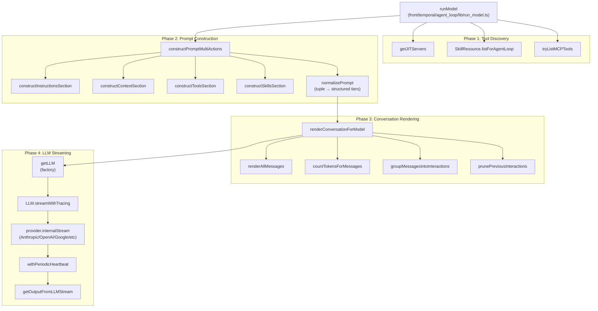

This architecture enables efficient prompt reuse, token budget compliance, and consistent streaming experience across model providers.

**Sources:**  
- [front/temporal/agent_loop/lib/run_model.ts:99-895]()  
- [front/lib/api/assistant/generation.ts:392-529]()  
- [front/lib/api/assistant/conversation_rendering/index.ts:7]()  
- [front/lib/api/llm/llm.ts:143-348]()

---

## Prompt Construction

### Structured System Prompt Design

Dust constructs system prompts with multiple distinct sections organized into tiers that correspond to caching boundaries. This approach optimizes prompt reuse by minimizing injection of high-entropy or user-specific data into sections shared by many users.

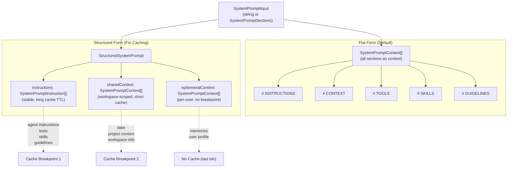

**Key Type Definitions:**

```typescript
interface SystemPromptInstruction {
  role: "instruction";
  content: string;
}

interface SystemPromptContext {
  role: "context";
  content: string;
}

interface StructuredSystemPrompt {
  instructions: SystemPromptInstruction[];      // Long cache tier
  sharedContext: SystemPromptContext[];         // Medium cache tier  
  ephemeralContext: SystemPromptContext[];      // No cache, per-user data
}

type SystemPromptSections = SystemPromptContext[] | StructuredSystemPrompt;
```

This structuring supports separation of stable instructions, workspace-wide context that changes occasionally (e.g., date), and ephemeral per-user context such as memories or profiles.

**Primary functions:**

| Function | Description | Location |
|----------|-------------|----------|
| `constructPromptMultiActions` | Compose all prompt components and returns `SystemPromptSections` | [front/lib/api/assistant/generation.ts:392-529]() |
| `normalizePrompt` | Converts any system prompt input to structured form | [front/lib/api/llm/types/options.ts:65-81]() |
| `systemPromptToText` | Flattens structured prompt to plain string for legacy APIs | [front/lib/api/llm/types/options.ts:84-96]() |
| `buildSystemBlocks` | Converts prompt sections into Anthropic cache blocks | [front/lib/api/llm/clients/anthropic/index.ts:40-64]() |

**Sources:**  
- [front/lib/api/llm/types/options.ts:14-96]()  
- [front/lib/api/assistant/generation.ts:392-529]()

### Prompt Section Builders

The core function `constructPromptMultiActions` builds each section of the prompt through dedicated builder functions:

```mermaid
graph TB
    constructPromptMultiActions["constructPromptMultiActions<br/>(front/lib/api/assistant/generation.ts)"]
    
    subgraph "Section Builders"
        constructInstructionsSection["constructInstructionsSection<br/>(lines 349-382)"]
        constructContextSection["constructContextSection<br/>(lines 51-86)"]
        constructProjectContextSection["constructProjectContextSection<br/>(lines 88-123)"]
        constructToolsSection["constructToolsSection<br/>(lines 125-193)"]
        constructSkillsSection["constructSkillsSection<br/>(lines 218-278)"]
        constructAttachmentsSection["constructAttachmentsSection<br/>(lines 280-293)"]
        constructPastedContentSection["constructPastedContentSection<br/>(lines 295-301)"]
        constructGuidelinesSection["constructGuidelinesSection<br/>(lines 303-347)"]
    end
    
    subgraph "Dynamic Context (Global Agents)"
        buildMemoriesContext["buildMemoriesContext<br/>(for DUST agents)"]
        buildUserContext["buildUserContext<br/>(for SIDEKICK)"]
        buildWorkspaceContext["buildWorkspaceContext<br/>(for SIDEKICK)"]
        buildToolsetsContext["buildToolsetsContext<br/>(for DUST)"]
    end
    
    constructPromptMultiActions --> constructInstructionsSection
    constructPromptMultiActions --> constructContextSection
    constructPromptMultiActions --> constructProjectContextSection
    constructPromptMultiActions --> constructToolsSection
    constructPromptMultiActions --> constructSkillsSection
    constructPromptMultiActions --> constructAttachmentsSection
    constructPromptMultiActions --> constructPastedContentSection
    constructPromptMultiActions --> constructGuidelinesSection
    
    constructPromptMultiActions --> buildMemoriesContext
    constructPromptMultiActions --> buildUserContext
    constructPromptMultiActions --> buildWorkspaceContext
    constructPromptMultiActions --> buildToolsetsContext
```

**Section Contents and Cache Tier:**

| Section | Content Summary | Cache Tier | Location |
|---------|-----------------|------------|----------|
| INSTRUCTIONS | Agent instructions, replaced `{ASSISTANTS_LIST}`, tool use guidance | Instructions tier | [front/lib/api/assistant/generation.ts:349-382]() |
| CONTEXT | Current date (YYYY-MM-DD), workspace name, formatting meta-prompt | Shared context tier | [front/lib/api/assistant/generation.ts:51-86]() |
| PROJECT CONTEXT | Project tool prioritization and file storage instructions | Shared context tier | [front/lib/api/assistant/generation.ts:88-123]() |
| TOOLS | Tool usage directives, reasoning meta-prompts, server tool listings | Instructions tier | [front/lib/api/assistant/generation.ts:125-193]() |
| SKILLS | Enabled skills (full instructions) plus equipped skills (name/description) | Instructions tier | [front/lib/api/assistant/generation.ts:218-278]() |
| ATTACHMENTS | File attachment tags format and includability | Instructions tier | [front/lib/api/assistant/generation.ts:280-293]() |
| PASTED CONTENT | User pasted content guidance and limits | Instructions tier | [front/lib/api/assistant/generation.ts:295-301]() |
| GUIDELINES | Citation rules, LaTeX and markdown meta-prompts | Instructions tier | [front/lib/api/assistant/generation.ts:303-347]() |
| MEMORIES | User memories context (Dust agents only) | Ephemeral context tier | (Defined externally) |
| USER CONTEXT | Job function, platform contexts (Sidekick only) | Ephemeral context tier | (Defined externally) |
| WORKSPACE CONTEXT | Available models, workspace metadata (Sidekick) | Shared context tier | (Defined externally) |

The date uses format `"YYYY-MM-DD (ddd)"` (e.g., "2024-06-20 (Thu)") without time precision to maximize prompt cache hits among users in the same workspace on the same day.

**Sources:**  
- [front/lib/api/assistant/generation.ts:51-382]()  
- [front/lib/api/assistant/global_agents/configurations/dust/dust.ts]()  
- [front/lib/api/assistant/global_agents/sidekick_context.ts]()  

### Cache Tier Assignment and Agent Classification

The prompt construction logic chooses between a fully structured prompt or a flat array of contexts based on agent type:

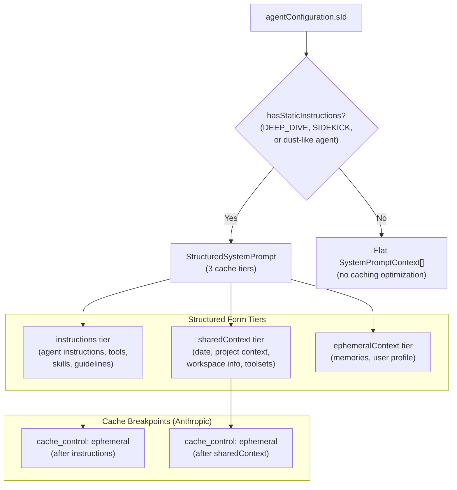

The key predicate:

```typescript
const hasStaticInstructions =
  agentConfiguration.sId === GLOBAL_AGENTS_SID.DEEP_DIVE ||
  agentConfiguration.sId === GLOBAL_AGENTS_SID.SIDEKICK ||
  isDustLikeAgent(agentConfiguration.sId);
```

When true, a three-tier structured prompt is constructed; otherwise, a simple flat context array is used.

**Built structured prompt content example:**

```typescript
const fullInstructions = [
  instructionsContent,
  toolsSection,
  skillsSection,
  attachmentsSection,
  pastedContentSection,
  guidelinesSection,
].filter((s) => s.trim() !== "").join("\n");

const sharedContext: SystemPromptContext[] = [
  { role: "context", content: contextSection },
  { role: "context", content: projectContextSection },
  { role: "context", content: toolsetsContext ?? "" },
  { role: "context", content: workspaceContext ?? "" },
].filter((s) => s.content.trim() !== "");

const ephemeralContext: SystemPromptContext[] = [
  { role: "context", content: memoriesContext ?? "" },
  { role: "context", content: userContext ?? "" },
].filter((s) => s.content.trim() !== "");

const structured: StructuredSystemPrompt = {
  instructions: [{ role: "instruction", content: fullInstructions }],
  sharedContext,
  ephemeralContext,
};
```

**Cache Tier Benefits:**

- **Instructions tier**: Stable, shared across agents/users → long cache TTL  
- **Shared context tier**: Workspace-scoped data for the day → medium cache TTL  
- **Ephemeral context tier**: User-specific, no cache → fresh every time  

**Sources:**  
- [front/lib/api/assistant/generation.ts:435-509]()  
- [front/lib/api/assistant/generation.test.ts:315-395]()

---

## Conversation Rendering and Token Management

### Conversation Rendering Pipeline

The `renderConversationForModel` function converts conversation history into model-compatible messages within token budgets:

```mermaid
graph TB
    renderConversationForModel["renderConversationForModel<br/>(front/lib/api/assistant/conversation_rendering/index.ts)"]
    
    renderAllMessages["renderAllMessages<br/>(lines 133-211)"]
    countTokensForMessages["countTokensForMessages<br/>(lines 307-384)"]
    groupMessagesIntoInteractions["groupMessagesIntoInteractions<br/>(lines 258-305)"]
    
    subgraph "Message Type Rendering"
        renderUserMessage["renderUserMessage<br/>(helpers.ts:249-353)"]
        getSteps["getSteps<br/>(helpers.ts:109-244)"]
        renderAgentSteps["renderAgentSteps<br/>(message_rendering.ts:36-125)"]
        renderOtherAgentMessageAsUserMessage["renderOtherAgentMessageAsUserMessage<br/>(helpers.ts:359-387)"]
        renderContentFragment["renderContentFragment<br/>(helpers.ts:392-407)"]
    end
    
    subgraph "Pruning Strategy"
        progressivelyPruneInteraction["progressivelyPruneInteraction<br/>(pruning.ts:57-108)"]
        prunePreviousInteractions["prunePreviousInteractions<br/>(pruning.ts:115-158)"]
    end
    
    subgraph "Output"
        ModelConversationTypeMultiActions["ModelConversationTypeMultiActions<br/>(messages array)"]
        tokensUsed["tokensUsed: number"]
        prunedContext["prunedContext: boolean"]
    end
    
    renderConversationForModel --> renderAllMessages
    
    renderAllMessages --> renderUserMessage
    renderAllMessages --> getSteps
    renderAllMessages --> renderAgentSteps
    renderAllMessages --> renderOtherAgentMessageAsUserMessage
    renderAllMessages --> renderContentFragment
    
    renderConversationForModel --> countTokensForMessages
    renderConversationForModel --> groupMessagesIntoInteractions
    renderConversationForModel --> progressivelyPruneInteraction
    renderConversationForModel --> prunePreviousInteractions
    
    prunePreviousInteractions --> ModelConversationTypeMultiActions
    prunePreviousInteractions --> tokensUsed
    prunePreviousInteractions --> prunedContext
```

#### User Message Rendering

User messages include contextual metadata such as:

- Sender's fullName, email, and mention replacements
- Conversation ID and message origin (web, slack, teams, triggered)
- Timestamp formatted according to user timezone
- Special instructions for Slack and Teams explaining how mentions appear

Mentions in messages are replaced (e.g., `:mention[label]{sId=...}` → `@label`) for clarity in prompt.

**Sources:**  
- [front/lib/api/assistant/conversation_rendering/helpers.ts:249-353]()  
- [front/lib/mentions/format.ts]()  

#### Agent Message Rendering

Agent messages represent multi-step interactions consisting of:

- Model reasoning and text output
- Tool calls (`function_call` messages) with parameters
- Tool results (`function` messages)
- Reasoning tokens tagged within content fragments

The steps are grouped by `stepIndex` and rendered as sequences of messages suitable for LLM consumption.

When rendering with the `excludeActions` option enabled (used when displaying historical messages for OpenAI), only the last step's text content is included, excluding function calls and tool results to avoid API errors.

**Sources:**  
- [front/lib/api/assistant/conversation_rendering/helpers.ts:109-244]()  
- [front/lib/api/assistant/conversation_rendering/message_rendering.ts:36-125]()  

### Token Counting

The function `countTokensForMessages` estimates token usage for a model's input messages, accounting for:

- Text tokens based on tokenization of message content
- Additional cost for images (fixed 3100 tokens each)
- Reasoning tokens separately marked in reasoning content items
- Tokens from function calls (name and arguments)

Result returned is token count per message plus the total tokens used.

**Sources:**  
- [front/lib/api/assistant/conversation_rendering/index.ts:7]()  
- [front/lib/tokenization.ts:tokenCountForTexts]()  

### Context Pruning Strategy

To stay within LLM context window limits, Dust implements a two-phase pruning approach:

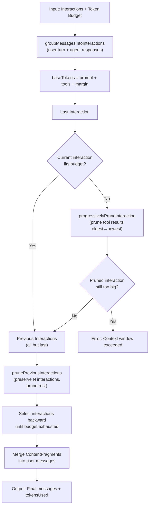

- **Phase 1:** The current (last) user-agent interaction is pruned progressively, replacing individual tool results with a placeholder from oldest to newest until it fits within available tokens.
- **Phase 2:** Previous interactions are pruned more aggressively - only the last N interactions are preserved fully (default N=1). Earlier interactions have tool results replaced with minimal placeholders.
- Final selected interactions are merged and output for the LLM.

Constants used:

```typescript
const PREVIOUS_INTERACTIONS_TO_PRESERVE = 1;
const IMAGE_CONTENT_TOKEN_COUNT = 3100;
const tokensMargin = 1024;
```

This two-phase pruning balances retaining critical recent context with conserving tokens by pruning older data.

**Sources:**  
- [front/lib/api/assistant/conversation_rendering/index.ts:7]()  
- [front/lib/api/assistant/conversation_rendering/pruning.ts:1-55]()  

---

## LLM Client Integration

### LLM Base Class

The abstract `LLM` class encapsulates interaction with model providers, streaming generation with observability, and token usage gathering.

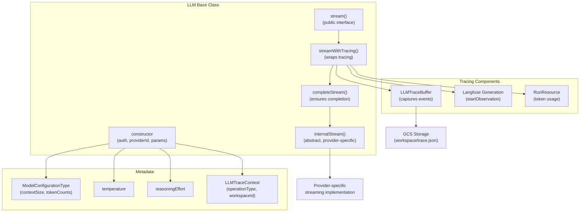

- `stream()` is the public async generator returning LLM events.
- `streamWithTracing()` wraps streaming to provide detailed telemetry and traces (Langfuse, GCS).
- `completeStream()` ensures a terminal success/error event is emitted.
- `internalStream()` is abstract and must be implemented by derived classes for specific providers.

Key metadata like model ID, temperature, reasoning effort, and trace context are initialized in the constructor.

**Sources:**  
- [front/lib/api/llm/llm.ts:61-374]()  

### Provider Implementations

Each LLM provider implements the `internalStream` method according to their API:

| Provider | Implementation Class | Model Examples | Location |
| ----------- | -------------------- | -------------- | -------- |
| Anthropic | `AnthropicLLM` | claude-3.5-sonnet, claude-opus | [front/lib/api/llm/clients/anthropic/index.ts:66-145]() |
| OpenAI Responses | `OpenAIResponsesLLM` | gpt-5, gpt-4-turbo | [front/lib/api/llm/clients/openai/index.ts:28-90]() |
| Google AI Studio | `GoogleLLM` | gemini-2.0-flash, gemini-pro | [front/lib/api/llm/clients/google/index.ts:30-100]() |
| Mistral | `MistralLLM` | mistral-large | [front/lib/api/llm/clients/mistral/index.ts:23-79]() |
| Fireworks | `FireworksLLM` | deepseek-v3.2, kimi-k2 | [front/lib/api/llm/clients/fireworks/index.ts:27-84]() |
| xAI | `XaiLLM` | grok-2 | [front/lib/api/llm/clients/xai/index.ts:25-73]() |

**Anthropic LLM internal workflow:**

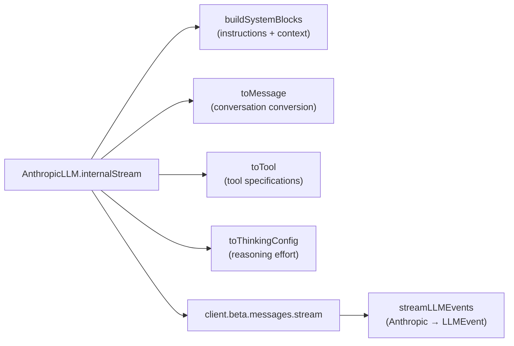

**OpenAI Responses internal workflow:**

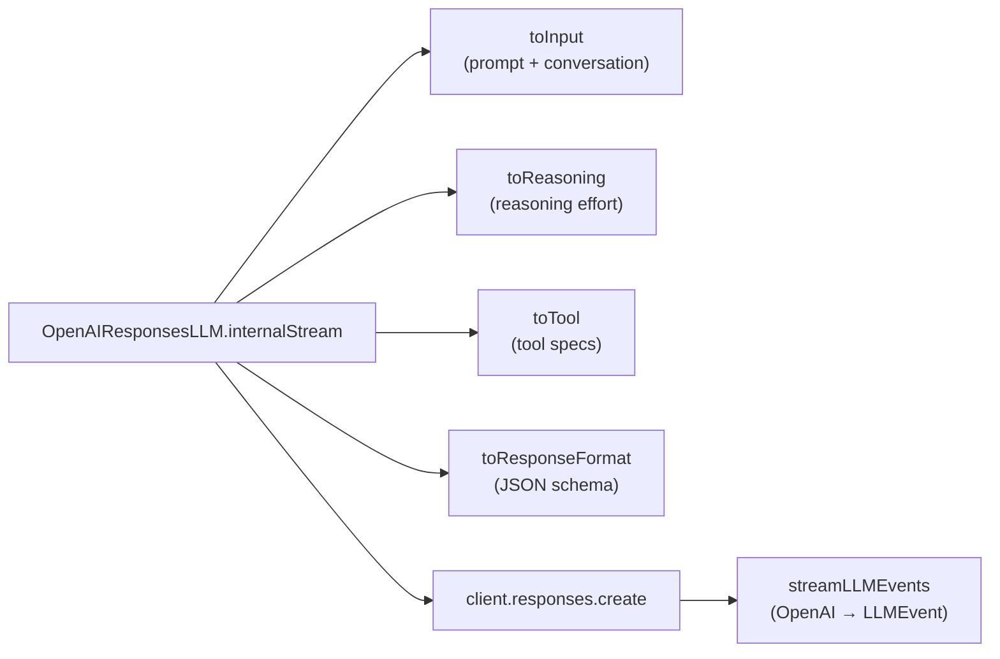

Each provider class bridges Dust-agnostic prompt/message formats to server-specific API calls and streaming event formats.

**Sources:**  
- [front/lib/api/llm/clients/anthropic/index.ts:66-145]()  
- [front/lib/api/llm/clients/openai/index.ts:28-90]()  
- [front/lib/api/llm/clients/google/index.ts:30-100]()  
- [front/lib/api/llm/clients/mistral/index.ts:23-79]()  
- [front/lib/api/llm/clients/fireworks/index.ts:27-84]()  
- [front/lib/api/llm/clients/xai/index.ts:25-73]()  

---

## Streaming and Output Processing

### LLM Event Types and Flow

Dust normalizes LLM output to a common event format that includes incremental tokens, tool calls, token usage, and completion events:

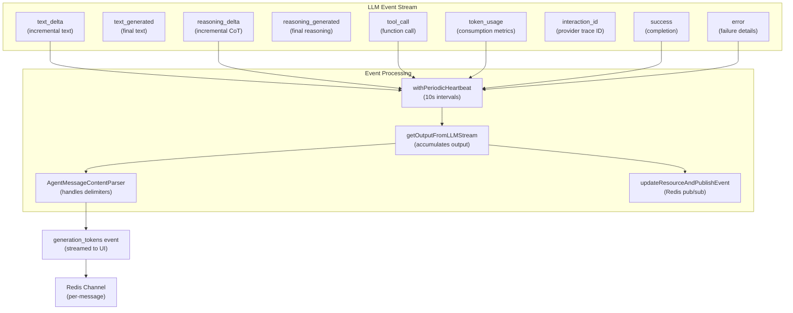

Events convey both text generation deltas and metadata for token usage and function calls, all streamed asynchronously.

**Sources:**  
- [front/lib/api/llm/types/events.ts]()  
- [front/temporal/agent_loop/lib/get_output_from_llm.ts:125-344]()  

### Heartbeat Mechanism

To keep Temporal workflows alive during prolonged model generation, a heartbeat generator wraps the LLM stream:

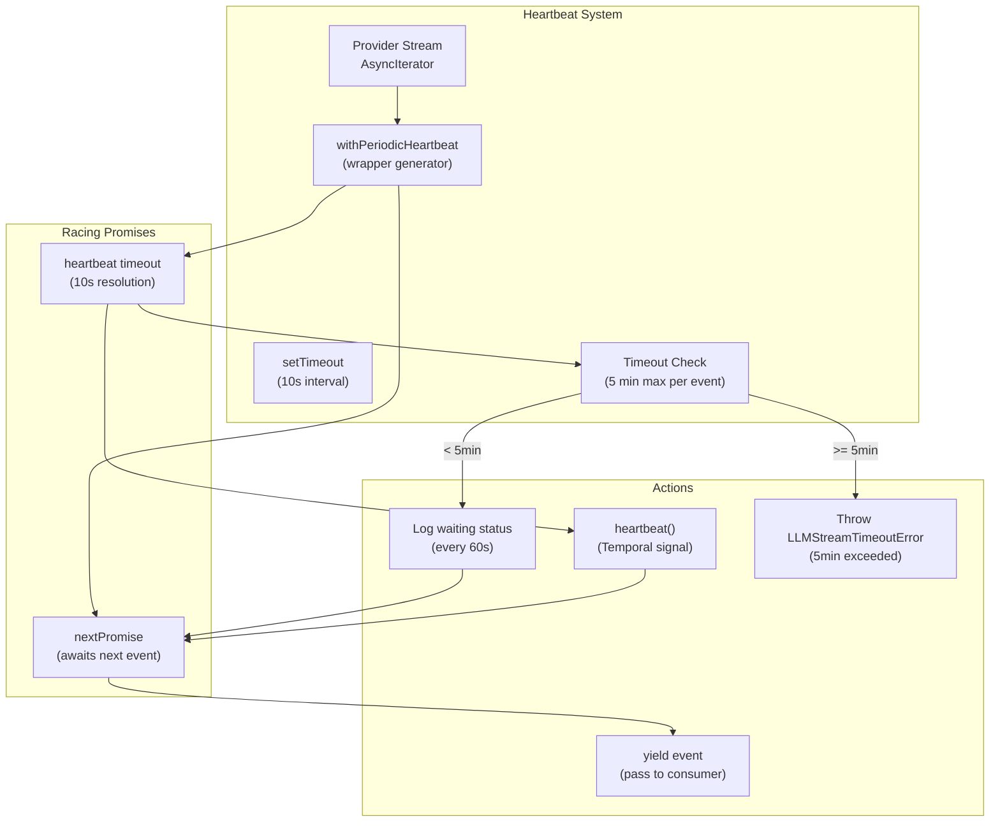

Key constants:

- `LLM_HEARTBEAT_INTERVAL_MS = 10,000` (10 seconds)
- `LLM_EVENT_TIMEOUT_MINUTES = 5`

This mechanism sends periodic heartbeats to Temporal while waiting for LLM output, logging status and failing on excessive timeout without events.

**Sources:**  
- [front/temporal/agent_loop/lib/get_output_from_llm.ts:34-123]()  

### Output Accumulation and Content Parsing

The core streaming output parser `getOutputFromLLMStream` accumulates tokens, reasoning, and tool call content:

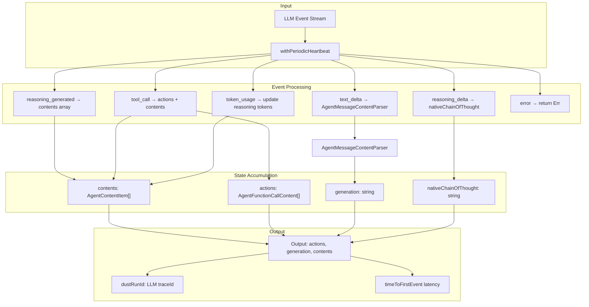

- The `AgentMessageContentParser` processes incremental content tokens with support for custom delimiters.
- Tool calls add to both action list and content array.
- Reasoning deltas are separately tracked to support native chain-of-thought models.
- On error events, streaming aborts returning retryable or terminal errors accordingly.

**Return Type:**

```typescript
type GetOutputResponse = Result<
  {
    output: {
      actions: AgentFunctionCallContentType[];
      generation: string;
      contents: AgentContentItemType[];
    };
    dustRunId: string;
    nativeChainOfThought: string;
    timeToFirstEvent?: number;
  },
  | { type: "shouldRetryMessage"; content: LLMErrorInfo }
  | { type: "shouldReturnNull" }
>;
```

**Sources:**  
- [front/temporal/agent_loop/lib/get_output_from_llm.ts:128-371]()  
- [front/temporal/agent_loop/lib/types.ts:23-85]()  

---

## Supporting Systems

### Observability and Tracing

#### LLMTraceBuffer

The `LLMTraceBuffer` class tracks the full output trace from a generation session, enforcing maximum output size limits (64 KB output bytes):

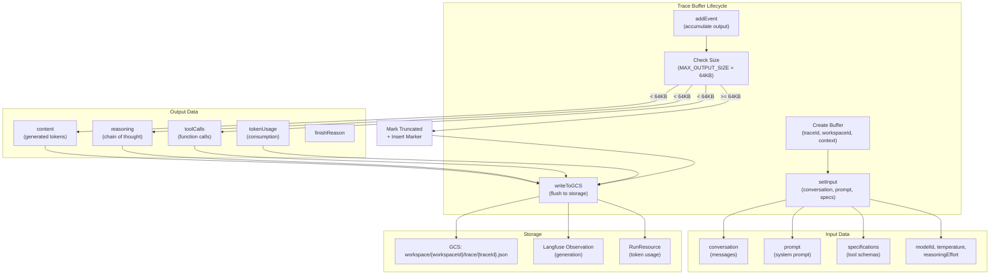

The buffer applies truncation if output data exceeds the limit and writes JSON traces to GCS under the workspace scope. It also updates Langfuse observations and usage resources.

**Sources:**  
- [front/lib/api/llm/traces/buffer.ts:54-330]()  

#### Langfuse Integration

Langfuse observations capture detailed metadata and generation content for downstream analysis:

```mermaid
graph TB
    subgraph "Observation Creation"
        StartObs["startObservation<br/>(llm-completion)"]
        UpdateTrace["updateTrace<br/>(name, input, metadata)"]
        UpdateGeneration["update<br/>(output, usage)"]
        EndObs["end<br/>(finalize)"]
    end
    
    subgraph "Input Data"
        ObsInput["Observation Input<br/>(full conversation + system)"]
        TraceInput["Trace Input<br/>(custom or default)"]
    end
    
    subgraph "Metadata"
        TraceTags["Tags<br/>(isError, errorType)"]
        TraceMetadata["Metadata<br/>(dustTraceId, userId, apiKeyId,<br/>authMethod, context fields)"]
        UserId["userId<br/>(workspaceId for grouping)"]
    end
    
    subgraph "Output Data"
        GenOutput["Generation Output<br/>(content, toolCalls, reasoning)"]
        TraceOutput["Trace Output<br/>(custom or full output)"]
    end
    
    subgraph "Usage Details"
        InputTokens["input<br/>(uncached tokens)"]
        OutputTokens["output"]
        CacheRead["cache_read_input_tokens"]
        CacheCreation["cache_creation_input_tokens"]
        ReasoningTokens["reasoning_tokens"]
    end
    
    StartObs --> ObsInput
    StartObs --> UpdateTrace
    
    UpdateTrace --> TraceInput
    UpdateTrace --> TraceMetadata
    UpdateTrace --> UserId
    
    UpdateGeneration --> GenOutput
    UpdateGeneration --> InputTokens
    UpdateGeneration --> OutputTokens
    UpdateGeneration --> CacheRead
    UpdateGeneration --> CacheCreation
    UpdateGeneration --> ReasoningTokens
    
    TraceOutput --> EndObs
    TraceTags --> EndObs
```

The system records operational metadata, including trace IDs, user/workspace IDs, and model parameters. Output tokens are tracked, including details about cache usage and reasoning tokens.

**Sources:**  
- [front/lib/api/llm/llm.ts:143-348]()  

---

## Error Handling and Retries

### Error Classification and Retry Logic

LLM errors are mapped to categories with associated retry semantics:

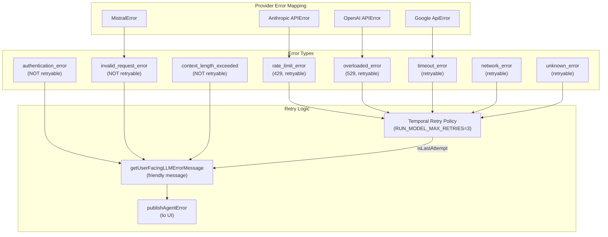

The Temporal workflow retries the model call up to a maximum count (default 3). Non-retryable errors such as authentication or invalid request errors produce user-friendly messages published to the UI.

**Sources:**  
- [front/lib/api/llm/types/errors.ts]()  
- [front/temporal/agent_loop/lib/run_model.ts:594-627]()  
- [front/temporal/agent_loop/config.ts]()  

---

## Tool Call Argument Parsing

### Unicode Corruption Fix for GPT-4o / GPT-5

Tool call arguments are JSON strings. Dust fixes a known GPT streaming bug where certain Unicode escapes are corrupted:

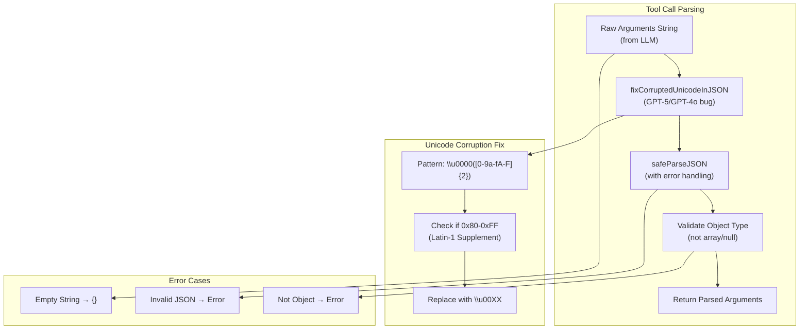

**Fix implementation snippet:**

```typescript
function fixCorruptedUnicodeInJSON(jsonString: string): string {
  return jsonString.replace(/\\u0000([0-9a-fA-F]{2})/g, (_match, hex) => {
    const codePoint = parseInt(hex, 16);
    if (codePoint >= 0x80 && codePoint <= 0xff) {
      return `\\u00${hex}`;
    }
    return _match;
  });
}
```

**Parsing function:**

```typescript
export const parseToolArguments = (
  input: string,
  toolName: string
): Record<string, unknown> => {
  if (input.trim() === "") {
    return {};
  }
  const processedInput = fixCorruptedUnicodeInJSON(input);
  if (processedInput !== input) {
    logger.warn({ toolName }, "Unicode corruption fixed in tool args.");
  }
  const parsed = safeParseJSON(processedInput);
  if (parsed.isErr()) {
    throw new Error(`Parsing error in tool '${toolName}': ${parsed.error}`);
  }
  if (!isObject(parsed.value) || Array.isArray(parsed.value)) {
    throw new Error(`Tool arguments must be JSON object. Tool: '${toolName}'`);
  }
  return parsed.value;
};
```

The fix addresses corrupted Unicode escapes like `\u0000e9` instead of `\u00e9`, seen in GPT-5 streaming.

**Sources:**  
- [front/lib/api/llm/utils/tool_arguments.ts:1-60]()  
- [front/lib/api/llm/utils/tool_arguments.test.ts]()  

---

## Integration with Agent Loop

The full LLM prompt construction and invocation are integrated in the agent loop Temporal workflow:

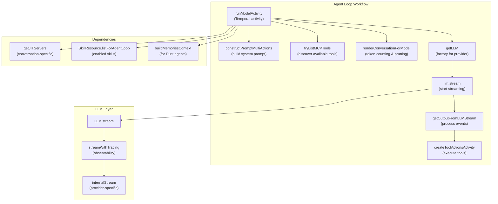

The Temporal activity:

1. Discovers relevant tools (JIT servers and MCP tools)
2. Fetches enabled skills and memories context
3. Constructs the structured system prompt with all sections
4. Renders prior conversation messages and prunes as needed
5. Instantiates the appropriate LLM client via `getLLM`
6. Streams completions with heartbeat and telemetry
7. Accumulates outputs and parses tool calls
8. Triggers tool execution activities if applicable

**Sources:**  
- [front/temporal/agent_loop/lib/run_model.ts:62-790]()  
- [front/lib/api/llm/index.ts]()  

---

# Summary

This page detailed the Dust platform's comprehensive system for constructing rich, tiered prompts; efficiently rendering conversations within token budgets using pruning; integrating multiple LLM providers uniformly; and robustly streaming and parsing LLM generation output to drive agent tool execution. The design emphasizes prompt caching optimization, observability, failover handling, and multi-provider support to enable scalable, extensible AI agents.

# Sources

- front/lib/api/assistant/generation.ts  
- front/lib/api/assistant/generation.test.ts  
- front/lib/api/llm/llm.ts  
- front/lib/api/llm/index.ts  
- front/lib/api/llm/clients/anthropic/index.ts  
- front/lib/api/llm/clients/openai/index.ts  
- front/lib/api/assistant/conversation_rendering/index.ts  
- front/lib/api/assistant/conversation_rendering/message_rendering.ts  
- front/lib/api/assistant/conversation_rendering/helpers.ts  
- front/lib/api/assistant/conversation_rendering/pruning.ts  
- front/temporal/agent_loop/lib/get_output_from_llm.ts  
- front/temporal/agent_loop/lib/run_model.ts  
- front/lib/api/llm/utils/tool_arguments.ts

---

