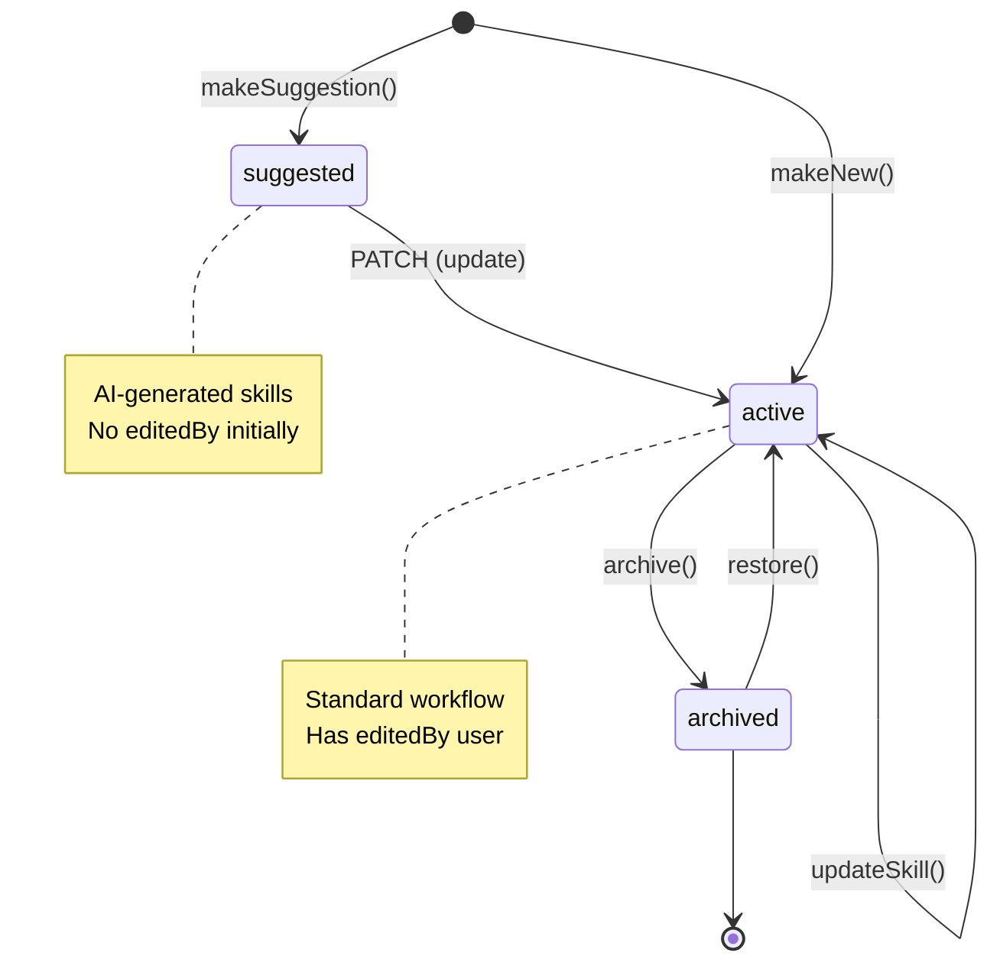
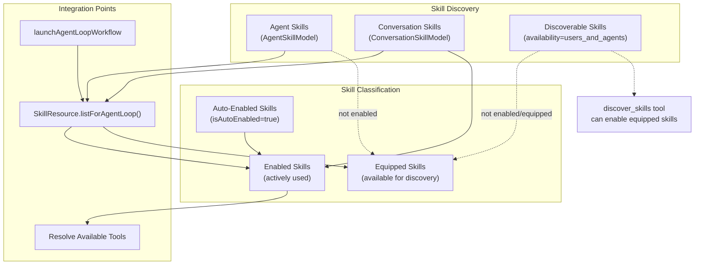
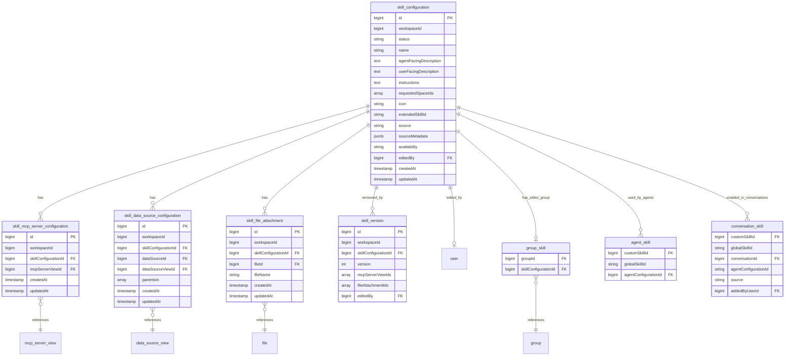
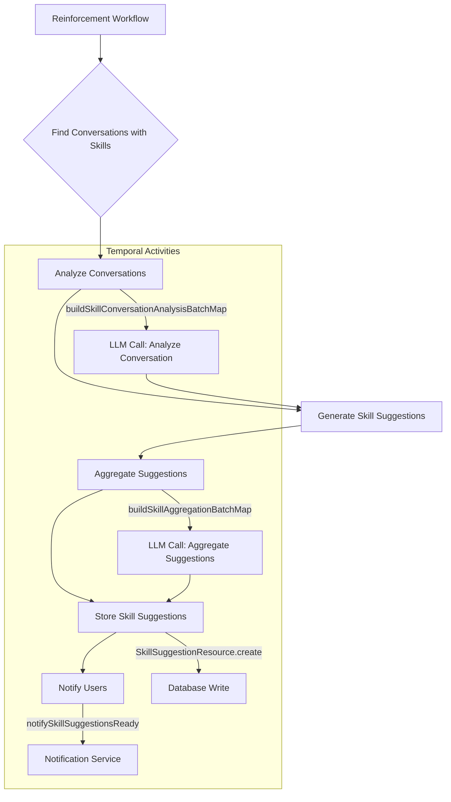
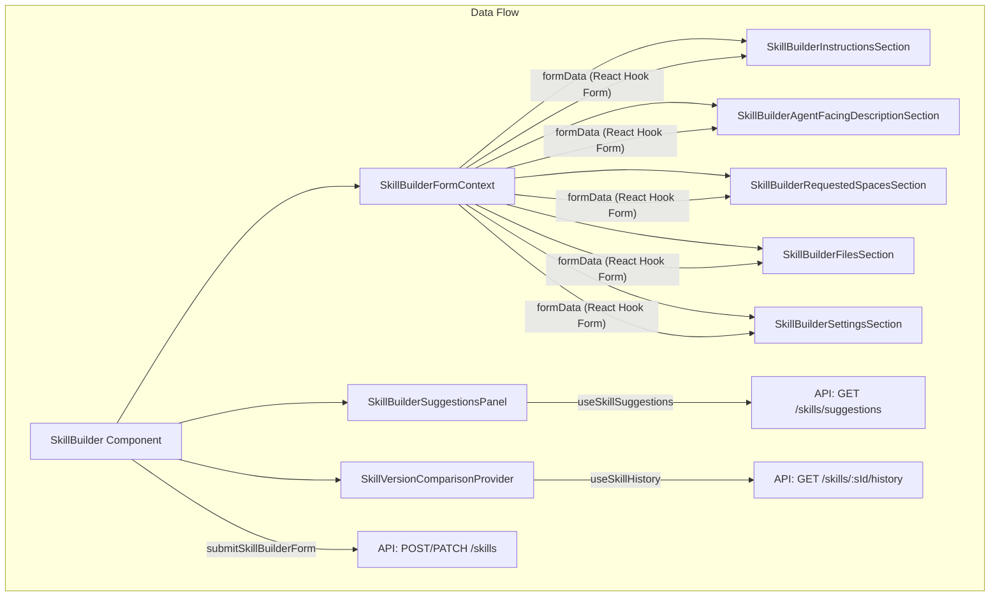

<!-- source: DeepWiki mcp.deepwiki.com · repo dust-tt/dust · page 3.5 Skill System · fetched 2026-10-27 -->

# Skill System

<details>
<summary>Relevant source files</summary>

The following files were used as context for generating this wiki page:

- [front-api/routes/v1/w/[wId]/skills/[skillId].test.ts](front-api/routes/v1/w/[wId]/skills/[skillId].test.ts)
- [front-api/routes/v1/w/[wId]/skills/[skillId].ts](front-api/routes/v1/w/[wId]/skills/[skillId].ts)
- [front-api/routes/v1/w/[wId]/skills/index.test.ts](front-api/routes/v1/w/[wId]/skills/index.test.ts)
- [front-api/routes/v1/w/[wId]/skills/index.ts](front-api/routes/v1/w/[wId]/skills/index.ts)
- [front-api/routes/w/[wId]/skills/[sId]/editors.test.ts](front-api/routes/w/[wId]/skills/[sId]/editors.test.ts)
- [front-api/routes/w/[wId]/skills/[sId]/editors.ts](front-api/routes/w/[wId]/skills/[sId]/editors.ts)
- [front-api/routes/w/[wId]/skills/[sId]/index.test.ts](front-api/routes/w/[wId]/skills/[sId]/index.test.ts)
- [front-api/routes/w/[wId]/skills/[sId]/index.ts](front-api/routes/w/[wId]/skills/[sId]/index.ts)
- [front-api/routes/w/[wId]/skills/[sId]/reinforcement.test.ts](front-api/routes/w/[wId]/skills/[sId]/reinforcement.test.ts)
- [front-api/routes/w/[wId]/skills/[sId]/reinforcement.ts](front-api/routes/w/[wId]/skills/[sId]/reinforcement.ts)
- [front-api/routes/w/[wId]/skills/availability.test.ts](front-api/routes/w/[wId]/skills/availability.test.ts)
- [front-api/routes/w/[wId]/skills/availability.ts](front-api/routes/w/[wId]/skills/availability.ts)
- [front-api/routes/w/[wId]/skills/index.test.ts](front-api/routes/w/[wId]/skills/index.test.ts)
- [front-api/routes/w/[wId]/skills/index.ts](front-api/routes/w/[wId]/skills/index.ts)
- [front-api/routes/w/[wId]/spaces/access-check.test.ts](front-api/routes/w/[wId]/spaces/access-check.test.ts)
- [front-api/routes/w/[wId]/spaces/access-check.ts](front-api/routes/w/[wId]/spaces/access-check.ts)
- [front/admin/audit_log_schemas/skill_import_github_connection.created.json](front/admin/audit_log_schemas/skill_import_github_connection.created.json)
- [front/admin/audit_log_schemas/skill_import_github_connection.deleted.json](front/admin/audit_log_schemas/skill_import_github_connection.deleted.json)
- [front/components/agent_builder/AgentBuilderSectionContainer.tsx](front/components/agent_builder/AgentBuilderSectionContainer.tsx)
- [front/components/agent_builder/AgentBuilderSpacesBlock.tsx](front/components/agent_builder/AgentBuilderSpacesBlock.tsx)
- [front/components/agent_builder/capabilities/capabilities_sheet/SpaceSelectionPage.tsx](front/components/agent_builder/capabilities/capabilities_sheet/SpaceSelectionPage.tsx)
- [front/components/agent_builder/capabilities/knowledge/KnowledgeFooter.tsx](front/components/agent_builder/capabilities/knowledge/KnowledgeFooter.tsx)
- [front/components/assistant/conversation/MessageEmojiPicker.tsx](front/components/assistant/conversation/MessageEmojiPicker.tsx)
- [front/components/assistant/details/tabs/AgentInfoTab/index.tsx](front/components/assistant/details/tabs/AgentInfoTab/index.tsx)
- [front/components/assistant/details/tabs/AgentMemoryTab.tsx](front/components/assistant/details/tabs/AgentMemoryTab.tsx)
- [front/components/pages/builder/skills/CreateSkillPage.tsx](front/components/pages/builder/skills/CreateSkillPage.tsx)
- [front/components/pages/builder/skills/EditSkillPage.tsx](front/components/pages/builder/skills/EditSkillPage.tsx)
- [front/components/pages/builder/skills/utils.ts](front/components/pages/builder/skills/utils.ts)
- [front/components/poke/skill_suggestions/columns.tsx](front/components/poke/skill_suggestions/columns.tsx)
- [front/components/shared/CapabilityDetailsSheets.tsx](front/components/shared/CapabilityDetailsSheets.tsx)
- [front/components/shared/RemoveSpaceDialog.tsx](front/components/shared/RemoveSpaceDialog.tsx)
- [front/components/shared/SpaceChips.tsx](front/components/shared/SpaceChips.tsx)
- [front/components/skill_builder/SkillBuilder.tsx](front/components/skill_builder/SkillBuilder.tsx)
- [front/components/skill_builder/SkillBuilderFormContext.tsx](front/components/skill_builder/SkillBuilderFormContext.tsx)
- [front/components/skill_builder/SkillBuilderRequestedSpacesSection.tsx](front/components/skill_builder/SkillBuilderRequestedSpacesSection.tsx)
- [front/components/skill_builder/SkillBuilderSuggestionsPanel.tsx](front/components/skill_builder/SkillBuilderSuggestionsPanel.tsx)
- [front/components/skill_builder/SkillEditorsAccessWarning.tsx](front/components/skill_builder/SkillEditorsAccessWarning.tsx)
- [front/components/skill_builder/SkillSpaceRestrictionsContext.tsx](front/components/skill_builder/SkillSpaceRestrictionsContext.tsx)
- [front/components/skill_builder/SkillSuggestionCard.tsx](front/components/skill_builder/SkillSuggestionCard.tsx)
- [front/components/skill_builder/skillFormData.ts](front/components/skill_builder/skillFormData.ts)
- [front/components/skill_builder/submitSkillBuilderForm.ts](front/components/skill_builder/submitSkillBuilderForm.ts)
- [front/components/skill_builder/useRemoveSkillSpace.ts](front/components/skill_builder/useRemoveSkillSpace.ts)
- [front/components/skills/SkillDetailsButtonBar.tsx](front/components/skills/SkillDetailsButtonBar.tsx)
- [front/components/skills/SkillDetailsSheet.tsx](front/components/skills/SkillDetailsSheet.tsx)
- [front/components/skills/SkillFavoriteButton.tsx](front/components/skills/SkillFavoriteButton.tsx)
- [front/components/skills/import/ConnectWorkspaceGitHubMessage.tsx](front/components/skills/import/ConnectWorkspaceGitHubMessage.tsx)
- [front/components/skills/import/DetectedSkillsList.tsx](front/components/skills/import/DetectedSkillsList.tsx)
- [front/components/skills/import/GitHubConnectionRow.tsx](front/components/skills/import/GitHubConnectionRow.tsx)
- [front/components/skills/import/ImportFromFilesTab.tsx](front/components/skills/import/ImportFromFilesTab.tsx)
- [front/components/skills/import/ImportFromRepositoryTab.tsx](front/components/skills/import/ImportFromRepositoryTab.tsx)
- [front/components/skills/import/ImportSkillsDialog.tsx](front/components/skills/import/ImportSkillsDialog.tsx)
- [front/components/skills/import/formSchema.ts](front/components/skills/import/formSchema.ts)
- [front/lib/api/actions/servers/skill_authoring/metadata.ts](front/lib/api/actions/servers/skill_authoring/metadata.ts)
- [front/lib/api/actions/servers/skill_authoring/tools/index.test.ts](front/lib/api/actions/servers/skill_authoring/tools/index.test.ts)
- [front/lib/api/actions/servers/skill_authoring/tools/index.ts](front/lib/api/actions/servers/skill_authoring/tools/index.ts)
- [front/lib/api/llm/traces/types.ts](front/lib/api/llm/traces/types.ts)
- [front/lib/api/mcp_server/README.md](front/lib/api/mcp_server/README.md)
- [front/lib/api/mcp_server/server.test.ts](front/lib/api/mcp_server/server.test.ts)
- [front/lib/api/mcp_server/server.ts](front/lib/api/mcp_server/server.ts)
- [front/lib/api/mcp_server/tools/index.ts](front/lib/api/mcp_server/tools/index.ts)
- [front/lib/api/mcp_server/tools/skills/create.ts](front/lib/api/mcp_server/tools/skills/create.ts)
- [front/lib/api/mcp_server/tools/skills/index.ts](front/lib/api/mcp_server/tools/skills/index.ts)
- [front/lib/api/poke/plugins/workspaces/reinforcement_workflow.ts](front/lib/api/poke/plugins/workspaces/reinforcement_workflow.ts)
- [front/lib/api/skills/detection/files/import_skills.ts](front/lib/api/skills/detection/files/import_skills.ts)
- [front/lib/api/skills/detection/github/github_auth.ts](front/lib/api/skills/detection/github/github_auth.ts)
- [front/lib/api/skills/detection/github/import_skills.ts](front/lib/api/skills/detection/github/import_skills.ts)
- [front/lib/api/skills/github_connection.ts](front/lib/api/skills/github_connection.ts)
- [front/lib/editor/instructions_block_conflict.ts](front/lib/editor/instructions_block_conflict.ts)
- [front/lib/models/skill.ts](front/lib/models/skill.ts)
- [front/lib/models/skill/skill_suggestion.ts](front/lib/models/skill/skill_suggestion.ts)
- [front/lib/production_checks/checks/check_active_workflows_for_connectors.ts](front/lib/production_checks/checks/check_active_workflows_for_connectors.ts)
- [front/lib/production_checks/checks/check_active_workflows_for_front.ts](front/lib/production_checks/checks/check_active_workflows_for_front.ts)
- [front/lib/production_checks/checks/check_connectors_last_sync_success.ts](front/lib/production_checks/checks/check_connectors_last_sync_success.ts)
- [front/lib/production_checks/checks/check_data_sources_consistency.ts](front/lib/production_checks/checks/check_data_sources_consistency.ts)
- [front/lib/production_checks/checks/check_ended_backend_only_subscriptions.ts](front/lib/production_checks/checks/check_ended_backend_only_subscriptions.ts)
- [front/lib/production_checks/checks/check_excess_credits.ts](front/lib/production_checks/checks/check_excess_credits.ts)
- [front/lib/production_checks/checks/check_extraneous_workflows_for_paused_connectors.ts](front/lib/production_checks/checks/check_extraneous_workflows_for_paused_connectors.ts)
- [front/lib/reinforcement/aggregate_suggestions.test.ts](front/lib/reinforcement/aggregate_suggestions.test.ts)
- [front/lib/reinforcement/aggregate_suggestions.ts](front/lib/reinforcement/aggregate_suggestions.ts)
- [front/lib/reinforcement/analyze_conversation.test.ts](front/lib/reinforcement/analyze_conversation.test.ts)
- [front/lib/reinforcement/analyze_conversation.ts](front/lib/reinforcement/analyze_conversation.ts)
- [front/lib/reinforcement/billing.ts](front/lib/reinforcement/billing.ts)
- [front/lib/reinforcement/constants.ts](front/lib/reinforcement/constants.ts)
- [front/lib/reinforcement/consumption.test.ts](front/lib/reinforcement/consumption.test.ts)
- [front/lib/reinforcement/consumption.ts](front/lib/reinforcement/consumption.ts)
- [front/lib/reinforcement/format_skill_context.ts](front/lib/reinforcement/format_skill_context.ts)
- [front/lib/reinforcement/run_reinforced_analysis.test.ts](front/lib/reinforcement/run_reinforced_analysis.test.ts)
- [front/lib/reinforcement/run_reinforced_analysis.ts](front/lib/reinforcement/run_reinforced_analysis.ts)
- [front/lib/reinforcement/selection.ts](front/lib/reinforcement/selection.ts)
- [front/lib/reinforcement/skill_instruction_edit_prompt.ts](front/lib/reinforcement/skill_instruction_edit_prompt.ts)
- [front/lib/reinforcement/skill_suggestion_pruning.test.ts](front/lib/reinforcement/skill_suggestion_pruning.test.ts)
- [front/lib/reinforcement/skill_suggestion_pruning.ts](front/lib/reinforcement/skill_suggestion_pruning.ts)
- [front/lib/reinforcement/types.ts](front/lib/reinforcement/types.ts)
- [front/lib/resources/skill/skill_resource.test.ts](front/lib/resources/skill/skill_resource.test.ts)
- [front/lib/resources/skill/skill_resource.ts](front/lib/resources/skill/skill_resource.ts)
- [front/lib/resources/skill_suggestion_resource.test.ts](front/lib/resources/skill_suggestion_resource.test.ts)
- [front/lib/resources/skill_suggestion_resource.ts](front/lib/resources/skill_suggestion_resource.ts)
- [front/lib/skill_detection.ts](front/lib/skill_detection.ts)
- [front/lib/swr/github_connection.ts](front/lib/swr/github_connection.ts)
- [front/lib/swr/skill_configurations.ts](front/lib/swr/skill_configurations.ts)
- [front/migrations/20260828_backfill_skill_manually_requested_spaces.ts](front/migrations/20260828_backfill_skill_manually_requested_spaces.ts)
- [front/scripts/temporal-build/build-temporal-bundles.ts](front/scripts/temporal-build/build-temporal-bundles.ts)
- [front/temporal/production_checks/activities.ts](front/temporal/production_checks/activities.ts)
- [front/temporal/reinforcement/activities.ts](front/temporal/reinforcement/activities.ts)
- [front/temporal/reinforcement/admin/cli.ts](front/temporal/reinforcement/admin/cli.ts)
- [front/temporal/reinforcement/client.ts](front/temporal/reinforcement/client.ts)
- [front/temporal/reinforcement/config.ts](front/temporal/reinforcement/config.ts)
- [front/temporal/reinforcement/worker.ts](front/temporal/reinforcement/worker.ts)
- [front/temporal/reinforcement/workflows.ts](front/temporal/reinforcement/workflows.ts)
- [front/temporal/worker_registry.ts](front/temporal/worker_registry.ts)
- [front/tests/reinforcement-evals/lib/assertions.ts](front/tests/reinforcement-evals/lib/assertions.ts)
- [front/tests/reinforcement-evals/lib/judge.ts](front/tests/reinforcement-evals/lib/judge.ts)
- [front/tests/reinforcement-evals/lib/reinforcement-executor.ts](front/tests/reinforcement-evals/lib/reinforcement-executor.ts)
- [front/tests/reinforcement-evals/lib/types.ts](front/tests/reinforcement-evals/lib/types.ts)
- [front/tests/reinforcement-evals/reinforcement-eval.test.ts](front/tests/reinforcement-evals/reinforcement-eval.test.ts)
- [front/tests/reinforcement-evals/test-suites/aggregate-suggestions.ts](front/tests/reinforcement-evals/test-suites/aggregate-suggestions.ts)
- [front/tests/reinforcement-evals/test-suites/analyze-conversation.ts](front/tests/reinforcement-evals/test-suites/analyze-conversation.ts)
- [front/tests/utils/SkillFactory.ts](front/tests/utils/SkillFactory.ts)
- [front/tests/utils/SkillSuggestionFactory.ts](front/tests/utils/SkillSuggestionFactory.ts)
- [front/types/assistant/skill_configuration.ts](front/types/assistant/skill_configuration.ts)
- [front/types/production_checks.ts](front/types/production_checks.ts)
- [front/types/suggestions/skill_suggestion.ts](front/types/suggestions/skill_suggestion.ts)
- [sparkle/src/components/ConversationMessage.tsx](sparkle/src/components/ConversationMessage.tsx)
- [sparkle/src/components/DataTableLoadingSkeleton.tsx](sparkle/src/components/DataTableLoadingSkeleton.tsx)
- [sparkle/src/components/IconButton.tsx](sparkle/src/components/IconButton.tsx)
- [sparkle/src/components/Notification.tsx](sparkle/src/components/Notification.tsx)
- [sparkle/src/components/PuzzleSpinner.tsx](sparkle/src/components/PuzzleSpinner.tsx)
- [sparkle/src/components/SplitButton.tsx](sparkle/src/components/SplitButton.tsx)
- [sparkle/src/stories/DataTableLoadingSkeleton.stories.tsx](sparkle/src/stories/DataTableLoadingSkeleton.stories.tsx)
- [sparkle/src/stories/Notification.stories.tsx](sparkle/src/stories/Notification.stories.tsx)
- [sparkle/src/stories/PuzzleSpinner.stories.tsx](sparkle/src/stories/PuzzleSpinner.stories.tsx)
- [sparkle/src/styles/sparkle-theme.css](sparkle/src/styles/sparkle-theme.css)

</details>


## Overview

The Skill System provides a mechanism for packaging reusable capabilities that agents can leverage. A skill bundles together four types of components: instructions (agent-facing guidance), MCP server references (pre-configured tools), attached knowledge (data source views), and file attachments (sandbox resources). This system enables both workspace-specific customization through custom skills and platform-wide capabilities through global skills.

For information about MCP tool execution, see [MCP Tool System](#4). For agent configuration and workflow execution, see [Agent System](#3).

**Sources:** [front/lib/resources/skill/skill_resource.ts:145-187]()

---

## Skill Types

### Custom Skills

Custom skills are database-backed, user-created capabilities specific to a workspace. They persist in the `skill_configuration` table and can be created, edited, and archived by users with appropriate permissions. Each custom skill has an associated editor group that controls write access.

**Sources:** [front/lib/resources/skill/skill_resource.ts:88-105](), [front/lib/models/skill.ts:93-114]()

### Global Skills

Global skills are code-defined capabilities maintained in `GlobalSkillsRegistry`. They do not persist in the database and instead use synthetic fields (e.g., `id: -1`) internally. Global skills are available across all workspaces and can be either auto-enabled (baseline discovery capabilities) or extendable (allowing workspace-specific customization).

**Key characteristics:**
- Identified by `globalSId` field presence
- No database persistence
- Defined in code registry
- Cannot be modified directly (only extended)
- May be auto-enabled for all agents

**Sources:** [front/lib/resources/skill/skill_resource.ts:145-187](), [front/lib/resources/skill/skill_resource.ts:197-221]()

### Skill Extension

Custom skills can extend global skills through the `extendedSkillId` field. This allows workspaces to customize global capabilities while maintaining a reference to the base skill. Only non-auto-enabled global skills are extendable.

```typescript
// Checking if a skill is extendable
get isExtendable(): boolean {
  return this.globalSId !== null && !this.isAutoEnabled;
}
```

**Sources:** [front/lib/resources/skill/skill_resource.ts:320-323](), [front-api/routes/w/[wId]/skills/index.ts:268-281]()

---

## Skill Architecture

```mermaid
graph TB
    subgraph "Skill Resource Layer"
        SkillResource["SkillResource<br/>(Unified API)"]
        CustomPath["Custom Skills<br/>(Database-backed)"]
        GlobalPath["Global Skills<br/>(Code-defined)"]
    end
    
    subgraph "Skill Components"
        Instructions["instructions<br/>(Markdown text)"]
        MCPConfigs["mcpServerConfigurations<br/>(SkillMCPServerConfiguration[])"]
        DataSourceConfigs["dataSourceConfigurations<br/>(SkillDataSourceConfigurationModel[])"]
        FileAttachments["fileAttachments<br/>(FileResource[])"]
    end
    
    subgraph "Database Models"
        SkillConfigurationModel["SkillConfigurationModel<br/>(skill_configuration)"]
        SkillMCPServerConfigurationModel["SkillMCPServerConfigurationModel<br/>(skill_mcp_server_configuration)"]
        SkillDataSourceConfigurationModel["SkillDataSourceConfigurationModel<br/>(skill_data_source_configuration)"]
        SkillFileAttachmentModel["SkillFileAttachmentModel<br/>(skill_file_attachment)"]
        SkillVersionModel["SkillVersionModel<br/>(skill_version)"]
    end
    
    subgraph "Permission System"
        RequestedSpaceIds["requestedSpaceIds<br/>(ModelId[])"]
        EditorGroup["editorGroup<br/>(GroupResource)"]
        GroupSkillModel["GroupSkillModel<br/>(group_skill)"]
    end
    
    subgraph "External References"
        MCPServerViewResource["MCPServerViewResource"]
        DataSourceViewResource["DataSourceViewResource"]
        FileResource["FileResource"]
    end
    
    SkillResource --> CustomPath
    SkillResource --> GlobalPath
    
    CustomPath --> SkillConfigurationModel
    CustomPath --> EditorGroup
    
    SkillResource --> Instructions
    SkillResource --> MCPConfigs
    SkillResource --> DataSourceConfigs
    SkillResource --> FileAttachments
    
    SkillConfigurationModel --> SkillMCPServerConfigurationModel
    SkillConfigurationModel --> SkillDataSourceConfigurationModel
    SkillConfigurationModel --> SkillFileAttachmentModel
    SkillConfigurationModel --> SkillVersionModel
    
    MCPConfigs --> MCPServerViewResource
    DataSourceConfigs --> DataSourceViewResource
    FileAttachments --> FileResource
    
    EditorGroup --> GroupSkillModel
    
    SkillConfigurationModel --> RequestedSpaceIds
    MCPServerViewResource -.->|contributes to| RequestedSpaceIds
    DataSourceViewResource -.->|contributes to| RequestedSpaceIds
```



**Diagram: Skill System Architecture**

This diagram illustrates the unified `SkillResource` abstraction that handles both custom and global skills. Custom skills persist through `SkillConfigurationModel` and related join tables, while global skills exist only in code. All skills expose the same four component types through the resource interface.

**Sources:** [front/lib/resources/skill/skill_resource.ts:142-221](), [front/lib/models/skill.ts:93-114]()

---

## Skill Components

### Instructions

Instructions are markdown-formatted text providing agent-facing guidance on how to use the skill. The instructions field supports rich content through a custom editor and can reference attached knowledge items inline.

**Storage:** `skill_configuration.instructions` (TEXT, nullable)

**Sources:** [front/lib/models/skill.ts:44-46]()

### MCP Server References (Tools)

Skills reference MCP server views through the `SkillMCPServerConfigurationModel` join table. Each reference represents a pre-configured tool that becomes available when the skill is enabled.

**Data structure:**
```typescript
type SkillMCPServerConfiguration = {
  view: MCPServerViewResource;
  childAgentId?: string;
  serverNameOverride?: string;
};
```

**Database mapping:**
- Table: `skill_mcp_server_configuration`
- Foreign keys: `skillConfigurationId`, `mcpServerViewId`

**Sources:** [front/lib/resources/skill/skill_resource.ts:120-124](), [front/lib/models/skill.ts:209-271]()

### Attached Knowledge

Skills can attach knowledge from data sources through `SkillDataSourceConfigurationModel`. Each configuration specifies:
- `dataSourceViewId`: Reference to the data source view
- `parentsIn`: Array of node IDs (folders/documents) to include

**Interface:**
```typescript
interface SkillAttachedKnowledge {
  dataSourceView: DataSourceViewResource;
  nodeId: string;
}
```

Knowledge attachments automatically create "skill servers" (dynamic MCP servers) that expose search/query tools over the attached data.

**Sources:** [front/lib/resources/skill/skill_resource.ts:134-137](), [front/lib/resources/skill/skill_resource.ts:246-279](), [front/lib/models/skill.ts:360-444]()

### File Attachments

Skills can attach files for sandbox synchronization. Files must have `useCase: "skill_attachment"` and be in `ready` status. This feature is gated behind the `sandbox_tools` feature flag.

**Database model:**
- Table: `skill_file_attachment`
- Fields: `skillConfigurationId`, `fileId`, `fileName`

**Sources:** [front/lib/models/skill.ts:272-349](), [front-api/routes/w/[wId]/skills/index.ts:284-325]()

---

## Skill States and Lifecycle

### Status Enum

| Status | Description | Behavior |
|--------|-------------|----------|
| `active` | Skill is available for use | Returned in standard queries, can be enabled |
| `archived` | Skill is soft-deleted | Hidden from default queries, cannot be used |
| `suggested` | AI-generated skill awaiting approval | Requires explicit activation before use |

**Sources:** [front/types/assistant/skill_configuration.ts:5](), [front/lib/models/skill.ts:28-31]()

### Lifecycle Operations



**Diagram: Skill Lifecycle State Machine**

**Key lifecycle methods:**
- `SkillResource.makeNew()`: Creates active skill with current user as editor [front/lib/resources/skill/skill_resource.ts:325-401]()
- `SkillResource.makeSuggestion()`: Creates suggested skill without editor [front/lib/resources/skill/skill_resource.ts:403-439]()
- `updateSkill()`: Updates skill and creates version entry [front/lib/resources/skill/skill_resource.ts:1399-1475]()
- `archive()`: Sets status to 'archived' [front/lib/resources/skill/skill_resource.ts:1274-1317]()
- `restore()`: Sets status back to 'active' [front/lib/resources/skill/skill_resource.ts:1319-1361]()

**Sources:** [front/lib/resources/skill/skill_resource.ts:325-401](), [front/lib/resources/skill/skill_resource.ts:403-439](), [front/lib/resources/skill/skill_resource.ts:1274-1361](), [front/lib/resources/skill/skill_resource.ts:1399-1475]()

### Versioning

Each skill update creates an entry in `skill_version` table, capturing:
- All skill configuration fields at that point in time
- `mcpServerViewIds`: Snapshot of attached tools
- `fileAttachmentIds`: Snapshot of attached files
- `version`: Incrementing integer
- `editedBy`: User who made the change

**Sources:** [front/lib/models/skill.ts:140-187](), [front/lib/resources/skill/skill_resource.ts:1399-1475]()

---

## Permission System

### Requested Space IDs

The `requestedSpaceIds` field is the source of truth for space access requirements. It is computed from:

1. **MCP server view space requirements:** Space IDs required by each referenced MCP server
2. **Attached knowledge space IDs:** Space containing each data source view

```typescript
static async computeRequestedSpaceIds(
  auth: Authenticator,
  {
    mcpServerViews,
    attachedKnowledge,
  }: {
    mcpServerViews: MCPServerViewResource[];
    attachedKnowledge: SkillAttachedKnowledge[];
  }
): Promise<ModelId[]>
```

**Filtering logic:**
- Skills are filtered during `baseFetch()` to only return those where the user has read access to all `requestedSpaceIds` [front/lib/resources/skill/skill_resource.ts:509-531]()
- Uses `createResourcePermissionsFromSpacesWithMap()` to construct permission object
- User must be member of groups that have access to the required spaces

**Sources:** [front/lib/resources/skill/skill_resource.ts:285-310](), [front/lib/resources/skill/skill_resource.ts:509-531]()

### Editor Groups

Each custom skill has an associated editor group of kind `skill_editors`. The group membership determines write access.

**Group creation:**
- Automatically created in `makeNew()` with format: `"[Skill] {name} (skill:{id})"` [front/lib/resources/skill/skill_resource.ts:359-360]()
- Creating user is automatically added as member (unless `addCurrentUserAsEditor: false`) [front/lib/resources/skill/skill_resource.ts:361-363]()
- Linked through `GroupSkillModel` join table [front/lib/models/skill/group_skill.ts]()

**Permission checks:**
```typescript
canWrite(auth: Authenticator): boolean {
  return this.editorGroup?.hasMember(auth) ?? false;
}
```

**Sources:** [front/lib/resources/skill/skill_resource.ts:441-485](), [front/lib/models/skill/group_skill.ts]()

---

## Agent Integration



**Diagram: Skill Integration with Agent Loop**

**Sources:** [front/lib/resources/skill/skill_resource.ts:1071-1144]()

### Enabled Skills

Enabled skills are actively used during agent execution. They contribute their tools, knowledge, and instructions to the agent's context.

**Sources:**
1. **Auto-enabled global skills:** Present in agent configuration and `isAutoEnabled = true` [front/lib/resources/skill/skill_resource.ts:1104-1119]()
2. **Conversation-enabled skills:** Added via `ConversationSkillModel` with `source: "conversation"` [front/lib/models/skill/conversation_skill.ts]()

**Database model for conversation skills:**
```typescript
type ConversationSkillCreationAttributes =
  CreationAttributes<ConversationSkillModel> &
    (
      | {
          source: "conversation";
          agentConfigurationId: null;
        }
      | {
          source: "agent_enabled";
          agentConfigurationId: string;
        }
    );
```

**Sources:** [front/lib/resources/skill/skill_resource.ts:1104-1119](), [front/lib/models/skill/conversation_skill.ts]()

### Equipped Skills

Equipped skills are available for discovery but not actively used. They include:
1. **Agent skills not already enabled:** Skills linked via `AgentSkillModel` but not in enabled set [front/lib/resources/skill/skill_resource.ts:1121-1138]()
2. **Discoverable skills:** Custom skills with `availability: "users_and_agents"` or non-auto-enabled global skills [front/lib/resources/skill/skill_resource.ts:1121-1138]()

Equipped skills become available when the agent has the `discover_skills` global skill enabled.

**Sources:** [front/lib/resources/skill/skill_resource.ts:1121-1138]()

### Auto-Enabled Skills

Auto-enabled skills are global skills that are automatically treated as enabled when present in an agent's configuration. They represent baseline discovery capabilities and are not meant to be extended.

**Identification:**
```typescript
get isAutoEnabled(): boolean {
  if (!this.globalSId) return false;
  return GlobalSkillsRegistry.isSkillAutoEnabled(this.sId);
}
```

**Sources:** [front/lib/resources/skill/skill_resource.ts:312-318]()

### Discoverable Skills

Skills marked as discoverable (`availability: "users_and_agents"` for custom skills, or non-auto-enabled global skills) appear in the `discover_skills` tool output and can be dynamically enabled during conversations.

**Query method:**
```typescript
static async listDiscoverable(auth: Authenticator): Promise<SkillResource[]> {
  return this.baseFetch(auth, {
    where: {
      status: "active",
      availability: "users_and_agents",
    },
  });
}
```

**Sources:** [front/lib/resources/skill/skill_resource.ts:938-946]()

---

## Data Model



**Diagram: Skill System Database Schema**

**Key constraints:**
- Skills are workspace-scoped (all tables have `workspaceId`)
- Unique constraint: `(workspaceId, name, status)` on `skill_configuration`
- Unique constraint: `(workspaceId, skillConfigurationId, dataSourceViewId)` on data source configs
- Unique constraint: `(workspaceId, fileId)` on file attachments
- Either `customSkillId` OR `globalSkillId` must be set (not both) in skill reference tables

**Sources:** [front/lib/models/skill.ts:93-444](), [front/lib/models/agent/agent_skill.ts](), [front/lib/models/skill/conversation_skill.ts](), [front/lib/models/skill/group_skill.ts]()

---

## Resource Layer

The `SkillResource` class provides a unified abstraction for both custom and global skills. It implements the resource pattern with specialized fetch methods and lifecycle operations.

### Unified Fetch API

| Method | Description | Custom | Global |
|--------|-------------|---------|--------|
| `fetchById(auth, sId)` | Fetch by string ID | ✓ | ✓ |
| `fetchByIds(auth, sIds[])` | Batch fetch | ✓ | ✓ |
| `fetchByModelIdWithAuth(auth, id)` | Fetch by numeric ID | ✓ | ✗ |
| `fetchActiveByName(auth, name)` | Fetch by name | ✓ | ✓ |
| `listByWorkspace(auth, options)` | List all skills | ✓ | ✓ |
| `listByAgentConfiguration(auth, agent)` | Agent's skills | ✓ | ✓ |
| `listEnabledByConversation(auth, conv)` | Conversation skills | ✓ | ✓ |
| `listForAgentLoop(auth, data)` | Loop integration | ✓ | ✓ |
| `listDiscoverable(auth)` | Default skills | ✓ | ✓ |

### Query Options

The `baseFetch()` method supports a special `onlyCustom` flag:

```typescript
type SkillConfigurationFindOptions = {
  where?: WhereOptions<SkillConfigurationModel>;
  includes?: Includeable[];
  onlyCustom?: boolean;  // If true, exclude global skills
  limit?: number;
};
```

**Constraint:** Complex Sequelize operators (e.g., `Op.in`, `Op.like`) require `onlyCustom: true` because global skills cannot be queried with database operators.

**Sources:** [front/lib/resources/skill/skill_resource.ts:487-687](), [front/lib/resources/skill/types.ts]()

### Mutation Operations

| Operation | Method | Status Transition | Creates Version |
|-----------|--------|-------------------|----------------|
| Create | `makeNew()` | → active | No (initial) |
| Suggest | `makeSuggestion()` | → suggested | No |
| Update | `updateSkill()` | (unchanged) | Yes |
| Activate | `updateSkill({status: "active"})` | suggested → active | Yes |
| Archive | `archive()` | → archived | Yes |
| Restore | `restore()` | archived → active | Yes |

**Global skill protection:** All mutation methods check for `globalSId` presence and reject operations on global skills.

**Sources:** [front/lib/resources/skill/skill_resource.ts:1274-1361](), [front/lib/resources/skill/skill_resource.ts:1399-1475]()

### Permission Helpers

```typescript
// Check write access
canWrite(auth: Authenticator): boolean {
  if (this.globalSId) return false;  // Global skills not writable
  return this.editorGroup?.hasMember(auth) ?? false;
}

// List editors
async listEditors(auth: Authenticator): Promise<UserResource[] | null> {
  if (!this.editorGroup) return null;
  return this.editorGroup.members();
}
```

**Sources:** [front/lib/resources/skill/skill_resource.ts:1554-1575]()

---

## API Endpoints

### GET /api/w/[wId]/skills

**Query parameters:**
- `status`: Filter by status (`active`, `archived`, `suggested`)
- `withRelations`: Include usage and editor information
- `globalSpaceOnly`: Restrict to skills using only global space
- `availability`: Filter by availability (`editors`, `workspace_users`, `users_and_agents`)

**Response types:**
```typescript
type GetSkillsResponseBody = {
  skills: SkillType[];
};

type GetSkillsWithRelationsResponseBody = {
  skills: SkillWithRelationsType[];
};
```

**Sources:** [front-api/routes/w/[wId]/skills/index.ts:121-174]()

### POST /api/w/[wId]/skills

**Request body:**
```typescript
{
  name: string;
  agentFacingDescription: string;
  userFacingDescription: string;
  instructions: string;
  icon: string | null;
  tools: Array<{ mcpServerViewId: string }>;
  attachedKnowledge: Array<{
    dataSourceViewId: string;
    nodeId: string;
    spaceId: string;
    title: string;
  }>;
  fileAttachments?: Array<{ fileId: string }>;
  availability?: SkillAvailability; // Replaces isDefault
  reinforcement?: SkillReinforcementMode;
  source?: "github" | "web_app" | "local_file";
  sourceMetadata?: { repoUrl: string; filePath: string } | null;
}
```

**Validation:**
1. Workspace must have builder role
2. Name must be unique among active skills
3. All MCP server view IDs must exist and be accessible
4. All data source view IDs must exist and be accessible
5. File attachments require `sandbox_tools` feature flag
6. Extended skill must be extendable global skill

**Response:** `PostSkillResponseBody` with created skill

**Sources:** [front-api/routes/w/[wId]/skills/index.ts:50-88]()

### GET /api/w/[wId]/skills/[sId]

**Query parameters:**
- `withRelations`: Include usage and editor information

**Response:** `GetSkillResponseBody` or `GetSkillWithRelationsResponseBody`

**Sources:** [front-api/routes/w/[wId]/skills/[sId]/index.ts:109-177]()

### PATCH /api/w/[wId]/skills/[sId]

**Request body:** Same structure as POST (excluding creator-only fields)

**Behavior:**
- Requires write access (editor group membership)
- Automatically activates suggested skills on first save
- Recomputes `requestedSpaceIds` from tools and knowledge
- Creates version entry via `updateSkill()`
- Validates name uniqueness (excluding current skill)

**Sources:** [front-api/routes/w/[wId]/skills/[sId]/index.ts:180-331]()

### DELETE /api/w/[wId]/skills/[sId]

**Authorization:** Requires write access

**Behavior:** Soft-deletes by setting `status: "archived"`

**Response:** `{ success: boolean }`

**Sources:** [front-api/routes/w/[wId]/skills/[sId]/index.ts:333-358]()

### PATCH /api/w/[wId]/skills/[sId]/editors

**Request body:**
```typescript
{
  addEditorIds: string[];     // User sIds to add
  removeEditorIds: string[];  // User sIds to remove
}
```

**Behavior:** Updates editor group membership through `GroupResource.addMembers()` and `GroupResource.removeMembers()`

**Sources:** [front-api/routes/w/[wId]/skills/[sId]/editors/index.ts](), [front/components/skill_builder/submitSkillBuilderForm.ts:70-116]()

---

## Usage Tracking

Skills track their usage through two join tables:

1. **Agent usage:** `AgentSkillModel` links skills to agent configurations
2. **Conversation usage:** `ConversationSkillModel` tracks JIT enablement

**Usage aggregation:**
```typescript
async fetchUsage(auth: Authenticator): Promise<AgentsUsageType> {
  // Queries both agent_skill and conversation_skill tables
  // Returns: { count: number, agents: LightAgentConfigurationType[] }
}
```

The usage information includes:
- Total count of agents using the skill
- List of agent configurations (sorted by name)
- Message counts per agent (from conversation_skill)

**Sources:** [front/lib/resources/skill/skill_resource.ts:1529-1552](), [front/lib/models/agent/agent_skill.ts](), [front/lib/models/skill/conversation_skill.ts]()

---

## Reinforcement Learning

The skill system incorporates reinforcement learning capabilities to automatically suggest improvements to skills. This process involves analyzing conversations where skills are used, identifying potential edits, and aggregating these into suggestions.

### Reinforcement Modes

Skills can be configured with different reinforcement modes:
- `auto`: Automatically suggests improvements.
- `on`: Reinforcement is enabled, but requires manual triggering or approval.
- `off`: Reinforcement is disabled.

**Sources:** [front/types/assistant/skill_configuration.ts:12-13]()

### Reinforcement Workflow

The reinforcement process is orchestrated by Temporal workflows and activities:



**Diagram: Reinforcement Learning Workflow**

1.  **`findConversationsWithSkills`**: Selects conversations for analysis based on criteria like skill usage and recency. [front/lib/reinforcement/selection.ts]()
2.  **`analyzeConversation`**: For each selected conversation, an LLM is used to analyze the skill's performance and suggest improvements. This involves:
    *   `buildSkillAnalysisSystemPrompt`: Constructs the system prompt for the LLM. [front/lib/reinforcement/analyze_conversation.ts:48-50]()
    *   `buildSkillConversationAnalysisBatchMap`: Prepares batch LLM calls for conversation analysis. [front/lib/reinforcement/analyze_conversation.ts:52-54]()
    *   The LLM uses tools like `edit_skill` and `reject_suggestion` to propose changes or reject bad suggestions. [front/lib/reinforcement/run_reinforced_analysis.ts:97-114]()
3.  **`aggregateSuggestions`**: Multiple suggestions for the same skill are aggregated into a single, refined suggestion.
    *   `buildSkillAggregationSystemPrompt`: Constructs the system prompt for the LLM. [front/lib/reinforcement/aggregate_suggestions.ts:39-41]()
    *   `buildSkillAggregationBatchMap`: Prepares batch LLM calls for suggestion aggregation. [front/lib/reinforcement/aggregate_suggestions.ts:43-45]()
4.  **`storeTerminalToolCallResults`**: The aggregated suggestions are stored as `SkillSuggestionResource` objects. [front/lib/reinforcement/tool_execution.ts:75-100]()
5.  **`notifySkillSuggestionsReady`**: Users are notified when new suggestions are available. [front/lib/notifications/workflows/skill-suggestions-ready.ts]()

**Sources:** [front/temporal/reinforcement/workflows.ts](), [front/temporal/reinforcement/activities.ts:39-48](), [front/lib/reinforcement/run_reinforced_analysis.ts:97-114]()

### Skill Suggestion Resource

`SkillSuggestionResource` represents an AI-generated suggestion for improving a skill.

**Key fields:**
- `skillId`: The skill being suggested for improvement.
- `sourceSuggestionIds`: IDs of the individual suggestions that were aggregated.
- `status`: `pending`, `applied`, `rejected`.
- `suggestedInstructions`: Proposed new instructions.
- `suggestedAgentFacingDescription`: Proposed new agent-facing description.

**Sources:** [front/lib/resources/skill_suggestion_resource.ts:1-100](), [front/types/suggestions/skill_suggestion.ts:1-30]()

---

## Skill Authoring Tools

The platform provides tools to facilitate skill creation and management.

### Skill Builder UI

The `SkillBuilder` component provides a comprehensive interface for creating and editing skills.



**Diagram: Skill Builder UI Architecture**

**Key features:**
-   **Form Management**: Uses `react-hook-form` with `zodResolver` for validation. [front/components/skill_builder/SkillBuilder.tsx:118-126]()
-   **Sections**: Organizes skill configuration into logical sections:
    *   `SkillBuilderInstructionsSection`: For editing skill instructions.
    *   `SkillBuilderAgentFacingDescriptionSection`: For editing agent-facing description.
    *   `SkillBuilderRequestedSpacesSection`: For managing space access.
    *   `SkillBuilderFilesSection`: For attaching files.
    *   `SkillBuilderSettingsSection`: For general skill settings.
-   **Suggestions Panel**: Displays AI-generated skill suggestions (`SkillBuilderSuggestionsPanel`). [front/components/skill_builder/SkillBuilderSuggestionsPanel.tsx]()
-   **Versioning**: `SkillVersionComparisonProvider` and `SkillVersionHistoryPicker` allow viewing and comparing different versions of a skill. [front/components/skill_builder/SkillBuilderVersionComparisonBanner.tsx](), [front/components/skill_builder/SkillBuilderVersionContext.tsx]()
-   **Submission**: `submitSkillBuilderForm` handles API calls for creating or updating skills. [front/components/skill_builder/submitSkillBuilderForm.ts]()

**Sources:** [front/components/skill_builder/SkillBuilder.tsx:1-62](), [front/components/skill_builder/SkillBuilderFormContext.tsx](), [front/components/skill_builder/submitSkillBuilderForm.ts]()

### Skill Detection and Import

The system supports detecting and importing skills from various sources, such as GitHub repositories or local files.

**Process:**
1.  **Detection**: `detectSkillsFromZip` analyzes uploaded ZIP files to identify potential skills. [front/lib/api/skills/detection/zip/detect_skills.ts]()
2.  **Validation**: `validateSkillsForImport` checks for conflicts with existing skills and ensures validity. [front/lib/api/skills/detection/validate_skills.ts]()
3.  **Import**: `importSkillsFromFiles` handles the creation or update of `SkillResource` objects, including uploading attachments and suggesting MCP servers. [front/lib/api/skills/detection/files/import_skills.ts:60-69]()

**Conflict Strategies**: When importing, conflicts with existing skills can be handled by `error`, `skip`, or `override`. [front/lib/api/skills/detection/files/import_skills.ts:31-33]()

**Sources:** [front/lib/api/skills/detection/files/import_skills.ts:1-28](), [front/lib/api/skills/detection/zip/detect_skills.ts](), [front/lib/api/skills/detection/validate_skills.ts]()

---

**Sources:** [front/lib/resources/skill/skill_resource.ts:1-1714](), [front/lib/models/skill.ts:1-444](), [front-api/routes/w/[wId]/skills/index.ts:1-392](), [front-api/routes/w/[wId]/skills/[sId]/index.ts:1-373](), [front/types/assistant/skill_configuration.ts:1-55](), [front/temporal/reinforcement/workflows.ts](), [front/temporal/reinforcement/activities.ts:39-48](), [front/lib/reinforcement/run_reinforced_analysis.ts:97-114](), [front/lib/reinforcement/selection.ts](), [front/lib/reinforcement/analyze_conversation.ts:48-54](), [front/lib/reinforcement/aggregate_suggestions.ts:39-45](), [front/lib/notifications/workflows/skill-suggestions-ready.ts](), [front/lib/resources/skill_suggestion_resource.ts:1-100](), [front/types/suggestions/skill_suggestion.ts:1-30](), [front/components/skill_builder/SkillBuilder.tsx:1-62](), [front/components/skill_builder/SkillBuilderFormContext.tsx](), [front/components/skill_builder/submitSkillBuilderForm.ts](), [front/components/skill_builder/SkillBuilderSuggestionsPanel.tsx](), [front/components/skill_builder/SkillBuilderVersionComparisonBanner.tsx](), [front/components/skill_builder/SkillBuilderVersionContext.tsx](), [front/lib/api/skills/detection/files/import_skills.ts:1-28](), [front/lib/api/skills/detection/zip/detect_skills.ts](), [front/lib/api/skills/detection/validate_skills.ts]()

---

