<!-- source: DeepWiki mcp.deepwiki.com · repo dust-tt/dust · page 3.6 Trigger System · fetched 2026-10-27 -->

# Trigger System

<details>
<summary>Relevant source files</summary>

The following files were used as context for generating this wiki page:

- [front-api/routes/debug/index.ts](front-api/routes/debug/index.ts)
- [front-api/routes/debug/profiler.ts](front-api/routes/debug/profiler.ts)
- [front-api/routes/email/index.ts](front-api/routes/email/index.ts)
- [front-api/routes/email/validate-action.test.ts](front-api/routes/email/validate-action.test.ts)
- [front-api/routes/email/validate-action.ts](front-api/routes/email/validate-action.ts)
- [front-api/routes/email/webhook.test.ts](front-api/routes/email/webhook.test.ts)
- [front-api/routes/email/webhook.ts](front-api/routes/email/webhook.ts)
- [front-api/routes/enrichment/company.ts](front-api/routes/enrichment/company.ts)
- [front-api/routes/enrichment/index.ts](front-api/routes/enrichment/index.ts)
- [front-api/routes/metronome/index.ts](front-api/routes/metronome/index.ts)
- [front-api/routes/stripe/index.ts](front-api/routes/stripe/index.ts)
- [front-api/routes/stripe/webhook.ts](front-api/routes/stripe/webhook.ts)
- [front-api/routes/templates/[tId]/index.ts](front-api/routes/templates/[tId]/index.ts)
- [front-api/routes/templates/index.ts](front-api/routes/templates/index.ts)
- [front-api/routes/w/[wId]/assistant/agent_configurations/[aId]/triggers/index.test.ts](front-api/routes/w/[wId]/assistant/agent_configurations/[aId]/triggers/index.test.ts)
- [front-api/routes/w/[wId]/assistant/agent_configurations/[aId]/triggers/index.ts](front-api/routes/w/[wId]/assistant/agent_configurations/[aId]/triggers/index.ts)
- [front-api/routes/w/[wId]/me/analytics/automations/triggers/index.test.ts](front-api/routes/w/[wId]/me/analytics/automations/triggers/index.test.ts)
- [front-api/routes/w/[wId]/me/index.ts](front-api/routes/w/[wId]/me/index.ts)
- [front-api/routes/w/[wId]/me/triggers.ts](front-api/routes/w/[wId]/me/triggers.ts)
- [front/components/agent_builder/AgentBuilderFormContext.tsx](front/components/agent_builder/AgentBuilderFormContext.tsx)
- [front/components/agent_builder/submitAgentBuilderForm.ts](front/components/agent_builder/submitAgentBuilderForm.ts)
- [front/components/agent_builder/triggers/AgentBuilderTriggersBlock.tsx](front/components/agent_builder/triggers/AgentBuilderTriggersBlock.tsx)
- [front/components/agent_builder/triggers/TriggerPodSelector.tsx](front/components/agent_builder/triggers/TriggerPodSelector.tsx)
- [front/components/agent_builder/triggers/schedule/ScheduleEditionSheet.tsx](front/components/agent_builder/triggers/schedule/ScheduleEditionSheet.tsx)
- [front/components/agent_builder/triggers/schedule/scheduleEditionFormSchema.ts](front/components/agent_builder/triggers/schedule/scheduleEditionFormSchema.ts)
- [front/components/agent_builder/triggers/webhook/WebhookEditionSheet.tsx](front/components/agent_builder/triggers/webhook/WebhookEditionSheet.tsx)
- [front/components/agent_builder/triggers/webhook/webhookEditionFormSchema.ts](front/components/agent_builder/triggers/webhook/webhookEditionFormSchema.ts)
- [front/components/me/UserAutomationsDialog.tsx](front/components/me/UserAutomationsDialog.tsx)
- [front/components/me/UserAutomationsTable.tsx](front/components/me/UserAutomationsTable.tsx)
- [front/components/me/UserToolsDialog.tsx](front/components/me/UserToolsDialog.tsx)
- [front/components/triggers/TriggerStatusChip.tsx](front/components/triggers/TriggerStatusChip.tsx)
- [front/components/workspace/analytics/automations/AutomationsFilterOptionIcon.tsx](front/components/workspace/analytics/automations/AutomationsFilterOptionIcon.tsx)
- [front/components/workspace/analytics/automations/AutomationsFilterPanel.tsx](front/components/workspace/analytics/automations/AutomationsFilterPanel.tsx)
- [front/components/workspace/analytics/automations/AutomationsFilterSummary.tsx](front/components/workspace/analytics/automations/AutomationsFilterSummary.tsx)
- [front/components/workspace/analytics/automations/AutomationsTriggerBreakdown.test.tsx](front/components/workspace/analytics/automations/AutomationsTriggerBreakdown.test.tsx)
- [front/components/workspace/analytics/automations/AutomationsTriggerBreakdown.tsx](front/components/workspace/analytics/automations/AutomationsTriggerBreakdown.tsx)
- [front/components/workspace/analytics/automations/AutomationsTriggersRowsTable.tsx](front/components/workspace/analytics/automations/AutomationsTriggersRowsTable.tsx)
- [front/components/workspace/analytics/automations/AutomationsTriggersTable.tsx](front/components/workspace/analytics/automations/AutomationsTriggersTable.tsx)
- [front/components/workspace/analytics/automations/automationsTriggerColumns.tsx](front/components/workspace/analytics/automations/automationsTriggerColumns.tsx)
- [front/components/workspace/analytics/automationsFilter.test.ts](front/components/workspace/analytics/automationsFilter.test.ts)
- [front/components/workspace/analytics/automationsFilter.ts](front/components/workspace/analytics/automationsFilter.ts)
- [front/hooks/useAutomationsTriggers.ts](front/hooks/useAutomationsTriggers.ts)
- [front/hooks/useUserAutomationsTriggers.ts](front/hooks/useUserAutomationsTriggers.ts)
- [front/lib/api/analytics/automations/schema.ts](front/lib/api/analytics/automations/schema.ts)
- [front/lib/api/analytics/automations/triggers.test.ts](front/lib/api/analytics/automations/triggers.test.ts)
- [front/lib/api/analytics/automations/triggers.ts](front/lib/api/analytics/automations/triggers.ts)
- [front/lib/api/analytics/automations/user_triggers.test.ts](front/lib/api/analytics/automations/user_triggers.test.ts)
- [front/lib/api/analytics/automations/user_triggers.ts](front/lib/api/analytics/automations/user_triggers.ts)
- [front/lib/api/assistant/email/email_reply.test.ts](front/lib/api/assistant/email/email_reply.test.ts)
- [front/lib/api/assistant/email/email_reply.ts](front/lib/api/assistant/email/email_reply.ts)
- [front/lib/api/assistant/email/email_trigger.test.ts](front/lib/api/assistant/email/email_trigger.test.ts)
- [front/lib/api/assistant/email/email_trigger.ts](front/lib/api/assistant/email/email_trigger.ts)
- [front/lib/api/assistant/email/header_parsing.test.ts](front/lib/api/assistant/email/header_parsing.test.ts)
- [front/lib/api/assistant/email/header_parsing.ts](front/lib/api/assistant/email/header_parsing.ts)
- [front/lib/api/assistant/email/inbound_auth.test.ts](front/lib/api/assistant/email/inbound_auth.test.ts)
- [front/lib/api/assistant/email/inbound_auth.ts](front/lib/api/assistant/email/inbound_auth.ts)
- [front/lib/api/assistant/email/webhook_helpers.ts](front/lib/api/assistant/email/webhook_helpers.ts)
- [front/lib/api/assistant/participants.ts](front/lib/api/assistant/participants.ts)
- [front/lib/api/poke/plugins/triggers/webhook_settings.ts](front/lib/api/poke/plugins/triggers/webhook_settings.ts)
- [front/lib/api/poke/plugins/workspaces/soft_delete_conversation.ts](front/lib/api/poke/plugins/workspaces/soft_delete_conversation.ts)
- [front/lib/iam/users.ts](front/lib/iam/users.ts)
- [front/lib/models/agent/triggers/triggers.ts](front/lib/models/agent/triggers/triggers.ts)
- [front/lib/resources/storage/models/wakeup.ts](front/lib/resources/storage/models/wakeup.ts)
- [front/lib/resources/trigger_resource.test.ts](front/lib/resources/trigger_resource.test.ts)
- [front/lib/resources/trigger_resource.ts](front/lib/resources/trigger_resource.ts)
- [front/lib/resources/wakeup_resource.ts](front/lib/resources/wakeup_resource.ts)
- [front/lib/swr/agent_triggers.ts](front/lib/swr/agent_triggers.ts)
- [front/lib/swr/wakeups.ts](front/lib/swr/wakeups.ts)
- [front/lib/workspace_usage.ts](front/lib/workspace_usage.ts)
- [front/migrations/pre-deploy/20260708120858_index_wake_ups_on_agent_configuration_id.sql](front/migrations/pre-deploy/20260708120858_index_wake_ups_on_agent_configuration_id.sql)
- [front/scripts/merge_mapped_identities.ts](front/scripts/merge_mapped_identities.ts)
- [front/scripts/sync_scim_custom_attributes.ts](front/scripts/sync_scim_custom_attributes.ts)
- [front/temporal/agent_loop/activities/mentions.ts](front/temporal/agent_loop/activities/mentions.ts)
- [front/temporal/agent_loop/activities/notification.ts](front/temporal/agent_loop/activities/notification.ts)
- [front/temporal/agent_loop/activities/snapshot_skills.ts](front/temporal/agent_loop/activities/snapshot_skills.ts)
- [front/temporal/triggers/activities.test.ts](front/temporal/triggers/activities.test.ts)
- [front/temporal/triggers/activities.ts](front/temporal/triggers/activities.ts)
- [front/temporal/triggers/schedule_client.ts](front/temporal/triggers/schedule_client.ts)
- [front/temporal/triggers/wakeup_client.ts](front/temporal/triggers/wakeup_client.ts)
- [front/temporal/triggers/workflows.ts](front/temporal/triggers/workflows.ts)
- [front/tests/utils/TriggerFactory.ts](front/tests/utils/TriggerFactory.ts)
- [front/tests/utils/WakeUpFactory.ts](front/tests/utils/WakeUpFactory.ts)
- [front/types/assistant/triggers.ts](front/types/assistant/triggers.ts)
- [front/types/assistant/wakeups.ts](front/types/assistant/wakeups.ts)
- [x/spolu/wakeup/plan.md](x/spolu/wakeup/plan.md)
- [x/spolu/wakeup/wakeup.md](x/spolu/wakeup/wakeup.md)

</details>


## Purpose and Scope

The Trigger System enables agents to execute automatically based on external events or schedules, rather than requiring manual invocation. This system provides two trigger types: **Schedule Triggers** (cron-based recurring execution) and **Webhook Triggers** (event-driven execution from external systems). The system includes AI-assisted configuration, permission management (editor/subscriber model), and lifecycle controls (enable/disable/delete). It also covers the **Wakeup System** for agent-scheduled one-shot or recurring tasks, and **Email Triggers** for agent interaction via email.

For information about agent execution after trigger activation, see [Agent Execution and Temporal Workflows](). For the Agent Builder interface where triggers are configured, see [Agent Builder Interface]().

---

## Trigger Types and Data Model

The trigger system uses a discriminated union type to represent two distinct trigger kinds:

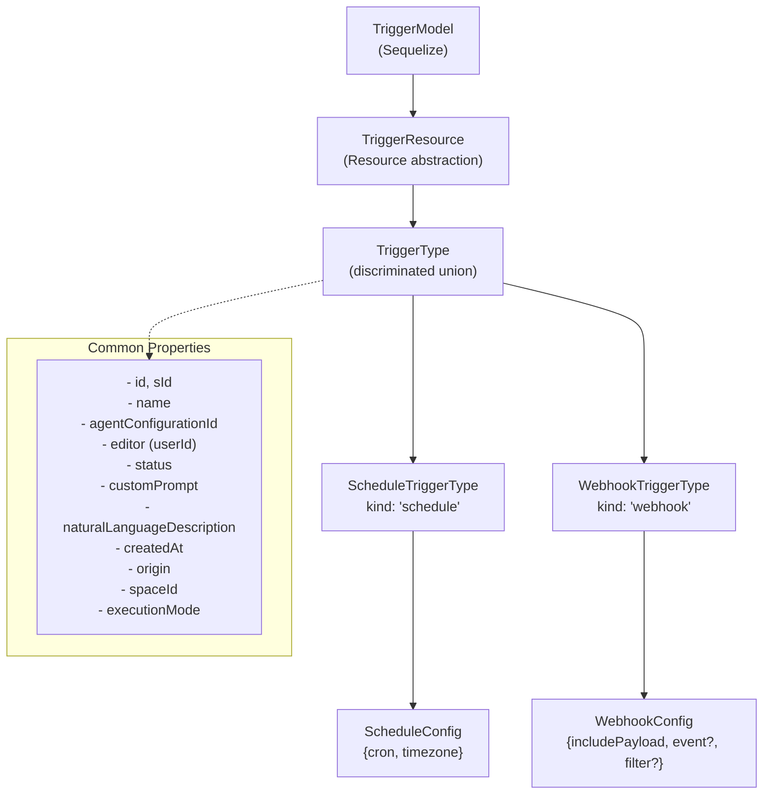

**Sources**: [front/types/assistant/triggers.ts:139-192](), [front/lib/resources/trigger_resource.ts:108-132]()

### Core Type Definitions

| Type | Description | Key Fields |
|------|-------------|------------|
| `ScheduleTriggerType` | Cron-based recurring trigger | `configuration: {cron, timezone}` |
| `WebhookTriggerType` | Event-driven webhook trigger | `configuration: {includePayload, event?, filter?}`, `webhookSourceViewId`, `executionPerDayLimitOverride`, `executionMode` |
| `TriggerStatus` | Lifecycle state | `"enabled" \| "disabled" \| "disabled_by_manager" \| "relocating" \| "downgraded"` |
| `TriggerOrigin` | Creation source | `"user" \| "agent" \| "system"` |
| `TriggerExecutionMode` | Billing pool for execution | `"user_pool" \| "workspace_pool"` |

**Sources**: [front/types/assistant/triggers.ts:4-120]()

---

## Trigger Lifecycle and Status Management

### Status States

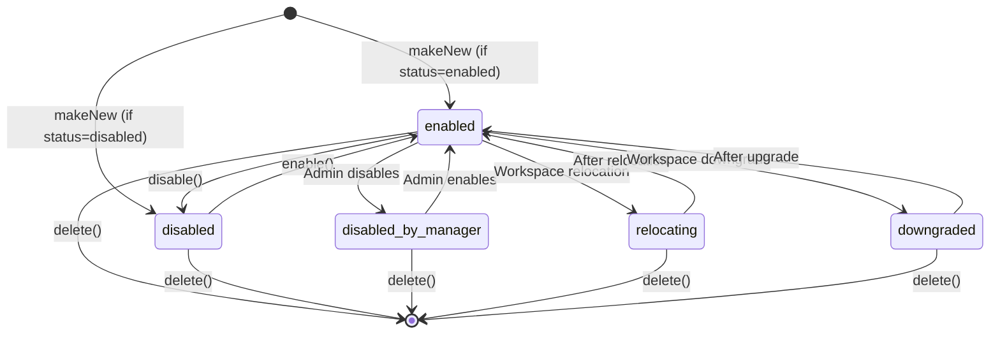

The `getTriggerStatusOwner` function determines who can change a trigger's status: `editor`, `admin`, or `system`. [front/types/assistant/triggers.ts:102-120]()

**Sources**: [front/lib/resources/trigger_resource.ts:622-704](), [front/types/assistant/triggers.ts:85-120]()

### Temporal Workflow Integration

For **schedule triggers**, status changes trigger Temporal workflow operations:

| Status Transition | Temporal Action | Method |
|-------------------|----------------|---------|
| `disabled` → `enabled` | Create/update schedule | `createOrUpdateAgentSchedule()` |
| `enabled` → `disabled` | Delete schedule | `deleteTriggerSchedule()` |
| Update while enabled | Update schedule | `createOrUpdateAgentSchedule()` |

The `upsertTemporalWorkflow` and `removeTemporalWorkflow` methods on `TriggerResource` handle these interactions with the Temporal client. [front/lib/resources/trigger_resource.ts:592-620]()

**Sources**: [front/lib/resources/trigger_resource.ts:592-620](), [front/temporal/triggers/schedule_client.ts:1-25]()

### Bulk Operations for Workspace Management

The `TriggerResource` provides bulk operations for workspace lifecycle events:

```typescript
// Disable all triggers (e.g., during workspace relocation)
TriggerResource.disableAllForWorkspace(auth, targetStatus: "relocating" | "downgraded")

// Re-enable triggers after workspace events
TriggerResource.enableAllForWorkspace(auth, fromStatus: "relocating" | "downgraded")

// Delete all triggers (e.g., workspace deletion)
TriggerResource.deleteAllForWorkspace(auth)
```

These operations filter triggers by status and ensure only active agents are re-enabled.

**Sources**: [front/lib/resources/trigger_resource.ts:457-590]()

---

## Schedule Triggers

### Configuration and Cron Expression

Schedule triggers execute agents on a recurring schedule defined by a cron expression. The configuration includes:

```typescript
type CronScheduleConfig = {
  type?: "cron"; // optional for backward compat with existing DB records
  cron: string;        // Standard cron expression
  timezone: string;    // IANA timezone (e.g., "America/New_York")
};

type IntervalScheduleConfig = {
  type: "interval";
  intervalDays: number; // e.g. 14 for bi-weekly, 3 for every 3 days
  dayOfWeek: number | null; // 0-6 (0=Sunday), null for pure day intervals
  hour: number; // 0-23
  minute: number; // 0-59
  timezone: string;
};

type ScheduleConfig = CronScheduleConfig | IntervalScheduleConfig;
```

**Sources**: [front/types/assistant/triggers.ts:4-20]()

### AI-Assisted Cron Generation

The system provides natural language to cron conversion using the `/text_as_cron_rule` API:

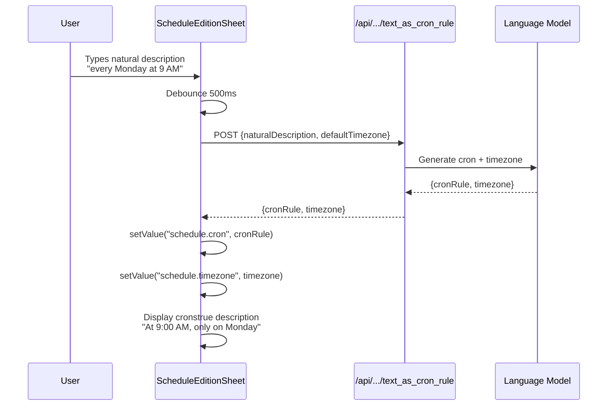

**Sources**: [front/components/agent_builder/triggers/schedule/ScheduleEditionSheet.tsx:1-140](), [front/lib/swr/agent_triggers.ts:17-37](), [front-api/routes/w/[wId]/assistant/agent_configurations/text_as_cron_rule.ts]()

### Temporal Schedule Workflow

When a schedule trigger is enabled, the system creates a Temporal schedule:

```typescript
// front/temporal/triggers/schedule_client.ts
createOrUpdateAgentSchedule({
  auth,
  trigger: TriggerResource
})
```

The schedule workflow:
1. Creates a Temporal schedule with the cron expression.
2. Executes `runTriggeredAgentsActivity` at scheduled times. [front/temporal/triggers/workflows.ts:1-83]()
3. Passes `customPrompt` as the initial message to the agent.
4. Runs in the agent's configured timezone.

**Sources**: [front/lib/resources/trigger_resource.ts:592-604](), [front/temporal/triggers/schedule_client.ts:18-25](), [front/temporal/triggers/activities.ts:177-187]()

### Form Schema

```typescript
const ScheduleFormSchema = z.object({
  name: z.string().min(1).max(255),
  status: triggerStatusSchema.default("enabled"),
  naturalLanguageDescription: z.string().optional(),
  customPrompt: z.string(),
  cron: z.string().min(1, "Cron expression is required"),
  timezone: z.string().min(1, "Timezone is required"),
});
```

**Sources**: [front/components/agent_builder/triggers/schedule/ScheduleEditionSheet.tsx:20-26]()

---

## Webhook Triggers

### Configuration and Webhook Sources

Webhook triggers respond to external events from webhook sources. Each trigger must be associated with a `WebhookSourcesViewModel`:

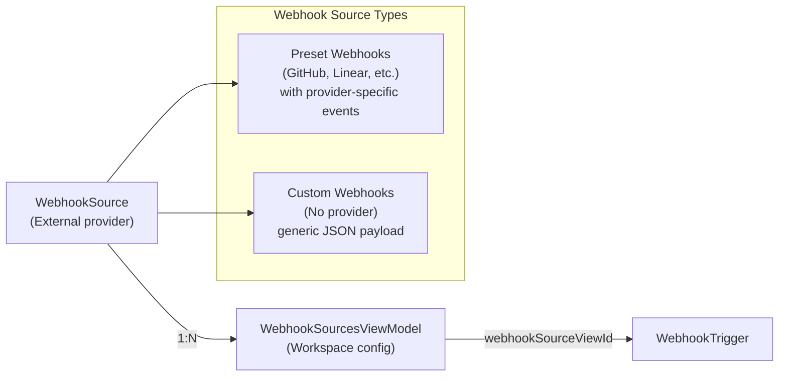

**Sources**: [front/lib/resources/trigger_resource.ts:345-377](), [front/lib/models/agent/triggers/webhook_sources_view.ts]()

### Webhook Configuration Structure

```typescript
type WebhookConfig = {
  includePayload: boolean;  // Pass webhook JSON to agent
  event?: string;           // Preset provider event type
  filter?: string;          // Matcher expression for filtering
};

export type WebhookTriggerType = TriggerType & {
  kind: "webhook";
  webhookSourceViewId: string;
  executionPerDayLimitOverride: number | null;
};
```

**Sources**: [front/types/assistant/triggers.ts:60-64](), [front/types/assistant/triggers.ts:206-210]()

### Event Filtering System

Webhook triggers support filtering using a custom expression language, parsed by `parseMatcherExpression`. [front/lib/swr/agent_triggers.ts:4-5]()

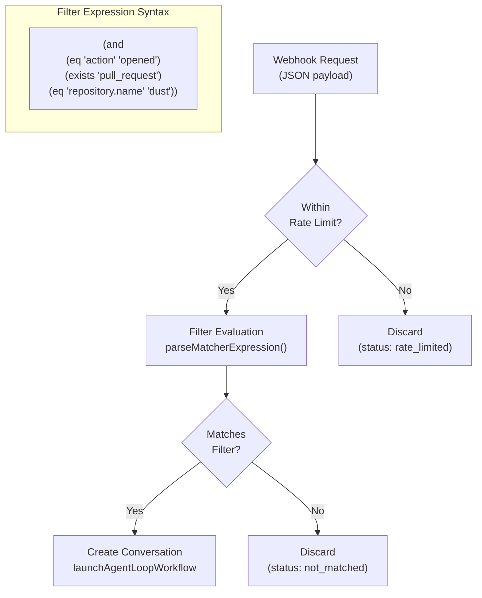

**Sources**: [front/lib/swr/agent_triggers.ts:4-5](), [front/components/agent_builder/triggers/webhook/WebhookEditionSheet.tsx:1-200]()

### AI-Assisted Filter Generation

For preset webhook providers, the system generates filter expressions from natural language:

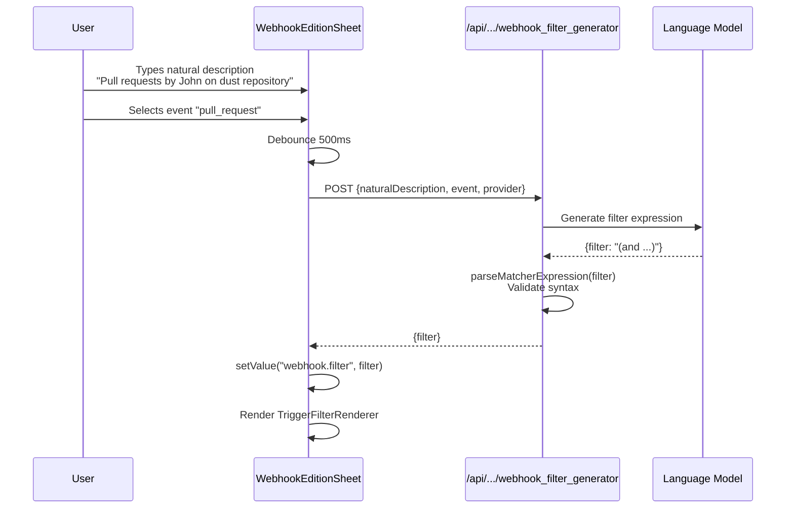

**Sources**: [front/components/agent_builder/triggers/webhook/WebhookEditionSheet.tsx:1-200](), [front/lib/swr/agent_triggers.ts:22-26]()

### Rate Limiting and Execution Modes

Each webhook trigger has configurable rate limits:

| Field | Description | Default |
|-------|-------------|---------|
| `executionPerDayLimitOverride` | Max executions per 24h window | `DEFAULT_SINGLE_TRIGGER_EXECUTION_PER_DAY_LIMIT` (42) [front/types/assistant/triggers.ts:68]() |
| `executionMode` | Quota type | `"user_pool"` or `"workspace_pool"` [front/types/assistant/triggers.ts:70]() |

**Sources**: [front/types/assistant/triggers.ts:68-72](), [front/components/agent_builder/triggers/webhook/WebhookEditionSheet.tsx:91-134]()

### Webhook Request History

The system tracks webhook request attempts for each trigger:

```typescript
// WebhookRequestModel -> WebhookRequestTriggerModel -> TriggerModel
type WebhookRequestTriggerStatus = 
  | "workflow_start_succeeded"  // Successfully launched agent
  | "workflow_start_failed"      // Failed to start workflow
  | "not_matched"                // Didn't match filter
  | "rate_limited"               // Hit rate limit
  | "credits_exhausted"          // Workspace credits exhausted
```

**Sources**: [front/types/assistant/triggers.ts:123-131](), [front/lib/models/agent/triggers/webhook_request_trigger.ts]()

---

## Wakeup System

The wakeup system allows agents to schedule one-shot or recurring tasks for themselves within a conversation. This is distinct from general triggers as wakeups are agent-initiated and conversation-specific.

### Wakeup Configuration

Wakeups can be configured as either one-shot or cron-based:

```typescript
export type WakeUpScheduleConfig =
  | {
      scheduleType: "one_shot";
      fireAt: Date;
      cronExpression: null;
      cronTimezone: null;
    }
  | {
      scheduleType: "cron";
      fireAt: null;
      cronExpression: string;
      cronTimezone: string;
    };
```

**Sources**: [front/types/assistant/wakeups.ts:26-39]()

### Wakeup Lifecycle and Status

Wakeups have statuses like `active`, `fired`, `cancelled`, and `expired`. They are managed by the `WakeUpResource`. [front/types/assistant/wakeups.ts:41-46](), [front/lib/resources/wakeup_resource.ts:84-85]()

**Key constraints**:
- Maximum `MAX_WAKE_UP_FIRES` (32) for cron wakeups to prevent runaway situations. [front/lib/resources/wakeup_resource.ts:47]()
- Minimum interval of `WAKE_UP_MIN_INTERVAL_MINUTES` (5 minutes) for cron wakeups. [front/lib/resources/wakeup_resource.ts:51]()
- Only the wakeup owner or a workspace admin can cancel a wakeup. [x/spolu/wakeup/plan.md:91-96]()
- While a conversation has an active wakeup, only the wakeup owner can post or edit user messages. [x/spolu/wakeup/plan.md:98-105]()

### Temporal Workflow for Wakeups

Wakeups are orchestrated by Temporal workflows:
- `launchOrScheduleWakeUpTemporalWorkflow` starts the workflow. [front/lib/resources/wakeup_resource.ts:30]()
- `cancelWakeUpTemporalWorkflow` cancels it. [front/lib/resources/wakeup_resource.ts:21]()
- `wakeUpWorkflow` handles the logic, calling `runWakeUpActivity` to post the agent message. [x/spolu/wakeup/plan.md:26-30]()

### `wakeups` Internal MCP Server

An internal MCP server (`id 1031`) exposes `schedule_wakeup`, `list_wakeups`, and `cancel_wakeup` tools to agents. [x/spolu/wakeup/plan.md:74-76]()

**Sources**: [front/lib/resources/wakeup_resource.ts:1-229](), [x/spolu/wakeup/plan.md:1-141]()

---

## Email Triggers

The system supports agents interacting via email, primarily for replying to inbound emails. This involves storing context in Redis and handling tool validation.

### Email Reply Context

When an agent is triggered by an email, `EmailReplyContext` is stored in Redis to facilitate replying after the agent's message is complete. This context includes subject, sender, threading headers, and conversation IDs. [front/lib/api/assistant/email/email_trigger.ts:59-70]()

```typescript
export type EmailReplyContext = {
  subject: string;
  originalText: string;
  fromEmail: string;
  fromFull: string;
  threadingMessageId: string | null;
  threadingInReplyTo: string | null;
  threadingReferences: string | null;
  agentConfigurationId: string;
  workspaceId: string;
  conversationId: string;
};
```

The context is stored with a TTL of 3 hours (`EMAIL_REPLY_CONTEXT_TTL_SECONDS`). [front/lib/api/assistant/email/email_trigger.ts:45]()

### Handling Agent Message Completion

The `sendEmailReplyOnCompletion` function is called after an agent message is completed. [front/lib/api/assistant/email/email_reply.ts:155-228]()
1. It retrieves the `EmailReplyContext` from Redis. [front/lib/api/assistant/email/email_reply.ts:167-171]()
2. Checks if email agents are enabled for the workspace. [front/lib/api/assistant/email/email_reply.ts:57-67]()
3. If the agent is blocked on tool validation, it sends a validation email to the user and re-stores the context with a fresh TTL. [front/lib/api/assistant/email/email_reply.ts:74-148]()
4. Otherwise, it sends the agent's response as an email reply and deletes the context from Redis. [front/lib/api/assistant/email/email_reply.ts:219-220]()

**Sources**: [front/lib/api/assistant/email/email_trigger.ts:1-129](), [front/lib/api/assistant/email/email_reply.ts:1-238]()

---

## Permission Model: Editor and Subscribers

### Editor vs Subscriber Roles

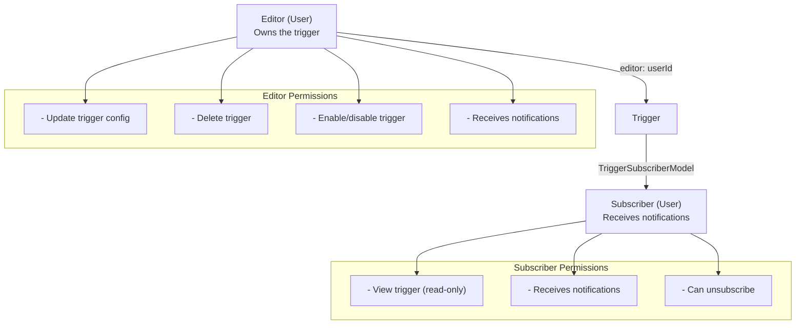

**Sources**: [front/lib/resources/trigger_resource.ts:732-849]()

### Subscriber Management API

```typescript
class TriggerResource {
  // Add current user to subscribers
  async addToSubscribers(auth: Authenticator): Promise<Result<undefined, DustError>>
  
  // Remove current user from subscribers
  async removeFromSubscribers(auth: Authenticator): Promise<Result<undefined, DustError>>
  
  // Check if current user is subscriber
  async isSubscriber(auth: Authenticator): Promise<boolean>
  
  // Get all subscribers for trigger
  async getSubscribers(auth: Authenticator): Promise<Result<UserResource[], DustError>>
}
```

**Constraints**:
- Editor cannot subscribe to their own trigger (returns `internal_error`)
- Users can only subscribe to triggers in their workspace
- Unique constraint on `(workspaceId, triggerId, userId)` prevents duplicate subscriptions

**Sources**: [front/lib/resources/trigger_resource.ts:732-849](), [front/lib/resources/trigger_resource.test.ts:14-241]()

---

## UI Components

### Agent Builder Triggers Block

The `AgentBuilderTriggersBlock` component manages trigger CRUD within the Agent Builder:

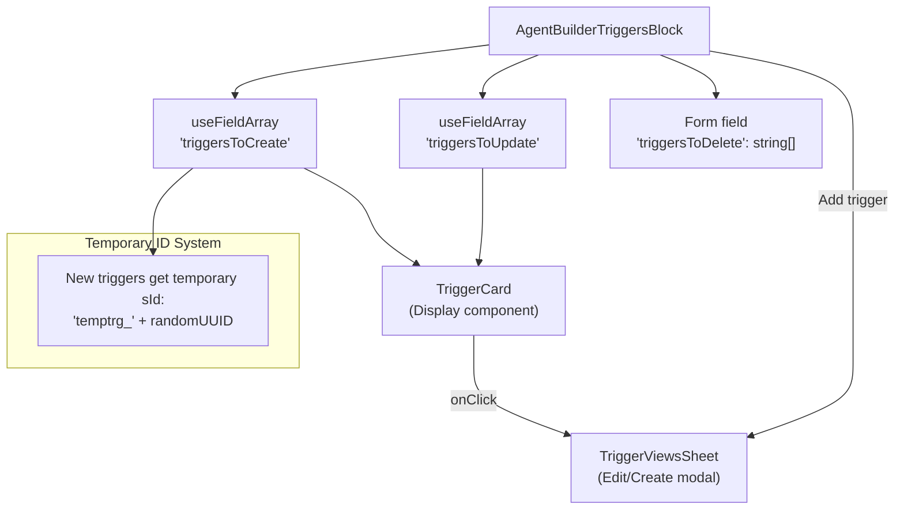

**Sources**: [front/components/agent_builder/triggers/AgentBuilderTriggersBlock.tsx:1-257]()

### Form Field Arrays for Batch Operations

The trigger form uses three separate arrays to track changes:

| Field Array | Purpose | Type |
|-------------|---------|------|
| `triggersToCreate` | New triggers to create on save | `AgentBuilderTriggerType[]` |
| `triggersToUpdate` | Existing triggers with modifications | `AgentBuilderTriggerType[]` |
| `triggersToDelete` | Trigger sIds to delete on save | `string[]` |

This design allows batch submission in the correct order: **DELETE** → **PATCH** → **POST**.

**Sources**: [front/components/agent_builder/triggers/AgentBuilderTriggersBlock.tsx:43-63](), [front/components/agent_builder/submitAgentBuilderForm.ts:203-379]()

### Multi-Page Sheet for Trigger Configuration

The `TriggerViewsSheet` uses a multi-page sheet pattern:

```typescript
const TRIGGERS_SHEET_PAGE_IDS = {
  SELECTION: "trigger-selection",    // Choose schedule vs webhook
  SCHEDULE: "schedule-edition",      // Configure schedule trigger
  WEBHOOK: "webhook-edition",        // Configure webhook trigger
}
```

**Navigation flow**:
1. User clicks "Add triggers" → Opens on SELECTION page
2. User selects trigger type → Navigates to SCHEDULE or WEBHOOK page
3. User fills form and saves → Appends to `triggersToCreate` or `triggersToUpdate`
4. For editing, opens directly on the appropriate page (SCHEDULE or WEBHOOK)

**Sources**: [front/components/agent_builder/triggers/TriggerViewsSheet.tsx:32-324]()

---

## Backend Architecture

### Resource Layer: TriggerResource

```mermaid
graph TB
    TriggerResource["TriggerResource<br/>(Resource abstraction)"]
    TriggerModel["TriggerModel<br/>(Sequelize ORM)"]
    TriggerSubscriberModel["TriggerSubscriberModel<br/>(Subscribers junction table)"]
    WebhookSourcesViewModel["WebhookSourcesViewModel<br/>(Webhook source config)"]
    
    TriggerResource --> TriggerModel
    TriggerResource --> TriggerSubscriberModel
    TriggerResource --> WebhookSourcesViewModel
    
    subgraph "Static Methods (Query)"
        Q1["fetchById(auth, sId)"]
        Q2["fetchByIds(auth, sIds)"]
        Q3["listByAgentConfigurationId(auth, agentId)"]
        Q4["listByUserEditor(auth, user)"]
        Q5["listByUserSubscriber(auth, user)"]
        Q6["listByWebhookSourceViewId(auth, viewId)"]
        Q7["listByWorkspaceAndKindsAndExecutionModes(auth, {kinds, executionModes})"]
        Q8["listByWorkspaceAndNameSearch(auth, search)"]
    end
    
    subgraph "Static Methods (Mutation)"
        M1["makeNew(auth, blob)"]
        M2["update(auth, sId, blob)"]
        M3["deleteAllForWorkspace(auth)"]
        M4["disableAllForWorkspace(auth, status)"]
        M5["enableAllForWorkspace(auth, status)"]
    end
    
    subgraph "Instance Methods"
        I1["delete(auth)"]
        I2["enable(auth)"]
        I3["disable(auth, targetStatus)"]
        I4["upsertTemporalWorkflow(auth)"]
        I5["removeTemporalWorkflow(auth)"]
        I6["addToSubscribers(auth)"]
        I7["removeFromSubscribers(auth)"]
        I8["getSubscribers(auth)"]
    end
    
    TriggerResource --> Q1
    TriggerResource --> Q2
    TriggerResource --> Q3
    TriggerResource --> Q4
    TriggerResource --> Q5
    TriggerResource --> Q6
    TriggerResource --> Q7
    TriggerResource --> Q8
    
    TriggerResource --> M1
    TriggerResource --> M2
    TriggerResource --> M3
    TriggerResource --> M4
    TriggerResource --> M5
    
    TriggerResource --> I1
    TriggerResource --> I2
    TriggerResource --> I3
    TriggerResource --> I4
    TriggerResource --> I5
    TriggerResource --> I6
    TriggerResource --> I7
    TriggerResource --> I8
```

**Sources**: [front/lib/resources/trigger_resource.ts:51-900](), [front/lib/api/analytics/automations/triggers.ts:135-138](), [front/lib/api/analytics/automations/triggers.ts:148-151]()

### Database Schema

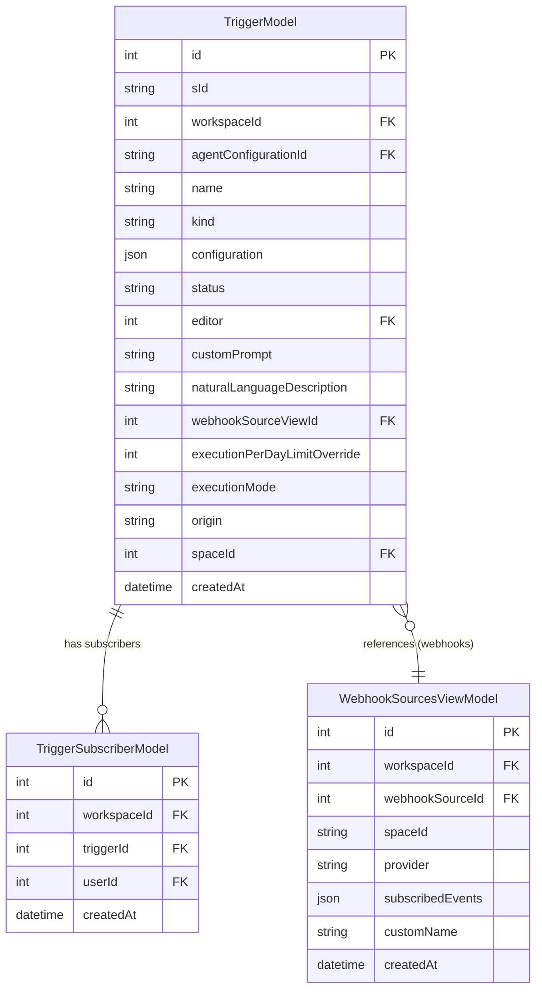

**Sources**: [front/lib/models/agent/triggers/triggers.ts](), [front/lib/models/agent/triggers/trigger_subscriber.ts](), [front/lib/models/agent/triggers/webhook_sources_view.ts]()

---

## API Endpoints

### Trigger CRUD API

**Endpoint**: `/api/w/[wId]/assistant/agent_configurations/[aId]/triggers`

```typescript
// GET - List all triggers for an agent
type GetTriggersResponseBody = {
  triggers: (TriggerType & {
    isSubscriber: boolean;
    isEditor: boolean;
    editorName?: string;
  })[];
}

// POST - Batch create triggers
type PostTriggersRequestBody = {
  triggers: TriggerSchema[];  // Array of new triggers
}

// PATCH - Batch update triggers
type PatchTriggersRequestBody = {
  triggers: (TriggerSchema & { sId: string })[];
}

// DELETE - Batch delete triggers
type DeleteTriggersRequestBody = {
  triggerIds: string[];  // Array of sIds to delete
}
```

**Authorization**:
- GET: Requires agent read permission
- POST/PATCH: Requires agent edit permission
- DELETE: Admin can delete any trigger; users can only delete their own triggers

**Sources**: [front-api/routes/w/[wId]/assistant/agent_configurations/[aId]/triggers/index.ts:1-380]()

### Subscriber Management API

**Endpoint**: `/api/w/[wId]/assistant/agent_configurations/[aId]/triggers/[tId]/subscribers`

```typescript
// GET - List subscribers for a trigger
type GetSubscribersResponseBody = {
  subscribers: UserType[];
}

// POST - Add current user to subscribers
// (No request body)

// DELETE - Remove current user from subscribers
// (No request body)
```

**Sources**: [front-api/routes/w/[wId]/assistant/agent_configurations/[aId]/triggers/[tId]/subscribers.ts]()

### AI Assistant Endpoints

**Schedule Natural Language to Cron**:
```typescript
// POST /api/w/[wId]/assistant/agent_configurations/text_as_cron_rule
type PostTextAsCronRuleRequestBody = {
  naturalDescription: string;
  defaultTimezone: string;
}

type PostTextAsCronRuleResponseBody = {
  cronRule: string;
  timezone: string;
}
```

**Webhook Filter Generation**:
```typescript
// POST /api/w/[wId]/assistant/agent_configurations/webhook_filter_generator
type PostWebhookFilterGeneratorRequestBody = {
  naturalDescription: string;
  event: string;
  provider: WebhookProvider;
}

type PostWebhookFilterGeneratorResponseBody = {
  filter: string;  // Matcher expression
}
```

**Sources**: [front/lib/swr/agent_triggers.ts:17-37](), [front/lib/swr/agent_triggers.ts:22-26](), [front-api/routes/w/[wId]/assistant/agent_configurations/text_as_cron_rule.ts](), [front-api/routes/w/[wId]/assistant/agent_configurations/webhook_filter_generator.ts]()

---

## Submission Flow

### Form Submission in Agent Builder

When the agent is saved, triggers are submitted in a specific order to maintain referential integrity:

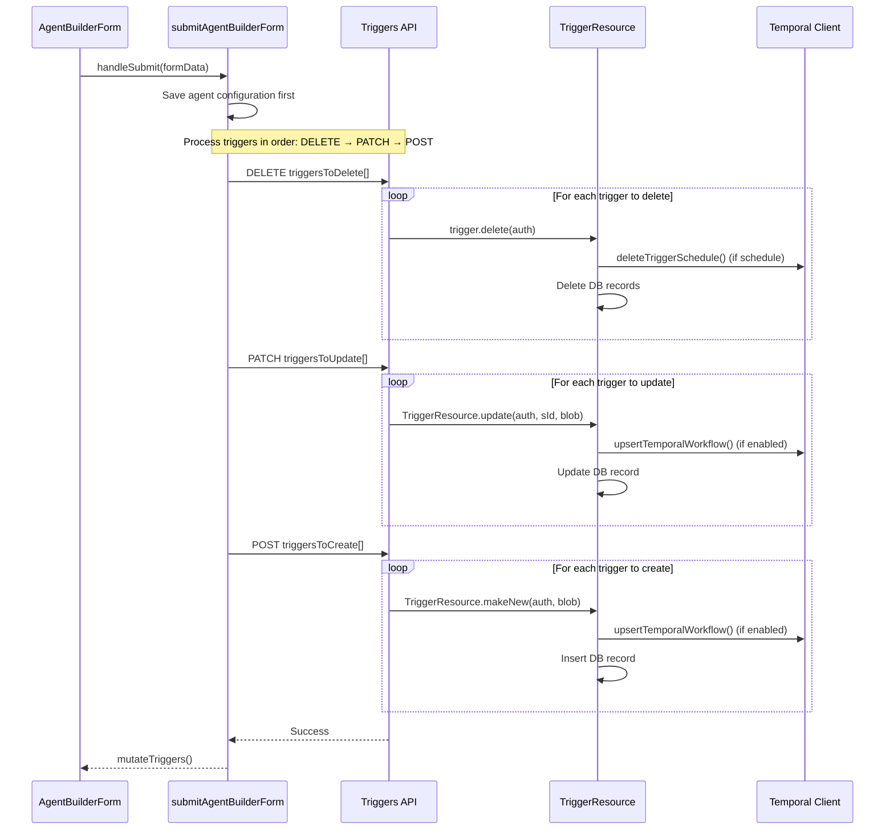

**Why this order?**
- **DELETE first**: Remove obsolete triggers to free up names and resources
- **PATCH second**: Update existing triggers (may have name changes)
- **POST last**: Create new triggers with validated names

**Sources**: [front/components/agent_builder/submitAgentBuilderForm.ts:203-379]()

### Validation Rules

The submission process validates:
1. **Unique names**: All trigger names must be unique for a given agent
2. **Editor ownership**: Users can only update/delete triggers they created
3. **Agent permissions**: User must have edit permission on the agent
4. **Webhook source access**: Webhook triggers must reference accessible webhook sources
5. **Execution Mode**: User must have permission to use the specified `executionMode` (e.g., `workspace_pool`). [front/lib/resources/trigger_resource.ts:139-145]()

**Sources**: [front/components/agent_builder/submitAgentBuilderForm.ts:217-241](), [front-api/routes/w/[wId]/assistant/agent_configurations/[aId]/triggers/index.ts:175-263](), [front/lib/resources/trigger_resource.ts:139-145]()

---

## Integration with Agent Execution

When a trigger activates (schedule time reached or webhook received), it launches an agent loop workflow:

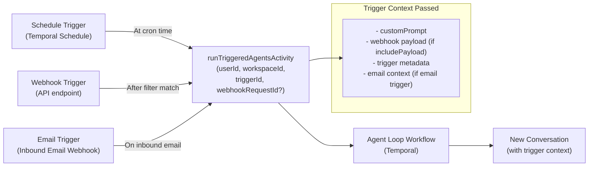

The `runTriggeredAgentsActivity` is the core activity that creates a new conversation and posts a user message to trigger the agent. [front/temporal/triggers/activities.ts:177-187]() It handles passing the `customPrompt` and, for webhook triggers, optionally includes the webhook payload as a content fragment. [front/temporal/triggers/activities.ts:150-154](), [front/temporal/triggers/activities.ts:87-148]()

For details on agent loop execution, see [Agent Execution and Temporal Workflows]().

**Sources**: [front/temporal/triggers/schedule_client.ts](), [front/lib/resources/trigger_resource.ts:592-604](), [front/temporal/triggers/activities.ts:177-187](), [front/temporal/triggers/activities.ts:87-154]()

---

## Automations Analytics Page

The Automations Analytics page (`/w/[wId]/analytics/automations`) provides insights into trigger usage and performance.

### Data Fetching and Aggregation

The `fetchTriggersRanking` function queries Elasticsearch to retrieve ranked trigger data based on consumption. [front/lib/api/analytics/automations/triggers.ts:171-197]()

**Key metrics**:
- `runCount`: Number of times the trigger executed.
- `credits`: Total credits consumed by the trigger.
- `medianRunCount`, `medianCostPerRun`: Baselines for comparison.

Filters can be applied by `kinds` (schedule/webhook), `executionModes` (user_pool/workspace_pool), `agentIds`, `editorIds`, and `search` by trigger name. [front/lib/api/analytics/automations/schema.ts:16-21]()

### UI Components

The `AutomationsTriggersTable` component displays the ranked triggers. [front/components/workspace/analytics/automations/AutomationsTriggersTable.tsx:204-210]()

**Features**:
- **Search and Filter**: Allows filtering by trigger kind, execution mode, agent, and editor. [front/components/workspace/analytics/automations/AutomationsFilterPanel.tsx]()
- **Status Toggle**: Users can enable/disable triggers directly from the table using a `SliderToggle`. [front/components/workspace/analytics/automations/AutomationsTriggersTable.tsx:77-83]()
- **Bulk Actions**: Supports bulk updating of trigger execution mode. [front/components/workspace/analytics/automations/BulkTriggerPoolModal.tsx]()
- **Breakdown**: Clicking a row expands to show `AutomationsTriggerBreakdown` with detailed consumption data. [front/components/workspace/analytics/automations/AutomationsTriggerBreakdown.tsx]()

**Sources**: [front/components/workspace/analytics/automations/AutomationsTriggersTable.tsx:1-210](), [front/lib/api/analytics/automations/triggers.ts:1-214](), [front/lib/api/analytics/automations/schema.ts:1-84]()

---

