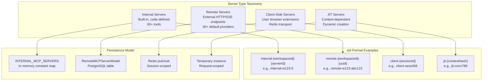
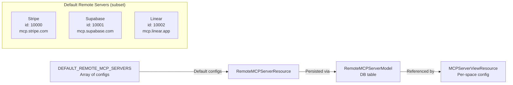
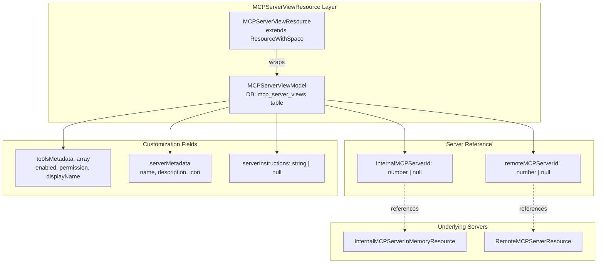
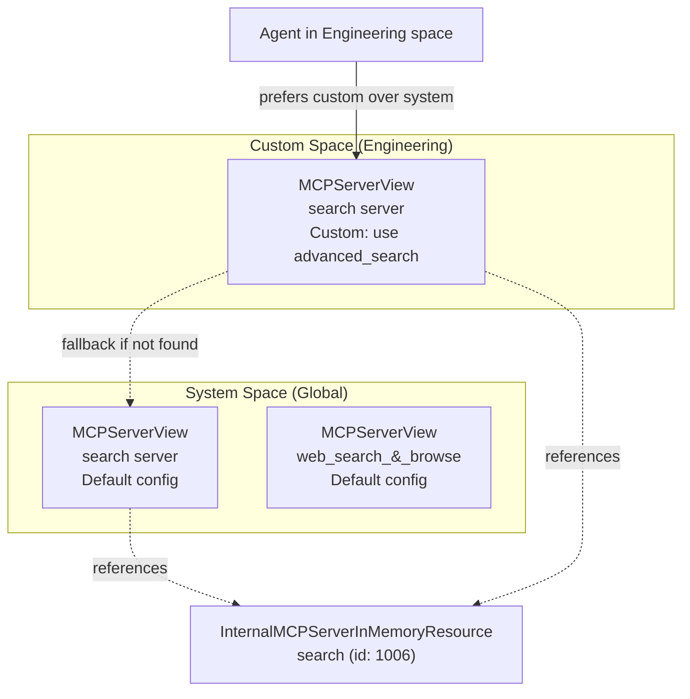
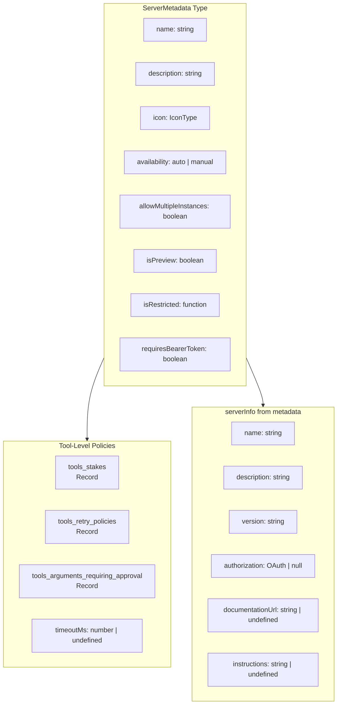
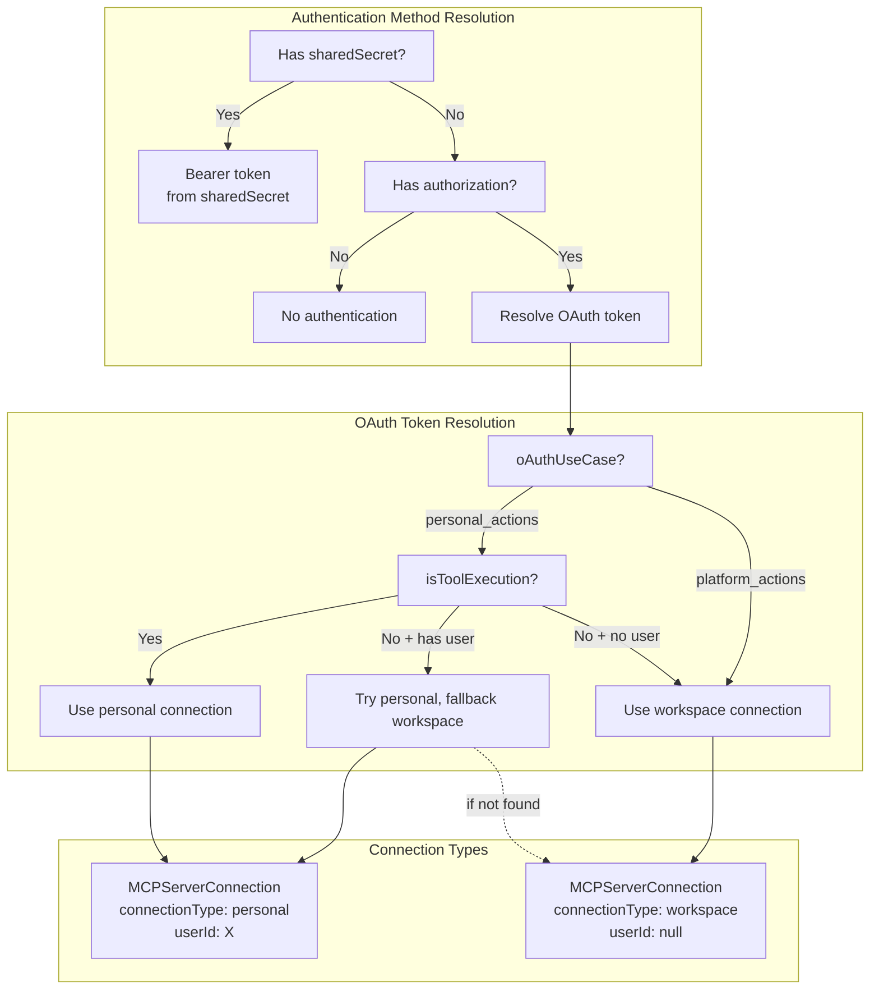
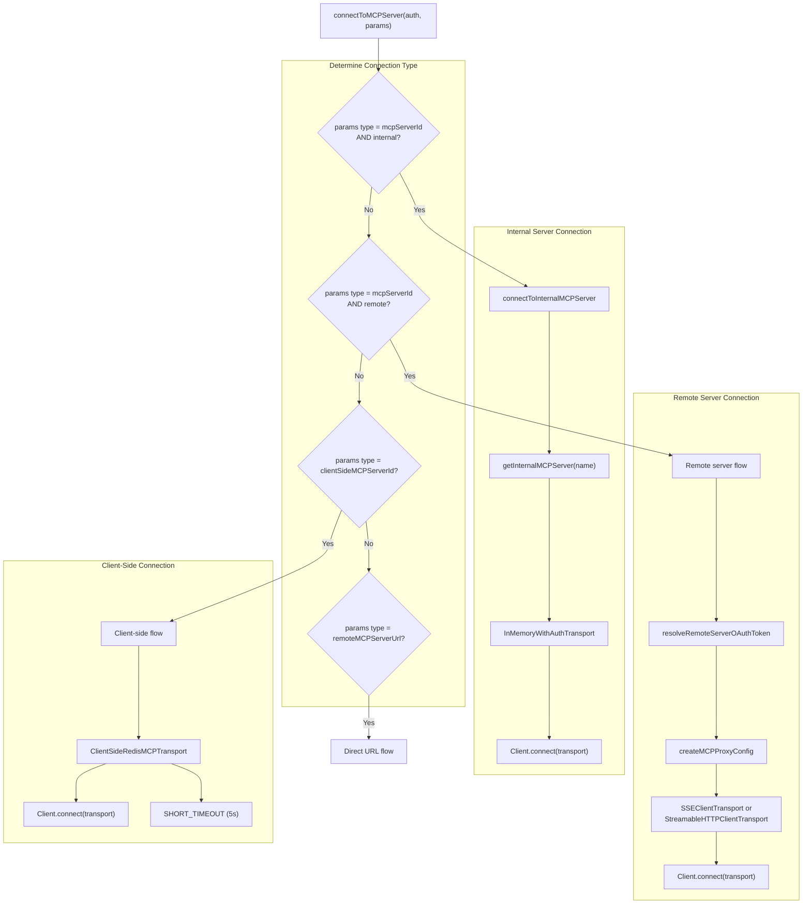
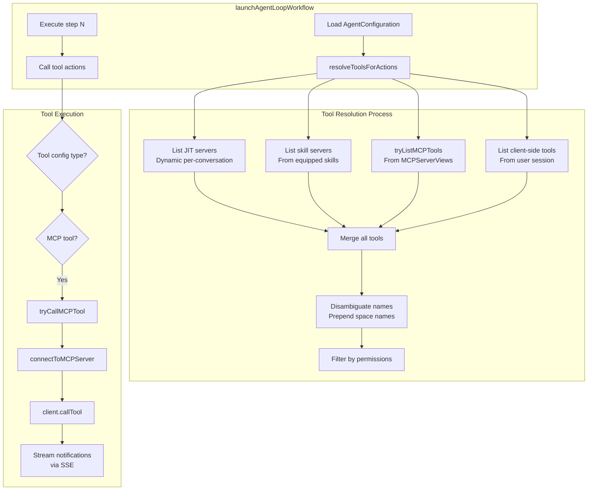
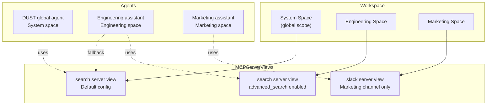

<!-- source: DeepWiki mcp.deepwiki.com · repo dust-tt/dust · page 4.1 MCP Server Architecture · fetched 2026-10-27 -->

# MCP Server Architecture

<details>
<summary>Relevant source files</summary>

The following files were used as context for generating this wiki page:

- [front-api/routes/w/[wId]/assistant/skills/[sId]/suggestions.test.ts](front-api/routes/w/[wId]/assistant/skills/[sId]/suggestions.test.ts)
- [front-api/routes/w/[wId]/mcp/[serverId]/index.test.ts](front-api/routes/w/[wId]/mcp/[serverId]/index.test.ts)
- [front-api/routes/w/[wId]/mcp/[serverId]/index.ts](front-api/routes/w/[wId]/mcp/[serverId]/index.ts)
- [front-api/routes/w/[wId]/mcp/[serverId]/sync.test.ts](front-api/routes/w/[wId]/mcp/[serverId]/sync.test.ts)
- [front-api/routes/w/[wId]/mcp/connections/[connectionType]/[cId]/index.test.ts](front-api/routes/w/[wId]/mcp/connections/[connectionType]/[cId]/index.test.ts)
- [front-api/routes/w/[wId]/mcp/connections/[connectionType]/[cId]/index.ts](front-api/routes/w/[wId]/mcp/connections/[connectionType]/[cId]/index.ts)
- [front-api/routes/w/[wId]/mcp/index.test.ts](front-api/routes/w/[wId]/mcp/index.test.ts)
- [front-api/routes/w/[wId]/mcp/index.ts](front-api/routes/w/[wId]/mcp/index.ts)
- [front-api/routes/w/[wId]/mcp/views/[viewId]/index.test.ts](front-api/routes/w/[wId]/mcp/views/[viewId]/index.test.ts)
- [front-api/routes/w/[wId]/mcp/views/[viewId]/index.ts](front-api/routes/w/[wId]/mcp/views/[viewId]/index.ts)
- [front-api/routes/w/[wId]/me/approvals.ts](front-api/routes/w/[wId]/me/approvals.ts)
- [front-api/routes/w/[wId]/members/index.test.ts](front-api/routes/w/[wId]/members/index.test.ts)
- [front-api/routes/w/[wId]/skills/[sId]/history/index.test.ts](front-api/routes/w/[wId]/skills/[sId]/history/index.test.ts)
- [front-api/routes/w/[wId]/skills/[sId]/restore.test.ts](front-api/routes/w/[wId]/skills/[sId]/restore.test.ts)
- [front-api/routes/w/[wId]/skills/reinforcement_daily_spend.test.ts](front-api/routes/w/[wId]/skills/reinforcement_daily_spend.test.ts)
- [front-api/routes/w/[wId]/skills/reinforcement_spend.test.ts](front-api/routes/w/[wId]/skills/reinforcement_spend.test.ts)
- [front-api/routes/w/[wId]/spaces/[spaceId]/mcp/available.test.ts](front-api/routes/w/[wId]/spaces/[spaceId]/mcp/available.test.ts)
- [front-api/routes/w/[wId]/spaces/[spaceId]/mcp_views/index.test.ts](front-api/routes/w/[wId]/spaces/[spaceId]/mcp_views/index.test.ts)
- [front-api/routes/w/[wId]/spaces/[spaceId]/webhook_source_views/index.test.ts](front-api/routes/w/[wId]/spaces/[spaceId]/webhook_source_views/index.test.ts)
- [front/components/actions/mcp/MCPServerAuthConnection.tsx](front/components/actions/mcp/MCPServerAuthConnection.tsx)
- [front/components/actions/mcp/create/ConnectMCPServerDialog.tsx](front/components/actions/mcp/create/ConnectMCPServerDialog.tsx)
- [front/components/actions/mcp/create/CreateMCPServerDialog.tsx](front/components/actions/mcp/create/CreateMCPServerDialog.tsx)
- [front/components/actions/mcp/create/SnowflakeKeypairCredentialForm.tsx](front/components/actions/mcp/create/SnowflakeKeypairCredentialForm.tsx)
- [front/components/actions/mcp/create/static_credential_forms.ts](front/components/actions/mcp/create/static_credential_forms.ts)
- [front/components/actions/mcp/forms/submitCreateMCPServerDialogForm.test.ts](front/components/actions/mcp/forms/submitCreateMCPServerDialogForm.test.ts)
- [front/components/actions/mcp/forms/submitCreateMCPServerDialogForm.ts](front/components/actions/mcp/forms/submitCreateMCPServerDialogForm.ts)
- [front/components/actions/mcp/forms/utils.ts](front/components/actions/mcp/forms/utils.ts)
- [front/components/actions/mcp/provider_setup_instructions/NetSuiteSetupInstructions.tsx](front/components/actions/mcp/provider_setup_instructions/NetSuiteSetupInstructions.tsx)
- [front/components/actions/mcp/provider_setup_instructions/PowerBiSetupInstructions.tsx](front/components/actions/mcp/provider_setup_instructions/PowerBiSetupInstructions.tsx)
- [front/components/actions/mcp/provider_setup_instructions/SnowflakeSetupInstructions.tsx](front/components/actions/mcp/provider_setup_instructions/SnowflakeSetupInstructions.tsx)
- [front/components/actions/mcp/provider_setup_instructions/index.tsx](front/components/actions/mcp/provider_setup_instructions/index.tsx)
- [front/components/agent_builder/PersonalConnectionRequiredDialog.tsx](front/components/agent_builder/PersonalConnectionRequiredDialog.tsx)
- [front/components/poke/mcp_server_views/view.tsx](front/components/poke/mcp_server_views/view.tsx)
- [front/components/resources/resources_icon_names.ts](front/components/resources/resources_icon_names.ts)
- [front/components/resources/resources_icons.tsx](front/components/resources/resources_icons.tsx)
- [front/lib/actions/data_source_file_system_read_targets.ts](front/lib/actions/data_source_file_system_read_targets.ts)
- [front/lib/actions/mcp_internal_actions/__snapshots__/mcp_servers_metadata.test.ts.snap](front/lib/actions/mcp_internal_actions/__snapshots__/mcp_servers_metadata.test.ts.snap)
- [front/lib/actions/mcp_internal_actions/constants.test.ts](front/lib/actions/mcp_internal_actions/constants.test.ts)
- [front/lib/actions/mcp_internal_actions/constants.ts](front/lib/actions/mcp_internal_actions/constants.ts)
- [front/lib/actions/mcp_internal_actions/internal_mcp_server_availability.snapshot.json](front/lib/actions/mcp_internal_actions/internal_mcp_server_availability.snapshot.json)
- [front/lib/actions/mcp_internal_actions/remote_servers.ts](front/lib/actions/mcp_internal_actions/remote_servers.ts)
- [front/lib/actions/mcp_internal_actions/servers/index.ts](front/lib/actions/mcp_internal_actions/servers/index.ts)
- [front/lib/actions/mcp_metadata_extraction.ts](front/lib/actions/mcp_metadata_extraction.ts)
- [front/lib/actions/tool_display_labels.test.ts](front/lib/actions/tool_display_labels.test.ts)
- [front/lib/actions/tool_display_labels.ts](front/lib/actions/tool_display_labels.ts)
- [front/lib/api/actions/servers/bm25_tool_search.test.ts](front/lib/api/actions/servers/bm25_tool_search.test.ts)
- [front/lib/api/actions/servers/bm25_tool_search_utils.test.ts](front/lib/api/actions/servers/bm25_tool_search_utils.test.ts)
- [front/lib/api/actions/servers/shopify/client.test.ts](front/lib/api/actions/servers/shopify/client.test.ts)
- [front/lib/api/actions/servers/shopify/client.ts](front/lib/api/actions/servers/shopify/client.ts)
- [front/lib/api/actions/servers/shopify/helpers.ts](front/lib/api/actions/servers/shopify/helpers.ts)
- [front/lib/api/actions/servers/shopify/metadata.test.ts](front/lib/api/actions/servers/shopify/metadata.test.ts)
- [front/lib/api/actions/servers/shopify/metadata.ts](front/lib/api/actions/servers/shopify/metadata.ts)
- [front/lib/api/actions/servers/shopify/rendering.ts](front/lib/api/actions/servers/shopify/rendering.ts)
- [front/lib/api/actions/servers/shopify/tools/index.ts](front/lib/api/actions/servers/shopify/tools/index.ts)
- [front/lib/api/actions/servers/shopify/types.ts](front/lib/api/actions/servers/shopify/types.ts)
- [front/lib/api/marketing/integrations.ts](front/lib/api/marketing/integrations.ts)
- [front/lib/api/mcp.ts](front/lib/api/mcp.ts)
- [front/lib/api/mcp/servers.ts](front/lib/api/mcp/servers.ts)
- [front/lib/api/mcp/views.ts](front/lib/api/mcp/views.ts)
- [front/lib/api/mcp_oauth_prerequisites.ts](front/lib/api/mcp_oauth_prerequisites.ts)
- [front/lib/api/poke/plugins/mcp_server_views/update-mcp-url.ts](front/lib/api/poke/plugins/mcp_server_views/update-mcp-url.ts)
- [front/lib/resources/default_remote_mcp_server_in_memory_resource.ts](front/lib/resources/default_remote_mcp_server_in_memory_resource.ts)
- [front/lib/resources/internal_mcp_server_in_memory_resource.ts](front/lib/resources/internal_mcp_server_in_memory_resource.ts)
- [front/lib/resources/mcp_server_connection_resource.test.ts](front/lib/resources/mcp_server_connection_resource.test.ts)
- [front/lib/resources/mcp_server_connection_resource.ts](front/lib/resources/mcp_server_connection_resource.ts)
- [front/lib/resources/mcp_server_view_resource.test.ts](front/lib/resources/mcp_server_view_resource.test.ts)
- [front/lib/resources/mcp_server_view_resource.ts](front/lib/resources/mcp_server_view_resource.ts)
- [front/lib/resources/remote_mcp_servers_resource.test.ts](front/lib/resources/remote_mcp_servers_resource.test.ts)
- [front/lib/resources/remote_mcp_servers_resource.ts](front/lib/resources/remote_mcp_servers_resource.ts)
- [front/lib/swr/mcp_servers.ts](front/lib/swr/mcp_servers.ts)
- [front/temporal/agent_loop/lib/run_model.test.ts](front/temporal/agent_loop/lib/run_model.test.ts)
- [front/temporal/agent_loop/lib/run_model.ts](front/temporal/agent_loop/lib/run_model.ts)
- [front/types/shared/feature_flags.ts](front/types/shared/feature_flags.ts)
- [marketing/components/resources/resources_icon_names.ts](marketing/components/resources/resources_icon_names.ts)
- [marketing/components/resources/resources_icons.tsx](marketing/components/resources/resources_icons.tsx)
- [sdks/js/src/mcp_icon_types.ts](sdks/js/src/mcp_icon_types.ts)
- [sdks/js/src/types.ts](sdks/js/src/types.ts)
- [sparkle/src/logo/platforms/Databricks.tsx](sparkle/src/logo/platforms/Databricks.tsx)
- [sparkle/src/logo/platforms/Shopify.tsx](sparkle/src/logo/platforms/Shopify.tsx)
- [sparkle/src/logo/platforms/index.ts](sparkle/src/logo/platforms/index.ts)
- [sparkle/src/logo/platforms/registry.ts](sparkle/src/logo/platforms/registry.ts)
- [sparkle/src/logo/src/platforms/Databricks.svg](sparkle/src/logo/src/platforms/Databricks.svg)
- [sparkle/src/logo/src/platforms/PowerBi.svg](sparkle/src/logo/src/platforms/PowerBi.svg)
- [sparkle/src/logo/src/platforms/Shopify.svg](sparkle/src/logo/src/platforms/Shopify.svg)

</details>


This page documents the Model Context Protocol (MCP) server architecture, which enables extensible tool integration in the Dust platform. It covers the four types of MCP servers, the configuration layer, authentication mechanisms, and how servers integrate with the agent execution system. For details on tool execution and the discovery pipeline, see [Tool Discovery Pipeline](#4.2) and [Tool Execution and Authentication](#4.3).

## Server Types and Identification

The system supports four distinct MCP server types, each with a unique identification scheme and lifecycle model.

### Server Type Classification



**Sources**: [front/lib/actions/mcp_internal_actions/constants.ts:129-200](), [front/lib/actions/mcp_helper.ts](), [front/lib/resources/internal_mcp_server_in_memory_resource.ts](), [front/lib/resources/remote_mcp_servers_resource.ts]()

### Internal MCP Servers

Internal servers are defined at compile time in the `INTERNAL_MCP_SERVERS` constant map. Each server has a stable numeric ID and metadata including availability, retry policies, and tool stakes.

| Server Name | ID | Availability | Multiple Instances | Key Tools |
|-------------|----|--------------|--------------------|-----------|
| `web_search_&_browse` | 5 | auto | no | `websearch`, `webbrowser` |
| `search` | 1006 | auto | no | `semantic_search` |
| `query_tables_v2` | 1009 | auto | no | `query_tables` |
| `run_agent` | 1008 | auto | yes | `run_agent` |
| `github` | 1 | manual | yes | Various GitHub operations |
| `slack` | 18 | manual | yes | Slack messaging |
| `salesforce` | 14 | manual | yes | Salesforce CRM |

The availability field controls default enablement:
- `"auto"`: Enabled by default in global space
- `"manual"`: Requires explicit workspace configuration  
- `"auto_hidden_builder"`: Auto-enabled but hidden from UI

**Sources**: [front/lib/actions/mcp_internal_actions/constants.ts:217-890]()

### Remote MCP Servers

Remote servers connect to external HTTP/SSE endpoints. The system includes 30+ default server configurations in `DEFAULT_REMOTE_MCP_SERVERS`, but workspaces can add custom remote servers.



Remote servers support three authentication methods:
- `"oauth-dynamic"`: OAuth flow with provider-specific scopes
- `"bearer"`: Shared secret or API key in Authorization header
- `null`: No authentication required

**Sources**: [front/lib/actions/mcp_internal_actions/remote_servers.ts:20-545](), [front/lib/resources/remote_mcp_servers_resource.ts]()

### Server ID Parsing

The `getServerTypeAndIdFromSId` function extracts server type and internal ID from the composite sId:

```typescript
// Returns: { serverType: "internal" | "remote" | "client", id: number | string }
// Example: "internal-w123-5" -> { serverType: "internal", id: 5 }
// Example: "remote-w123-abc" -> { serverType: "remote", id: "abc" }
```

**Sources**: [front/lib/actions/mcp_helper.ts]()

## MCPServerViewResource: Configuration Layer

`MCPServerViewResource` provides workspace-specific and space-scoped configuration for MCP servers. It wraps the underlying server (internal or remote) with customization, metadata, and access control.

### Resource Model



**Sources**: [front/lib/resources/mcp_server_view_resource.ts:53-76](), [front/lib/models/agent/actions/mcp_server_view.ts]()

### Key Methods

| Method | Purpose | Returns |
|--------|---------|---------|
| `createFromInternalServer` | Create view for internal server | `MCPServerViewResource` |
| `createFromRemoteServer` | Create view for remote server | `MCPServerViewResource` |
| `fetchById` | Retrieve by numeric ID | `MCPServerViewResource \| null` |
| `fetchBySId` | Retrieve by composite sId | `MCPServerViewResource \| null` |
| `listBySpace` | All views in a space | `MCPServerViewResource[]` |
| `fetchSystemViewForInternalServer` | Get system space view | `MCPServerViewResource \| null` |

The `makeNew` static method enforces:
- Only admins can create MCP server views
- Valid internal server IDs (workspace-scoped)
- Space association (vaultId) for access control

**Sources**: [front/lib/resources/mcp_server_view_resource.ts:78-142](), [front/lib/resources/mcp_server_view_resource.ts:146-279]()

### System vs Custom Views

Internal servers always have a "system view" in the workspace's system space, created automatically. Workspaces can override settings by creating custom views in regular spaces.



**Sources**: [front/lib/resources/mcp_server_view_resource.ts:146-194](), [front/lib/resources/mcp_server_view_resource.ts:510-558]()

### Conflict Prevention

The `isCreatingConflictingView` method prevents duplicate server instances when `allowMultipleInstances = false`:

```typescript
// Checks if creating a view for systemView in targetSpace would conflict
// Returns true if:
//   1. Server doesn't allow multiple instances AND
//   2. A view for the same underlying server already exists in targetSpace
```

**Sources**: [front/lib/resources/mcp_server_view_resource.ts:144-194]()

## Server Metadata and Capabilities

### Metadata Structure

The `ServerMetadata` type defines server-level configuration that affects all tools:



**Sources**: [front/lib/actions/mcp_internal_actions/tool_definition.ts](), [front/lib/api/mcp.ts:1-100]()

### Tool Stakes and Approval

Tool stakes determine approval requirements before execution:

| Stake Level | Behavior | Example Tools |
|-------------|----------|---------------|
| `"never_ask"` | Execute without approval | `semantic_search`, `list_tables` |
| `"low"` | Ask approval only once per conversation | `send_request` (HTTP client) |
| `"medium"` | Ask approval for each invocation | `post_message` (Slack) |
| `"high"` | Always require explicit approval | `update_word_document`, `upload_file` |

Some tools require approval for specific arguments (e.g., `gmail.send_mail` requires approval for `to` field).

**Sources**: [front/lib/actions/mcp_internal_actions/constants.ts:366-640](), [front/lib/actions/constants.ts]()

### Retry Policies

The `MCPToolRetryPolicyType` enum defines how to handle tool failures:

```typescript
type MCPToolRetryPolicyType = "retry_on_interrupt" | "no_retry";

// Tools with "retry_on_interrupt" (default):
// - Retry if interrupted by cancellation/timeout
// - Up to RETRY_ON_INTERRUPT_MAX_ATTEMPTS (3)

// Tools with "no_retry":
// - Fail immediately on any error
```

Servers can specify a default retry policy and per-tool overrides in `tools_retry_policies`.

**Sources**: [front/lib/api/mcp.ts:200-220](), [front/lib/actions/constants.ts:14]()

### Availability and Restrictions

Internal servers define availability and restriction logic:

```typescript
// Availability: controls default enablement
type MCPServerAvailability = "manual" | "auto" | "auto_hidden_builder";

// isRestricted: function that determines if server is accessible
isRestricted?: (context: { 
  featureFlags: WhitelistableFeature[], 
  plan: PlanType 
}) => boolean;

// Example: salesforce restricted unless feature flag or plan allows
salesforce: {
  isRestricted: ({ featureFlags, plan }) => {
    const isInPlan = plan.limits.connections.isSalesforceAllowed;
    const hasFeatureFlag = featureFlags.includes("salesforce_tool");
    return !(isInPlan || hasFeatureFlag);
  }
}
```

**Sources**: [front/lib/actions/mcp_internal_actions/constants.ts:210-215](), [front/lib/actions/mcp_internal_actions/constants.ts:344-359]()

## Authentication and Authorization

MCP servers support three authentication patterns, with personal vs workspace OAuth connections for different use cases.

### Authentication Methods



**Sources**: [front/lib/actions/mcp_metadata.ts:174-308](), [front/lib/actions/mcp_authentication.ts]()

### OAuth Connection Management

The `MCPServerConnectionResource` manages OAuth connections:

| Field | Description |
|-------|-------------|
| `mcpServerId` | Foreign key to `MCPServerViewResource` |
| `connectionType` | `"personal"` or `"workspace"` |
| `userId` | User ID for personal connections, null for workspace |
| `provider` | OAuth provider name (e.g., `"microsoft_tools"`) |
| `connectionId` | Provider-specific connection identifier |
| `rawMetadata` | OAuth metadata (scope, etc.) |

Personal connections are user-specific and stored per-user. Workspace connections are admin-configured and shared across users.

**Sources**: [front/lib/resources/mcp_server_connection_resource.ts](), [front/lib/models/agent/actions/mcp_server_connection.ts]()

### Authentication Error Handling

```typescript
// MCPServerPersonalAuthenticationRequiredError
// - Thrown when personal OAuth is needed but missing
// - Triggers in-conversation auth flow
// - Returns special exit content for user action

// MCPServerRequiresAdminAuthenticationError  
// - Thrown when workspace OAuth is needed but missing/expired
// - Cannot be fixed by user in conversation
// - Displayed as tool error requiring admin intervention
```

**Sources**: [front/lib/actions/mcp_authentication.ts](), [front/lib/actions/mcp_actions.ts:353-384]()

### Token Caching and Refresh

OAuth tokens are cached with TTL:

```typescript
// invalidateOAuthConnectionAccessTokenCache(connectionId)
// - Clears cached token for a connection
// - Called on OAuth errors (401, token_expired)
// - Forces re-fetch from OAuthConnectionResource
```

The `MCPOAuthProvider` class wraps the OAuth provider and implements token refresh via the MCP SDK's `OAuthProvider` interface.

**Sources**: [front/lib/api/oauth_access_token.ts](), [front/lib/actions/mcp_oauth_provider.ts]()

## Connection Management

### Connection Establishment

The `connectToMCPServer` function establishes MCP client connections based on server type:



**Sources**: [front/lib/actions/mcp_metadata.ts:310-450](), [front/lib/actions/mcp_internal_actions/index.ts]()

### Proxy Configuration

Remote server connections use proxies based on workspace configuration:

```typescript
async function createMCPProxyConfig(auth, host): Promise<MCPProxyConfig> {
  // 1. Check if workspace requires static IP proxy
  //    (legacy hardcoded list OR host under verified domain)
  const useStaticIP = 
    isWorkspaceUsingStaticIP(workspace) ||
    await isHostUnderVerifiedDomain(auth, host);
  
  if (useStaticIP) {
    return {
      dispatcher: getStaticIPProxyAgent(),
      fetch: createProxyFetch(staticAgent),
      proxyKind: "static_ip_proxy"
    };
  }
  
  // 2. Otherwise use untrusted egress proxy
  return {
    dispatcher: getUntrustedEgressAgent(),
    fetch: createProxyFetch(dispatcher),
    proxyKind: "untrusted_egress_proxy"
  };
}
```

The custom `fetch` function is required because the MCP SDK's `SSEClientTransport` and `StreamableHTTPClientTransport` do not forward `dispatcher` to internal fetch calls.

**Sources**: [front/lib/actions/mcp_metadata.ts:121-163]()

### Transport Types

| Transport | Used For | Timeout | Notes |
|-----------|----------|---------|-------|
| `InMemoryWithAuthTransport` | Internal servers | Default | In-process, no network |
| `SSEClientTransport` | Remote servers (SSE) | 25s | Server-Sent Events stream |
| `StreamableHTTPClientTransport` | Remote servers (HTTP) | 25s | Request/response |
| `ClientSideRedisMCPTransport` | Client-side servers | 5s | Redis pub/sub |

**Sources**: [front/lib/actions/mcp_internal_actions/in_memory_with_auth_transport.ts](), [front/lib/api/actions/mcp_client_side.ts](), [front/lib/actions/mcp_metadata.ts:56-61]()

## Integration with Agent System

### Agent Loop Integration

The agent loop resolves and executes MCP tools during workflow execution:



**Sources**: [front/lib/actions/types.ts](), [front/lib/actions/mcp_actions.ts:138-254](), [front/lib/actions/mcp_actions.ts:281-563]()

### Skill Integration

Skills can attach MCP servers to pre-configure tool access:

```typescript
// SkillResource has:
// - mcpServerViews: MCPServerViewResource[]
// - Creates "skill servers" (JIT MCP servers) from knowledge

// When agent has equipped skill:
// 1. Skill's MCP server views are added to available tools
// 2. Skill's knowledge creates dynamic search/query servers
// 3. Skill instructions guide tool usage
```

**Sources**: [front/lib/resources/skill_resource.ts](), [front/lib/api/assistant/agent.ts]()

### Global Agent Auto-Enablement

Global agents automatically enable certain internal servers:

```typescript
// Example: DUST global agent
const actions: MCPServerConfigurationType[] = [
  getCompanyDataAction(dataSources),        // search server (id: 1006)
  getCompanyDataWarehousesAction(),         // data_warehouses server
  ...getDefaultWebActionsForGlobalAgent(),  // web_search_&_browse (id: 5)
  ...getToolsetsToolsConfiguration(),       // toolsets server
  ...getAgentRouterToolsConfiguration(),    // agent_router (id: 8)
];

// These servers are "auto" availability, so they're enabled
// by default in the global space
```

**Sources**: [front/lib/api/assistant/global_agents/configurations/dust/dust.ts:295-450](), [front/lib/api/assistant/global_agents/tools.ts]()

### Space-Scoped Access

MCP server views are scoped to spaces (vaults), enabling per-space customization:



The `listBySpace` method retrieves all server views accessible from a space, including system space views.

**Sources**: [front/lib/resources/mcp_server_view_resource.ts:510-558](), [front/lib/api/assistant/agent.ts]()

---

