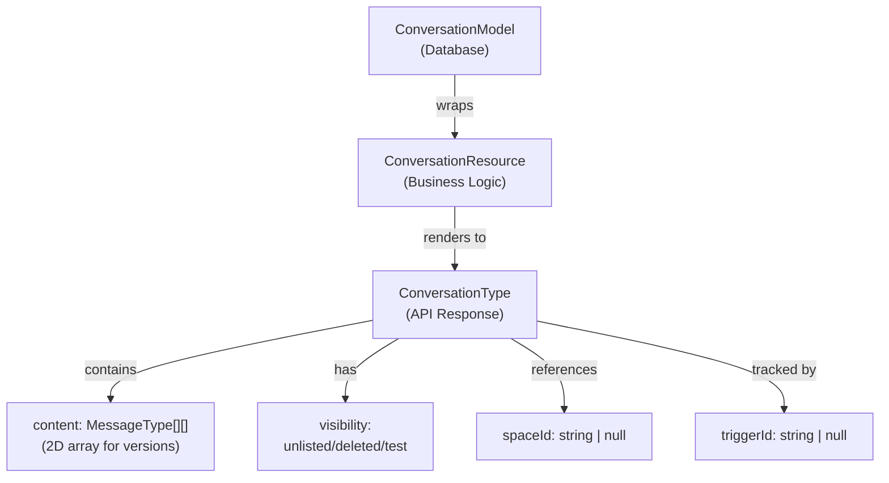
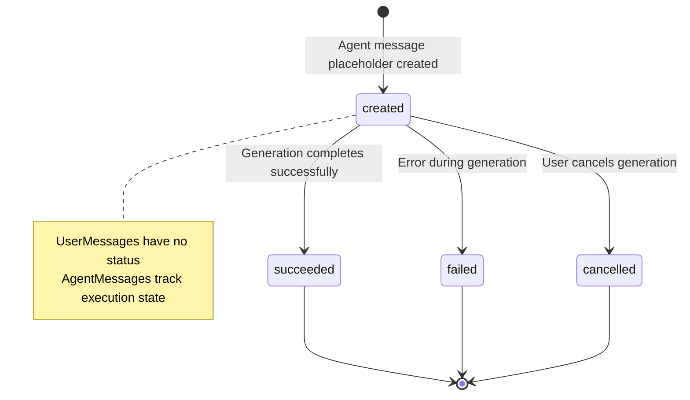
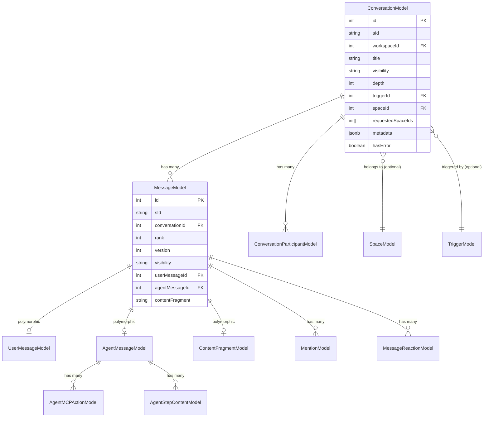

<!-- source: DeepWiki mcp.deepwiki.com · repo dust-tt/dust · page 5 Conversation System · fetched 2026-10-27 -->

# Conversation System

<details>
<summary>Relevant source files</summary>

The following files were used as context for generating this wiki page:

- [front/admin/db.ts](front/admin/db.ts)
- [front/components/assistant/conversation/AgentMessage.tsx](front/components/assistant/conversation/AgentMessage.tsx)
- [front/components/assistant/conversation/CompactionMessage.tsx](front/components/assistant/conversation/CompactionMessage.tsx)
- [front/components/assistant/conversation/ConversationViewer.tsx](front/components/assistant/conversation/ConversationViewer.tsx)
- [front/components/assistant/conversation/MessageItem.tsx](front/components/assistant/conversation/MessageItem.tsx)
- [front/components/assistant/conversation/UserMessage.tsx](front/components/assistant/conversation/UserMessage.tsx)
- [front/components/assistant/conversation/actions/AgentActionsPanel.tsx](front/components/assistant/conversation/actions/AgentActionsPanel.tsx)
- [front/components/assistant/conversation/actions/inline/InlineActivitySteps.tsx](front/components/assistant/conversation/actions/inline/InlineActivitySteps.tsx)
- [front/components/assistant/conversation/actions/inline/TimelineRow.tsx](front/components/assistant/conversation/actions/inline/TimelineRow.tsx)
- [front/components/assistant/conversation/types.ts](front/components/assistant/conversation/types.ts)
- [front/hooks/conversations/index.ts](front/hooks/conversations/index.ts)
- [front/hooks/conversations/useConversationMessages.ts](front/hooks/conversations/useConversationMessages.ts)
- [front/hooks/useAgentMessageStream.test.ts](front/hooks/useAgentMessageStream.test.ts)
- [front/hooks/useAgentMessageStream.ts](front/hooks/useAgentMessageStream.ts)
- [front/hooks/useChildAgentStream.ts](front/hooks/useChildAgentStream.ts)
- [front/hooks/useConversationEvents.ts](front/hooks/useConversationEvents.ts)
- [front/lib/api/assistant/activity_steps.test.ts](front/lib/api/assistant/activity_steps.test.ts)
- [front/lib/api/assistant/activity_steps.ts](front/lib/api/assistant/activity_steps.ts)
- [front/lib/api/assistant/conversation.test.ts](front/lib/api/assistant/conversation.test.ts)
- [front/lib/api/assistant/conversation.ts](front/lib/api/assistant/conversation.ts)
- [front/lib/api/assistant/conversation/destroy.ts](front/lib/api/assistant/conversation/destroy.ts)
- [front/lib/api/assistant/conversation/fetch.ts](front/lib/api/assistant/conversation/fetch.ts)
- [front/lib/api/assistant/conversation/forks.test.ts](front/lib/api/assistant/conversation/forks.test.ts)
- [front/lib/api/assistant/conversation/forks.ts](front/lib/api/assistant/conversation/forks.ts)
- [front/lib/api/assistant/conversation/messages.test.ts](front/lib/api/assistant/conversation/messages.test.ts)
- [front/lib/api/assistant/conversation/messages.ts](front/lib/api/assistant/conversation/messages.ts)
- [front/lib/api/assistant/conversation/permissions.test.ts](front/lib/api/assistant/conversation/permissions.test.ts)
- [front/lib/api/assistant/conversation/permissions.ts](front/lib/api/assistant/conversation/permissions.ts)
- [front/lib/api/assistant/conversation/validate_agent_mention.ts](front/lib/api/assistant/conversation/validate_agent_mention.ts)
- [front/lib/api/assistant/premium_model_limit.test.ts](front/lib/api/assistant/premium_model_limit.test.ts)
- [front/lib/api/assistant/premium_model_limit.ts](front/lib/api/assistant/premium_model_limit.ts)
- [front/lib/api/spaces/access.ts](front/lib/api/spaces/access.ts)
- [front/lib/models/agent/conversation.ts](front/lib/models/agent/conversation.ts)
- [front/lib/resources/conversation_resource.test.ts](front/lib/resources/conversation_resource.test.ts)
- [front/lib/resources/conversation_resource.ts](front/lib/resources/conversation_resource.ts)
- [front/lib/resources/storage/models/files.ts](front/lib/resources/storage/models/files.ts)
- [front/lib/resources/string_ids.ts](front/lib/resources/string_ids.ts)
- [front/migrations/post-deploy/20260721120000_drop_shareable_files_workspace_id_file_id_index.sql](front/migrations/post-deploy/20260721120000_drop_shareable_files_workspace_id_file_id_index.sql)
- [front/migrations/pre-deploy/20260720180500_add_index_shareable_files_file_id.sql](front/migrations/pre-deploy/20260720180500_add_index_shareable_files_file_id.sql)
- [front/migrations/pre-deploy/20260819134521_add_file_system_node_id_to_files.sql](front/migrations/pre-deploy/20260819134521_add_file_system_node_id_to_files.sql)
- [front/poke/temporal/activities.ts](front/poke/temporal/activities.ts)
- [front/types/assistant/conversation.ts](front/types/assistant/conversation.ts)
- [sparkle/src/components/ConversationMessages.tsx](sparkle/src/components/ConversationMessages.tsx)

</details>


## Purpose and Scope

The Conversation System manages the creation, persistence, and real-time updates of conversations between users and AI agents in the Dust platform. This system handles message threading, participant management, mentions, reactions, and synchronization between the backend database and frontend UI.

For information about agent execution within conversations, see [Agent Execution and Temporal Workflows](#3.3). For details on real-time event streaming, see [Event Streaming and Real-time Updates](#5.3). For UI-specific rendering logic, see [Conversation UI Components](#5.4).

**Sources:** [front/lib/api/assistant/conversation.ts:1-133](), [front/lib/resources/conversation_resource.ts:1-95]()

---

## Core Concepts

### Conversations

A **Conversation** represents a threaded discussion between users and agents. Each conversation has:

- **Visibility**: `unlisted` (default), `deleted` (soft-deleted), or `test` (hidden from user history)
- **Space Association**: Conversations can belong to a project space or be private (`spaceId`)
- **Depth**: Tracks conversation nesting level (default 0)
- **Metadata**: Extensible JSON object for additional context
- **Requested Space IDs**: List of space IDs required for permission checks
- **Trigger**: Optional reference to scheduled or webhook triggers



**Sources:** [front/types/assistant/conversation.ts:286-349](), [front/lib/resources/conversation_resource.ts:66-95]()

### Messages

Messages follow a **2D array structure** to support versioning (edits/retries):
- First dimension: `rank` (chronological order)
- Second dimension: `version` (edit history for user messages, retry history for agent messages)

| Message Type | Description | Key Fields |
|-------------|-------------|------------|
| `UserMessageType` | User-authored messages | `content`, `mentions`, `context`, `user` |
| `AgentMessageType` | Agent-generated responses | `configuration`, `actions`, `status`, `content` |
| `ContentFragmentType` | Attached files/documents | `contentType`, `fileId`, `title` |

**Sources:** [front/types/assistant/conversation.ts:34-49](), [front/types/assistant/conversation.ts:145-169](), [front/types/assistant/conversation.ts:212-246]()

### Message Status and Lifecycle



**Sources:** [front/types/assistant/conversation.ts:186-195]()

### Participants

Participants track user engagement with conversations:

- **Action Types**: `posted` (sent message), `reacted` (added emoji), `subscribed` (manually joined)
- **Action Required**: Flag indicating user needs to respond
- **Last Read Timestamp**: Used for unread indicators
- **Conversation Creator**: First participant who created the conversation

**Sources:** [front/lib/resources/conversation_resource.ts:60-78](), [front/types/assistant/conversation.ts:351-377]()

---

## Database Schema

### Core Models



**Key Indexes:**
- `(conversationId, rank, version)` - Fast message retrieval
- `(workspaceId, visibility, updatedAt)` - Conversation listing
- `(spaceId)` - Project conversation filtering

**Sources:** [front/lib/models/agent/conversation.ts:1-800](), [front/admin/db.ts:27-35]()

### Advisory Locks

To prevent race conditions during message creation, the system uses PostgreSQL advisory locks based on conversation ID:

```typescript
// Key generation: md5(conversation_message_rank_version_{conversationId}) % 9999999999
```

The lock is acquired at transaction start and automatically released at commit/rollback, ensuring atomic rank/version assignment.

**Sources:** [front/lib/api/assistant/conversation.ts:430-454]()

---

## Conversation Management API

The Conversation Management API provides endpoints for creating, retrieving, updating, and deleting conversations and their associated messages. The core abstraction for managing conversations is the `ConversationResource` class. This API handles permission checks, database interactions, and ensures data consistency.

For detailed information on the API endpoints and the `ConversationResource` class, see [Conversation Management API](#5.1).

**Sources:** [front/lib/resources/conversation_resource.ts:191-192](), [front/lib/api/assistant/conversation.ts:515-891]()

## Message Flow and Persistence

The message flow describes the lifecycle of messages from user input to agent response and their persistence in the database. This includes handling user messages, processing mentions, creating agent messages, and managing content fragments and attachments. Transactions are used to ensure atomicity and consistency during message creation and updates.

For a comprehensive explanation of message posting, transaction management, and persistence details, see [Message Flow and Persistence](#5.2).

**Sources:** [front/lib/api/assistant/conversation.ts:515-891](), [front/lib/api/assistant/conversation/messages.ts:1-50]()

## Event Streaming and Real-time Updates

The conversation system leverages Server-Sent Events (SSE) and Redis streams to provide real-time updates to UI clients. This enables a dynamic and responsive user experience, where new messages, agent progress, and other conversation-related events are pushed to the client as they occur. Events are coalesced to optimize performance and reduce network overhead.

For an in-depth look at event types, publishing mechanisms, and client-side consumption of real-time updates, see [Event Streaming and Real-time Updates](#5.3).

**Sources:** [front/lib/api/assistant/streaming/events.ts:58-61](), [front/hooks/useAgentMessageStream.ts:1-150](), [front/hooks/useConversationEvents.ts:1-47]()

## Conversation UI Components

The user interface for conversations is built using a hierarchy of React components, designed for efficient rendering and interactive user experience. Key components include the `ConversationViewer` for displaying messages, `AgentMessage` and `UserMessage` for rendering individual messages, and the `AgentInputBar` for user input. The `VirtuosoMessageList` library is used for virtualized scrolling to handle long conversations efficiently.

For a detailed breakdown of the UI components, their structure, and how they render conversation elements, see [Conversation UI Components](#5.4).

**Sources:** [front/components/assistant/conversation/ConversationViewer.tsx:1-150](), [front/components/assistant/conversation/AgentMessage.tsx:1-140](), [front/components/assistant/conversation/UserMessage.tsx:1-100]()

## Input Bar

The input bar is a rich text editor that allows users to compose messages, mention agents and skills, attach files, and select models. It includes features like slash commands, draft persistence, and real-time validation of mentions. The `InputBarContainer` component wraps a TipTap editor to provide these capabilities.

For a comprehensive guide to the input bar's features, its underlying components, and how it integrates with the conversation system, see [Input Bar](#5.5).

**Sources:** [front/components/assistant/conversation/input_bar/InputBarContainer.tsx:1-200](), [front/components/assistant/conversation/input_bar/InputBarContext.ts:1-50]()

---

