<!-- source: DeepWiki mcp.deepwiki.com · repo dust-tt/dust · page 5.2 Message Flow and Persistence · fetched 2026-10-27 -->

# Message Flow and Persistence

Relevant source files

The following files were used as context for generating this wiki page:

- [front/admin/db.ts](front/admin/db.ts)
- [front/components/assistant/conversation/AgentMessage.tsx](front/components/assistant/conversation/AgentMessage.tsx)
- [front/components/assistant/conversation/CompactionMessage.tsx](front/components/assistant/conversation/CompactionMessage.tsx)
- [front/components/assistant/conversation/ConversationViewer.tsx](front/components/assistant/conversation/ConversationViewer.tsx)
- [front/components/assistant/conversation/MessageItem.tsx](front/components/assistant/conversation/MessageItem.tsx)
- [front/components/assistant/conversation/UserMessage.tsx](front/components/assistant/conversation/UserMessage.tsx)
- [front/components/assistant/conversation/actions/AgentActionsPanel.tsx](front/components/assistant/conversation/actions/AgentActionsPanel.tsx)
- [front/components/assistant/conversation/actions/inline/InlineActivitySteps.tsx](front/components/assistant/conversation/actions/inline/InlineActivitySteps.tsx)
- [front/components/assistant/conversation/actions/inline/TimelineRow.tsx](front/components/assistant/conversation/actions/inline/TimelineRow.tsx)
- [front/components/assistant/conversation/input_bar/pasted_utils.ts](front/components/assistant/conversation/input_bar/pasted_utils.ts)
- [front/components/assistant/conversation/types.ts](front/components/assistant/conversation/types.ts)
- [front/hooks/conversations/index.ts](front/hooks/conversations/index.ts)
- [front/hooks/conversations/useConversationMessages.ts](front/hooks/conversations/useConversationMessages.ts)
- [front/hooks/useAgentMessageStream.test.ts](front/hooks/useAgentMessageStream.test.ts)
- [front/hooks/useAgentMessageStream.ts](front/hooks/useAgentMessageStream.ts)
- [front/hooks/useChildAgentStream.ts](front/hooks/useChildAgentStream.ts)
- [front/hooks/useConversationEvents.ts](front/hooks/useConversationEvents.ts)
- [front/lib/actions/mcp_internal_actions/utils/file_utils.ts](front/lib/actions/mcp_internal_actions/utils/file_utils.ts)
- [front/lib/api/actions/servers/conversation_files/index.ts](front/lib/api/actions/servers/conversation_files/index.ts)
- [front/lib/api/actions/servers/conversation_files/metadata.ts](front/lib/api/actions/servers/conversation_files/metadata.ts)
- [front/lib/api/actions/servers/conversation_files/tools/index.test.ts](front/lib/api/actions/servers/conversation_files/tools/index.test.ts)
- [front/lib/api/actions/servers/conversation_files/tools/index.ts](front/lib/api/actions/servers/conversation_files/tools/index.ts)
- [front/lib/api/assistant/activity_steps.test.ts](front/lib/api/assistant/activity_steps.test.ts)
- [front/lib/api/assistant/activity_steps.ts](front/lib/api/assistant/activity_steps.ts)
- [front/lib/api/assistant/conversation.test.ts](front/lib/api/assistant/conversation.test.ts)
- [front/lib/api/assistant/conversation.ts](front/lib/api/assistant/conversation.ts)
- [front/lib/api/assistant/conversation/answer_user_question.ts](front/lib/api/assistant/conversation/answer_user_question.ts)
- [front/lib/api/assistant/conversation/attachments.test.ts](front/lib/api/assistant/conversation/attachments.test.ts)
- [front/lib/api/assistant/conversation/attachments.ts](front/lib/api/assistant/conversation/attachments.ts)
- [front/lib/api/assistant/conversation/destroy.ts](front/lib/api/assistant/conversation/destroy.ts)
- [front/lib/api/assistant/conversation/fetch.ts](front/lib/api/assistant/conversation/fetch.ts)
- [front/lib/api/assistant/conversation/forks.test.ts](front/lib/api/assistant/conversation/forks.test.ts)
- [front/lib/api/assistant/conversation/forks.ts](front/lib/api/assistant/conversation/forks.ts)
- [front/lib/api/assistant/conversation/messages.test.ts](front/lib/api/assistant/conversation/messages.test.ts)
- [front/lib/api/assistant/conversation/messages.ts](front/lib/api/assistant/conversation/messages.ts)
- [front/lib/api/assistant/conversation/permissions.test.ts](front/lib/api/assistant/conversation/permissions.test.ts)
- [front/lib/api/assistant/conversation/permissions.ts](front/lib/api/assistant/conversation/permissions.ts)
- [front/lib/api/assistant/conversation/resolve_authentication.ts](front/lib/api/assistant/conversation/resolve_authentication.ts)
- [front/lib/api/assistant/conversation/retry_blocked_actions.ts](front/lib/api/assistant/conversation/retry_blocked_actions.ts)
- [front/lib/api/assistant/conversation/validate_actions.test.ts](front/lib/api/assistant/conversation/validate_actions.test.ts)
- [front/lib/api/assistant/conversation/validate_actions.ts](front/lib/api/assistant/conversation/validate_actions.ts)
- [front/lib/api/assistant/conversation/validate_agent_mention.ts](front/lib/api/assistant/conversation/validate_agent_mention.ts)
- [front/lib/api/assistant/email/validate_tool_from_email.test.ts](front/lib/api/assistant/email/validate_tool_from_email.test.ts)
- [front/lib/api/assistant/email/validate_tool_from_email.ts](front/lib/api/assistant/email/validate_tool_from_email.ts)
- [front/lib/api/assistant/jit_utils.ts](front/lib/api/assistant/jit_utils.ts)
- [front/lib/api/assistant/messages.ts](front/lib/api/assistant/messages.ts)
- [front/lib/api/assistant/premium_model_limit.test.ts](front/lib/api/assistant/premium_model_limit.test.ts)
- [front/lib/api/assistant/premium_model_limit.ts](front/lib/api/assistant/premium_model_limit.ts)
- [front/lib/api/files/snippet.ts](front/lib/api/files/snippet.ts)
- [front/lib/api/mcp/create_mcp.ts](front/lib/api/mcp/create_mcp.ts)
- [front/lib/api/spaces/access.ts](front/lib/api/spaces/access.ts)
- [front/lib/models/agent/actions/mcp.ts](front/lib/models/agent/actions/mcp.ts)
- [front/lib/models/agent/conversation.ts](front/lib/models/agent/conversation.ts)
- [front/lib/reinforcement/tool_execution.ts](front/lib/reinforcement/tool_execution.ts)
- [front/lib/resources/agent_mcp_action/output_storage.ts](front/lib/resources/agent_mcp_action/output_storage.ts)
- [front/lib/resources/agent_mcp_action_resource.test.ts](front/lib/resources/agent_mcp_action_resource.test.ts)
- [front/lib/resources/agent_mcp_action_resource.ts](front/lib/resources/agent_mcp_action_resource.ts)
- [front/lib/resources/content_fragment_resource.test.ts](front/lib/resources/content_fragment_resource.test.ts)
- [front/lib/resources/content_fragment_resource.ts](front/lib/resources/content_fragment_resource.ts)
- [front/lib/resources/conversation_resource.test.ts](front/lib/resources/conversation_resource.test.ts)
- [front/lib/resources/conversation_resource.ts](front/lib/resources/conversation_resource.ts)
- [front/lib/resources/storage/models/files.ts](front/lib/resources/storage/models/files.ts)
- [front/lib/resources/string_ids.ts](front/lib/resources/string_ids.ts)
- [front/migrations/20260512_backfill_step_content_tool_execution.ts](front/migrations/20260512_backfill_step_content_tool_execution.ts)
- [front/migrations/post-deploy/20260721120000_drop_shareable_files_workspace_id_file_id_index.sql](front/migrations/post-deploy/20260721120000_drop_shareable_files_workspace_id_file_id_index.sql)
- [front/migrations/pre-deploy/20260720180500_add_index_shareable_files_file_id.sql](front/migrations/pre-deploy/20260720180500_add_index_shareable_files_file_id.sql)
- [front/migrations/pre-deploy/20260813145341_add_generated_files_lookup_index.sql](front/migrations/pre-deploy/20260813145341_add_generated_files_lookup_index.sql)
- [front/migrations/pre-deploy/20260819134521_add_file_system_node_id_to_files.sql](front/migrations/pre-deploy/20260819134521_add_file_system_node_id_to_files.sql)
- [front/poke/temporal/activities.ts](front/poke/temporal/activities.ts)
- [front/scripts/backfill_mcp_action_output_item_gcs_paths.ts](front/scripts/backfill_mcp_action_output_item_gcs_paths.ts)
- [front/tests/utils/ConversationFactory.ts](front/tests/utils/ConversationFactory.ts)
- [front/types/api/assistant/conversation/attachments.ts](front/types/api/assistant/conversation/attachments.ts)
- [front/types/assistant/conversation.ts](front/types/assistant/conversation.ts)
- [front/types/content_fragment.ts](front/types/content_fragment.ts)
- [sparkle/src/components/ConversationMessages.tsx](sparkle/src/components/ConversationMessages.tsx)

## Purpose and Scope

This document describes how messages are created, persisted, and managed within conversations in the Dust platform. It covers the complete lifecycle of message creation, including transaction management, advisory locking mechanisms, database persistence patterns, message versioning for edits, and cascading deletion behaviors.

For information about conversation management and retrieval, see [Conversation Management API](#5.1). For real-time event streaming and SSE updates, see [Event Streaming and Real-time Updates](#5.3).

---

## Message Creation Lifecycle

When a user posts a message to a conversation, the system follows a multi-phase process that creates the user message, processes mentions, creates placeholder agent messages, and launches asynchronous agent execution.

### High-Level Flow

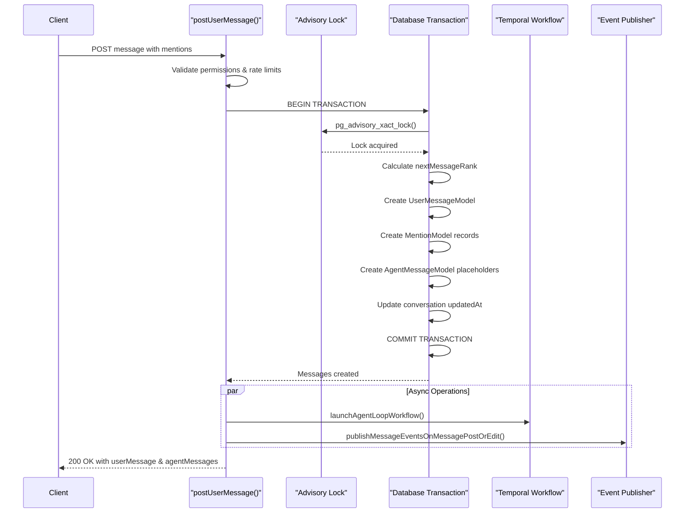

**Sources:** [front/lib/api/assistant/conversation.ts:515-891]()

---

### Message Creation Transaction

The core message creation logic executes within a single database transaction protected by an advisory lock. This ensures atomicity and prevents race conditions when multiple messages are posted concurrently.

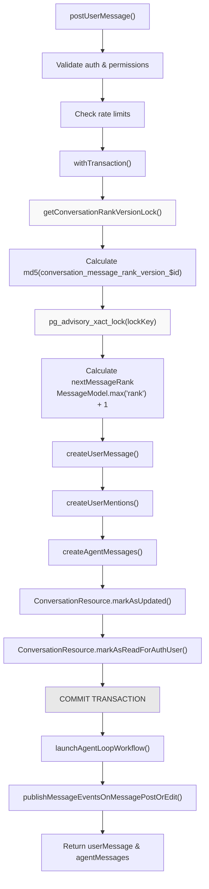

The transaction flow at [front/lib/api/assistant/conversation.ts:669-804]() uses `withTransaction()` to ensure all database operations succeed or fail atomically. The advisory lock prevents multiple concurrent message posts from creating messages with duplicate ranks.

**Sources:** [front/lib/api/assistant/conversation.ts:669-804](), [front/lib/api/assistant/conversation/lock.ts:1-30]()

---

## Transaction Management and Advisory Locking

### Advisory Lock Implementation

The system uses PostgreSQL advisory locks to synchronize concurrent message creation. Each conversation has a unique lock key derived from its ID:

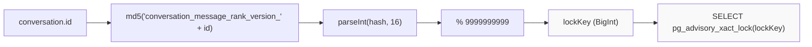

The lock acquisition at [front/lib/api/assistant/conversation/lock.ts:14-20]() uses a transaction-scoped advisory lock that automatically releases when the transaction commits or rolls back. The lock key is computed to fit within PostgreSQL's BigInt range.

**Critical Constraint:** During the advisory lock period, **no other SQL queries** should be issued outside the transaction holding the lock. This prevents connection pool exhaustion and potential deadlocks [front/lib/api/assistant/conversation/lock.ts:9-13]().

**Sources:** [front/lib/api/assistant/conversation/lock.ts:1-30]()

---

### Message Rank Calculation

Messages within a conversation are ordered by two fields:
- **`rank`**: The position in the conversation (0, 1, 2, ...)
- **`version`**: The version at that rank (0 for original, 1+ for edits)

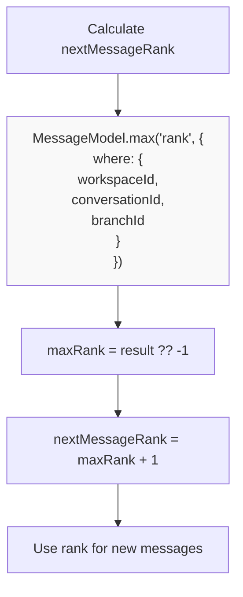

At [front/lib/api/assistant/conversation/lock.ts:22-28](), the system queries for the maximum rank and increments it. This ensures sequential ordering within the transaction's isolated view of the database.

**Sources:** [front/lib/api/assistant/conversation/lock.ts:22-28]()

---

## Database Schema and Models

### Core Message Models

The conversation message persistence uses a multi-table schema with the `MessageModel` as the central junction point:

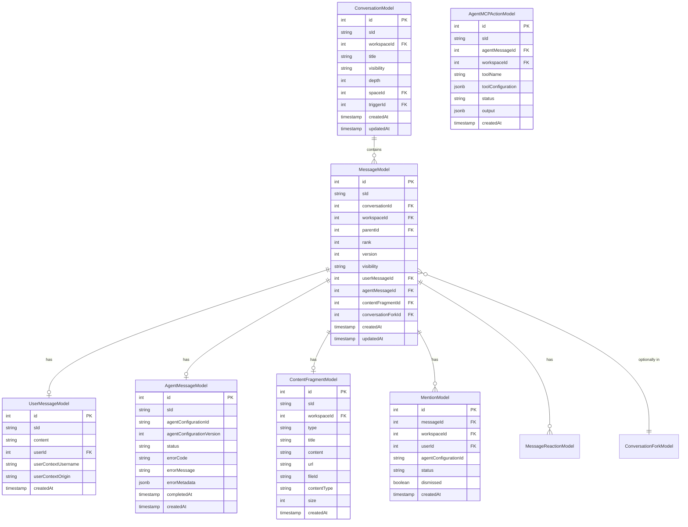

**Key Design Patterns:**

1.  **Polymorphic Message Types**: `MessageModel` acts as a junction with foreign keys to `userMessageId`, `agentMessageId`, or `contentFragmentId` (only one is non-null) [front/lib/models/agent/conversation.ts:200-269]().
2.  **Rank-Version Tuple**: The `(rank, version)` pair provides both ordering and edit history. Fetching "latest" messages requires grouping by rank and selecting max version [front/lib/api/assistant/messages.ts:180-303]().
3.  **Workspace Scoping**: All tables include `workspaceId` for multi-tenancy and efficient querying with composite indexes.
4.  **Content Fragments**: `ContentFragmentModel` stores structured content (e.g., files, URLs) that can be attached to messages.
5.  **AgentMCPActionModel**: Records the execution of MCP tools by agents, including tool configuration, status, and output.

**Sources:** [front/lib/models/agent/conversation.ts:95-269](), [front/lib/models/agent/actions/mcp.ts:1-100](), [front/lib/resources/storage/models/content_fragment.ts:1-50]()

---

### Message Visibility and Soft Deletion

Messages use the `visibility` field for soft deletion:

| Visibility | Meaning |
|------------|---------|
| `"visible"` | Normal, active message |
| `"deleted"` | Soft-deleted, excluded from queries by default |

The deletion at [front/lib/api/assistant/conversation/destroy.ts:59-119]() updates visibility rather than removing rows, preserving referential integrity and audit history.

**Sources:** [front/lib/api/assistant/conversation/destroy.ts:1-150](), [front/lib/models/agent/conversation.ts:95-269]()

---

## Message Versioning and Editing

### Edit Message Flow

When a user edits a message, the system creates a new version at the same rank rather than mutating the existing record:

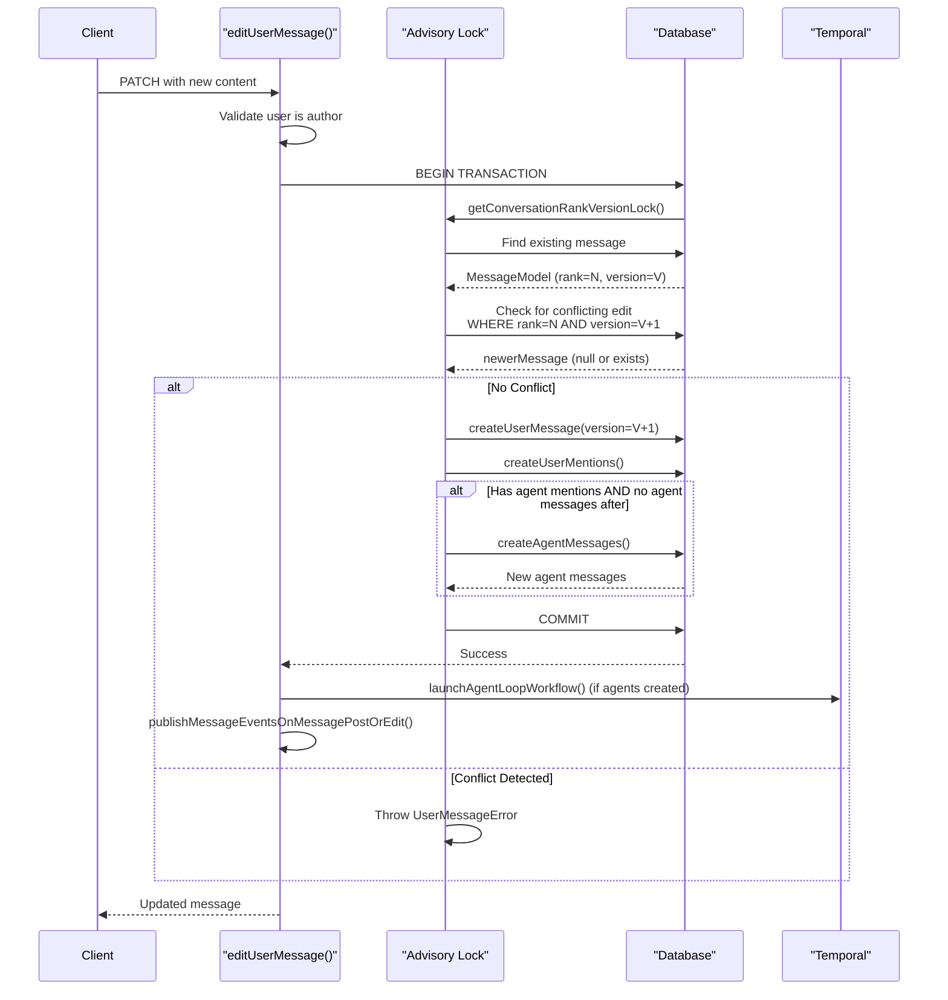

The edit logic at [front/lib/api/assistant/conversation.ts:920-1199]() checks for concurrent edits by querying for `version + 1` at the same rank. If found, the edit is rejected to prevent overwriting another user's concurrent edit.

**Edit Behavior with Agent Mentions:**

1.  If the edited message **adds agent mentions** AND there are **no agent messages after the edited rank**, the system creates new agent message placeholders [front/lib/api/assistant/conversation.ts:1076-1125]().
2.  If agent messages already exist after the edit point, the edit updates the user message only, leaving the conversation flow intact.

**Sources:** [front/lib/api/assistant/conversation.ts:920-1199]()

---

### Message Version Retrieval

Fetching messages from the conversation requires handling the rank-version structure:

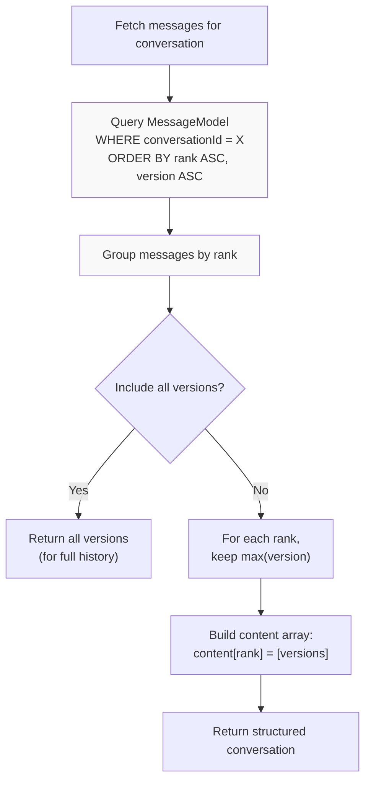

The query at [front/lib/api/assistant/conversation/fetch.ts:1-350]() retrieves all messages ordered by `(rank, version)`. For display, the system typically shows only the latest version of each rank, but the full version history remains accessible for audit purposes.

**Sources:** [front/lib/api/assistant/conversation/fetch.ts:1-350](), [front/lib/api/assistant/messages.ts:180-303]()

---

## Message Deletion and Cascades

### Soft Delete vs Hard Delete

The system supports two deletion modes:

1.  **Soft Delete** (default): Sets `visibility = 'deleted'` without removing rows
2.  **Hard Delete**: Physically removes records and all related data

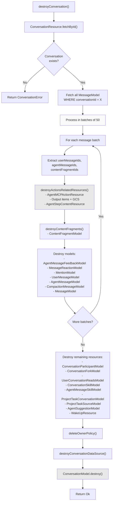

**Cascade Order:**

The deletion at [front/lib/api/assistant/conversation/destroy.ts:59-150]() follows a specific order to respect foreign key constraints:

1.  **Message-related data** (batched by 50 messages):
    *   Agent action outputs (including GCS cleanup) [front/lib/api/assistant/conversation/destroy.ts:53-74]()
    *   Agent actions (`AgentMCPActionResource`) [front/lib/api/assistant/conversation/destroy.ts:66-74]()
    *   Agent step contents (`AgentStepContentResource`) [front/lib/api/assistant/conversation/destroy.ts:180-182]()
    *   Content fragments (`ContentFragmentModel`) [front/lib/api/assistant/conversation/destroy.ts:103-120]()
    *   Feedbacks (`AgentMessageFeedbackModel`) [front/lib/api/assistant/conversation/destroy.ts:183-188]()
    *   Reactions (`MessageReactionModel`) [front/lib/api/assistant/conversation/destroy.ts:86-91]()
    *   Mentions (`MentionResource`) [front/lib/api/assistant/conversation/destroy.ts:92-95]()
    *   User messages (`UserMessageModel`) [front/lib/api/assistant/conversation/destroy.ts:174-179]()
    *   Agent messages (`AgentMessageModel`) [front/lib/api/assistant/conversation/destroy.ts:197-202]()
    *   Compaction messages (`CompactionMessageModel`) [front/lib/api/assistant/conversation/destroy.ts:207-212]()
    *   Message records (`MessageModel`) [front/lib/api/assistant/conversation/destroy.ts:96-101]()
2.  **Conversation-level data**:
    *   Conversation forks (`ConversationForkResource`) [front/lib/api/assistant/conversation/destroy.ts:82-85]()
    *   Participants (`ConversationParticipantModel`) [front/lib/resources/conversation_resource.ts:300-305]()
    *   Read markers (`UserConversationReadsModel`) [front/lib/resources/conversation_resource.ts:306-311]()
    *   Skills (`ConversationSkillModel`, `AgentMessageSkillModel`) [front/lib/api/assistant/conversation/destroy.ts:189-196]()
    *   Project tasks (`ProjectTaskConversationModel`, `ProjectTaskSourceModel`) [front/lib/resources/conversation_resource.ts:312-317]()
    *   Agent suggestions (`AgentSuggestionModel`) [front/lib/resources/conversation_resource.ts:318-323]()
    *   Wake-ups (`WakeUpResource`) [front/lib/resources/conversation_resource.ts:324-329]()
3.  **Sandbox Egress Policy**: `deleteOwnerPolicy()` for sandbox-related network rules [front/lib/api/assistant/conversation/destroy.ts:3-3]()
4.  **Conversation Data Source**: `destroyConversationDataSource()` if the conversation has an associated data source [front/lib/api/assistant/conversation/destroy.ts:122-139]()
5.  **Conversation record** (`ConversationModel`) [front/lib/resources/conversation_resource.ts:330-335]()

**Batching Strategy:** Messages are processed in batches of 50 (`DESTROY_MESSAGE_BATCH`) to avoid loading excessive data into memory for large conversations [front/lib/api/assistant/conversation/destroy.ts:45]().

**Sources:** [front/lib/api/assistant/conversation/destroy.ts:1-215](), [front/lib/resources/conversation_resource.ts:295-335](), [front/poke/temporal/activities.ts:203-236]()

---

## Mention Processing

### Mention Creation Flow

When a message contains mentions (either user or agent mentions), the system creates corresponding `MentionModel` records linked to the message:

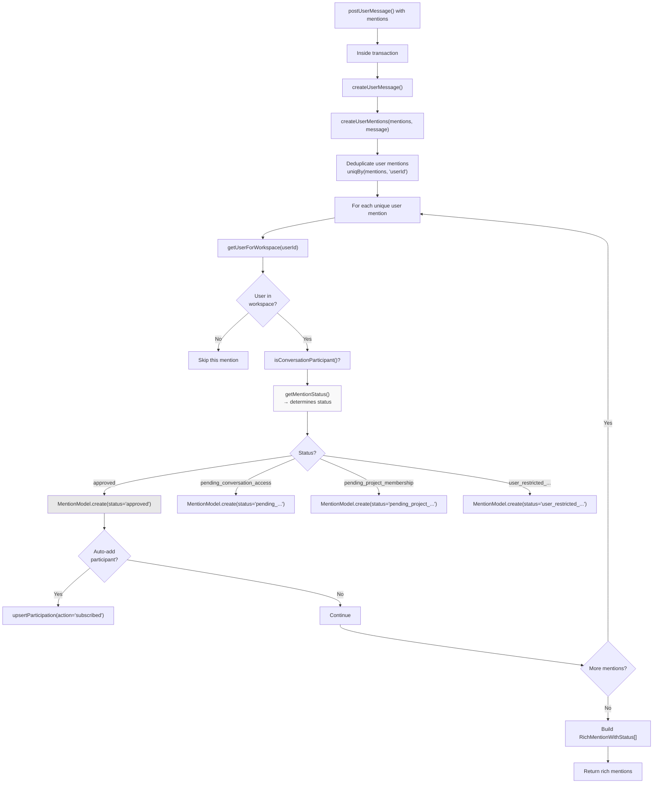

**Mention Status Values:**

| Status | Meaning |
|--------|---------|
| `"approved"` | User can access conversation and is auto-added as participant |
| `"pending_conversation_access"` | User exists but awaits approval to access conversation |
| `"pending_project_membership"` | User needs to be added to project space |
| `"user_restricted_by_conversation_access"` | User cannot access due to space permissions |
| `"agent_restricted_by_space_usage"` | Agent cannot be used due to space restrictions |

The status determination at [front/lib/api/assistant/conversation/mentions.ts:55-114]() considers:
- Whether conversation is a project conversation
- User's membership in the project space
- User's access to conversation's requested spaces
- Whether user is already a participant

**Sources:** [front/lib/api/assistant/conversation/mentions.ts:116-195](), [front/lib/api/assistant/conversation/mentions.ts:55-114]()

---

### Mention Validation and Project Membership

Users can approve or reject pending mentions. For project conversations, approval automatically adds the user to the project space:

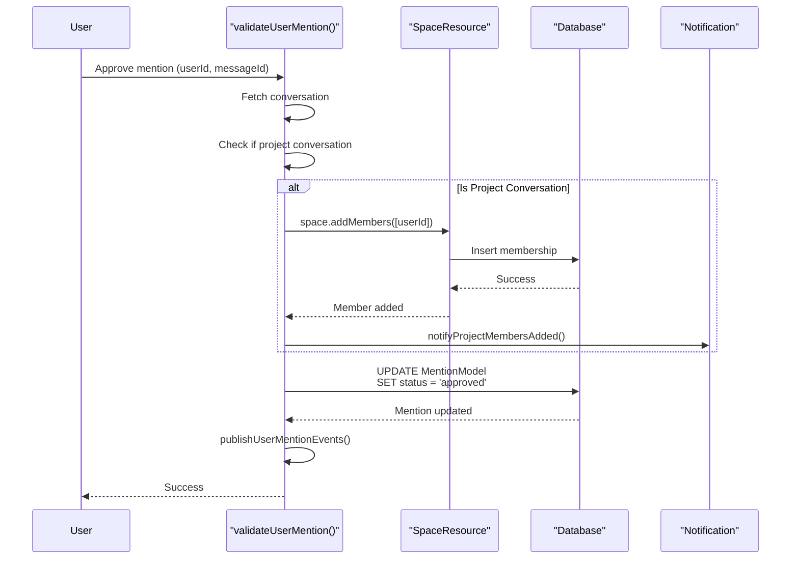

At [front/lib/api/assistant/conversation/mentions.ts:224-258](), approving a mention in a project conversation triggers `space.addMembers()` before updating the mention status. This ensures the user gains project access before being notified.

**Sources:** [front/lib/api/assistant/conversation/mentions.ts:196-383]()

---

## Agent Message Creation and Persistence

When an agent is mentioned, a placeholder `AgentMessageModel` is created. The actual content and status of this message are updated asynchronously by the agent loop.

### AgentMCPActionResource

The `AgentMCPActionResource` manages the persistence of actions performed by agents, particularly those involving Model Context Protocol (MCP) tools. It stores details about tool calls, their configurations, and outputs.

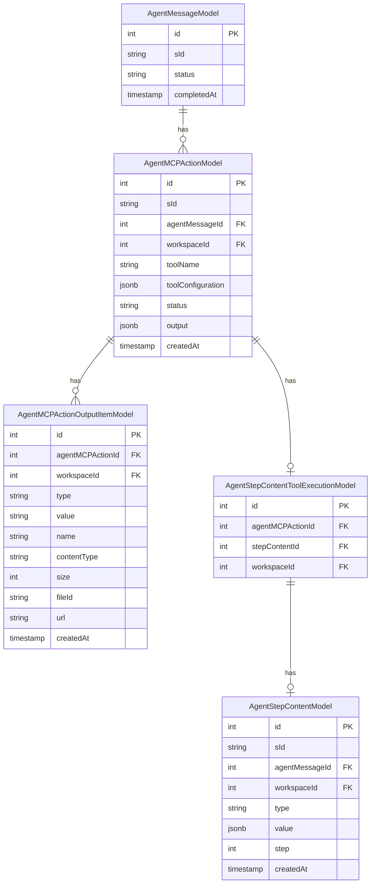

**Key aspects of `AgentMCPActionResource`:**

*   **Tool Execution Tracking**: Each `AgentMCPActionModel` represents a single tool execution by an agent [front/lib/models/agent/actions/mcp.ts:10-12]().
*   **Output Storage**: `AgentMCPActionOutputItemModel` stores the output of tool executions, which can include various types of data like files, text, or structured JSON [front/lib/models/agent/actions/mcp.ts:13-15](). Large outputs are stored in GCS and referenced by `fileId` [front/lib/resources/agent_mcp_action/output_storage.ts:1-50]().
*   **Status Management**: The `status` field tracks the lifecycle of the tool execution (e.g., `running`, `succeeded`, `failed`, `blocked`) [front/lib/resources/agent_mcp_action_resource.ts:6-11]().
*   **Content Fragments**: Tool outputs can generate content fragments, which are then associated with the conversation.
*   **Deletion Cascade**: When an `AgentMessageModel` is deleted, all associated `AgentMCPActionModel` records and their `AgentMCPActionOutputItemModel`s are also deleted, including cleanup of GCS objects [front/lib/api/assistant/conversation/destroy.ts:53-74]().

**Sources:** [front/lib/resources/agent_mcp_action_resource.ts:1-128](), [front/lib/models/agent/actions/mcp.ts:1-15](), [front/lib/api/assistant/conversation/destroy.ts:53-74]()

---

## Content Fragments and Attachments

Content fragments represent structured pieces of content (e.g., files, URLs, code snippets) that can be part of a message.

### ContentFragmentModel

The `ContentFragmentModel` stores metadata about these fragments.

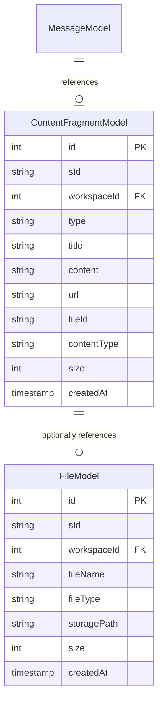

**Key aspects:**

*   **Types**: Fragments can be of various types, such as `file`, `url`, `code`, `text` [front/lib/resources/storage/models/content_fragment.ts:1-50]().
*   **File Attachments**: If a fragment is a file, it references a `FileModel` via `fileId`. The actual file content is stored in GCS [front/lib/api/files/attachments.ts:1-92]().
*   **Creation**: `postNewContentFragment()` handles the creation and association of content fragments with messages [front/lib/api/assistant/conversation.ts:1201-1260]().
*   **Deletion**: When a message referencing a content fragment is deleted, the `ContentFragmentModel` is also deleted. If it's a file, the associated GCS object is cleaned up [front/lib/api/assistant/conversation/destroy.ts:103-120]().

**Sources:** [front/lib/resources/storage/models/content_fragment.ts:1-50](), [front/lib/api/assistant/conversation.ts:1201-1260](), [front/lib/api/assistant/conversation/destroy.ts:103-120]()

---

## Transaction Isolation and Consistency

### Isolation Level

The system uses PostgreSQL's default `READ COMMITTED` isolation level. Within a transaction:

1.  **Snapshot Consistency**: All reads see a consistent snapshot from transaction start
2.  **Write Visibility**: Writes are visible only within the transaction until commit
3.  **Advisory Lock Serialization**: The advisory lock ensures only one transaction at a time modifies a conversation's messages

### Read-Your-Writes Consistency

After message creation, the API immediately returns the created messages [front/lib/api/assistant/conversation.ts:887-890](). Subsequent reads may occur from:

1.  **Primary Database**: Sees changes immediately after commit
2.  **Read Replicas** (if configured): May have replication lag (typically <1s)
3.  **SSE Events**: Delivered asynchronously to all connected clients

The optimistic UI pattern in the frontend displays placeholder messages immediately based on the API response, while SSE events provide eventual consistency for all observers.

**Sources:** [front/lib/api/assistant/conversation.ts:515-891](), [front/lib/api/assistant/streaming/events.ts:1-202]()

---

