<!-- source: DeepWiki mcp.deepwiki.com · repo dust-tt/dust · page 5.4 Conversation UI Components · fetched 2026-10-27 -->

# Conversation UI Components

<details>
<summary>Relevant source files</summary>

The following files were used as context for generating this wiki page:

- [connectors/src/connectors/dust_project/lib/api_errors.test.ts](connectors/src/connectors/dust_project/lib/api_errors.test.ts)
- [connectors/src/connectors/dust_project/lib/api_errors.ts](connectors/src/connectors/dust_project/lib/api_errors.ts)
- [front-api/routes/poke/workspaces/[wId]/files/[sId].ts](front-api/routes/poke/workspaces/[wId]/files/[sId].ts)
- [front/admin/db.ts](front/admin/db.ts)
- [front/components/FairUsageModal.tsx](front/components/FairUsageModal.tsx)
- [front/components/app/FairUseCreditsUsage.tsx](front/components/app/FairUseCreditsUsage.tsx)
- [front/components/assistant/ConversationViewerEmptyState.tsx](front/components/assistant/ConversationViewerEmptyState.tsx)
- [front/components/assistant/conversation/AgentBrowserContainer.tsx](front/components/assistant/conversation/AgentBrowserContainer.tsx)
- [front/components/assistant/conversation/AgentMessage.tsx](front/components/assistant/conversation/AgentMessage.tsx)
- [front/components/assistant/conversation/CompactionMessage.tsx](front/components/assistant/conversation/CompactionMessage.tsx)
- [front/components/assistant/conversation/ConversationContainer.tsx](front/components/assistant/conversation/ConversationContainer.tsx)
- [front/components/assistant/conversation/ConversationLayout.tsx](front/components/assistant/conversation/ConversationLayout.tsx)
- [front/components/assistant/conversation/ConversationMenu.tsx](front/components/assistant/conversation/ConversationMenu.tsx)
- [front/components/assistant/conversation/ConversationSidePanelHeader.tsx](front/components/assistant/conversation/ConversationSidePanelHeader.tsx)
- [front/components/assistant/conversation/ConversationTitle.tsx](front/components/assistant/conversation/ConversationTitle.tsx)
- [front/components/assistant/conversation/ConversationViewer.tsx](front/components/assistant/conversation/ConversationViewer.tsx)
- [front/components/assistant/conversation/MessageItem.tsx](front/components/assistant/conversation/MessageItem.tsx)
- [front/components/assistant/conversation/SidebarMenu.tsx](front/components/assistant/conversation/SidebarMenu.tsx)
- [front/components/assistant/conversation/UserMessage.tsx](front/components/assistant/conversation/UserMessage.tsx)
- [front/components/assistant/conversation/actions/AgentActionsPanel.tsx](front/components/assistant/conversation/actions/AgentActionsPanel.tsx)
- [front/components/assistant/conversation/actions/inline/InlineActivitySteps.tsx](front/components/assistant/conversation/actions/inline/InlineActivitySteps.tsx)
- [front/components/assistant/conversation/actions/inline/TimelineRow.tsx](front/components/assistant/conversation/actions/inline/TimelineRow.tsx)
- [front/components/assistant/conversation/attachment/utils.test.tsx](front/components/assistant/conversation/attachment/utils.test.tsx)
- [front/components/assistant/conversation/files_panel/ConversationFileExplorer.tsx](front/components/assistant/conversation/files_panel/ConversationFileExplorer.tsx)
- [front/components/assistant/conversation/files_panel/ConversationFilesPanel.tsx](front/components/assistant/conversation/files_panel/ConversationFilesPanel.tsx)
- [front/components/assistant/conversation/files_panel/FilePreviewPanel.tsx](front/components/assistant/conversation/files_panel/FilePreviewPanel.tsx)
- [front/components/assistant/conversation/files_panel/FilesTab.tsx](front/components/assistant/conversation/files_panel/FilesTab.tsx)
- [front/components/assistant/conversation/files_panel/SandboxTab.tsx](front/components/assistant/conversation/files_panel/SandboxTab.tsx)
- [front/components/assistant/conversation/files_panel/types.ts](front/components/assistant/conversation/files_panel/types.ts)
- [front/components/assistant/conversation/files_panel/utils.ts](front/components/assistant/conversation/files_panel/utils.ts)
- [front/components/assistant/conversation/interactive_content/UnsupportedContentRenderer.tsx](front/components/assistant/conversation/interactive_content/UnsupportedContentRenderer.tsx)
- [front/components/assistant/conversation/types.ts](front/components/assistant/conversation/types.ts)
- [front/components/assistant/conversation/utils.ts](front/components/assistant/conversation/utils.ts)
- [front/components/file_explorer/FileExplorer.test.tsx](front/components/file_explorer/FileExplorer.test.tsx)
- [front/components/file_explorer/FileExplorer.tsx](front/components/file_explorer/FileExplorer.tsx)
- [front/components/file_explorer/FileExplorerBreadcrumb.tsx](front/components/file_explorer/FileExplorerBreadcrumb.tsx)
- [front/components/file_explorer/FileExplorerContent.tsx](front/components/file_explorer/FileExplorerContent.tsx)
- [front/components/file_explorer/FileExplorerItem.tsx](front/components/file_explorer/FileExplorerItem.tsx)
- [front/components/file_explorer/FilePreviewContent.tsx](front/components/file_explorer/FilePreviewContent.tsx)
- [front/components/file_explorer/FilePreviewDialog.tsx](front/components/file_explorer/FilePreviewDialog.tsx)
- [front/components/file_explorer/PDFViewer.tsx](front/components/file_explorer/PDFViewer.tsx)
- [front/components/file_explorer/fileExplorerDragDrop.test.ts](front/components/file_explorer/fileExplorerDragDrop.test.ts)
- [front/components/file_explorer/fileExplorerDragDrop.ts](front/components/file_explorer/fileExplorerDragDrop.ts)
- [front/components/file_explorer/fileExplorerPipeline.test.ts](front/components/file_explorer/fileExplorerPipeline.test.ts)
- [front/components/file_explorer/fileExplorerPipeline.ts](front/components/file_explorer/fileExplorerPipeline.ts)
- [front/components/file_explorer/types.ts](front/components/file_explorer/types.ts)
- [front/components/file_explorer/utils.test.ts](front/components/file_explorer/utils.test.ts)
- [front/components/file_explorer/utils.ts](front/components/file_explorer/utils.ts)
- [front/components/navigation/NavigationSidebar.tsx](front/components/navigation/NavigationSidebar.tsx)
- [front/components/pod/files/EditPodFrameTabDialog.tsx](front/components/pod/files/EditPodFrameTabDialog.tsx)
- [front/components/pod/files/PodFileExplorer.tsx](front/components/pod/files/PodFileExplorer.tsx)
- [front/components/pod/files/PodFrameTabButton.tsx](front/components/pod/files/PodFrameTabButton.tsx)
- [front/components/pod/tasks/SuggestedTaskItem.tsx](front/components/pod/tasks/SuggestedTaskItem.tsx)
- [front/components/poke/pages/FramePage.tsx](front/components/poke/pages/FramePage.tsx)
- [front/components/spaces/SpaceSideBarMenu.tsx](front/components/spaces/SpaceSideBarMenu.tsx)
- [front/hooks/conversations/index.ts](front/hooks/conversations/index.ts)
- [front/hooks/conversations/useBranchConversation.ts](front/hooks/conversations/useBranchConversation.ts)
- [front/hooks/conversations/useConversationMessages.ts](front/hooks/conversations/useConversationMessages.ts)
- [front/hooks/conversations/useConversationSandboxFiles.ts](front/hooks/conversations/useConversationSandboxFiles.ts)
- [front/hooks/conversations/useConversationSandboxStatus.ts](front/hooks/conversations/useConversationSandboxStatus.ts)
- [front/hooks/useAgentMessageStream.test.ts](front/hooks/useAgentMessageStream.test.ts)
- [front/hooks/useAgentMessageStream.ts](front/hooks/useAgentMessageStream.ts)
- [front/hooks/useChildAgentStream.ts](front/hooks/useChildAgentStream.ts)
- [front/hooks/useConversationEvents.ts](front/hooks/useConversationEvents.ts)
- [front/hooks/useCreateConversationWithMessage.ts](front/hooks/useCreateConversationWithMessage.ts)
- [front/hooks/useFolderPathUrlState.ts](front/hooks/useFolderPathUrlState.ts)
- [front/hooks/usePodFrameTabs.ts](front/hooks/usePodFrameTabs.ts)
- [front/hooks/useSubmitMessage.ts](front/hooks/useSubmitMessage.ts)
- [front/lib/api/assistant/activity_steps.test.ts](front/lib/api/assistant/activity_steps.test.ts)
- [front/lib/api/assistant/activity_steps.ts](front/lib/api/assistant/activity_steps.ts)
- [front/lib/api/assistant/conversation.test.ts](front/lib/api/assistant/conversation.test.ts)
- [front/lib/api/assistant/conversation.ts](front/lib/api/assistant/conversation.ts)
- [front/lib/api/assistant/conversation/destroy.ts](front/lib/api/assistant/conversation/destroy.ts)
- [front/lib/api/assistant/conversation/fetch.ts](front/lib/api/assistant/conversation/fetch.ts)
- [front/lib/api/assistant/conversation/forks.test.ts](front/lib/api/assistant/conversation/forks.test.ts)
- [front/lib/api/assistant/conversation/forks.ts](front/lib/api/assistant/conversation/forks.ts)
- [front/lib/api/assistant/conversation/messages.test.ts](front/lib/api/assistant/conversation/messages.test.ts)
- [front/lib/api/assistant/conversation/messages.ts](front/lib/api/assistant/conversation/messages.ts)
- [front/lib/api/assistant/conversation/permissions.test.ts](front/lib/api/assistant/conversation/permissions.test.ts)
- [front/lib/api/assistant/conversation/permissions.ts](front/lib/api/assistant/conversation/permissions.ts)
- [front/lib/api/assistant/conversation/validate_agent_mention.ts](front/lib/api/assistant/conversation/validate_agent_mention.ts)
- [front/lib/api/assistant/premium_model_limit.test.ts](front/lib/api/assistant/premium_model_limit.test.ts)
- [front/lib/api/assistant/premium_model_limit.ts](front/lib/api/assistant/premium_model_limit.ts)
- [front/lib/api/files/read.ts](front/lib/api/files/read.ts)
- [front/lib/api/spaces/access.ts](front/lib/api/spaces/access.ts)
- [front/lib/models/agent/conversation.ts](front/lib/models/agent/conversation.ts)
- [front/lib/resources/conversation_resource.test.ts](front/lib/resources/conversation_resource.test.ts)
- [front/lib/resources/conversation_resource.ts](front/lib/resources/conversation_resource.ts)
- [front/lib/resources/storage/models/files.ts](front/lib/resources/storage/models/files.ts)
- [front/lib/resources/string_ids.ts](front/lib/resources/string_ids.ts)
- [front/lib/spaces.ts](front/lib/spaces.ts)
- [front/lib/spaces_utils.ts](front/lib/spaces_utils.ts)
- [front/lib/swr/files.ts](front/lib/swr/files.ts)
- [front/migrations/post-deploy/20260721120000_drop_shareable_files_workspace_id_file_id_index.sql](front/migrations/post-deploy/20260721120000_drop_shareable_files_workspace_id_file_id_index.sql)
- [front/migrations/pre-deploy/20260720180500_add_index_shareable_files_file_id.sql](front/migrations/pre-deploy/20260720180500_add_index_shareable_files_file_id.sql)
- [front/migrations/pre-deploy/20260819134521_add_file_system_node_id_to_files.sql](front/migrations/pre-deploy/20260819134521_add_file_system_node_id_to_files.sql)
- [front/poke/swr/frame_details.ts](front/poke/swr/frame_details.ts)
- [front/poke/temporal/activities.ts](front/poke/temporal/activities.ts)
- [front/styles/theme-extras.css](front/styles/theme-extras.css)
- [front/types/assistant/conversation.ts](front/types/assistant/conversation.ts)
- [front/types/error.ts](front/types/error.ts)
- [sdks/js/src/errors/errors.ts](sdks/js/src/errors/errors.ts)
- [sparkle/src/components/ConversationMessages.tsx](sparkle/src/components/ConversationMessages.tsx)
- [sparkle/src/components/NavigationList.tsx](sparkle/src/components/NavigationList.tsx)

</details>


## Purpose and Scope

This document covers the frontend UI components responsible for rendering conversations, messages, and user input in the Dust platform. These components handle the display of agent and user messages, real-time streaming updates, message interactions (reactions, editing, deletion), and the input bar for composing new messages.

For information about the backend conversation API and message persistence, see [Conversation Management API](#5.1). For details on event streaming and SSE, see [Event Streaming and Real-time Updates](#5.3). For agent execution logic, see [Agent Execution and Temporal Workflows](#3.3).

---

## Component Hierarchy

The conversation UI is structured as a hierarchy of components, with `ConversationLayout` at the top providing layout structure, `ConversationViewer` managing the virtualized message list, and specialized components for rendering individual messages and handling user input.

### Main Component Tree

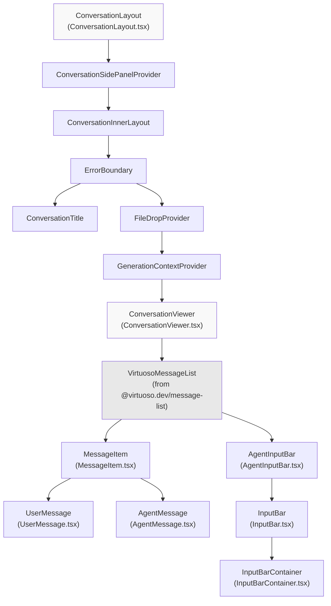

**Sources**: [front/components/assistant/conversation/ConversationLayout.tsx:1-201](), [front/components/assistant/conversation/ConversationViewer.tsx:1-850](), [front/components/assistant/conversation/MessageItem.tsx:1-230]()

---

## Message Rendering Components

### MessageItem Component

The `MessageItem` component acts as a router that determines which specialized component to render based on message type. It wraps both user and agent messages with common functionality like date indicators and mention validation displays.

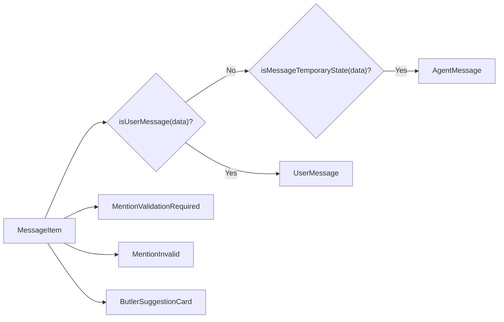

The component performs type discrimination using helper functions `isUserMessage()` and `isMessageTemporaryState()` defined in [front/components/assistant/conversation/types.ts:208-210](). It also handles visibility checks via `isHiddenMessage()` to filter out system messages like onboarding messages and handovers.

**Sources**: [front/components/assistant/conversation/MessageItem.tsx:29-230](), [front/components/assistant/conversation/types.ts:175-182]()

### UserMessage Component

The `UserMessage` component renders user-authored messages with support for editing, deletion, reactions, and content fragments (attachments).

**Key Features**:
- **Inline Editing**: Uses `UserMessageEditor` with TipTap editor for in-place message editing
- **Reactions**: Displays `MessageReactions` and `MessageEmojiPicker` for emoji responses
- **Action Menu**: Dropdown with copy link, edit, and delete actions
- **Citations**: Renders attached content fragments as `AttachmentCitation` components
- **Agent Suggestions**: Shows `AgentSuggestion` component for last message without mentions

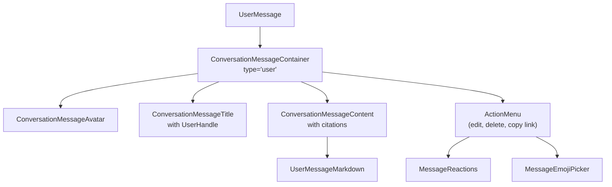

The component uses the custom hook `useEditUserMessage()` to handle saving edits and `useDeleteMessage()` for deletions. Message visibility is controlled by the `shouldShowEditor` state which toggles between display and edit modes.

**Sources**: [front/components/assistant/conversation/UserMessage.tsx:1-528]()

### AgentMessage Component

The `AgentMessage` component is the most complex message renderer, handling agent responses with streaming content, tool actions, and various blocked states requiring user intervention.

**Component Structure**:

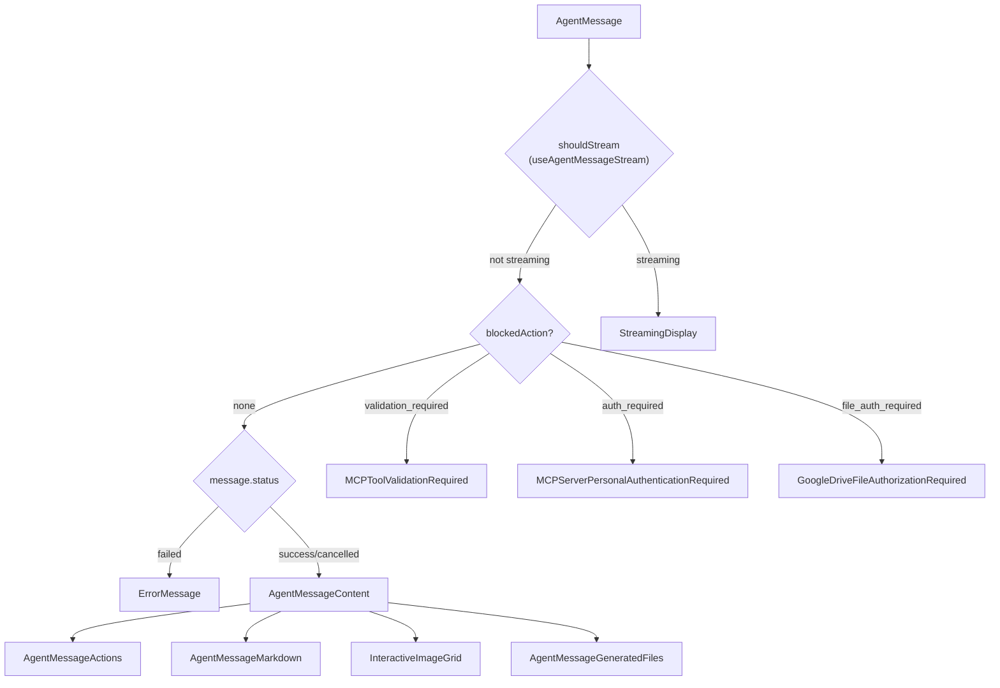

**Streaming State Management**: The component uses `useAgentMessageStream()` hook to subscribe to SSE events for the message. The hook processes events like:
- `tool_approve_execution`: Enqueues blocked action requiring validation
- `tool_personal_auth_required`: Enqueues authentication requirement
- `tool_file_auth_required`: Enqueues file authorization requirement
- `agent_message_success`/`agent_error`/`agent_generation_cancelled`: Removes blocked actions

**Message Actions**: The component renders various action buttons based on state:
- **Stop button**: When streaming with multiple agents
- **Copy button**: With dropdown for retry and delete
- **Feedback selector**: Thumbs up/down for completed messages
- **Retry button**: For non-streaming, non-failed messages

**Sources**: [front/components/assistant/conversation/AgentMessage.tsx:1-1297]()

### AgentMessageContent Sub-Component

The `AgentMessageContent` component (within AgentMessage.tsx) handles the actual content rendering and citation management.

**Key Responsibilities**:
- **Citation Tracking**: Uses `CitationsContext.Provider` to manage active references
- **Custom Markdown Components**: Registers visualization, cite block, quick reply, and tool setup plugins
- **Generated Files**: Displays both images (via `InteractiveImageGrid`) and interactive content
- **Blocked Actions**: Renders validation/authentication prompts via `MCPToolValidationRequired`, `MCPServerPersonalAuthenticationRequired`, and `GoogleDriveFileAuthorizationRequired`

**Sources**: [front/components/assistant/conversation/AgentMessage.tsx:851-1297]()

---

## Input Bar Components

The input bar system is layered with three main components providing progressively more specialized functionality.

### Input Bar Component Hierarchy

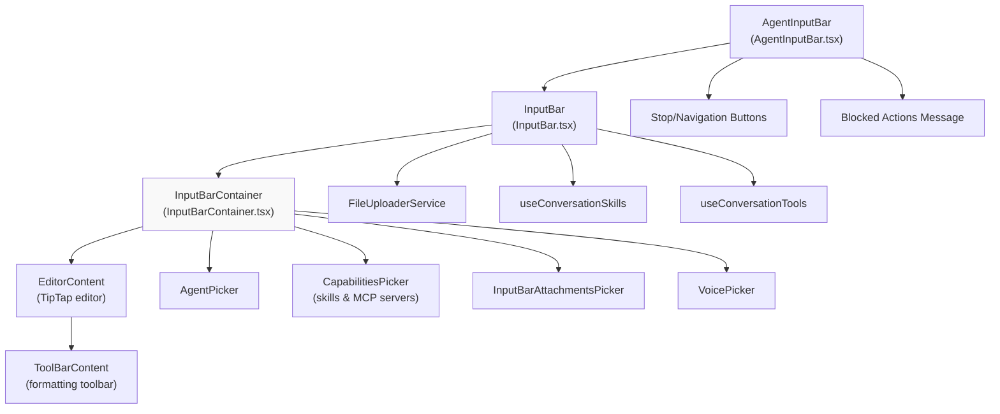

**Sources**: [front/components/assistant/conversation/AgentInputBar.tsx:1-368](), [front/components/assistant/conversation/input_bar/InputBar.tsx:1-404](), [front/components/assistant/conversation/input_bar/InputBarContainer.tsx:1-1108]()

### AgentInputBar

`AgentInputBar` provides conversation-level controls and wraps the `InputBar` component:

**Features**:
- **Stop Generation**: Button to cancel all generating agent messages in the conversation
- **Message Navigation**: Arrow buttons to scroll to previous/next user messages
- **Blocked Actions Indicator**: Shows count of pending validations with "Review" button to cycle through them
- **Auto-Mentions**: Automatically prefills agent mentions from the last user message

The navigation logic uses `VirtuosoMessageList` methods to calculate message positions and scroll locations. It filters for user messages using `isUserMessage()` and determines scrollability based on viewport position.

**Sources**: [front/components/assistant/conversation/AgentInputBar.tsx:40-368]()

### InputBar

`InputBar` manages conversation-specific state and coordinates file uploads, tool selection, and message submission:

**State Management**:
- **Attached Nodes**: Data source content nodes selected for attachment
- **Selected MCP Server Views**: Tools selected via `CapabilitiesPicker`
- **Selected Skills**: Skills selected for the conversation
- **File Uploader Service**: Manages file upload lifecycle

**Hooks Used**:
| Hook | Purpose |
|------|---------|
| `useConversationSkills()` | Fetches current conversation skills |
| `useConversationTools()` | Fetches current conversation MCP server views |
| `useAddDeleteConversationSkill()` | Mutates conversation skills |
| `useAddDeleteConversationTool()` | Mutates conversation MCP server views |
| `useConversationDrafts()` | Auto-saves and restores draft text |

The component handles submission differently for new vs. existing conversations. For new conversations, it passes `selectedMCPServerViewIds` and `selectedSkillIds` to the submit handler since there's no conversation to attach them to yet.

**Sources**: [front/components/assistant/conversation/input_bar/InputBar.tsx:39-404]()

### InputBarContainer

`InputBarContainer` provides the core text editing experience using TipTap editor with custom extensions:

**Custom Editor Features** (via `useCustomEditor` hook):
- **Mention Support**: Auto-complete for agent and user mentions
- **URL Detection**: Automatically detects and converts pasted URLs to knowledge nodes
- **Long Text Paste**: Automatically converts long pasted text into file attachments
- **Inline Text**: Allows converting file attachments back to inline text
- **Markdown Export**: Converts editor content to markdown for submission

**Attachment Pickers**:
- `InputBarAttachmentsPicker`: For adding knowledge nodes and tool files
- `CapabilitiesPicker`: For selecting skills and MCP server views
- `AgentPicker`: For mentioning agents
- `VoicePicker`: For voice transcription

**Editor State Management**: The component uses refs to track:
- `editorRef`: Current editor instance
- `pastedAttachmentIdsRef`: Set of pasted attachment file IDs for cleanup

**Sources**: [front/components/assistant/conversation/input_bar/InputBarContainer.tsx:83-1108]()

---

## Context Providers

The conversation UI uses several React context providers to share state and functionality across components without prop drilling.

### Context Provider Stack

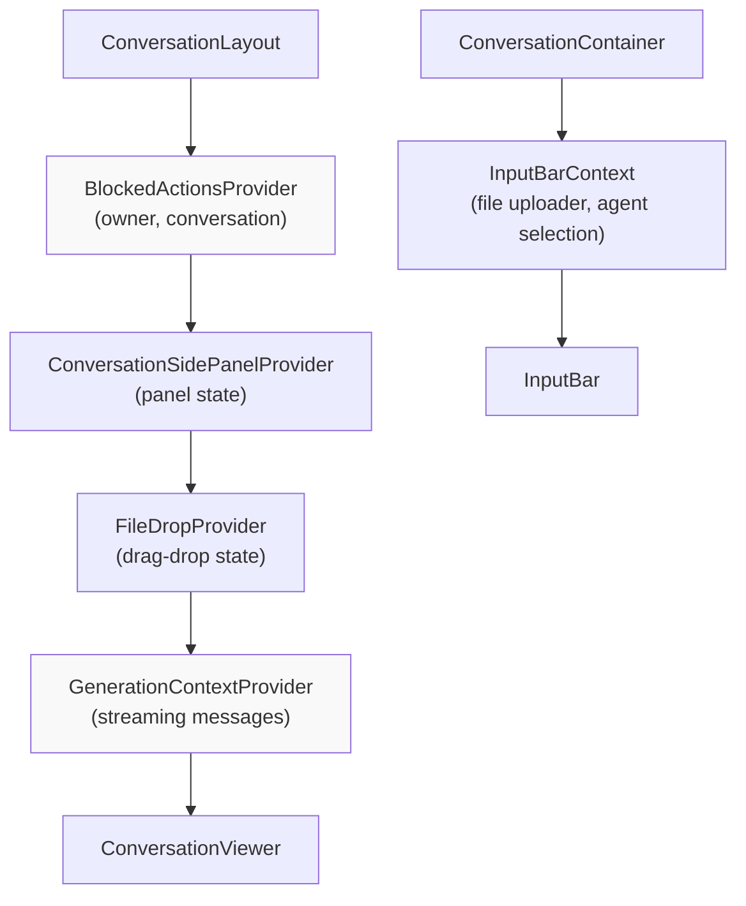

### BlockedActionsProvider

Manages blocked agent actions that require user intervention (OAuth, validation, file access). Components use `useBlockedActionsContext()` to:
- `enqueueBlockedAction()`: Add a new blocked action
- `getBlockedActions()`: Get all blocked actions for a user
- `hasPendingValidations()`: Check if validations are pending
- `startPulsingAction()`: Highlight a specific action for review

**Sources**: [front/components/assistant/conversation/BlockedAction.tsx:1-10](), [front/components/assistant/conversation/BlockedActionsProvider.tsx:1-100]()

### GenerationContextProvider

Tracks which messages are currently streaming across all conversations. This is critical for showing/hiding the stop button and managing UI state during generation.

**API**:
- `addGeneratingMessage(messageId, conversationId)`: Mark message as generating
- `removeGeneratingMessage(messageId)`: Mark message as complete
- `getConversationGeneratingMessages(conversationId)`: Get all generating messages for a conversation
- `generatingMessages`: Array of all generating messages

**Sources**: [front/components/assistant/conversation/GenerationContextProvider.tsx:1-100]() (referenced in [front/components/assistant/conversation/AgentMessage.tsx:13,341]())

### InputBarContext

Provides shared state for the input bar across the application:
- `fileUploaderService`: File upload management service
- `animate`: Trigger animation when clicking "New" button
- `selectedAgent`: Agent to auto-mention when input bar opens
- `captureActions`: Browser extension capture actions (screenshot, page content)

**Sources**: [front/components/assistant/conversation/input_bar/InputBarContext.tsx:1-100]() (referenced in [front/components/assistant/conversation/input_bar/InputBar.tsx:69]())

---

## VirtuosoMessageList Integration

The conversation viewer uses `VirtuosoMessageList` from `@virtuoso.dev/message-list` for efficient rendering of large conversation histories with virtualization.

### VirtuosoMessageList Configuration

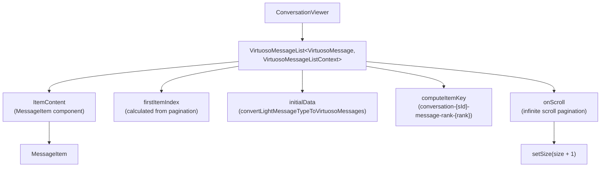

**Key Props and Methods**:

| Property/Method | Purpose | Location |
|----------------|---------|----------|
| `initialData` | Initial messages to render | [front/components/assistant/conversation/ConversationViewer.tsx:202-263]() |
| `ItemContent` | Component to render each message (MessageItem) | [front/components/assistant/conversation/ConversationViewer.tsx:820-861]() |
| `computeItemKey` | Stable key for each message (conversation-sId-message-rank-N) | [front/components/assistant/conversation/ConversationViewer.tsx:766-777]() |
| `firstItemIndex` | Index offset for pagination | [front/components/assistant/conversation/ConversationViewer.tsx:803]() |
| `context` | VirtuosoMessageListContext passed to all items | [front/components/assistant/conversation/ConversationViewer.tsx:788-833]() |
| `methods.data` | Imperative API for data manipulation | Used throughout |

### Data Manipulation Methods

The `VirtuosoMessageList` provides an imperative API via `methods.data` for updating the message list without re-mounting components:

```typescript
// Append new messages
methods.data.append([newMessage], shouldScroll)

// Prepend older messages (pagination)
methods.data.prepend([olderMessages])

// Update existing message
methods.data.map(m => m.rank === targetRank ? updatedMessage : m)

// Insert at specific position
methods.data.insert([messages], offset, shouldScroll)

// Find messages
methods.data.find(predicate)
methods.data.findIndex(predicate)
```

**Sources**: [front/components/assistant/conversation/ConversationViewer.tsx:209-308,401-557]()

### Scroll Behavior

The viewer implements custom scroll behavior for different scenarios:

**Auto-Scroll on New Messages**:
- User messages from others: Scroll to show message
- Agent messages: Scroll to put user message at top (for multi-turn)
- Own messages: Don't scroll (prevent disruption)

**Initial Scroll Position**:
- Deep link (URL hash): Scroll to linked message
- Unread conversation: Scroll to first unread message
- Read conversation: Scroll to bottom

**Custom Smooth Scroll**: Uses `customSmoothScroll()` function with easing:
```typescript
function easeOutQuint(x: number): number {
  return 1 - Math.pow(1 - x, 5);
}

function customSmoothScroll() {
  return {
    animationFrameCount: 30,
    easing: easeOutQuint,
  };
}
```

**Sources**: [front/components/assistant/conversation/ConversationViewer.tsx:131-140,649-675]()

---

## Message Streaming and Real-Time Updates

The conversation UI receives real-time updates via Server-Sent Events (SSE) and updates the UI reactively.

### Event Processing Flow

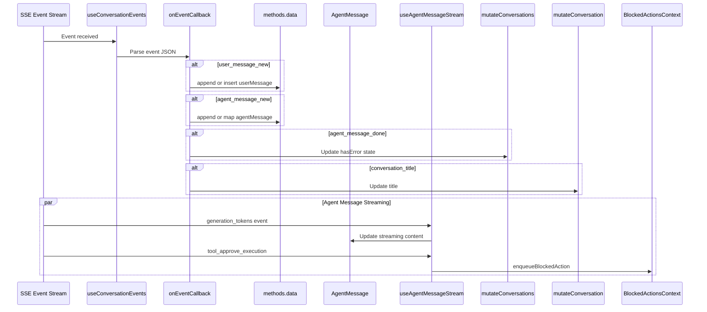

**Sources**: [front/components/assistant/conversation/ConversationViewer.tsx:373-567]()

### Agent Message Streaming Hook

The `useAgentMessageStream` hook subscribes to SSE events for a specific agent message and processes streaming updates:

**Event Types Handled**:
- `generation_tokens`: Updates streaming text content
- `tool_params`, `tool_notification`, `tool_success`, `tool_error`: Updates tool execution state
- `tool_approve_execution`: Enqueues blocked action for validation
- `tool_personal_auth_required`: Enqueues authentication requirement
- `tool_file_auth_required`: Enqueues file authorization requirement
- `agent_message_success`, `agent_error`, `agent_generation_cancelled`: Finalizes message state

The hook returns `{ shouldStream }` which indicates whether the message is currently streaming. This controls the display of streaming indicators and content updates.

**Sources**: [front/hooks/useAgentMessageStream.ts:1-250]() (referenced in [front/components/assistant/conversation/AgentMessage.tsx:200-310]())

### Conversation Event Subscription

The `useConversationEvents` hook (referenced but not shown in files) subscribes to conversation-level events and invokes the `onEventCallback` with each event. The callback uses `eventIds.current` array to deduplicate events since SSE may replay events on reconnection.

**Event Deduplication**:
```typescript
if (!eventIds.current.includes(eventPayload.eventId)) {
  eventIds.current.push(eventPayload.eventId);
  // Process event...
}
```

**Sources**: [front/components/assistant/conversation/ConversationViewer.tsx:380,399-556]()

---

## VirtuosoMessageListContext

The `VirtuosoMessageListContext` type defines the shared context passed to all message components via the VirtuosoMessageList.

### Context Structure

```typescript
type VirtuosoMessageListContext = {
  owner: LightWorkspaceType;
  user: UserType;
  isOnboardingConversation: boolean;
  handleSubmit: (
    input: string,
    mentions: RichMention[],
    contentFragments: ContentFragmentsType
  ) => Promise<Result<undefined, DustError>>;
  draftKey: string;
  conversation?: ConversationWithoutContentType;
  // Whether the conversation should render its compact UI variant (currently:
  // conversations that live in the user's activation pod).
  uiView: UiView;
  agentBuilderContext?: {
    draftAgent?: LightAgentConfigurationType;
    isSubmitting: boolean;
    actionsToShow: InputBarContainerProps["actions"];
    // Locks the conversation to its current agent: no `@` agent suggestions
    // and no agent switch on paste (used by the sidekick).
    disableAgentMentions?: boolean;
    resetConversation: () => void;
    clientSideMCPServerIds?: string[];
    skipToolsValidation?: boolean;
  };
  feedbacksByMessageId: Record<string, AgentMessageFeedbackType>;
  additionalMarkdownComponents?: Components;
  additionalMarkdownPlugins?: PluggableList;
  // Project membership fields (undefined for non-project conversations)
  isProjectMember?: boolean;
  isProjectRestricted?: boolean;
  isProjectArchived?: boolean;
  projectId?: string;
  projectSpaceName?: string;
  isAutoScrollEnabledRef: MutableRefObject<boolean>;
  isNoSeat?: boolean;
  setLimitReachedCode?: (code: WorkspaceLimit) => void;
};
```

**Sources**: [front/components/assistant/conversation/types.ts:115-152]() (referenced in [front/components/assistant/conversation/ConversationViewer.tsx:788-833]())

### Agent Builder Context Usage

When rendering in the agent builder preview, the context includes `agentBuilderContext` which:
- Provides `draftAgent` to auto-mention in input bar
- Indicates `isSubmitting` state for button loading
- Specifies `actionsToShow` to limit input bar features (e.g., only "attachment")
- Provides `resetConversation()` to clear the preview conversation
- Passes `clientSideMCPServerIds` for extension-based tools

This enables the same conversation components to work in both normal conversations and agent builder preview.

**Sources**: [front/components/assistant/conversation/types.ts:129-139]()

---

## Message Type Definitions

The conversation system uses discriminated unions to represent different message types in the virtualized list.

### VirtuosoMessage Type

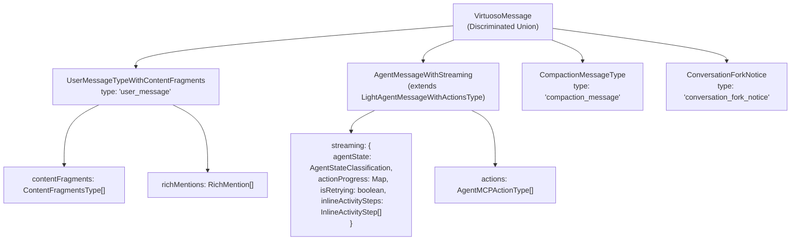

**Type Guards**:
- `isUserMessage(msg)`: Checks if message is user message [front/components/assistant/conversation/types.ts:208-210]()
- `isAgentMessageWithStreaming(msg)`: Checks if message is agent message with streaming state [front/components/assistant/conversation/types.ts:212-214]()
- `isCompactionMessage(msg)`: Checks if message is a compaction message [front/components/assistant/conversation/types.ts:200-202]()
- `isConversationForkNotice(msg)`: Checks if message is a conversation fork notice [front/components/assistant/conversation/types.ts:204-206]()
- `isHiddenMessage(msg)`: Checks if message should be hidden (onboarding, handover, etc.) [front/components/assistant/conversation/types.ts:175-182]()
- `isHandoverUserMessage(msg)`: Checks if message is agent handover [front/components/assistant/conversation/types.ts:220-222]()

**Sources**: [front/components/assistant/conversation/types.ts:109-114]()

### AgentMessageWithStreaming

Agent messages are wrapped in `AgentMessageWithStreaming` to add streaming-related state:

| Field | Type | Purpose |
|-------|------|---------|
| `agentState` | `"placeholder" \| "thinking" \| "acting" \| "writing" \| "done"` | Current agent execution phase |
| `actionProgress` | `Map<ModelId, {action, progress}>` | Progress of each tool action |
| `isRetrying` | `boolean` | Whether message is being retried |
| `lastUpdated` | `Date` | Last update timestamp |
| `inlineActivitySteps` | `InlineActivityStep[]` | Steps of the agent's activity |

The `makeInitialMessageStreamState()` helper converts `LightAgentMessageType` to `AgentMessageWithStreaming` with initial streaming state.

**Sources**: [front/components/assistant/conversation/types.ts:78-86](), [front/components/assistant/conversation/types.ts:146-148]()

---

## Conversation Container Integration

The top-level `ConversationContainerVirtuoso` component orchestrates conversation creation and handles plan limits.

### Component Responsibilities

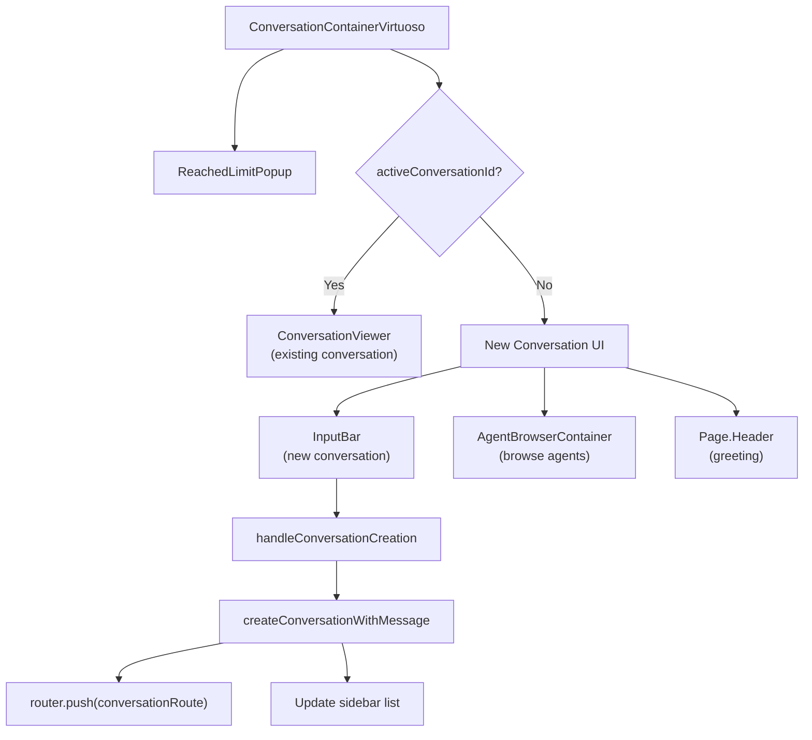

**Conversation Creation Flow**:
1. User submits message in input bar
2. `handleConversationCreation` called with input, mentions, content fragments, and selected tools/skills
3. `createConversationWithMessage` API call
4. On success: Navigate to new conversation URL and update sidebar
5. On error: Show notification or plan limit popup

**Sources**: [front/components/assistant/conversation/ConversationContainer.tsx:1-221]()

---

## Layout and Error Handling

### ConversationLayout

The `ConversationLayout` component provides the overall page structure with error boundaries and side panels:

**Key Features**:
- Error boundary for uncaught errors
- Resizable panel group for main content and side panel
- Agent details and member details modals
- Welcome tour guide integration
- Navigation children (sidebar menu)

**Sources**: [front/components/assistant/conversation/ConversationLayout.tsx:38-201]()

### Error Display Components

The system provides specialized error components for different error scenarios:

| Component | Use Case | Display |
|-----------|----------|---------|
| `ConversationErrorDisplay` | API errors (access restricted, not found) | Error-specific message with icon |
| `ErrorDisplay` | Generic errors | Customizable icon, title, message |
| `UncaughtConversationErrorFallback` | Error boundary fallback | Generic "something unexpected happened" |

**Sources**: [front/components/assistant/conversation/ConversationError.tsx:1-93](), [front/components/assistant/conversation/ConversationLayout.tsx:173-183]()

---

## Agent Builder Preview Integration

The conversation components are reused in the agent builder preview panel with specialized context.

### Preview Component Structure

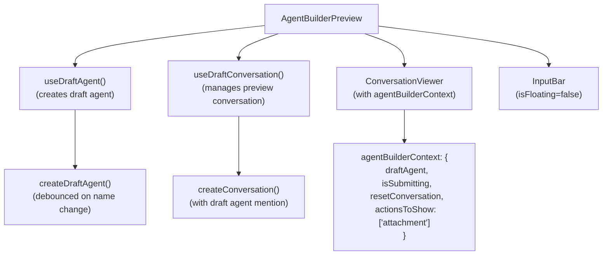

**Draft Agent Lifecycle**:
1. User edits agent configuration in form
2. `useWatch()` detects changes to instructions/actions/name
3. Debounced call to `createDraftAgent()` after 500ms
4. Draft agent saved with `status: 'draft'`
5. Preview conversation uses draft agent mention

**Preview Conversation**:
- Isolated conversation for testing agent
- Auto-mentions draft agent
- Limited input actions (only attachments)
- Reset button clears conversation

**Sources**: [front/components/agent_builder/AgentBuilderPreview.tsx:1-310](), [front/components/agent_builder/hooks/useAgentPreview.ts:1-185]()

---

## Sidebar Menu and File Explorer

### SidebarMenu

The `SidebarMenu` component, located in the left navigation panel, displays a list of conversations and pods, and provides functionality for searching, filtering, and managing them.

**Key Features**:
- **Conversation Listing**: Displays conversations grouped by date or unread status.
- **Pod Listing**: Shows pods (project spaces) and allows creation of new ones.
- **Search Functionality**: Integrates `SidebarSearch` to filter conversations and pods.
- **Actions**: Provides options to mark all conversations as read, delete conversations, and move conversations to pods.
- **Activation Nudges**: Displays recommendations for new users.

```mermaid
graph TD
    SidebarMenu["SidebarMenu<br/>(SidebarMenu.tsx)"]
    NavigationList["NavigationList"]
    SidebarSearch["SidebarSearch"]
    PodsBrowsePopover["PodsBrowsePopover"]
    ConversationMenu["ConversationMenu"]
    CreatePodModal["CreatePodModal"]
    DeleteConversationsDialog["DeleteConversationsDialog"]

    SidebarMenu --> NavigationList
    SidebarMenu --> SidebarSearch
    SidebarMenu --> PodsBrowsePopover
    SidebarMenu --> ConversationMenu
    SidebarMenu --> CreatePodModal
    SidebarMenu --> DeleteConversationsDialog

    NavigationList --> NavigationListCollapsibleSection["NavigationListCollapsibleSection<br/>(Conversations, Pods, Starred Pods)"]
    NavigationListCollapsibleSection --> NavigationListItem["NavigationListItem<br/>(Individual Conversation/Pod)"]

    subgraph Hooks
        useConversations["useConversations"]
        usePodConversationsSummary["usePodConversationsSummary"]
        useSearchPodConversations["useSearchPodConversations"]
        useSearchPrivateConversations["useSearchPrivateConversations"]
        useSearchPods["useSearchPods"]
        useDeleteConversation["useDeleteConversation"]
        useMarkAllConversationsAsRead["useMarkAllConversationsAsRead"]
        useBulkMoveConversationsToPod["useBulkMoveConversationsToPod"]
        useMoveConversationToPod["useMoveConversationToPod"]
        useActivationPod["useActivationPod"]
        useActivationRecommendations["useActivationRecommendations"]
    end

    SidebarMenu --> useConversations
    SidebarMenu --> usePodConversationsSummary
    SidebarMenu --> useSearchPodConversations
    SidebarMenu --> useSearchPrivateConversations
    SidebarMenu --> useSearchPods
    SidebarMenu --> useDeleteConversation
    SidebarMenu --> useMarkAllConversationsAsRead
    SidebarMenu --> useBulkMoveConversationsToPod
    SidebarMenu --> useMoveConversationToPod
    SidebarMenu --> useActivationPod
    SidebarMenu --> useActivationRecommendations
```

The `SidebarMenu` uses several hooks to fetch and manage conversation and pod data, including `useConversations` [front/hooks/conversations/index.ts:1-38]() for general conversations, `usePodConversationsSummary` [front/hooks/conversations/index.ts:1-38]() for pod-specific conversations, and `useSearchPods` [front/hooks/useSearchPods.ts:1-96]() for searching pods. It also integrates with `InputBarContext` [front/components/assistant/conversation/input_bar/InputBarContext.tsx:1-100]() to handle actions like creating new conversations.

**Sources**: [front/components/assistant/conversation/SidebarMenu.tsx:1-122]()

### File Explorer Panel

The `FileExplorer` component provides a UI for browsing and managing files associated with a conversation or project. It is typically rendered within a side panel.

**Key Features**:
- **File Listing**: Displays files in a hierarchical view.
- **File Upload**: Allows users to upload new files.
- **File Actions**: Provides options to delete files, rename them, and manage their visibility.
- **Contextual Filtering**: Can display files relevant to the current conversation or project.

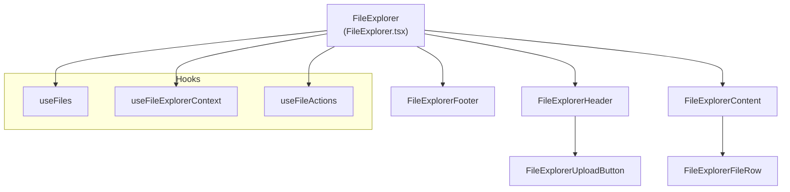

The `FileExplorer` component uses `useFiles` [front/lib/swr/files.ts:1-100]() to fetch file data and `useFileExplorerContext` [front/components/file_explorer/FileExplorer.tsx:1-100]() to manage the state of the file explorer, such as the currently selected folder and search query. It also integrates with `FileResource` [front/lib/resources/storage/models/files.ts:1-100]() for file operations.

**Sources**: [front/components/file_explorer/FileExplorer.tsx:1-100](), [front/components/file_explorer/FileExplorerContent.tsx:1-100](), [front/components/file_explorer/utils.ts:1-100]()

---

