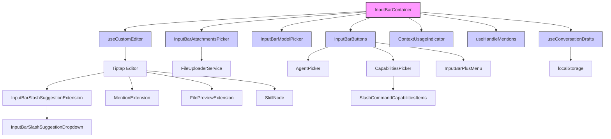
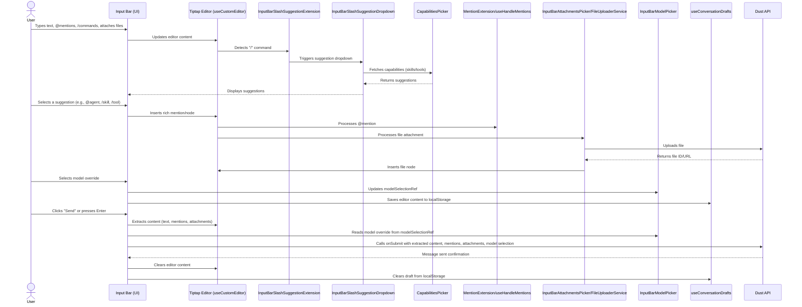

<!-- source: DeepWiki mcp.deepwiki.com · repo dust-tt/dust · page 5.5 Input Bar · fetched 2026-10-27 -->

# Input Bar

<details>
<summary>Relevant source files</summary>

The following files were used as context for generating this wiki page:

- [front/components/actions/mcp/forms/submitConnectMCPServerDialogForm.ts](front/components/actions/mcp/forms/submitConnectMCPServerDialogForm.ts)
- [front/components/agent_builder/AgentBuilderPreview.tsx](front/components/agent_builder/AgentBuilderPreview.tsx)
- [front/components/assistant/AgentPicker.tsx](front/components/assistant/AgentPicker.tsx)
- [front/components/assistant/CapabilitiesPicker.tsx](front/components/assistant/CapabilitiesPicker.tsx)
- [front/components/assistant/conversation/AgentInputBar.tsx](front/components/assistant/conversation/AgentInputBar.tsx)
- [front/components/assistant/conversation/GenerationContextProvider.tsx](front/components/assistant/conversation/GenerationContextProvider.tsx)
- [front/components/assistant/conversation/InAppBanner.tsx](front/components/assistant/conversation/InAppBanner.tsx)
- [front/components/assistant/conversation/input_bar/InputBar.tsx](front/components/assistant/conversation/input_bar/InputBar.tsx)
- [front/components/assistant/conversation/input_bar/InputBarButtons.tsx](front/components/assistant/conversation/input_bar/InputBarButtons.tsx)
- [front/components/assistant/conversation/input_bar/InputBarContainer.tsx](front/components/assistant/conversation/input_bar/InputBarContainer.tsx)
- [front/components/assistant/conversation/input_bar/InputBarContext.tsx](front/components/assistant/conversation/input_bar/InputBarContext.tsx)
- [front/components/assistant/conversation/input_bar/InputBarMessageNavigation.tsx](front/components/assistant/conversation/input_bar/InputBarMessageNavigation.tsx)
- [front/components/assistant/conversation/input_bar/InputBarModelPicker.tsx](front/components/assistant/conversation/input_bar/InputBarModelPicker.tsx)
- [front/components/assistant/conversation/input_bar/ModelPickerHighlight.tsx](front/components/assistant/conversation/input_bar/ModelPickerHighlight.tsx)
- [front/components/assistant/conversation/input_bar/inputBarCompactStyles.ts](front/components/assistant/conversation/input_bar/inputBarCompactStyles.ts)
- [front/components/assistant/conversation/input_bar/useConversationDrafts.ts](front/components/assistant/conversation/input_bar/useConversationDrafts.ts)
- [front/components/assistant/conversation/lib.ts](front/components/assistant/conversation/lib.ts)
- [front/components/editor/SkillInstructionsEditor.tsx](front/components/editor/SkillInstructionsEditor.tsx)
- [front/components/editor/extensions/MentionExtension.test.ts](front/components/editor/extensions/MentionExtension.test.ts)
- [front/components/editor/extensions/MentionExtension.tsx](front/components/editor/extensions/MentionExtension.tsx)
- [front/components/editor/extensions/input_bar/InputBarSlashSuggestionDropdown.test.ts](front/components/editor/extensions/input_bar/InputBarSlashSuggestionDropdown.test.ts)
- [front/components/editor/extensions/input_bar/InputBarSlashSuggestionDropdown.tsx](front/components/editor/extensions/input_bar/InputBarSlashSuggestionDropdown.tsx)
- [front/components/editor/extensions/input_bar/InputBarSlashSuggestionExtension.tsx](front/components/editor/extensions/input_bar/InputBarSlashSuggestionExtension.tsx)
- [front/components/editor/extensions/input_bar/InputBarSlashSuggestionItems.tsx](front/components/editor/extensions/input_bar/InputBarSlashSuggestionItems.tsx)
- [front/components/editor/extensions/input_bar/InputBarSlashSuggestionTypes.ts](front/components/editor/extensions/input_bar/InputBarSlashSuggestionTypes.ts)
- [front/components/editor/extensions/shared/SlashCommandCapabilitiesItems.test.ts](front/components/editor/extensions/shared/SlashCommandCapabilitiesItems.test.ts)
- [front/components/editor/extensions/shared/SlashCommandCapabilitiesItems.ts](front/components/editor/extensions/shared/SlashCommandCapabilitiesItems.ts)
- [front/components/editor/extensions/shared/slash_suggestion/PickModelSubMenuDropdown.tsx](front/components/editor/extensions/shared/slash_suggestion/PickModelSubMenuDropdown.tsx)
- [front/components/editor/extensions/shared/slash_suggestion/SlashCommandDropdown.tsx](front/components/editor/extensions/shared/slash_suggestion/SlashCommandDropdown.tsx)
- [front/components/editor/extensions/shared/slash_suggestion/buildSlashCommandItems.ts](front/components/editor/extensions/shared/slash_suggestion/buildSlashCommandItems.ts)
- [front/components/editor/extensions/shared/slash_suggestion/slashStaticCommands.tsx](front/components/editor/extensions/shared/slash_suggestion/slashStaticCommands.tsx)
- [front/components/editor/extensions/shared/slash_suggestion/slashSuggestionUtils.ts](front/components/editor/extensions/shared/slash_suggestion/slashSuggestionUtils.ts)
- [front/components/editor/extensions/skill_builder/RawMarkdownBlock.test.ts](front/components/editor/extensions/skill_builder/RawMarkdownBlock.test.ts)
- [front/components/editor/extensions/skill_builder/RawMarkdownBlock.tsx](front/components/editor/extensions/skill_builder/RawMarkdownBlock.tsx)
- [front/components/editor/extensions/skill_builder/SlashCommandDropdown.tsx](front/components/editor/extensions/skill_builder/SlashCommandDropdown.tsx)
- [front/components/editor/extensions/skill_builder/SlashCommandExtension.test.ts](front/components/editor/extensions/skill_builder/SlashCommandExtension.test.ts)
- [front/components/editor/extensions/skill_builder/SlashCommandExtension.tsx](front/components/editor/extensions/skill_builder/SlashCommandExtension.tsx)
- [front/components/editor/input_bar/mentionSuggestion.tsx](front/components/editor/input_bar/mentionSuggestion.tsx)
- [front/components/editor/input_bar/useCustomEditor.test.ts](front/components/editor/input_bar/useCustomEditor.test.ts)
- [front/components/editor/input_bar/useCustomEditor.tsx](front/components/editor/input_bar/useCustomEditor.tsx)
- [front/components/editor/input_bar/useHandleMentions.tsx](front/components/editor/input_bar/useHandleMentions.tsx)
- [front/components/labs/transcripts/ProviderSelection.tsx](front/components/labs/transcripts/ProviderSelection.tsx)
- [front/components/model_picker/ModelPicker.tsx](front/components/model_picker/ModelPicker.tsx)
- [front/components/model_picker/ModelPickerContent.tsx](front/components/model_picker/ModelPickerContent.tsx)
- [front/components/model_picker/ModelPickerMakersView.tsx](front/components/model_picker/ModelPickerMakersView.tsx)
- [front/components/model_picker/ModelPickerModelRow.tsx](front/components/model_picker/ModelPickerModelRow.tsx)
- [front/components/model_picker/ModelPickerSelectionIndicator.tsx](front/components/model_picker/ModelPickerSelectionIndicator.tsx)
- [front/components/model_picker/ModelTierChip.tsx](front/components/model_picker/ModelTierChip.tsx)
- [front/components/model_picker/modelPickerIcons.ts](front/components/model_picker/modelPickerIcons.ts)
- [front/components/model_picker/modelPickerTracking.test.ts](front/components/model_picker/modelPickerTracking.test.ts)
- [front/components/model_picker/modelPickerTracking.ts](front/components/model_picker/modelPickerTracking.ts)
- [front/components/pages/oauth/OAuthFinalizePage.tsx](front/components/pages/oauth/OAuthFinalizePage.tsx)
- [front/components/skill_builder/SkillBuilderInstructionsEditor.tsx](front/components/skill_builder/SkillBuilderInstructionsEditor.tsx)
- [front/components/skill_builder/SkillBuilderInstructionsReferenceSummary.tsx](front/components/skill_builder/SkillBuilderInstructionsReferenceSummary.tsx)
- [front/components/skills/SkillInfoTab.tsx](front/components/skills/SkillInfoTab.tsx)
- [front/components/skills/SkillInstructionsReadOnlyEditor.tsx](front/components/skills/SkillInstructionsReadOnlyEditor.tsx)
- [front/components/spaces/AddConnectionMenu.tsx](front/components/spaces/AddConnectionMenu.tsx)
- [front/components/triggers/CreateWebhookSourceWithProviderForm.tsx](front/components/triggers/CreateWebhookSourceWithProviderForm.tsx)
- [front/components/workspace/settings/BotToggle.tsx](front/components/workspace/settings/BotToggle.tsx)
- [front/lib/api/assistant/citations.ts](front/lib/api/assistant/citations.ts)
- [front/lib/context/clientType.tsx](front/lib/context/clientType.tsx)
- [front/lib/editor/build_skill_instructions_extensions.ts](front/lib/editor/build_skill_instructions_extensions.ts)
- [front/lib/editor/skill_instructions_preprocessing.test.ts](front/lib/editor/skill_instructions_preprocessing.test.ts)
- [front/lib/editor/skill_instructions_preprocessing.ts](front/lib/editor/skill_instructions_preprocessing.ts)
- [front/lib/resources/skill/code_defined/global/search_aliases.test.ts](front/lib/resources/skill/code_defined/global/search_aliases.test.ts)
- [front/lib/skills/global_search_aliases.ts](front/lib/skills/global_search_aliases.ts)
- [front/lib/tracking.ts](front/lib/tracking.ts)
- [front/lib/utils.ts](front/lib/utils.ts)
- [front/migrations/20260415_truncate_skill_suggestions.sql](front/migrations/20260415_truncate_skill_suggestions.sql)
- [front/public/static/Academy_Banner.png](front/public/static/Academy_Banner.png)
- [front/public/static/Extension_Banner.png](front/public/static/Extension_Banner.png)
- [front/public/static/Skills_Banner.jpg](front/public/static/Skills_Banner.jpg)
- [front/scripts/migrate_skill_instructions_html.ts](front/scripts/migrate_skill_instructions_html.ts)
- [front/tests/lib/utils.test.ts](front/tests/lib/utils.test.ts)
- [front/types/oauth/client/setup.ts](front/types/oauth/client/setup.ts)
- [sparkle/src/components/DiscoveryGlint.tsx](sparkle/src/components/DiscoveryGlint.tsx)
- [sparkle/src/stories/DiscoveryGlint.stories.tsx](sparkle/src/stories/DiscoveryGlint.stories.tsx)

</details>


The Input Bar is a rich text editor component central to user interaction within the Dust platform, particularly in conversations and agent/skill building. It provides capabilities for rich text formatting, agent and skill mentions, file attachments, model selection, and slash commands, all while ensuring draft persistence. This page details its architecture, key components, and data flow.

## Purpose and Scope

The Input Bar serves as the primary interface for users to compose messages and interact with AI agents and skills. Its design prioritizes a rich user experience, offering features like:
*   **Rich Text Editing**: Users can format their input with various styles.
*   **Slash Commands**: A powerful mechanism to trigger actions, mention agents, skills, or tools, and attach context.
*   **Agent/Skill Mentions**: Direct referencing of AI agents and skills within the input.
*   **File Attachments**: Seamless integration for attaching files to messages.
*   **Model Picker**: Allows users to override the default model used by an agent for a specific message.
*   **Draft Persistence**: Ensures that user input is saved across sessions, preventing data loss.

This page will delve into the technical implementation of these features, covering the core React components, custom editor extensions, and context providers that enable this functionality.

## Architecture and Key Components

The Input Bar's functionality is distributed across several interconnected components and hooks, primarily located in `front/components/assistant/conversation/input_bar/` and `front/components/editor/input_bar/`.

### `InputBarContainer`

The `InputBarContainer` [front/components/assistant/conversation/input_bar/InputBarContainer.tsx:1-118]() is the main wrapper component for the rich text editor and its associated controls. It orchestrates the various sub-components and manages the overall state of the input bar.

It handles:
*   **Editor Initialization**: Uses `useCustomEditor` to set up the Tiptap editor instance.
*   **Slash Command Management**: Integrates with `InputBarSlashSuggestionExtension` and `InputBarSlashSuggestionDropdown` to provide agent, skill, and tool suggestions.
*   **Mention Handling**: Leverages `useHandleMentions` for processing agent and user mentions.
*   **File Attachments**: Coordinates with `InputBarAttachmentsPicker` and `FileUploaderService` for file uploads.
*   **Model Selection**: Incorporates `InputBarModelPicker` for model overrides.
*   **Draft Persistence**: Interacts with `useConversationDrafts` to save and restore input.
*   **Context Usage Indication**: Displays `ContextUsageIndicator` to inform users about conversation context limits.


**Diagram: InputBarContainer and its Dependencies**

Sources:
- [front/components/assistant/conversation/input_bar/InputBarContainer.tsx:1-118]()

### `useCustomEditor` Hook

The `useCustomEditor` hook [front/components/editor/input_bar/useCustomEditor.tsx:36-38]() is responsible for initializing and managing the Tiptap editor instance used in the Input Bar. It configures various Tiptap extensions to provide rich text capabilities and integrate with other Input Bar features.

Key extensions configured by `useCustomEditor`:
*   `MentionExtension`: Enables `@` mentions for agents and users.
*   `InputBarSlashSuggestionExtension`: Handles `/` commands for agents, skills, and tools.
*   `FilePreviewExtension`: Displays attached files within the editor.
*   `SkillNode`: Custom node type for rendering skill mentions.
*   `URLDetectionExtension` and `URLStorageExtension`: For handling URLs.
*   `PastedAttachmentExtension`: Manages pasted files.
*   `CodeExtension`, `BlockquoteExtension`, `LinkExtension`, `EmojiExtension`, `KeyboardShortcutsExtension`, `VoicePartialNode`: Standard rich text and utility extensions.

The hook also provides an `editorService` [front/components/editor/input_bar/useCustomEditor.tsx:54-152]() with methods like `insertText`, `appendText`, `setVoicePartialText`, and `commitVoicePartialText` for programmatic interaction with the editor content.

Sources:
- [front/components/editor/input_bar/useCustomEditor.tsx:36-38]()
- [front/components/editor/input_bar/useCustomEditor.tsx:54-152]()

### Slash Command Capabilities

Slash commands (`/`) are a core interaction mechanism in the Input Bar, allowing users to quickly invoke agents, skills, or tools.

#### `SlashCommandCapabilitiesItems`

This module [front/components/editor/extensions/shared/SlashCommandCapabilitiesItems.ts:1-240]() defines the types and utility functions for handling slash commands related to capabilities (skills and tools).

*   `SELECT_SKILL_SLASH_COMMAND_ACTION`, `SELECT_TOOL_SLASH_COMMAND_ACTION`, `RUN_COMMAND_SLASH_COMMAND_ACTION`: Constants defining the actions associated with different slash commands.
*   `SkillSlashCommand`, `ToolSlashCommand`, `RunCommandSlashCommand`: Interfaces extending `SlashCommand` to carry specific data for skills, tools, and generic commands.
*   `isSkillSlashCommand`, `isToolSlashCommand`, `isRunCommandSlashCommand`: Type guards for narrowing down `SlashCommand` types.
*   `searchCapabilityIndex`: A utility function [front/components/editor/extensions/shared/SlashCommandCapabilitiesItems.ts:67-135]() that filters and sorts capability items based on a query, prioritizing exact matches, prefix matches, and favorites. This is crucial for the dropdown's suggestion logic.

#### `CapabilitiesPicker`

The `CapabilitiesPicker` component [front/components/assistant/CapabilitiesPicker.tsx:182-300]() provides a UI for users to browse and select skills and tools. It's used both as a standalone button in the Input Bar and as part of the slash command dropdown.

It fetches available skills and MCP servers (tools) and presents them in a searchable dropdown. When a capability is selected, it triggers the `onSelect` or `onSkillSelect` callback, which typically inserts the corresponding mention into the editor.

#### `InputBarSlashSuggestionDropdown`

This component [front/components/editor/extensions/input_bar/InputBarSlashSuggestionDropdown.tsx:33-76]() is the UI for the slash command suggestions that appear as the user types `/`. It uses `buildInputBarSlashCommandItems` and `useInputBarSlashCommandCapabilities` to populate the list of suggestions. It also handles sub-menus for attaching context (`AttachContextSubMenuDropdown`) and picking models (`PickModelSubMenuDropdown`).

```mermaid
graph TD
    A[User types /command] --> B[InputBarSlashSuggestionExtension]
    B --> C[InputBarSlashSuggestionDropdown]
    C --> D[buildInputBarSlashCommandItems]
    C --> E[useInputBarSlashCommandCapabilities]
    E --> F[SlashCommandCapabilitiesItems]
    F --> F1[searchCapabilityIndex]
    C --> G{Selected Command Type?}
    G -- "Skill" --> H[SkillSlashCommand]
    G -- "Tool" --> I[ToolSlashCommand]
    G -- "Attach Context" --> J[AttachContextSubMenuDropdown]
    G -- "Pick Model" --> K[PickModelSubMenuDropdown]
    H --> H1[editor.insertContent(SkillNode)]
    I --> I1[editor.insertContent(ToolNode)]
    J --> J1[applyAttachContextSelection]
    K --> K1[onModelSelectRef.current]

    style A fill:#f9f,stroke:#333,stroke-width:2px
    style B fill:#ccf,stroke:#333,stroke-width:1px
    style C fill:#ccf,stroke:#333,stroke-width:1px
    style D fill:#ccf,stroke:#333,stroke-width:1px
    style E fill:#ccf,stroke:#333,stroke-width:1px
    style F fill:#ccf,stroke:#333,stroke-width:1px
    style G fill:#f9f,stroke:#333,stroke-width:2px
    style H fill:#ccf,stroke:#333,stroke-width:1px
    style I fill:#ccf,stroke:#333,stroke-width:1px
    style J fill:#ccf,stroke:#333,stroke-width:1px
    style K fill:#ccf,stroke:#333,stroke-width:1px
```
**Diagram: Slash Command Data Flow**

Sources:
- [front/components/editor/extensions/shared/SlashCommandCapabilitiesItems.ts:1-240]()
- [front/components/editor/extensions/shared/SlashCommandCapabilitiesItems.ts:67-135]()
- [front/components/assistant/CapabilitiesPicker.tsx:182-300]()
- [front/components/editor/extensions/input_bar/InputBarSlashSuggestionDropdown.tsx:33-76]()

### Agent and Skill Mentions

The Input Bar supports `@` mentions for agents and skills, which are rendered as special nodes within the Tiptap editor.

*   **Agent Mentions**: Handled by `MentionExtension` [front/components/editor/extensions/MentionExtension.tsx:1-10]() and `mentionSuggestion` [front/components/editor/input_bar/mentionSuggestion.tsx:1-10](). When a user types `@`, a dropdown appears with suggestions for available agents. Selecting an agent inserts a `mention` node into the editor.
*   **Skill Mentions**: Skills are inserted as `SkillNode` [front/components/editor/extensions/input_bar/SkillNode.tsx:1-10]() instances. These nodes contain the skill's ID and are used to identify which skills are referenced in the user's input. The `readDefaultSkillEditorState` function [front/components/assistant/conversation/input_bar/InputBarContainer.tsx:166-186]() in `InputBarContainer` extracts these skill IDs from the editor's content.

Sources:
- [front/components/editor/extensions/MentionExtension.tsx:1-10]()
- [front/components/editor/input_bar/mentionSuggestion.tsx:1-10]()
- [front/components/editor/extensions/input_bar/SkillNode.tsx:1-10]()
- [front/components/assistant/conversation/input_bar/InputBarContainer.tsx:166-186]()

### File Attachments

Users can attach files to their messages through the Input Bar.

*   **`InputBarAttachmentsPicker`**: This component [front/components/assistant/conversation/input_bar/InputBarAttachmentsPicker.tsx:1-10]() provides the UI for selecting and managing file attachments. It integrates with a `FileUploaderService` [front/hooks/useFileUploaderService.ts:1-10]() to handle the actual upload process.
*   **`FilePreviewExtension`**: Once attached, files are represented within the Tiptap editor as special nodes, rendered by the `FilePreviewExtension` [front/components/editor/extensions/input_bar/FilePreviewExtension.tsx:1-10](). This allows users to see their attached files directly in the input area.
*   **`PastedAttachmentExtension`**: This extension [front/components/editor/extensions/input_bar/PastedAttachmentExtension.tsx:1-10]() handles files pasted directly into the editor, automatically uploading them and inserting their representation.

Sources:
- [front/components/assistant/conversation/input_bar/InputBarAttachmentsPicker.tsx:1-10]()
- [front/hooks/useFileUploaderService.ts:1-10]()
- [front/components/editor/extensions/input_bar/FilePreviewExtension.tsx:1-10]()
- [front/components/editor/extensions/input_bar/PastedAttachmentExtension.tsx:1-10]()

### Model Picker

The Input Bar includes a model picker, allowing users to override the default LLM used by an agent for a specific message.

*   **`InputBarModelPicker`**: This component [front/components/assistant/conversation/input_bar/InputBarModelPicker.tsx:1-10]() provides the UI for selecting a model. It uses the `ModelPicker` component [front/components/model_picker/ModelPicker.tsx:1-10]() from the Sparkle design system.
*   **`modelSelectionRef`**: The selected model is stored in a `modelSelectionRef` [front/components/assistant/conversation/input_bar/InputBar.tsx:157-158]() within the `InputBar` component, which is then read at the time of message submission.

Sources:
- [front/components/assistant/conversation/input_bar/InputBarModelPicker.tsx:1-10]()
- [front/components/model_picker/ModelPicker.tsx:1-10]()
- [front/components/assistant/conversation/input_bar/InputBar.tsx:157-158]()

### Draft Persistence

To prevent data loss, the Input Bar automatically saves and restores user input as a draft.

*   **`useConversationDrafts`**: This hook [front/components/assistant/conversation/input_bar/useConversationDrafts.ts:1-10]() manages the saving and loading of drafts. It stores the editor's content (in JSON format) in `localStorage` [front/components/assistant/conversation/input_bar/useConversationDrafts.ts:100-100](), keyed by the conversation ID and user ID.
*   **`InputBarContext`**: The `InputBarContext` [front/components/assistant/conversation/input_bar/InputBarContext.tsx:1-10]() provides functions like `getAndClearPendingInputText` [front/components/assistant/conversation/input_bar/InputBarContext.tsx:29-31]() to retrieve and clear the pending input text, which can be used to pre-populate the editor.

Sources:
- [front/components/assistant/conversation/input_bar/useConversationDrafts.ts:1-10]()
- [front/components/assistant/conversation/input_bar/useConversationDrafts.ts:100-100]()
- [front/components/assistant/conversation/input_bar/InputBarContext.tsx:1-10]()
- [front/components/assistant/conversation/input_bar/InputBarContext.tsx:29-31]()

## Data Flow

When a user interacts with the Input Bar, the data flows through several stages:

1.  **User Input**: Text, mentions, slash commands, and attachments are entered into the Tiptap editor managed by `useCustomEditor`.
2.  **Editor State Management**: The Tiptap editor maintains its internal state, representing the rich text content as a JSON document. Custom nodes (e.g., `SkillNode`, `FilePreviewExtension` nodes) store metadata about mentions and attachments.
3.  **Slash Command Processing**: If a user types `/`, `InputBarSlashSuggestionExtension` detects it and triggers `InputBarSlashSuggestionDropdown` to display suggestions. `SlashCommandCapabilitiesItems` and `CapabilitiesPicker` provide the data for these suggestions.
4.  **Mention Processing**: If a user types `@`, `MentionExtension` triggers a dropdown with agent/user suggestions. `useHandleMentions` processes these selections.
5.  **Attachment Handling**: Files are uploaded via `FileUploaderService` and represented in the editor by `FilePreviewExtension`.
6.  **Draft Saving**: `useConversationDrafts` periodically saves the editor's JSON content to `localStorage`.
7.  **Submission**: When the user submits the message:
    *   The editor's content is extracted, including plain text, rich mentions, and content fragments (for attachments).
    *   Selected MCP server views (tools) and space IDs are gathered.
    *   The `modelSelectionRef` is read to get any model override.
    *   This consolidated data is passed to the `onSubmit` callback [front/components/assistant/conversation/input_bar/InputBar.tsx:83-88]() provided by the parent component (e.g., `AgentInputBar`), which then sends the message to the backend.


**Diagram: Input Bar Data Flow**

Sources:
- [front/components/assistant/conversation/input_bar/InputBar.tsx:83-88]()

---

