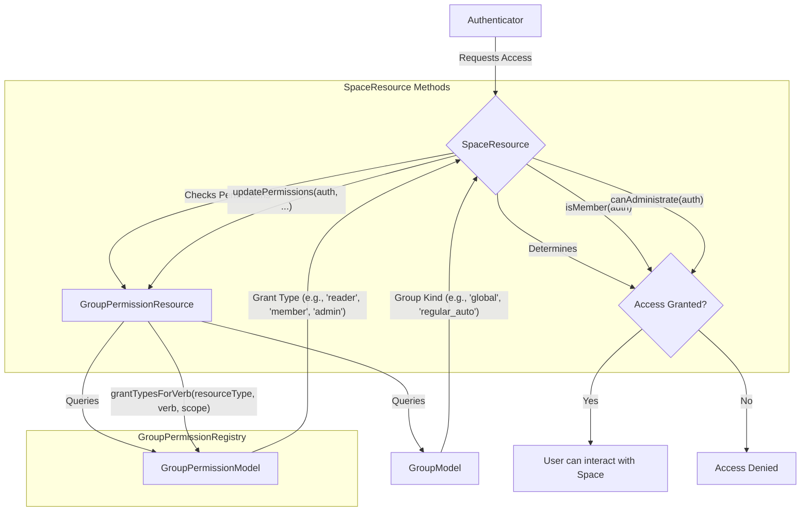

<!-- source: DeepWiki mcp.deepwiki.com · repo dust-tt/dust · page 7.1 Spaces and Groups · fetched 2026-10-27 -->

# 7.1. Spaces and Groups

<details>
<summary>Relevant source files</summary>

The following files were used as context for generating this wiki page:

- [cli/dust-cli/src/index.tsx](cli/dust-cli/src/index.tsx)
- [cli/dust-cli/src/ui/App.tsx](cli/dust-cli/src/ui/App.tsx)
- [cli/dust-cli/src/ui/Help.tsx](cli/dust-cli/src/ui/Help.tsx)
- [cli/dust-cli/src/ui/commands/NonInteractiveChat.tsx](cli/dust-cli/src/ui/commands/NonInteractiveChat.tsx)
- [cli/dust-cli/src/ui/commands/chat/nonInteractive.ts](cli/dust-cli/src/ui/commands/chat/nonInteractive.ts)
- [front-api/routes/v1/w/[wId]/apps/index.ts](front-api/routes/v1/w/[wId]/apps/index.ts)
- [front-api/routes/v1/w/[wId]/spaces/[spaceId]/apps/index.ts](front-api/routes/v1/w/[wId]/spaces/[spaceId]/apps/index.ts)
- [front-api/routes/v1/w/[wId]/spaces/[spaceId]/members/index.ts](front-api/routes/v1/w/[wId]/spaces/[spaceId]/members/index.ts)
- [front-api/routes/v1/w/[wId]/spaces/index.test.ts](front-api/routes/v1/w/[wId]/spaces/index.test.ts)
- [front-api/routes/v1/w/[wId]/spaces/index.ts](front-api/routes/v1/w/[wId]/spaces/index.ts)
- [front-api/routes/w/[wId]/groups/[groupId]/spend_limit.test.ts](front-api/routes/w/[wId]/groups/[groupId]/spend_limit.test.ts)
- [front-api/routes/w/[wId]/spaces/[spaceId]/index.ts](front-api/routes/w/[wId]/spaces/[spaceId]/index.ts)
- [front-api/routes/w/[wId]/spaces/index.ts](front-api/routes/w/[wId]/spaces/index.ts)
- [front/components/agent_builder/SpacesContext.tsx](front/components/agent_builder/SpacesContext.tsx)
- [front/components/agent_builder/capabilities/shared/ProjectSection.tsx](front/components/agent_builder/capabilities/shared/ProjectSection.tsx)
- [front/components/poke/pages/PlansPage.tsx](front/components/poke/pages/PlansPage.tsx)
- [front/components/poke/plans/NewPlanWarningDialog.tsx](front/components/poke/plans/NewPlanWarningDialog.tsx)
- [front/lib/api/groups/spend_limit.test.ts](front/lib/api/groups/spend_limit.test.ts)
- [front/lib/api/groups/spend_limit.ts](front/lib/api/groups/spend_limit.ts)
- [front/lib/api/plan_compatibility.ts](front/lib/api/plan_compatibility.ts)
- [front/lib/api/plan_limit_overrides.test.ts](front/lib/api/plan_limit_overrides.test.ts)
- [front/lib/api/plan_limit_overrides.ts](front/lib/api/plan_limit_overrides.ts)
- [front/lib/api/poke/plugins/spaces/update_pod_members.test.ts](front/lib/api/poke/plugins/spaces/update_pod_members.test.ts)
- [front/lib/api/poke/plugins/spaces/update_pod_members.ts](front/lib/api/poke/plugins/spaces/update_pod_members.ts)
- [front/lib/api/poke/plugins/workspaces/conversations_retention.ts](front/lib/api/poke/plugins/workspaces/conversations_retention.ts)
- [front/lib/api/poke/plugins/workspaces/override_plan_limits.ts](front/lib/api/poke/plugins/workspaces/override_plan_limits.ts)
- [front/lib/api/projects/list.ts](front/lib/api/projects/list.ts)
- [front/lib/api/spaces.test.ts](front/lib/api/spaces.test.ts)
- [front/lib/api/spaces.ts](front/lib/api/spaces.ts)
- [front/lib/conversations_retention.ts](front/lib/conversations_retention.ts)
- [front/lib/plans/plan_limit_overrides.test.ts](front/lib/plans/plan_limit_overrides.test.ts)
- [front/lib/plans/plan_limit_overrides.ts](front/lib/plans/plan_limit_overrides.ts)
- [front/lib/resources/app_resource.ts](front/lib/resources/app_resource.ts)
- [front/lib/resources/group_resource.test.ts](front/lib/resources/group_resource.test.ts)
- [front/lib/resources/group_resource.ts](front/lib/resources/group_resource.ts)
- [front/lib/resources/space_resource.test.ts](front/lib/resources/space_resource.test.ts)
- [front/lib/resources/space_resource.ts](front/lib/resources/space_resource.ts)
- [front/lib/resources/storage/models/workspace_plan_limit_override.ts](front/lib/resources/storage/models/workspace_plan_limit_override.ts)
- [front/lib/resources/workspace_resource.test.ts](front/lib/resources/workspace_resource.test.ts)
- [front/lib/resources/workspace_resource.ts](front/lib/resources/workspace_resource.ts)
- [front/lib/swr/spaces.ts](front/lib/swr/spaces.ts)
- [front/lib/utils/apps.ts](front/lib/utils/apps.ts)
- [front/migrations/20241205_update_space_group_names.ts](front/migrations/20241205_update_space_group_names.ts)
- [front/migrations/20260728_backfill_space_group_permissions.ts](front/migrations/20260728_backfill_space_group_permissions.ts)
- [front/scripts/seed/factories/seedSpace.ts](front/scripts/seed/factories/seedSpace.ts)
- [front/tests/utils/SpaceFactory.ts](front/tests/utils/SpaceFactory.ts)
- [front/types/api/spaces.ts](front/types/api/spaces.ts)
- [front/types/groups.ts](front/types/groups.ts)
- [front/types/space.ts](front/types/space.ts)

</details>


This page details the management of `SpaceResource` and `GroupResource` within the Dust platform. It covers the different kinds of spaces (system, global, conversations, project/pod), how group membership is managed, the concept of spend limits for groups, and the API endpoints related to spaces. Key functions and classes like `makeNew`, `listWorkspaceSpaces`, and the `SpaceFactory` are explained.

## SpaceResource

The `SpaceResource` class [front/lib/resources/space_resource.ts:59-59]() is a stateless representation of a space within a workspace. Spaces are fundamental for organizing and controlling access to various resources like data sources, tools, and conversations.

### Space Kinds

Dust supports several types of spaces, each serving a distinct purpose:

*   **System Space**: An internal space accessible only by Dust's system API keys. It holds core connected data sources [front/types/groups.ts:8-10]().
*   **Global Space**: Contains all users from the workspace and holds data sources created before the introduction of spaces [front/types/groups.ts:11-13](). Its name is `GLOBAL_SPACE_NAME` ("Company Data") [front/types/groups.ts:173-173]().
*   **Regular Space**: User-created spaces for general organization. They can be either "manual" (membership managed directly) or "provisioned" (membership synced from an external identity provider) [front/lib/api/spaces.test.ts:117-149]().
*   **Project/Pod Space**: These are specialized spaces designed for projects, often referred to as "Pods". They can have associated metadata, sandbox environments, and specific access controls. Project spaces can also be linked to a database filesystem [front/lib/api/spaces.test:82-114]().

### Space Management Modes

Spaces can operate in different management modes:

*   **Manual**: Membership and permissions are managed directly within Dust.
*   **Provisioned**: Membership is synced from an external identity provider (e.g., WorkOS) [front/lib/api/spaces.test:171-180]().

### Space Creation

New spaces are created using `SpaceResource.makeNew()` [front/lib/resources/space_resource.ts:290-290]() or the `createSpaceAndGroup` API function [front/lib/api/spaces.test:39-40](). When a space is created, an associated `GroupResource` is also created to manage its members and permissions.

```typescript
// Example of creating a regular space with manual management
const regularSpace = await SpaceResource.makeNew(
  adminAuth,
  {
    name: "Test Regular Space",
    kind: "regular",
    workspaceId: workspace.id,
    managementMode: "manual",
  },
  { members: [regularGroup] }
);
```
Sources:
* [front/lib/resources/space_resource.ts:290-290]()
* [front/lib/api/spaces.test:39-40]()
* [front/lib/api/spaces.test:117-149]()

### Space Permissions and Membership

Space permissions are managed through `GroupPermissionResource` [front/lib/resources/group_permission_resource.ts:7-7](). A `SpaceGroupReference` [front/lib/resources/space_resource.ts:66-95]() object links a space to a group and specifies the `GrantType` (e.g., "reader", "member", "admin").

*   `isReader()`: Checks if a `SpaceGroupReference` confers read-only access [front/lib/resources/space_resource.ts:93-94]().
*   `isMember()`: Determines if a user is a member of a space based on their grants. The membership verb (`"read"` for regular spaces, `"write"` for project spaces) differs by space kind [front/lib/resources/space_resource.ts:98-106]().
*   `canAdministrate()`: Checks if the authenticator has administrative privileges over the space [front/lib/resources/space_resource.ts:490-492]().

The `updatePermissions` method [front/lib/resources/space_resource.ts:500-500]() is used to modify the groups associated with a space and their respective grant types.

#### Space Permissions Diagram


Sources:
* [front/lib/resources/space_resource.ts:66-95]()
* [front/lib/resources/space_resource.ts:93-94]()
* [front/lib/resources/space_resource.ts:98-106]()
* [front/lib/resources/space_resource.ts:490-492]()
* [front/lib/resources/space_resource.ts:500-500]()
* [front/lib/resources/group_permission_resource.ts:7-7]()

### Space Deletion

Spaces can be soft-deleted or hard-deleted.
*   `delete()`: Performs a soft delete, marking the space as deleted but retaining its data [front/lib/resources/space_resource.ts:600-600]().
*   `hardDeleteSpace()`: Permanently removes a space and its associated resources, including selected conversations, sandbox environment variables, and project metadata [front/lib/api/spaces.ts:9-9](). This process involves a Temporal workflow (`launchScrubSpaceWorkflow`) [front/lib/api/spaces.ts:35-35]().

```typescript
// Example of hard deleting a space
const hardDeleteResult = await hardDeleteSpace(adminAuth, deletedSpace);
expect(hardDeleteResult.isOk()).toBe(true);
```
Sources:
* [front/lib/resources/space_resource.ts:600-600]()
* [front/lib/api/spaces.ts:9-9]()
* [front/lib/api/spaces.ts:35-35]()
* [front/lib/resources/space_resource.test.ts:158-160]()

### Space API Endpoints

The following API endpoints are available for managing spaces:

*   `GET /api/w/:wId/spaces`: Lists all spaces for a workspace [front-api/routes/v1/w/[wId]/spaces/index.ts]().
*   `GET /api/w/:wId/spaces/:spaceId`: Retrieves details for a specific space [front-api/routes/w/[wId]/spaces/[spaceId]/index.ts:58-170]().
*   `PATCH /api/w/:wId/spaces/:spaceId`: Updates a space's properties [front-api/routes/w/[wId]/spaces/[spaceId]/index.ts:172-172]().
*   `DELETE /api/w/:wId/spaces/:spaceId`: Deletes a space [front-api/routes/w/[wId]/spaces/[spaceId]/index.ts:172-172]().
*   `POST /api/w/:wId/spaces`: Creates a new space [front-api/routes/v1/w/[wId]/spaces/index.ts]().

Sources:
* [front-api/routes/v1/w/[wId]/spaces/index.ts]()
* [front-api/routes/w/[wId]/spaces/[spaceId]/index.ts:58-170]()
* [front-api/routes/w/[wId]/spaces/[spaceId]/index.ts:172-172]()

## GroupResource

The `GroupResource` class [front/lib/resources/group_resource.ts:93-93]() represents a group within a workspace. Groups are used to manage collections of users and assign permissions to resources.

### Group Kinds

Groups are categorized by their `kind` [front/types/groups.ts:30-38]():

*   **`regular_auto`**: Implicitly created by Dust (e.g., for agent editors, space members) [front/types/groups.ts:18-19]().
*   **`regular_manual`**: Manually created by users via the UI [front/types/groups.ts:21-22]().
*   **`global`**: Contains all users from the workspace [front/types/groups.ts:11-13]().
*   **`system`**: Accessible only by Dust's system API keys [front/types/groups.ts:8-10]().
*   **`agent_editors`**: Specific to represent agent editors, tied to an agent [front/types/groups.ts:25-27]().
*   **`provisioned`**: Membership synced from an external identity provider [front/types/groups.ts:29-29]().

### Group Creation and Management

*   `makeNew()`: Creates a new group [front/lib/resources/group_resource.ts:200-200]().
*   `dangerouslyAddMembers()`: Adds members to a group [front/lib/resources/group_resource.ts:400-400]().
*   `getAllMembers()`: Retrieves all members of a group [front/lib/resources/group_resource.ts:420-420]().
*   `dangerouslyListUserGroupsForAuth()`: Lists groups a user belongs to for authentication purposes [front/lib/resources/group_resource.ts:500-500]().

```typescript
// Example of creating a new group
const regularGroup = await GroupResource.makeNew({
  name: "Test Regular Group",
  workspaceId: workspace.id,
  kind: "regular_auto",
});
```
Sources:
* [front/lib/resources/group_resource.ts:93-93]()
* [front/lib/resources/group_resource.ts:200-200]()
* [front/lib/resources/group_resource.ts:400-400]()
* [front/lib/resources/group_resource.ts:420-420]()
* [front/lib/resources/group_resource.ts:500-500]()
* [front/types/groups.ts:8-10]()
* [front/types/groups.ts:11-13]()
* [front/types/groups.ts:18-19]()
* [front/types/groups.ts:21-22]()
* [front/types/groups.ts:25-27]()
* [front/types/groups.ts:29-29]()
* [front/types/groups.ts:30-38]()
* [front/lib/resources/space_resource.test.ts:80-83]()

### Group Spend Limits

Certain group kinds (`provisioned`, `regular_manual`) can have a `poolCapAwuCredits` [front/types/groups.ts:103-104]() attribute, which defines a per-group usage spend limit. This allows for granular control over credit consumption within a workspace.

```mermaid
graph TD
    A[Workspace] --> B[GroupResource]
    B --> C[GroupKind]
    C -- "provisioned" --> D[Spend Limit (poolCapAwuCredits)]
    C -- "regular_manual" --> D
    C -- "global" --> E[No Spend Limit]
    C -- "system" --> E
    C -- "regular_auto" --> E
    C -- "agent_editors" --> E
    D --> F[Usage Tracking]
    F --> G[Billing]
```
Sources:
* [front/types/groups.ts:103-104]()
* [front/types/groups.ts:43-46]()

### Group API Endpoints

*   `GET /api/w/:wId/groups`: Lists all groups for a workspace.
*   `GET /api/w/:wId/groups/:groupId`: Retrieves details for a specific group.
*   `PATCH /api/w/:wId/groups/:groupId/spend_limit`: Updates the spend limit for a group [front-api/routes/w/[wId]/groups/[groupId]/spend_limit.ts]().

Sources:
* [front-api/routes/w/[wId]/groups/[groupId]/spend_limit.ts]()

## SpaceFactory

The `SpaceFactory` [front/tests/utils/SpaceFactory.ts]() is a utility class used in tests to create `SpaceResource` instances. It simplifies the setup of various space configurations for testing purposes.

```typescript
// Example from tests: creating a project space
const pod = await SpaceFactory.project(workspace, user1.id);
```
Sources:
* [front/tests/utils/SpaceFactory.ts]()
* [front/lib/resources/space_resource.test.ts:172-172]()

## Listing Workspace Spaces

The `listWorkspaceSpaces` function (or similar methods like `useSpaces` in SWR hooks [front/lib/swr/spaces.ts:50-50]()) allows fetching spaces based on various criteria, including `SpaceKind` and whether the user is an admin.

```typescript
// Example from SWR hook
export function useSpaces({
  workspaceId,
  kinds, // e.g., ["regular", "project"] or "all"
  disabled,
  swrOptions,
}: {
  workspaceId: string;
  kinds: SpaceKind[] | "all";
  disabled?: boolean;
  swrOptions?: SWRConfiguration;
}) {
  // ... fetches spaces based on kinds
}
```
Sources:
* [front/lib/swr/spaces.ts:50-50]()

## Space and Group Interaction Flow

```mermaid
graph TD
    User[User] -->|Interacts with UI| Frontend[Frontend Application]
    Frontend -->|API Request (e.g., GET /spaces)| API[Dust API]
    API -->|Authenticator.fromSession()| Auth[Authenticator]
    Auth -->|getNonNullableWorkspace()| Workspace[WorkspaceResource]
    API -->|SpaceResource.listWorkspaceSpaces(auth, ...)| SpaceResource[SpaceResource]
    SpaceResource -->|Queries DB (SpaceModel)| DB[(Database)]
    SpaceResource -->|Fetches associated groups| GroupResource[GroupResource]
    GroupResource -->|Queries DB (GroupModel, GroupMembershipModel)| DB
    SpaceResource -->|Checks permissions (GroupPermissionResource)| GroupPermissionResource[GroupPermissionResource]
    GroupPermissionResource -->|Queries DB (GroupPermissionModel)| DB
    SpaceResource -->|Enriches data (e.g., categories, members)| SpaceEnrichment[Space Enrichment Logic]
    SpaceEnrichment -->|Returns EnrichedSpaceType| API
    API -->|Sends response| Frontend
    Frontend -->|Displays spaces and groups| User
```
Sources:
* [front/lib/resources/space_resource.ts]()
* [front/lib/resources/group_resource.ts]()
* [front/lib/resources/group_permission_resource.ts]()
* [front/lib/swr/spaces.ts]()
* [front-api/routes/w/[wId]/spaces/[spaceId]/index.ts]()
* [front-api/routes/v1/w/[wId]/spaces/index.ts]()

---

