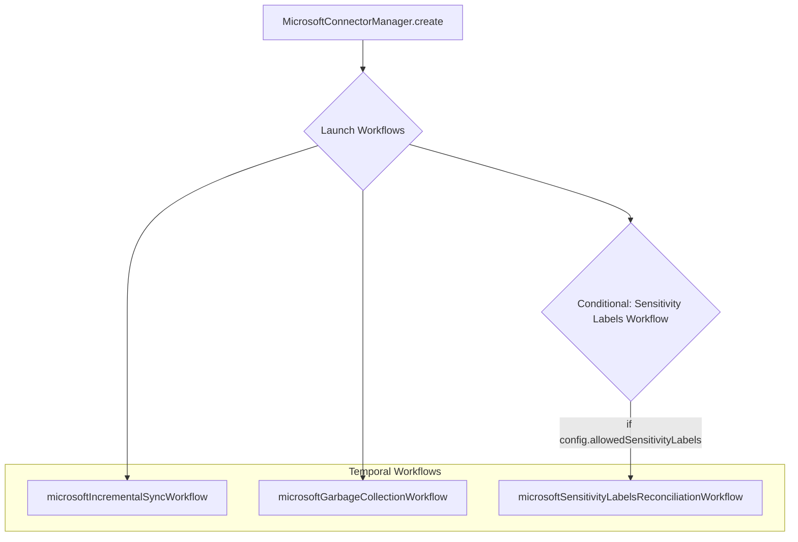
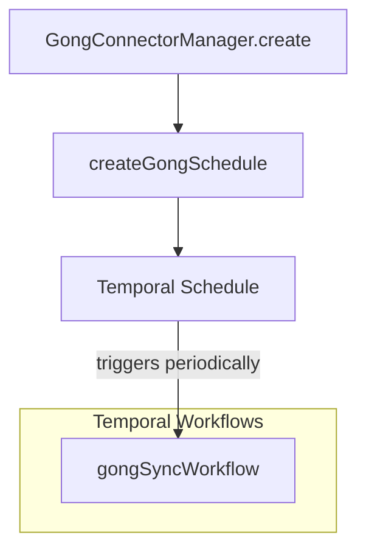

<!-- source: DeepWiki mcp.deepwiki.com · repo dust-tt/dust · page 8 Data Connectors · fetched 2026-10-27 -->

# Data Connectors

Relevant source files

The following files were used as context for generating this wiki page:

- [cli/dust-cli/src/ui/commands/Chat.tsx](cli/dust-cli/src/ui/commands/Chat.tsx)
- [cli/dust-cli/src/ui/components/AgentSelector.tsx](cli/dust-cli/src/ui/components/AgentSelector.tsx)
- [cli/dust-cli/src/utils/tokenStorage.ts](cli/dust-cli/src/utils/tokenStorage.ts)
- [cli/dust-cli/src/utils/toolsCache.ts](cli/dust-cli/src/utils/toolsCache.ts)
- [connectors/migrations/20260227_clear_gdrive_first_sync_progress.ts](connectors/migrations/20260227_clear_gdrive_first_sync_progress.ts)
- [connectors/migrations/20260313_clear_microsoft_first_sync_progress.ts](connectors/migrations/20260313_clear_microsoft_first_sync_progress.ts)
- [connectors/scripts/debug/run_profiler.ts](connectors/scripts/debug/run_profiler.ts)
- [connectors/scripts/microsoft_terminate_sensitivity_labels_workflows.ts](connectors/scripts/microsoft_terminate_sensitivity_labels_workflows.ts)
- [connectors/src/api/profiler.ts](connectors/src/api/profiler.ts)
- [connectors/src/api/webhooks/teams/adaptive_cards.ts](connectors/src/api/webhooks/teams/adaptive_cards.ts)
- [connectors/src/api/webhooks/teams/bot.ts](connectors/src/api/webhooks/teams/bot.ts)
- [connectors/src/api/webhooks/webhook_slack_bot_interaction.ts](connectors/src/api/webhooks/webhook_slack_bot_interaction.ts)
- [connectors/src/connectors/confluence/temporal/workflows.ts](connectors/src/connectors/confluence/temporal/workflows.ts)
- [connectors/src/connectors/github/lib/code/gcs_repository.ts](connectors/src/connectors/github/lib/code/gcs_repository.ts)
- [connectors/src/connectors/github/lib/github_api.ts](connectors/src/connectors/github/lib/github_api.ts)
- [connectors/src/connectors/gong/index.ts](connectors/src/connectors/gong/index.ts)
- [connectors/src/connectors/gong/lib/errors.ts](connectors/src/connectors/gong/lib/errors.ts)
- [connectors/src/connectors/gong/lib/gong_api.ts](connectors/src/connectors/gong/lib/gong_api.ts)
- [connectors/src/connectors/gong/lib/permission_profiles.ts](connectors/src/connectors/gong/lib/permission_profiles.ts)
- [connectors/src/connectors/gong/lib/users.ts](connectors/src/connectors/gong/lib/users.ts)
- [connectors/src/connectors/gong/lib/utils.ts](connectors/src/connectors/gong/lib/utils.ts)
- [connectors/src/connectors/gong/temporal/activities.ts](connectors/src/connectors/gong/temporal/activities.ts)
- [connectors/src/connectors/gong/temporal/cast_known_errors.ts](connectors/src/connectors/gong/temporal/cast_known_errors.ts)
- [connectors/src/connectors/gong/temporal/client.ts](connectors/src/connectors/gong/temporal/client.ts)
- [connectors/src/connectors/gong/temporal/workflows.ts](connectors/src/connectors/gong/temporal/workflows.ts)
- [connectors/src/connectors/google_drive/temporal/activities/get_drives_to_sync.ts](connectors/src/connectors/google_drive/temporal/activities/get_drives_to_sync.ts)
- [connectors/src/connectors/google_drive/temporal/config.ts](connectors/src/connectors/google_drive/temporal/config.ts)
- [connectors/src/connectors/google_drive/temporal/workflows.ts](connectors/src/connectors/google_drive/temporal/workflows.ts)
- [connectors/src/connectors/intercom/lib/intercom_api.ts](connectors/src/connectors/intercom/lib/intercom_api.ts)
- [connectors/src/connectors/intercom/temporal/workflows.ts](connectors/src/connectors/intercom/temporal/workflows.ts)
- [connectors/src/connectors/microsoft/index.ts](connectors/src/connectors/microsoft/index.ts)
- [connectors/src/connectors/microsoft/lib/errors.ts](connectors/src/connectors/microsoft/lib/errors.ts)
- [connectors/src/connectors/microsoft/lib/graph_api.ts](connectors/src/connectors/microsoft/lib/graph_api.ts)
- [connectors/src/connectors/microsoft/lib/types.ts](connectors/src/connectors/microsoft/lib/types.ts)
- [connectors/src/connectors/microsoft/temporal/activities.ts](connectors/src/connectors/microsoft/temporal/activities.ts)
- [connectors/src/connectors/microsoft/temporal/cast_known_errors.ts](connectors/src/connectors/microsoft/temporal/cast_known_errors.ts)
- [connectors/src/connectors/microsoft/temporal/client.ts](connectors/src/connectors/microsoft/temporal/client.ts)
- [connectors/src/connectors/microsoft/temporal/file.ts](connectors/src/connectors/microsoft/temporal/file.ts)
- [connectors/src/connectors/microsoft/temporal/sensitivity_labels.test.ts](connectors/src/connectors/microsoft/temporal/sensitivity_labels.test.ts)
- [connectors/src/connectors/microsoft/temporal/workflows.ts](connectors/src/connectors/microsoft/temporal/workflows.ts)
- [connectors/src/connectors/notion/index.ts](connectors/src/connectors/notion/index.ts)
- [connectors/src/connectors/notion/lib/cli.ts](connectors/src/connectors/notion/lib/cli.ts)
- [connectors/src/connectors/notion/lib/notion_api.test.ts](connectors/src/connectors/notion/lib/notion_api.test.ts)
- [connectors/src/connectors/notion/lib/notion_api.ts](connectors/src/connectors/notion/lib/notion_api.ts)
- [connectors/src/connectors/notion/temporal/activities.ts](connectors/src/connectors/notion/temporal/activities.ts)
- [connectors/src/connectors/notion/temporal/config.ts](connectors/src/connectors/notion/temporal/config.ts)
- [connectors/src/connectors/notion/temporal/workflows/admins.ts](connectors/src/connectors/notion/temporal/workflows/admins.ts)
- [connectors/src/connectors/notion/temporal/workflows/children.ts](connectors/src/connectors/notion/temporal/workflows/children.ts)
- [connectors/src/connectors/notion/temporal/workflows/garbage_collection.ts](connectors/src/connectors/notion/temporal/workflows/garbage_collection.ts)
- [connectors/src/connectors/notion/temporal/workflows/upserts.ts](connectors/src/connectors/notion/temporal/workflows/upserts.ts)
- [connectors/src/connectors/slack/bot.ts](connectors/src/connectors/slack/bot.ts)
- [connectors/src/connectors/slack/chat/action_utils.ts](connectors/src/connectors/slack/chat/action_utils.ts)
- [connectors/src/connectors/slack/chat/blocks.ts](connectors/src/connectors/slack/chat/blocks.ts)
- [connectors/src/connectors/slack/chat/plan_message_handler.ts](connectors/src/connectors/slack/chat/plan_message_handler.ts)
- [connectors/src/connectors/slack/chat/slack_stream_handler.ts](connectors/src/connectors/slack/chat/slack_stream_handler.ts)
- [connectors/src/connectors/slack/chat/stream_conversation_handler.ts](connectors/src/connectors/slack/chat/stream_conversation_handler.ts)
- [connectors/src/connectors/slack/lib/errors.test.ts](connectors/src/connectors/slack/lib/errors.test.ts)
- [connectors/src/connectors/slack/lib/errors.ts](connectors/src/connectors/slack/lib/errors.ts)
- [connectors/src/connectors/slack/lib/slack_client.ts](connectors/src/connectors/slack/lib/slack_client.ts)
- [connectors/src/connectors/slack/lib/thread.ts](connectors/src/connectors/slack/lib/thread.ts)
- [connectors/src/connectors/slack/lib/utils.ts](connectors/src/connectors/slack/lib/utils.ts)
- [connectors/src/connectors/slack/lib/workspace_limits.test.ts](connectors/src/connectors/slack/lib/workspace_limits.test.ts)
- [connectors/src/connectors/slack/lib/workspace_limits.ts](connectors/src/connectors/slack/lib/workspace_limits.ts)
- [connectors/src/connectors/slack/temporal/cast_known_errors.ts](connectors/src/connectors/slack/temporal/cast_known_errors.ts)
- [connectors/src/connectors/zendesk/lib/zendesk_api.ts](connectors/src/connectors/zendesk/lib/zendesk_api.ts)
- [connectors/src/connectors/zendesk/temporal/activities.ts](connectors/src/connectors/zendesk/temporal/activities.ts)
- [connectors/src/connectors/zendesk/temporal/workflows.ts](connectors/src/connectors/zendesk/temporal/workflows.ts)
- [connectors/src/lib/api/config.ts](connectors/src/lib/api/config.ts)
- [connectors/src/lib/api/dust_api.ts](connectors/src/lib/api/dust_api.ts)
- [connectors/src/lib/bot/mentions.test.ts](connectors/src/lib/bot/mentions.test.ts)
- [connectors/src/lib/bot/mentions.ts](connectors/src/lib/bot/mentions.ts)
- [connectors/src/lib/bot/user_validation.ts](connectors/src/lib/bot/user_validation.ts)
- [connectors/src/lib/data_sources.ts](connectors/src/lib/data_sources.ts)
- [connectors/src/lib/models/gong.ts](connectors/src/lib/models/gong.ts)
- [connectors/src/lib/models/microsoft.ts](connectors/src/lib/models/microsoft.ts)
- [connectors/src/lib/oauth.ts](connectors/src/lib/oauth.ts)
- [connectors/src/lib/sync_status.ts](connectors/src/lib/sync_status.ts)
- [connectors/src/resources/gong_resources.ts](connectors/src/resources/gong_resources.ts)
- [connectors/src/resources/microsoft_resource.ts](connectors/src/resources/microsoft_resource.ts)
- [connectors/src/types/shared/redis_client.ts](connectors/src/types/shared/redis_client.ts)
- [connectors/tsconfig.json](connectors/tsconfig.json)
- [firebase-functions/webhook-router/docker-compose.yml](firebase-functions/webhook-router/docker-compose.yml)
- [front-api/routes/v1/w/[wId]/assistant/conversations/[cId]/index.ts](front-api/routes/v1/w/[wId]/assistant/conversations/[cId]/index.ts)
- [front/components/Confirm.tsx](front/components/Confirm.tsx)
- [front/components/data_source/ZendeskOAuthExtraConfig.tsx](front/components/data_source/ZendeskOAuthExtraConfig.tsx)
- [front/components/data_source/gong/GongOptionComponent.tsx](front/components/data_source/gong/GongOptionComponent.tsx)
- [front/components/data_source/salesforce/SalesforceOAuthExtractConfig.tsx](front/components/data_source/salesforce/SalesforceOAuthExtractConfig.tsx)
- [front/hooks/useEnableBrowserNotification.tsx](front/hooks/useEnableBrowserNotification.tsx)
- [front/lib/api/oauth/providers/gong.ts](front/lib/api/oauth/providers/gong.ts)
- [front/lib/api/oauth/providers/zendesk.test.ts](front/lib/api/oauth/providers/zendesk.test.ts)
- [front/lib/api/oauth/providers/zendesk.ts](front/lib/api/oauth/providers/zendesk.ts)
- [front/lib/api/poke/plugins/data_sources/notion_unstuck_syncing_nodes.ts](front/lib/api/poke/plugins/data_sources/notion_unstuck_syncing_nodes.ts)
- [sdks/js/src/index.test.ts](sdks/js/src/index.test.ts)
- [sdks/js/src/index.ts](sdks/js/src/index.ts)

The Data Connectors service is responsible for synchronizing external data sources into Dust. It provides a standardized interface for integrating with various third-party platforms, enabling Dust agents to access and utilize data from these sources. This page provides a high-level overview of the connector interface, the Temporal-based synchronization workflows, and the range of supported integrations.

For detailed information on the architecture and implementation, refer to the [Connector Architecture](#8.1) child page. For specifics on each supported integration, see [Supported Integrations](#8.2).

## Overview of Data Synchronization

The core function of the Data Connectors service is to ingest data from external platforms and make it available within the Dust ecosystem. This involves:
1.  **Authentication and Authorization**: Securely connecting to external services using OAuth or API keys.
2.  **Data Retrieval**: Fetching data from the external source, often involving pagination and handling of rate limits.
3.  **Data Transformation**: Converting the external data into a standardized format (`ContentNode`) that Dust can understand and process.
4.  **Data Storage**: Storing the transformed data in Dust's internal data sources, typically involving upsert operations.
5.  **Synchronization Management**: Orchestrating full and incremental syncs, handling errors, and performing garbage collection to maintain data freshness and consistency.

The synchronization process is primarily managed through Temporal workflows, which provide robust, fault-tolerant, and scalable execution of these tasks.

## Connector Interface

All data connectors adhere to a common interface, defined by the `BaseConnectorManager` class [connectors/src/connectors/interface.ts](). This interface ensures consistency across different integrations and simplifies the management of connectors. Key operations supported by the interface include:

*   **Creation**: Setting up a new connector instance for a given data source and workspace.
*   **Update**: Modifying connector configurations, such as connection details or sync settings.
*   **Deletion**: Removing a connector and cleaning up associated data.
*   **Permissions Retrieval**: Fetching the permissions associated with the connector, which dictates what data can be accessed.
*   **Synchronization Control**: Initiating, pausing, and resuming synchronization processes.

The `ConnectorResource` class [connectors/src/resources/connector_resource.ts]() represents a connector instance in the database, storing its configuration and status.

Sources:
* [connectors/src/connectors/gong/index.ts:74-76]()
* [connectors/src/connectors/microsoft/index.ts:92-94]()

## Temporal-based Sync Workflows

The synchronization logic for each connector is implemented as Temporal workflows and activities. Temporal provides a durable execution environment, ensuring that sync operations can withstand failures and resume from where they left off.

### Sync Workflow Types

Each connector typically implements several types of workflows:

*   **Full Sync Workflow**: Performs an initial, comprehensive synchronization of all selected data from the external source. This often involves traversing the entire data hierarchy.
*   **Incremental Sync Workflow**: Periodically fetches only the changes (new, updated, or deleted items) from the external source since the last sync. This is crucial for maintaining data freshness efficiently.
*   **Garbage Collection Workflow**: Identifies and removes data from Dust that no longer exists in the external source or is no longer selected for synchronization.
*   **Webhook Handling Workflows**: For connectors that support webhooks, these workflows process real-time notifications from the external service to trigger immediate incremental updates.

### Example: Microsoft 365 Sync Workflows

The Microsoft 365 connector, for instance, utilizes several Temporal workflows to manage its synchronization:

**Diagram: Microsoft 365 Connector Workflow Launch**

Sources:
* [connectors/src/connectors/microsoft/index.ts:36-47]()
* [connectors/src/connectors/microsoft/index.ts:151-175]()

The `microsoftIncrementalSyncWorkflow` [connectors/src/connectors/microsoft/temporal/workflows.ts]() is responsible for continuously pulling changes from Microsoft Graph API using delta links. The `microsoftGarbageCollectionWorkflow` [connectors/src/connectors/microsoft/temporal/workflows.ts]() ensures that deleted or unselected items are removed from Dust.

### Example: Gong Sync Workflows

The Gong connector also uses Temporal for its synchronization. A key aspect is the `gongSyncWorkflow` [connectors/src/connectors/gong/temporal/workflows.ts](), which handles the periodic fetching and processing of call transcripts.

**Diagram: Gong Connector Workflow Launch**

Sources:
* [connectors/src/connectors/gong/index.ts:123-157]()
* [connectors/src/connectors/gong/temporal/workflows.ts]()

The `gongSyncWorkflow` [connectors/src/connectors/gong/temporal/workflows.ts]() orchestrates activities like `gongSaveStartSyncActivity` [connectors/src/connectors/gong/temporal/activities.ts:136-147]() and `gongSyncTranscriptsActivity` [connectors/src/connectors/gong/temporal/activities.ts:199-209]() to manage the sync state and fetch transcripts. It also incorporates logic for handling permission profiles and excluding transcripts based on keywords [connectors/src/connectors/gong/temporal/activities.ts:43-134]().

For details on the specific activities and their implementation, see [Connector Architecture](#8.1).

## Supported Integrations

The Data Connectors service supports a growing list of external data sources. Each integration is tailored to the specific API and data model of the external service, while still adhering to the common connector interface.

Some of the key integrations include:

*   **Slack**: Synchronizes messages and files from Slack channels, enabling agents to access conversation history and shared documents. The Slack bot functionality also allows agents to participate in Slack conversations [connectors/src/connectors/slack/bot.ts]().
*   **Notion**: Ingests Notion pages and databases, making structured and unstructured content available to Dust agents.
*   **Google Drive**: Synchronizes files and folders from Google Drive, including handling of permissions and delta updates [connectors/src/connectors/google_drive/temporal/workflows.ts]().
*   **Microsoft 365 (SharePoint/OneDrive)**: Integrates with Microsoft SharePoint sites and OneDrive, synchronizing documents and site content. It includes advanced features like sensitivity label handling [connectors/src/connectors/microsoft/temporal/activities.ts:205-211]().
*   **GitHub**: Connects to GitHub repositories to synchronize code, issues, and pull requests.
*   **Confluence**: Ingests content from Confluence spaces and pages.
*   **Gong**: Synchronizes call transcripts and metadata, allowing agents to analyze sales conversations [connectors/src/connectors/gong/lib/gong_api.ts]().
*   **Salesforce**: Integrates with Salesforce to access CRM data.
*   **Zendesk**: Connects to Zendesk for customer support ticket data.

Each integration has its own specific sync strategies, permission models, and webhook handling mechanisms, which are detailed in the [Supported Integrations](#8.2) child page.

Sources:
* [connectors/src/connectors/slack/bot.ts]()
* [connectors/src/connectors/google_drive/temporal/workflows.ts]()
* [connectors/src/connectors/microsoft/temporal/activities.ts:205-211]()
* [connectors/src/connectors/gong/lib/gong_api.ts]()

---

