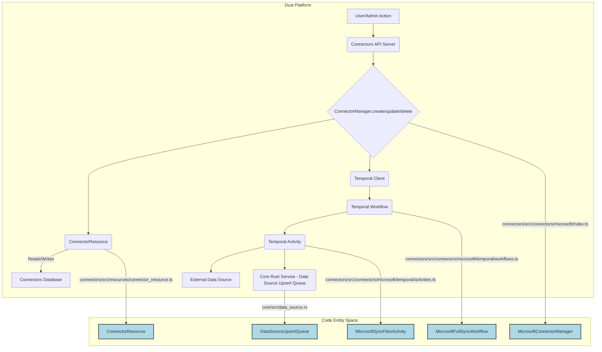

<!-- source: DeepWiki mcp.deepwiki.com · repo dust-tt/dust · page 8.1 Connector Architecture · fetched 2026-10-27 -->

# Connector Architecture

Relevant source files

The following files were used as context for generating this wiki page:

- [cli/dust-cli/src/ui/commands/Chat.tsx](cli/dust-cli/src/ui/commands/Chat.tsx)
- [cli/dust-cli/src/ui/components/AgentSelector.tsx](cli/dust-cli/src/ui/components/AgentSelector.tsx)
- [cli/dust-cli/src/utils/tokenStorage.ts](cli/dust-cli/src/utils/tokenStorage.ts)
- [cli/dust-cli/src/utils/toolsCache.ts](cli/dust-cli/src/utils/toolsCache.ts)
- [connectors/migrations/20260227_clear_gdrive_first_sync_progress.ts](connectors/migrations/20260227_clear_gdrive_first_sync_progress.ts)
- [connectors/migrations/20260313_clear_microsoft_first_sync_progress.ts](connectors/migrations/20260313_clear_microsoft_first_sync_progress.ts)
- [connectors/scripts/microsoft_terminate_sensitivity_labels_workflows.ts](connectors/scripts/microsoft_terminate_sensitivity_labels_workflows.ts)
- [connectors/src/api/webhooks/teams/adaptive_cards.ts](connectors/src/api/webhooks/teams/adaptive_cards.ts)
- [connectors/src/api/webhooks/teams/bot.ts](connectors/src/api/webhooks/teams/bot.ts)
- [connectors/src/api/webhooks/webhook_slack_bot_interaction.ts](connectors/src/api/webhooks/webhook_slack_bot_interaction.ts)
- [connectors/src/connectors/confluence/temporal/workflows.ts](connectors/src/connectors/confluence/temporal/workflows.ts)
- [connectors/src/connectors/github/lib/code/gcs_repository.ts](connectors/src/connectors/github/lib/code/gcs_repository.ts)
- [connectors/src/connectors/google_drive/temporal/activities/get_drives_to_sync.ts](connectors/src/connectors/google_drive/temporal/activities/get_drives_to_sync.ts)
- [connectors/src/connectors/google_drive/temporal/config.ts](connectors/src/connectors/google_drive/temporal/config.ts)
- [connectors/src/connectors/google_drive/temporal/workflows.ts](connectors/src/connectors/google_drive/temporal/workflows.ts)
- [connectors/src/connectors/microsoft/index.ts](connectors/src/connectors/microsoft/index.ts)
- [connectors/src/connectors/microsoft/lib/errors.ts](connectors/src/connectors/microsoft/lib/errors.ts)
- [connectors/src/connectors/microsoft/lib/graph_api.ts](connectors/src/connectors/microsoft/lib/graph_api.ts)
- [connectors/src/connectors/microsoft/lib/types.ts](connectors/src/connectors/microsoft/lib/types.ts)
- [connectors/src/connectors/microsoft/temporal/activities.ts](connectors/src/connectors/microsoft/temporal/activities.ts)
- [connectors/src/connectors/microsoft/temporal/cast_known_errors.ts](connectors/src/connectors/microsoft/temporal/cast_known_errors.ts)
- [connectors/src/connectors/microsoft/temporal/client.ts](connectors/src/connectors/microsoft/temporal/client.ts)
- [connectors/src/connectors/microsoft/temporal/file.ts](connectors/src/connectors/microsoft/temporal/file.ts)
- [connectors/src/connectors/microsoft/temporal/sensitivity_labels.test.ts](connectors/src/connectors/microsoft/temporal/sensitivity_labels.test.ts)
- [connectors/src/connectors/microsoft/temporal/workflows.ts](connectors/src/connectors/microsoft/temporal/workflows.ts)
- [connectors/src/connectors/notion/index.ts](connectors/src/connectors/notion/index.ts)
- [connectors/src/connectors/notion/lib/cli.ts](connectors/src/connectors/notion/lib/cli.ts)
- [connectors/src/connectors/notion/lib/notion_api.test.ts](connectors/src/connectors/notion/lib/notion_api.test.ts)
- [connectors/src/connectors/notion/lib/notion_api.ts](connectors/src/connectors/notion/lib/notion_api.ts)
- [connectors/src/connectors/notion/temporal/activities.ts](connectors/src/connectors/notion/temporal/activities.ts)
- [connectors/src/connectors/notion/temporal/config.ts](connectors/src/connectors/notion/temporal/config.ts)
- [connectors/src/connectors/notion/temporal/workflows/admins.ts](connectors/src/connectors/notion/temporal/workflows/admins.ts)
- [connectors/src/connectors/notion/temporal/workflows/garbage_collection.ts](connectors/src/connectors/notion/temporal/workflows/garbage_collection.ts)
- [connectors/src/connectors/slack/bot.ts](connectors/src/connectors/slack/bot.ts)
- [connectors/src/connectors/slack/chat/action_utils.ts](connectors/src/connectors/slack/chat/action_utils.ts)
- [connectors/src/connectors/slack/chat/blocks.ts](connectors/src/connectors/slack/chat/blocks.ts)
- [connectors/src/connectors/slack/chat/plan_message_handler.ts](connectors/src/connectors/slack/chat/plan_message_handler.ts)
- [connectors/src/connectors/slack/chat/slack_stream_handler.ts](connectors/src/connectors/slack/chat/slack_stream_handler.ts)
- [connectors/src/connectors/slack/chat/stream_conversation_handler.ts](connectors/src/connectors/slack/chat/stream_conversation_handler.ts)
- [connectors/src/connectors/slack/lib/errors.test.ts](connectors/src/connectors/slack/lib/errors.test.ts)
- [connectors/src/connectors/slack/lib/errors.ts](connectors/src/connectors/slack/lib/errors.ts)
- [connectors/src/connectors/slack/lib/utils.ts](connectors/src/connectors/slack/lib/utils.ts)
- [connectors/src/connectors/zendesk/lib/zendesk_api.ts](connectors/src/connectors/zendesk/lib/zendesk_api.ts)
- [connectors/src/connectors/zendesk/temporal/activities.ts](connectors/src/connectors/zendesk/temporal/activities.ts)
- [connectors/src/lib/bot/mentions.test.ts](connectors/src/lib/bot/mentions.test.ts)
- [connectors/src/lib/bot/mentions.ts](connectors/src/lib/bot/mentions.ts)
- [connectors/src/lib/models/microsoft.ts](connectors/src/lib/models/microsoft.ts)
- [connectors/src/lib/sync_status.ts](connectors/src/lib/sync_status.ts)
- [connectors/src/resources/microsoft_resource.ts](connectors/src/resources/microsoft_resource.ts)
- [connectors/src/types/shared/redis_client.ts](connectors/src/types/shared/redis_client.ts)
- [firebase-functions/webhook-router/docker-compose.yml](firebase-functions/webhook-router/docker-compose.yml)
- [front-api/routes/v1/w/[wId]/assistant/conversations/[cId]/index.ts](front-api/routes/v1/w/[wId]/assistant/conversations/[cId]/index.ts)
- [front/lib/api/poke/plugins/data_sources/notion_unstuck_syncing_nodes.ts](front/lib/api/poke/plugins/data_sources/notion_unstuck_syncing_nodes.ts)
- [sdks/js/src/index.ts](sdks/js/src/index.ts)

This page details the architecture of the Dust platform's connector service, which is responsible for synchronizing external data sources. It covers the core connector interface, the use of Temporal for managing sync workflows, webhook handling, and the administrative command-line interface (CLI). The page also describes the connector lifecycle, the data source upsert queue, and the connectors API server.

## Connector Interface and `ConnectorResource`

The core of the connector architecture is defined by the `BaseConnectorManager` class and the `ConnectorResource` model. The `BaseConnectorManager` [connectors/src/connectors/microsoft/index.ts:7-9]() provides a standardized interface for managing various data source connectors, ensuring consistent operations across different external services. Each specific connector, such as Microsoft or Slack, implements this base class, overriding methods for `create`, `update`, `stop`, `resume`, `delete`, `retrievePermissions`, `setPermissions`, `retrieveContentNode`, `retrieveContentNodes`, `retrieveDataSourceConfig`, and `retrieveConnectorPermissions`.

The `ConnectorResource` [connectors/src/resources/connector_resource.ts]() is a database model that represents an installed connector instance. It stores essential information about the connector, including its `connectorProvider` (e.g., "microsoft", "slack"), `workspaceId`, `dataSourceId`, and `connectionId` to the OAuth credentials.

### Connector Lifecycle

The lifecycle of a connector involves several key operations:

*   **Create**: When a new connector is created, the `create` method of the specific `BaseConnectorManager` implementation is called. This method typically performs initial setup, such as validating connection details, creating the `ConnectorResource` entry in the database, and launching initial Temporal workflows for synchronization. For example, the `MicrosoftConnectorManager.create` method [connectors/src/connectors/microsoft/index.ts:95-177]() creates a `ConnectorResource`, sets up initial configuration, and launches incremental sync and garbage collection workflows.
*   **Sync**: Data synchronization is primarily handled by Temporal workflows. Connectors can initiate full syncs or incremental syncs. The `sync` method [connectors/src/connectors/microsoft/index.ts:269-271]() (or `fullSync` [connectors/src/connectors/microsoft/index.ts:273-275]()) triggers the appropriate Temporal workflow.
*   **Pause/Resume**: The `stop` [connectors/src/connectors/microsoft/index.ts:280-282]() and `resume` [connectors/src/connectors/microsoft/index.ts:290-292]() methods allow administrators to temporarily halt or restart synchronization for a connector. This typically involves terminating or restarting Temporal workflows associated with the connector.
*   **Delete**: The `delete` method [connectors/src/connectors/microsoft/index.ts:300-302]() removes the connector and its associated data. This includes terminating all Temporal workflows for the connector and deleting its entry from the database.

### `ConnectorResource` and `BaseConnectorManager` Interaction

The `ConnectorResource` acts as the persistent state for a connector instance, while the `BaseConnectorManager` provides the operational logic. When an action is requested for a connector (e.g., `update`), the system fetches the `ConnectorResource` by its ID and then uses the appropriate `BaseConnectorManager` implementation to perform the action.

**Diagram: Connector Lifecycle and Core Components**

Sources:
* [connectors/src/connectors/microsoft/index.ts:7-9]()
* [connectors/src/connectors/microsoft/index.ts:95-177]()
* [connectors/src/connectors/microsoft/index.ts:269-271]()
* [connectors/src/connectors/microsoft/index.ts:273-275]()
* [connectors/src/connectors/microsoft/index.ts:280-282]()
* [connectors/src/connectors/microsoft/index.ts:290-292]()
* [connectors/src/connectors/microsoft/index.ts:300-302]()
* [connectors/src/resources/connector_resource.ts]()

## Temporal Sync Workflows

Temporal is a critical component for orchestrating long-running and fault-tolerant synchronization processes. Each connector leverages Temporal workflows and activities to manage data ingestion from external sources.

### Workflow Types

Connectors typically implement several types of Temporal workflows:

*   **Full Sync Workflows**: These workflows perform an initial, comprehensive synchronization of all accessible data from the external source. For example, `googleDriveFullSyncV2` [connectors/src/connectors/google_drive/temporal/workflows.ts:203-215]() for Google Drive or `fullSyncWorkflow` [connectors/src/connectors/microsoft/temporal/workflows.ts:55-195]() for Microsoft. These workflows often involve iterating through large datasets, handling pagination, and potentially continuing as new workflows to manage history length [connectors/src/connectors/google_drive/temporal/workflows.ts:164-173]().
*   **Incremental Sync Workflows**: These workflows are designed to detect and synchronize only the changes (new, updated, or deleted items) since the last sync. They often rely on delta tokens or change tracking mechanisms provided by the external API. For instance, `incrementalSyncWorkflowV2` [connectors/src/connectors/microsoft/temporal/workflows.ts:219-242]() for Microsoft fetches delta data and processes changes.
*   **Garbage Collection Workflows**: These workflows are responsible for identifying and removing data from Dust that no longer exists in the external source or is no longer permitted to be synced. An example is `googleDriveGarbageCollectorWorkflow` [connectors/src/connectors/google_drive/temporal/workflows.ts:68-78]().
*   **Reconciliation Workflows**: Some connectors, like Microsoft, have specific reconciliation workflows, such as `microsoftSensitivityLabelsReconciliationWorkflow` [connectors/src/connectors/microsoft/temporal/workflows.ts:37-40](), which handles cases where sensitivity labels might prevent certain files from being synced.

### Activities

Workflows orchestrate activities, which are the actual units of work that interact with external APIs, process data, and update Dust's internal data sources. Examples of activities include:

*   `syncFiles` [connectors/src/connectors/microsoft/temporal/activities.ts:51]() (Microsoft): Downloads and processes individual files.
*   `getDrivesToSync` [connectors/src/connectors/google_drive/temporal/workflows.ts:29]() (Google Drive): Retrieves a list of drives to be synchronized.
*   `populateDeltas` [connectors/src/connectors/microsoft/temporal/activities.ts:32]() (Microsoft): Populates delta information for incremental sync.
*   `deleteFile` [connectors/src/connectors/microsoft/temporal/activities.ts:45]() (Microsoft): Deletes a file from Dust's data source.
*   `upsertDataSourceFolder` [connectors/src/lib/data_sources.ts:65]() (General): Creates or updates a folder entry in Dust's data source.

### Signals and `continueAsNew`

Temporal signals are used to communicate with running workflows, allowing for dynamic adjustments. For example, the `folderUpdatesSignal` [connectors/src/connectors/google_drive/temporal/signals.ts:9]() in Google Drive workflows can add or remove folders from the sync scope [connectors/src/connectors/microsoft/temporal/workflows.ts:70-94]().

The `continueAsNew` feature [connectors/src/connectors/google_drive/temporal/workflows.ts:164-173]() is used in long-running workflows to prevent the workflow history from growing too large, effectively restarting the workflow with a fresh history while preserving its state.

### Error Handling and Interceptors

Temporal activities are wrapped with interceptors to handle common errors gracefully. For instance, `MicrosoftCastKnownErrorsInterceptor` [connectors/src/connectors/microsoft/temporal/cast_known_errors.ts:113-141]() catches specific Microsoft API errors like throttling (`MicrosoftThrottlingError` [connectors/src/connectors/microsoft/lib/errors.ts:3-4]()) or OAuth token errors (`ExternalOAuthTokenError` [connectors/src/connectors/microsoft/temporal/cast_known_errors.ts:133]()), allowing for retries or specific error handling.

```mermaid
graph TD
    subgraph "Temporal Workflows"
        W1[MicrosoftFullSyncWorkflow] --> A1(GetRootNodesToSync);
        W1 --> A2(PopulateDeltas);
        W1 --> A3(SyncFilesActivity);
        W1 --> A4(MarkNodeAsSeen);
        W1 --> A5(MicrosoftDeletionActivity);
        W1 --> W1_CN(ContinueAsNew);

        W2[MicrosoftIncrementalSyncWorkflowV2] --> A6(IsMicrosoftFullSyncRunning);
        W2 --> A7(GetRootNodesToSync);
        W2 --> A8(FetchDeltaForRootNodesInDrive);
        W2 --> A9(ProcessDeltaChangesFromGCS);
        W2 --> A10(CleanupDeltaGCSFile);

        W3[GoogleDriveFullSyncV2] --> A11(PopulateSyncTokens);
        W3 --> A12(GetFoldersToSync);
        W3 --> W3_Child(googleDriveFolderSync);
        W3_Child --> A13(SyncFilesActivity);
        W3_Child --> A14(MarkFolderAsVisited);
        W3_Child --> W3_Child_CN(ContinueAsNew);

        W4[GoogleDriveGarbageCollectorWorkflow] --> A15(GarbageCollectorActivity);
        W4 --> A16(GarbageCollectorFinished);

        W5[MicrosoftSensitivityLabelsReconciliationWorkflow] --> A17(GetDisallowedSensitivityLabelGuids);
        W5 --> A18(SearchFilesByLabel);
        W5 --> A19(RemoveSensitivityLabelFilesActivity);
        W5 --> A20(ReconcileHiddenFilesActivity);
    end

    subgraph "Code Entity Space"
        classDef code_entity fill:#ADD8E6,stroke:#333,stroke-width:2px;
        W1 -- "connectors/src/connectors/microsoft/temporal/workflows.ts" --> fullSyncWorkflow;
        W2 -- "connectors/src/connectors/microsoft/temporal/workflows.ts" --> incrementalSyncWorkflowV2;
        W3 -- "connectors/src/connectors/google_drive/temporal/workflows.ts" --> googleDriveFullSyncV2;
        W3_Child -- "connectors/src/connectors/google_drive/temporal/workflows.ts" --> googleDriveFolderSync;
        W4 -- "connectors/src/connectors/google_drive/temporal/workflows.ts" --> googleDriveGarbageCollectorWorkflow;
        W5 -- "connectors/src/connectors/microsoft/temporal/workflows.ts" --> microsoftSensitivityLabelsReconciliationWorkflow;

        A1 -- "connectors/src/connectors/microsoft/temporal/activities.ts" --> getRootNodesToSync;
        A2 -- "connectors/src/connectors/microsoft/temporal/activities.ts" --> populateDeltas;
        A3 -- "connectors/src/connectors/microsoft/temporal/activities.ts" --> syncFiles;
        A4 -- "connectors/src/connectors/microsoft/temporal/activities.ts" --> markNodeAsSeen;
        A5 -- "connectors/src/connectors/microsoft/temporal/activities.ts" --> microsoftDeletionActivity;
        A6 -- "connectors/src/connectors/microsoft/temporal/activities.ts" --> isMicrosoftFullSyncRunning;
        A7 -- "connectors/src/connectors/microsoft/temporal/activities.ts" --> getRootNodesToSync;
        A8 -- "connectors/src/connectors/microsoft/temporal/activities.ts" --> fetchDeltaForRootNodesInDrive;
        A9 -- "connectors/src/connectors/microsoft/temporal/activities.ts" --> processDeltaChangesFromGCS;
        A10 -- "connectors/src/connectors/microsoft/temporal/activities.ts" --> cleanupDeltaGCSFile;
        A11 -- "connectors/src/connectors/google_drive/temporal/activities.ts" --> populateSyncTokens;
        A12 -- "connectors/src/connectors/google_drive/temporal/activities.ts" --> getFoldersToSync;
        A13 -- "connectors/src/connectors/google_drive/temporal/activities.ts" --> syncFiles;
        A14 -- "connectors/src/connectors/google_drive/temporal/activities.ts" --> markFolderAsVisited;
        A15 -- "connectors/src/connectors/google_drive/temporal/activities.ts" --> garbageCollector;
        A16 -- "connectors/src/connectors/google_drive/temporal/activities.ts" --> garbageCollectorFinished;
        A17 -- "connectors/src/connectors/microsoft/temporal/activities.ts" --> getDisallowedSensitivityLabelGuids;
        A18 -- "connectors/src/connectors/microsoft/temporal/activities.ts" --> searchFilesByLabel;
        A19 -- "connectors/src/connectors/microsoft/temporal/activities.ts" --> removeSensitivityLabelFilesActivity;
        A20 -- "connectors/src/connectors/microsoft/temporal/activities.ts" --> reconcileHiddenFilesActivity;

        fullSyncWorkflow:::code_entity;
        incrementalSyncWorkflowV2:::code_entity;
        googleDriveFullSyncV2:::code_entity;
        googleDriveFolderSync:::code_entity;
        googleDriveGarbageCollectorWorkflow:::code_entity;
        microsoftSensitivityLabelsReconciliationWorkflow:::code_entity;
        getRootNodesToSync:::code_entity;
        populateDeltas:::code_entity;
        syncFiles:::code_entity;
        markNodeAsSeen:::code_entity;
        microsoftDeletionActivity:::code_entity;
        isMicrosoftFullSyncRunning:::code_entity;
        fetchDeltaForRootNodesInDrive:::code_entity;
        processDeltaChangesFromGCS:::code_entity;
        cleanupDeltaGCSFile:::code_entity;
        populateSyncTokens:::code_entity;
        getFoldersToSync:::code_entity;
        markFolderAsVisited:::code_entity;
        garbageCollector:::code_entity;
        garbageCollectorFinished:::code_entity;
        getDisallowedSensitivityLabelGuids:::code_entity;
        searchFilesByLabel:::code_entity;
        removeSensitivityLabelFilesActivity:::code_entity;
        reconcileHiddenFilesActivity:::code_entity;
    end
```

**Diagram: Temporal Sync Workflows and Activities**

Sources:
* [connectors/src/connectors/google_drive/temporal/workflows.ts:203-215]()
* [connectors/src/connectors/google_drive/temporal/workflows.ts:164-173]()
* [connectors/src/connectors/google_drive/temporal/workflows.ts:68-78]()
* [connectors/src/connectors/google_drive/temporal/signals.ts:9]()
* [connectors/src/connectors/google_drive/temporal/workflows.ts:29]()
* [connectors/src/connectors/microsoft/temporal/workflows.ts:55-195]()
* [connectors/src/connectors/microsoft/temporal/workflows.ts:219-242]()
* [connectors/src/connectors/microsoft/temporal/workflows.ts:37-40]()
* [connectors/src/connectors/microsoft/temporal/workflows.ts:70-94]()
* [connectors/src/connectors/microsoft/temporal/activities.ts:32]()
* [connectors/src/connectors/microsoft/temporal/activities.ts:45]()
* [connectors/src/connectors/microsoft/temporal/activities.ts:51]()
* [connectors/src/connectors/microsoft/temporal/cast_known_errors.ts:113-141]()
* [connectors/src/connectors/microsoft/lib/errors.ts:3-4]()
* [connectors/src/connectors/microsoft/temporal/cast_known_errors.ts:133]()
* [connectors/src/lib/data_sources.ts:65]()

## Webhook Handling

Connectors can also process webhooks from external services to enable real-time or near real-time updates. This is particularly important for interactive connectors like Slack.

### Slack Webhook Example

For Slack, the `webhook_slack_bot_interaction` [connectors/src/api/webhooks/webhook_slack_bot_interaction.ts]() endpoint handles incoming interactions. When a user interacts with the Dust bot in Slack, a webhook is triggered.

The `botAnswerMessage` function [connectors/src/connectors/slack/bot.ts:154-177]() is a central entry point for processing messages directed at the Slack bot. It retrieves the relevant `SlackConfigurationResource` and `ConnectorResource` [connectors/src/connectors/slack/bot.ts:133-152](), then calls `answerMessage` to generate a response.

The `streamConversationToSlack` function [connectors/src/connectors/slack/chat/stream_conversation_handler.ts:162-222]() handles streaming the agent's response back to Slack, updating the message in real-time. It uses `SlackStreamHandler` [connectors/src/connectors/slack/chat/slack_stream_handler.ts]() to manage the streaming process and `PlanMessageHandler` [connectors/src/connectors/slack/chat/plan_message_handler.ts]() for displaying intermediate steps.

Slack messages are constructed using various block types defined in `blocks.ts` [connectors/src/connectors/slack/chat/blocks.ts](), such as `makeMarkdownBlock` [connectors/src/connectors/slack/chat/blocks.ts:42-67]() for text and `makeAssistantSelectionBlock` [connectors/src/connectors/slack/chat/blocks.ts:155-227]() for interactive elements like agent selection or feedback buttons.

```mermaid
graph TD
    subgraph "Slack Interaction Flow"
        A[User Message/Interaction in Slack] --> B(Slack Webhook);
        B --> C(Connectors API Server);
        C -- "/webhooks/slack/bot_interaction" --> D(webhook_slack_bot_interaction);
        D --> E(botAnswerMessage);
        E --> F(getSlackConnector);
        F --> G(SlackConfigurationResource);
        F --> H(ConnectorResource);
        E --> I(answerMessage);
        I --> J(streamConversationToSlack);
        J --> K(SlackStreamHandler);
        J --> L(PlanMessageHandler);
        J --> M(makeMessageUpdateBlocksAndText);
        M --> N(Slack Blocks - e.g., makeMarkdownBlock, makeAssistantSelectionBlock);
        N --> O(Slack API - chat.update/postMessage);
        O --> P[Updated Slack Message];
    end

    subgraph "Code Entity Space"
        classDef code_entity fill:#ADD8E6,stroke:#333,stroke-width:2px;
        D -- "connectors/src/api/webhooks/webhook_slack_bot_interaction.ts" --> webhook_slack_bot_interaction;
        E -- "connectors/src/connectors/slack/bot.ts" --> botAnswerMessage;
        F -- "connectors/src/connectors/slack/bot.ts" --> getSlackConnector;
        G -- "connectors/src/resources/slack_configuration_resource.ts" --> SlackConfigurationResource;
        H -- "connectors/src/resources/connector_resource.ts" --> ConnectorResource;
        J -- "connectors/src/connectors/slack/chat/stream_conversation_handler.ts" --> streamConversationToSlack;
        K -- "connectors/src/connectors/slack/chat/slack_stream_handler.ts" --> SlackStreamHandler;
        L -- "connectors/src/connectors/slack/chat/plan_message_handler.ts" --> PlanMessageHandler;
        M -- "connectors/src/connectors/slack/chat/blocks.ts" --> makeMessageUpdateBlocksAndText;
        N -- "connectors/src/connectors/slack/chat/blocks.ts" --> makeMarkdownBlock;
        N -- "connectors/src/connectors/slack/chat/blocks.ts" --> makeAssistantSelectionBlock;

        webhook_slack_bot_interaction:::code_entity;
        botAnswerMessage:::code_entity;
        getSlackConnector:::code_entity;
        SlackConfigurationResource:::code_entity;
        ConnectorResource:::code_entity;
        streamConversationToSlack:::code_entity;
        SlackStreamHandler:::code_entity;
        PlanMessageHandler:::code_entity;
        makeMessageUpdateBlocksAndText:::code_entity;
        makeMarkdownBlock:::code_entity;
        makeAssistantSelectionBlock:::code_entity;
    end
```

**Diagram: Slack Webhook Processing Flow**

Sources:
* [connectors/src/api/webhooks/webhook_slack_bot_interaction.ts]()
* [connectors/src/connectors/slack/bot.ts:154-177]()
* [connectors/src/connectors/slack/bot.ts:133-152]()
* [connectors/src/connectors/slack/chat/stream_conversation_handler.ts:162-222]()
* [connectors/src/connectors/slack/chat/slack_stream_handler.ts]()
* [connectors/src/connectors/slack/chat/plan_message_handler.ts]()
* [connectors/src/connectors/slack/chat/blocks.ts]()
* [connectors/src/connectors/slack/chat/blocks.ts:42-67]()
* [connectors/src/connectors/slack/chat/blocks.ts:155-227]()

## Data Source Upsert Queue

When connectors synchronize data, they don't directly write to the main data store. Instead, they push documents and folders to a data source upsert queue. This queue is managed by the Core Rust Service and ensures that data ingestion is decoupled from the connector's sync logic, providing resilience and scalability.

Activities like `upsertDataSourceDocument` [connectors/src/lib/data_sources.ts:39]() and `upsertDataSourceFolder` [connectors/src/lib/data_sources.ts:65]() are used by connectors to add or update content in Dust. These activities interact with the Core Rust Service, which then handles the actual storage, indexing, and processing of the data.

The `MAX_FILE_SIZE_TO_DOWNLOAD` [connectors/src/lib/data_sources.ts:35]() and `MAX_DOCUMENT_TXT_LEN` [connectors/src/lib/data_sources.ts:36]() constants define limits for documents processed by the upsert queue.

Sources:
* [connectors/src/lib/data_sources.ts:39]()
* [connectors/src/lib/data_sources.ts:65]()
* [connectors/src/lib/data_sources.ts:35]()
* [connectors/src/lib/data_sources.ts:36]()

## Connectors API Server

The connectors service runs its own API server, which exposes endpoints for managing connectors and handling webhooks. This server acts as the entry point for external interactions with the connector system.

The `sdks/js/src/index.ts` [sdks/js/src/index.ts]() file defines the `DustAPI` client, which is used by other Dust services (e.g., the frontend) to interact with the connectors API. It includes methods for various operations, such as `postUserMessage` [sdks/js/src/index.ts:96]() for sending messages to agents (which might involve connectors like Slack), and `AnswerUserQuestion` [sdks/js/src/index.ts:15]() for getting answers from agents.

The API server handles authentication, authorization, and routes requests to the appropriate connector manager or webhook handler.

Sources:
* [sdks/js/src/index.ts]()
* [sdks/js/src/index.ts:96]()
* [sdks/js/src/index.ts:15]()

## Admin CLI

The `cli/dust-cli` [cli/dust-cli/src/ui/commands/Chat.tsx]() provides administrative tools for interacting with the Dust platform, including connector management. While the provided snippets don't directly show connector-specific CLI commands, the CLI typically allows for:

*   Listing installed connectors.
*   Triggering syncs manually.
*   Inspecting connector status and logs.
*   Managing connector configurations.

For example, `cli/dust-cli/src/ui/components/AgentSelector.tsx` [cli/dust-cli/src/ui/components/AgentSelector.tsx]() and `cli/dust-cli/src/ui/commands/Chat.tsx` [cli/dust-cli/src/ui/commands/Chat.tsx]() show how the CLI interacts with agents, which in turn might leverage connectors for data access.

Sources:
* [cli/dust-cli/src/ui/commands/Chat.tsx]()
* [cli/dust-cli/src/ui/components/AgentSelector.tsx]()

---

