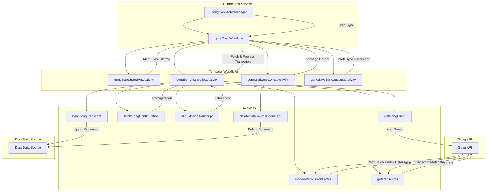
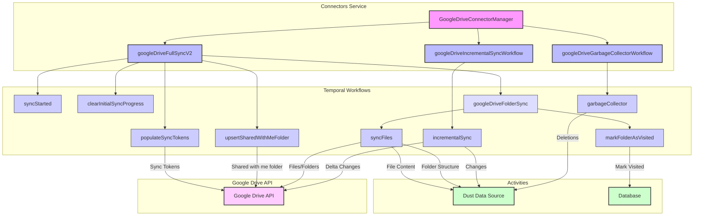

<!-- source: DeepWiki mcp.deepwiki.com · repo dust-tt/dust · page 8.2 Supported Integrations · fetched 2026-10-27 -->

# Supported Integrations

Relevant source files

The following files were used as context for generating this wiki page:

- [connectors/migrations/20260227_clear_gdrive_first_sync_progress.ts](connectors/migrations/20260227_clear_gdrive_first_sync_progress.ts)
- [connectors/migrations/20260313_clear_microsoft_first_sync_progress.ts](connectors/migrations/20260313_clear_microsoft_first_sync_progress.ts)
- [connectors/scripts/debug/run_profiler.ts](connectors/scripts/debug/run_profiler.ts)
- [connectors/scripts/microsoft_terminate_sensitivity_labels_workflows.ts](connectors/scripts/microsoft_terminate_sensitivity_labels_workflows.ts)
- [connectors/src/api/profiler.ts](connectors/src/api/profiler.ts)
- [connectors/src/connectors/confluence/temporal/workflows.ts](connectors/src/connectors/confluence/temporal/workflows.ts)
- [connectors/src/connectors/github/lib/code/gcs_repository.ts](connectors/src/connectors/github/lib/code/gcs_repository.ts)
- [connectors/src/connectors/github/lib/github_api.ts](connectors/src/connectors/github/lib/github_api.ts)
- [connectors/src/connectors/gong/index.ts](connectors/src/connectors/gong/index.ts)
- [connectors/src/connectors/gong/lib/errors.ts](connectors/src/connectors/gong/lib/errors.ts)
- [connectors/src/connectors/gong/lib/gong_api.ts](connectors/src/connectors/gong/lib/gong_api.ts)
- [connectors/src/connectors/gong/lib/permission_profiles.ts](connectors/src/connectors/gong/lib/permission_profiles.ts)
- [connectors/src/connectors/gong/lib/users.ts](connectors/src/connectors/gong/lib/users.ts)
- [connectors/src/connectors/gong/lib/utils.ts](connectors/src/connectors/gong/lib/utils.ts)
- [connectors/src/connectors/gong/temporal/activities.ts](connectors/src/connectors/gong/temporal/activities.ts)
- [connectors/src/connectors/gong/temporal/cast_known_errors.ts](connectors/src/connectors/gong/temporal/cast_known_errors.ts)
- [connectors/src/connectors/gong/temporal/client.ts](connectors/src/connectors/gong/temporal/client.ts)
- [connectors/src/connectors/gong/temporal/workflows.ts](connectors/src/connectors/gong/temporal/workflows.ts)
- [connectors/src/connectors/google_drive/temporal/activities/get_drives_to_sync.ts](connectors/src/connectors/google_drive/temporal/activities/get_drives_to_sync.ts)
- [connectors/src/connectors/google_drive/temporal/config.ts](connectors/src/connectors/google_drive/temporal/config.ts)
- [connectors/src/connectors/google_drive/temporal/workflows.ts](connectors/src/connectors/google_drive/temporal/workflows.ts)
- [connectors/src/connectors/intercom/lib/intercom_api.ts](connectors/src/connectors/intercom/lib/intercom_api.ts)
- [connectors/src/connectors/intercom/temporal/workflows.ts](connectors/src/connectors/intercom/temporal/workflows.ts)
- [connectors/src/connectors/microsoft/index.ts](connectors/src/connectors/microsoft/index.ts)
- [connectors/src/connectors/microsoft/lib/errors.ts](connectors/src/connectors/microsoft/lib/errors.ts)
- [connectors/src/connectors/microsoft/lib/graph_api.ts](connectors/src/connectors/microsoft/lib/graph_api.ts)
- [connectors/src/connectors/microsoft/lib/types.ts](connectors/src/connectors/microsoft/lib/types.ts)
- [connectors/src/connectors/microsoft/temporal/activities.ts](connectors/src/connectors/microsoft/temporal/activities.ts)
- [connectors/src/connectors/microsoft/temporal/cast_known_errors.ts](connectors/src/connectors/microsoft/temporal/cast_known_errors.ts)
- [connectors/src/connectors/microsoft/temporal/client.ts](connectors/src/connectors/microsoft/temporal/client.ts)
- [connectors/src/connectors/microsoft/temporal/file.ts](connectors/src/connectors/microsoft/temporal/file.ts)
- [connectors/src/connectors/microsoft/temporal/sensitivity_labels.test.ts](connectors/src/connectors/microsoft/temporal/sensitivity_labels.test.ts)
- [connectors/src/connectors/microsoft/temporal/workflows.ts](connectors/src/connectors/microsoft/temporal/workflows.ts)
- [connectors/src/connectors/notion/index.ts](connectors/src/connectors/notion/index.ts)
- [connectors/src/connectors/notion/lib/cli.ts](connectors/src/connectors/notion/lib/cli.ts)
- [connectors/src/connectors/notion/lib/notion_api.test.ts](connectors/src/connectors/notion/lib/notion_api.test.ts)
- [connectors/src/connectors/notion/lib/notion_api.ts](connectors/src/connectors/notion/lib/notion_api.ts)
- [connectors/src/connectors/notion/temporal/activities.ts](connectors/src/connectors/notion/temporal/activities.ts)
- [connectors/src/connectors/notion/temporal/config.ts](connectors/src/connectors/notion/temporal/config.ts)
- [connectors/src/connectors/notion/temporal/workflows/admins.ts](connectors/src/connectors/notion/temporal/workflows/admins.ts)
- [connectors/src/connectors/notion/temporal/workflows/children.ts](connectors/src/connectors/notion/temporal/workflows/children.ts)
- [connectors/src/connectors/notion/temporal/workflows/garbage_collection.ts](connectors/src/connectors/notion/temporal/workflows/garbage_collection.ts)
- [connectors/src/connectors/notion/temporal/workflows/upserts.ts](connectors/src/connectors/notion/temporal/workflows/upserts.ts)
- [connectors/src/connectors/slack/lib/slack_client.ts](connectors/src/connectors/slack/lib/slack_client.ts)
- [connectors/src/connectors/slack/lib/thread.ts](connectors/src/connectors/slack/lib/thread.ts)
- [connectors/src/connectors/slack/lib/utils.ts](connectors/src/connectors/slack/lib/utils.ts)
- [connectors/src/connectors/slack/lib/workspace_limits.test.ts](connectors/src/connectors/slack/lib/workspace_limits.test.ts)
- [connectors/src/connectors/slack/lib/workspace_limits.ts](connectors/src/connectors/slack/lib/workspace_limits.ts)
- [connectors/src/connectors/slack/temporal/cast_known_errors.ts](connectors/src/connectors/slack/temporal/cast_known_errors.ts)
- [connectors/src/connectors/zendesk/lib/zendesk_api.ts](connectors/src/connectors/zendesk/lib/zendesk_api.ts)
- [connectors/src/connectors/zendesk/temporal/activities.ts](connectors/src/connectors/zendesk/temporal/activities.ts)
- [connectors/src/connectors/zendesk/temporal/workflows.ts](connectors/src/connectors/zendesk/temporal/workflows.ts)
- [connectors/src/lib/api/config.ts](connectors/src/lib/api/config.ts)
- [connectors/src/lib/api/dust_api.ts](connectors/src/lib/api/dust_api.ts)
- [connectors/src/lib/bot/user_validation.ts](connectors/src/lib/bot/user_validation.ts)
- [connectors/src/lib/data_sources.ts](connectors/src/lib/data_sources.ts)
- [connectors/src/lib/models/gong.ts](connectors/src/lib/models/gong.ts)
- [connectors/src/lib/models/microsoft.ts](connectors/src/lib/models/microsoft.ts)
- [connectors/src/lib/oauth.ts](connectors/src/lib/oauth.ts)
- [connectors/src/lib/sync_status.ts](connectors/src/lib/sync_status.ts)
- [connectors/src/resources/gong_resources.ts](connectors/src/resources/gong_resources.ts)
- [connectors/src/resources/microsoft_resource.ts](connectors/src/resources/microsoft_resource.ts)
- [connectors/tsconfig.json](connectors/tsconfig.json)
- [front/components/Confirm.tsx](front/components/Confirm.tsx)
- [front/components/data_source/ZendeskOAuthExtraConfig.tsx](front/components/data_source/ZendeskOAuthExtraConfig.tsx)
- [front/components/data_source/gong/GongOptionComponent.tsx](front/components/data_source/gong/GongOptionComponent.tsx)
- [front/components/data_source/salesforce/SalesforceOAuthExtractConfig.tsx](front/components/data_source/salesforce/SalesforceOAuthExtractConfig.tsx)
- [front/hooks/useEnableBrowserNotification.tsx](front/hooks/useEnableBrowserNotification.tsx)
- [front/lib/api/oauth/providers/gong.ts](front/lib/api/oauth/providers/gong.ts)
- [front/lib/api/oauth/providers/zendesk.test.ts](front/lib/api/oauth/providers/zendesk.test.ts)
- [front/lib/api/oauth/providers/zendesk.ts](front/lib/api/oauth/providers/zendesk.ts)
- [front/lib/api/poke/plugins/data_sources/notion_unstuck_syncing_nodes.ts](front/lib/api/poke/plugins/data_sources/notion_unstuck_syncing_nodes.ts)
- [sdks/js/src/index.test.ts](sdks/js/src/index.test.ts)

This page details the data source connectors supported by Dust, outlining their sync strategies, permission models, and webhook handling. These connectors are part of the `connectors` service, which is responsible for synchronizing external data into the Dust platform.

## Microsoft 365 (OneDrive/SharePoint)

The Microsoft 365 connector integrates with OneDrive and SharePoint to synchronize files and folders. It supports both full and incremental synchronization, as well as garbage collection and sensitivity label reconciliation.

### Sync Strategy

The Microsoft 365 connector employs a Temporal-based workflow for synchronization.

#### Full Sync

A full sync workflow (`microsoftFullSyncWorkflowId` [connectors/src/connectors/microsoft/temporal/workflows.ts:65-67]()) is initiated to synchronize all selected content. It uses a breadth-first traversal to discover and sync files and folders. The workflow can be resumed using `continueAsNew` [connectors/src/connectors/microsoft/temporal/workflows.ts:157-164]() if the history length becomes too large.

The `fullSyncWorkflow` [connectors/src/connectors/microsoft/temporal/workflows.ts:55-195]() activity `syncFiles` [connectors/src/connectors/microsoft/temporal/activities.ts:176-197]() is responsible for fetching files and folders from a given parent and upserting them into the data source. It also discovers child nodes to be processed.

#### Incremental Sync

Incremental synchronization is handled by `incrementalSyncWorkflowV2` [connectors/src/connectors/microsoft/temporal/workflows.ts:219-260](). This workflow fetches delta changes from the Microsoft Graph API using `fetchDeltaForRootNodesInDrive` [connectors/src/connectors/microsoft/temporal/activities.ts:236-241]() and processes them. Large delta results are stored in GCS using `createDeltaJsonStream` [connectors/src/connectors/microsoft/temporal/activities.ts:119-165]() and read back using `readDeltaFromGCSStream` [connectors/src/connectors/microsoft/temporal/activities.ts:167-197]() to avoid memory issues.

The `processDeltaChangesFromGCS` [connectors/src/connectors/microsoft/temporal/activities.ts:243-247]() activity then iterates through the changed items, performing `syncOneFile` [connectors/src/connectors/microsoft/temporal/file.ts:167-230]() for new or updated files and `deleteFile` [connectors/src/connectors/microsoft/temporal/file.ts:145-151]() or `deleteFolder` [connectors/src/connectors/microsoft/temporal/file.ts:153-159]() for deleted items.

#### Garbage Collection

The `microsoftGarbageCollectionWorkflow` [connectors/src/connectors/microsoft/temporal/workflows.ts:262-270]() is responsible for removing documents that are no longer part of the selected content. It uses `microsoftGarbageCollectionActivity` [connectors/src/connectors/microsoft/temporal/activities.ts:272-280]() to identify and delete stale documents.

#### Sensitivity Labels Reconciliation

The connector supports filtering content based on Microsoft Information Protection (MIP) sensitivity labels. The `microsoftSensitivityLabelsReconciliationWorkflow` [connectors/src/connectors/microsoft/temporal/workflows.ts:272-280]() identifies files that should be excluded or included based on configured sensitivity labels. `computeDisallowedLabels` [connectors/src/connectors/microsoft/temporal/file.ts:113-124]() determines which labels are not allowed, and `removeFileBasedOnSensitivityLabel` [connectors/src/connectors/microsoft/temporal/file.ts:126-165]() handles the removal of non-compliant files.

### Permission Model

The Microsoft 365 connector operates under the permissions granted to the OAuth token used for connection. It respects the access controls configured within Microsoft 365. If a user does not have access to a particular file or site, the connector will not be able to sync it. Errors like `isAccessBlockedError` [connectors/src/connectors/microsoft/temporal/cast_known_errors.ts:53-61]() or `isGeneralExceptionError` [connectors/src/connectors/microsoft/temporal/cast_known_errors.ts:64-72]() are handled to gracefully skip inaccessible resources.

### Key Functions and Classes

*   `MicrosoftConnectorManager` [connectors/src/connectors/microsoft/index.ts:93-340](): Manages the lifecycle of Microsoft 365 connectors, including creation, update, and deletion.
*   `getMicrosoftClient` [connectors/src/connectors/microsoft/temporal/activities.ts:2](): Retrieves an authenticated Microsoft Graph API client.
*   `clientApiGet`, `clientApiPost` [connectors/src/connectors/microsoft/lib/graph_api.ts:37-88](): Wrapper functions for making Graph API calls, including retry logic for throttling errors.
*   `MicrosoftConfigurationResource` [connectors/src/resources/microsoft_resource.ts:42-140](): Stores configuration specific to a Microsoft 365 connector, such as enabled features and selected sites.
*   `MicrosoftNodeResource` [connectors/src/resources/microsoft_resource.ts:142-200](): Represents a synchronized file or folder from Microsoft 365.
*   `MicrosoftRootResource` [connectors/src/resources/microsoft_resource.ts:202-240](): Represents a root node (site, drive, or folder) selected for synchronization.

### Microsoft 365 Sync Data Flow

```mermaid
graph TD
    subgraph "Connectors Service"
        C[MicrosoftConnectorManager] --> WFS[microsoftFullSyncWorkflow]
        C --> WIS[microsoftIncrementalSyncWorkflowV2]
        C --> WGC[microsoftGarbageCollectionWorkflow]
        C --> WSR[microsoftSensitivityLabelsReconciliationWorkflow]
    end

    subgraph "Temporal Workflows"
        WFS --> A1[getRootNodesToSync]
        WFS --> A2[populateDeltas]
        WFS --> A3[syncFiles]
        WFS --> A4[markNodeAsSeen]
        WFS --> A5[microsoftDeletionActivity]

        WIS --> A6[isMicrosoftFullSyncRunning]
        WIS --> A7[getRootNodesToSync]
        WIS --> A8[groupRootItemsByDriveId]
        WIS --> A9[fetchDeltaForRootNodesInDrive]
        WIS --> A10[processDeltaChangesFromGCS]
        WIS --> A11[cleanupDeltaGCSFile]

        WGC --> A12[microsoftGarbageCollectionActivity]

        WSR --> A13[getDisallowedSensitivityLabelGuids]
        WSR --> A14[searchFilesByLabel]
        WSR --> A15[removeSensitivityLabelFilesActivity]
        WSR --> A16[reconcileHiddenFilesActivity]
    end

    subgraph "Activities"
        A3 --> F1[syncOneFile]
        A3 --> F2[deleteFile]
        A3 --> F3[deleteFolder]
        A10 --> F1
        A10 --> F2
        A10 --> F3
        A15 --> F2
        A16 --> F1
        A16 --> F2
    end

    subgraph "Microsoft Graph API"
        MSAPI[Microsoft Graph API]
    end

    subgraph "Dust Data Source"
        DDS[Dust Data Source]
    end

    subgraph "Google Cloud Storage"
        GCS[GCS Bucket]
    end

    A1 -- "Selected Root Nodes" --> WFS
    A7 -- "Selected Root Nodes" --> WIS
    A9 -- "Delta Data" --> GCS
    GCS -- "Delta Data" --> A10
    A3 -- "Files/Folders" --> MSAPI
    A9 -- "Delta Changes" --> MSAPI
    A14 -- "Files by Label" --> MSAPI
    F1 -- "Upsert Document/Folder" --> DDS
    F2 -- "Delete Document" --> DDS
    F3 -- "Delete Folder" --> DDS
    A12 -- "Delete Stale Documents" --> DDS

    MSAPI -- "File Content" --> F1
    MSAPI -- "Metadata" --> F1
    MSAPI -- "Metadata" --> A9
    MSAPI -- "Metadata" --> A14

    style C fill:#f9f,stroke:#333,stroke-width:2px
    style WFS fill:#bbf,stroke:#333,stroke-width:2px
    style WIS fill:#bbf,stroke:#333,stroke-width:2px
    style WGC fill:#bbf,stroke:#333,stroke-width:2px
    style WSR fill:#bbf,stroke:#333,stroke-width:2px
    style A1 fill:#ccf,stroke:#333,stroke-width:1px
    style A2 fill:#ccf,stroke:#333,stroke-width:1px
    style A3 fill:#ccf,stroke:#333,stroke-width:1px
    style A4 fill:#ccf,stroke:#333,stroke-width:1px
    style A5 fill:#ccf,stroke:#333,stroke-width:1px
    style A6 fill:#ccf,stroke:#333,stroke-width:1px
    style A7 fill:#ccf,stroke:#333,stroke-width:1px
    style A8 fill:#ccf,stroke:#333,stroke-width:1px
    style A9 fill:#ccf,stroke:#333,stroke-width:1px
    style A10 fill:#ccf,stroke:#333,stroke-width:1px
    style A11 fill:#ccf,stroke:#333,stroke-width:1px
    style A12 fill:#ccf,stroke:#333,stroke-width:1px
    style A13 fill:#ccf,stroke:#333,stroke-width:1px
    style A14 fill:#ccf,stroke:#333,stroke-width:1px
    style A15 fill:#ccf,stroke:#333,stroke-width:1px
    style A16 fill:#ccf,stroke:#333,stroke-width:1px
    style F1 fill:#eef,stroke:#333,stroke-width:1px
    style F2 fill:#eef,stroke:#333,stroke-width:1px
    style F3 fill:#eef,stroke:#333,stroke-width:1px
    style MSAPI fill:#fcf,stroke:#333,stroke-width:2px
    style DDS fill:#cfc,stroke:#333,stroke-width:2px
    style GCS fill:#ffc,stroke:#333,stroke-width:2px
```

**Diagram: Microsoft 365 Sync Data Flow**

Sources:
- [connectors/src/connectors/microsoft/temporal/activities.ts:119-165]()
- [connectors/src/connectors/microsoft/temporal/activities.ts:167-197]()
- [connectors/src/connectors/microsoft/temporal/activities.ts:236-241]()
- [connectors/src/connectors/microsoft/temporal/activities.ts:243-247]()
- [connectors/src/connectors/microsoft/temporal/cast_known_errors.ts:53-61]()
- [connectors/src/connectors/microsoft/temporal/cast_known_errors.ts:64-72]()
- [connectors/src/connectors/microsoft/temporal/file.ts:113-124]()
- [connectors/src/connectors/microsoft/temporal/file.ts:126-165]()
- [connectors/src/connectors/microsoft/temporal/file.ts:145-151]()
- [connectors/src/connectors/microsoft/temporal/file.ts:153-159]()
- [connectors/src/connectors/microsoft/temporal/file.ts:167-230]()
- [connectors/src/connectors/microsoft/temporal/workflows.ts:55-195]()
- [connectors/src/connectors/microsoft/temporal/workflows.ts:65-67]()
- [connectors/src/connectors/microsoft/temporal/workflows.ts:157-164]()
- [connectors/src/connectors/microsoft/temporal/workflows.ts:219-260]()
- [connectors/src/connectors/microsoft/temporal/workflows.ts:262-270]()
- [connectors/src/connectors/microsoft/temporal/workflows.ts:272-280]()
- [connectors/src/connectors/microsoft/index.ts:93-340]()
- [connectors/src/connectors/microsoft/temporal/activities.ts:2]()
- [connectors/src/connectors/microsoft/lib/graph_api.ts:37-88]()
- [connectors/src/resources/microsoft_resource.ts:42-140]()
- [connectors/src/resources/microsoft_resource.ts:142-200]()
- [connectors/src/resources/microsoft_resource.ts:202-240]()

## Gong

The Gong connector synchronizes call transcripts and metadata from the Gong platform. It supports configurable retention periods, tracker and account data inclusion, and filtering based on permission profiles and title keywords.

### Sync Strategy

The Gong connector uses a scheduled Temporal workflow (`gongSyncWorkflow` [connectors/src/connectors/gong/temporal/workflows.ts:15-17]()) for synchronization.

#### Initial and Incremental Sync

The `gongSyncWorkflow` [connectors/src/connectors/gong/temporal/workflows.ts:15-17]() orchestrates the synchronization process. It starts by calling `gongSaveStartSyncActivity` [connectors/src/connectors/gong/temporal/activities.ts:136-147]() to mark the sync as started.

The core of the sync involves fetching transcripts using `gongSyncTranscriptsActivity` [connectors/src/connectors/gong/temporal/activities.ts:199-235](). This activity retrieves call transcripts and their metadata from the Gong API. It handles pagination and can restart from the beginning if an expired cursor is encountered.

For each fetched transcript, `shouldSyncTranscript` [connectors/src/connectors/gong/temporal/activities.ts:88-134]() determines if it should be synced based on privacy settings, configured permission profiles, and excluded title keywords. If a transcript is to be synced, `syncGongTranscript` [connectors/src/connectors/gong/lib/upserts.ts:10-12]() is called to upsert it into the Dust data source.

#### Garbage Collection

The `gongGarbageCollectActivity` [connectors/src/connectors/gong/temporal/activities.ts:300-319]() is responsible for deleting old transcripts based on the configured `retentionPeriodDays` [connectors/src/resources/gong_resources.ts:141-146](). It runs periodically, as determined by `checkGarbageCollectionState` [connectors/src/resources/gong_resources.ts:197-215]().

### Permission Model

The Gong connector's permission model is based on Gong's permission profiles. Users can select a specific permission profile from Gong, and the connector will only sync calls that are accessible according to that profile.

*   `PermissionProfileSelector` [front/components/data_source/gong/GongOptionComponent.tsx:67-240]() in the frontend allows users to choose a permission profile.
*   `resolvePermissionProfile` [connectors/src/connectors/gong/temporal/activities.ts:42-66]() activity fetches the details of the selected permission profile from Gong and determines the set of user IDs whose calls should be synced.
*   `shouldSyncTranscript` [connectors/src/connectors/gong/temporal/activities.ts:88-134]() uses this resolved permission profile to filter transcripts. If the profile is "restricted", only calls where at least one participant (or the primary user) is in the `userIds` set of the profile are synced.

Additionally, the connector allows excluding transcripts based on keywords in their titles, configured via `setExcludeTitleKeywords` [connectors/src/resources/gong_resources.ts:148-175]().

### Key Functions and Classes

*   `GongConnectorManager` [connectors/src/connectors/gong/index.ts:74-300](): Manages the lifecycle of Gong connectors.
*   `GongConfigurationResource` [connectors/src/resources/gong_resources.ts:41-222](): Stores configuration for a Gong connector, including `retentionPeriodDays` [connectors/src/resources/gong_resources.ts:141-146](), `trackersEnabled` [connectors/src/resources/gong_resources.ts:109-114](), `accountsEnabled` [connectors/src/resources/gong_resources.ts:116-121](), `permissionProfileId` [connectors/src/resources/gong_resources.ts:134-139](), and `excludeTitleKeywords` [connectors/src/resources/gong_resources.ts:148-175]().
*   `GongTranscriptResource` [connectors/src/resources/gong_resources.ts:230-270](): Represents a synchronized Gong transcript.
*   `getGongClient` [connectors/src/connectors/gong/lib/utils.ts:10-12](): Retrieves an authenticated Gong API client.
*   `getTranscriptsMetadata` [connectors/src/connectors/gong/temporal/activities.ts:169-196]() and `getTranscripts` [connectors/src/connectors/gong/lib/gong_api.ts:300-319](): Functions for fetching transcript data from the Gong API.

### Gong Sync Data Flow

**Diagram: Gong Sync Data Flow**

Sources:
- [connectors/src/connectors/gong/lib/gong_api.ts:300-319]()
- [connectors/src/connectors/gong/lib/upserts.ts:10-12]()
- [connectors/src/connectors/gong/lib/utils.ts:10-12]()
- [connectors/src/connectors/gong/temporal/activities.ts:42-66]()
- [connectors/src/connectors/gong/temporal/activities.ts:88-134]()
- [connectors/src/connectors/gong/temporal/activities.ts:136-147]()
- [connectors/src/connectors/gong/temporal/activities.ts:169-196]()
- [connectors/src/connectors/gong/temporal/activities.ts:199-235]()
- [connectors/src/connectors/gong/temporal/activities.ts:300-319]()
- [connectors/src/connectors/gong/temporal/workflows.ts:15-17]()
- [connectors/src/connectors/gong/index.ts:74-300]()
- [connectors/src/resources/gong_resources.ts:41-222]()
- [connectors/src/resources/gong_resources.ts:109-114]()
- [connectors/src/resources/gong_resources.ts:116-121]()
- [connectors/src/resources/gong_resources.ts:134-139]()
- [connectors/src/resources/gong_resources.ts:141-146]()
- [connectors/src/resources/gong_resources.ts:148-175]()
- [connectors/src/resources/gong_resources.ts:197-215]()
- [connectors/src/resources/gong_resources.ts:230-270]()
- [front/components/data_source/gong/GongOptionComponent.tsx:67-240]()

## Google Drive

The Google Drive connector synchronizes files and folders from Google Drive. It supports full and incremental synchronization, as well as garbage collection.

### Sync Strategy

The Google Drive connector uses Temporal workflows for its synchronization process.

#### Full Sync

The `googleDriveFullSyncV2` [connectors/src/connectors/google_drive/temporal/workflows.ts:203-235]() workflow coordinates the full synchronization. It first calls `syncStarted` [connectors/src/lib/sync_status.ts:10-12]() and `clearInitialSyncProgress` [connectors/src/lib/sync_status.ts:14-16]() to initialize the sync state. It then populates sync tokens using `populateSyncTokens` [connectors/src/connectors/google_drive/temporal/activities.ts:10-12]() and upserts the "Shared with me" folder using `upsertSharedWithMeFolder` [connectors/src/connectors/google_drive/temporal/activities.ts:14-16]().

The workflow then launches child workflows, `googleDriveFolderSync` [connectors/src/connectors/google_drive/temporal/workflows.ts:113-178](), for each selected root folder. These child workflows explore the folder tree breadth-first, syncing files and discovering subfolders using `syncFiles` [connectors/src/connectors/google_drive/temporal/activities.ts:18-20](). `markFolderAsVisited` [connectors/src/connectors/google_drive/temporal/activities.ts:22-24]() is used to track visited folders. The `googleDriveFolderSync` [connectors/src/connectors/google_drive/temporal/workflows.ts:113-178]() workflow can `continueAsNew` [connectors/src/connectors/google_drive/temporal/workflows.ts:160-172]() to prevent history bloat.

#### Incremental Sync

The `googleDriveIncrementalSyncWorkflow` [connectors/src/connectors/google_drive/temporal/workflows.ts:300-302]() handles incremental updates. It fetches changes using `incrementalSync` [connectors/src/connectors/google_drive/temporal/activities.ts:26-28]() and processes them to update, create, or delete documents in the Dust data source.

#### Garbage Collection

The `googleDriveGarbageCollectorWorkflow` [connectors/src/connectors/google_drive/temporal/workflows.ts:68-78]() is responsible for cleaning up documents that are no longer selected for synchronization. It uses `garbageCollector` [connectors/src/connectors/google_drive/temporal/activities.ts:30-32]() to identify and remove stale documents.

### Permission Model

The Google Drive connector's permission model is based on the OAuth token used to connect. It respects the permissions of the connected Google account. If the account does not have access to a file or folder, it will not be synced. The connector also supports selecting specific folders for synchronization, effectively limiting the scope of data access.

### Key Functions and Classes

*   `googleDriveFullSyncV2` [connectors/src/connectors/google_drive/temporal/workflows.ts:203-235](): The main workflow for full synchronization.
*   `googleDriveFolderSync` [connectors/src/connectors/google_drive/temporal/workflows.ts:113-178](): A child workflow for syncing a single folder subtree.
*   `syncFiles` [connectors/src/connectors/google_drive/temporal/activities.ts:18-20](): Activity to synchronize files within a folder.
*   `incrementalSync` [connectors/src/connectors/google_drive/temporal/activities.ts:26-28](): Activity for incremental synchronization.
*   `garbageCollector` [connectors/src/connectors/google_drive/temporal/activities.ts:30-32](): Activity for garbage collection.

### Google Drive Sync Data Flow

**Diagram: Google Drive Sync Data Flow**

Sources:
- [connectors/src/connectors/google_drive/temporal/activities.ts:10-12]()
- [connectors/src/connectors/google_drive/temporal/activities.ts:14-16]()
- [connectors/src/connectors/google_drive/temporal/activities.ts:18-20]()
- [connectors/src/connectors/google_drive/temporal/activities.ts:22-24]()
- [connectors/src/connectors/google_drive/temporal/activities.ts:26-28]()
- [connectors/src/connectors/google_drive/temporal/activities.ts:30-32]()
- [connectors/src/connectors/google_drive/temporal/workflows.ts:68-78]()
- [connectors/src/connectors/google_drive/temporal/workflows.ts:113-178]()
- [connectors/src/connectors/google_drive/temporal/workflows.ts:160-172]()
- [connectors/src/connectors/google_drive/temporal/workflows.ts:203-235]()
- [connectors/src/connectors/google_drive/temporal/workflows.ts:300-302]()
- [connectors/src/lib/sync_status.ts:10-12]()
- [connectors/src/lib/sync_status.ts:14-16]()

## Other Connectors

Dust supports a variety of other data sources, each with its own synchronization mechanisms and permission models. While the detailed workflows for each are extensive, they generally follow similar patterns of full and incremental synchronization, often leveraging Temporal workflows.

### Notion

*   **Sync Strategy**: Notion synchronization involves fetching pages and databases. It uses `notionSyncWorkflow` [connectors/src/connectors/notion/temporal/workflows/main.ts:15-17]() for full and incremental syncs. `notionGarbageCollectionWorkflow` [connectors/src/connectors/notion/temporal/workflows/garbage_collection.ts:15-17]() handles deletion of unselected content.
*   **Permission Model**: Based on the Notion integration's permissions. Users select specific pages and databases to grant access to.
*   **Key Activities**: `notionUpsertPageActivity` [connectors/src/connectors/notion/temporal/activities.ts:10-12](), `notionUpsertDatabaseActivity` [connectors/src/connectors/notion/temporal/activities.ts:14-16](), `notionDeletePageActivity` [connectors/src/connectors/notion/temporal/activities.ts:18-20]().

### Slack

*   **Sync Strategy**: Slack synchronization focuses on channels and messages. It uses `slackSyncWorkflow` [connectors/src/connectors/slack/temporal/workflows/sync_workflow.ts:15-17]() for syncing and `slackGarbageCollectWorkflow` [connectors/src/connectors/slack/temporal/workflows/garbage_collect_workflow.ts:15-17]() for cleanup.
*   **Permission Model**: Based on the Slack app's permissions and the channels selected by the user.
*   **Key Activities**: `slackUpsertChannelActivity` [connectors/src/connectors/slack/temporal/activities.ts:10-12](), `slackUpsertMessagesActivity` [connectors/src/connectors/slack/temporal/activities.ts:14-16]().

### GitHub

*   **Sync Strategy**: GitHub synchronization involves repositories, issues, and pull requests. It uses `githubSyncWorkflow` [connectors/src/connectors/github/temporal/workflows.ts:15-17]() for syncing.
*   **Permission Model**: Based on the GitHub App's installation permissions and the repositories selected by the user.
*   **Key Activities**: `githubUpsertIssueActivity` [connectors/src/connectors/github/temporal/activities.ts:10-12](), `githubUpsertPullRequestActivity` [connectors/src/connectors/github/temporal/activities.ts:14-16]().

### Confluence

*   **Sync Strategy**: Confluence synchronization fetches spaces and pages. It uses `confluenceSyncWorkflow` [connectors/src/connectors/confluence/temporal/workflows.ts:15-17]() for synchronization.
*   **Permission Model**: Based on the Confluence OAuth app's permissions and the spaces selected by the user.
*   **Key Activities**: `confluenceUpsertSpaceActivity` [connectors/src/connectors/confluence/temporal/activities.ts:10-12](), `confluenceUpsertPageActivity` [connectors/src/connectors/confluence/temporal/activities.ts:14-16]().

### Intercom

*   **Sync Strategy**: Intercom synchronization fetches articles and conversations.
*   **Permission Model**: Based on the Intercom OAuth app's permissions.

### Salesforce

*   **Sync Strategy**: Salesforce synchronization fetches objects like accounts, contacts, and opportunities.
*   **Permission Model**: Based on the Salesforce OAuth app's permissions and the objects selected by the user.

### Zendesk

*   **Sync Strategy**: Zendesk synchronization fetches tickets and articles.
*   **Permission Model**: Based on the Zendesk OAuth app's permissions.

### BigQuery & Snowflake

*   **Sync Strategy**: These are database connectors. They typically involve fetching schema information and potentially data from tables. The sync strategy would involve querying the database and ingesting the results.
*   **Permission Model**: Based on database user credentials and granted permissions within the respective database systems.

### Webhook Handling

Many connectors, especially those supporting incremental updates, rely on webhooks to receive notifications about changes in the source system. When a webhook event is received, the `connectors` service processes it, often triggering a specific Temporal activity or workflow to handle the update. This allows for near real-time synchronization of changes.

Sources:
- [connectors/src/connectors/confluence/temporal/activities.ts:10-12]()
- [connectors/src/connectors/confluence/temporal/activities.ts:14-16]()
- [connectors/src/connectors/confluence/temporal/workflows.ts:15-17]()
- [connectors/src/connectors/github/temporal/activities.ts:10-12]()
- [connectors/src/connectors/github/temporal/activities.ts:14-16]()
- [connectors/src/connectors/github/temporal/workflows.ts:15-17]()
- [connectors/src/connectors/notion/temporal/activities.ts:10-12]()
- [connectors/src/connectors/notion/temporal/activities.ts:14-16]()
- [connectors/src/connectors/notion/temporal/activities.ts:18-20]()
- [connectors/src/connectors/notion/temporal/workflows/garbage_collection.ts:15-17]()
- [connectors/src/connectors/notion/temporal/workflows/main.ts:15-17]()
- [connectors/src/connectors/slack/temporal/activities.ts:10-12]()
- [connectors/src/connectors/slack/temporal/activities.ts:14-16]()
- [connectors/src/connectors/slack/temporal/workflows/garbage_collect_workflow.ts:15-17]()
- [connectors/src/connectors/slack/temporal/workflows/sync_workflow.ts:15-17]()

---

