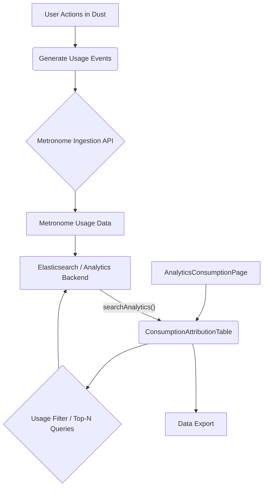

<!-- source: DeepWiki mcp.deepwiki.com · repo dust-tt/dust · page 9 Billing and Usage · fetched 2026-10-27 -->

# Billing and Usage

<details>
<summary>Relevant source files</summary>

The following files were used as context for generating this wiki page:

- [front-api/routes/poke/workspaces/[wId]/switch_contract.test.ts](front-api/routes/poke/workspaces/[wId]/switch_contract.test.ts)
- [front-api/routes/poke/workspaces/[wId]/switch_contract.ts](front-api/routes/poke/workspaces/[wId]/switch_contract.ts)
- [front-api/routes/w/[wId]/credits/index.ts](front-api/routes/w/[wId]/credits/index.ts)
- [front/components/members/InviteEmailButtonWithModal.tsx](front/components/members/InviteEmailButtonWithModal.tsx)
- [front/components/pages/workspace/UsagePage.tsx](front/components/pages/workspace/UsagePage.tsx)
- [front/components/poke/subscriptions/FreePlanUpgradeDialog.tsx](front/components/poke/subscriptions/FreePlanUpgradeDialog.tsx)
- [front/components/poke/subscriptions/SwitchContractDialog.tsx](front/components/poke/subscriptions/SwitchContractDialog.tsx)
- [front/components/workspace/BuyAwuCreditsDialog.tsx](front/components/workspace/BuyAwuCreditsDialog.tsx)
- [front/components/workspace/ChangeSeatModal.tsx](front/components/workspace/ChangeSeatModal.tsx)
- [front/components/workspace/EditSpendLimitModal.tsx](front/components/workspace/EditSpendLimitModal.tsx)
- [front/components/workspace/MembersSelectionBanner.tsx](front/components/workspace/MembersSelectionBanner.tsx)
- [front/components/workspace/MembersUsageTable.tsx](front/components/workspace/MembersUsageTable.tsx)
- [front/components/workspace/SeatCard.tsx](front/components/workspace/SeatCard.tsx)
- [front/hooks/useTableRowsSelection.ts](front/hooks/useTableRowsSelection.ts)
- [front/lib/api/credits/awu_pool_summary.ts](front/lib/api/credits/awu_pool_summary.ts)
- [front/lib/api/credits/credit_based_payg.ts](front/lib/api/credits/credit_based_payg.ts)
- [front/lib/api/credits/members_usage.ts](front/lib/api/credits/members_usage.ts)
- [front/lib/api/credits/seat_plan.ts](front/lib/api/credits/seat_plan.ts)
- [front/lib/api/membership.test.ts](front/lib/api/membership.test.ts)
- [front/lib/api/membership.ts](front/lib/api/membership.ts)
- [front/lib/api/metronome/credit_state_dispatcher.test.ts](front/lib/api/metronome/credit_state_dispatcher.test.ts)
- [front/lib/api/metronome/credit_state_dispatcher.ts](front/lib/api/metronome/credit_state_dispatcher.ts)
- [front/lib/api/metronome/process_webhook.ts](front/lib/api/metronome/process_webhook.ts)
- [front/lib/api/metronome/reconcile_credit_state.test.ts](front/lib/api/metronome/reconcile_credit_state.test.ts)
- [front/lib/api/metronome/reconcile_credit_state.ts](front/lib/api/metronome/reconcile_credit_state.ts)
- [front/lib/api/metronome/seat_sync.ts](front/lib/api/metronome/seat_sync.ts)
- [front/lib/api/poke/plugins/workspaces/sync_metronome_seats.ts](front/lib/api/poke/plugins/workspaces/sync_metronome_seats.ts)
- [front/lib/api/poke/switch_contract.ts](front/lib/api/poke/switch_contract.ts)
- [front/lib/credits/awu_purchase.test.ts](front/lib/credits/awu_purchase.test.ts)
- [front/lib/credits/awu_purchase.ts](front/lib/credits/awu_purchase.ts)
- [front/lib/credits/awu_purchase_constants.ts](front/lib/credits/awu_purchase_constants.ts)
- [front/lib/credits/credit_payg.ts](front/lib/credits/credit_payg.ts)
- [front/lib/metronome/alerts/per_user_credit_balance.ts](front/lib/metronome/alerts/per_user_credit_balance.ts)
- [front/lib/metronome/alerts/usage_cap.ts](front/lib/metronome/alerts/usage_cap.ts)
- [front/lib/metronome/client.ts](front/lib/metronome/client.ts)
- [front/lib/metronome/constants.ts](front/lib/metronome/constants.ts)
- [front/lib/metronome/contracts.test.ts](front/lib/metronome/contracts.test.ts)
- [front/lib/metronome/contracts.ts](front/lib/metronome/contracts.ts)
- [front/lib/metronome/live_user_credit_inputs.test.ts](front/lib/metronome/live_user_credit_inputs.test.ts)
- [front/lib/metronome/live_user_credit_inputs.ts](front/lib/metronome/live_user_credit_inputs.ts)
- [front/lib/metronome/plan_type.ts](front/lib/metronome/plan_type.ts)
- [front/lib/metronome/seat_types.test.ts](front/lib/metronome/seat_types.test.ts)
- [front/lib/metronome/seat_types.ts](front/lib/metronome/seat_types.ts)
- [front/lib/metronome/seats.test.ts](front/lib/metronome/seats.test.ts)
- [front/lib/metronome/seats.ts](front/lib/metronome/seats.ts)
- [front/lib/metronome/seats_sync.test.ts](front/lib/metronome/seats_sync.test.ts)
- [front/lib/metronome/setup_common.ts](front/lib/metronome/setup_common.ts)
- [front/lib/metronome/setup_legacy.ts](front/lib/metronome/setup_legacy.ts)
- [front/lib/metronome/setup_new_pricing.ts](front/lib/metronome/setup_new_pricing.ts)
- [front/lib/metronome/types.test.ts](front/lib/metronome/types.test.ts)
- [front/lib/metronome/types.ts](front/lib/metronome/types.ts)
- [front/lib/metronome/user_credit_state_machine.test.ts](front/lib/metronome/user_credit_state_machine.test.ts)
- [front/lib/metronome/user_credit_state_machine.ts](front/lib/metronome/user_credit_state_machine.ts)
- [front/lib/plans/credit_priced_plans.ts](front/lib/plans/credit_priced_plans.ts)
- [front/lib/plans/stripe.test.ts](front/lib/plans/stripe.test.ts)
- [front/lib/plans/stripe.ts](front/lib/plans/stripe.ts)
- [front/lib/resources/membership_resource.ts](front/lib/resources/membership_resource.ts)
- [front/lib/resources/storage/models/membership.ts](front/lib/resources/storage/models/membership.ts)
- [front/lib/resources/subscription_resource.ts](front/lib/resources/subscription_resource.ts)
- [front/lib/swr/credits.ts](front/lib/swr/credits.ts)
- [front/lib/swr/memberships.ts](front/lib/swr/memberships.ts)
- [front/migrations/20260605_backfill_membership_pool_cap_overrides.ts](front/migrations/20260605_backfill_membership_pool_cap_overrides.ts)
- [front/migrations/pre-deploy/20260729153513_add_pool_cap_override_expires_at_to_memberships.sql](front/migrations/pre-deploy/20260729153513_add_pool_cap_override_expires_at_to_memberships.sql)
- [front/scripts/metronome_setup.ts](front/scripts/metronome_setup.ts)
- [front/tests/utils/MembershipFactory.ts](front/tests/utils/MembershipFactory.ts)
- [front/tests/utils/metronome_contracts.ts](front/tests/utils/metronome_contracts.ts)
- [front/types/memberships.test.ts](front/types/memberships.test.ts)
- [front/types/memberships.ts](front/types/memberships.ts)

</details>


This page provides a high-level overview of Dust's billing and usage system, which is primarily built around Metronome for subscription management, seat allocation, credit tracking, and usage analytics. It covers how user seats are managed, how credits are consumed and tracked, and how usage data is presented. Detailed technical documentation for each sub-topic is provided in dedicated child pages.

## Metronome Billing Integration

Dust leverages Metronome as its core billing platform. This integration handles the lifecycle of customer contracts, subscription management, and the processing of webhooks from Metronome to update Dust's internal state. Key functionalities include provisioning new contracts, synchronizing seat counts, managing user credit states, and processing usage events. The system is designed to support various billing models, including pay-as-you-go (PAYG) and seat-based subscriptions.

For details, see [Metronome Billing Integration](#9.1).

### Metronome Client and Contract Management

The Metronome client, initialized by `getMetronomeClient()` [front/lib/metronome/client.ts:56-68](), provides the interface for interacting with the Metronome API. This client is used to manage customer accounts, provision contracts, and ingest usage events. Contracts are provisioned using `provisionMetronomeContract()` [front/lib/metronome/contracts.ts:190-240]() and can be scheduled to end with `scheduleMetronomeContractEnd()` [front/lib/metronome/client.ts:290-300](). The system also ensures that a Metronome customer exists for each workspace via `ensureMetronomeCustomerForWorkspace()` [front/lib/metronome/contracts.ts:50-108]().

### Seat Synchronization and Credit States

Seat management is a critical aspect of the billing system. The `syncSeatCount()` function [front/lib/metronome/seats.ts:300-302]() is responsible for reconciling the number of active seats in Metronome with the actual user memberships in Dust. This involves adding or revoking per-user credits in Metronome based on changes in user `MembershipSeatType` [front/types/memberships.ts:10-10](). User credit states, such as `capped`, `unlimited`, or `blocked`, are managed by a state machine and updated based on Metronome alerts and usage. The `UserCreditState` [front/types/memberships.ts:71-71]() enum defines these states.

### Webhook Processing

Metronome webhooks are crucial for real-time updates to Dust's billing state. The `processMetronomeWebhook()` function [front/lib/api/metronome/process_webhook.ts:157-157]() handles incoming events, such as `contract.start`, `credit.create`, and `alerts.spend_threshold_reached`. These webhooks trigger various actions, including updating subscription statuses, dispatching credit-related notifications, and reconciling user credit states.

### Metronome Billing System Overview

The following diagram illustrates the high-level interaction between Dust and Metronome for billing and usage tracking.

```mermaid
graph TD
    subgraph Dust
        A[User Actions] --> B(Usage Events Ingestion)
        C[Workspace Management] --> D(Seat Management)
        E[Subscription Management] --> F(Contract Provisioning)
        G[Webhook Handler]
    end

    subgraph Metronome
        H[Metronome API]
        I[Metronome Contracts]
        J[Metronome Customers]
        K[Metronome Credits]
        L[Metronome Webhooks]
    end

    B -- "ingestMetronomeEvents()" --> H
    F -- "createMetronomeContract()" --> H
    D -- "syncSeatCount()" --> H
    G <-- "unwrapMetronomeWebhook()" --- L
    H -- "getMetronomeClient()" --> MetronomeSDK[Metronome SDK]
    MetronomeSDK -- "API Calls" --> I
    MetronomeSDK -- "API Calls" --> J
    MetronomeSDK -- "API Calls" --> K
    L -- "Event Data" --> G
    G -- "processMetronomeWebhook()" --> DustInternalState[Dust Internal State Updates]
```
Sources:
- [front/lib/metronome/client.ts:56-68]()
- [front/lib/metronome/contracts.ts:50-108]()
- [front/lib/metronome/contracts.ts:190-240]()
- [front/lib/metronome/client.ts:290-300]()
- [front/lib/metronome/seats.ts:300-302]()
- [front/types/memberships.ts:10-10]()
- [front/types/memberships.ts:71-71]()
- [front/lib/api/metronome/process_webhook.ts:157-157]()

## Usage Management UI

The Usage Management UI provides administrators and users with tools to monitor and control their workspace's consumption. This includes viewing member usage, changing seat types, configuring spend limits, and purchasing additional credits. The interface is designed to be intuitive, allowing for both individual and bulk actions.

For details, see [Usage Management UI](#9.2).

### Usage Page and Member Tables

The `UsagePage` [front/components/pages/workspace/UsagePage.tsx:1-131]() is the central hub for usage management. It displays an overview of workspace consumption and includes the `MembersUsageTable` [front/components/workspace/MembersUsageTable.tsx:1-17]() for a detailed breakdown of individual member usage. This table shows each member's `seatType` [front/types/memberships.ts:10-10](), `consumedAwuCredits` [front/lib/api/credits/members_usage.ts:110-110](), and `spendLimitAwuCredits` [front/lib/api/credits/members_usage.ts:129-129]().

### Seat and Spend Limit Management

Administrators can change a user's seat type using the `ChangeSeatModal` [front/components/workspace/ChangeSeatModal.tsx:1-1]() and configure individual spend limits with the `EditSpendLimitModal` [front/components/workspace/EditSpendLimitModal.tsx:1-1](). Bulk actions are also supported through `BulkChangeSeatModal` [front/components/workspace/BulkChangeSeatModal.tsx:5-5]() and `BulkEditSpendLimitModal` [front/components/workspace/BulkEditSpendLimitModal.tsx:6-6](). These modals interact with API routes to update membership and credit usage configurations.

### AWU Credit Purchases

Workspaces can purchase additional AWU (AI Work Unit) credits through the `BuyAwuCreditsDialog` [front/components/workspace/BuyAwuCreditsDialog.tsx:1-1](). This dialog facilitates the process of adding credits to the workspace's pool, which are then consumed by users. The purchase process involves interaction with Stripe for payment processing.

### Poke Admin Billing Interface

The internal Poke admin interface provides advanced billing management capabilities, including the `SwitchContractDialog` [front/components/poke/subscriptions/SwitchContractDialog.tsx:1-1]() for changing a workspace's subscription contract. This interface allows for granular control over billing parameters and is used for internal support and reconciliation.

### Usage Management UI Components

```mermaid
graph TD
    A[UsagePage] --> B(MembersUsageTable)
    A --> C(GroupsUsageTable)
    A --> D(ModelTiersSettingsCard)
    A --> E(UsageSettingsCard)
    B --> F(ChangeSeatModal)
    B --> G(EditSpendLimitModal)
    A --> H(BuyAwuCreditsDialog)
    A --> I(BulkChangeSeatModal)
    A --> J(BulkEditSpendLimitModal)
    K[Poke Admin Interface] --> L(SwitchContractDialog)

    subgraph User Actions
        F -- "Update MembershipSeatType" --> API_MEMBERSHIP[API: /api/w/[wId]/memberships]
        G -- "Update Spend Limit" --> API_CREDITS[API: /api/w/[wId]/credits]
        H -- "Purchase AWU Credits" --> API_AWU_PURCHASE[API: /api/w/[wId]/credits/awu_purchase]
        I -- "Bulk Update Seat Type" --> API_MEMBERSHIP
        J -- "Bulk Update Spend Limit" --> API_CREDITS
        L -- "Switch Contract" --> API_SWITCH_CONTRACT[API: /poke/workspaces/[wId]/switch_contract]
    end
```
Sources:
- [front/components/pages/workspace/UsagePage.tsx:1-131]()
- [front/components/workspace/MembersUsageTable.tsx:1-17]()
- [front/types/memberships.ts:10-10]()
- [front/lib/api/credits/members_usage.ts:110-110]()
- [front/lib/api/credits/members_usage.ts:129-129]()
- [front/components/workspace/ChangeSeatModal.tsx:1-1]()
- [front/components/workspace/EditSpendLimitModal.tsx:1-1]()
- [front/components/workspace/BulkChangeSeatModal.tsx:5-5]()
- [front/components/workspace/BulkEditSpendLimitModal.tsx:6-6]()
- [front/components/workspace/BuyAwuCreditsDialog.tsx:1-1]()
- [front/components/poke/subscriptions/SwitchContractDialog.tsx:1-1]()

## Consumption Analytics

The consumption analytics system provides detailed insights into how resources are being used across workspaces and by individual users. This system collects, processes, and presents usage data, enabling administrators to understand consumption patterns, identify top users, and export data for further analysis.

For details, see [Consumption Analytics](#9.3).

### Analytics Consumption Page

The `AnalyticsConsumptionPage` (not explicitly provided in the snippets but implied by the context) is where users can view their consumption data. This page likely integrates with components like `ConsumptionAttributionTable` (implied) to display usage metrics. The system supports faceted filtering, allowing users to drill down into specific dimensions of usage.

### Data Collection and Storage

Usage data is collected through Metronome's event ingestion API, as described in the Metronome Billing Integration section. These events are then processed and stored, likely in an Elasticsearch-backed system, to enable efficient querying and analysis. The `searchAnalytics()` function [front/lib/api/credits/members_usage.ts:10-10]() is used to query this data.

### Usage Dimensions and Filtering

Consumption data can be analyzed across various dimensions, such as user, agent, and model. The `usageFilter` (implied) mechanism allows for complex queries to retrieve specific subsets of data. This enables functionalities like identifying top-N consumers or analyzing usage trends over time.

### Consumption Analytics Flow


Sources:
- [front/lib/api/credits/members_usage.ts:10-10]()

---

