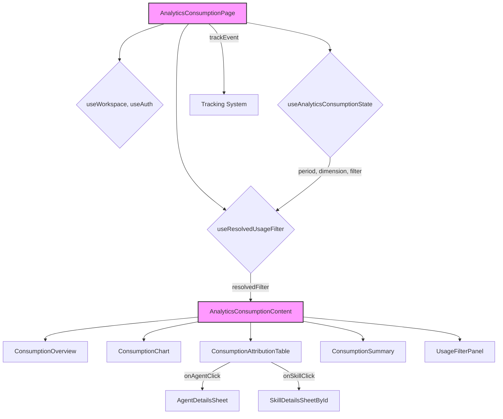
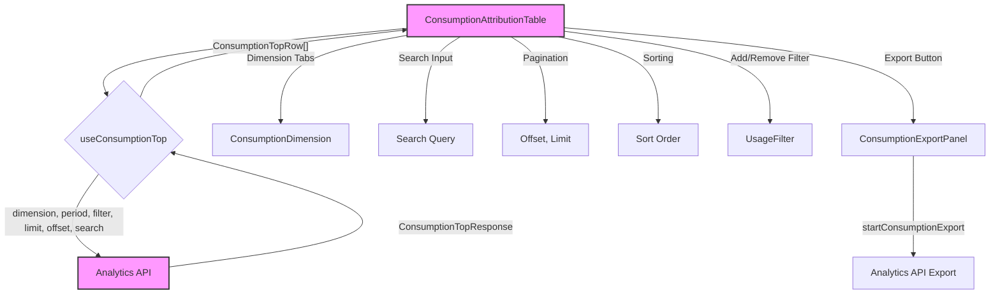
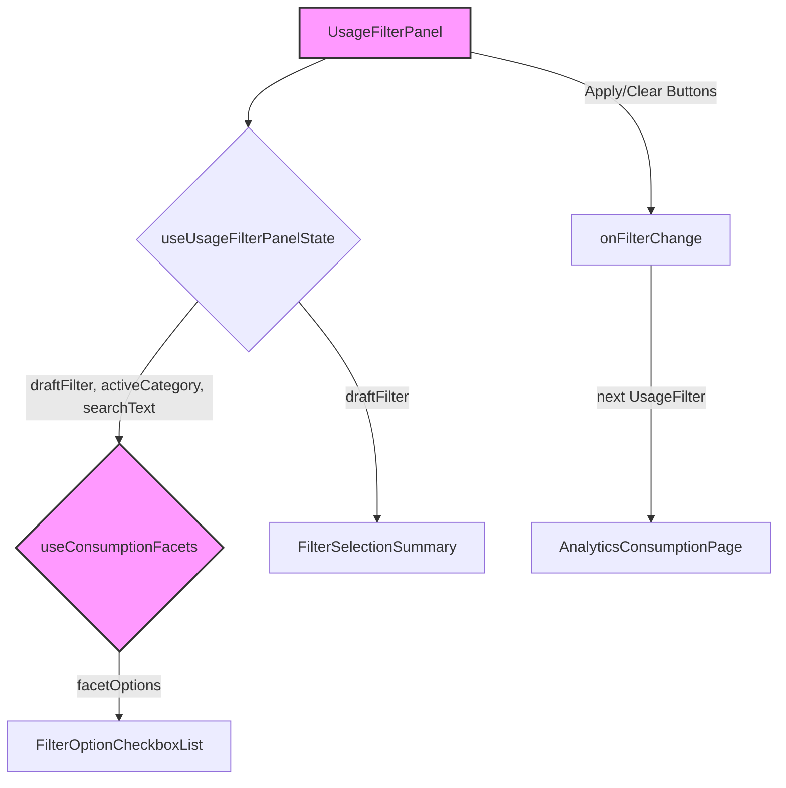

<!-- source: DeepWiki mcp.deepwiki.com · repo dust-tt/dust · page 9.3 Consumption Analytics · fetched 2026-10-27 -->

# Consumption Analytics

<details>
<summary>Relevant source files</summary>

The following files were used as context for generating this wiki page:

- [front-api/routes/v1/w/[wId]/analytics/export.test.ts](front-api/routes/v1/w/[wId]/analytics/export.test.ts)
- [front-api/routes/v1/w/[wId]/analytics/export.ts](front-api/routes/v1/w/[wId]/analytics/export.ts)
- [front-api/routes/w/[wId]/analytics/active-users.ts](front-api/routes/w/[wId]/analytics/active-users.ts)
- [front-api/routes/w/[wId]/analytics/agents-export.ts](front-api/routes/w/[wId]/analytics/agents-export.ts)
- [front-api/routes/w/[wId]/analytics/consumption/facets.test.ts](front-api/routes/w/[wId]/analytics/consumption/facets.test.ts)
- [front-api/routes/w/[wId]/analytics/consumption/facets.ts](front-api/routes/w/[wId]/analytics/consumption/facets.ts)
- [front-api/routes/w/[wId]/analytics/consumption/index.ts](front-api/routes/w/[wId]/analytics/consumption/index.ts)
- [front-api/routes/w/[wId]/analytics/consumption/top.test.ts](front-api/routes/w/[wId]/analytics/consumption/top.test.ts)
- [front-api/routes/w/[wId]/analytics/overview.ts](front-api/routes/w/[wId]/analytics/overview.ts)
- [front-api/routes/w/[wId]/analytics/skill-usage-export.ts](front-api/routes/w/[wId]/analytics/skill-usage-export.ts)
- [front-api/routes/w/[wId]/analytics/skill-usage.ts](front-api/routes/w/[wId]/analytics/skill-usage.ts)
- [front-api/routes/w/[wId]/analytics/source-export.ts](front-api/routes/w/[wId]/analytics/source-export.ts)
- [front-api/routes/w/[wId]/analytics/source.ts](front-api/routes/w/[wId]/analytics/source.ts)
- [front-api/routes/w/[wId]/analytics/tool-usage-export.ts](front-api/routes/w/[wId]/analytics/tool-usage-export.ts)
- [front-api/routes/w/[wId]/analytics/tool-usage.ts](front-api/routes/w/[wId]/analytics/tool-usage.ts)
- [front-api/routes/w/[wId]/analytics/usage-metrics-export.ts](front-api/routes/w/[wId]/analytics/usage-metrics-export.ts)
- [front-api/routes/w/[wId]/analytics/usage-metrics.ts](front-api/routes/w/[wId]/analytics/usage-metrics.ts)
- [front-api/routes/w/[wId]/analytics/users-export.ts](front-api/routes/w/[wId]/analytics/users-export.ts)
- [front/components/UserAnalyticsPopover.tsx](front/components/UserAnalyticsPopover.tsx)
- [front/components/pages/workspace/AnalyticsConsumptionPage.tsx](front/components/pages/workspace/AnalyticsConsumptionPage.tsx)
- [front/components/workspace/analytics/UsageFilterPanel.tsx](front/components/workspace/analytics/UsageFilterPanel.tsx)
- [front/components/workspace/analytics/consumption/ConsumptionAttributionBreakdown.tsx](front/components/workspace/analytics/consumption/ConsumptionAttributionBreakdown.tsx)
- [front/components/workspace/analytics/consumption/ConsumptionAttributionRowsTable.tsx](front/components/workspace/analytics/consumption/ConsumptionAttributionRowsTable.tsx)
- [front/components/workspace/analytics/consumption/ConsumptionAttributionTable.test.tsx](front/components/workspace/analytics/consumption/ConsumptionAttributionTable.test.tsx)
- [front/components/workspace/analytics/consumption/ConsumptionAttributionTable.tsx](front/components/workspace/analytics/consumption/ConsumptionAttributionTable.tsx)
- [front/components/workspace/analytics/consumption/ConsumptionChart.tsx](front/components/workspace/analytics/consumption/ConsumptionChart.tsx)
- [front/components/workspace/analytics/consumption/ConsumptionOverview.tsx](front/components/workspace/analytics/consumption/ConsumptionOverview.tsx)
- [front/components/workspace/analytics/consumption/consumptionDimensions.test.ts](front/components/workspace/analytics/consumption/consumptionDimensions.test.ts)
- [front/components/workspace/analytics/consumption/consumptionDimensions.ts](front/components/workspace/analytics/consumption/consumptionDimensions.ts)
- [front/components/workspace/analytics/usageFilter.test.ts](front/components/workspace/analytics/usageFilter.test.ts)
- [front/components/workspace/analytics/usageFilter.ts](front/components/workspace/analytics/usageFilter.ts)
- [front/hooks/useConsumptionFacets.ts](front/hooks/useConsumptionFacets.ts)
- [front/hooks/useConsumptionOverview.ts](front/hooks/useConsumptionOverview.ts)
- [front/hooks/useConsumptionQuery.ts](front/hooks/useConsumptionQuery.ts)
- [front/hooks/useConsumptionTimeseries.ts](front/hooks/useConsumptionTimeseries.ts)
- [front/hooks/useConsumptionTop.ts](front/hooks/useConsumptionTop.ts)
- [front/lib/analytics/consumption_period.ts](front/lib/analytics/consumption_period.ts)
- [front/lib/analytics/view_params.test.ts](front/lib/analytics/view_params.test.ts)
- [front/lib/analytics/view_params.ts](front/lib/analytics/view_params.ts)
- [front/lib/api/analytics/agents_export.test.ts](front/lib/api/analytics/agents_export.test.ts)
- [front/lib/api/analytics/agents_export.ts](front/lib/api/analytics/agents_export.ts)
- [front/lib/api/analytics/consumption/facet_catalog.ts](front/lib/api/analytics/consumption/facet_catalog.ts)
- [front/lib/api/analytics/consumption/facets.test.ts](front/lib/api/analytics/consumption/facets.test.ts)
- [front/lib/api/analytics/consumption/facets.ts](front/lib/api/analytics/consumption/facets.ts)
- [front/lib/api/analytics/consumption/labels.test.ts](front/lib/api/analytics/consumption/labels.test.ts)
- [front/lib/api/analytics/consumption/labels.ts](front/lib/api/analytics/consumption/labels.ts)
- [front/lib/api/analytics/consumption/period.test.ts](front/lib/api/analytics/consumption/period.test.ts)
- [front/lib/api/analytics/consumption/period.ts](front/lib/api/analytics/consumption/period.ts)
- [front/lib/api/analytics/consumption/schema.ts](front/lib/api/analytics/consumption/schema.ts)
- [front/lib/api/analytics/consumption/scope.test.ts](front/lib/api/analytics/consumption/scope.test.ts)
- [front/lib/api/analytics/consumption/scope.ts](front/lib/api/analytics/consumption/scope.ts)
- [front/lib/api/analytics/consumption/timeseries.test.ts](front/lib/api/analytics/consumption/timeseries.test.ts)
- [front/lib/api/analytics/consumption/top.test.ts](front/lib/api/analytics/consumption/top.test.ts)
- [front/lib/api/analytics/consumption/top.ts](front/lib/api/analytics/consumption/top.ts)
- [front/lib/api/analytics/consumption/top_agents.ts](front/lib/api/analytics/consumption/top_agents.ts)
- [front/lib/api/analytics/consumption/top_groups.ts](front/lib/api/analytics/consumption/top_groups.ts)
- [front/lib/api/analytics/consumption/top_models.ts](front/lib/api/analytics/consumption/top_models.ts)
- [front/lib/api/analytics/consumption/top_skills.ts](front/lib/api/analytics/consumption/top_skills.ts)
- [front/lib/api/analytics/consumption/top_sources.ts](front/lib/api/analytics/consumption/top_sources.ts)
- [front/lib/api/analytics/consumption/top_tools.ts](front/lib/api/analytics/consumption/top_tools.ts)
- [front/lib/api/analytics/consumption/top_users.ts](front/lib/api/analytics/consumption/top_users.ts)
- [front/lib/api/analytics/enrichment.ts](front/lib/api/analytics/enrichment.ts)
- [front/lib/api/analytics/export_tables.test.ts](front/lib/api/analytics/export_tables.test.ts)
- [front/lib/api/analytics/export_tables.ts](front/lib/api/analytics/export_tables.ts)
- [front/lib/api/analytics/feedback_export.ts](front/lib/api/analytics/feedback_export.ts)
- [front/lib/api/analytics/messages_export.test.ts](front/lib/api/analytics/messages_export.test.ts)
- [front/lib/api/analytics/messages_export.ts](front/lib/api/analytics/messages_export.ts)
- [front/lib/api/analytics/skill_usage_export.ts](front/lib/api/analytics/skill_usage_export.ts)
- [front/lib/api/analytics/tool_usage_export.ts](front/lib/api/analytics/tool_usage_export.ts)
- [front/lib/api/analytics/usage_metrics_export.ts](front/lib/api/analytics/usage_metrics_export.ts)
- [front/lib/api/analytics/users_export.test.ts](front/lib/api/analytics/users_export.test.ts)
- [front/lib/api/analytics/users_export.ts](front/lib/api/analytics/users_export.ts)
- [front/lib/api/assistant/observability/agent_labels.ts](front/lib/api/assistant/observability/agent_labels.ts)

</details>


This page documents the consumption analytics system, which provides insights into how Dust resources are being used within a workspace. It covers the UI components for displaying analytics, the underlying data fetching mechanisms, faceted filtering, top-N queries, and data export capabilities. The system leverages Elasticsearch for efficient querying and aggregation of consumption data.

## Analytics Consumption Page (`AnalyticsConsumptionPage`)

The `AnalyticsConsumptionPage` [front/components/pages/workspace/AnalyticsConsumptionPage.tsx:147-190]() is the main entry point for users to view consumption analytics. It orchestrates the display of various components, including the `ConsumptionAttributionTable`, `ConsumptionChart`, `ConsumptionOverview`, `ConsumptionSummary`, and `UsageFilterPanel`.

The page uses several hooks to manage its state and fetch data:
*   `useWorkspace()` and `useAuth()`: To get the current workspace and user context.
*   `useState()`: To manage the visibility of agent and skill detail sheets.
*   `useAnalyticsConsumptionState()`: A custom hook that manages the analytics view state, including the selected period, dimension, and filters.
*   `useResolvedUsageFilter()`: Resolves the `UsageFilter` based on the current workspace, period, and filter state.

The `AnalyticsConsumptionPage` also handles tracking user interactions for analytics purposes using `trackEvent` [front/components/pages/workspace/AnalyticsConsumptionPage.tsx:160-166]().


**Diagram: Analytics Consumption Page Flow**
Sources: [front/components/pages/workspace/AnalyticsConsumptionPage.tsx:1-190]()

## Consumption Attribution Table (`ConsumptionAttributionTable`)

The `ConsumptionAttributionTable` [front/components/workspace/analytics/consumption/ConsumptionAttributionTable.tsx:77]() component displays a breakdown of consumption by various dimensions (e.g., agents, users, models, skills). It supports:

*   **Dimension Selection**: Users can switch between different consumption dimensions using tabs.
*   **Pagination**: Data is paginated to handle large result sets.
*   **Sorting**: Columns can be sorted, with "credits" and "costShare" being server-sortable [front/components/workspace/analytics/consumption/ConsumptionAttributionTable.tsx:98-101]().
*   **Search**: A search input allows filtering the displayed rows.
*   **Faceted Filtering**: Users can apply filters based on selected dimensions, which updates the `UsageFilter`.
*   **Conversation Attribution**: For personal analytics, it can display consumption attributed to specific conversations [front/components/workspace/analytics/consumption/ConsumptionAttributionTable.tsx:8]().
*   **Data Export**: Provides a panel to export raw consumption data [front/components/workspace/analytics/consumption/ConsumptionExportPanel.tsx]().

The table uses `useConsumptionTop` [front/hooks/useConsumptionTop.ts:81]() to fetch the top N entities for the selected dimension and period. It also uses `framer-motion` for smooth transitions when changing dimensions [front/components/workspace/analytics/consumption/ConsumptionAttributionTable.tsx:103-131]().

### Consumption Dimensions

The system defines various `ConsumptionDimension` types [front/components/workspace/analytics/consumption/consumptionDimensions.ts]() that represent different ways to categorize consumption. These include:

*   `agent`: Consumption by agent.
*   `user`: Consumption by user.
*   `group`: Consumption by user group.
*   `model`: Consumption by LLM model.
*   `tool`: Consumption by tool.
*   `skill`: Consumption by skill.
*   `source`: Consumption by data source.
*   `api_key`: Consumption by API key.
*   `conversation`: Consumption by conversation (primarily for personal analytics).
*   `reasoning_effort`: Consumption by model reasoning effort.

The `CONSUMPTION_ATTRIBUTION_DIMENSIONS` array [front/components/workspace/analytics/consumption/consumptionDimensions.ts:10]() defines the dimensions available for attribution. The `getConsumptionAttributionDimensions` function [front/components/workspace/analytics/consumption/consumptionDimensions.ts:100]() dynamically determines which dimensions are available based on the `ConsumptionAnalyticsScope`.

### Top-N Queries (`useConsumptionTop`)

The `useConsumptionTop` hook [front/hooks/useConsumptionTop.ts:81]() is responsible for fetching the top N consuming entities for a given dimension. It constructs a request to the analytics API based on the selected dimension, period, limit, offset, search query, and filters.

The `toConsumptionTopRows` function [front/hooks/useConsumptionTop.ts:85]() maps the API response for different dimensions (e.g., `GetConsumptionTopAgentsResponse`, `GetConsumptionTopUsersResponse`) into a common `ConsumptionTopRow` format, which includes `id`, `name`, `credits`, `avgCredits`, and `previousCredits`.


**Diagram: Consumption Attribution Table Data Flow**
Sources: [front/components/workspace/analytics/consumption/ConsumptionAttributionTable.tsx:77](), [front/hooks/useConsumptionTop.ts:81](), [front/hooks/useConsumptionTop.ts:85]()

## Usage Filter (`UsageFilterPanel`)

The `UsageFilterPanel` [front/components/workspace/analytics/UsageFilterPanel.tsx:53]() component provides a faceted filtering interface for consumption analytics. It allows users to select specific agents, members, groups, models, tools, skills, sources, or API keys to narrow down the consumption data.

Key aspects of the `UsageFilterPanel`:

*   **Categories**: Filters are organized by categories like "Agents", "Members", "Models", etc. [front/components/workspace/analytics/usageFilter.ts:20]().
*   **Options**: Each category presents a list of available options (facets) fetched from the backend.
*   **Selection**: Users can select multiple options within each category.
*   **Draft State**: Selections are staged in a draft state (`draftFilter`) while the panel is open and only applied when the user clicks "Apply" [front/components/workspace/analytics/UsageFilterPanel.tsx:115]().
*   **Dynamic Categories**: The available filter categories can change based on the `ConsumptionAnalyticsScope` (e.g., "member" and "group" categories are hidden in personal scope) [front/components/workspace/analytics/usageFilter.ts:41-52]().
*   **Facet Fetching**: The `useConsumptionFacets` hook [front/hooks/useConsumptionFacets.ts]() fetches the available filter options (facets) for each category based on the current `draftScopeFilter`.

The `UsageFilter` type [front/components/workspace/analytics/usageFilter.ts:161]() represents the selected filters, mapping each category to an array of selected options. The `toConsumptionScopeFilter` function [front/components/workspace/analytics/usageFilter.ts:239]() converts the `UsageFilter` into a `ConsumptionScopeFilter` suitable for API requests.


**Diagram: Usage Filter Panel Data Flow**
Sources: [front/components/workspace/analytics/UsageFilterPanel.tsx:53](), [front/components/workspace/analytics/UsageFilterPanel.tsx:115](), [front/components/workspace/analytics/usageFilter.ts:161](), [front/components/workspace/analytics/usageFilter.ts:239]()

## Analytics API (Elasticsearch-backed)

The consumption analytics data is stored and queried using Elasticsearch. The backend API endpoints for analytics (e.g., `/api/w/[wId]/analytics/consumption/top`, `/api/w/[wId]/analytics/consumption/facets`) interact with Elasticsearch to retrieve aggregated consumption metrics.

### Consumption Scope Query (`buildConsumptionScopeQuery`)

The core of the Elasticsearch querying for consumption analytics is the `buildConsumptionScopeQuery` function [front/lib/api/analytics/consumption/scope.ts:175](). This function constructs an Elasticsearch `bool` query that filters consumption documents based on:

*   **Workspace ID**: Ensures data is scoped to the current workspace.
*   **Time Range**: Filters documents by `completed_at` within a specified `startDate` and `endDate`. The range is half-open `[startDate, endDate)`.
*   **Consumption Scope Filter**: Applies filters based on selected dimensions (e.g., `agent.attributed_id`, `user.id`, `model.model_id`). These filters are derived from the `UsageFilter` in the frontend.
*   **Extra Filters**: Allows for additional custom Elasticsearch query clauses.

The `CONSUMPTION_DIMENSION_FIELDS` [front/lib/api/analytics/consumption/scope.ts:63]() maps each `ConsumptionScopeDimension` to its corresponding field in the Elasticsearch document. For example, `agent` maps to `agent.attributed_id`.

### Metrics and Aggregations

Consumption metrics, such as `credit_micro` [front/lib/api/analytics/consumption/scope.ts:113](), are aggregated using Elasticsearch's `sum` aggregation. The `metricSubAgg` function [front/lib/api/analytics/consumption/scope.ts:140]() generates the aggregation structure for a given metric.

To count distinct messages, the `uniqueMessagesCardinalityAgg` function [front/lib/api/analytics/consumption/scope.ts:48]() uses a `cardinality` aggregation on the `agent_message_id` field, with a `precision_threshold` to optimize performance for high-cardinality fields.

### Data Export

The system supports exporting various analytics tables, including usage metrics, active users, agents, users, skills, and messages. The `exportTable` function [front/lib/api/analytics/export_tables.ts:174]() handles the logic for fetching data for each table type. It uses `searchConsumptionAnalytics` [front/lib/api/elasticsearch.ts]() to query Elasticsearch and then formats the results into CSV using `rowsToCsv` [front/lib/api/analytics/export_tables.ts:223]().

```mermaid
graph TD
    A[Frontend Components] --> B{Analytics API Endpoints}
    B -- "ConsumptionTopBody, ConsumptionFacetsBody" --> C[Elasticsearch Query Builder]
    C -- "buildConsumptionScopeQuery" --> D[Elasticsearch]
    D -- "Aggregated Data" --> C
    C -- "ConsumptionTopResponse, ConsumptionFacetsResponse" --> B
    B --> A

    subgraph "Elasticsearch Query Builder"
        C1[Workspace ID Filter]
        C2[Time Range Filter (completed_at)]
        C3[ConsumptionScopeFilter (e.g., agent.attributed_id)]
        C4[Metric Aggregations (credit_micro)]
        C5[Cardinality Aggregations (agent_message_id)]
        C --> C1
        C --> C2
        C --> C3
        C --> C4
        C --> C5
    end

    subgraph "Data Export"
        A_exp[ConsumptionExportPanel] --> B_exp[Analytics API Export Endpoint]
        B_exp -- "exportTable" --> C_exp[Elasticsearch Query Builder]
        C_exp --> D
        D -- "Raw Data" --> B_exp
        B_exp -- "CSV Conversion (rowsToCsv)" --> A_exp
    end

    style A fill:#f9f,stroke:#333,stroke-width:2px
    style B fill:#f9f,stroke:#333,stroke-width:2px
    style D fill:#f9f,stroke:#333,stroke-width:2px
```
**Diagram: Analytics API and Elasticsearch Interaction**
Sources: [front/lib/api/analytics/consumption/scope.ts:175](), [front/lib/api/analytics/consumption/scope.ts:63](), [front/lib/api/analytics/consumption/scope.ts:113](), [front/lib/api/analytics/consumption/scope.ts:140](), [front/lib/api/analytics/consumption/scope.ts:48](), [front/lib/api/analytics/export_tables.ts:174](), [front/lib/api/analytics/export_tables.ts:223]()

---

