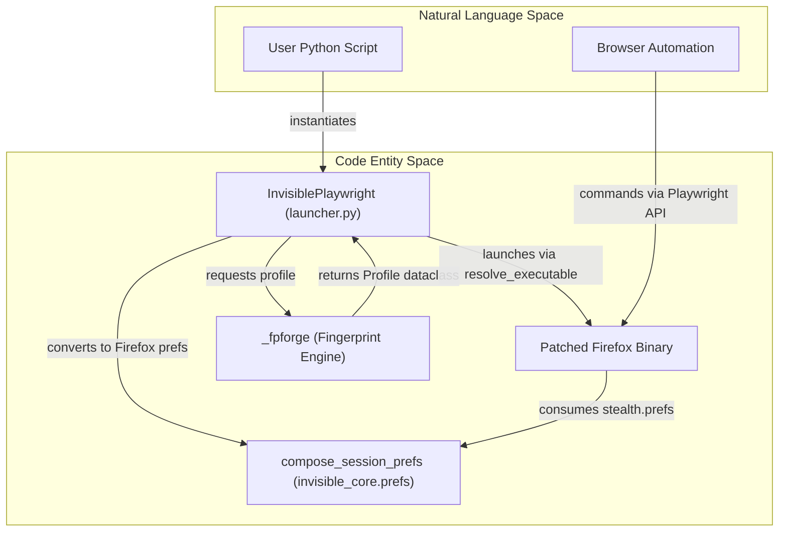
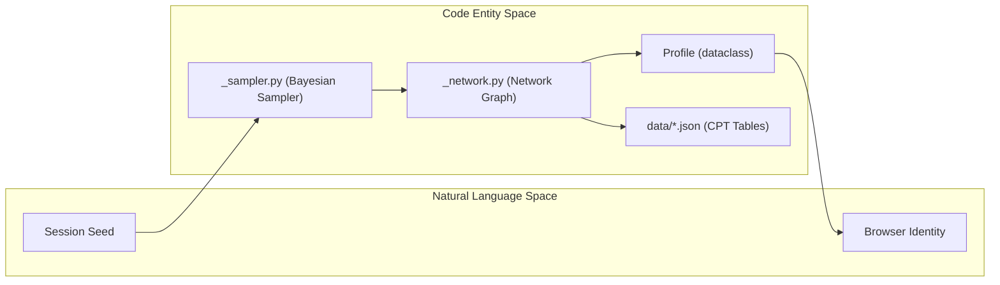

<!-- source: DeepWiki mcp.deepwiki.com · repo feder-cr/invisible_playwright · page 1 Overview · fetched 2026-10-27 -->

# Overview

<details>
<summary>Relevant source files</summary>

The following files were used as context for generating this wiki page:

- [CHANGELOG.md](CHANGELOG.md)
- [README.md](README.md)
- [docs/README.md](docs/README.md)
- [docs/badges/telegram.svg](docs/badges/telegram.svg)
- [docs/banner-dark.png](docs/banner-dark.png)
- [docs/banner-light.png](docs/banner-light.png)
- [docs/configuration.md](docs/configuration.md)
- [docs/integrations/README.md](docs/integrations/README.md)
- [docs/pinning.md](docs/pinning.md)
- [docs/quickstart.md](docs/quickstart.md)
- [docs/recaptcha-v3-score.md](docs/recaptcha-v3-score.md)
- [docs/sannysoft-explained.md](docs/sannysoft-explained.md)
- [docs/screen-size-headless-tells.md](docs/screen-size-headless-tells.md)
- [pyproject.toml](pyproject.toml)
- [src/invisible_playwright/_geo.py](src/invisible_playwright/_geo.py)
- [src/invisible_playwright/constants.py](src/invisible_playwright/constants.py)
- [src/invisible_playwright/download.py](src/invisible_playwright/download.py)
- [tests/test_readme_claims.py](tests/test_readme_claims.py)

</details>


`invisible_playwright` is a Python-based wrapper for a custom-patched Firefox binary designed to provide 100% compatibility with the Playwright API while passing advanced browser-fingerprint and bot detectors [README.md:1-17](). Unlike standard anti-detect solutions that rely on fragile JavaScript-level overrides, this project utilizes C++ level patches within the Gecko engine to ensure that spoofed values are indistinguishable from native browser behavior [README.md:22-30]().

### Purpose and Design Philosophy

The project exists to solve the detectability of automated browsers. Most tools patch `navigator` or `WebGL` properties using `Object.defineProperty`, which leaves traces that detectors can identify as "lies" [README.md:28-29]().

`invisible_playwright` achieves stealth through:
*   **Engine-Level Patches**: Fingerprint values (GPU, screen, fonts, audio, etc.) are set inside the engine, not injected into the page [README.md:26-28]().
*   **Coherent Fingerprinting**: Every session generates a unique profile where hardware characteristics are logically consistent, powered by a Bayesian network [docs/pinning.md:13-15](), [docs/pinning.md:31-37]().
*   **Humanized Input**: Actions like clicks and hovers follow natural Bezier-curve paths with human timing and trusted event signatures [README.md:31-35]().

### Comparison to Standard Playwright

While `invisible_playwright` maintains full API parity with the standard `playwright` library, it introduces several enhancements under the hood:

| Feature | Standard Playwright (Firefox) | `invisible_playwright` |
| :--- | :--- | :--- |
| **Engine** | Upstream Firefox | Patched Firefox (Engine-level stealth) [README.md:26]() |
| **Fingerprint** | Static/Generic | Dynamic & Coherent (Bayesian) [docs/pinning.md:13]() |
| **Proxy Auth** | Standard Playwright Proxy | Patched `nsProtocolProxyService` for SOCKS5 + Auth [docs/configuration.md:29-32]() |
| **Mouse Movement** | Linear/Instant | Bezier-curve trajectories [README.md:33]() |
| **Lifecycle** | Standard Process Management | `_reaper.py` (via `invisible_core`) prevents process leaks [pyproject.toml:60-70]() |

### System Architecture

The following diagram illustrates how the `InvisiblePlaywright` class bridges the gap between the Python user code and the specialized Firefox binary.

**Bridge: Python API to Patched Binary**

Sources: [README.md:57-66](), [CHANGELOG.md:58-60](), [pyproject.toml:27-30]()

### Key Components

The library is organized into several subsystems that manage the lifecycle of a stealthy browser session:

*   **Launcher & API**: The `InvisiblePlaywright` class (available in sync and async variants) manages the context manager lifecycle and serves as the entry point [README.md:70-89]().
*   **Core Logic**: Much of the configuration logic (seed-to-fingerprint, binary downloading, proxying) resides in the `invisible_core` package [pyproject.toml:27-30]().
*   **Fingerprint Engine (fpforge)**: Generates coherent profiles using Bayesian sampling to ensure fields like GPU and Screen Tier match realistically [docs/pinning.md:31-44]().
*   **CLI**: A command-line utility for fetching the engine and verifying its integrity against a `seal.json` checksum [README.md:159-169](), [CHANGELOG.md:11-14]().

**Entity Mapping: Fingerprint Generation**

Sources: [docs/pinning.md:13-15](), [docs/pinning.md:31-37](), [pyproject.toml:27-30]()

### Quick Start

Installation requires Python 3.11+ and a one-time fetch of the ~238 MB patched binary [README.md:45-50](), [pyproject.toml:10]().

```bash
pip install invisible-playwright
python -m invisible_playwright fetch
```

Basic usage mirrors standard Playwright with a simple two-line change:

```python
from invisible_playwright import InvisiblePlaywright

with InvisiblePlaywright() as browser:
    page = browser.new_page()
    page.goto("https://example.com")
    page.click("#submit") # Mouse arcs on a Bezier curve
```
Sources: [README.md:60-78]()

### Documentation Sections

*   **[Getting Started](#1.1)**: Detailed installation steps, platform support (Windows, Linux, macOS), and binary management via the CLI.
*   **[Usage Examples](#1.2)**: Practical code examples for sync/async APIs, proxy configuration, seed-based reproducibility, and fingerprint pinning.

Sources: [README.md:45-52](), [README.md:56-155](), [pyproject.toml:1-30]()

---

