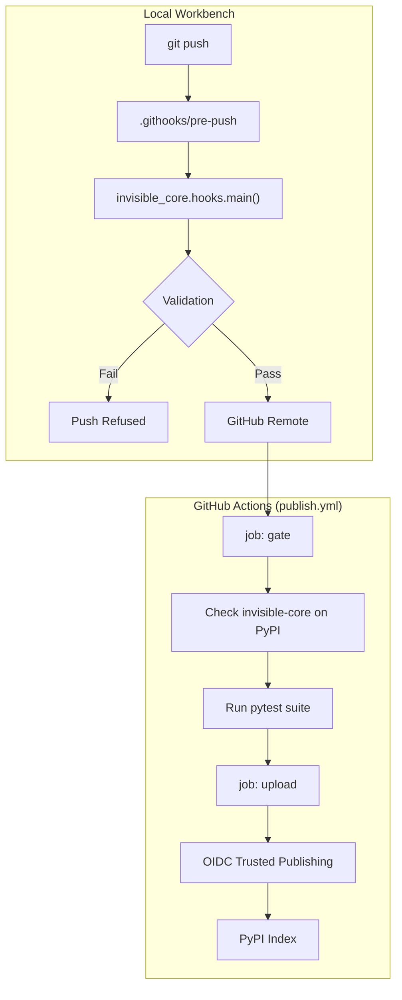

<!-- source: DeepWiki mcp.deepwiki.com · repo feder-cr/invisible_playwright · page 10 Release and CI/CD Infrastructure · fetched 2026-10-27 -->

# Release and CI/CD Infrastructure

Relevant source files

The following files were used as context for generating this wiki page:

- [.gitattributes](.gitattributes)
- [.githooks/pre-push](.githooks/pre-push)
- [.github/workflows/firefox-launch-matrix.yml](.github/workflows/firefox-launch-matrix.yml)
- [.github/workflows/publish.yml](.github/workflows/publish.yml)
- [.github/workflows/tests.yml](.github/workflows/tests.yml)
- [.github/workflows/user-install.yml](.github/workflows/user-install.yml)
- [.github/workflows/webrtc-e2e.yml](.github/workflows/webrtc-e2e.yml)
- [PUBLISHED.json](PUBLISHED.json)
- [scripts/install_hooks.py](scripts/install_hooks.py)
- [src/invisible_playwright/cli.py](src/invisible_playwright/cli.py)
- [tests/test_cli.py](tests/test_cli.py)
- [tests/test_mouse.py](tests/test_mouse.py)
- [tests/test_publish_gate_wiring.py](tests/test_publish_gate_wiring.py)
- [tests/test_release_e2e.py](tests/test_release_e2e.py)
- [tests/test_upgrade_e2e.py](tests/test_upgrade_e2e.py)
- [tests/test_version.py](tests/test_version.py)
- [tests/test_webrtc_realness.py](tests/test_webrtc_realness.py)

This section provides an overview of the release pipeline, publication gates, and continuous integration workflows that ensure the integrity of `invisible_playwright`. The infrastructure is designed to manage the tight coupling between the Python wrapper and the `invisible-core` package, preventing broken releases through automated ledger checks and multi-platform testing.

### System Overview: Release & CI Logic

The release infrastructure bridges the gap between local development and the PyPI index using a combination of Git hooks, a publication ledger, and GitHub Actions.

**Natural Language to Code Entity Space: Release Pipeline**
| System Component | Code Entity / Path | Role |
| :--- | :--- | :--- |
| **Release Ledger** | `PUBLISHED.json` | Authoritative record of every version that reached the index. |
| **Pre-push Gate** | `.githooks/pre-push` | Local script that hands off to `invisible_core.hooks`. |
| **Hook Installer** | `scripts/install_hooks.py` | Sets `core.hooksPath` to `.githooks` for local enforcement. |
| **Publication Workflow** | `.github/workflows/publish.yml` | OIDC-trusted publishing with dependency synchronization gates. |
| **CLI Versioning** | `src/invisible_playwright/cli.py` | `version` and `fetch` commands for engine verification. |

**Code Flow: Release Integrity Gate**

**Sources:** [.github/workflows/publish.yml:1-160](), [.githooks/pre-push:1-56](), [scripts/install_hooks.py:1-20](), [PUBLISHED.json:1-10]()

---

## 10.1 Publication Gate and Release Ledger
The release process is governed by a strict integrity system designed to prevent "split-brain" releases where the wrapper is published before its required `invisible-core` dependency is available on the index.

*   **Release Ledger (`PUBLISHED.json`):** A JSON file acting as the authoritative record of successful releases, containing SHA256 digests of all shipped files to prevent artifact tampering [.github/workflows/publish.yml:145-160](), [PUBLISHED.json:1-42]().
*   **Pre-push Hooks:** Local development is gated by `.githooks/pre-push`, which is installed via `scripts/install_hooks.py` [scripts/install_hooks.py:1-15](). This hook ensures that the `invisible_core.hooks` policy is applied before any code reaches the remote repository [.githooks/pre-push:45-55]().
*   **Synchronization Gate:** The `publish.yml` workflow includes a specific step to verify that the pinned `invisible-core` version is already live on PyPI before allowing the wrapper to publish [.github/workflows/publish.yml:87-117]().

For technical details on ledger validation and OIDC publishing, see **[Publication Gate and Release Ledger](#10.1)**.

**Sources:** [.github/workflows/publish.yml:87-117](), [.githooks/pre-push:1-56](), [PUBLISHED.json:1-50](), [scripts/install_hooks.py:1-20]()

---

## 10.2 CI Workflows and Gates
`invisible_playwright` utilizes a comprehensive matrix of GitHub Actions to validate stealth consistency and cross-platform compatibility.

*   **Test Floor Guard:** The `tests.yml` workflow implements a "floor" check, refusing to pass if the number of executed tests falls below a specific threshold (e.g., 380+), preventing silent suite de-selection [.github/workflows/tests.yml:106-132]().
*   **End-to-End (E2E) Validation:** 
    *   `user-install.yml`: Simulates a fresh user installation from the PyPI index on Ubuntu and Windows to verify the `pip install` path [tests/test_release_e2e.py:1-31](), [.github/workflows/user-install.yml:1-38]().
    *   `firefox-launch-matrix.yml`: A dedicated smoke test for Windows editions (Server 2022, 2025, and Latest) to detect SxS (Side-by-Side) assembly mismatches [.github/workflows/firefox-launch-matrix.yml:1-52]().
*   **Stealth Verification:** `webrtc-e2e.yml` and `e2e.yml` verify ICE candidate realness and humanized cursor behavior using live browser launches [tests/test_webrtc_realness.py:1-22](), [tests/test_mouse.py:1-16]().

**Natural Language to Code Entity Space: CI Gates**
| CI Requirement | Code Entity / Script | Workflow File |
| :--- | :--- | :--- |
| **Dependency Availability** | `core-on-index.yml` | `tests.yml`, `publish.yml` |
| **Release Path Testing** | `tests/test_release_e2e.py` | `user-install.yml` |
| **Upgrade Path Testing** | `tests/test_upgrade_e2e.py` | `user-install.yml` |
| **Windows Launch Smoke** | `ensure_binary()` | `firefox-launch-matrix.yml` |
| **Hang Detection** | `scripts/run_e2e.py` | `e2e.yml` |

For details on the E2E retry logic and platform-specific CI scripts, see **[CI Workflows and Gates](#10.2)**.

**Sources:** [.github/workflows/tests.yml:35-57](), [.github/workflows/user-install.yml:68-150](), [.github/workflows/firefox-launch-matrix.yml:40-112](), [tests/test_release_e2e.py:44-88](), [tests/test_upgrade_e2e.py:1-25]()

---

