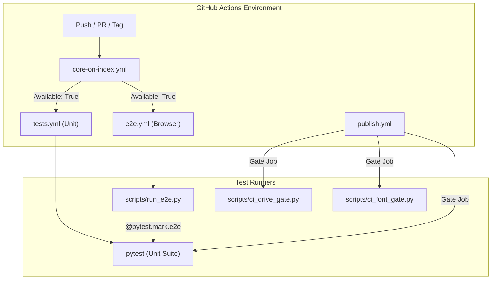
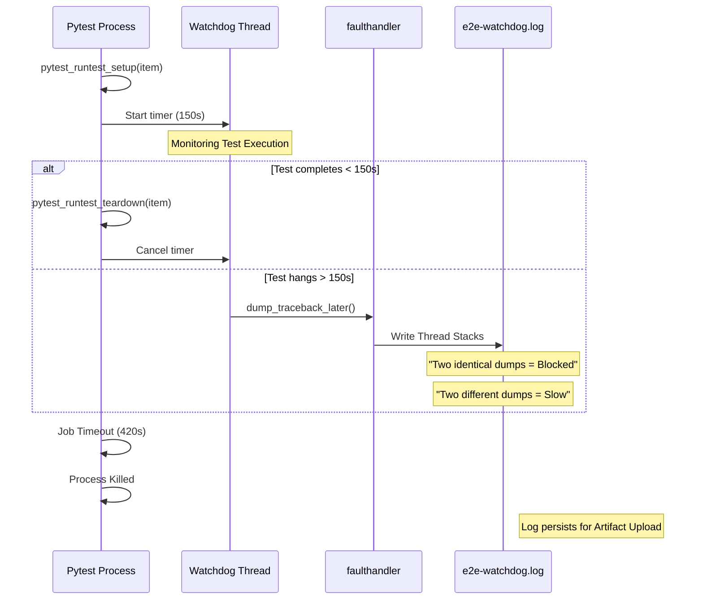

<!-- source: DeepWiki mcp.deepwiki.com · repo feder-cr/invisible_playwright · page 10.2 CI Workflows and Gates · fetched 2026-10-27 -->

# CI Workflows and Gates

Relevant source files

The following files were used as context for generating this wiki page:

- [.github/workflows/e2e-hunt.yml](.github/workflows/e2e-hunt.yml)
- [.github/workflows/e2e.yml](.github/workflows/e2e.yml)
- [.github/workflows/firefox-launch-matrix.yml](.github/workflows/firefox-launch-matrix.yml)
- [.github/workflows/publish.yml](.github/workflows/publish.yml)
- [.github/workflows/tests.yml](.github/workflows/tests.yml)
- [.github/workflows/webrtc-e2e.yml](.github/workflows/webrtc-e2e.yml)
- [scripts/ci_drive_gate.py](scripts/ci_drive_gate.py)
- [scripts/ci_font_gate.py](scripts/ci_font_gate.py)
- [scripts/run_e2e.py](scripts/run_e2e.py)
- [src/invisible_playwright/_session.py](src/invisible_playwright/_session.py)
- [tests/conftest.py](tests/conftest.py)
- [tests/test_ci_font_gate_declaration.py](tests/test_ci_font_gate_declaration.py)
- [tests/test_e2e.py](tests/test_e2e.py)
- [tests/test_fingerprint_consistency.py](tests/test_fingerprint_consistency.py)
- [tests/test_mouse.py](tests/test_mouse.py)
- [tests/test_prefs_composition_arm.py](tests/test_prefs_composition_arm.py)
- [tests/test_service_worker.py](tests/test_service_worker.py)
- [tests/test_webrtc_realness.py](tests/test_webrtc_realness.py)

This page documents the GitHub Actions workflows and specialized CI scripts that ensure the integrity, stealth, and stability of `invisible_playwright`. The CI infrastructure is designed to detect engine-level regressions, validate fingerprint coherence, and prevent common pitfalls like process hangs or dependency synchronization errors.

## Core Workflows

### 1. Unit Tests (`tests.yml`)
The primary CI gate for code changes. It executes the unit and integration suite across a matrix of operating systems and Python versions.

*   **Matrix Strategy**: Covers `ubuntu-latest` and `windows-latest`. To optimize costs, the full Python range (`3.11` to `3.14`) runs on Linux, while Windows coverage is pinned to `3.12` [.github/workflows/tests.yml:42-56]().
*   **Core-on-Index Guard**: A dependency gate that checks if the required `invisible-core` version is available on PyPI before starting. If the core is not yet published, the job skips to avoid "red" runs caused by unresolvable dependencies [.github/workflows/tests.yml:23-33]().
*   **Test Floor Guard**: A post-execution script that fails the job if the number of passed tests falls below a threshold (currently 380). This prevents "silent success" where a misconfigured marker expression deselects the entire suite [.github/workflows/tests.yml:106-131]().

### 2. End-to-End Suite (`e2e.yml`)
Runs the full browser-driving suite (tests marked `@pytest.mark.e2e`) on Linux using `xvfb-run` to provide a virtual display [.github/workflows/e2e.yml:8-10]().

*   **Runner**: Uses `ubuntu-24.04` [.github/workflows/e2e.yml:63]().
*   **Watchdog System**: Implements a "watchdog" thread via `faulthandler`. If a test exceeds 150 seconds, it dumps the stack trace of all threads to a log file. This allows for post-mortem analysis of hangs that would otherwise be killed anonymously by the GitHub timeout [.github/workflows/e2e.yml:91-97](), [tests/conftest.py:12-35]().
*   **Retry Logic**: Uses `pytest-rerunfailures` for transient issues like "context destroyed" or "target closed", but explicitly excludes `TimeoutExpired` to prevent multiplying hang times [.github/workflows/e2e.yml:103-104](), [scripts/run_e2e.py:33-67]().

### 3. WebRTC Realness (`webrtc-e2e.yml`)
Validates that the patched binary correctly spoofs WebRTC ICE candidates and prevents IP leaks.
*   **Unit Layer**: Asserts SDP/candidate strings against golden samples (e.g., ensuring host candidates are mDNS `.local`) [tests/test_webrtc_realness.py:3-10]().
*   **E2E Layer**: Launches the browser behind a mock SOCKS5 server that refuses UDP, forcing the engine to exercise "Fix C" fallback logic while injecting a fake public IP via `STEALTHFOX_WEBRTC_PUBLIC_IP` [tests/test_webrtc_realness.py:12-21]().

### 4. Windows Launch Matrix (`firefox-launch-matrix.yml`)
A specialized smoke test that verifies the sealed Firefox binary can launch on various Windows editions (`2022`, `2025`, `latest`). It specifically checks for DLL/SxS mismatches that have historically occurred on new Windows builds [.github/workflows/firefox-launch-matrix.yml:6-16]().

---

## Workflow Data Flow and Runners

The following diagram illustrates how a commit triggers the CI pipeline and how the various gates interact with the `scripts/` runners.

**CI Execution Flow**

**Sources:** [.github/workflows/tests.yml:32-37](), [.github/workflows/e2e.yml:56-62](), [.github/workflows/publish.yml:61-137](), [scripts/run_e2e.py:1-25]()

---

## Specialized CI Scripts

### `scripts/run_e2e.py`
The mandatory pre-release runner. It configures the environment for the full browser bench, pointing `INVPW_BINARY_PATH` to the binary under test [scripts/run_e2e.py:45-50]().
*   **Hang Detection**: Configures `pytest-timeout` with `--timeout-method thread` and a 420s limit. This is critical because Playwright's sync API blocks the main thread, making standard signal-based timeouts ineffective [scripts/run_e2e.py:72-83]().

### `scripts/ci_drive_gate.py`
A lightweight "smoke" vs "full" drive check.
*   **Smoke Level**: Asserts basic drivability (launch, navigate, DOM read) and ensures `navigator.webdriver` is false [scripts/ci_drive_gate.py:11-19]().
*   **Full Level**: Exercises mouse movement, keyboard input, and canvas determinism to catch regressions in Juggler event synthesis [scripts/ci_drive_gate.py:21-27]().

### `scripts/ci_font_gate.py`
Ensures the "block-at-birth" font protection is active.
*   **Logic**: Launches the browser and uses a width-probe detector to enumerate visible fonts.
*   **Assertions**:
    1. The visible set exactly matches the Windows 11 bundle [scripts/ci_font_gate.py:36-64]().
    2. Host fonts (e.g., `Helvetica`, `Ubuntu`) are invisible [scripts/ci_font_gate.py:69-77]().
    3. CSS generics (`serif`, `sans-serif`) resolve to the correct Windows families [scripts/ci_font_gate.py:79-85]().

---

## Hang Detection and the Watchdog

The "Watchdog" is a diagnostic system implemented in `tests/conftest.py` to debug non-deterministic hangs in the CI environment.

**Watchdog and Timeout Logic**

**Sources:** [tests/conftest.py:10-35](), [tests/conftest.py:64-83](), [scripts/run_e2e.py:82-83]()

### Artifacts and Proofs
The CI workflows are configured to upload the `e2e-watchdog.log` even on failure or cancellation. This log is the only way to distinguish between a deadlocked process (e.g., a socket `accept()` hang) and a extremely slow runner [.github/workflows/e2e.yml:129-136]().

---

## Release Gates (`publish.yml`)

The publication workflow includes several "Hard Gates" that must pass before the OIDC trust relationship allows a PyPI upload:
1.  **Index Probing**: Verifies the version in `pyproject.toml` is not already published [.github/workflows/publish.yml:39-59]().
2.  **Core Sync**: Ensures the exact version of `invisible-core` pinned in `pyproject.toml` is already live on PyPI [.github/workflows/publish.yml:87-117]().
3.  **Hook Arming**: Runs `scripts/install_hooks.py` to ensure the environment matches a developer's setup [.github/workflows/publish.yml:128-130]().
4.  **Full Suite**: Runs the entire test suite on the runner before building the wheel [.github/workflows/publish.yml:132-136]().

**Sources:** [.github/workflows/publish.yml:1-160](), [.github/workflows/tests.yml:1-150](), [.github/workflows/e2e.yml:1-140](), [scripts/run_e2e.py:1-105](), [scripts/ci_drive_gate.py:1-41](), [scripts/ci_font_gate.py:1-28](), [tests/conftest.py:1-83]().

---

