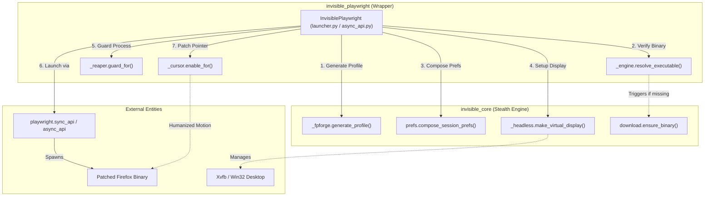
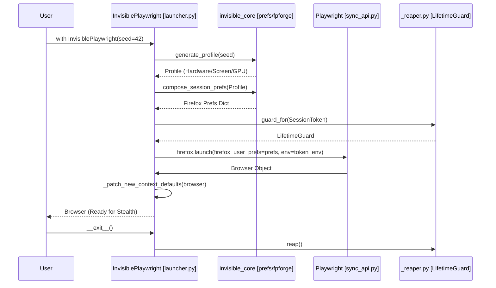

<!-- source: DeepWiki mcp.deepwiki.com · repo feder-cr/invisible_playwright · page 2 Core Architecture · fetched 2026-10-27 -->

# Core Architecture

Relevant source files

The following files were used as context for generating this wiki page:

- [CHANGELOG.md](CHANGELOG.md)
- [pyproject.toml](pyproject.toml)
- [src/invisible_playwright/__init__.py](src/invisible_playwright/__init__.py)
- [src/invisible_playwright/_geo.py](src/invisible_playwright/_geo.py)
- [src/invisible_playwright/_pin.py](src/invisible_playwright/_pin.py)
- [src/invisible_playwright/_recaptcha_seed.py](src/invisible_playwright/_recaptcha_seed.py)
- [src/invisible_playwright/async_api.py](src/invisible_playwright/async_api.py)
- [src/invisible_playwright/constants.py](src/invisible_playwright/constants.py)
- [src/invisible_playwright/download.py](src/invisible_playwright/download.py)
- [src/invisible_playwright/launcher.py](src/invisible_playwright/launcher.py)
- [tests/test_async_api.py](tests/test_async_api.py)
- [tests/test_core_pin.py](tests/test_core_pin.py)
- [tests/test_launcher_helpers.py](tests/test_launcher_helpers.py)
- [tests/test_recaptcha_seed.py](tests/test_recaptcha_seed.py)
- [tests/test_seal_floor.py](tests/test_seal_floor.py)

The `invisible_playwright` system is a specialized wrapper around Playwright that integrates a custom-patched Firefox binary with a Bayesian fingerprinting engine. Unlike standard anti-detect libraries that rely on JavaScript shims, this architecture operates at the C++ level of the browser engine, ensuring that spoofed values are indistinguishable from native ones. The architecture is split between `invisible_playwright` (the Playwright-specific wrapper) and `invisible_core` (the engine-agnostic stealth logic).

## System Lifecycle

The lifecycle of an `invisible_playwright` session follows a multi-stage pipeline from instantiation to browser teardown, coordinated by the `InvisiblePlaywright` context manager.

### 1. Initialization and Fingerprinting
When `InvisiblePlaywright` is instantiated, it immediately generates a deterministic browser profile using the `_fpforge` engine.
*   **Seed Generation:** A 31-bit seed is either provided or randomly generated using `secrets.randbits(31)` [src/invisible_playwright/launcher.py:112-112]().
*   **Profile Generation:** The `generate_profile` function uses this seed and any provided `pin` dictionary to sample a coherent identity from a Bayesian network [src/invisible_playwright/launcher.py:126-128]().
*   **Core Integrity:** At import time, the wrapper enforces an exact version pin of `invisible_core` to prevent divergence between the wrapper and the stealth engine [src/invisible_playwright/_pin.py:34-40]().

### 2. Environment Preparation
Before launching the binary, the wrapper prepares the execution environment:
*   **Binary Verification:** It resolves the patched Firefox binary path and ensures it matches the required version via `resolve_executable` and `assert_wire_version` [src/invisible_playwright/launcher.py:165-166]().
*   **Preference Translation:** The `Profile` is converted into Firefox preferences via `compose_session_prefs` (re-exported from `invisible_core`), which handles stealth baselines and fingerprint overrides [src/invisible_playwright/launcher.py:173-178]().
*   **Virtual Display:** If `headless=True` (the default stealth mode), `make_virtual_display` initializes a platform-specific virtual display (Xvfb on Linux or a Win32 Desktop on Windows) so Firefox runs in "headed" mode without a visible window [src/invisible_playwright/launcher.py:164-164]().

### 3. Browser Launch and Patching
The wrapper starts the Playwright process but overrides key behaviors to maintain stealth:
*   **Launch Parameters:** The browser is launched with the custom binary, generated preferences, and the `SessionToken` used for process tracking [src/invisible_playwright/launcher.py:186-193]().
*   **API Patching:** The wrapper patches `new_context` and `new_page` to inject default viewport and screen dimensions that match the spoofed fingerprint, and applies the `_NEWTAB_SETTLE` sleep to prevent race conditions during tab creation [src/invisible_playwright/launcher.py:30-49]().
*   **Cursor Humanization:** If `humanize` is enabled, the `_cursor` engine intercepts pointer calls to move the mouse along seed-derived Bezier paths [src/invisible_playwright/launcher.py:209-209]().

### 4. Teardown
During `__exit__` or `__aexit__`, the system ensures a clean shutdown. The `LifetimeGuard` (re-exported from `invisible_core`) ensures that if the Python process is killed, the browser tree is reaped to prevent process leaks [src/invisible_playwright/launcher.py:252-258]().

**Sources:**
- [src/invisible_playwright/launcher.py:78-212]()
- [src/invisible_playwright/async_api.py:47-152]()
- [src/invisible_playwright/_pin.py:7-43]()

---

## High-Level Component Interaction

The following diagram illustrates how the core Python classes interact with the internal subsystems and the external Firefox binary.

### System Entity Map

**Sources:**
- [src/invisible_playwright/launcher.py:110-211]()
- [src/invisible_playwright/async_api.py:50-152]()
- [src/invisible_playwright/__init__.py:45-52]()

---

## Major Subsystems

### [Sync and Async APIs](#2.1)
The library provides two primary entry points: `launcher.InvisiblePlaywright` (Sync) and `async_api.InvisiblePlaywright` (Async). These classes share logic via `_session.py` to ensure parity in how viewports, screen geometries, and timezones are calculated.
For details, see [Sync and Async APIs](#2.1).

### [Headless Mode and Virtual Displays](#2.2)
To maintain stealth, `invisible_playwright` avoids the detectable `--headless` flag. Instead, it uses `make_virtual_display` to create hidden environments where Firefox runs in a real headed mode.
For details, see [Headless Mode and Virtual Displays](#2.2).

### [Binary Management and Download](#2.3)
The system requires a specific patched Firefox. `_engine.py` resolves the executable path, while `download.py` (via `invisible_core`) manages fetching and SHA256 verification of the binary archives.
For details, see [Binary Management and Download](#2.3).

### [Humanized Cursor Motion](#2.4)
The `_cursor` module intercepts Playwright's `page.click` and `page.hover` calls, replacing the default "teleport" jump with a paced, curved trajectory generated from the session seed.
For details, see [Humanized Cursor Motion](#2.4).

### [Process Lifecycle and Reaper](#2.5)
Browser processes are marked with a `SessionToken`. The `_reaper` module uses Windows Job Objects or Linux process scanning to ensure that browsers do not outlive the Python automation script.
For details, see [Process Lifecycle and Reaper](#2.5).

---

## Logic Flow and Code Entities

This diagram bridges the high-level system concepts to the specific file entities that implement them.

### Sequence of Operation

**Sources:**
- [src/invisible_playwright/launcher.py:110-211]()
- [src/invisible_playwright/async_api.py:105-152]()
- [src/invisible_playwright/_reaper.py:24-24]()

---

