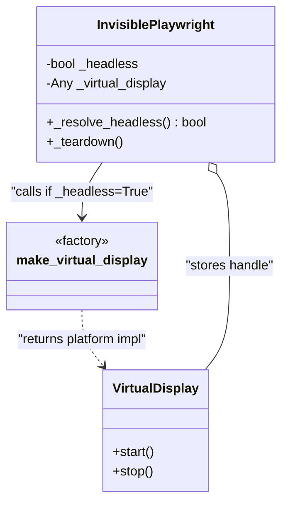

<!-- source: DeepWiki mcp.deepwiki.com · repo feder-cr/invisible_playwright · page 2.2 Headless Mode and Virtual Displays · fetched 2026-10-27 -->

# Headless Mode and Virtual Displays

<details>
<summary>Relevant source files</summary>

The following files were used as context for generating this wiki page:

- [.github/workflows/e2e-hunt.yml](.github/workflows/e2e-hunt.yml)
- [.github/workflows/e2e.yml](.github/workflows/e2e.yml)
- [scripts/run_e2e.py](scripts/run_e2e.py)
- [src/invisible_playwright/_fpforge/__init__.py](src/invisible_playwright/_fpforge/__init__.py)
- [src/invisible_playwright/_headless.py](src/invisible_playwright/_headless.py)
- [src/invisible_playwright/_proxy.py](src/invisible_playwright/_proxy.py)
- [src/invisible_playwright/_recaptcha_seed.py](src/invisible_playwright/_recaptcha_seed.py)
- [src/invisible_playwright/async_api.py](src/invisible_playwright/async_api.py)
- [src/invisible_playwright/launcher.py](src/invisible_playwright/launcher.py)
- [tests/conftest.py](tests/conftest.py)
- [tests/test_async_api.py](tests/test_async_api.py)
- [tests/test_backcompat.py](tests/test_backcompat.py)
- [tests/test_cloak.py](tests/test_cloak.py)
- [tests/test_e2e.py](tests/test_e2e.py)
- [tests/test_fingerprint_consistency.py](tests/test_fingerprint_consistency.py)
- [tests/test_fingerprint_surface.py](tests/test_fingerprint_surface.py)
- [tests/test_launcher_helpers.py](tests/test_launcher_helpers.py)
- [tests/test_recaptcha_seed.py](tests/test_recaptcha_seed.py)
- [tests/test_service_worker.py](tests/test_service_worker.py)

</details>


`invisible_playwright` achieves "headless" operation by running the browser in a **headed** state (with full UI rendering, widget trees, and GPU acceleration) but redirecting the graphical output to a virtual display or a hidden desktop [src/invisible_playwright/launcher.py:131-134](). This avoids the detection risks associated with the browser's native `--headless` flag, which uses a distinct software-only rendering path that anti-bot systems can easily identify [src/invisible_playwright/launcher.py:115-134]().

## Architecture Overview

The virtual display system is managed via a factory pattern in `invisible_core` that abstracts platform-specific implementations for Linux and Windows [src/invisible_playwright/launcher.py:21](). The `_headless.py` module in the wrapper now acts as a shim to the core implementation.

### Virtual Display Lifecycle

The following diagram illustrates how the `InvisiblePlaywright` launcher interacts with the virtual display subsystem during the browser startup sequence.

**Launcher to Virtual Display Data Flow**
```mermaid
graph TD
    subgraph "Launcher Space"
        IP["InvisiblePlaywright.__enter__"]
        RH["_resolve_headless()"]
    end

    subgraph "Core Subsystem"
        MVD["make_virtual_display()"]
        LVD["_LinuxVirtualDisplay"]
        WVD["_WindowsVirtualDesktop"]
    end

    IP --> RH [src/invisible_playwright/launcher.py:192]
    RH -- "if headless=True" --> MVD [src/invisible_playwright/launcher.py:202]
    MVD -- "platform == linux" --> LVD
    MVD -- "platform == win32" --> WVD
    
    LVD -- "start()" --> XVFB["Spawn Xvfb Process"]
    WVD -- "start()" --> WIN32["CreateDesktop / SetThreadDesktop"]
    
    XVFB --> ENV["Update os.environ['DISPLAY']"]
    WIN32 --> THREAD["Bind Thread to Desktop"]
```
Sources: [src/invisible_playwright/launcher.py:192-205](), [src/invisible_playwright/async_api.py:128-130](), [src/invisible_playwright/launcher.py:21]()

## Implementation Details

The library supports two distinct virtual display mechanisms depending on the host operating system.

### Linux Implementation: `_LinuxVirtualDisplay` (Xvfb)
On Linux, the library utilizes `Xvfb` (X Virtual Framebuffer). It spawns a dedicated X server instance for each session and modifies the environment variables of the Python process so that Firefox connects to the virtual display.

- **Automatic Display Selection**: Scans for available display numbers to prevent collisions in parallel execution environments like CI runners [tests/test_e2e.py:147-152]().
- **Environment Isolation**: Modifies `os.environ["DISPLAY"]` and ensures Wayland variables are managed to prevent "leaks" onto the physical desktop [tests/test_e2e.py:133-143]().
- **CI Integration**: The E2E suite leverages `xvfb-run` on GitHub Actions to ensure stable browser interaction during tests [.github/workflows/e2e.yml:8-10]().

### Windows Implementation: `_WindowsVirtualDesktop` (Win32 CreateDesktop)
On Windows, the library uses the Win32 `CreateDesktop` API to create a completely hidden desktop object.

- **Thread Affinity**: The calling thread is bound to the new hidden desktop using `SetThreadDesktop`.
- **Inheritance**: When Playwright spawns child processes (the Node.js driver and `firefox.exe`), they inherit the hidden desktop of the parent thread.
- **Sandbox Compatibility**: On Windows, certain GPU sandbox levels are adjusted when running on a virtual desktop to ensure the rendering pipeline remains stable [tests/test_e2e.py:133-143]().

## Configuration and Environment Variables

The behavior of the headless subsystem can be influenced by specific environment variables and constructor parameters.

| Variable / Parameter | Description |
| :--- | :--- |
| `headless` (Arg) | When `True`, the launcher invokes `make_virtual_display()` to hide the browser [src/invisible_playwright/launcher.py:131-134](). |
| `INVPW_TRUE_HEADLESS` | If set to `1`, the launcher bypasses virtual displays and uses the browser's native `--headless` flag (less stealthy, used for debugging) [tests/test_async_api.py:158-162](). |
| `INVPW_TEST_WATCHDOG_FILE` | Used in CI to monitor hung browser processes on virtual displays [tests/conftest.py:36-38](). |

## Stealth Advantages

Using virtual displays instead of the native `--headless` flag provides several critical stealth benefits:

1. **Natural Rendering Pipeline**: The browser uses its standard headed rendering path. This ensures that CSS layout, font metrics, and device pixel ratios (DPR) match those of a real user [tests/test_launcher_helpers.py:136-145]().
2. **GPU Feature Parity**: Standard headless mode often disables WebGL extensions or uses software rasterizers (like SwiftShader) that are easily detected. Virtual displays allow the use of the platform's standard GPU drivers (or Xvfb's GLX/RENDER extensions) [tests/test_fingerprint_surface.py:150-162]().
3. **Viewport Consistency**: `invisible_playwright` calculates the viewport by subtracting window chrome (title bars, borders) from the spoofed screen size. In native headless mode, these chrome offsets are often zero, creating a detectable fingerprint mismatch [tests/test_launcher_helpers.py:136-145]().

**Entity Mapping: Headless Resolution**

Sources: [src/invisible_playwright/launcher.py:192-205](), [src/invisible_playwright/async_api.py:128-130](), [tests/test_e2e.py:147-173]()

## Teardown and Idempotency

The virtual display is tied to the `InvisiblePlaywright` context manager lifecycle. When the context exits, `_teardown()` is called to stop the virtual display and restore the environment [src/invisible_playwright/launcher.py:228-232](). This process is idempotent to prevent resource leaks if `__exit__` is called multiple times [tests/test_e2e.py:94-103]().

Sources: [src/invisible_playwright/launcher.py:228-232](), [tests/test_e2e.py:176-199]()

---

