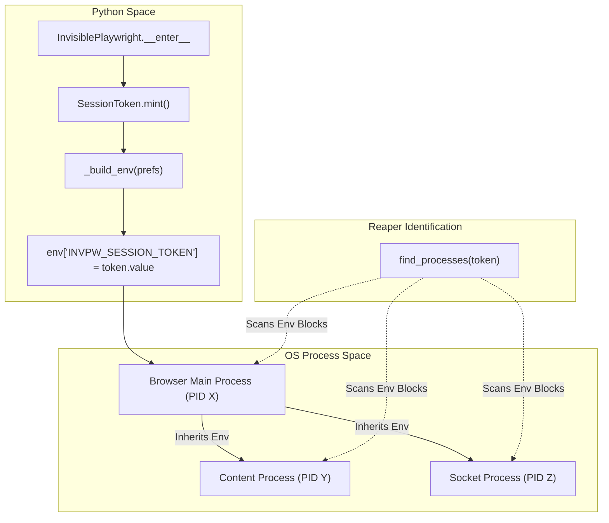
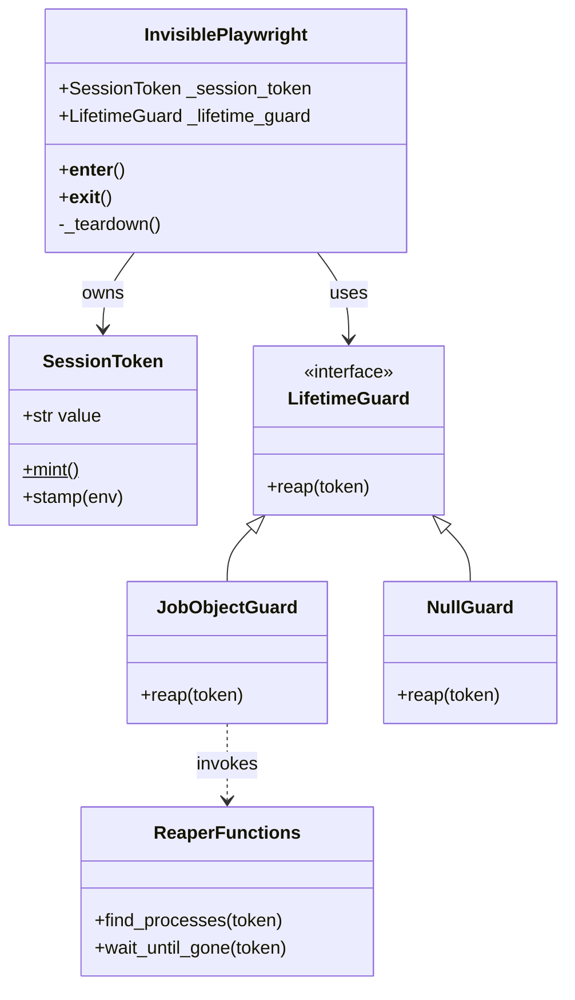

<!-- source: DeepWiki mcp.deepwiki.com · repo feder-cr/invisible_playwright · page 2.5 Process Lifecycle and Reaper · fetched 2026-10-27 -->

# Process Lifecycle and Reaper

Relevant source files

The following files were used as context for generating this wiki page:

- [CHANGELOG.md](CHANGELOG.md)
- [pyproject.toml](pyproject.toml)
- [src/invisible_playwright/_geo.py](src/invisible_playwright/_geo.py)
- [src/invisible_playwright/_reaper.py](src/invisible_playwright/_reaper.py)
- [src/invisible_playwright/_recaptcha_seed.py](src/invisible_playwright/_recaptcha_seed.py)
- [src/invisible_playwright/async_api.py](src/invisible_playwright/async_api.py)
- [src/invisible_playwright/constants.py](src/invisible_playwright/constants.py)
- [src/invisible_playwright/download.py](src/invisible_playwright/download.py)
- [src/invisible_playwright/launcher.py](src/invisible_playwright/launcher.py)
- [tests/test_async_api.py](tests/test_async_api.py)
- [tests/test_cursor_wiring.py](tests/test_cursor_wiring.py)
- [tests/test_launcher_helpers.py](tests/test_launcher_helpers.py)
- [tests/test_old_core_says_which_version.py](tests/test_old_core_says_which_version.py)
- [tests/test_reaper.py](tests/test_reaper.py)
- [tests/test_recaptcha_seed.py](tests/test_recaptcha_seed.py)

The `invisible_playwright` package implements a robust process management system designed to prevent "zombie" browser processes. Because the patched Firefox binary is launched in headed mode (even when visually hidden) and involves complex process trees, standard clean-up mechanisms often fail during ungraceful shutdowns (e.g., script timeouts, CI runner cancellations, or unhandled exceptions).

## Overview and Purpose

The lifecycle management system ensures that every browser process and its children are positively identified and terminated when the parent Python process exits. This is achieved through three primary mechanisms:
1.  **Session Token Stamping**: Every browser session is assigned a unique cryptographic token injected into its environment.
2.  **Lifetime Guards**: Platform-specific observers that monitor the Python process.
3.  **The Reaper**: A teardown routine that scans for processes carrying the session's specific token.

Sources: `src/invisible_playwright/_reaper.py:1-31`(), `src/invisible_playwright/launcher.py:24-24`(), `src/invisible_playwright/async_api.py:91-101`().

---

## Session Token Minting and Stamping

To avoid killing healthy browsers belonging to other concurrent sessions, `invisible_playwright` uses a `SessionToken`. This token is more reliable than PID tracking because Firefox frequently spawns sub-processes (content processes, socket processes) that are not direct children of the initial launcher.

### Implementation Details
- **Minting**: A unique token is generated using `secrets.randbits(31)` during the `InvisiblePlaywright` context entry [src/invisible_playwright/launcher.py:129-129](), [src/invisible_playwright/async_api.py:129-129]().
- **Stamping**: The token is stored in the environment variable defined by `TOKEN_VAR` (internally `INVPW_SESSION_TOKEN`) [src/invisible_playwright/_reaper.py:39-39]().
- **Inheritance**: Because environment blocks are inherited, the entire browser tree (including grandchildren) carries this token [tests/test_reaper.py:71-75]().

### Token Flow Diagram
This diagram shows how a `SessionToken` moves from the Python wrapper into the OS process space.

Sources: `src/invisible_playwright/launcher.py:129-130`(), `src/invisible_playwright/async_api.py:129-130`(), `tests/test_reaper.py:71-76`(), `src/invisible_playwright/_reaper.py:34-45`().

---

## Lifetime Guards

The `LifetimeGuard` is an abstraction that ensures browser cleanup regardless of how the Python process terminates. The system uses `guard_for()` to return the appropriate implementation for the current OS [src/invisible_playwright/_reaper.py:42-42]().

| Guard Class | Platform | Mechanism |
| :--- | :--- | :--- |
| `JobObjectGuard` | Windows | Uses Win32 **Job Objects**. If the Python process dies, the OS automatically terminates all processes assigned to the job. |
| `NullGuard` | Linux / Other | Relies on the `reap()` pattern and `atexit` handlers, as Linux lacks a strict equivalent to Job Objects for arbitrary process trees. |

### Windows Job Objects and `spawn_into`
On Windows, `JobObjectGuard` provides a "hard" guarantee. The `invisible_core.process` module (re-exported by `_reaper.py`) includes a `spawn_into` mechanism. This allows creating a process in a suspended state, assigning it to the Job Object, and then resuming it. This ensures the process is "born" inside the job, preventing a race condition where a process could spawn a child before being assigned to the guard.

Sources: `src/invisible_playwright/_reaper.py:20-30`(), `tests/test_reaper.py:180-188`(), `src/invisible_playwright/launcher.py:101-101`().

---

## The `reap()` Teardown Pattern

When the `InvisiblePlaywright` context manager exits (via `__exit__` or `__aexit__`), it invokes a teardown sequence.

### Execution Flow
1.  **Playwright Close**: Attempts to close the browser normally via `browser.close()`.
2.  **Display Cleanup**: Shuts down virtual displays (Xvfb/Win32 Desktop) [src/invisible_playwright/launcher.py:186-189]().
3.  **Forceful Reap**: Calls `self._lifetime_guard.reap(self._session_token)`.
    - The reaper uses `psutil` to scan all running processes [src/invisible_playwright/pyproject.toml:60-70]().
    - It checks the environment block of every process for the matching `INVPW_SESSION_TOKEN` [tests/test_reaper.py:60-66]().
    - Any matching processes are forcefully terminated.

### Lifecycle Entity Mapping
The following diagram maps code entities to their roles in the lifecycle.

Sources: `src/invisible_playwright/launcher.py:78-108`(), `src/invisible_playwright/async_api.py:47-101`(), `src/invisible_playwright/_reaper.py:34-45`(), `tests/test_reaper.py:23-25`().

---

## Implementation Comparison: Sync vs Async

The lifecycle logic is mirrored between the sync and async APIs to ensure parity. A critical fix in version 0.7.0 ensured that the `async_api` also correctly stamps and reaps tokens, as previous versions had a discrepancy where the async launcher did not arm the reaper.

| Feature | Sync (`launcher.py`) | Async (`async_api.py`) |
| :--- | :--- | :--- |
| **Token Generation** | `SessionToken.mint()` in `__enter__` | `SessionToken.mint()` in `__aenter__` |
| **Env Stamping** | `_build_env` calls `token.stamp` | `_build_env` calls `token.stamp` |
| **Guard Arming** | `_bind_process_tree()` | `_bind_process_tree()` |
| **Teardown** | `_teardown()` in `__exit__` | `_teardown()` in `__aexit__` |

Sources: `src/invisible_playwright/launcher.py:129-150`(), `src/invisible_playwright/async_api.py:129-152`(), `tests/test_async_api.py:88-109`(), `tests/test_async_api.py:112-154`().

---

