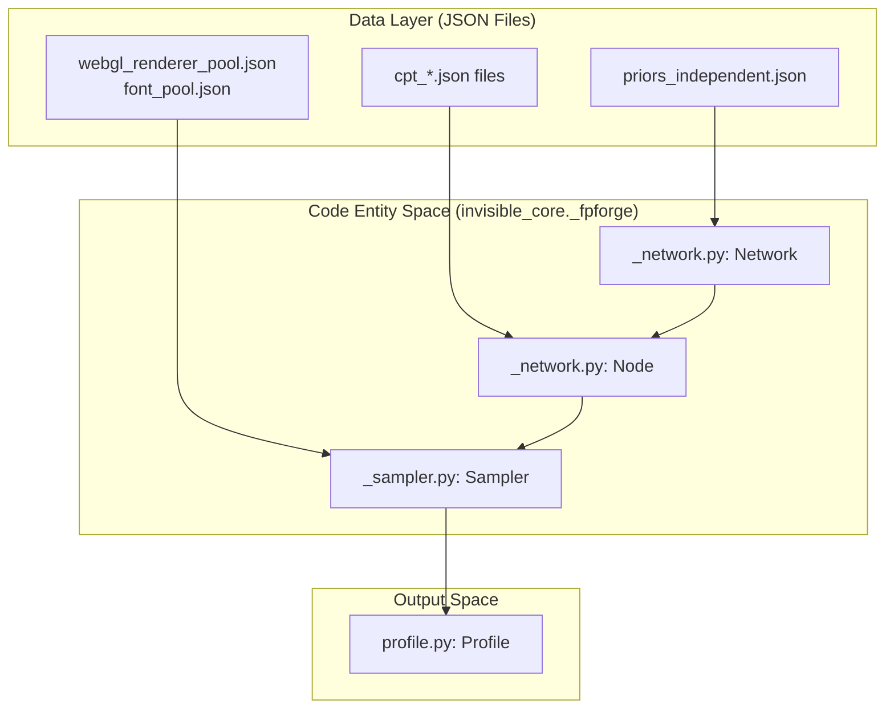
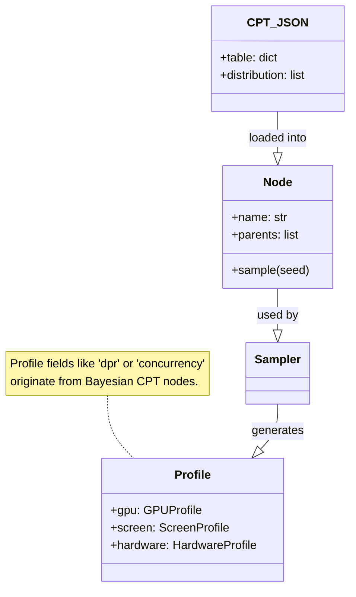

<!-- source: DeepWiki mcp.deepwiki.com · repo feder-cr/invisible_playwright · page 3.4 CPT Data Files · fetched 2026-10-27 -->

# CPT Data Files

Relevant source files

The following files were used as context for generating this wiki page:

- [docs/configuration.md](docs/configuration.md)
- [docs/pinning.md](docs/pinning.md)
- [docs/quickstart.md](docs/quickstart.md)
- [docs/recaptcha-v3-score.md](docs/recaptcha-v3-score.md)
- [docs/sannysoft-explained.md](docs/sannysoft-explained.md)
- [docs/screen-size-headless-tells.md](docs/screen-size-headless-tells.md)
- [src/invisible_playwright/_fpforge/__init__.py](src/invisible_playwright/_fpforge/__init__.py)
- [src/invisible_playwright/_headless.py](src/invisible_playwright/_headless.py)
- [src/invisible_playwright/_proxy.py](src/invisible_playwright/_proxy.py)
- [tests/test_backcompat.py](tests/test_backcompat.py)
- [tests/test_cloak.py](tests/test_cloak.py)
- [tests/test_fingerprint_surface.py](tests/test_fingerprint_surface.py)

The `invisible_playwright` fingerprint engine (fpforge) utilizes a Bayesian network to generate coherent browser profiles. The statistical relationships between hardware components (e.g., a high-end GPU implying a high-resolution monitor and high core count) are defined in Conditional Probability Table (CPT) files located in the `_fpforge/data/` directory.

These JSON files serve as the "brain" of the sampler, ensuring that generated fingerprints do not contain statistically impossible combinations—such as a high-end RTX 4090 paired with a 2-core CPU—that would trigger anti-bot detections.

## Bayesian Network Topology

The network is structured around a central latent variable, `gpu_class_tier`, which acts as the primary parent for most hardware and software features [docs/pinning.md:54-63](). To increase coherence, a hidden `intra_tier` variable is used to group "budget," "standard," and "premium" configurations within each GPU class.

### Data Flow: From Priors to Profiles

The following diagram illustrates how data from the CPT files is consumed by the `Network` and `Node` classes to produce a `Profile`.

**Fingerprint Generation Data Flow**

**Sources:** [src/invisible_playwright/_fpforge/__init__.py:1-18](), [docs/pinning.md:31-45]()

---

## Core CPT Definitions

### 1. Hardware Concurrency
Defines the number of logical processors reported by `navigator.hardwareConcurrency`. Unlike many other fields, this is sampled from a marginal distribution based on real Windows telemetry because core count is an OS-level fact rather than strictly GPU-conditioned [docs/pinning.md:35-36]().
*   **Implementation**: Pinned via the `hardware.concurrency` key [docs/pinning.md:81]().
*   **Consistency**: The sampler ensures that unpinned children are sampled from their conditionals using the parent's original posterior to maintain coherence [docs/pinning.md:37-40]().

### 2. Screen Distributions
Defines the `screen` object, including width, height, available width/height, and Device Pixel Ratio (DPR).
*   **Logic**: High-end GPUs are statistically more likely to be paired with 1440p or 4K monitors [docs/pinning.md:54-61]().
*   **Normalization**: The engine avoids `availHeight === height` tells (which signal a missing taskbar) by deriving available height from the full height based on the claimed platform [docs/screen-size-headless-tells.md:35-44]().

### 3. Storage Quota
Overrides `navigator.storage.estimate().quota`. In real browsers, this is derived from disk space.
*   **Realism**: The `hardware.storage_quota_mb` field is sampled to reflect physically plausible storage limits, preventing a persona from claiming a workstation-class GPU while having a tiny mobile-sized storage quota [docs/pinning.md:82]().

### 4. WebGL MSAA
Defines the number of Anti-Aliasing samples supported by the WebGL context.
*   **Correlation**: This is conditioned on the `gpu_class_tier`. Pinning the `gpu.class_tier` alone steers this field toward a coherent value (e.g., 4x or 8x MSAA for high-end cards) without requiring manual specification [docs/pinning.md:54-61]().

### 5. Audio, Codecs, and Fonts
*   **Audio**: Defines sample rate, latency, and channel count. These are sampled to match the hardware profile [docs/pinning.md:88-89]().
*   **Codecs**: Determines support for `AV1`, `WebM`, and other media capabilities [docs/pinning.md:90-91]().
*   **Fonts**: Derived from a font pool. The `hardware.generics` field ensures that CSS generic families (like `x-math`) are correctly mapped to prevent rendering tells [docs/pinning.md:87]().

---

## CPT Relationship Mapping

The Bayesian network relies on these specific file associations to build the dependency graph.

| Child Node | Parent Node(s) | Role in Coherence |
| :--- | :--- | :--- |
| `gpu_class_tier` | None (Root) | Primary handle for steering the whole profile [docs/pinning.md:54-61]() |
| `screen.tier` | `gpu_class_tier` | Ensures resolution matches GPU power [docs/pinning.md:35-36]() |
| `msaa_samples` | `gpu_class_tier` | Prevents high-end GPUs from reporting 0 MSAA [docs/pinning.md:54-61]() |
| `hw_concurrency` | Marginal | Sampled independently from real Windows marginals [docs/pinning.md:35-36]() |
| `storage_quota` | `gpu_class_tier` | Ensures disk space is plausible for the device class [docs/pinning.md:61]() |

**Sources:** [docs/pinning.md:31-63](), [docs/screen-size-headless-tells.md:92-100]()

---

## Implementation Details

### Pinning and Sampling Interaction
When a user pins a value, it bypasses the sampler for that specific field. However, unpinned children are still sampled from their original conditionals. This means pinning `gpu.renderer` to an RTX 4090 without pinning `screen` may result in a "low_end" screen being sampled if the original seed-derived tier was low [docs/pinning.md:37-43]().

### Profile Integration
Once sampled, these values are packed into the `Profile` dataclass. The conversion from raw sampled data to Firefox preferences is handled by `translate_profile_to_prefs()` [src/invisible_playwright/prefs.py:30-34]().

**Natural Language to Code Mapping**

**Sources:** [src/invisible_playwright/_fpforge/__init__.py:1-18](), [docs/pinning.md:11-29](), [docs/screen-size-headless-tells.md:92-100]()

---

