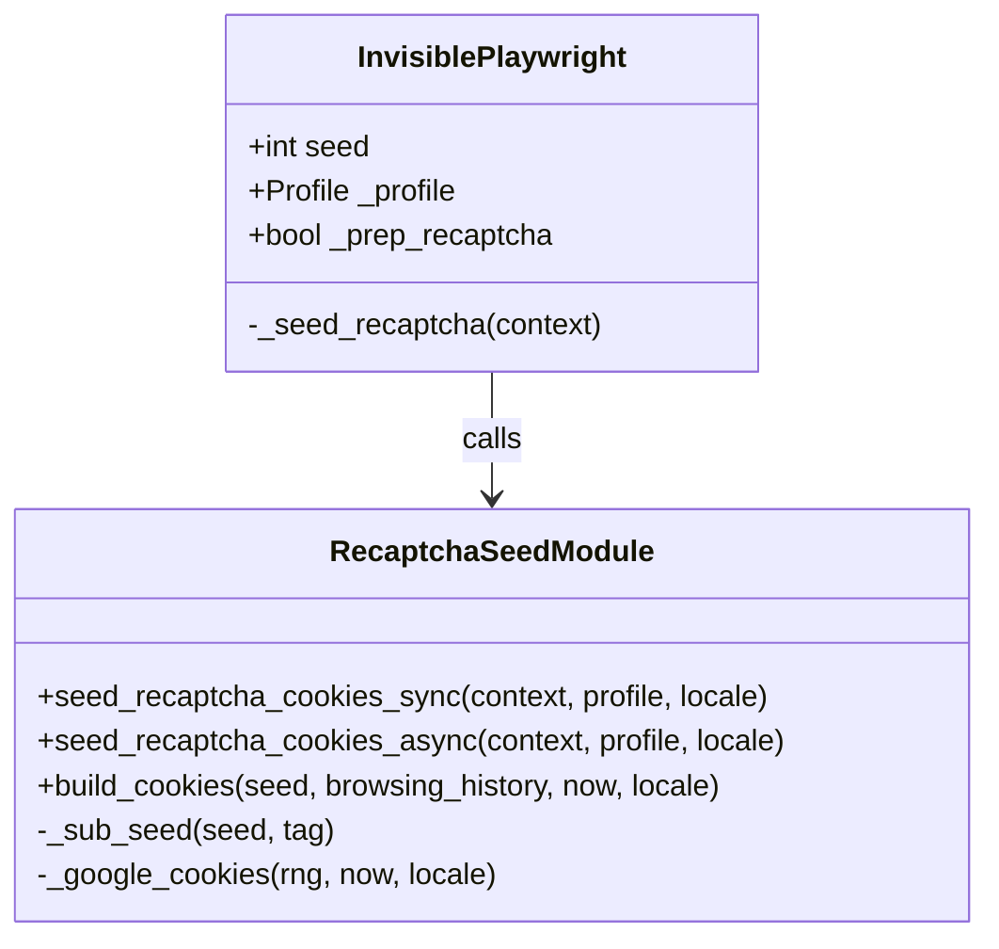

<!-- source: DeepWiki mcp.deepwiki.com · repo feder-cr/invisible_playwright · page 3.5 Cookie and History Seeding · fetched 2026-10-27 -->

# Cookie and History Seeding

<details>
<summary>Relevant source files</summary>

The following files were used as context for generating this wiki page:

- [docs/configuration.md](docs/configuration.md)
- [docs/pinning.md](docs/pinning.md)
- [docs/quickstart.md](docs/quickstart.md)
- [docs/recaptcha-v3-score.md](docs/recaptcha-v3-score.md)
- [docs/sannysoft-explained.md](docs/sannysoft-explained.md)
- [docs/screen-size-headless-tells.md](docs/screen-size-headless-tells.md)
- [src/invisible_playwright/_recaptcha_seed.py](src/invisible_playwright/_recaptcha_seed.py)
- [src/invisible_playwright/async_api.py](src/invisible_playwright/async_api.py)
- [src/invisible_playwright/launcher.py](src/invisible_playwright/launcher.py)
- [tests/test_async_api.py](tests/test_async_api.py)
- [tests/test_launcher_helpers.py](tests/test_launcher_helpers.py)
- [tests/test_recaptcha_seed.py](tests/test_recaptcha_seed.py)

</details>


The `_recaptcha_seed.py` module is responsible for pre-populating a browser context with a realistic set of cookies before any navigation occurs. This process is driven by the persona's `browsing_history` (sampled by the Fingerprint Engine) and is designed to mitigate the "empty profile" tell that causes low reCAPTCHA v3 scores [src/invisible_playwright/_recaptcha_seed.py:1-21](). By deriving all cookie values from the session `seed`, the system ensures that a specific persona always presents the same history to target sites across different sessions [src/invisible_playwright/_recaptcha_seed.py:7-8]().

## Deterministic Cookie Generation

The seeding system avoids using global random states. Instead, it uses a hierarchical seeding approach to ensure that even if the order of sites in the browsing history changes, the cookies generated for a specific domain remain identical [tests/test_recaptcha_seed.py:143-154]().

### Sub-seeding via FNV-1a
The function `_sub_seed` uses the FNV-1a hash algorithm to create independent PRNG streams for different logical "buckets" (e.g., specific domains or cookie types) from the single master `seed` [src/invisible_playwright/_recaptcha_seed.py:46-53]().

```python
def _sub_seed(seed: int, tag: str) -> int:
    h = 0xcbf29ce484222325 ^ (seed & 0xFFFFFFFF)
    for c in tag.encode("ascii"):
        h ^= c
        h = (h * 0x100000001b3) & 0xFFFFFFFFFFFFFFFF
    return h or 0xdeadbeef
```
[src/invisible_playwright/_recaptcha_seed.py:46-53]()

### The Google Batch
Every seeded context includes a standard "Google Batch" of cookies on `.google.com`. These are essential because almost every real-world browser carries Google identifiers [docs/recaptcha-v3-score.md:39-42]().

| Cookie | Purpose | Implementation Detail |
| :--- | :--- | :--- |
| `NID` | Visitor ID | Uses a broadened 3-digit prefix (100-540) to match historical observations [src/invisible_playwright/_recaptcha_seed.py:94-101](). |
| `CONSENT` | Consent Record | Derived from the session `locale` to ensure the region/language tokens match the IP/Timezone [src/invisible_playwright/_recaptcha_seed.py:102-108](). |
| `SOCS` | Security/State | Contains a base64-encoded state string [src/invisible_playwright/_recaptcha_seed.py:111-115](). |
| `_GRECAPTCHA` | reCAPTCHA | A 124-character identifier [src/invisible_playwright/_recaptcha_seed.py:116-120](). |
| `ENID` | Identity | A 252-character identifier [src/invisible_playwright/_recaptcha_seed.py:121-125](). |

**Anachronism Protection:** The system explicitly excludes the `1P_JAR` cookie. Google deprecated `1P_JAR` in 2022; including it in a modern session is a high-signal "anachronism flag" indicating a fabricated profile [src/invisible_playwright/_recaptcha_seed.py:10-12](), [docs/recaptcha-v3-score.md:55-68]().

**Sources:** `src/invisible_playwright/_recaptcha_seed.py`, `docs/recaptcha-v3-score.md`, `tests/test_recaptcha_seed.py`.

## Cookie Profiles and Recipes

The Fingerprint Engine (`fpforge`) samples a `browsing_history` list where each entry contains a `cookie_profile` tag [src/invisible_playwright/_recaptcha_seed.py:3-6](). `_recaptcha_seed.py` uses these tags to select "recipes" for cookie generation.

### Supported Profiles
*   **`ga_only`**: Generates standard Google Analytics `_ga` and `_gid` cookies [tests/test_recaptcha_seed.py:79-85]().
*   **`ga_cf`**: Generates `_ga` plus a Cloudflare bot-management cookie `__cf_bm` [tests/test_recaptcha_seed.py:87-93]().
*   **`ga_consent`**: Generates `_ga`, `_gid`, and a consent banner record (e.g., `OptanonAlertBoxClosed` from OneTrust or `cookieyes-consent`) [tests/test_recaptcha_seed.py:95-104]().
*   **`ga_consent_clarity`**: An advanced profile including Microsoft Clarity (`_clck`), Google Tag Manager (`_dc_gtm_*`), and Facebook Pixel (`_fbp`) identifiers [tests/test_recaptcha_seed.py:106-116]().

### Implementation Logic Flow
The following diagram illustrates how the `InvisiblePlaywright` launcher coordinates with `_recaptcha_seed` to populate the browser.

**Cookie Seeding Data Flow**
```mermaid
graph TD
    subgraph "Launcher Space (launcher.py / async_api.py)"
        "IP[InvisiblePlaywright]" -->|"1. generate_profile(seed)"| "P[Profile]"
        "IP" -->|"2. prep_recaptcha=True"| "S[seed_recaptcha_cookies_sync/async]"
    end

    subgraph "Logic Space (_recaptcha_seed.py)"
        "S" -->|"3. Iterate"| "BH[Profile.browsing_history]"
        "BH" -->|"4. Mix Domain + Seed"| "FNV[_sub_seed]"
        "FNV" -->|"5. Apply Recipe"| "R[Cookie Recipes]"
        "R" -->|"ga_consent_clarity"| "C1[_ga, _gid, _clck, Optanon...]"
        "R" -->|"google"| "C2[NID, CONSENT, SOCS, ENID]"
    end

    subgraph "Playwright Space"
        "C1" -->|"context.add_cookies()"| "CTX[BrowserContext]"
        "C2" -->|"context.add_cookies()"| "CTX"
    end
```
**Sources:** `src/invisible_playwright/launcher.py`, `src/invisible_playwright/async_api.py`, `src/invisible_playwright/_recaptcha_seed.py`, `tests/test_recaptcha_seed.py`.

## Locale-Derived Consent

The `CONSENT` cookie is particularly sensitive because it contains region and language tokens that must align with the browser's egress IP and locale [docs/recaptcha-v3-score.md:78-85]().

The module imports `consent_region_lang` from `invisible_core` [src/invisible_playwright/_recaptcha_seed.py:79](). This function maps the session BCP-47 `locale` to the specific format expected by Google (e.g., `ro-RO` results in a Romanian consent token) [src/invisible_playwright/_recaptcha_seed.py:67-78](). This prevents contradictions where a browser claiming to be in Italy presents a cookie indicating a non-EU English-speaking user [src/invisible_playwright/_recaptcha_seed.py:71-74]().

**Cookie Value Construction Example:**
```python
# CONSENT value construction
f"YES+cb.{_yyyymmdd_utc(now - consent_age)}-{rng.randint(10, 19):02d}-p{rng.randint(0, 9)}.{lang}+{region}+{rng.randint(100, 999)}"
```
[src/invisible_playwright/_recaptcha_seed.py:102-108]()

## Integration in Launcher

The seeding is gated by the `prep_recaptcha` parameter in the `InvisiblePlaywright` constructor [src/invisible_playwright/launcher.py:124](). It is automatically disabled if a `profile_dir` (persistent profile) is provided, as real accumulated history is always superior to a seeded approximation [src/invisible_playwright/launcher.py:192-194](), [docs/recaptcha-v3-score.md:147-150]().

### Sync API
In `launcher.py`, the `_seed_recaptcha` method calls `seed_recaptcha_cookies_sync` after the context is created but before any pages are opened [src/invisible_playwright/launcher.py:440-447]().

### Async API
In `async_api.py`, the same logic is applied via `await seed_recaptcha_cookies_async` within the `__aenter__` lifecycle [src/invisible_playwright/async_api.py:164-171]().

**Code Entity Mapping**

**Sources:** `src/invisible_playwright/launcher.py`, `src/invisible_playwright/async_api.py`, `src/invisible_playwright/_recaptcha_seed.py`.

---

