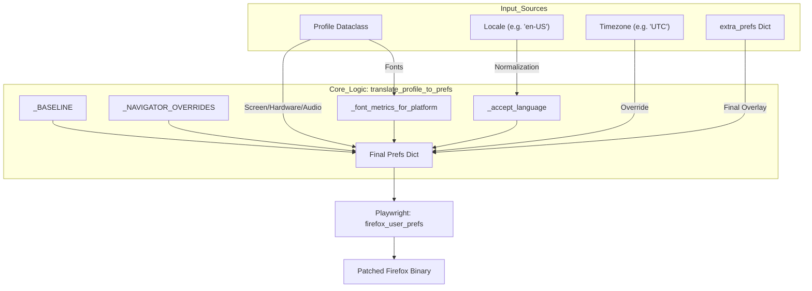
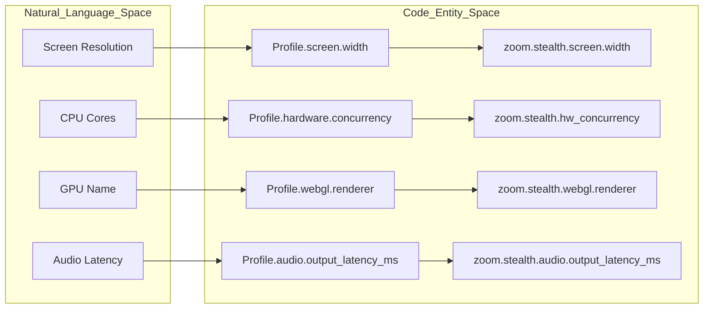

<!-- source: DeepWiki mcp.deepwiki.com · repo feder-cr/invisible_playwright · page 4.1 translate_profile_to_prefs · fetched 2026-10-27 -->

# translate_profile_to_prefs

Relevant source files

The following files were used as context for generating this wiki page:

- [scripts/ci_font_gate.py](scripts/ci_font_gate.py)
- [src/invisible_playwright/_session.py](src/invisible_playwright/_session.py)
- [src/invisible_playwright/_webgl_personas.py](src/invisible_playwright/_webgl_personas.py)
- [src/invisible_playwright/prefs.py](src/invisible_playwright/prefs.py)
- [tests/test_canvas_render_stealth.py](tests/test_canvas_render_stealth.py)
- [tests/test_ci_font_gate_declaration.py](tests/test_ci_font_gate_declaration.py)
- [tests/test_integration.py](tests/test_integration.py)
- [tests/test_prefs_composition_arm.py](tests/test_prefs_composition_arm.py)

The `translate_profile_to_prefs()` function is the central bridge between the abstract browser fingerprint (the `Profile` dataclass) and the concrete configuration of the patched Firefox binary. It converts high-level attributes—such as screen dimensions, hardware concurrency, and GPU renderers—into a dictionary of Firefox preferences (`prefs`).

In the current architecture, `src/invisible_playwright/prefs.py` serves as a backward-compatibility shim that aliases the implementation in `invisible_core.prefs` [src/invisible_playwright/prefs.py:1-5](). These preferences are passed to Playwright via the `firefox_user_prefs` parameter during context creation. The patched Firefox binary specifically monitors the `zoom.stealth.*` namespace to apply C++ level overrides to web APIs like Canvas, WebGL, and Web Audio [tests/test_integration.py:45-71]().

## Overview of the Translation Pipeline

The translation process follows a strict hierarchy to ensure a coherent identity:
1.  **Baseline Application**: A static set of "stealth-first" defaults (`_BASELINE`) is applied to disable telemetry, safebrowsing, and native fingerprinting resistance (RFP), which often creates a "bot-like" signature [tests/test_integration.py:67-71]().
2.  **Identity Overrides**: Navigator identity (User Agent, Platform, OSCPU) is locked to a Windows-canonical identity to ensure cross-platform consistency [tests/test_integration.py:70-71]().
3.  **Profile Overlay**: Fields from the `Profile` (generated by `fpforge`) are mapped to `zoom.stealth.*` keys [tests/test_integration.py:45-66]().
4.  **Platform Logic**: Adjustments are made based on the host OS (e.g., Windows vs. Linux) to handle GPU renderer strings and font metrics.
5.  **User Overrides**: The `extra_prefs` parameter allows callers to manually inject or delete specific keys [tests/test_prefs_composition_arm.py:108-111]().

### Data Flow Diagram: Profile to Prefs

The following diagram illustrates how various data sources converge within the core translation logic to produce the final configuration used by the wrapper.

"Data Flow: translate_profile_to_prefs"

Sources: [src/invisible_playwright/_session.py:27-30](), [tests/test_integration.py:80-85](), [tests/test_integration.py:141-149]()

## Function Parameters and Composition

The `compose_session_prefs` (aliased or called via `build_prefs` in the wrapper) handles the high-level assembly of the session environment.

| Parameter | Source/Context | Description |
| :--- | :--- | :--- |
| `profile` | `generate_profile()` | The fingerprint dataclass containing hardware and software attributes [tests/test_integration.py:84](). |
| `locale` | `build_prefs` | The desired browser language (e.g., "en-US"). Maps to `intl.accept_languages` [tests/test_integration.py:58](). |
| `timezone` | `build_prefs` | The IANA timezone string. Propagates to `TZ` environment variable [src/invisible_playwright/_session.py:125-126](). |
| `extra_prefs` | `InvisiblePlaywright` | User-provided dictionary to override any generated preference [tests/test_prefs_composition_arm.py:108-111](). |
| `cursor_engine` | `_cursor.py` | Determines if `stealthfox.humanize` is enabled in the binary [tests/test_prefs_composition_arm.py:61-80](). |

Sources: [src/invisible_playwright/_session.py:98-123](), [tests/test_prefs_composition_arm.py:41-45]()

## The Stealth Baseline and Identity

The translation ensures that the browser does not reveal its automated nature through default Firefox behaviors.

*   **RFP Disabling**: Unlike standard privacy tools, it explicitly ensures `privacy.resistFingerprinting` is handled carefully, as native RFP creates a unique, detectable signature [tests/test_integration.py:68]().
*   **WebRTC Protection**: Disables host IP leaks via `media.peerconnection.enabled` while allowing the patched engine to provide a spoofed `host_ip` [tests/test_integration.py:62-69]().
*   **Language Normalization**: The `_accept_language()` helper (internal to core) ensures that if a user provides `en-US`, the header is correctly expanded to `en-US, en` to match real browser behavior [tests/test_integration.py:58-60]().

Sources: [tests/test_integration.py:45-71]()

## Helper Logic and Platform Overlays

The translation logic branches to maintain the illusion of a Windows environment regardless of the host OS.

### Font Metrics and Generics
The `_font_metrics_for_platform()` helper handles the discrepancy between Linux and Windows font rendering. On Linux, specific scale factors are applied to ensure that the "bundled" Windows fonts (like Arial or Consolas) result in the exact pixel-widths expected on a real Windows machine [scripts/ci_font_gate.py:79-85]().
*   **Generics Mapping**: CSS generics are mapped to specific Windows families (e.g., `serif` to `Times New Roman`) via the `zoom.stealth.fonts.generics` preference [scripts/ci_font_gate.py:105-129]().

### Platform Branching
*   **Windows**: System colors are injected via `_WIN_LIGHT_COLORS` to ensure CSS system keywords (like `ButtonFace`) return Windows-specific RGB values [tests/test_integration.py:21-23]().
*   **Linux**: The ANGLE renderer strings from the `Profile` are injected into `zoom.stealth.webgl.renderer` to hide Mesa/X11 drivers [tests/test_integration.py:63-64]().

"Entity Mapping: Profile to Prefs"

Sources: [tests/test_integration.py:45-66](), [tests/test_integration.py:155-167]()

## Implementation Details: Profile Mapping

The following table details the mapping of `Profile` dataclass attributes to the specific preference keys monitored by the C++ patches in the Firefox binary.

| Profile Field | Preference Key | Purpose |
| :--- | :--- | :--- |
| `screen.width` | `zoom.stealth.screen.width` | Spoofs `window.screen.width` [tests/test_integration.py:46](). |
| `hardware.concurrency` | `zoom.stealth.hw_concurrency` | Spoofs `navigator.hardwareConcurrency` [tests/test_integration.py:50](). |
| `audio.sample_rate` | `zoom.stealth.audio.sample_rate` | Spoofs `AudioContext.sampleRate` [tests/test_integration.py:52](). |
| `storage.quota_mb` | `zoom.stealth.storage.quota_mb` | Spoofs Storage API limits [tests/test_integration.py:51](). |
| `webgl.renderer` | `zoom.stealth.webgl.renderer` | Spoofs WebGL Unmasked Renderer [tests/test_integration.py:63](). |
| `webgl.msaa_samples` | `webgl.msaa-samples` | Forces hardware-consistent MSAA [tests/test_integration.py:65](). |
| `canvas.noise_skip_mask` | `zoom.stealth.canvas.noise_skip_mask` | Controls render-noise skip for purity [tests/test_integration.py:66](). |

Sources: [tests/test_integration.py:45-71](), [tests/test_canvas_render_stealth.py:34-35]()

---

