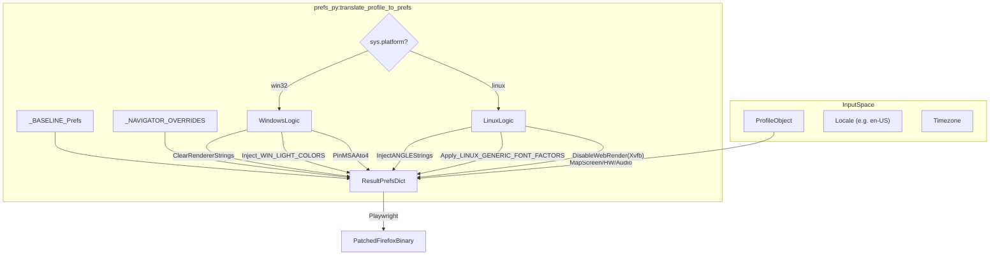
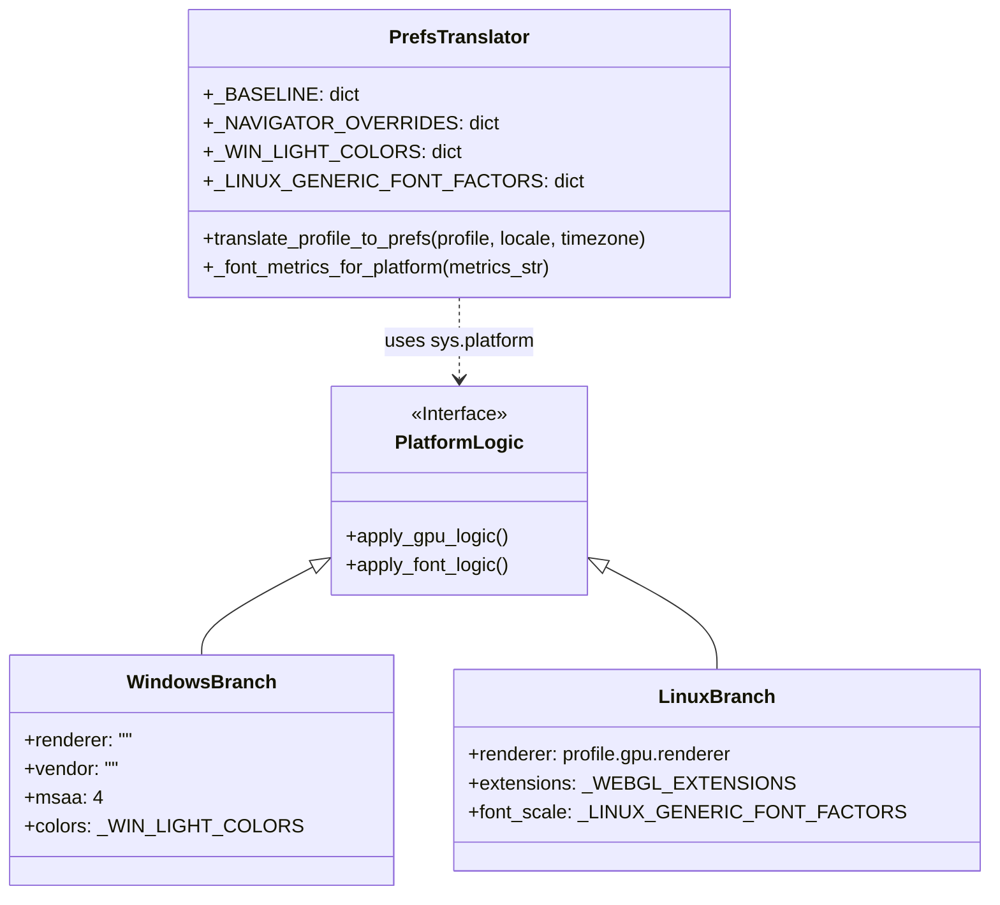

<!-- source: DeepWiki mcp.deepwiki.com · repo feder-cr/invisible_playwright · page 4.2 Platform-Specific Preference Logic · fetched 2026-10-27 -->

# Platform-Specific Preference Logic

Relevant source files

The following files were used as context for generating this wiki page:

- [docs/ai-browser-agents-stealth.md](docs/ai-browser-agents-stealth.md)
- [docs/browser-use-detection.md](docs/browser-use-detection.md)
- [docs/bundled-fonts-cross-platform.md](docs/bundled-fonts-cross-platform.md)
- [docs/canvas-fingerprint-noise.md](docs/canvas-fingerprint-noise.md)
- [docs/canvas-webgl-cross-platform-consistency.md](docs/canvas-webgl-cross-platform-consistency.md)
- [docs/crawl4ai-stealth-custom-browser.md](docs/crawl4ai-stealth-custom-browser.md)
- [docs/creepjs-explained.md](docs/creepjs-explained.md)
- [docs/headless-fonts-differ.md](docs/headless-fonts-differ.md)
- [docs/navigator-webdriver-explained.md](docs/navigator-webdriver-explained.md)
- [docs/playwright-detected-as-bot.md](docs/playwright-detected-as-bot.md)
- [docs/playwright-stealth-levels.md](docs/playwright-stealth-levels.md)
- [docs/webgl-renderer-strings.md](docs/webgl-renderer-strings.md)
- [src/invisible_playwright/_webgl_personas.py](src/invisible_playwright/_webgl_personas.py)
- [src/invisible_playwright/prefs.py](src/invisible_playwright/prefs.py)
- [tests/test_canvas_render_stealth.py](tests/test_canvas_render_stealth.py)
- [tests/test_integration.py](tests/test_integration.py)

This page details how `invisible_playwright` translates a unified browser `Profile` into platform-specific Firefox preferences. Because the patched Firefox binary is designed to emulate a Windows 10/11 environment regardless of the host OS, the translation logic in `prefs.py` must apply different transformations depending on whether it is running on Windows or Linux.

## Overview of Platform Branching

The core logic resides in `translate_profile_to_prefs()`, which branches based on `sys.platform` [src/invisible_playwright/prefs.py:20-21](). This branching ensures that the final `prefs` dictionary contains the correct values to satisfy the C++ patches in the browser binary while compensating for host-level differences in GPU drivers, font rendering, and system palettes.

### Data Flow: Profile to Platform Prefs

The following diagram illustrates how the `Profile` dataclass is processed into a `prefs` dictionary, showing where platform-specific logic intervenes.

**Profile Translation Pipeline**

**Sources:** [src/invisible_playwright/prefs.py:354-460](), [tests/test_integration.py:20-23]()

---

## Windows-Specific Logic

On Windows, the goal is to let the native OS and GPU drivers provide as much information as possible to avoid inconsistencies, while still masking identifying seeds.

### GPU and WebGL Handling
*   **Renderer Strings:** On Windows, `zoom.stealth.webgl.renderer` and `zoom.stealth.webgl.vendor` are set to empty strings `""` [src/invisible_playwright/prefs.py:441-443](). This instructs the patched binary to report the native ANGLE strings from the hardware. As documented in the stealth guides, a real Windows Firefox reports a vendor of `Google Inc. (NVIDIA)` because of the ANGLE translation layer [docs/webgl-renderer-strings.md:29-43]().
*   **WebGL Extensions:** The extensions list is cleared (`""`) for the same reason—native Windows Firefox should report what the driver actually supports [src/invisible_playwright/prefs.py:444-445]().
*   **MSAA Pinning:** Even if the `Profile` suggests a different value, MSAA samples are pinned to `4` on Windows to match standard browser behavior for the platform [src/invisible_playwright/prefs.py:447-450]().

### System Color Palette
To prevent "CSS System Color" probing (e.g., `getComputedStyle` on `ButtonFace`), `_WIN_LIGHT_COLORS` are injected [src/invisible_playwright/prefs.py:59-98](). This ensures that even if the user has a custom Windows theme, the browser reports standard Windows 10 Light theme RGB values [src/invisible_playwright/prefs.py:438-439]().

**Sources:** [src/invisible_playwright/prefs.py:59-98](), [src/invisible_playwright/prefs.py:437-450](), [docs/webgl-renderer-strings.md:29-43]()

---

## Linux-Specific Logic

On Linux, the browser must aggressively spoof Windows-like behavior to avoid detection, as a generic Linux container often reveals its identity through software renderers and missing fonts [docs/playwright-detected-as-bot.md:68-88]().

### GPU Spoofing (ANGLE Injection)
Unlike Windows, Linux Firefox typically uses GLX/EGL drivers. To appear as Windows, the `zoom.stealth.webgl.renderer` is populated with a synthetic ANGLE string derived from the `Profile` [src/invisible_playwright/prefs.py:423-424]().
*   **Extension Whitelisting:** Linux uses `_WEBGL1_EXTENSIONS` and `_WEBGL2_EXTENSIONS` to restrict the reported WebGL capabilities to exactly what a Windows machine would report [src/invisible_playwright/prefs.py:107-154](), [src/invisible_playwright/prefs.py:425-426]().

### Font Metric Compensation
Linux font engines (FreeType) and common fonts (DejaVu/Liberation) produce different character widths than Windows (GDI/DirectWrite). As explained in [docs/headless-fonts-differ.md:28-35](), a bare container often falls back to DejaVu, which has different metrics.
*   **`_LINUX_GENERIC_FONT_FACTORS`**: This constant provides scaling factors for common font families to compensate for GTK/FreeType differences [src/invisible_playwright/prefs.py:178-183]().
*   **`_font_metrics_for_platform`**: On Linux, this helper function applies these factors to the `Profile.font.metrics` string [src/invisible_playwright/prefs.py:311-331]().

### Xvfb and WebRender Workarounds
When running in a virtual display (Xvfb) on Linux, certain hardware acceleration features are disabled to ensure stability.
*   **WebRender:** If `virtual_display` is detected, WebRender is disabled via `gfx.webrender.all: False` [src/invisible_playwright/prefs.py:433-435]().
*   **Canvas Noise:** The `zoom.stealth.canvas.noise_skip_mask` is adjusted based on the renderer to ensure the noise injected by the C++ patch matches the expected artifacts of the spoofed GPU [src/invisible_playwright/prefs.py:427-428]().

**Sources:** [src/invisible_playwright/prefs.py:178-183](), [src/invisible_playwright/prefs.py:311-331](), [src/invisible_playwright/prefs.py:422-435](), [docs/headless-fonts-differ.md:28-35]()

---

## Key Entity Mapping

The following diagram maps the logical platform requirements to the specific code constants and functions that implement them.

**Code Entity Mapping: Platform Logic**

| Platform Requirement | Code Entity (Variable/Function) | File Path |
|:---|:---|:---|
| Windows UA/OS Strings | `_NAVIGATOR_OVERRIDES` | [src/invisible_playwright/prefs.py:31-47]() |
| CSS System Colors | `_WIN_LIGHT_COLORS` | [src/invisible_playwright/prefs.py:59-98]() |
| Linux Font Scaling | `_LINUX_GENERIC_FONT_FACTORS` | [src/invisible_playwright/prefs.py:178-183]() |
| WebGL Extensions | `_WEBGL1_EXTENSIONS` / `_WEBGL2_EXTENSIONS` | [src/invisible_playwright/prefs.py:107-154]() |
| Profile Translation | `translate_profile_to_prefs` | [src/invisible_playwright/prefs.py:354]() |
| Font Processing | `_font_metrics_for_platform` | [src/invisible_playwright/prefs.py:311]() |

**Sources:** [src/invisible_playwright/prefs.py:31-183](), [src/invisible_playwright/prefs.py:354-460]()

## Implementation Details

### Font Metric Logic
The function `_font_metrics_for_platform` [src/invisible_playwright/prefs.py:311-331]() is critical for cross-platform consistency. It takes a comma-separated string of `FontName|WidthFactor` and, if on Linux, multiplies the width factors by the values in `_LINUX_GENERIC_FONT_FACTORS`. This ensures that font detection via width measurement [docs/headless-fonts-differ.md:83-93]() returns consistent results regardless of the host OS.

### Summary Table: Preference Divergence

| Preference Key | Windows Value | Linux Value |
|:---|:---|:---|
| `zoom.stealth.webgl.renderer` | `""` (Native) | Spoofed ANGLE string |
| `zoom.stealth.webgl.vendor` | `""` (Native) | Spoofed Vendor string |
| `zoom.stealth.webgl.extensions`| `""` | `_WEBGL1_EXTENSIONS` |
| `ui.buttonface` | `_WIN_LIGHT_COLORS` | `_WIN_LIGHT_COLORS` (Injected) |
| `zoom.stealth.font.metrics` | Original from Profile | Scaled by `_LINUX_GENERIC_FONT_FACTORS` |
| `gfx.webrender.all` | Unset (Binary Default) | `False` (if using Virtual Display) |

**Sources:** [src/invisible_playwright/prefs.py:422-450](), [tests/test_integration.py:45-71](), [docs/canvas-webgl-cross-platform-consistency.md:89-92]()

---

