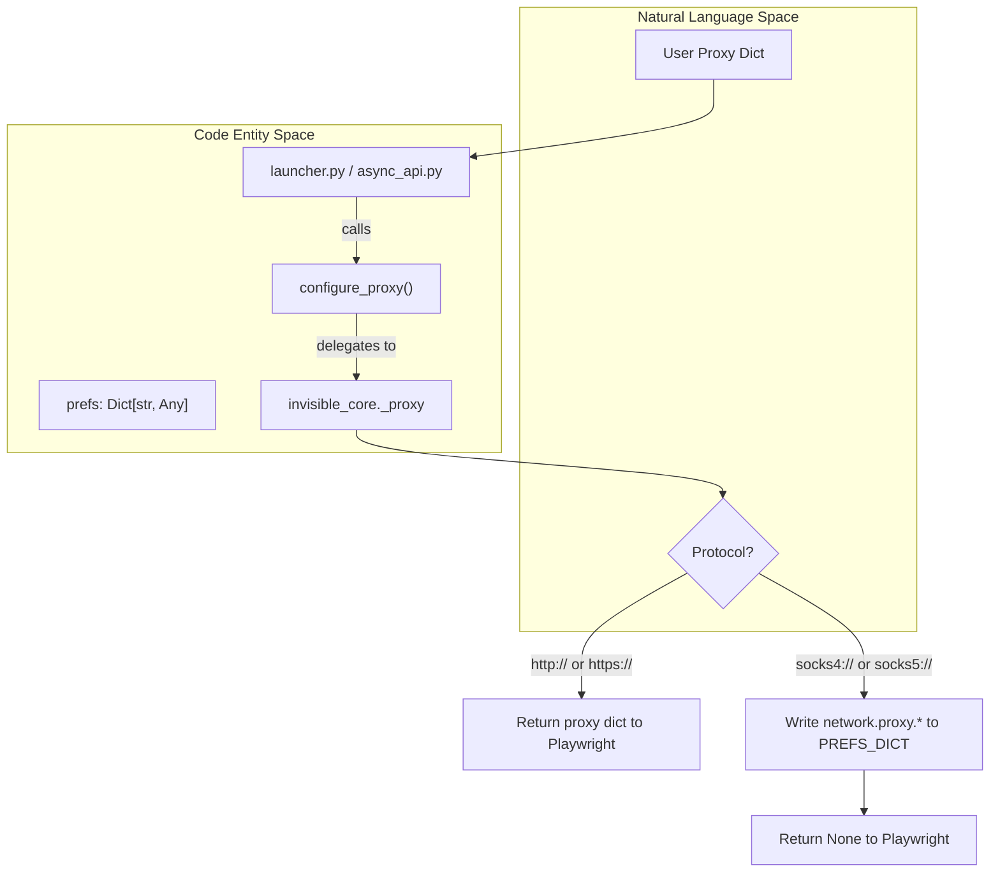
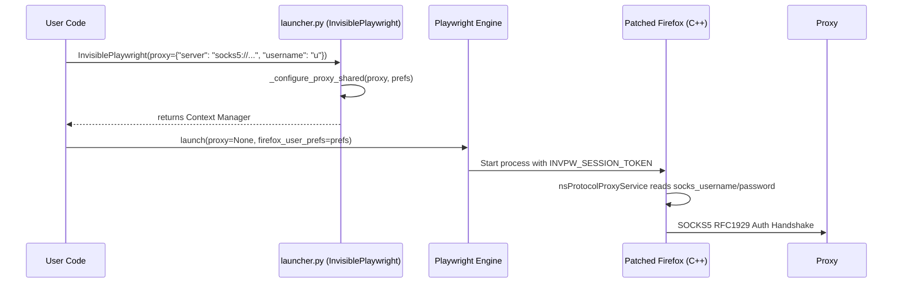

<!-- source: DeepWiki mcp.deepwiki.com · repo feder-cr/invisible_playwright · page 5 Proxy Configuration · fetched 2026-10-27 -->

# Proxy Configuration

Relevant source files

The following files were used as context for generating this wiki page:

- [docs/resist-fingerprinting.md](docs/resist-fingerprinting.md)
- [docs/speech-synthesis-voices.md](docs/speech-synthesis-voices.md)
- [docs/webrtc-leak-proxy.md](docs/webrtc-leak-proxy.md)
- [src/invisible_playwright/_recaptcha_seed.py](src/invisible_playwright/_recaptcha_seed.py)
- [src/invisible_playwright/async_api.py](src/invisible_playwright/async_api.py)
- [src/invisible_playwright/launcher.py](src/invisible_playwright/launcher.py)
- [tests/test_async_api.py](tests/test_async_api.py)
- [tests/test_launcher_helpers.py](tests/test_launcher_helpers.py)
- [tests/test_proxy_socks_auth_e2e.py](tests/test_proxy_socks_auth_e2e.py)
- [tests/test_recaptcha_seed.py](tests/test_recaptcha_seed.py)

`invisible_playwright` implements a dual-path strategy for proxy routing to ensure maximum stealth and compatibility. While standard Playwright handles HTTP/HTTPS proxy authentication, it lacks native support for authenticated SOCKS5 proxies without leaking credentials or triggering detection. To solve this, `invisible_playwright` utilizes a patched Firefox binary that handles SOCKS5 authentication at the C++ level via `nsProtocolProxyService`, driven by specific Firefox preferences.

## Dual-Path Routing Strategy

The system splits proxy handling based on the protocol scheme provided in the `proxy` dictionary. The `configure_proxy` function (exported from `invisible_core._proxy`) determines whether the proxy should be handled by Playwright's internal networking or by the patched Firefox engine directly [src/invisible_playwright/launcher.py:23-23]().

| Proxy Type | Handler | Mechanism |
| :--- | :--- | :--- |
| **HTTP / HTTPS** | Playwright | Passthrough: Returned to Playwright's `launch` or `launch_persistent_context` [src/invisible_playwright/launcher.py:168-175](). |
| **SOCKS4 / SOCKS5** | Firefox (Patched) | Internal: Written to Firefox `prefs`; Playwright receives `None` [src/invisible_playwright/async_api.py:127-127](). |
| **Direct** | None | No-op: Returns `None` and does not mutate preferences. |

### Data Flow: Proxy Configuration

The following diagram illustrates how `configure_proxy` decides where to route proxy configuration during the session initialization in `launcher.py` or `async_api.py`.

**Proxy Decision Logic**

Sources: [src/invisible_playwright/launcher.py:157-157](), [src/invisible_playwright/async_api.py:127-127]()

## SOCKS Configuration via Firefox Prefs

When a SOCKS proxy is detected, `configure_proxy` mutates the browser's preference dictionary in-place. This bypasses Playwright's proxy layer entirely, allowing the patched Firefox binary to handle the connection.

### Preference Keys
The following keys are injected into the Firefox profile to drive the internal proxy service:

*   `network.proxy.type`: Set to `1` (Manual configuration).
*   `network.proxy.socks`: The proxy hostname or IP.
*   `network.proxy.socks_port`: The integer port.
*   `network.proxy.socks_version`: `4` or `5` based on the scheme.
*   `network.proxy.socks_username`: Normalized credential.
*   `network.proxy.socks_password`: Normalized credential.
*   `network.proxy.socks_remote_dns`: Hardcoded to `True` to prevent DNS leaks at the local level.

### Implementation Details
*   **IPv6 Support**: The implementation correctly handles IPv6 addresses enclosed in brackets, such as `[::1]:1080`, ensuring the port is correctly parsed.
*   **Credential Normalization**: If `username` or `password` are missing or `None` in the input dictionary, they are converted to empty strings to satisfy the C++ preference parser.
*   **Localhost Hijacking**: Firefox by default bypasses proxies for `localhost`. In E2E testing environments, the `network.proxy.allow_hijacking_localhost` preference is set to `True` to force local traffic through the proxy for verification [tests/test_proxy_socks_auth_e2e.py:182-185]().

Sources: [src/invisible_playwright/launcher.py:135-138](), [tests/test_proxy_socks_auth_e2e.py:176-185]()

## Patched nsProtocolProxyService

Standard Firefox does not support SOCKS5 proxy authentication via preferences (it typically requires a UI prompt). `invisible_playwright` uses a binary where `nsProtocolProxyService` has been modified to read the `network.proxy.socks_username` and `network.proxy.socks_password` preferences directly.

**Proxy Logic Integration**

Sources: [src/invisible_playwright/launcher.py:157-175](), [tests/test_proxy_socks_auth_e2e.py:194-197]()

## WebRTC Egress Resolution

A critical component of the proxy configuration is resolving the **egress IP**. Standard Playwright proxies often leak the real local IP via WebRTC STUN candidates. 

`invisible_playwright` addresses this in `__enter__` (sync) and `__aenter__` (async) by calling `prepare_session_geo` [src/invisible_playwright/launcher.py:152-154](), [src/invisible_playwright/async_api.py:110-112](). This function performs a round-trip to discover the public IP of the proxy egress point. This discovered IP is then used to:
1.  Override WebRTC `srflx` candidates so the browser reports the proxy IP instead of the local IP [docs/webrtc-leak-proxy.md:105-108]().
2.  Automatically derive the session `locale` and `timezone` if set to `"auto"`, ensuring consistency between the network location and the browser's reported identity [src/invisible_playwright/launcher.py:158-164]().

Sources: [src/invisible_playwright/launcher.py:152-164](), [src/invisible_playwright/async_api.py:110-122](), [docs/webrtc-leak-proxy.md:105-114]()

---

