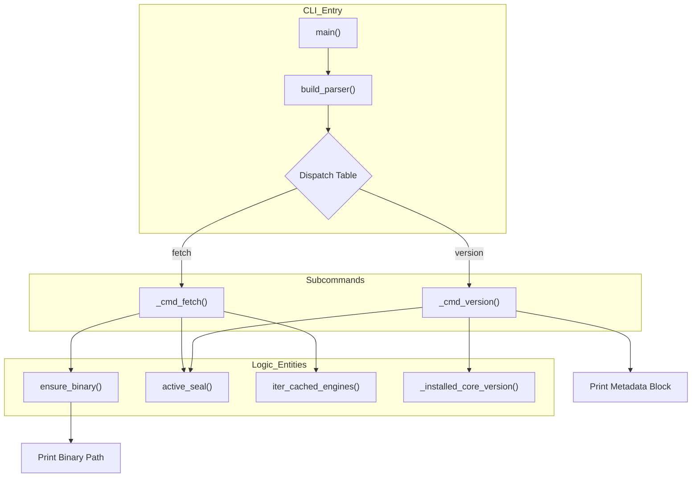
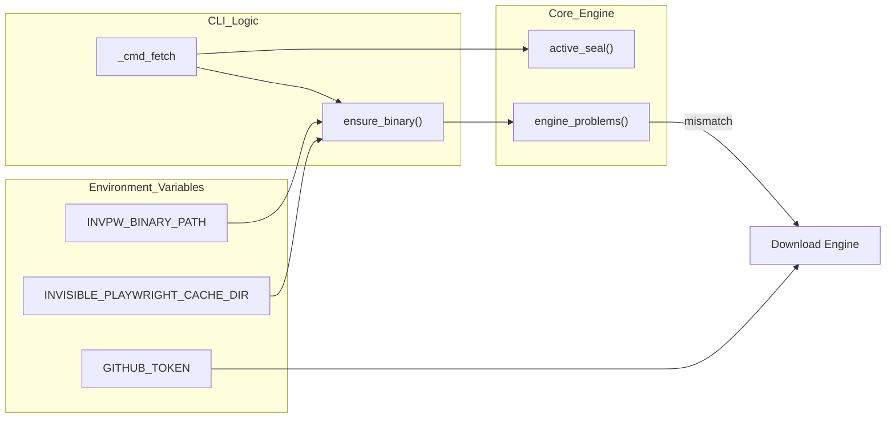

<!-- source: DeepWiki mcp.deepwiki.com · repo feder-cr/invisible_playwright · page 6 CLI Reference · fetched 2026-10-27 -->

# CLI Reference

Relevant source files

The following files were used as context for generating this wiki page:

- [.github/workflows/user-install.yml](.github/workflows/user-install.yml)
- [docs/cli-reference.md](docs/cli-reference.md)
- [docs/installation.md](docs/installation.md)
- [src/invisible_playwright/__init__.py](src/invisible_playwright/__init__.py)
- [src/invisible_playwright/_pin.py](src/invisible_playwright/_pin.py)
- [src/invisible_playwright/cli.py](src/invisible_playwright/cli.py)
- [tests/test_cli.py](tests/test_cli.py)
- [tests/test_core_pin.py](tests/test_core_pin.py)
- [tests/test_release_e2e.py](tests/test_release_e2e.py)
- [tests/test_seal_floor.py](tests/test_seal_floor.py)
- [tests/test_upgrade_e2e.py](tests/test_upgrade_e2e.py)
- [tests/test_version.py](tests/test_version.py)

The `invisible-playwright` command-line interface provides utilities for managing the lifecycle of the patched Firefox binary and verifying the installation environment. It handles binary acquisition, environment synchronization, and version reporting.

### CLI Entry Points

The CLI can be invoked in two ways:
1.  As a standalone command: `invisible-playwright <subcommand>`
2.  As a Python module: `python -m invisible_playwright <subcommand>`

The CLI surface was simplified in version 0.5.0 from six subcommands to two, folding maintenance tasks into the primary `fetch` command to ensure the browser "handles itself" [src/invisible_playwright/cli.py:5-30]().

---

### Command Dispatch Architecture

The CLI uses `argparse` to handle subcommand routing. The `main()` function serves as the entry point, delegating execution to specific handler functions.

**CLI Execution Flow**

**Sources:**
- [src/invisible_playwright/cli.py:115-128]() (Parser construction)
- [src/invisible_playwright/cli.py:131-146]() (Main dispatch logic)
- [tests/test_cli.py:32-55]() (Subcommand reduction logic)

---

### Subcommand Reference

#### `fetch`
Makes the engine present and correct, then prints its absolute path.
- **Behavior**: Unlike a simple "download if missing" check, `fetch` iterates through all cached engine trees and verifies them against the `active_seal()` shipped in `invisible-core` **before** downloading anything [src/invisible_playwright/cli.py:50-60]().
- **Repair Logic**: If a cached tree is stale (e.g., from an older release), it is reported to `stderr` but not deleted. `ensure_binary()` then fetches the correct sealed engine [src/invisible_playwright/cli.py:68-81]().
- **Scripting**: The last line of `stdout` is always the absolute path, allowing for usage like `FIREFOX="$(invisible-playwright fetch)"` [src/invisible_playwright/cli.py:85-87]().

#### `version`
Provides a complete diagnostic block for bug reports, covering the wrapper, core, and engine.
- **Output includes**:
    - `invisible_playwright` version.
    - `invisible_core` version (installed vs. declared pin) [src/invisible_playwright/cli.py:100-104]().
    - `engine` details: Tag (e.g., `firefox-18`), Upstream version (e.g., `151.0`), and BuildID [src/invisible_playwright/cli.py:107]().
    - `seal`: The SHA256 digest and the file origin [src/invisible_playwright/cli.py:108]().
    - `cache`: The filesystem root where engines are stored [src/invisible_playwright/cli.py:111]().

---

### Binary Management and Logic

The CLI relies on `invisible_core` for binary management.

| Function | Role | Source |
| :--- | :--- | :--- |
| `cache_root()` | Returns the platform-specific cache directory (e.g., `~/.cache/invisible-playwright`). | [src/invisible_playwright/cli.py:38-38]() |
| `ensure_binary()` | High-level orchestrator that resolves the binary path, downloading and verifying it if necessary. | [src/invisible_playwright/cli.py:81-81]() |
| `active_seal()` | Retrieves the cryptographic seal defining the required engine version and checksum. | [src/invisible_playwright/cli.py:58-58]() |

**Binary Resolution Data Flow**

**Sources:**
- [src/invisible_playwright/cli.py:47-87]()
- [docs/installation.md:42-53]()
- [tests/test_cli.py:99-125]()

---

### Environment Variables

The CLI and underlying engine respect several environment variables:

| Variable | Purpose |
| :--- | :--- |
| `INVISIBLE_PLAYWRIGHT_CACHE_DIR` | Overrides the default location for cached browser binaries [docs/installation.md:42-48](). |
| `INVPW_BINARY_PATH` | Forces the use of a specific binary, skipping the download and seal verification logic [docs/installation.md:50-53](). |
| `GITHUB_TOKEN` | Used for authenticated requests to the GitHub API during `fetch` to avoid rate-limiting [tests/test_release_e2e.py:142-147](). |
| `STEALTHFOX_GITHUB_TOKEN` | Primary authentication token for binary downloads (legacy support). |

---

### Error Handling and Testing

The CLI implementation is strictly guarded against regressions:
- **Pin Enforcement**: Upon any CLI invocation (via `__init__.py`), the package runs `enforce_core_pin()` to ensure the installed `invisible-core` matches the exact version required by the wrapper [src/invisible_playwright/__init__.py:42-43]().
- **Subcommand Guard**: The CLI explicitly refuses removed subcommands (like `doctor` or `clear-cache`) to prevent silent failures in stale scripts [tests/test_cli.py:142-153]().
- **Parser Validation**: Tests validate that the CLI offers exactly two subcommands and that `fetch` takes no arguments [tests/test_cli.py:32-73]().

**Sources:**
- [src/invisible_playwright/_pin.py:77-126]()
- [tests/test_cli.py:127-153]()
- [tests/test_version.py:70-106]()

---

