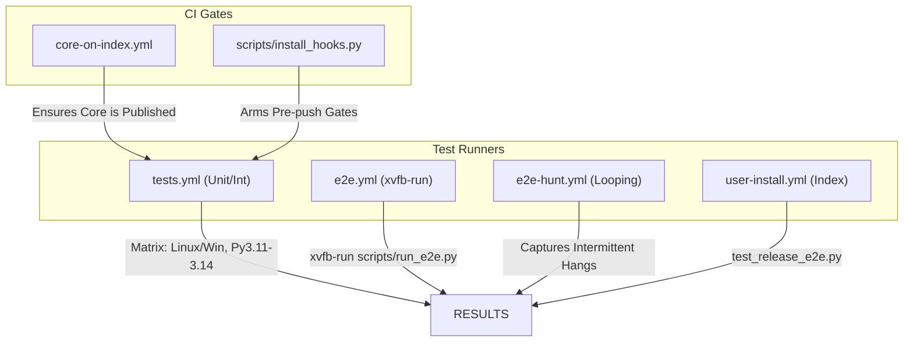

<!-- source: DeepWiki mcp.deepwiki.com · repo feder-cr/invisible_playwright · page 7 Testing Infrastructure · fetched 2026-10-27 -->

# Testing Infrastructure

<details>
<summary>Relevant source files</summary>

The following files were used as context for generating this wiki page:

- [.github/workflows/e2e-hunt.yml](.github/workflows/e2e-hunt.yml)
- [.github/workflows/e2e.yml](.github/workflows/e2e.yml)
- [.github/workflows/firefox-launch-matrix.yml](.github/workflows/firefox-launch-matrix.yml)
- [.github/workflows/publish.yml](.github/workflows/publish.yml)
- [.github/workflows/tests.yml](.github/workflows/tests.yml)
- [.github/workflows/user-install.yml](.github/workflows/user-install.yml)
- [.github/workflows/webrtc-e2e.yml](.github/workflows/webrtc-e2e.yml)
- [scripts/run_e2e.py](scripts/run_e2e.py)
- [src/invisible_playwright/cli.py](src/invisible_playwright/cli.py)
- [tests/conftest.py](tests/conftest.py)
- [tests/test_cli.py](tests/test_cli.py)
- [tests/test_e2e.py](tests/test_e2e.py)
- [tests/test_fingerprint_consistency.py](tests/test_fingerprint_consistency.py)
- [tests/test_mouse.py](tests/test_mouse.py)
- [tests/test_release_e2e.py](tests/test_release_e2e.py)
- [tests/test_service_worker.py](tests/test_service_worker.py)
- [tests/test_upgrade_e2e.py](tests/test_upgrade_e2e.py)
- [tests/test_version.py](tests/test_version.py)
- [tests/test_webrtc_realness.py](tests/test_webrtc_realness.py)

</details>


The `invisible_playwright` test suite ensures the integrity of Bayesian fingerprint generation, Firefox preference translation, and the end-to-end functionality of the patched browser binary. The infrastructure utilizes `pytest` with custom markers and a specialized watchdog system to detect hangs during heavy automation.

### Test Suite Structure

Tests are separated into categories based on execution requirements. By default, the runner excludes `slow` and `e2e` tests to allow for rapid development [pyproject.toml:41-41]().

| Category | Marker | Description |
| :--- | :--- | :--- |
| **Unit** | `unit` | Pure logic tests. No I/O or external dependencies [pyproject.toml:35-35](). |
| **Integration** | `integration` | Multi-module interactions (e.g., `_fpforge` + `prefs`) without a browser [pyproject.toml:36-36](). |
| **End-to-End** | `e2e` | Requires the patched Firefox binary and a display (Xvfb or Desktop) [pyproject.toml:37-37](). |
| **Linux Only** | `linux_only` | Tests for `_LinuxVirtualDisplay` or X11-specific logic [pyproject.toml:39-40](). |

### Hang Detection (Watchdog)

Because E2E tests drive a real browser, they are susceptible to hangs. The infrastructure includes a **Watchdog System** in `tests/conftest.py` that monitors execution [tests/conftest.py:10-21]().

*   **Thread Dumping**: If a test exceeds a threshold (default 150s), `faulthandler` dumps the stack trace of all threads to a log file [tests/conftest.py:64-71]().
*   **Persistence**: Logs are written to a file defined by `INVPW_TEST_WATCHDOG_FILE` because standard `pytest` output capture is lost if the process is killed [tests/conftest.py:28-34]().
*   **Diagnosis**: The system distinguishes between a **Slow** test (different stacks across dumps) and a **Blocked** test (identical stacks) [tests/conftest.py:19-21]().

### CI/CD Infrastructure

The test suite is automated via GitHub Actions, utilizing a matrix of OS and Python versions.


Sources: [.github/workflows/tests.yml:32-47](), [.github/workflows/e2e.yml:56-98](), [scripts/run_e2e.py:52-97]()

### Test Configuration and Fixtures

*   **Binary Resolution**: The `firefox_binary` fixture is the single source of truth, checking `INVPW_BINARY_PATH` before falling back to the local cache [tests/conftest.py:128-157]().
*   **RNG Seeding**: `deterministic_rng` provides a `random.Random(42)` instance for reproducible fingerprinting [tests/conftest.py:116-118]().
*   **CLI Validation**: `test_cli.py` ensures that the CLI surface remains minimal and that tests do not use deprecated flags like `--force` [tests/test_cli.py:156-174]().

### Execution Guide

To run the standard suite (unit and integration):
```bash
pytest tests/
```

To run the full E2E suite against a specific binary:
```bash
python scripts/run_e2e.py /path/to/firefox
```

To run the "Stranger's Path" (install from PyPI index into a fresh venv):
```bash
pytest tests/test_release_e2e.py -m e2e -o addopts=""
```
Sources: [scripts/run_e2e.py:23-24](), [tests/test_release_e2e.py:1-11]()

### Detailed Test Categories

#### [Unit and Integration Tests](#7.1)
Covers internal logic: `fpforge` sampling, `prefs` translation, `_motion` path planning, and `_reaper` process management.
For details, see [Unit and Integration Tests](#7.1).

#### [End-to-End and Build Tests](#7.2)
Covers the full browser lifecycle: `test_e2e.py`, `test_mouse.py` (regression for Juggler mouse events), `test_webrtc_realness.py` (ICE candidate validation), and release-path verification.
For details, see [End-to-End and Build Tests](#7.2).

Sources: [tests/conftest.py:10-83](), [tests/test_mouse.py:1-16](), [tests/test_webrtc_realness.py:1-22](), [.github/workflows/tests.yml:106-131]()

---

