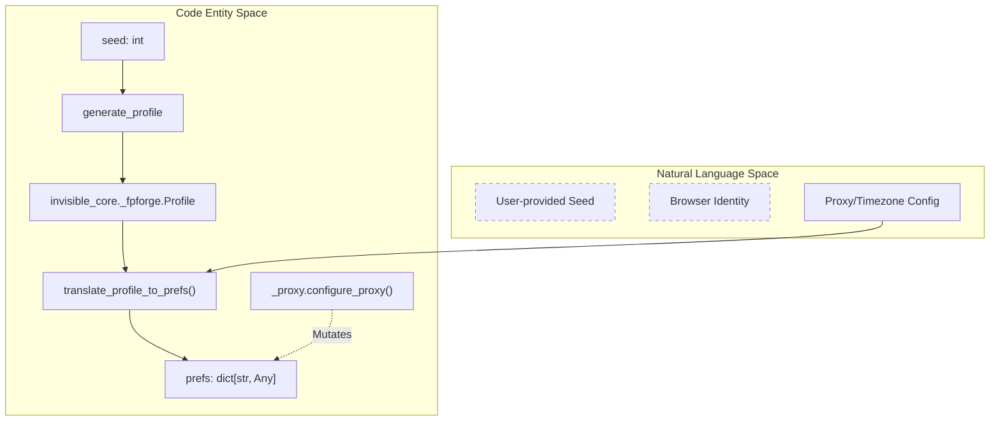
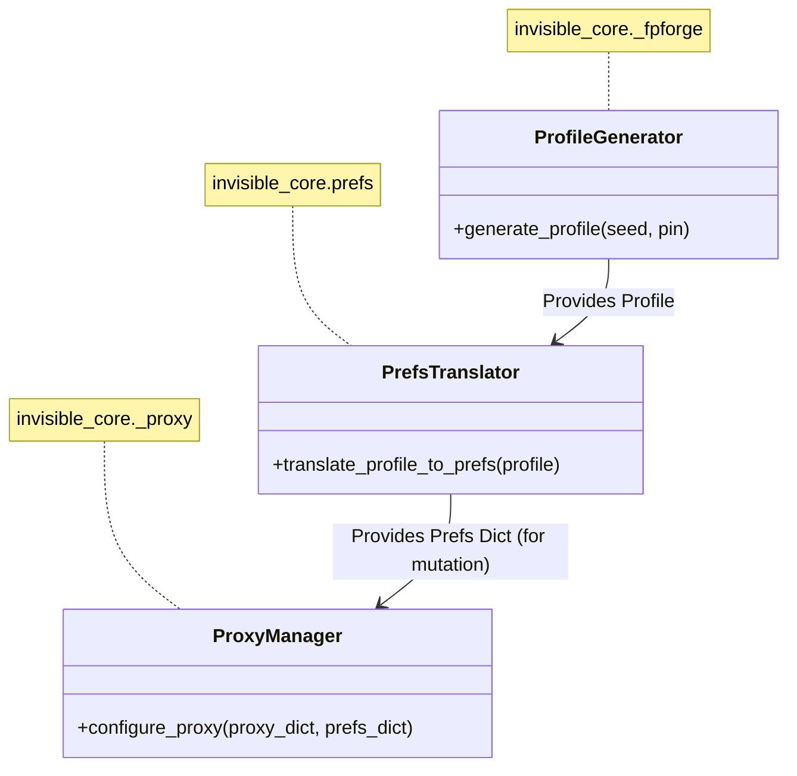

<!-- source: DeepWiki mcp.deepwiki.com · repo feder-cr/invisible_playwright · page 7.1 Unit and Integration Tests · fetched 2026-10-27 -->

# Unit and Integration Tests

Relevant source files

The following files were used as context for generating this wiki page:

- [src/invisible_playwright/_behaviour.py](src/invisible_playwright/_behaviour.py)
- [src/invisible_playwright/_cursor.py](src/invisible_playwright/_cursor.py)
- [src/invisible_playwright/_engine.py](src/invisible_playwright/_engine.py)
- [src/invisible_playwright/_motion.py](src/invisible_playwright/_motion.py)
- [src/invisible_playwright/_reaper.py](src/invisible_playwright/_reaper.py)
- [src/invisible_playwright/_webgl_personas.py](src/invisible_playwright/_webgl_personas.py)
- [src/invisible_playwright/prefs.py](src/invisible_playwright/prefs.py)
- [tests/test_behaviour.py](tests/test_behaviour.py)
- [tests/test_canvas_render_stealth.py](tests/test_canvas_render_stealth.py)
- [tests/test_cursor_dispatch.py](tests/test_cursor_dispatch.py)
- [tests/test_cursor_wiring.py](tests/test_cursor_wiring.py)
- [tests/test_integration.py](tests/test_integration.py)
- [tests/test_launcher_config.py](tests/test_launcher_config.py)
- [tests/test_motion.py](tests/test_motion.py)
- [tests/test_motion_fingerprint.py](tests/test_motion_fingerprint.py)
- [tests/test_old_core_says_which_version.py](tests/test_old_core_says_which_version.py)
- [tests/test_reaper.py](tests/test_reaper.py)
- [tests/test_seal_wire_version.py](tests/test_seal_wire_version.py)
- [tests/test_suite_boundaries.py](tests/test_suite_boundaries.py)

This page documents the unit and integration test suites for `invisible_playwright`. These tests ensure the correctness of individual modules (unit) and the data flow between subsystems (integration) without requiring the execution of the patched Firefox binary.

## Overview and Scope

The test infrastructure is designed to validate the fingerprinting logic, preference translation, and proxy configuration across both Windows and Linux environments.

| Test Category | Purpose | Module Examples |
| :--- | :--- | :--- |
| **Unit Tests** | Validate isolated logic, mathematical primitives, and platform-specific branching. | `test_reaper.py`, `test_motion.py`, `test_behaviour.py` |
| **Integration Tests** | Verify the end-to-end data pipeline from seed to Firefox preferences. | `test_integration.py` |

The suite utilizes `pytest` and heavily relies on `monkeypatch` to simulate different operating systems (e.g., forcing `sys.platform = "win32"` on a Linux host) to ensure cross-platform parity [tests/test_integration.py:7-9]().

## Data Flow: Seed to Preferences

The following diagram illustrates the data transformation verified by the integration tests, moving from a raw seed to the final dictionary used by Playwright.

**Fingerprint Pipeline Data Flow**

Sources: [tests/test_integration.py:80-85](), [tests/test_integration.py:105-112](), [tests/test_integration.py:144-146]()

## Unit Test Modules

### 1. Preference Translation (`src/invisible_playwright/prefs.py`)
This module is a backward-compatibility shim for `invisible_core.prefs` [src/invisible_playwright/prefs.py:1-4](). The tests in `test_integration.py` verify that `translate_profile_to_prefs` correctly maps `Profile` fields to `zoom.stealth.*` preference keys [tests/test_integration.py:80-88]().
*   **Required Keys:** A contract check ensures that critical keys like `zoom.stealth.screen.width`, `zoom.stealth.hw_concurrency`, and `zoom.stealth.webgl.renderer` are always present [tests/test_integration.py:45-71]().
*   **Determinism:** Confirms that the same seed produces identical preference dictionaries [tests/test_integration.py:176-181]().

### 2. Process Lifecycle and Reaper (`tests/test_reaper.py`)
Tests the `_reaper` module (a re-export from `invisible_core.process`) using real processes to ensure re-parented browser trees are correctly terminated [tests/test_reaper.py:1-12]().
*   **Token Uniqueness:** Verifies that `SessionToken.mint()` produces unique identifiers to prevent cross-session reaping [tests/test_reaper.py:55-57]().
*   **Tree Reaping:** Confirms that grandchildren spawned by a marked process inherit the `INVPW_SESSION_TOKEN` and are killed during teardown [tests/test_reaper.py:71-92]().
*   **Platform Seam:** `guard_for` is tested as the platform abstraction layer, returning `NullGuard` on POSIX and `JobObjectGuard` (or `NullGuard`) on Windows [tests/test_reaper.py:180-188]().

### 3. Cursor Motion and Behaviour (`tests/test_motion.py`, `tests/test_behaviour.py`)
These modules test the Python-side humanized cursor engine.
*   **Motion Purity:** `test_motion.py` validates that `CursorMotion` is a pure mathematical model, checking statistics like bell-shaped speed profiles and zero-mean noise without a browser [src/invisible_playwright/_motion.py:62-65]().
*   **Behaviour Planning:** `test_behaviour.py` verifies macro-scale planning (idle periods, fidgets) [src/invisible_playwright/_behaviour.py:23-30]().
*   **Regression Pinned Fingerprints:** `test_motion_fingerprint.py` hashes integer pixel coordinates and millisecond timestamps across a grid of 576 cases to ensure seed-reproducibility remains byte-identical [tests/test_motion_fingerprint.py:59-72]().

### 4. Launcher Configuration (`tests/test_launcher_config.py`)
Tests the internal configuration logic of the `InvisiblePlaywright` class.
*   **Timezone Mapping:** Validates the `_tz_env` helper, ensuring IANA zones like `America/New_York` map to POSIX `EST5EDT` while Arizona/Hawaii correctly omit DST suffixes [tests/test_launcher_config.py:16-29]().
*   **Persistent Context:** Ensures `_persistent_context_kwargs` matches default context kwargs to prevent isolation regressions in newer Firefox builds [tests/test_launcher_config.py:119-138]().
*   **Viewport Padding:** Asserts that `_CHROME_W`, `_CHROME_H`, and `_TASKBAR_H` are non-negative, ensuring the spoofed viewport fits inside the spoofed screen [tests/test_launcher_config.py:45-68]().

## Integration Test Patterns (`test_integration.py`)

Integration tests focus on the contract between the fingerprint generator, the preference translator, and the proxy manager.

**Code Entity Association: Subsystem Interaction**

Sources: [tests/test_integration.py:80-85](), [tests/test_integration.py:105-112]()

### Key Integration Checks
*   **SOCKS5 Proxy Mutation (IT2):** Verifies that `configure_proxy` writes SOCKS keys (host, port, auth) directly into the `prefs` dict and returns `None` so Playwright does not attempt to handle the proxy itself [tests/test_integration.py:97-122]().
*   **Pin Propagation (IT3):** Ensures that pinning a value like `screen.width` in `generate_profile` correctly propagates through the pipeline to the final `zoom.stealth.screen.width` preference [tests/test_integration.py:141-149]().
*   **Suite Boundaries:** `tests/test_suite_boundaries.py` enforces that tests for the core logic (e.g., Bayesian sampler) live in the `invisible_core` repository, while this suite only tests the wrapper's integration with those components [tests/test_suite_boundaries.py:1-39]().

## Stealth Regression Tests (`tests/test_canvas_render_stealth.py`)

These tests guard binary-level behaviors that are critical for stealth.
*   **WebGL Readback Purity:** A regression test ensuring that solid-color WebGL readbacks remain byte-exact (values `{0, 255}`) even when render-noise is enabled, preventing detection by fixed-hash reference checks [tests/test_canvas_render_stealth.py:42-63]().

Sources:
- `tests/test_integration.py`
- `tests/test_launcher_config.py`
- `tests/test_reaper.py`
- `tests/test_motion_fingerprint.py`
- `tests/test_canvas_render_stealth.py`
- `tests/test_suite_boundaries.py`
- `src/invisible_playwright/_motion.py`
- `src/invisible_playwright/_behaviour.py`
- `src/invisible_playwright/_reaper.py`
- `src/invisible_playwright/_engine.py`

---

