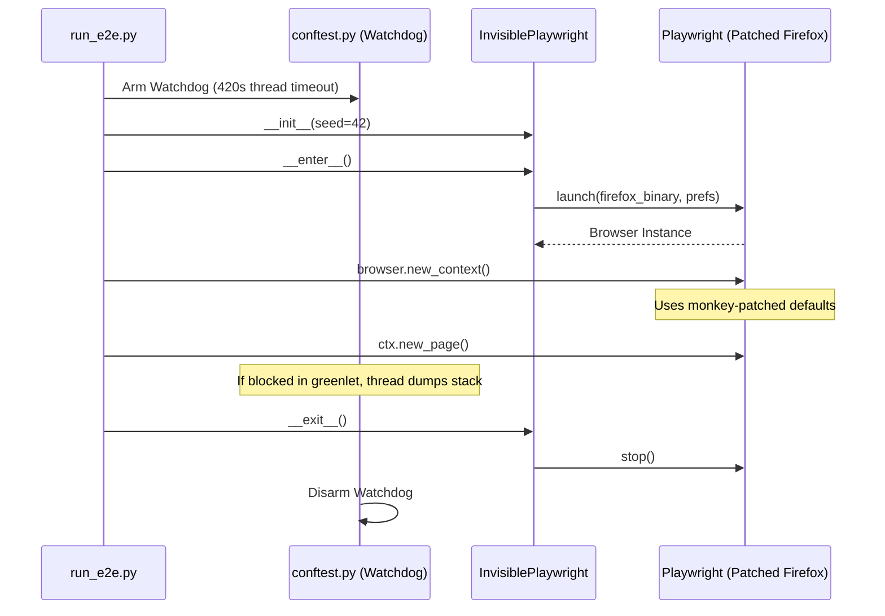
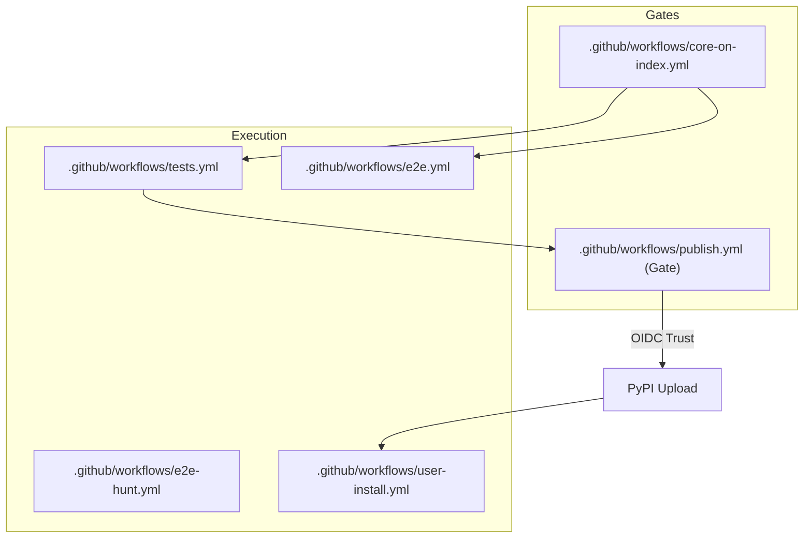

<!-- source: DeepWiki mcp.deepwiki.com · repo feder-cr/invisible_playwright · page 7.2 End-to-End and Build Tests · fetched 2026-10-27 -->

# End-to-End and Build Tests

Relevant source files

The following files were used as context for generating this wiki page:

- [.github/workflows/e2e-hunt.yml](.github/workflows/e2e-hunt.yml)
- [.github/workflows/e2e.yml](.github/workflows/e2e.yml)
- [.github/workflows/firefox-launch-matrix.yml](.github/workflows/firefox-launch-matrix.yml)
- [.github/workflows/publish.yml](.github/workflows/publish.yml)
- [.github/workflows/tests.yml](.github/workflows/tests.yml)
- [.github/workflows/user-install.yml](.github/workflows/user-install.yml)
- [.github/workflows/webrtc-e2e.yml](.github/workflows/webrtc-e2e.yml)
- [scripts/run_e2e.py](scripts/run_e2e.py)
- [src/invisible_playwright/cli.py](src/invisible_playwright/cli.py)
- [tests/conftest.py](tests/conftest.py)
- [tests/test_cli.py](tests/test_cli.py)
- [tests/test_cross_origin_iframe.py](tests/test_cross_origin_iframe.py)
- [tests/test_detectors_e2e.py](tests/test_detectors_e2e.py)
- [tests/test_e2e.py](tests/test_e2e.py)
- [tests/test_fingerprint_consistency.py](tests/test_fingerprint_consistency.py)
- [tests/test_long_session_e2e.py](tests/test_long_session_e2e.py)
- [tests/test_mouse.py](tests/test_mouse.py)
- [tests/test_release_e2e.py](tests/test_release_e2e.py)
- [tests/test_service_worker.py](tests/test_service_worker.py)
- [tests/test_upgrade_e2e.py](tests/test_upgrade_e2e.py)
- [tests/test_version.py](tests/test_version.py)
- [tests/test_webrtc_realness.py](tests/test_webrtc_realness.py)
- [tests/vendor/README.md](tests/vendor/README.md)
- [tests/vendor/botd-2.0.0.esm.js](tests/vendor/botd-2.0.0.esm.js)
- [tests/vendor/creepjs-10aa672.js](tests/vendor/creepjs-10aa672.js)
- [tests/vendor/fingerprintjs-5.2.0.umd.min.js](tests/vendor/fingerprintjs-5.2.0.umd.min.js)
- [tests/vendor/fpscanner-1.0.6.es.js](tests/vendor/fpscanner-1.0.6.es.js)

This page documents the high-level testing infrastructure of `invisible_playwright`. These tests ensure that the integration between the Python wrapper and the patched Firefox binary is functional, that the CLI manages the binary lifecycle correctly, and that the distribution packages (wheels) are built without defects.

## Overview of Test Categories

The test suite is divided into several categories based on their requirements and execution depth:

| Category | Module | Requirements | Purpose |
| :--- | :--- | :--- | :--- |
| **End-to-End** | `tests/test_e2e.py`, `tests/test_detectors_e2e.py` | Patched Firefox Binary | Full browser lifecycle and detection library validation. |
| **Async API** | `tests/test_async_api.py` | None (Unit-level) | Verifies parity between Sync and Async class constructors. |
| **CLI** | `tests/test_cli.py` | None (Mocked) | Tests the `invisible-playwright` command-line entry point. |
| **WebRTC** | `tests/test_webrtc_realness.py` | Mock SOCKS server | Verifies ICE candidate leakage protection and SDP masking. |
| **Release/Install** | `tests/test_release_e2e.py` | Fresh Venv, PyPI/Index | Simulates a clean user install from the public index. |

Sources: [tests/test_e2e.py:1-8](), [tests/test_detectors_e2e.py:1-35](), [tests/test_release_e2e.py:1-31]()

## End-to-End Lifecycle and Detectors

The E2E suite verifies the `InvisiblePlaywright` class's ability to launch a browser, create contexts, and clean up resources while remaining undetected by standard libraries.

### Detector Validation (`test_detectors_e2e.py`)
This module serves as the primary "realness" gate by running the actual open-source detection libraries against the patched binary:
*   **BotD**: Verifies aggregate and individual detector verdicts [tests/test_detectors_e2e.py:6-9]().
*   **FingerprintJS**: Ensures `visitorId` stability across launches with the same seed [tests/test_detectors_e2e.py:10-12]().
*   **CreepJS**: Asserts `headlessRating == 0` and checks for JS-proxy stealth tells [tests/test_detectors_e2e.py:20-26]().
*   **fpscanner**: Validates engine-agnostic rules like `hasWebdriver` and `hasBotUserAgent` [tests/test_detectors_e2e.py:53-63]().

### Mouse and Humanization (`test_mouse.py`)
Verifies the engine-level patches for `synthesizeMouseEvent` which replaced the missing `jugglerSendMouseEvent` [tests/test_mouse.py:1-16]().
*   **Humanize Contrast**: `test_humanize_emits_intermediate_moves` compares move counts when `humanize=True` (Bezier) vs `False` (Teleport) to ensure the `stealthfox.humanize` preference reaches the Juggler [tests/test_mouse.py:150-167]().

**Browser Lifecycle and Watchdog Sequence**

Sources: [scripts/run_e2e.py:68-84](), [tests/test_mouse.py:135-147]()

## CLI and Release Infrastructure

### CLI Tests (`test_cli.py`)
The CLI was reduced from six subcommands to two: `fetch` and `version` [tests/test_cli.py:32-49]().
*   **Fetch Integrity**: `fetch` now performs a full seal verification of cached engines, effectively replacing the old `doctor` and `path` commands [tests/test_cli.py:79-97]().
*   **Guardrails**: `test_no_test_invokes_the_cli_with_arguments_it_rejects` scans all test files to ensure no test calls removed flags like `--force` [tests/test_cli.py:156-174]().

### User-Install and Release (`test_release_e2e.py`)
This test is designed to catch failures in the `invisible-core` pinning mechanism that are invisible in local development [tests/test_release_e2e.py:13-21]().
*   **Isolation**: It creates a fresh venv and installs `invisible-playwright` from the index to verify dependency resolution [tests/test_release_e2e.py:44-56]().
*   **Cache Safety**: Uses a temporary `INVISIBLE_PLAYWRIGHT_CACHE_DIR` to avoid polluting the developer's local environment [tests/test_release_e2e.py:28-31]().

Sources: [tests/test_cli.py:52-56](), [tests/test_release_e2e.py:75-87](), [src/invisible_playwright/cli.py:1-20]()

## CI/CD Workflows (`.github/workflows/`)

The repository uses a multi-stage CI/CD pipeline to ensure stability across platforms and releases.

### Test Matrix and Floor (`tests.yml`)
Runs the unit suite across Ubuntu and Windows with Python versions 3.11 through 3.14 [.github/workflows/tests.yml:40-56]().
*   **Selection Guard**: Includes a tripwire to fail the job if `pytest` deselects too many tests (floor of 380+), preventing silent regressions where the suite runs nothing but exits 0 [.github/workflows/tests.yml:106-131]().

### E2E and Hang Detection (`e2e.yml` & `e2e-hunt.yml`)
*   **Watchdog System**: Uses a `thread` based timeout (420s) to detect hangs in the Juggler/Playwright sync API that standard signals cannot catch [scripts/run_e2e.py:68-84]().
*   **E2E Hunt**: A specialized workflow for capturing intermittent hangs (12% flake rate) by looping the suite up to 18 times on a dedicated runner [.github/workflows/e2e-hunt.yml:4-21]().

### Publication Gate (`publish.yml`)
Implements an OIDC-trusted publishing flow with strict ordering gates:
1.  **Index Check**: Verifies the version is not already published [.github/workflows/publish.yml:39-59]().
2.  **Core Gate**: Ensures the specific `invisible-core==X.Y.Z` pin is already available on the index before allowing the wrapper release [.github/workflows/publish.yml:87-117]().

**CI/CD Pipeline Architecture**

Sources: [.github/workflows/tests.yml:32-38](), [.github/workflows/publish.yml:11-22](), [.github/workflows/user-install.yml:5-19]()

---

