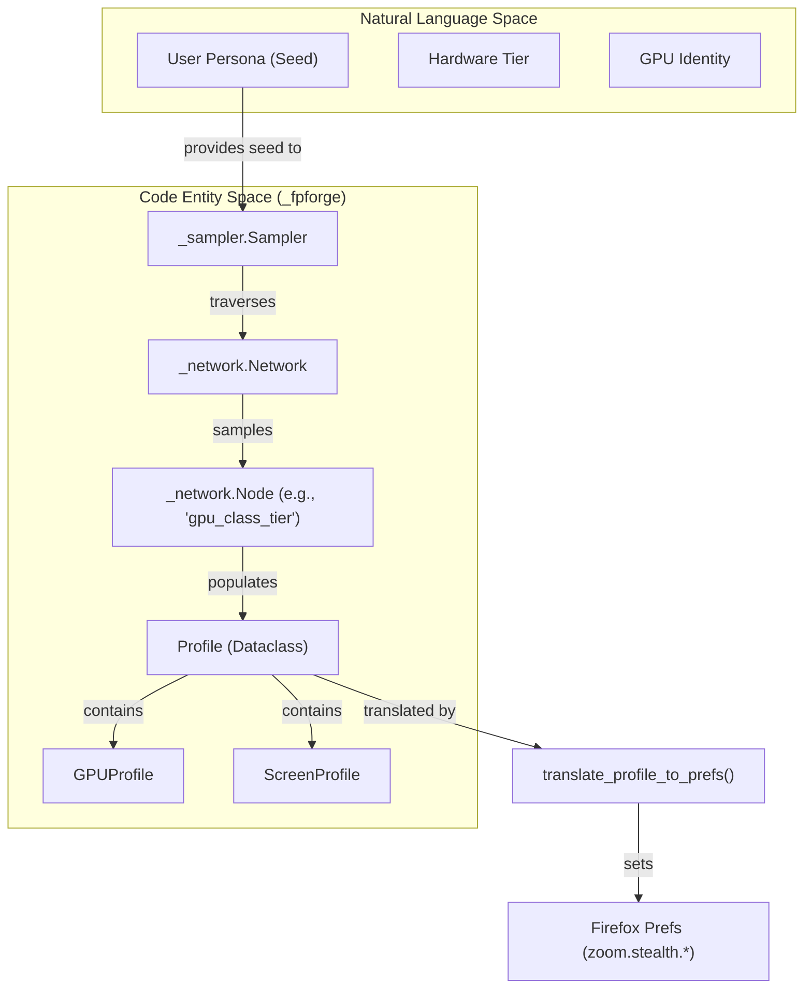

<!-- source: DeepWiki mcp.deepwiki.com · repo feder-cr/invisible_playwright · page 8 Stealth Concepts and Detection Reference · fetched 2026-10-27 -->

# Stealth Concepts and Detection Reference

<details>
<summary>Relevant source files</summary>

The following files were used as context for generating this wiki page:

- [docs/botd-explained.md](docs/botd-explained.md)
- [docs/cdc-variable-explained.md](docs/cdc-variable-explained.md)
- [docs/configuration.md](docs/configuration.md)
- [docs/creepjs-explained.md](docs/creepjs-explained.md)
- [docs/fingerprintjs-visitor-id.md](docs/fingerprintjs-visitor-id.md)
- [docs/headless-fonts-differ.md](docs/headless-fonts-differ.md)
- [docs/navigator-webdriver-explained.md](docs/navigator-webdriver-explained.md)
- [docs/pinning.md](docs/pinning.md)
- [docs/playwright-detected-as-bot.md](docs/playwright-detected-as-bot.md)
- [docs/playwright-stealth-levels.md](docs/playwright-stealth-levels.md)
- [docs/quickstart.md](docs/quickstart.md)
- [docs/recaptcha-v3-score.md](docs/recaptcha-v3-score.md)
- [docs/sannysoft-explained.md](docs/sannysoft-explained.md)
- [docs/screen-size-headless-tells.md](docs/screen-size-headless-tells.md)
- [docs/webgl-renderer-strings.md](docs/webgl-renderer-strings.md)

</details>


This page provides a high-level overview of the browser stealth landscape, the architectural approach of `invisible_playwright`, and how it addresses the multifaceted problem of bot detection.

## The Three Levels of Stealth

Stealth in browser automation is categorized into three distinct levels of intervention. Each level has a different "ceiling" of what it can hide and how it interacts with detection scripts.

| Level | Approach | Mechanism | Limitation |
| :--- | :--- | :--- | :--- |
| **Level 1** | **Patch the Page** | Injects JS before the site's own scripts to redefine properties like `navigator.webdriver`. | Redefined properties are observable via `Function.prototype.toString` or prototype walking. Does not fix hardware-level tells. |
| **Level 2** | **Patch the Driver** | Modifies the automation protocol (CDP/Marionette) to stop announcing itself. | Fixes automation flags at the source, but the engine still reports the real hardware (GPU, fonts) of the server. |
| **Level 3** | **Patch the Engine** | Modifies the browser's C++ source and compiles a custom binary. | The only level that can touch surfaces JS cannot reach (font enumeration, WebGL implementation, audio rounding). |

`invisible_playwright` operates at **Level 3**, providing a patched Firefox engine that reports values through native code paths, making the distinction between a spoofed value and a real one disappear.

For a detailed breakdown of these levels and how they compare to specific tools like `playwright-stealth` or `Patchright`, see [Comparisons with Other Tools](#8.2).

### Sources:
- [docs/playwright-stealth-levels.md:11-88]()

---

## Key Detection Vectors

Anti-bot systems do not look for a single "bot flag." Instead, they analyze a browser's **consistency** across multiple surfaces. A single contradiction between two values is often enough for a "blocked" verdict.

### 1. Automation Artifacts
These are properties left behind by the automation framework itself. While standard Playwright might set `navigator.webdriver` to `true`, `invisible_playwright` ensures these properties are either absent or report native values [docs/playwright-detected-as-bot.md:94-102]().

### 2. Hardware and Environment (The "Server" Tell)
Datacenter environments often lack graphics hardware and specific fonts. Detectors probe:
*   **WebGL Renderer:** A string like `llvmpipe` or `Microsoft Basic Render Driver` announces the browser is on a server [docs/webgl-renderer-strings.md:61-75]().
*   **Fonts:** Claiming to be Windows while having only Linux-default fonts (like DejaVu) is a decisive signal [docs/headless-fonts-differ.md:68-80]().
*   **AudioContext:** The way the audio pipeline rounds floating-point numbers can reveal the underlying OS and hardware [docs/playwright-stealth-levels.md:82-84]().

### 3. Network and Metadata
Consistency must extend beyond the browser window:
*   **Timezone vs. IP:** If the browser claims `America/New_York` but the egress IP is in London, the session is flagged [docs/configuration.md:60-64]().
*   **TLS Fingerprinting:** The network handshake (JA3/JA4) must match the claimed User-Agent [docs/playwright-detected-as-bot.md:123-128]().

For a complete reference of these surfaces and the engine-level fixes, see [Detection Surfaces and Fingerprinting](#8.1).

### Sources:
- [docs/playwright-detected-as-bot.md:14-93]()
- [docs/webgl-renderer-strings.md:61-75]()
- [docs/headless-fonts-differ.md:68-80]()

---

## The Concept of Determinism

A core philosophy of `invisible_playwright` is that **a number without reproducibility is an anecdote**. Most stealth tools generate a random fingerprint per launch, which makes debugging impossible.

`invisible_playwright` uses a `seed` to ensure that the same seed always results in the same navigator properties, screen geometry, GPU strings, and canvas output [docs/playwright-stealth-levels.md:118-123](). This allows for "bisecting" failures to determine if a block was caused by a site change or a specific fingerprint draw.

### Code Entity Space: Fingerprint Generation

The following diagram shows how high-level persona concepts map to the internal Bayesian network classes used to generate profiles.



### Sources:
- [docs/pinning.md:31-61]()
- [docs/playwright-stealth-levels.md:112-123]()

---

## Detection Tooling Reference

Different detection suites focus on different aspects of the browser. Understanding their methodology is key to verifying stealth.

| Tool | Focus | Key Methodology |
| :--- | :--- | :--- |
| **CreepJS** | **Tampering (Lies)** | Compares the page to a pristine iframe; checks `toString()` on native functions [docs/creepjs-explained.md:42-54](). |
| **FingerprintJS** | **Uniqueness (VisitorID)** | Hashes ~41 components (Canvas, WebGL, Audio) into a single ID [docs/fingerprintjs-visitor-id.md:32-39](). |
| **Sannysoft** | **Headless Heuristics** | Checks for 2018-era headless Chrome flags and iframe-vs-page canvas consistency [docs/sannysoft-explained.md:12-22](). |
| **reCAPTCHA v3** | **Reputation/History** | Scores sessions 0.0-1.0 based largely on the presence of valid Google cookies and history [docs/recaptcha-v3-score.md:12-18](). |

### System Mapping: Detection Interaction

This diagram illustrates how `invisible_playwright` entities interact with detection probes.

```mermaid
graph LR
    subgraph "Detection Probe"
        P1["CreepJS Iframe Probe"]
        P2["FingerprintJS Hash"]
        P3["Sannysoft WebDriver Check"]
    end

    subgraph "invisible_playwright Engine"
        E1["Patched C++ Getters"]
        E2["_fpforge Bayesian Sampler"]
        E3["_recaptcha_seed.py"]
    end

    P1 -->|Reads| E1
    P2 -->|Collects from| E2
    P3 -->|Queries| E1
    
    E3 -.->|Seeds| P2
    
    note right of E1 "Returns '[native code]' to toString()"
    note right of E2 "Ensures coherent GPU/Screen/Audio"
```

### Sources:
- [docs/creepjs-explained.md:12-68]()
- [docs/fingerprintjs-visitor-id.md:32-63]()
- [docs/sannysoft-explained.md:80-98]()
- [docs/recaptcha-v3-score.md:94-108]()

---

## Child Pages

*   **[Detection Surfaces and Fingerprinting](#8.1)**: Deep dive into specific browser properties, WebGL, Canvas, and how the engine patches them.
*   **[Comparisons with Other Tools](#8.2)**: Comparison with `Camoufox`, `Patchright`, `playwright-stealth`, and others.

---

