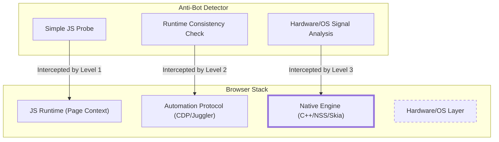
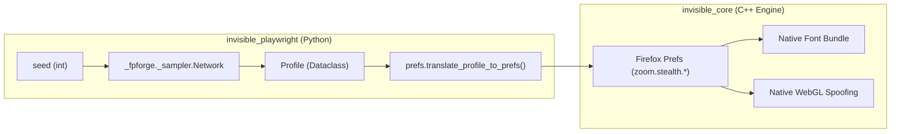

<!-- source: DeepWiki mcp.deepwiki.com · repo feder-cr/invisible_playwright · page 8.2 Comparisons with Other Tools · fetched 2026-10-27 -->

# Comparisons with Other Tools

Relevant source files

The following files were used as context for generating this wiki page:

- [docs/creepjs-explained.md](docs/creepjs-explained.md)
- [docs/headless-fonts-differ.md](docs/headless-fonts-differ.md)
- [docs/headless-vs-headful.md](docs/headless-vs-headful.md)
- [docs/navigator-webdriver-explained.md](docs/navigator-webdriver-explained.md)
- [docs/playwright-detected-as-bot.md](docs/playwright-detected-as-bot.md)
- [docs/playwright-proxy-per-context.md](docs/playwright-proxy-per-context.md)
- [docs/playwright-socks5-proxy-authentication.md](docs/playwright-socks5-proxy-authentication.md)
- [docs/playwright-stealth-levels.md](docs/playwright-stealth-levels.md)
- [docs/vs-camoufox.md](docs/vs-camoufox.md)
- [docs/vs-fingerprint-suite.md](docs/vs-fingerprint-suite.md)
- [docs/vs-nodriver.md](docs/vs-nodriver.md)
- [docs/vs-patchright.md](docs/vs-patchright.md)
- [docs/vs-playwright-stealth.md](docs/vs-playwright-stealth.md)
- [docs/vs-playwright-with-fingerprints.md](docs/vs-playwright-with-fingerprints.md)
- [docs/web-scraping-tls-fingerprint-requests-blocked.md](docs/web-scraping-tls-fingerprint-requests-blocked.md)
- [docs/webgl-renderer-strings.md](docs/webgl-renderer-strings.md)

This page provides a technical comparison between `invisible_playwright` and other automation/stealth tools. It frames the landscape using the **Three Stealth Levels** framework and explains why engine-level intervention differs fundamentally from JavaScript injection or driver-level patching.

## The Three Stealth Levels Framework

Stealth tools are not a flat list; they operate at different depths within the browser stack. Each level addresses a specific set of "tells" and is limited by a different "wall" [docs/playwright-stealth-levels.md:11-19]().

| Level | Strategy | Representative Tools | Primary Target |
| :--- | :--- | :--- | :--- |
| **Level 1** | **Patch the Page** | `playwright-stealth`, `puppeteer-extra-plugin-stealth` | Redefining JS properties (`navigator.webdriver`) via init scripts [docs/playwright-stealth-levels.md:23-31](). |
| **Level 2** | **Patch the Driver** | `Patchright`, `rebrowser-patches` | Modifying the automation protocol (CDP/Juggler) to remove framework artifacts [docs/playwright-stealth-levels.md:48-57](). |
| **Level 3** | **Patch the Engine** | `invisible_playwright`, `Camoufox` | Rebuilding the C++ source to change native behavior and hardware reporting [docs/playwright-stealth-levels.md:71-76](). |

### Logic Flow: Detection vs. Intervention Depth
The following diagram illustrates how detection probes penetrate the browser stack and where each tool level intercepts them.

**Diagram: Stealth Level Interception Points**

**Sources:** [docs/playwright-stealth-levels.md:11-88](), [docs/vs-playwright-stealth.md:11-22]()

---

## Comparison: invisible_playwright vs. Level 1 (playwright-stealth)

`playwright-stealth` injects JavaScript `init` scripts to redefine properties like `navigator.webdriver` [docs/vs-playwright-stealth.md:27-29]().

### The "Same Runtime" Race
Level 1 tools share a runtime with the detector. This creates several detectable anomalies:
1.  **Descriptor Hygiene**: Redefined properties often become "own" properties of the `navigator` instance instead of being inherited from the prototype [docs/navigator-webdriver-explained.md:55-62]().
2.  **toString() Detection**: Patched functions can be unmasked by calling `.toString()`, which reveals the JS source instead of `[native code]` [docs/navigator-webdriver-explained.md:64-70]().
3.  **Execution Timing**: Init scripts must win a race against the site's own scripts. If a site captures a reference to `navigator.webdriver` before the stealth script runs, the patch fails [docs/navigator-webdriver-explained.md:74-90]().

`invisible_playwright` avoids this by hardcoding values in the C++ engine. There is no "before" state for the detector to capture [docs/navigator-webdriver-explained.md:96-98]().

**Sources:** [docs/vs-playwright-stealth.md:37-46](), [docs/navigator-webdriver-explained.md:35-70]()

---

## Comparison: invisible_playwright vs. Level 2 (Patchright / rebrowser)

Patchright and rebrowser focus on the **Driver** layer, specifically the Chromium DevTools Protocol (CDP).

### CDP vs. Juggler
*   **Patchright**: Modifies the CDP session to avoid `Runtime.enable` and `Console.enable`, which are common automation tells in Chromium [docs/vs-patchright.md:23-31]().
*   **invisible_playwright**: Operates on Firefox, which uses the **Juggler** protocol. Many CDP-specific tells (like Blink-specific flags) do not exist in Firefox, and `invisible_playwright` patches Juggler-specific leaks like JIT-disabling timing and driver frames in stack traces [docs/vs-patchright.md:45-70]().

### The Hardware Wall
Level 2 tools make automation look like a normal browser *on that specific machine*. If the machine is a server with a software WebGL renderer (e.g., `llvmpipe` or `Microsoft Basic Render Driver`), Level 2 tools cannot hide it [docs/vs-patchright.md:74-78](). `invisible_playwright` patches the engine to report real GPU strings (e.g., NVIDIA/Intel) regardless of the underlying hardware [docs/webgl-renderer-strings.md:138-141]().

**Sources:** [docs/vs-patchright.md:9-38](), [docs/webgl-renderer-strings.md:61-74]()

---

## Comparison: invisible_playwright vs. Level 3 (Camoufox)

Both tools use C++ engine patching on Firefox. The primary difference lies in their **Identity Model**.

| Feature | invisible_playwright | Camoufox |
| :--- | :--- | :--- |
| **Model** | **Deterministic Derivation** | **Probabilistic Rotation** |
| **Core Logic** | Every field is derived from a single integer `seed`. | Rotates plausible devices per session from a distribution. |
| **Goal** | **Reproducibility**: Same seed = identical fingerprint/canvas/audio forever. | **Variety**: A fresh, unique device for every session. |
| **Fonts** | Bundles real Windows fonts in the binary for host-independence. | Spoofs and masks host fonts. |

**Diagram: Deterministic Identity Generation (invisible_playwright)**
The `InvisiblePlaywright` class uses the `seed` to drive the `fpforge` engine, ensuring consistency across the `Profile` dataclass.

**Sources:** [docs/vs-camoufox.md:11-25](), [docs/vs-camoufox.md:73-81](), [docs/vs-camoufox.md:120-124]()

---

## Technical Summary: Why Engine Patching Wins

Engine-level intervention (`invisible_playwright`) reaches surfaces that are unreachable via JS or Driver patching:

1.  **Font Subsystem**: `invisible_playwright` carries its own font bundle. JS measurement (width probes) will return metrics consistent with the claimed OS (e.g., Windows fonts on a Linux server) [docs/headless-fonts-differ.md:134-136]().
2.  **Audio Pipeline**: It patches how the audio pipeline rounds floating-point signals, preventing `AudioContext` fingerprinting from revealing the underlying OS [docs/playwright-stealth-levels.md:82-84]().
3.  **Network Layer**: Because it is a real browser binary, it produces a genuine TLS ClientHello (JA3/JA4) and HTTP/2 settings frames. Impersonation tools (like `curl_cffi`) only simulate this; `invisible_playwright` executes it [docs/web-scraping-tls-fingerprint-requests-blocked.md:63-66]().
4.  **SOCKS5 Authentication**: `invisible_playwright` patches the Firefox proxy service to support `network.proxy.socks_username` and `password` preferences, which are not supported in stock Playwright or Firefox [docs/playwright-socks5-proxy-authentication.md:105-110]().

**Sources:** [docs/playwright-stealth-levels.md:78-87](), [docs/headless-fonts-differ.md:134-142](), [docs/playwright-socks5-proxy-authentication.md:105-110]()

---

