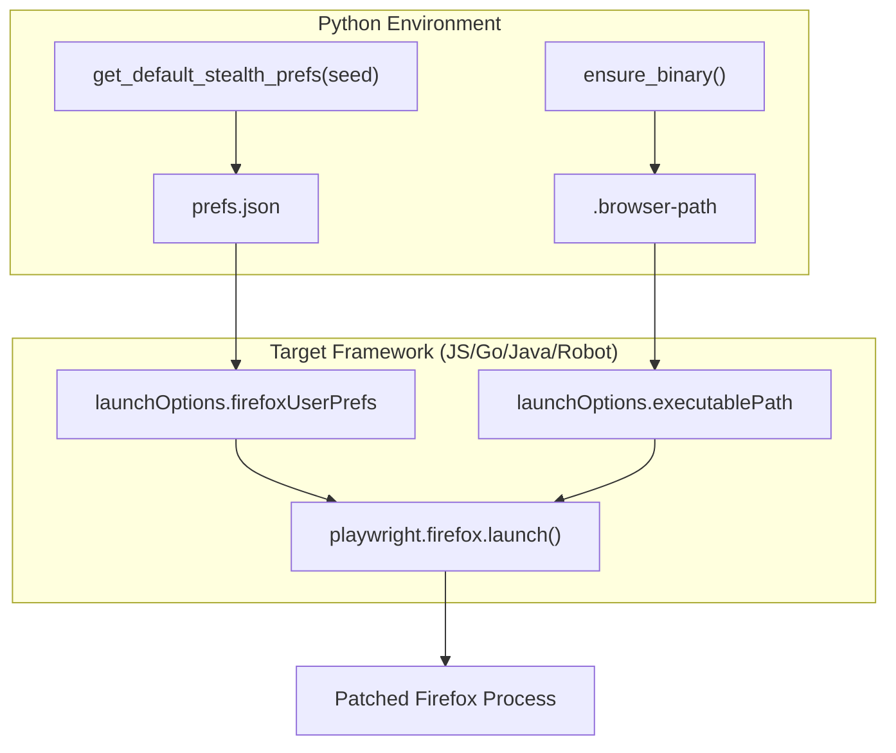
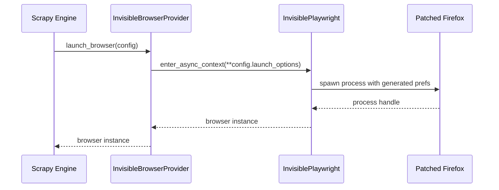

<!-- source: DeepWiki mcp.deepwiki.com · repo feder-cr/invisible_playwright · page 9.1 Framework Integrations · fetched 2026-10-27 -->

# Framework Integrations

<details>
<summary>Relevant source files</summary>

The following files were used as context for generating this wiki page:

- [docs/integrations/codeceptjs.md](docs/integrations/codeceptjs.md)
- [docs/integrations/crawlee-js.md](docs/integrations/crawlee-js.md)
- [docs/integrations/crawlee-python.md](docs/integrations/crawlee-python.md)
- [docs/integrations/other-languages.md](docs/integrations/other-languages.md)
- [docs/integrations/playwright-mcp.md](docs/integrations/playwright-mcp.md)
- [docs/integrations/robot-framework.md](docs/integrations/robot-framework.md)
- [docs/integrations/scrapy-playwright.md](docs/integrations/scrapy-playwright.md)
- [docs/integrations/test-runners.md](docs/integrations/test-runners.md)
- [src/invisible_playwright/config.py](src/invisible_playwright/config.py)
- [tests/unit/test_config_public.py](tests/unit/test_config_public.py)

</details>


This page provides technical guidance for integrating `invisible_playwright` into third-party frameworks and languages. While the native Python `InvisiblePlaywright` context manager provides the most comprehensive stealth features (including humanized motion and dynamic timezone resolution), many frameworks require a "configuration-only" approach using the patched binary path and generated preferences.

## Integration Strategies

There are two primary ways to integrate the stealth engine into other frameworks:

1.  **Full Wrapper Integration (Python only):** Using the `InvisiblePlaywright` class directly within a framework's plugin system (e.g., Scrapy-Playwright `BrowserProvider`). This preserves all features, including humanized pointer motion.
2.  **Configuration Injection (Cross-language):** Providing the `executable_path` and `firefox_user_prefs` to a standard Playwright `launch()` call. This is compatible with any language binding but lacks driver-side features like pointer humanization.

### The Config API

For frameworks that cannot use the context manager, `invisible_playwright` provides a public API to retrieve the necessary launch parameters:

| Function | Role | Source |
| :--- | :--- | :--- |
| `ensure_binary()` | Downloads (if missing) and returns the absolute path to the patched Firefox. | [src/invisible_playwright/config.py:1-5]() |
| `get_default_stealth_prefs(seed, ...)` | Generates a dictionary of Firefox preferences derived from a fingerprint seed. | [src/invisible_playwright/config.py:1-5]() |
| `get_default_args()` | Returns a list of CLI flags required for engine stability. | [docs/integrations/crawlee-python.md:70-71]() |

### Implementation Data Flow

The following diagram illustrates how the Python-side configuration is extracted and injected into a target framework (e.g., a Node.js or Robot Framework environment).

**Configuration Extraction Flow**

Sources: [docs/integrations/crawlee-js.md:29-33](), [docs/integrations/robot-framework.md:33-38]()

---

## Scrapy-Playwright (Python)

Integration with `scrapy-playwright` is achieved by implementing a custom `BrowserProvider`. This is the recommended route as it maintains full feature parity.

### Implementation Details
A `BrowserProvider` subclass overrides `launch_browser` to enter the `InvisiblePlaywright` async context manager, ensuring the process reaper and stealth defaults are correctly initialized [docs/integrations/scrapy-playwright.md:44-71]().

**Scrapy-Playwright Provider Logic**

Sources: [docs/integrations/scrapy-playwright.md:33-71]()

---

## Crawlee (Python & JavaScript)

### Crawlee for Python
Crawlee uses a plugin system where `PlaywrightBrowserPlugin` is subclassed. The `new_browser` method is overridden to inject `executable_path` and `firefox_user_prefs` into the launch options [docs/integrations/crawlee-python.md:76-119]().

**Key Requirement:** `fingerprint_generator` must be set to `None`. Crawlee's internal fingerprinting will otherwise conflict with the engine-level fingerprint, creating a detection vector [docs/integrations/crawlee-python.md:115-118]().

### Crawlee for JavaScript
In Node.js, the integration is pure configuration. The binary path and prefs must be pre-generated via a Python one-liner and then read from disk [docs/integrations/crawlee-js.md:41-70]().

Sources: [docs/integrations/crawlee-python.md:76-119](), [docs/integrations/crawlee-js.md:41-70]()

---

## Robot Framework

The `robotframework-browser` library supports these options as named arguments in the `New Browser` keyword [docs/integrations/robot-framework.md:10-24]().

### Configuration Example
```robotframework
*** Keywords ***
Open Stealth Browser
    ${prefs}=    Evaluate    __import__('invisible_playwright').get_default_stealth_prefs(seed=1)
    ${binary}=   Evaluate    str(__import__('invisible_playwright').ensure_binary())
    New Browser  firefox  executablePath=${binary}  firefoxUserPrefs=${prefs}
```
Sources: [docs/integrations/robot-framework.md:79-85]()

---

## Test Runners (Cypress, WebdriverIO, CodeceptJS)

Most test runners wrap Playwright or WebDriver, exposing a mechanism to pass browser-specific preferences.

| Runner | Mechanism | Stealth Coverage |
| :--- | :--- | :--- |
| **WebdriverIO** | `moz:firefoxOptions` in `capabilities` | Engine + Identity [docs/integrations/test-runners.md:71-88]() |
| **CodeceptJS** | `helpers.Playwright.firefox` block | Engine + Identity [docs/integrations/codeceptjs.md:38-55]() |
| **Cypress** | `before:browser:launch` hook | Engine + Identity [docs/integrations/test-runners.md:31-53]() |
| **TestCafe** | `path:` browser provider | Engine Only (No Prefs) [docs/integrations/test-runners.md:96-105]() |

**The UserAgent Trap:** In all integrations, the `userAgent` should **never** be set manually in the framework config. Overriding the string causes a mismatch with the engine's internal `navigator` properties, which is a high-signal detection vector [docs/integrations/test-runners.md:59-63](), [docs/integrations/codeceptjs.md:77-80]().

---

## Other Languages (Go, Java, C#, Ruby, Rust)

Every official Playwright binding mirrors the `LaunchOptions` API, allowing the injection of `executablePath` and `firefoxUserPrefs`.

| Language | Call Site |
| :--- | :--- |
| **Go** | `pw.Firefox.Launch(playwright.BrowserTypeLaunchOptions{...})` [docs/integrations/other-languages.md:55-66]() |
| **Java** | `playwright.firefox().launch(new BrowserType.LaunchOptions().setFirefoxUserPrefs(prefs))` [docs/integrations/other-languages.md:70-78]() |
| **C#** | `await playwright.Firefox.LaunchAsync(new BrowserTypeLaunchOptions { FirefoxUserPrefs = prefs })` [docs/integrations/other-languages.md:82-92]() |

Sources: [docs/integrations/other-languages.md:22-29]()

---

## Feature Limitations Outside Python

When using `invisible_playwright` via the configuration injection method (non-Python or non-wrapper), certain high-level features are unavailable because they require active driver-side intervention:

1.  **Humanized Pointer Motion:** The `firefoxUserPrefs` enable the engine-level hooks, but the actual Bezier trajectory planning is performed by the Python `_motion.py` and `_cursor.py` modules. In other languages, the pointer will teleport [docs/integrations/test-runners.md:148-152]().
2.  **Dynamic Timezone/Locale:** The Python wrapper resolves `timezone="auto"` by querying the proxy exit IP at launch. Static `prefs.json` files contain the timezone of the machine that generated them [docs/integrations/other-languages.md:111-114]().
3.  **Wire Version Check:** The Python wrapper validates that the binary version matches the preference generation logic. Manual integrations must ensure `prefs.json` is regenerated after every `invisible-playwright fetch` [docs/integrations/other-languages.md:118-121]().

Sources: [docs/integrations/test-runners.md:148-154](), [docs/integrations/other-languages.md:108-121]()

---

