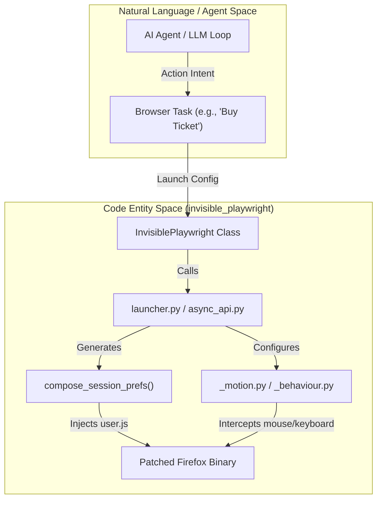
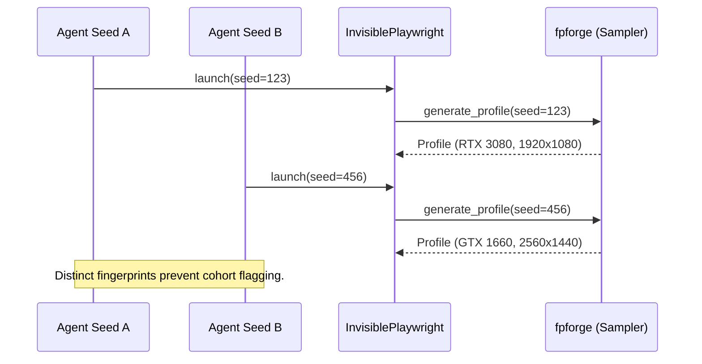

<!-- source: DeepWiki mcp.deepwiki.com · repo feder-cr/invisible_playwright · page 9.2 AI Agent and MCP Integrations · fetched 2026-10-27 -->

# AI Agent and MCP Integrations

<details>
<summary>Relevant source files</summary>

The following files were used as context for generating this wiki page:

- [docs/ai-browser-agents-stealth.md](docs/ai-browser-agents-stealth.md)
- [docs/browser-use-detection.md](docs/browser-use-detection.md)
- [docs/bundled-fonts-cross-platform.md](docs/bundled-fonts-cross-platform.md)
- [docs/canvas-fingerprint-noise.md](docs/canvas-fingerprint-noise.md)
- [docs/canvas-webgl-cross-platform-consistency.md](docs/canvas-webgl-cross-platform-consistency.md)
- [docs/crawl4ai-stealth-custom-browser.md](docs/crawl4ai-stealth-custom-browser.md)
- [docs/http-basic-auth-playwright-http-credentials.md](docs/http-basic-auth-playwright-http-credentials.md)
- [docs/integrations/codeceptjs.md](docs/integrations/codeceptjs.md)
- [docs/integrations/crawlee-js.md](docs/integrations/crawlee-js.md)
- [docs/integrations/crawlee-python.md](docs/integrations/crawlee-python.md)
- [docs/integrations/other-languages.md](docs/integrations/other-languages.md)
- [docs/integrations/playwright-mcp.md](docs/integrations/playwright-mcp.md)
- [docs/integrations/robot-framework.md](docs/integrations/robot-framework.md)
- [docs/integrations/scrapy-playwright.md](docs/integrations/scrapy-playwright.md)
- [docs/integrations/test-runners.md](docs/integrations/test-runners.md)
- [docs/ipv6-vs-ipv4-which-does-your-proxy-use.md](docs/ipv6-vs-ipv4-which-does-your-proxy-use.md)
- [docs/keystroke-timing-detection-playwright.md](docs/keystroke-timing-detection-playwright.md)
- [docs/mcp-browser-server-stealth-firefox.md](docs/mcp-browser-server-stealth-firefox.md)
- [docs/migrate-puppeteer-to-playwright-stealth.md](docs/migrate-puppeteer-to-playwright-stealth.md)
- [docs/migrate-selenium-to-playwright-stealth.md](docs/migrate-selenium-to-playwright-stealth.md)
- [docs/mouse-dynamics-behavioural-biometrics.md](docs/mouse-dynamics-behavioural-biometrics.md)
- [docs/parallel-browser-agents-distinct-fingerprints.md](docs/parallel-browser-agents-distinct-fingerprints.md)
- [docs/persistent-logged-in-session-browser-agent.md](docs/persistent-logged-in-session-browser-agent.md)

</details>


This page provides technical documentation for integrating `invisible_playwright` with AI-driven browser agents and Model Context Protocol (MCP) servers. AI agents often face heightened scrutiny from anti-bot systems due to non-human behavioral patterns (e.g., model latency pauses, perfect click coordinates). Using `invisible_playwright` addresses the engine-level detection surfaces (fingerprinting) and behavioral signals (humanized motion) that standard Playwright or CDP-based agents leak.

## Integration Architecture

The integration strategy depends on whether the agent framework is built directly on Playwright or uses the Chrome DevTools Protocol (CDP). Because `invisible_playwright` relies on a patched Firefox binary, it is fundamentally incompatible with CDP-only tools (like `browser-use` or `Stagehand`) which require a Chromium-family browser [docs/ai-browser-agents-stealth.md:28-46]().

For Playwright-based frameworks, the integration follows one of two paths:
1.  **Direct Wrapper**: Using the `InvisiblePlaywright` context manager to launch the browser.
2.  **Configuration Injection**: Passing the `executable_path` and `firefox_user_prefs` to the framework's launch options.

### Data Flow: Agent to Patched Engine

The following diagram illustrates how an AI Agent's intent is translated into a stealthy browser session through the `invisible_playwright` infrastructure.

**AI Agent to Code Entity Mapping**

**Sources:** [docs/ai-browser-agents-stealth.md:38-42](), [docs/integrations/scrapy-playwright.md:33-36]()

---

## Playwright MCP Integration

Microsoft's `playwright-mcp` can be configured to use the patched Firefox engine by specifying the browser type and the executable path.

### Implementation
1.  **Fetch Binary**: Use the CLI to ensure the patched binary is present.
    ```bash
    invisible-playwright fetch
    ```
2.  **Configure MCP Server**: Point the `mcpServers` configuration to the fetched path.
    ```json
    {
      "mcpServers": {
        "playwright": {
          "command": "npx",
          "args": [
            "@playwright/mcp@latest",
            "--browser", "firefox",
            "--executable-path", "/path/to/patched/firefox"
          ]
        }
      }
    }
    ```

**Note on Profiles**: Using only `--executable-path` provides the patched engine but **not** the seeded identity [docs/integrations/playwright-mcp.md:49-53](). To include the fingerprint, you must generate a profile with `get_default_stealth_prefs` and pass it via `--user-data-dir` [docs/integrations/playwright-mcp.md:62-84]().

**Sources:** [docs/integrations/playwright-mcp.md:18-39](), [docs/integrations/playwright-mcp.md:98-102]()

---

## Parallel Agent Sessions and Fingerprinting

When running multiple AI agents in parallel (e.g., a swarm of `smolagents` or LangChain workers), it is critical to maintain distinct hardware fingerprints. If 10 agents share the same GPU renderer string and screen resolution while originating from the same IP, they form a suspicious cohort.

### Deterministic Fingerprinting
`invisible_playwright` uses a `seed` parameter to ensure that a session's identity is stable across restarts but unique compared to other seeds [docs/integrations/crawlee-python.md:149-153]().

| Feature | Implementation in `invisible_playwright` |
| :--- | :--- |
| **GPU Coherence** | `WebGLProfile` derived from seed via Bayesian network [docs/canvas-webgl-cross-platform-consistency.md:91-93](). |
| **Font Metrics** | `MOZ_BUNDLED_FONTS` manifest ensures identical rendering across OSes [docs/bundled-fonts-cross-platform.md:43-48](). |
| **Canvas** | Full substitution of readback calls (e.g., `toDataURL`) to prevent noise-based detection [docs/canvas-fingerprint-noise.md:92-95](). |

**Parallel Session Lifecycle**

**Sources:** [docs/parallel-browser-agents-distinct-fingerprints.md](), [docs/canvas-webgl-cross-platform-consistency.md:89-93]()

---

## Stealth Requirements for AI Agents

AI agents exhibit specific behavioral "tells" that `invisible_playwright` mitigates through its internal subsystems.

### Behavioral Mitigation

1.  **Humanized Motion**: AI agents typically teleport the cursor to the center of an element. `invisible_playwright` intercepts `page.click()` and `page.hover()` calls via `_cursor.py` to inject Bezier-based trajectories with realistic overshoot and tremor [docs/integrations/scrapy-playwright.md:118-120]().
2.  **Model Latency vs. Idle Time**: Anti-bot systems monitor periods of inactivity. `_behaviour.py` manages macro-scale pointer behavior, such as idle fidgeting, to simulate a human reading the page while the LLM processes the next step.
3.  **Timezone/Locale Alignment**: When agents use proxies, the browser's internal clock and language settings must match the proxy's exit IP. `InvisiblePlaywright` resolves this at launch using `timezone="auto"` and `locale="auto"` [docs/integrations/crawlee-python.md:170-173]().

### Integration Limitations
| Framework | Support Level | Technical Reason |
| :--- | :--- | :--- |
| **Crawl4AI** | Partial | Built on Playwright; supports `browser_type="firefox"` but lacks `executable_path` exposure in some versions [docs/ai-browser-agents-stealth.md:89-95](). |
| **browser-use** | None | Hardcoded to Chromium/CDP [docs/ai-browser-agents-stealth.md:65-73](). |
| **LangChain** | Full | Can use `InvisiblePlaywright` directly within Python tools/functions. |
| **smolagents** | Full | Can instantiate `InvisiblePlaywright` as the browser backend for agent tools. |

**Sources:** [docs/ai-browser-agents-stealth.md:53-60](), [docs/integrations/scrapy-playwright.md:118-124](), [docs/integrations/crawlee-python.md:170-173]()

---

