# Page: Overview

# Overview

<details>
<summary>Relevant source files</summary>

The following files were used as context for generating this wiki page:

- [CHANGELOG.md](CHANGELOG.md)
- [README.md](README.md)
- [docs/README.md](docs/README.md)
- [docs/badges/telegram.svg](docs/badges/telegram.svg)
- [docs/banner-dark.png](docs/banner-dark.png)
- [docs/banner-light.png](docs/banner-light.png)
- [docs/configuration.md](docs/configuration.md)
- [docs/integrations/README.md](docs/integrations/README.md)
- [docs/pinning.md](docs/pinning.md)
- [docs/quickstart.md](docs/quickstart.md)
- [docs/recaptcha-v3-score.md](docs/recaptcha-v3-score.md)
- [docs/sannysoft-explained.md](docs/sannysoft-explained.md)
- [docs/screen-size-headless-tells.md](docs/screen-size-headless-tells.md)
- [pyproject.toml](pyproject.toml)
- [src/invisible_playwright/_geo.py](src/invisible_playwright/_geo.py)
- [src/invisible_playwright/constants.py](src/invisible_playwright/constants.py)
- [src/invisible_playwright/download.py](src/invisible_playwright/download.py)
- [tests/test_readme_claims.py](tests/test_readme_claims.py)

</details>


`invisible_playwright` is a Python-based wrapper for a custom-patched Firefox binary designed to provide 100% compatibility with the Playwright API while passing advanced browser-fingerprint and bot detectors [README.md:1-17](). Unlike standard anti-detect solutions that rely on fragile JavaScript-level overrides, this project utilizes C++ level patches within the Gecko engine to ensure that spoofed values are indistinguishable from native browser behavior [README.md:22-30]().

### Purpose and Design Philosophy

The project exists to solve the detectability of automated browsers. Most tools patch `navigator` or `WebGL` properties using `Object.defineProperty`, which leaves traces that detectors can identify as "lies" [README.md:28-29]().

`invisible_playwright` achieves stealth through:
*   **Engine-Level Patches**: Fingerprint values (GPU, screen, fonts, audio, etc.) are set inside the engine, not injected into the page [README.md:26-28]().
*   **Coherent Fingerprinting**: Every session generates a unique profile where hardware characteristics are logically consistent, powered by a Bayesian network [docs/pinning.md:13-15](), [docs/pinning.md:31-37]().
*   **Humanized Input**: Actions like clicks and hovers follow natural Bezier-curve paths with human timing and trusted event signatures [README.md:31-35]().

### Comparison to Standard Playwright

While `invisible_playwright` maintains full API parity with the standard `playwright` library, it introduces several enhancements under the hood:

| Feature | Standard Playwright (Firefox) | `invisible_playwright` |
| :--- | :--- | :--- |
| **Engine** | Upstream Firefox | Patched Firefox (Engine-level stealth) [README.md:26]() |
| **Fingerprint** | Static/Generic | Dynamic & Coherent (Bayesian) [docs/pinning.md:13]() |
| **Proxy Auth** | Standard Playwright Proxy | Patched `nsProtocolProxyService` for SOCKS5 + Auth [docs/configuration.md:29-32]() |
| **Mouse Movement** | Linear/Instant | Bezier-curve trajectories [README.md:33]() |
| **Lifecycle** | Standard Process Management | `_reaper.py` (via `invisible_core`) prevents process leaks [pyproject.toml:60-70]() |

### System Architecture

The following diagram illustrates how the `InvisiblePlaywright` class bridges the gap between the Python user code and the specialized Firefox binary.

**Bridge: Python API to Patched Binary**
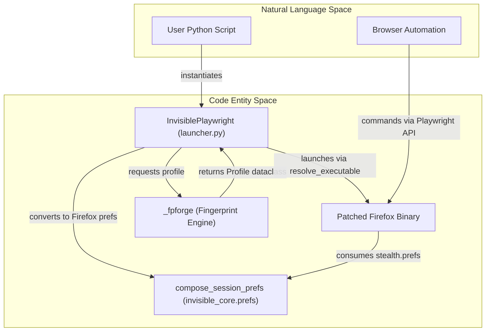
Sources: [README.md:57-66](), [CHANGELOG.md:58-60](), [pyproject.toml:27-30]()

### Key Components

The library is organized into several subsystems that manage the lifecycle of a stealthy browser session:

*   **Launcher & API**: The `InvisiblePlaywright` class (available in sync and async variants) manages the context manager lifecycle and serves as the entry point [README.md:70-89]().
*   **Core Logic**: Much of the configuration logic (seed-to-fingerprint, binary downloading, proxying) resides in the `invisible_core` package [pyproject.toml:27-30]().
*   **Fingerprint Engine (fpforge)**: Generates coherent profiles using Bayesian sampling to ensure fields like GPU and Screen Tier match realistically [docs/pinning.md:31-44]().
*   **CLI**: A command-line utility for fetching the engine and verifying its integrity against a `seal.json` checksum [README.md:159-169](), [CHANGELOG.md:11-14]().

**Entity Mapping: Fingerprint Generation**
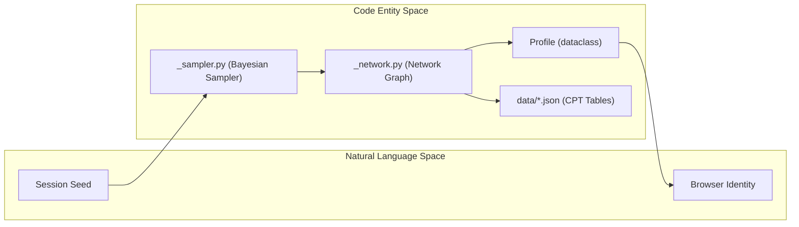
Sources: [docs/pinning.md:13-15](), [docs/pinning.md:31-37](), [pyproject.toml:27-30]()

### Quick Start

Installation requires Python 3.11+ and a one-time fetch of the ~238 MB patched binary [README.md:45-50](), [pyproject.toml:10]().

```bash
pip install invisible-playwright
python -m invisible_playwright fetch
```

Basic usage mirrors standard Playwright with a simple two-line change:

```python
from invisible_playwright import InvisiblePlaywright

with InvisiblePlaywright() as browser:
    page = browser.new_page()
    page.goto("https://example.com")
    page.click("#submit") # Mouse arcs on a Bezier curve
```
Sources: [README.md:60-78]()

### Documentation Sections

*   **[Getting Started](#1.1)**: Detailed installation steps, platform support (Windows, Linux, macOS), and binary management via the CLI.
*   **[Usage Examples](#1.2)**: Practical code examples for sync/async APIs, proxy configuration, seed-based reproducibility, and fingerprint pinning.

Sources: [README.md:45-52](), [README.md:56-155](), [pyproject.toml:1-30]()

---

# Page: Getting Started

# Getting Started

<details>
<summary>Relevant source files</summary>

The following files were used as context for generating this wiki page:

- [CHANGELOG.md](CHANGELOG.md)
- [README.md](README.md)
- [docs/README.md](docs/README.md)
- [docs/badges/telegram.svg](docs/badges/telegram.svg)
- [docs/banner-dark.png](docs/banner-dark.png)
- [docs/banner-light.png](docs/banner-light.png)
- [docs/cli-reference.md](docs/cli-reference.md)
- [docs/installation.md](docs/installation.md)
- [docs/integrations/README.md](docs/integrations/README.md)
- [pyproject.toml](pyproject.toml)
- [src/invisible_playwright/_geo.py](src/invisible_playwright/_geo.py)
- [src/invisible_playwright/constants.py](src/invisible_playwright/constants.py)
- [src/invisible_playwright/download.py](src/invisible_playwright/download.py)
- [tests/test_readme_claims.py](tests/test_readme_claims.py)

</details>


This page covers the initial setup, installation requirements, and first-run procedures for `invisible_playwright`. It details how to prepare your environment, fetch the required patched Firefox binaries via the CLI, and execute a minimal stealth automation script.

## Installation

`invisible_playwright` requires **Python 3.11 or higher** [pyproject.toml:10-10](). The package is supported on **Windows x86_64**, **Linux x86_64 / arm64**, and **macOS arm64 / x86_64** [README.md:52-52]().

### Dependencies

The package relies on the following core dependencies:
*   `invisible_core==19.14.0`: The engine that handles fingerprint generation, binary management, and preference translation [pyproject.toml:52-52]().
*   `playwright>=1.55,<=1.61.0`: The underlying automation library [pyproject.toml:59-59]().
*   `psutil>=5.9`: Required for identifying and reaping browser process trees to prevent leaks [pyproject.toml:70-71]().

To install the package via pip:

```bash
pip install invisible-playwright
```

Sources: [pyproject.toml:10-71](), [README.md:47-48]()

## Binary Management (CLI)

`invisible_playwright` requires a specific patched Firefox binary. This binary is patched at the C++ source level to ensure that fingerprinting (navigator, screen, GPU, WebGL, canvas, etc.) is handled inside the engine rather than through JavaScript shims [README.md:26-29]().

The package provides a CLI tool `invisible-playwright` [pyproject.toml:116-116]() to manage these binaries.

### Fetching the Binary

Before running any scripts, you must download the patched binary. The binary is approximately 238 MB (544 MB unpacked) and is sha256-verified against a `seal.json` asset [README.md:49-50]().

```bash
python -m invisible_playwright fetch
```

The `fetch` command performs a "doctor" check on every cached engine tree against the seal **before** downloading anything [docs/cli-reference.md:25-30](). This ensures that a tree that no longer matches the seal is replaced.

### CLI Commands Reference

| Command | Function | Description |
| :--- | :--- | :--- |
| `fetch` | Downloads and verifies the engine. | Makes the engine present and correct, then prints the absolute path [docs/cli-reference.md:21-23](). |
| `version` | Displays version metadata. | Shows wrapper, core, engine, and seal versions, plus the cache location [docs/cli-reference.md:44-52](). |

*Note: The `path`, `clear-cache`, and `doctor` subcommands were removed in version 0.7.0 as their functionality was folded into `fetch` and `version` [CHANGELOG.md:69-75]().*

### Data Flow: CLI to Binary Storage

The following diagram illustrates how the CLI interacts with the `invisible_core` logic to provision the environment.

**Binary Provisioning Flow**
```mermaid
graph TD
    subgraph "User Space"
        [CLI] -- "invisible-playwright fetch" --> [MAIN]
    end

    subgraph "invisible_playwright.cli"
        [MAIN] -- "calls" --> [CMD_FETCH]
    end

    subgraph "invisible_core.download (via shim)"
        [CMD_FETCH] -- "invokes" --> [ENSURE_BINARY]
        [ENSURE_BINARY] -- "verifies" --> [SEAL_JSON]
        [ENSURE_BINARY] -- "extracts to" --> [CACHE_ROOT]
    end

    subgraph "Filesystem"
        [CACHE_ROOT] -- "Path" --> [FS_DIR]
        [FS_DIR] -- ".cache/invisible-playwright" --> [BIN_FILE]
    end
```
Sources: [src/invisible_playwright/cli.py:116-116](), [src/invisible_playwright/download.py:1-4](), [docs/cli-reference.md:25-30](), [CHANGELOG.md:11-14]()

## Minimal Working Example

`invisible_playwright` is designed to be a drop-in replacement for standard Playwright. The `InvisiblePlaywright` class acts as a context manager that handles browser launching and fingerprinting automatically.

```python
from invisible_playwright import InvisiblePlaywright

def main():
    # 1. Initialize the stealth context
    with InvisiblePlaywright() as browser:
        # 2. Create a new page (automatically uses a generated fingerprint)
        page = browser.new_page()
        
        # 3. Navigate to a target
        page.goto("https://example.com")
        
        # Every click follows a natural mouse path (Bezier curve)
        page.click("#submit")
        
        print("Page Title:", page.title())

if __name__ == "__main__":
    main()
```
Sources: [README.md:71-78](), [CHANGELOG.md:53-53]()

### Execution Logic

When `InvisiblePlaywright` is instantiated:
1.  It resolves the executable path for the patched Firefox binary [docs/integrations/README.md:28-30]().
2.  It generates a deterministic fingerprint based on a `seed` (random by default).
3.  It translates this fingerprint into Firefox preferences, including the `zoom.stealth.*` namespace [CHANGELOG.md:59-60]().
4.  It launches the browser, typically using a virtual display (Xvfb on Linux) to achieve "headless" operation without using the detectable `--headless` flag.

**System Entity Mapping**
```mermaid
graph LR
    subgraph "Application Code"
        [USER_SCRIPT] -- "instantiates" --> [IP_CLASS]
    end

    subgraph "invisible_playwright (Wrapper)"
        [IP_CLASS] -- "imports" --> [ASYNC_API]
        [IP_CLASS] -- "uses" --> [SESSION_PY]
    end

    subgraph "invisible_core (Logic)"
        [SESSION_PY] -- "requests prefs from" --> [PREFS_COMP]
        [PREFS_COMP] -- "generates" --> [STEALTH_PREFS]
    end

    subgraph "Automation Engine"
        [IP_CLASS] -- "launches" --> [PW_FIREFOX]
        [PW_FIREFOX] -- "loads" --> [PATCHED_BIN]
        [PATCHED_BIN] -- "applies" --> [STEALTH_PREFS]
    end
```
Sources: [src/invisible_playwright/constants.py:1-4](), [README.md:57-66](), [CHANGELOG.md:58-60](), [docs/integrations/README.md:28-35]()

---

# Page: Usage Examples

# Usage Examples

<details>
<summary>Relevant source files</summary>

The following files were used as context for generating this wiki page:

- [README.md](README.md)
- [docs/README.md](docs/README.md)
- [docs/badges/telegram.svg](docs/badges/telegram.svg)
- [docs/banner-dark.png](docs/banner-dark.png)
- [docs/banner-light.png](docs/banner-light.png)
- [docs/configuration.md](docs/configuration.md)
- [docs/integrations/README.md](docs/integrations/README.md)
- [docs/pinning.md](docs/pinning.md)
- [docs/quickstart.md](docs/quickstart.md)
- [docs/recaptcha-v3-score.md](docs/recaptcha-v3-score.md)
- [docs/sannysoft-explained.md](docs/sannysoft-explained.md)
- [docs/screen-size-headless-tells.md](docs/screen-size-headless-tells.md)
- [src/invisible_playwright/_recaptcha_seed.py](src/invisible_playwright/_recaptcha_seed.py)
- [src/invisible_playwright/async_api.py](src/invisible_playwright/async_api.py)
- [src/invisible_playwright/launcher.py](src/invisible_playwright/launcher.py)
- [tests/test_async_api.py](tests/test_async_api.py)
- [tests/test_launcher_helpers.py](tests/test_launcher_helpers.py)
- [tests/test_readme_claims.py](tests/test_readme_claims.py)
- [tests/test_recaptcha_seed.py](tests/test_recaptcha_seed.py)

</details>


The `invisible_playwright` library provides a drop-in replacement for the standard Playwright Firefox launcher. It abstracts the complexity of fingerprint generation, preference translation, and virtual display management into a single entry point: the `InvisiblePlaywright` class [src/invisible_playwright/launcher.py:78-108]().

## Basic Browser Launch

The most common usage pattern is the synchronous context manager. This pattern handles the initialization of the Playwright engine, the generation of a random coherent profile, and the automated cleanup of the browser process.

```python
from invisible_playwright import InvisiblePlaywright

# Every session gets a unique, coherent fingerprint drawn from real-world telemetry
with InvisiblePlaywright() as browser:
    page = browser.new_page()
    page.goto("https://example.com")
    print("Title:", page.title())
    # Browser and Playwright resources are automatically cleaned up here
```

### Implementation Flow
When `InvisiblePlaywright` is instantiated, it immediately generates a `Profile` via `generate_profile` [src/invisible_playwright/launcher.py:175-177](). Upon entering the context (`__enter__`), it:
1.  Resolves the session geography and timezone [src/invisible_playwright/launcher.py:196-197]().
2.  Starts a virtual display if `headless=True` (default) [src/invisible_playwright/launcher.py:214-215]().
3.  Translates the `Profile` into a dictionary of Firefox preferences [src/invisible_playwright/launcher.py:209-210]().
4.  Launches the patched Firefox binary using custom `firefox_user_prefs` [src/invisible_playwright/launcher.py:234-243]().
5.  Applies a `_NEWTAB_SETTLE` sleep (0.4s) to prevent navigation race conditions [src/invisible_playwright/launcher.py:30-49]().

**Sources:** [README.md:57-78](), [src/invisible_playwright/launcher.py:30-243]()

---

## Proxy Configuration

`invisible_playwright` supports `socks5`, `socks4`, `http`, and `https` proxies [README.md:120-120](). Unlike standard Playwright, which may leak the host IP via WebRTC or fail on SOCKS5 authentication, this library uses a patched `nsProtocolProxyService` to ensure credentials and routing are handled at the C++ level [docs/configuration.md:29-32]().

```python
from invisible_playwright import InvisiblePlaywright

proxy_config = {
    "server": "socks5://gate.example.com:1080",
    "username": "user",
    "password": "pass"
}

with InvisiblePlaywright(proxy=proxy_config) as browser:
    page = browser.new_page()
    page.goto("https://httpbin.org/ip")
```

### Proxy Data Flow
The following diagram illustrates how proxy settings are propagated from the Python API to the Firefox internal networking layer.

**System Proxy Integration**
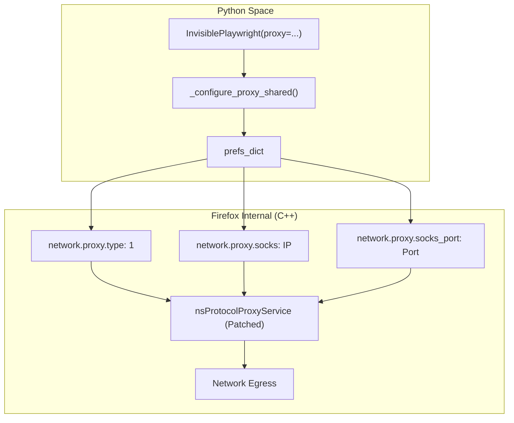

**Sources:** [README.md:108-120](), [src/invisible_playwright/launcher.py:211-211](), [docs/configuration.md:17-37]()

---

## Seed-based Deterministic Sessions

To recreate the exact same browser fingerprint (GPU, Screen, Audio, etc.) across different runs, you can provide a `seed`. This is useful for maintaining a consistent "identity".

```python
from invisible_playwright import InvisiblePlaywright

# Session 1: Use seed 42
with InvisiblePlaywright(seed=42) as browser:
    # This session will have a specific GPU and screen resolution
    page = browser.new_page()

# Session 2: Use seed 42 again
with InvisiblePlaywright(seed=42) as browser:
    # This session is guaranteed to have the EXACT same fingerprint
    page = browser.new_page()
```

### Seed Validation and Eager Materialization
The `InvisiblePlaywright` constructor ensures that if a seed is provided, it is clamped to `int32_t` and used to materialize the `Profile` immediately [src/invisible_playwright/launcher.py:157-177](). If no seed is provided, a random 31-bit integer is chosen via `secrets.randbits(31)` [src/invisible_playwright/launcher.py:158-158]().

**Sources:** [README.md:101-107](), [src/invisible_playwright/launcher.py:157-177]()

---

## Humanized Cursor Motion

By default, `invisible_playwright` humanizes mouse movements. Standard Playwright calls like `page.click()` or `page.hover()` are intercepted to move the cursor along a Bezier-curve trajectory [README.md:77-77]().

```python
with InvisiblePlaywright(humanize=True) as browser:
    page = browser.new_page()
    page.goto("https://example.com")
    # The pointer travels on a curved path, it does not teleport
    page.click("#submit") 
```

### Cursor Engine Resolution
The engine used (Python-side vs. Binary-side) is resolved via `resolve_cursor_engine(humanize)` [src/invisible_playwright/launcher.py:166-166](). The maximum movement time is capped (default 1.5s) using `_cursor_max_seconds` [tests/test_launcher_helpers.py:95-97]().

**Sources:** [README.md:31-35](), [src/invisible_playwright/launcher.py:94-99](), [tests/test_launcher_helpers.py:95-129]()

---

## Async API Usage

For high-concurrency applications, the `invisible_playwright.async_api` module provides an asynchronous interface [src/invisible_playwright/async_api.py:1-48]().

```python
import asyncio
from invisible_playwright.async_api import InvisiblePlaywright

async def run_task():
    async with InvisiblePlaywright() as browser:
        page = await browser.new_page()
        await page.goto("https://example.com")
        print(await page.title())

asyncio.run(run_task())
```

### Lifecycle Comparison
The `InvisiblePlaywright` class manages the transition between the high-level API and the underlying Playwright lifecycle, including the `SessionToken` and `LifetimeGuard` for process management [src/invisible_playwright/async_api.py:100-101]().

**Lifecycle Mapping: Code to System**
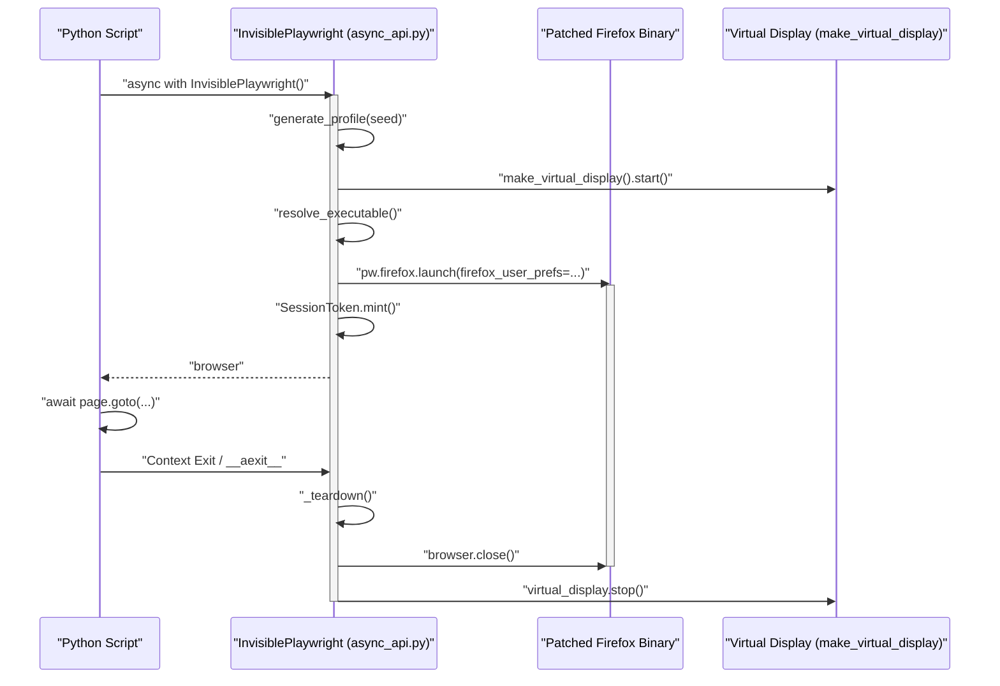

**Sources:** [src/invisible_playwright/async_api.py:47-152](), [src/invisible_playwright/launcher.py:78-108]()

---

# Page: Core Architecture

# Core Architecture

<details>
<summary>Relevant source files</summary>

The following files were used as context for generating this wiki page:

- [CHANGELOG.md](CHANGELOG.md)
- [pyproject.toml](pyproject.toml)
- [src/invisible_playwright/__init__.py](src/invisible_playwright/__init__.py)
- [src/invisible_playwright/_geo.py](src/invisible_playwright/_geo.py)
- [src/invisible_playwright/_pin.py](src/invisible_playwright/_pin.py)
- [src/invisible_playwright/_recaptcha_seed.py](src/invisible_playwright/_recaptcha_seed.py)
- [src/invisible_playwright/async_api.py](src/invisible_playwright/async_api.py)
- [src/invisible_playwright/constants.py](src/invisible_playwright/constants.py)
- [src/invisible_playwright/download.py](src/invisible_playwright/download.py)
- [src/invisible_playwright/launcher.py](src/invisible_playwright/launcher.py)
- [tests/test_async_api.py](tests/test_async_api.py)
- [tests/test_core_pin.py](tests/test_core_pin.py)
- [tests/test_launcher_helpers.py](tests/test_launcher_helpers.py)
- [tests/test_recaptcha_seed.py](tests/test_recaptcha_seed.py)
- [tests/test_seal_floor.py](tests/test_seal_floor.py)

</details>


The `invisible_playwright` system is a specialized wrapper around Playwright that integrates a custom-patched Firefox binary with a Bayesian fingerprinting engine. Unlike standard anti-detect libraries that rely on JavaScript shims, this architecture operates at the C++ level of the browser engine, ensuring that spoofed values are indistinguishable from native ones. The architecture is split between `invisible_playwright` (the Playwright-specific wrapper) and `invisible_core` (the engine-agnostic stealth logic).

## System Lifecycle

The lifecycle of an `invisible_playwright` session follows a multi-stage pipeline from instantiation to browser teardown, coordinated by the `InvisiblePlaywright` context manager.

### 1. Initialization and Fingerprinting
When `InvisiblePlaywright` is instantiated, it immediately generates a deterministic browser profile using the `_fpforge` engine.
*   **Seed Generation:** A 31-bit seed is either provided or randomly generated using `secrets.randbits(31)` [src/invisible_playwright/launcher.py:112-112]().
*   **Profile Generation:** The `generate_profile` function uses this seed and any provided `pin` dictionary to sample a coherent identity from a Bayesian network [src/invisible_playwright/launcher.py:126-128]().
*   **Core Integrity:** At import time, the wrapper enforces an exact version pin of `invisible_core` to prevent divergence between the wrapper and the stealth engine [src/invisible_playwright/_pin.py:34-40]().

### 2. Environment Preparation
Before launching the binary, the wrapper prepares the execution environment:
*   **Binary Verification:** It resolves the patched Firefox binary path and ensures it matches the required version via `resolve_executable` and `assert_wire_version` [src/invisible_playwright/launcher.py:165-166]().
*   **Preference Translation:** The `Profile` is converted into Firefox preferences via `compose_session_prefs` (re-exported from `invisible_core`), which handles stealth baselines and fingerprint overrides [src/invisible_playwright/launcher.py:173-178]().
*   **Virtual Display:** If `headless=True` (the default stealth mode), `make_virtual_display` initializes a platform-specific virtual display (Xvfb on Linux or a Win32 Desktop on Windows) so Firefox runs in "headed" mode without a visible window [src/invisible_playwright/launcher.py:164-164]().

### 3. Browser Launch and Patching
The wrapper starts the Playwright process but overrides key behaviors to maintain stealth:
*   **Launch Parameters:** The browser is launched with the custom binary, generated preferences, and the `SessionToken` used for process tracking [src/invisible_playwright/launcher.py:186-193]().
*   **API Patching:** The wrapper patches `new_context` and `new_page` to inject default viewport and screen dimensions that match the spoofed fingerprint, and applies the `_NEWTAB_SETTLE` sleep to prevent race conditions during tab creation [src/invisible_playwright/launcher.py:30-49]().
*   **Cursor Humanization:** If `humanize` is enabled, the `_cursor` engine intercepts pointer calls to move the mouse along seed-derived Bezier paths [src/invisible_playwright/launcher.py:209-209]().

### 4. Teardown
During `__exit__` or `__aexit__`, the system ensures a clean shutdown. The `LifetimeGuard` (re-exported from `invisible_core`) ensures that if the Python process is killed, the browser tree is reaped to prevent process leaks [src/invisible_playwright/launcher.py:252-258]().

**Sources:**
- [src/invisible_playwright/launcher.py:78-212]()
- [src/invisible_playwright/async_api.py:47-152]()
- [src/invisible_playwright/_pin.py:7-43]()

---

## High-Level Component Interaction

The following diagram illustrates how the core Python classes interact with the internal subsystems and the external Firefox binary.

### System Entity Map
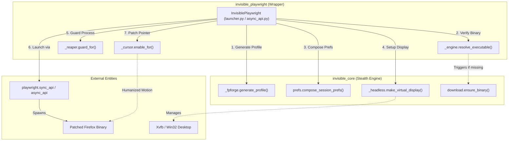
**Sources:**
- [src/invisible_playwright/launcher.py:110-211]()
- [src/invisible_playwright/async_api.py:50-152]()
- [src/invisible_playwright/__init__.py:45-52]()

---

## Major Subsystems

### [Sync and Async APIs](#2.1)
The library provides two primary entry points: `launcher.InvisiblePlaywright` (Sync) and `async_api.InvisiblePlaywright` (Async). These classes share logic via `_session.py` to ensure parity in how viewports, screen geometries, and timezones are calculated.
For details, see [Sync and Async APIs](#2.1).

### [Headless Mode and Virtual Displays](#2.2)
To maintain stealth, `invisible_playwright` avoids the detectable `--headless` flag. Instead, it uses `make_virtual_display` to create hidden environments where Firefox runs in a real headed mode.
For details, see [Headless Mode and Virtual Displays](#2.2).

### [Binary Management and Download](#2.3)
The system requires a specific patched Firefox. `_engine.py` resolves the executable path, while `download.py` (via `invisible_core`) manages fetching and SHA256 verification of the binary archives.
For details, see [Binary Management and Download](#2.3).

### [Humanized Cursor Motion](#2.4)
The `_cursor` module intercepts Playwright's `page.click` and `page.hover` calls, replacing the default "teleport" jump with a paced, curved trajectory generated from the session seed.
For details, see [Humanized Cursor Motion](#2.4).

### [Process Lifecycle and Reaper](#2.5)
Browser processes are marked with a `SessionToken`. The `_reaper` module uses Windows Job Objects or Linux process scanning to ensure that browsers do not outlive the Python automation script.
For details, see [Process Lifecycle and Reaper](#2.5).

---

## Logic Flow and Code Entities

This diagram bridges the high-level system concepts to the specific file entities that implement them.

### Sequence of Operation
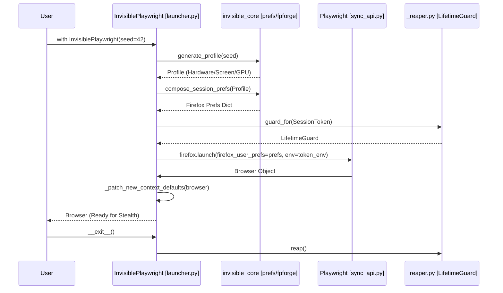
**Sources:**
- [src/invisible_playwright/launcher.py:110-211]()
- [src/invisible_playwright/async_api.py:105-152]()
- [src/invisible_playwright/_reaper.py:24-24]()

---

# Page: Sync and Async APIs

# Sync and Async APIs

<details>
<summary>Relevant source files</summary>

The following files were used as context for generating this wiki page:

- [src/invisible_playwright/_engine.py](src/invisible_playwright/_engine.py)
- [src/invisible_playwright/_recaptcha_seed.py](src/invisible_playwright/_recaptcha_seed.py)
- [src/invisible_playwright/async_api.py](src/invisible_playwright/async_api.py)
- [src/invisible_playwright/launcher.py](src/invisible_playwright/launcher.py)
- [tests/test_async_api.py](tests/test_async_api.py)
- [tests/test_launcher_config.py](tests/test_launcher_config.py)
- [tests/test_launcher_helpers.py](tests/test_launcher_helpers.py)
- [tests/test_new_page_defaults.py](tests/test_new_page_defaults.py)
- [tests/test_recaptcha_seed.py](tests/test_recaptcha_seed.py)
- [tests/test_seal_wire_version.py](tests/test_seal_wire_version.py)
- [tests/test_suite_boundaries.py](tests/test_suite_boundaries.py)

</details>


The `invisible_playwright` package provides a high-level wrapper around a patched Firefox binary, offering both synchronous and asynchronous APIs. These APIs manage the browser lifecycle, fingerprint generation, and virtual display orchestration to ensure a stealthy, "invisible" automation environment.

## The InvisiblePlaywright Class

The core of the library is the `InvisiblePlaywright` class, available in `invisible_playwright.launcher` [[src/invisible_playwright/launcher.py:78-78]]() (sync) and `invisible_playwright.async_api` [[src/invisible_playwright/async_api.py:47-47]]() (async). Both variants maintain strict API parity, ensuring that the fingerprinting logic, preference translation, and proxy handling remain identical regardless of the concurrency model [[tests/test_async_api.py:112-154]]().

### Constructor and Eager Initialization

The constructor performs "eager" profile generation. This ensures that the fingerprint is materialized immediately upon instantiation, allowing users to inspect the chosen identity (via `self.seed` and `self._profile`) before the browser is even launched.

**Key Constructor Parameters:**
*   `seed`: An optional integer. If `None`, a random 31-bit integer is chosen using `secrets.randbits(31)` [[src/invisible_playwright/launcher.py:147-147]]().
*   `pin`: A dictionary to force specific fingerprint fields. Invalid keys raise a `ValueError` immediately during construction [[src/invisible_playwright/async_api.py:53-53]](), [[tests/test_async_api.py:53-56]]().
*   `headless`: A boolean that, when `True`, triggers the library's custom virtual display logic instead of the standard Playwright `headless=True` flag [[src/invisible_playwright/launcher.py:149-149]]().
*   `humanize`: Controls the patched Juggler's Bezier mouse trajectory logic [[src/invisible_playwright/launcher.py:118-118]]().
*   `prep_recaptcha`: If `True`, pre-seeds the browser context with realistic cookies [[src/invisible_playwright/launcher.py:124-124]]().

**Sources:** [[src/invisible_playwright/launcher.py:110-160]](), [[src/invisible_playwright/async_api.py:50-103]](), [[tests/test_async_api.py:23-83]]()

### Data Flow: From Constructor to Browser Launch

The following diagram illustrates how the `InvisiblePlaywright` instance prepares the environment during the lifecycle.

**Launcher Initialization Flow**
```mermaid
graph TD
    subgraph "Constructor (Eager)"
        Init["InvisiblePlaywright.__init__"] --> Seed["Clamp Seed (int31)"]
        Seed --> GenProf["_fpforge.generate_profile(seed, pin)"]
        GenProf --> ProfileObj["self._profile (Materialized)"]
    end

    subgraph "Lifecycle Start (__enter__ / __aenter__)"
        Enter["__enter__ / __aenter__"] --> Geo["prepare_session_geo() (Off-loop)"]
        Geo --> Bin["resolve_executable()"]
        Bin --> Prefs["_build_prefs()"]
        Prefs --> Proxy["_configure_proxy_shared()"]
        Proxy --> Headless["_resolve_headless() (Virtual Display)"]
        Headless --> Launch["playwright.firefox.launch()"]
        Launch --> Patch["_patch_new_context_defaults()"]
    end
```
**Sources:** [[src/invisible_playwright/launcher.py:147-210]](), [[src/invisible_playwright/async_api.py:66-132]]()

---

## Lifecycle Management

`InvisiblePlaywright` is designed to be used as a context manager. This ensures that the Playwright driver, the browser process, and any virtual displays (Xvfb/Win32 Desktop) are cleaned up reliably.

### Context Manager Implementation
*   **Sync:** Implements `__enter__` and `__exit__` [[src/invisible_playwright/launcher.py:162-230]]().
*   **Async:** Implements `__aenter__` and `__aexit__` [[src/invisible_playwright/async_api.py:105-180]]().

Upon entering the context, the class monkey-patches the returned `Browser` object's `new_context` and `new_page` methods. This ensures that every context created from the browser automatically inherits the correct viewport, screen resolution, and device scale factor derived from the generated `Profile` [[src/invisible_playwright/launcher.py:221-228]]().

### Teardown Sequence
The `_teardown` method (or its async equivalent) follows a strict order to avoid resource leaks:
1.  Close the `Browser` object.
2.  Stop the `Playwright` driver.
3.  Stop the `_virtual_display` (if one was created) [[src/invisible_playwright/launcher.py:248-266]]().

**Sources:** [[src/invisible_playwright/launcher.py:162-266]](), [[src/invisible_playwright/async_api.py:105-180]]()

---

## Viewport and Screen Geometry

One of the primary responsibilities of the launcher is to calculate a valid viewport that fits within the spoofed screen dimensions without triggering "out of bounds" detection or Playwright errors.

### Geometry Calculation Logic
The library uses offsets to account for "Window Chrome" (title bars, scrollbars) and the OS taskbar. These are now sourced from the `Profile` itself or shared core constants to prevent internal disagreements [[src/invisible_playwright/launcher.py:51-69]]().

| Constant | Source | Description |
| :--- | :--- | :--- |
| `_CHROME_W` | `invisible_core.constants.CHROME_W` | Horizontal window padding (measured as 0 in real FF151) [[src/invisible_playwright/launcher.py:60-60]]() |
| `_CHROME_H` | `invisible_core.constants.CHROME_H` | Vertical chrome (measured as 85 in real FF151) [[src/invisible_playwright/launcher.py:59-59]]() |
| `_TASKBAR_H` | `ScreenProfile.taskbar_px` | OS Taskbar height (defaults to 48 in core) [[src/invisible_playwright/launcher.py:69-69]]() |

**Logic:**
*   `viewport_width = profile.screen.width - _CHROME_W` [[tests/test_launcher_helpers.py:143-143]]()
*   `viewport_height = profile.screen.height - profile.screen.taskbar_px - _CHROME_H` [[tests/test_launcher_helpers.py:144-145]]()

**Sources:** [[src/invisible_playwright/launcher.py:51-70]](), [[tests/test_launcher_helpers.py:136-152]](), [[tests/test_launcher_config.py:45-68]]()

---

## Timezone and Locale Handling

`InvisiblePlaywright` handles timezones at two levels: the OS environment and the Playwright realm.

### TZ Environment Mapping
Windows and Linux handle the `TZ` environment variable differently. Linux glibc accepts IANA names (e.g., `America/New_York`), but Windows MSVCRT requires POSIX format (e.g., `EST5EDT`). The `_tz_env` helper uses the `_IANA_TO_POSIX_TZ` table to translate common residential proxy zones [[src/invisible_playwright/launcher.py:71-76]]().

### Realm Overrides
Because Windows ICU can sometimes drop no-DST zones (like `America/Phoenix`) when set via global preferences, the library explicitly passes the `timezone_id` and `locale` into Playwright's `new_context` kwargs [[src/invisible_playwright/async_api.py:127-130]]().

**Entity Relationship: Preference and Context Propagation**
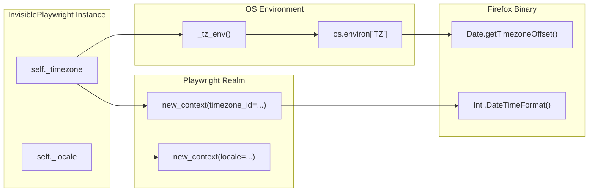
**Sources:** [[src/invisible_playwright/launcher.py:71-76]](), [[src/invisible_playwright/async_api.py:106-122]](), [[tests/test_launcher_helpers.py:27-80]]()

---

## API Parity and Patching

The library implements a specific patch to mitigate races in Firefox 150 with Fission.

### The `new_page` Settle Race-Condition Fix
Both sync and async variants wrap the `BrowserContext.new_page` method. When a new tab is created, Firefox emits an internal `about:newtab` navigation roughly 100ms later. If a script calls `page.goto()` immediately, it often fails with "Navigation interrupted". The launcher injects a `0.4s` sleep (constant `_NEWTAB_SETTLE`) to allow the internal navigation to settle [[src/invisible_playwright/launcher.py:27-48]](), [[src/invisible_playwright/async_api.py:11-44]]().

### Cookie Pre-seeding
If `prep_recaptcha` is enabled, the launcher uses `_recaptcha_seed.py` to populate the context with cookies derived from the persona's `browsing_history`. This includes a mandatory batch for `.google.com` (NID, CONSENT, SOCS, _GRECAPTCHA, ENID) while excluding deprecated cookies like `1P_JAR` [[src/invisible_playwright/_recaptcha_seed.py:1-21]]().

### Implementation Parity
The two APIs are strictly compared in tests to ensure features like the process-leak reaper and environment variable support land on both sides simultaneously [[tests/test_async_api.py:88-174]]().

| Feature | Sync API (`launcher.py`) | Async API (`async_api.py`) |
| :--- | :--- | :--- |
| **Driver** | `sync_playwright()` | `async_playwright()` |
| **Settle** | `time.sleep(0.4)` | `await asyncio.sleep(0.4)` |
| **Context** | `__enter__` / `__exit__` | `__aenter__` / `__aexit__` |
| **Geo Resolution** | `prepare_session_geo` | `await asyncio.to_thread(prepare_session_geo)` |

**Sources:** [[src/invisible_playwright/launcher.py:27-48]](), [[src/invisible_playwright/async_api.py:11-44]](), [[src/invisible_playwright/_recaptcha_seed.py:86-126]](), [[tests/test_new_page_defaults.py:143-153]]()

---

# Page: Headless Mode and Virtual Displays

# Headless Mode and Virtual Displays

<details>
<summary>Relevant source files</summary>

The following files were used as context for generating this wiki page:

- [.github/workflows/e2e-hunt.yml](.github/workflows/e2e-hunt.yml)
- [.github/workflows/e2e.yml](.github/workflows/e2e.yml)
- [scripts/run_e2e.py](scripts/run_e2e.py)
- [src/invisible_playwright/_fpforge/__init__.py](src/invisible_playwright/_fpforge/__init__.py)
- [src/invisible_playwright/_headless.py](src/invisible_playwright/_headless.py)
- [src/invisible_playwright/_proxy.py](src/invisible_playwright/_proxy.py)
- [src/invisible_playwright/_recaptcha_seed.py](src/invisible_playwright/_recaptcha_seed.py)
- [src/invisible_playwright/async_api.py](src/invisible_playwright/async_api.py)
- [src/invisible_playwright/launcher.py](src/invisible_playwright/launcher.py)
- [tests/conftest.py](tests/conftest.py)
- [tests/test_async_api.py](tests/test_async_api.py)
- [tests/test_backcompat.py](tests/test_backcompat.py)
- [tests/test_cloak.py](tests/test_cloak.py)
- [tests/test_e2e.py](tests/test_e2e.py)
- [tests/test_fingerprint_consistency.py](tests/test_fingerprint_consistency.py)
- [tests/test_fingerprint_surface.py](tests/test_fingerprint_surface.py)
- [tests/test_launcher_helpers.py](tests/test_launcher_helpers.py)
- [tests/test_recaptcha_seed.py](tests/test_recaptcha_seed.py)
- [tests/test_service_worker.py](tests/test_service_worker.py)

</details>


`invisible_playwright` achieves "headless" operation by running the browser in a **headed** state (with full UI rendering, widget trees, and GPU acceleration) but redirecting the graphical output to a virtual display or a hidden desktop [src/invisible_playwright/launcher.py:131-134](). This avoids the detection risks associated with the browser's native `--headless` flag, which uses a distinct software-only rendering path that anti-bot systems can easily identify [src/invisible_playwright/launcher.py:115-134]().

## Architecture Overview

The virtual display system is managed via a factory pattern in `invisible_core` that abstracts platform-specific implementations for Linux and Windows [src/invisible_playwright/launcher.py:21](). The `_headless.py` module in the wrapper now acts as a shim to the core implementation.

### Virtual Display Lifecycle

The following diagram illustrates how the `InvisiblePlaywright` launcher interacts with the virtual display subsystem during the browser startup sequence.

**Launcher to Virtual Display Data Flow**
```mermaid
graph TD
    subgraph "Launcher Space"
        IP["InvisiblePlaywright.__enter__"]
        RH["_resolve_headless()"]
    end

    subgraph "Core Subsystem"
        MVD["make_virtual_display()"]
        LVD["_LinuxVirtualDisplay"]
        WVD["_WindowsVirtualDesktop"]
    end

    IP --> RH [src/invisible_playwright/launcher.py:192]
    RH -- "if headless=True" --> MVD [src/invisible_playwright/launcher.py:202]
    MVD -- "platform == linux" --> LVD
    MVD -- "platform == win32" --> WVD
    
    LVD -- "start()" --> XVFB["Spawn Xvfb Process"]
    WVD -- "start()" --> WIN32["CreateDesktop / SetThreadDesktop"]
    
    XVFB --> ENV["Update os.environ['DISPLAY']"]
    WIN32 --> THREAD["Bind Thread to Desktop"]
```
Sources: [src/invisible_playwright/launcher.py:192-205](), [src/invisible_playwright/async_api.py:128-130](), [src/invisible_playwright/launcher.py:21]()

## Implementation Details

The library supports two distinct virtual display mechanisms depending on the host operating system.

### Linux Implementation: `_LinuxVirtualDisplay` (Xvfb)
On Linux, the library utilizes `Xvfb` (X Virtual Framebuffer). It spawns a dedicated X server instance for each session and modifies the environment variables of the Python process so that Firefox connects to the virtual display.

- **Automatic Display Selection**: Scans for available display numbers to prevent collisions in parallel execution environments like CI runners [tests/test_e2e.py:147-152]().
- **Environment Isolation**: Modifies `os.environ["DISPLAY"]` and ensures Wayland variables are managed to prevent "leaks" onto the physical desktop [tests/test_e2e.py:133-143]().
- **CI Integration**: The E2E suite leverages `xvfb-run` on GitHub Actions to ensure stable browser interaction during tests [.github/workflows/e2e.yml:8-10]().

### Windows Implementation: `_WindowsVirtualDesktop` (Win32 CreateDesktop)
On Windows, the library uses the Win32 `CreateDesktop` API to create a completely hidden desktop object.

- **Thread Affinity**: The calling thread is bound to the new hidden desktop using `SetThreadDesktop`.
- **Inheritance**: When Playwright spawns child processes (the Node.js driver and `firefox.exe`), they inherit the hidden desktop of the parent thread.
- **Sandbox Compatibility**: On Windows, certain GPU sandbox levels are adjusted when running on a virtual desktop to ensure the rendering pipeline remains stable [tests/test_e2e.py:133-143]().

## Configuration and Environment Variables

The behavior of the headless subsystem can be influenced by specific environment variables and constructor parameters.

| Variable / Parameter | Description |
| :--- | :--- |
| `headless` (Arg) | When `True`, the launcher invokes `make_virtual_display()` to hide the browser [src/invisible_playwright/launcher.py:131-134](). |
| `INVPW_TRUE_HEADLESS` | If set to `1`, the launcher bypasses virtual displays and uses the browser's native `--headless` flag (less stealthy, used for debugging) [tests/test_async_api.py:158-162](). |
| `INVPW_TEST_WATCHDOG_FILE` | Used in CI to monitor hung browser processes on virtual displays [tests/conftest.py:36-38](). |

## Stealth Advantages

Using virtual displays instead of the native `--headless` flag provides several critical stealth benefits:

1. **Natural Rendering Pipeline**: The browser uses its standard headed rendering path. This ensures that CSS layout, font metrics, and device pixel ratios (DPR) match those of a real user [tests/test_launcher_helpers.py:136-145]().
2. **GPU Feature Parity**: Standard headless mode often disables WebGL extensions or uses software rasterizers (like SwiftShader) that are easily detected. Virtual displays allow the use of the platform's standard GPU drivers (or Xvfb's GLX/RENDER extensions) [tests/test_fingerprint_surface.py:150-162]().
3. **Viewport Consistency**: `invisible_playwright` calculates the viewport by subtracting window chrome (title bars, borders) from the spoofed screen size. In native headless mode, these chrome offsets are often zero, creating a detectable fingerprint mismatch [tests/test_launcher_helpers.py:136-145]().

**Entity Mapping: Headless Resolution**
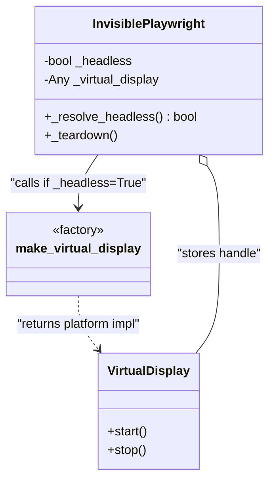
Sources: [src/invisible_playwright/launcher.py:192-205](), [src/invisible_playwright/async_api.py:128-130](), [tests/test_e2e.py:147-173]()

## Teardown and Idempotency

The virtual display is tied to the `InvisiblePlaywright` context manager lifecycle. When the context exits, `_teardown()` is called to stop the virtual display and restore the environment [src/invisible_playwright/launcher.py:228-232](). This process is idempotent to prevent resource leaks if `__exit__` is called multiple times [tests/test_e2e.py:94-103]().

Sources: [src/invisible_playwright/launcher.py:228-232](), [tests/test_e2e.py:176-199]()

---

# Page: Binary Management and Download

# Binary Management and Download

<details>
<summary>Relevant source files</summary>

The following files were used as context for generating this wiki page:

- [.github/workflows/user-install.yml](.github/workflows/user-install.yml)
- [CHANGELOG.md](CHANGELOG.md)
- [pyproject.toml](pyproject.toml)
- [src/invisible_playwright/_engine.py](src/invisible_playwright/_engine.py)
- [src/invisible_playwright/_geo.py](src/invisible_playwright/_geo.py)
- [src/invisible_playwright/cli.py](src/invisible_playwright/cli.py)
- [src/invisible_playwright/constants.py](src/invisible_playwright/constants.py)
- [src/invisible_playwright/download.py](src/invisible_playwright/download.py)
- [tests/test_cli.py](tests/test_cli.py)
- [tests/test_launcher_config.py](tests/test_launcher_config.py)
- [tests/test_release_e2e.py](tests/test_release_e2e.py)
- [tests/test_seal_wire_version.py](tests/test_seal_wire_version.py)
- [tests/test_suite_boundaries.py](tests/test_suite_boundaries.py)
- [tests/test_upgrade_e2e.py](tests/test_upgrade_e2e.py)
- [tests/test_version.py](tests/test_version.py)

</details>


The `invisible_playwright` package requires a specific, patched build of Firefox to function. This page describes the automated system for fetching, verifying, and caching these binaries. Following the 2026-07-03 architecture split, the core logic for binary management now resides in `invisible_core`, with `invisible_playwright` providing backward-compatibility shims and CLI entry points.

## Binary Lifecycle and Pipeline

The binary management system follows a "cache-check-then-download" pipeline. When the library or CLI requests the browser path, the system first checks the local filesystem. If the binary is missing or belongs to an outdated version, it initiates a secure download from GitHub Releases.

### Download Flow

The primary entry point for this logic is `ensure_binary()`, which is imported into `src/invisible_playwright/cli.py` from `invisible_core.download` [src/invisible_playwright/cli.py:38]().

1.  **Platform Detection**: The system identifies the host OS and architecture.
2.  **Cache Lookup**: It checks for the existence of the binary in the versioned cache directory (e.g., `~/.cache/invisible-playwright/firefox-19/`) [src/invisible_playwright/cli.py:111]().
3.  **Verification (Seal Check)**: Before using a cached binary, the system validates it against the `seal.json`. The `engine_problems` function checks if the cached tree matches the active seal [src/invisible_playwright/cli.py:64]().
4.  **Download & Verification**: If not found or invalid, it downloads the archive. Verification is performed using SHA256 checksums provided in the engine release's `seal.json` asset [CHANGELOG.md:11-14]().
5.  **Extraction**: Upon successful verification, the archive is extracted into the permanent cache directory.

### Download Pipeline Architecture

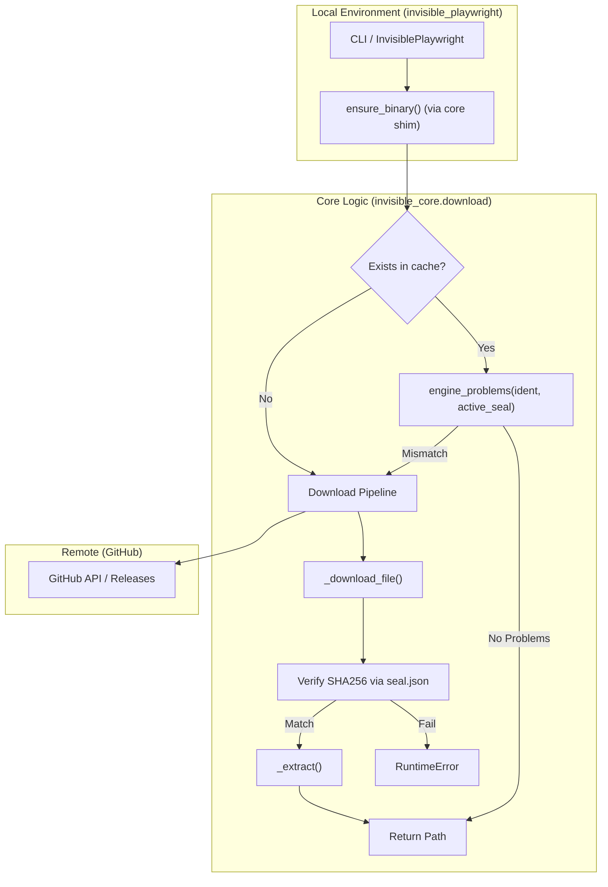
**Sources:** [src/invisible_playwright/cli.py:47-88](), [src/invisible_playwright/download.py:1-5](), [CHANGELOG.md:11-14]()

## Configuration and Versioning

Binary versioning is decoupled from the Python package version. The expected core version is strictly pinned in `pyproject.toml` to ensure the wrapper drives a compatible engine [pyproject.toml:52]().

| Code Entity | Description | Location |
| :--- | :--- | :--- |
| `BINARY_VERSION` | The unique tag for the patched Firefox build (e.g., `firefox-19`). | [src/invisible_playwright/cli.py:37]() |
| `FIREFOX_UPSTREAM_VERSION` | The base Firefox version (e.g., `151.0`). | [src/invisible_playwright/cli.py:37]() |
| `active_seal()` | Returns the `Seal` object containing BuildID and digest. | [src/invisible_playwright/cli.py:58]() |
| `cache_root()` | The filesystem location where engines are stored. | [src/invisible_playwright/cli.py:111]() |

**Sources:** [src/invisible_playwright/cli.py:37-44](), [pyproject.toml:52-59]()

## Verification and Deadlines

### Seal Verification
Every run of `fetch` checks every cached engine against the seal [src/invisible_playwright/cli.py:10-13](). A mismatching tree is reported to `stderr` and replaced by `ensure_binary` [src/invisible_playwright/cli.py:72-78](). This replaces the legacy `doctor` command.

### Download Deadlines
To prevent hanging on slow connections, the system enforces a download deadline via `INVISIBLE_DOWNLOAD_DEADLINE` (default 1800s). This is managed at the `requests` level within the core engine [CHANGELOG.md:47]().

**Sources:** [src/invisible_playwright/cli.py:47-88](), [CHANGELOG.md:47]()

## GitHub Authentication

The system supports authenticated requests to avoid GitHub API rate limits (60 calls/hour for unauthenticated IPs). The CLI and download logic respect the following environment variables:
1.  `STEALTHFOX_GITHUB_TOKEN`
2.  `GITHUB_TOKEN` [tests/test_release_e2e.py:147]()

Authentication is critical for CI/CD workflows (like `user-install.yml`) that perform multiple version checks in rapid succession [.github/workflows/user-install.yml:142-147]().

**Sources:** [tests/test_release_e2e.py:142-147](), [.github/workflows/user-install.yml:142-147]()

### Entity Mapping: CLI to Core Implementation

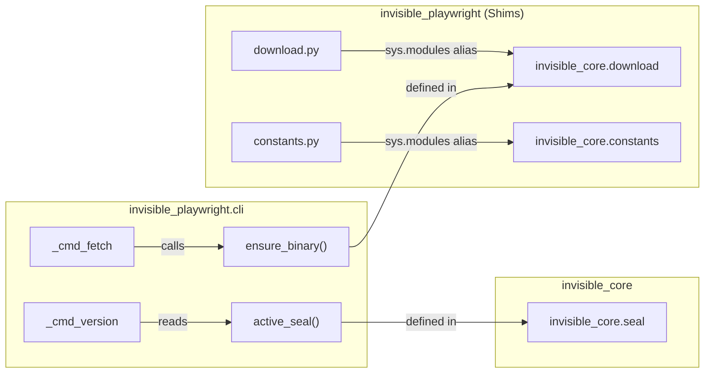
**Sources:** [src/invisible_playwright/cli.py:47-112](), [src/invisible_playwright/download.py:1-5](), [src/invisible_playwright/constants.py:1-5]()

## CLI Reference for Binary Management

The CLI surface has been simplified to two primary commands [src/invisible_playwright/cli.py:3-30]().

*   **`fetch`**: Checks all cached engines against the seal, downloads the required binary if missing or invalid, and prints the absolute path to the executable as the last line of `stdout` [src/invisible_playwright/cli.py:47-87]().
    *   *Usage*: `$(invisible-playwright fetch)` for scripting.
*   **`version`**: Prints the versions of the wrapper, the installed core, and the sealed engine (Tag, Firefox version, BuildID, and Seal digest) [src/invisible_playwright/cli.py:90-112](). It also displays the `cache_root` location.

**Sources:** [src/invisible_playwright/cli.py:3-30](), [tests/test_cli.py:32-56]()

---

# Page: Humanized Cursor Motion

# Humanized Cursor Motion

<details>
<summary>Relevant source files</summary>

The following files were used as context for generating this wiki page:

- [.github/workflows/firefox-launch-matrix.yml](.github/workflows/firefox-launch-matrix.yml)
- [.github/workflows/publish.yml](.github/workflows/publish.yml)
- [.github/workflows/tests.yml](.github/workflows/tests.yml)
- [.github/workflows/webrtc-e2e.yml](.github/workflows/webrtc-e2e.yml)
- [src/invisible_playwright/_behaviour.py](src/invisible_playwright/_behaviour.py)
- [src/invisible_playwright/_cursor.py](src/invisible_playwright/_cursor.py)
- [src/invisible_playwright/_motion.py](src/invisible_playwright/_motion.py)
- [src/invisible_playwright/_recaptcha_seed.py](src/invisible_playwright/_recaptcha_seed.py)
- [src/invisible_playwright/async_api.py](src/invisible_playwright/async_api.py)
- [src/invisible_playwright/launcher.py](src/invisible_playwright/launcher.py)
- [tests/test_async_api.py](tests/test_async_api.py)
- [tests/test_behaviour.py](tests/test_behaviour.py)
- [tests/test_cursor_dispatch.py](tests/test_cursor_dispatch.py)
- [tests/test_launcher_helpers.py](tests/test_launcher_helpers.py)
- [tests/test_motion.py](tests/test_motion.py)
- [tests/test_motion_fingerprint.py](tests/test_motion_fingerprint.py)
- [tests/test_mouse.py](tests/test_mouse.py)
- [tests/test_recaptcha_seed.py](tests/test_recaptcha_seed.py)
- [tests/test_webrtc_realness.py](tests/test_webrtc_realness.py)

</details>


The humanized cursor motion system in `invisible_playwright` transforms discrete, instantaneous pointer "teleports" typical of automation into continuous, human-like trajectories. It operates by intercepting Playwright's low-level pointer calls and expanding them into a series of intermediate movements defined by Bezier curves, physiological tremor models, and macro-scale behavioral patterns.

## Architecture Overview

The system is split into three layers to separate trajectory math from behavioral logic and API integration:

1.  **`_motion.py` (Micro-scale)**: Responsible for the mathematical generation of a single stroke. It handles Bezier path planning, velocity profiles (Minimum Jerk), and the physiological tremor model [src/invisible_playwright/_motion.py:1-50]().
2.  **`_behaviour.py` (Macro-scale)**: Plans the "why and when." It decides where endpoints should land within an element (distribution), when to perform "fidget" moves, and how long idle periods should last [src/invisible_playwright/_behaviour.py:37-55]().
3.  **`_cursor.py` (Integration)**: The wiring layer that intercepts Playwright's `page.click`, `page.hover`, and `mouse.move` calls to inject the planned movements into the browser [src/invisible_playwright/_cursor.py:1-30]().

### Data Flow: From Call to Cursor

The following diagram illustrates how a standard Playwright call is processed by the humanization engine.

**Pointer Instruction Pipeline**
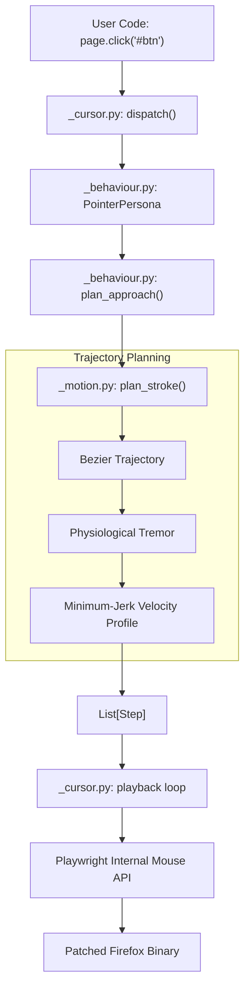
Sources: [src/invisible_playwright/_cursor.py:75-120](), [src/invisible_playwright/_behaviour.py:37-81](), [src/invisible_playwright/_motion.py:20-60]().

---

## Configuration and Control

The motion engine is primarily controlled via the `InvisiblePlaywright` constructor and environment variables.

| Parameter / Variable | Type | Description |
| :--- | :--- | :--- |
| `humanize` | `bool \| float` | `True` enables default behavior (1.5s cap). A `float` sets a custom time cap per movement. `False` disables humanization. |
| `INVPW_CURSOR_ENGINE` | `env` | `python` (default): Uses this Python-side engine. `binary`: Uses the engine inside the C++ binary. `off`: Disables motion process-wide. |
| `seed` | `int` | The session seed drives all random parameters (speed, overshoot, tremor) making them deterministic for that session. |

Sources: [src/invisible_playwright/launcher.py:118-118](), [src/invisible_playwright/_cursor.py:32-55]().

---

## Behavioral Planning (`_behaviour.py`)

This module defines the `PointerPersona` class, which encapsulates session-specific behavioral traits derived from the `seed` [src/invisible_playwright/_behaviour.py:204-220]().

### Key Behavioral Features
*   **Endpoint Distribution**: Instead of clicking the center of a bounding box, `landing_point()` uses a beta distribution to favor the center while occasionally hitting edges [src/invisible_playwright/_behaviour.py:240-265]().
*   **Idle Fidgets**: When the script is idle, the system may plan "aimless moves" to prevent the cursor from being perfectly static, which is a signature of automation [src/invisible_playwright/_behaviour.py:15-20]().
*   **Overshoot and Correction**: Based on the `PointerPersona`'s `overshoot_prob`, moves may over-travel the target and require a corrective sub-movement, simulating human motor control errors [src/invisible_playwright/_behaviour.py:530-550]().

**Entity Mapping: Behavior to Code**
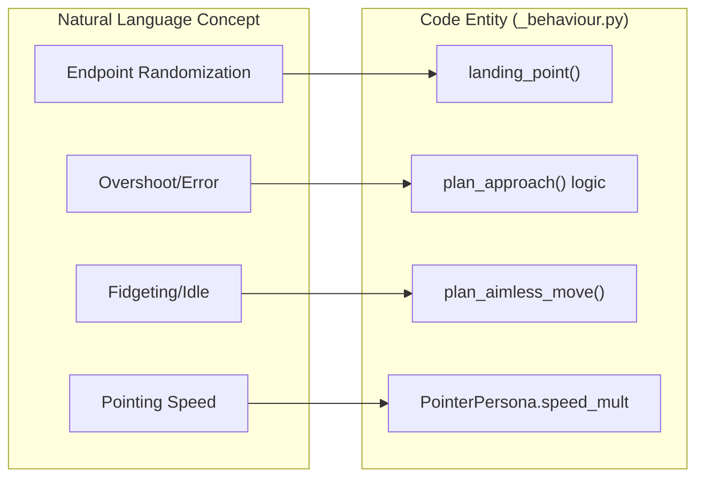
Sources: [src/invisible_playwright/_behaviour.py:86-103](), [src/invisible_playwright/_behaviour.py:240-250](), [src/invisible_playwright/_behaviour.py:314-330]().

---

## Motion Generation (`_motion.py`)

The micro-scale movement is generated using `plan_stroke()`.

### Mathematical Models
1.  **Bezier Paths**: Uses cubic Bezier curves where control points are jittered based on the distance between start and end [src/invisible_playwright/_motion.py:110-130]().
2.  **Minimum-Jerk Profile**: Velocity is not constant; it follows a "minimum-jerk" curve (smooth acceleration and deceleration) common in biological movements [src/invisible_playwright/_motion.py:150-165]().
3.  **Tremor Model**: Adds high-frequency (8-12 Hz) low-amplitude noise to the path to simulate physiological hand tremor [src/invisible_playwright/_motion.py:180-200]().

Sources: [src/invisible_playwright/_motion.py:100-210]().

---

## Dispatch and Interception (`_cursor.py`)

The `_cursor.py` module wraps the `BrowserContext` to intercept calls.

### Integration Mechanism
When `InvisiblePlaywright` starts a session, it calls `enable_for(context)` [src/invisible_playwright/_cursor.py:230-245](). This function performs the following:
*   Attaches a `MoveStrategy` to the context.
*   Wraps the `page.mouse.move` and `page.click` methods.
*   When a user calls `page.click(selector)`, the wrapper:
    1.  Calculates the target coordinates using Playwright's internal element handle logic.
    2.  Calculates the current cursor position.
    3.  Calls the planner to generate a `List[Step]`.
    4.  Iterates through the steps, executing `time.sleep(step.delay)` and then a low-level, non-humanized move to the intermediate coordinate [src/invisible_playwright/_cursor.py:150-190]().

**Sources:**
* `src/invisible_playwright/launcher.py:94-99` (Usage and default cap)
* `src/invisible_playwright/_cursor.py:1-55` (Engine resolution and constants)
* `src/invisible_playwright/_cursor.py:75-120` (Dispatch logic)
* `src/invisible_playwright/_behaviour.py:1-81` (Behavioral design philosophy)
* `src/invisible_playwright/_behaviour.py:204-220` (PointerPersona definition)
* `src/invisible_playwright/_motion.py:1-50` (Motion design and tremor theory)
* `src/invisible_playwright/_motion.py:110-165` (Bezier and velocity math)

---

# Page: Process Lifecycle and Reaper

# Process Lifecycle and Reaper

<details>
<summary>Relevant source files</summary>

The following files were used as context for generating this wiki page:

- [CHANGELOG.md](CHANGELOG.md)
- [pyproject.toml](pyproject.toml)
- [src/invisible_playwright/_geo.py](src/invisible_playwright/_geo.py)
- [src/invisible_playwright/_reaper.py](src/invisible_playwright/_reaper.py)
- [src/invisible_playwright/_recaptcha_seed.py](src/invisible_playwright/_recaptcha_seed.py)
- [src/invisible_playwright/async_api.py](src/invisible_playwright/async_api.py)
- [src/invisible_playwright/constants.py](src/invisible_playwright/constants.py)
- [src/invisible_playwright/download.py](src/invisible_playwright/download.py)
- [src/invisible_playwright/launcher.py](src/invisible_playwright/launcher.py)
- [tests/test_async_api.py](tests/test_async_api.py)
- [tests/test_cursor_wiring.py](tests/test_cursor_wiring.py)
- [tests/test_launcher_helpers.py](tests/test_launcher_helpers.py)
- [tests/test_old_core_says_which_version.py](tests/test_old_core_says_which_version.py)
- [tests/test_reaper.py](tests/test_reaper.py)
- [tests/test_recaptcha_seed.py](tests/test_recaptcha_seed.py)

</details>


The `invisible_playwright` package implements a robust process management system designed to prevent "zombie" browser processes. Because the patched Firefox binary is launched in headed mode (even when visually hidden) and involves complex process trees, standard clean-up mechanisms often fail during ungraceful shutdowns (e.g., script timeouts, CI runner cancellations, or unhandled exceptions).

## Overview and Purpose

The lifecycle management system ensures that every browser process and its children are positively identified and terminated when the parent Python process exits. This is achieved through three primary mechanisms:
1.  **Session Token Stamping**: Every browser session is assigned a unique cryptographic token injected into its environment.
2.  **Lifetime Guards**: Platform-specific observers that monitor the Python process.
3.  **The Reaper**: A teardown routine that scans for processes carrying the session's specific token.

Sources: `src/invisible_playwright/_reaper.py:1-31`(), `src/invisible_playwright/launcher.py:24-24`(), `src/invisible_playwright/async_api.py:91-101`().

---

## Session Token Minting and Stamping

To avoid killing healthy browsers belonging to other concurrent sessions, `invisible_playwright` uses a `SessionToken`. This token is more reliable than PID tracking because Firefox frequently spawns sub-processes (content processes, socket processes) that are not direct children of the initial launcher.

### Implementation Details
- **Minting**: A unique token is generated using `secrets.randbits(31)` during the `InvisiblePlaywright` context entry [src/invisible_playwright/launcher.py:129-129](), [src/invisible_playwright/async_api.py:129-129]().
- **Stamping**: The token is stored in the environment variable defined by `TOKEN_VAR` (internally `INVPW_SESSION_TOKEN`) [src/invisible_playwright/_reaper.py:39-39]().
- **Inheritance**: Because environment blocks are inherited, the entire browser tree (including grandchildren) carries this token [tests/test_reaper.py:71-75]().

### Token Flow Diagram
This diagram shows how a `SessionToken` moves from the Python wrapper into the OS process space.

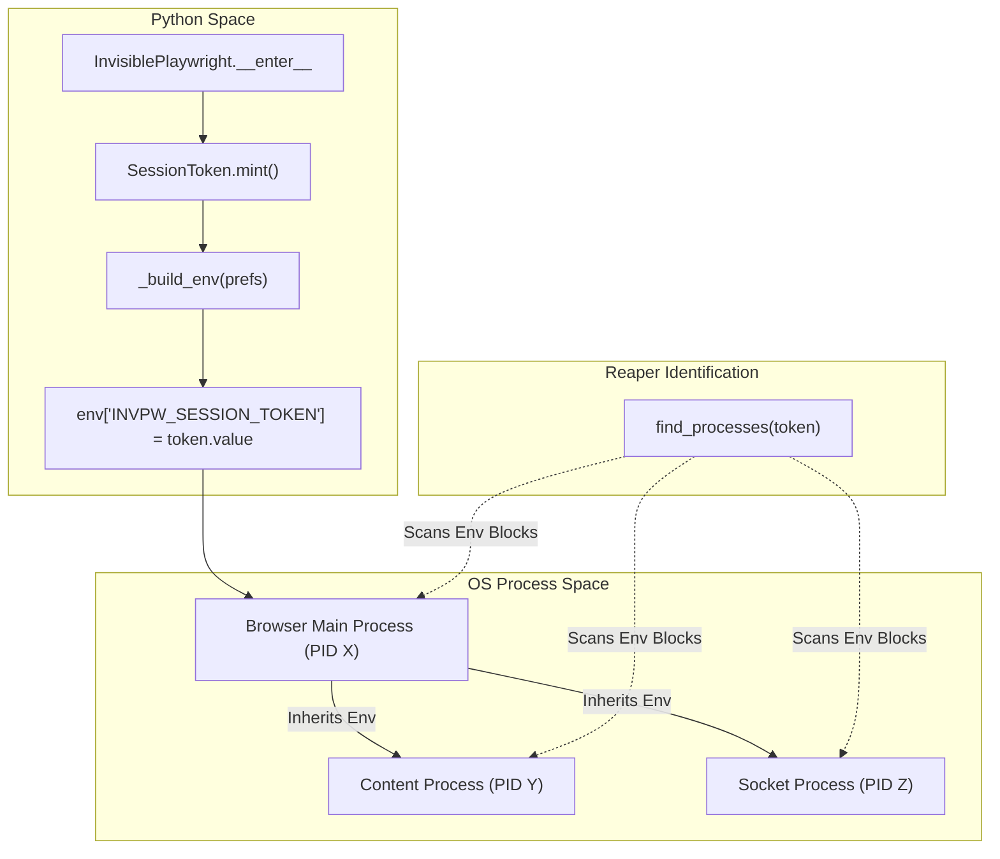
Sources: `src/invisible_playwright/launcher.py:129-130`(), `src/invisible_playwright/async_api.py:129-130`(), `tests/test_reaper.py:71-76`(), `src/invisible_playwright/_reaper.py:34-45`().

---

## Lifetime Guards

The `LifetimeGuard` is an abstraction that ensures browser cleanup regardless of how the Python process terminates. The system uses `guard_for()` to return the appropriate implementation for the current OS [src/invisible_playwright/_reaper.py:42-42]().

| Guard Class | Platform | Mechanism |
| :--- | :--- | :--- |
| `JobObjectGuard` | Windows | Uses Win32 **Job Objects**. If the Python process dies, the OS automatically terminates all processes assigned to the job. |
| `NullGuard` | Linux / Other | Relies on the `reap()` pattern and `atexit` handlers, as Linux lacks a strict equivalent to Job Objects for arbitrary process trees. |

### Windows Job Objects and `spawn_into`
On Windows, `JobObjectGuard` provides a "hard" guarantee. The `invisible_core.process` module (re-exported by `_reaper.py`) includes a `spawn_into` mechanism. This allows creating a process in a suspended state, assigning it to the Job Object, and then resuming it. This ensures the process is "born" inside the job, preventing a race condition where a process could spawn a child before being assigned to the guard.

Sources: `src/invisible_playwright/_reaper.py:20-30`(), `tests/test_reaper.py:180-188`(), `src/invisible_playwright/launcher.py:101-101`().

---

## The `reap()` Teardown Pattern

When the `InvisiblePlaywright` context manager exits (via `__exit__` or `__aexit__`), it invokes a teardown sequence.

### Execution Flow
1.  **Playwright Close**: Attempts to close the browser normally via `browser.close()`.
2.  **Display Cleanup**: Shuts down virtual displays (Xvfb/Win32 Desktop) [src/invisible_playwright/launcher.py:186-189]().
3.  **Forceful Reap**: Calls `self._lifetime_guard.reap(self._session_token)`.
    - The reaper uses `psutil` to scan all running processes [src/invisible_playwright/pyproject.toml:60-70]().
    - It checks the environment block of every process for the matching `INVPW_SESSION_TOKEN` [tests/test_reaper.py:60-66]().
    - Any matching processes are forcefully terminated.

### Lifecycle Entity Mapping
The following diagram maps code entities to their roles in the lifecycle.

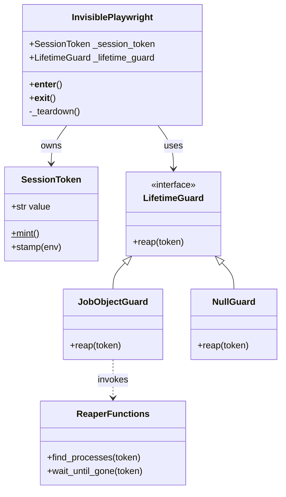
Sources: `src/invisible_playwright/launcher.py:78-108`(), `src/invisible_playwright/async_api.py:47-101`(), `src/invisible_playwright/_reaper.py:34-45`(), `tests/test_reaper.py:23-25`().

---

## Implementation Comparison: Sync vs Async

The lifecycle logic is mirrored between the sync and async APIs to ensure parity. A critical fix in version 0.7.0 ensured that the `async_api` also correctly stamps and reaps tokens, as previous versions had a discrepancy where the async launcher did not arm the reaper.

| Feature | Sync (`launcher.py`) | Async (`async_api.py`) |
| :--- | :--- | :--- |
| **Token Generation** | `SessionToken.mint()` in `__enter__` | `SessionToken.mint()` in `__aenter__` |
| **Env Stamping** | `_build_env` calls `token.stamp` | `_build_env` calls `token.stamp` |
| **Guard Arming** | `_bind_process_tree()` | `_bind_process_tree()` |
| **Teardown** | `_teardown()` in `__exit__` | `_teardown()` in `__aexit__` |

Sources: `src/invisible_playwright/launcher.py:129-150`(), `src/invisible_playwright/async_api.py:129-152`(), `tests/test_async_api.py:88-109`(), `tests/test_async_api.py:112-154`().

---

# Page: Fingerprint Engine (fpforge)

# Fingerprint Engine (fpforge)

<details>
<summary>Relevant source files</summary>

The following files were used as context for generating this wiki page:

- [docs/configuration.md](docs/configuration.md)
- [docs/pinning.md](docs/pinning.md)
- [docs/quickstart.md](docs/quickstart.md)
- [docs/recaptcha-v3-score.md](docs/recaptcha-v3-score.md)
- [docs/sannysoft-explained.md](docs/sannysoft-explained.md)
- [docs/screen-size-headless-tells.md](docs/screen-size-headless-tells.md)
- [src/invisible_playwright/__init__.py](src/invisible_playwright/__init__.py)
- [src/invisible_playwright/_fpforge/__init__.py](src/invisible_playwright/_fpforge/__init__.py)
- [src/invisible_playwright/_headless.py](src/invisible_playwright/_headless.py)
- [src/invisible_playwright/_pin.py](src/invisible_playwright/_pin.py)
- [src/invisible_playwright/_proxy.py](src/invisible_playwright/_proxy.py)
- [tests/test_backcompat.py](tests/test_backcompat.py)
- [tests/test_cloak.py](tests/test_cloak.py)
- [tests/test_core_pin.py](tests/test_core_pin.py)
- [tests/test_fingerprint_surface.py](tests/test_fingerprint_surface.py)
- [tests/test_seal_floor.py](tests/test_seal_floor.py)

</details>


The `_fpforge` package is the internal engine responsible for generating unique, coherent browser fingerprints. Now part of the `invisible_core` foundation, it ensures that every `InvisiblePlaywright` session presents a statistically plausible identity. Unlike standard anti-detect tools that use static profiles or independent random values, `fpforge` utilizes a Bayesian network to ensure that all spoofed attributes—such as GPU, screen resolution, hardware concurrency, and audio capabilities—are mutually consistent.

This engine is designed specifically for the patched Firefox binary and ensures that the browser "tells the truth" at the C++ level, avoiding the detection of JavaScript-based shims.

## Core Concepts

### Bayesian Coherence
The primary challenge in browser spoofing is maintaining "internal coherence." Anti-bot scripts like CreepJS detect "lies" by identifying contradictions, such as a high-end RTX 4090 GPU paired with a dual-core CPU and a 720p screen [docs/sannysoft-explained.md:71-77](). `fpforge` solves this by sampling from a directed acyclic graph where child nodes are conditioned on their parents [src/invisible_playwright/_fpforge/_sampler.py:9-25]().

### The Sampling Pipeline
The engine follows a strict topological order to generate a profile:
1. **Root Sampling**: A real-world GPU is selected from a pool of 444 Windows ANGLE renderers [src/invisible_playwright/_fpforge/_sampler.py:64-64]().
2. **Classification**: The `classify_gpu` function maps the raw renderer string to a `gpu_class` (e.g., `high_end`, `integrated_modern`) [src/invisible_playwright/_fpforge/_sampler.py:98-155]().
3. **Conditional Sampling**: Screen dimensions, hardware concurrency, and MSAA levels are sampled based on the `gpu_class` and a hidden `intra_tier` variable to ensure they match the hardware's expected performance bracket [src/invisible_playwright/_fpforge/_sampler.py:66-72]().

### System Architecture Diagram

This diagram shows how the `fpforge` internal components interact to transform a seed into a set of browser preferences.

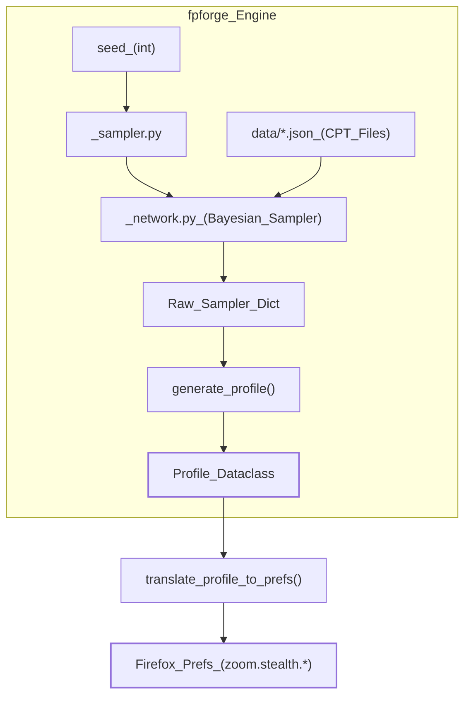
Sources: [src/invisible_playwright/_fpforge/_sampler.py:9-25](), [src/invisible_playwright/_fpforge/profile.py:176-200](), [src/invisible_playwright/_fpforge/_network.py:1-10]()

## Sub-Modules

### [Bayesian Sampler and Network](#3.1)
The logic for graph traversal and probability calculation. It uses a `Network` class containing `Node` objects. It manages the `intra_tier` variable, which prevents "average" hardware from being sampled for "high-end" GPUs by triangulating dependencies.
*   **Key Entities**: `Network`, `Node`, `classify_gpu`, `_LOCKED` identity constants.
*   For details, see [Bayesian Sampler and Network](#3.1).

### [Profile Dataclasses](#3.2)
Typed containers that structure the raw sampler output. These dataclasses (e.g., `GPUProfile`, `ScreenProfile`, `HardwareProfile`) provide a clean API for the library to consume fingerprint data and convert it to browser preferences via `to_prefs_dict()`.
*   **Key Entities**: `Profile`, `GPUProfile`, `HardwareProfile`, `AudioProfile`, `CodecProfile`.
*   For details, see [Profile Dataclasses](#3.2).

### [Pinning System](#3.3)
A mechanism to bypass the Bayesian sampler for specific fields while keeping the rest of the fingerprint deterministic. This allows users to force specific screen resolutions or GPU models via the `pin` parameter in `InvisiblePlaywright` [docs/pinning.md:11-29]().
*   **Key Entities**: `_PIN_GROUPS`, `_PIN_TO_RAW`, `_apply_pins_to_raw()`, `_validate_pin_key()`.
*   For details, see [Pinning System](#3.3).

### [CPT Data Files](#3.4)
The "brain" of the engine. These JSON files in `_fpforge/data/` contain the Conditional Probability Tables (CPTs) derived from real-world telemetry. They define the likelihood of specific hardware combinations.
*   **Key Files**: `webgl_renderer_pool.json`, `cpt_screen_given_class_tier.json`, `priors_independent.json`.
*   For details, see [CPT Data Files](#3.4).

### [Cookie and History Seeding](#3.5)
The persona generated by `fpforge` includes a sampled browsing history. The `_recaptcha_seed.py` module uses this to pre-populate the browser context with realistic cookies (Google NID/CONSENT, analytics, etc.) to improve trust scores [docs/recaptcha-v3-score.md:94-100]().
*   **Key Entities**: `seed_recaptcha_cookies_sync`, `_sub_seed`, `ga_consent_clarity`.
*   For details, see [Cookie and History Seeding](#3.5).

## Data Flow: From Seed to Code Entities

The following diagram maps the transition from the high-level concept of a "Fingerprint" to the specific code entities in the `_fpforge` package.

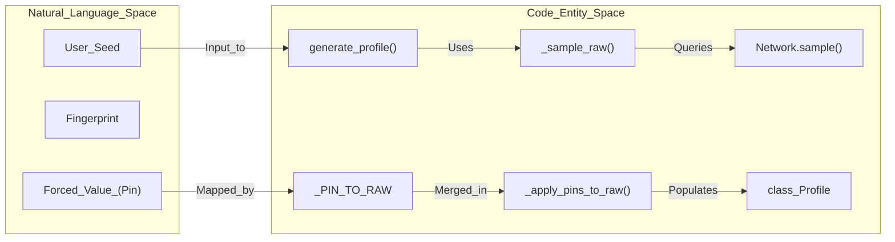
Sources: [src/invisible_playwright/_fpforge/profile.py:108-176](), [src/invisible_playwright/_fpforge/_sampler.py:194-210](), [src/invisible_playwright/_fpforge/_network.py:70-85]()

## Locked Identity
While most fields are sampled, certain identity markers are locked to match the patched Firefox 150 binary's compiled-in values. This ensures that the `User-Agent` and `platform` always match the underlying engine's behavior and avoid contradictions with the binary's internal strings.

| Property | Locked Value |
| :--- | :--- |
| `user_agent` | `Mozilla/5.0 (Windows NT 10.0; Win64; x64; rv:150.0) Gecko/20100101 Firefox/150.0.1` |
| `platform` | `Win32` |
| `oscpu` | `Windows NT 10.0; Win64; x64` |
| `webdriver` | `False` |

Sources: [src/invisible_playwright/_fpforge/_sampler.py:46-58]()

---

# Page: Bayesian Sampler and Network

# Bayesian Sampler and Network

<details>
<summary>Relevant source files</summary>

The following files were used as context for generating this wiki page:

- [docs/configuration.md](docs/configuration.md)
- [docs/creepjs-explained.md](docs/creepjs-explained.md)
- [docs/headless-fonts-differ.md](docs/headless-fonts-differ.md)
- [docs/navigator-webdriver-explained.md](docs/navigator-webdriver-explained.md)
- [docs/pinning.md](docs/pinning.md)
- [docs/playwright-detected-as-bot.md](docs/playwright-detected-as-bot.md)
- [docs/playwright-stealth-levels.md](docs/playwright-stealth-levels.md)
- [docs/quickstart.md](docs/quickstart.md)
- [docs/recaptcha-v3-score.md](docs/recaptcha-v3-score.md)
- [docs/sannysoft-explained.md](docs/sannysoft-explained.md)
- [docs/screen-size-headless-tells.md](docs/screen-size-headless-tells.md)
- [docs/webgl-renderer-strings.md](docs/webgl-renderer-strings.md)
- [src/invisible_playwright/_fpforge/__init__.py](src/invisible_playwright/_fpforge/__init__.py)
- [src/invisible_playwright/_headless.py](src/invisible_playwright/_headless.py)
- [src/invisible_playwright/_proxy.py](src/invisible_playwright/_proxy.py)
- [tests/test_backcompat.py](tests/test_backcompat.py)
- [tests/test_cloak.py](tests/test_cloak.py)
- [tests/test_fingerprint_surface.py](tests/test_fingerprint_surface.py)

</details>


The `invisible_playwright` fingerprint engine utilizes a Bayesian network to generate coherent, realistic browser fingerprints. This system ensures that sampled attributes (like GPU, screen resolution, and hardware concurrency) are statistically consistent with one another, mimicking real-world hardware distributions found in the Windows Firefox ecosystem.

## Core Implementation

The system is split between a generic Bayesian implementation in `_network.py` and a fingerprint-specific configuration in `_sampler.py`.

### Bayesian Entities

The engine defines two primary classes to handle the probabilistic logic:

*   **`Node`**: Represents a single fingerprint attribute (e.g., `gpu`, `hw_concurrency`). It can be marginal (independent), conditional (dependent on parents), or deterministic (calculated via a classifier) [[src/invisible_playwright/_fpforge/_network.py:27-45]]().
*   **`Network`**: A collection of `Node` objects. It performs a topological sort upon initialization to ensure that parent nodes are always sampled before their children [[src/invisible_playwright/_fpforge/_network.py:71-82]]().

### Data Flow and Sampling

Sampling is deterministic based on a `stealth_seed` provided to the `Forge` or `sample` entry points [[src/invisible_playwright/_fpforge/_sampler.py:26-27]]().

1.  **Topological Sort**: The `Network` ensures nodes are processed in an order where dependencies are resolved first [[src/invisible_playwright/_fpforge/_network.py:109-131]]().
2.  **Weighted Picking**: For probabilistic nodes, the system performs a weighted selection from a Conditional Probability Table (CPT) or marginal list [[src/invisible_playwright/_fpforge/_network.py:87-98]]().
3.  **Parent Key Generation**: Conditional nodes look up their distribution by creating a stable JSON key from the values of their parent nodes [[src/invisible_playwright/_fpforge/_network.py:101-106]]().

### Code Entity Space to Bayesian Logic

The following diagram illustrates how Python classes and functions map to the theoretical Bayesian components.

**Entity Mapping: Sampler Architecture**
```mermaid
graph TD
    subgraph "Natural Language Space"
        ProbDist["Probability Distribution"]
        Dependency["Conditional Dependency"]
        Classifier["Deterministic Logic"]
    end

    subgraph "Code Entity Space"
        CPT_JSON["cpt_*.json files"]
        NodeClass["Node class"]
        NetworkClass["Network class"]
        ClassifyGPU["classify_gpu()"]
        WeightedPick["_weighted_pick()"]
    end

    CPT_JSON -->|Defines| ProbDist
    NodeClass -->|Uses| WeightedPick
    NodeClass -->|Implements| Dependency
    ClassifyGPU -->|Implements| Classifier
    NetworkClass -->|Orchestrates| NodeClass
```
Sources: [[src/invisible_playwright/_fpforge/_network.py:27-82]](), [[src/invisible_playwright/_fpforge/_sampler.py:98-155]]().

## The Sampling Graph

The network architecture defines specific relationships to prevent "impossible" hardware combinations (e.g., a high-end RTX 4090 paired with a 2-core CPU).

**Fingerprint Dependency Graph**
```mermaid
graph TD
    GPU["gpu (Root Pool)"] --> GPU_CLASS["gpu_class (Classifier)"]
    GPU_CLASS --> INTRA_TIER["intra_tier (Hidden)"]
    
    GPU_CLASS --> HWC["hw_concurrency"]
    INTRA_TIER --> HWC
    
    GPU_CLASS --> SCREEN["screen (w/h/dpr)"]
    INTRA_TIER --> SCREEN
    
    GPU_CLASS --> MSAA["msaa_samples"]
    SCREEN --> MSAA
    
    GPU_CLASS --> AUDIO["audio"]
    GPU_CLASS --> FONTS["fonts_optional"]
    
    INDEP["Independent Nodes"] --> THEME["dark_theme"]
    INDEP --> CODECS["media codecs"]
```
Sources: [[src/invisible_playwright/_fpforge/_sampler.py:9-25]]().

### GPU Pool and Classification
The root of the network is the `gpu` node, which samples from a pool of 444 real Windows ANGLE renderer strings [[src/invisible_playwright/_fpforge/_sampler.py:11-13]](). These strings are then passed to `classify_gpu()`, which categorizes them into one of six tiers: `integrated_old`, `integrated_modern`, `low_end`, `mid_range`, `high_end`, or `workstation` [[src/invisible_playwright/_fpforge/_sampler.py:92-95]]().

*   **NVIDIA Sanitization**: Firefox's internal `SanitizeRenderer.cpp` collapses modern GeForce cards into vintage buckets (e.g., GTX 980). The sampler replicates this by routing these specific strings to the `low_end` class to maintain consistency with CPU/Screen tiers [[src/invisible_playwright/_fpforge/_sampler.py:119-130]]().

### The Hidden `intra_tier` Variable
To achieve high-fidelity triangulation between `hw_concurrency`, `screen`, and `storage`, the network uses a hidden variable called `intra_tier` [[src/invisible_playwright/_fpforge/_sampler.py:65-70]](). This variable ensures that within a `gpu_class` (e.g., `mid_range`), the sampler consistently picks either "high-mid" or "low-mid" components across different attributes.

### Font Whitelist Derivation
Fonts are handled through a two-tier system:
1.  **Core Fonts**: A "always-included" list from `font_pool.json` [[src/invisible_playwright/_fpforge/_sampler.py:84]]().
2.  **Optional Fonts**: Sampled based on the `gpu_class` CPT [[src/invisible_playwright/_fpforge/_sampler.py:86]]().

The final whitelist is derived by combining these and applying a deterministic hash of the `stealth_seed` to exclude a small subset, mimicking natural variation in user-installed fonts [[src/invisible_playwright/_fpforge/_sampler.py:23-24]]().

## Locked Identity Constants

While hardware varies, certain identity fields are "locked" to match the patched Firefox binary. These values never vary regardless of the seed, ensuring the browser's reported identity matches its actual capabilities.

| Field | Value | Notes |
| :--- | :--- | :--- |
| `user_agent` | `Mozilla/5.0 (Windows NT 10.0; Win64; x64; rv:150.0) Gecko/20100101 Firefox/150.0.1` | Fixed Firefox identity [[src/invisible_playwright/_fpforge/_sampler.py:46-48]]() |
| `platform` | `Win32` | Standard Windows platform string [[src/invisible_playwright/_fpforge/_sampler.py:50]]() |
| `oscpu` | `Windows NT 10.0; Win64; x64` | Windows 10/11 OS identifier [[src/invisible_playwright/_fpforge/_sampler.py:51]]() |
| `webdriver` | `False` | Essential for stealth [[src/invisible_playwright/_fpforge/_sampler.py:54]]() |
| `max_touch_points` | `0` | Desktop default [[src/invisible_playwright/_fpforge/_sampler.py:57]]() |

Sources: [[src/invisible_playwright/_fpforge/_sampler.py:46-58]]().

## Conditional Probability Tables (CPTs)

The network logic is decoupled from the data, which is stored in JSON files within `_fpforge/data/`.

*   **`cpt_hwc_given_class.json`**: Maps CPU core counts to GPU tiers (e.g., `integrated_old` has a 60% probability of having 4 cores).
*   **`cpt_screen_given_class.json`**: Maps resolutions and DPR (Device Pixel Ratio) to GPU tiers. It restricts widths to $\ge 1920$ to avoid server-side normalization by anti-fingerprinting services [[docs/pinning.md:35-42]]().
*   **`webgl_renderer_pool.json`**: Contains the 444 real-world ANGLE renderer strings used as the network root [[docs/webgl-renderer-strings.md:85-91]]().

Sources: [[src/invisible_playwright/_fpforge/_sampler.py:64-87]](), [[docs/pinning.md:35-63]](), [[docs/webgl-renderer-strings.md:85-103]]().

---

# Page: Profile Dataclasses

# Profile Dataclasses

<details>
<summary>Relevant source files</summary>

The following files were used as context for generating this wiki page:

- [docs/configuration.md](docs/configuration.md)
- [docs/pinning.md](docs/pinning.md)
- [docs/quickstart.md](docs/quickstart.md)
- [docs/recaptcha-v3-score.md](docs/recaptcha-v3-score.md)
- [docs/sannysoft-explained.md](docs/sannysoft-explained.md)
- [docs/screen-size-headless-tells.md](docs/screen-size-headless-tells.md)
- [src/invisible_playwright/_fpforge/__init__.py](src/invisible_playwright/_fpforge/__init__.py)
- [src/invisible_playwright/_headless.py](src/invisible_playwright/_headless.py)
- [src/invisible_playwright/_proxy.py](src/invisible_playwright/_proxy.py)
- [src/invisible_playwright/_recaptcha_seed.py](src/invisible_playwright/_recaptcha_seed.py)
- [src/invisible_playwright/async_api.py](src/invisible_playwright/async_api.py)
- [src/invisible_playwright/launcher.py](src/invisible_playwright/launcher.py)
- [tests/test_async_api.py](tests/test_async_api.py)
- [tests/test_backcompat.py](tests/test_backcompat.py)
- [tests/test_cloak.py](tests/test_cloak.py)
- [tests/test_fingerprint_surface.py](tests/test_fingerprint_surface.py)
- [tests/test_launcher_helpers.py](tests/test_launcher_helpers.py)
- [tests/test_recaptcha_seed.py](tests/test_recaptcha_seed.py)

</details>


The `invisible_playwright` fingerprint engine represents browser identities using a hierarchy of immutable dataclasses. These classes provide a type-safe, structured view of the raw values generated by the underlying Bayesian network. The primary entry point for creating these objects is the `generate_profile()` function.

### Overview of Data Flow

The lifecycle of a profile begins with an integer seed and optional "pins". The engine samples a flat dictionary of raw values from the Bayesian network, applies any overrides, and then maps these values into the `Profile` dataclass and its specialized sub-profiles.

**Profile Generation and Mapping Diagram**

```mermaid
graph TD
    subgraph "Input Space"
        SEED["seed: int"]
        PIN["pin: Dict[str, Any]"]
    end

    subgraph "Logic Space (invisible_core._fpforge)"
        SAMPLER["_sample_raw(seed)"]
        VALIDATE["_validate_pin_key()"]
        APPLY["_apply_pins_to_raw()"]
        GEN_PROF["generate_profile()"]
    end

    subgraph "Code Entity Space (Dataclasses)"
        PROF["Profile"]
        GPU["GPUProfile"]
        SCR["ScreenProfile"]
        HW["HardwareProfile"]
        AUD["AudioProfile"]
        COD["CodecProfile"]
        WGL["WebGLProfile"]
    end

    SEED --> SAMPLER
    SAMPLER --> GEN_PROF
    PIN --> VALIDATE
    VALIDATE --> APPLY
    APPLY --> GEN_PROF
    
    GEN_PROF --> PROF
    PROF --> GPU
    PROF --> SCR
    PROF --> HW
    PROF --> AUD
    PROF --> COD
    PROF --> WGL
```
**Sources:** [src/invisible_playwright/launcher.py:18-18](), [src/invisible_playwright/async_api.py:19-19](), [docs/pinning.md:31-45]()

---

### The Profile Dataclass

The `Profile` class is the root container for all sampled fingerprint data. It is an immutable representation of a browser persona.

| Field | Type | Description |
| :--- | :--- | :--- |
| `seed` | `int` | The original seed used for sampling. |
| `gpu` | `GPUProfile` | Graphics card and renderer details. |
| `screen` | `ScreenProfile` | Resolution, available area, and pixel density. |
| `hardware` | `HardwareProfile` | CPU concurrency, storage limits, and media devices. |
| `audio` | `AudioProfile` | Sample rates and channel counts. |
| `codec` | `CodecProfile` | Media capability flags (AV1, WebM, etc.). |
| `webgl` | `WebGLProfile` | WebGL-specific parameters like MSAA. |
| `fonts` | `List[str]` | A list of available system fonts. |
| `dark_theme` | `bool` | User color scheme preference. |
| `browsing_history` | `List[Dict]` | Sampled history used by the reCAPTCHA seed system. |

**Sources:** [src/invisible_playwright/launcher.py:103-104](), [src/invisible_playwright/_recaptcha_seed.py:3-9](), [docs/pinning.md:157-181]()

---

### Sub-Profile Components

Each sub-profile groups related browser attributes. These are all defined as frozen dataclasses within the `invisible_core` engine.

#### GPUProfile
Defines the hardware acceleration identity used by WebGL's `UNMASKED_RENDERER_WEBGL`.
*   `vendor`: The WebGL vendor string (e.g., "Google Inc. (NVIDIA)").
*   `renderer`: The WebGL renderer string (e.g., "ANGLE (NVIDIA, NVIDIA GeForce RTX 4090 Direct3D11)").
*   `class_tier`: A classification used for Bayesian grouping (e.g., `high_end`, `integrated_modern`).

#### ScreenProfile
Captures the geometry of the display and the browser window.
*   `width` / `height`: Physical screen resolution.
*   `avail_width` / `avail_height`: Screen area minus OS taskbars/menus.
*   `dpr`: Device Pixel Ratio.
*   `taskbar_px`: The height of the OS taskbar, used to calculate `avail_height`.
*   `chrome_w` / `chrome_h`: The dimensions of the browser's own UI chrome.

#### Hardware & Audio Profiles
*   **HardwareProfile**: Contains `concurrency` (logical cores), `storage_quota_mb`, `max_touch_points`, and `fake_media_devices` status.
*   **AudioProfile**: Contains `sample_rate`, `max_channel_count`, and `ac_state_running`.

#### Codec & WebGL Profiles
*   **CodecProfile**: Boolean flags for `av1_enabled`, `webm_encoder_enabled`, `mediasource_webm`, and `webspeech_synth`.
*   **WebGLProfile**: Tracks `msaa_samples`.

**Sources:** [docs/pinning.md:50-88](), [src/invisible_playwright/launcher.py:51-70](), [tests/test_launcher_helpers.py:136-152]()

---

### Generating Profiles

The `generate_profile()` function coordinates the transition from a seed to a fully populated `Profile` object.

1.  **Sampling**: It uses the seed to sample values from the Bayesian network.
2.  **Pinning**: If a `pin` dictionary is provided, it overrides individual fields. Pinning breaks the conditional chain; unpinned children are still sampled from their original distributions.
3.  **Instantiation**: The engine maps the raw sampler output into the typed dataclasses.

**Pin Mapping Logic**
The engine uses dotted-path pins to override specific raw sampler keys.

| Pin Key (Dotted) | Raw Sampler Key | Description |
| :--- | :--- | :--- |
| `gpu.class_tier` | `gpu_class_tier` | The root of the Bayesian network. |
| `screen.width` | `screen_w` | Physical width in pixels. |
| `hardware.concurrency` | `hw_concurrency` | `navigator.hardwareConcurrency`. |
| `screen.taskbar_px` | `taskbar_px` | Taskbar height for `availHeight` calculation. |

**Sources:** [docs/pinning.md:9-45](), [docs/pinning.md:52-81](), [src/invisible_playwright/launcher.py:103-104]()

---

### Seeded History and Cookies

The `Profile` includes a `browsing_history` field, which is a Bayesian-sampled list of visited sites. Each entry includes a `cookie_profile` tag (e.g., `ga_cf`, `ga_consent_clarity`).

The reCAPTCHA seed system (`_recaptcha_seed.py`) consumes this history to pre-populate the browser context with realistic cookies:
*   **Google Batch**: Always seeds `NID`, `CONSENT`, `SOCS`, `_GRECAPTCHA`, and `ENID` on `.google.com`.
*   **Per-Site Cookies**: Builds 1-5 cookies (like `_ga`, `_gid`, `__cf_bm`) based on the site's `cookie_profile`.
*   **Determinism**: All values are derived from the persona seed via `_sub_seed` (an FNV-1a mix), ensuring the same persona always presents the same cookies.

**Sources:** [src/invisible_playwright/_recaptcha_seed.py:3-21](), [src/invisible_playwright/_recaptcha_seed.py:46-52](), [src/invisible_playwright/_recaptcha_seed.py:86-126]()

---

### Integration: Profile to Preferences

The `Profile` dataclass is the primary input for the preference translation layer. The launcher uses the profile's fields to build the `firefox_user_prefs` dictionary and calculate the Playwright `viewport` and `screen` parameters.

**Integration Diagram: Profile to Browser Context**

```mermaid
graph LR
    subgraph "Profile Entity"
        P["Profile Instance"]
    end

    subgraph "Launcher Logic"
        V_CALC["_default_context_kwargs()"]
        PREF_BUILD["_build_prefs()"]
    end

    subgraph "Playwright API"
        CTX["new_context()"]
    end

    P -- "provides geometry" --> V_CALC
    P -- "provides raw data" --> PREF_BUILD
    V_CALC -- "viewport/screen" --> CTX
    PREF_BUILD -- "firefox_user_prefs" --> CTX
```

**Sources:** [src/invisible_playwright/launcher.py:126-152](), [tests/test_launcher_helpers.py:136-162](), [src/invisible_playwright/async_api.py:126-148]()

---

# Page: Pinning System

# Pinning System

<details>
<summary>Relevant source files</summary>

The following files were used as context for generating this wiki page:

- [docs/configuration.md](docs/configuration.md)
- [docs/pinning.md](docs/pinning.md)
- [docs/quickstart.md](docs/quickstart.md)
- [docs/recaptcha-v3-score.md](docs/recaptcha-v3-score.md)
- [docs/sannysoft-explained.md](docs/sannysoft-explained.md)
- [docs/screen-size-headless-tells.md](docs/screen-size-headless-tells.md)
- [src/invisible_playwright/__init__.py](src/invisible_playwright/__init__.py)
- [src/invisible_playwright/_pin.py](src/invisible_playwright/_pin.py)
- [tests/test_core_pin.py](tests/test_core_pin.py)
- [tests/test_pin.py](tests/test_pin.py)
- [tests/test_seal_floor.py](tests/test_seal_floor.py)

</details>


The pinning system allows users to bypass the default Bayesian sampling for specific fingerprint fields. While `invisible_playwright` typically generates a coherent, high-entropy fingerprint based on an integer `seed`, the `pin` parameter enables forcing exact values for attributes like GPU renderer strings, screen resolutions, or hardware concurrency [docs/pinning.md:9-13]().

## Core Logic and Data Structures

The pinning system is integrated into the `generate_profile()` function within the `_fpforge` internal package (housed in `invisible_core`). It operates by intercepting the raw output of the Bayesian sampler and overwriting specific keys before they are packaged into the typed `Profile` dataclass [docs/pinning.md:37-42]().

### Validation Tables
To ensure API stability and prevent typos, the system uses two primary allowlists:
*   **`_PIN_GROUPS`**: A dictionary mapping group names (e.g., `gpu`, `screen`) to sets of valid field names.
*   **`_PIN_TOP`**: A set of top-level keys that do not require a dot-notation prefix, such as `dark_theme` [docs/pinning.md:46-56]().

### Internal Mapping (`_PIN_TO_RAW`)
Because the user-facing `pin` keys use a clean "dotted" syntax (e.g., `screen.width`), but the internal Bayesian sampler uses flat, abbreviated keys, a mapping layer serves as the translation mechanism.

| Pin Key (User) | Description | Example |
| :--- | :--- | :--- |
| `gpu.class_tier` | Root of the Bayesian network | `"high_end"` |
| `screen.width` | Screen width in pixels | `2560` |
| `hardware.concurrency` | `navigator.hardwareConcurrency` | `16` |
| `audio.sample_rate` | AudioContext sample rate | `48000` |
| `hardware.fake_media_devices` | Spoof `enumerateDevices` | `True` |

**Sources:** [docs/pinning.md:46-87](), [tests/test_pin.py:8-31]()

## Implementation Flow

The following diagram illustrates how a user-provided `pin` dictionary moves from the `InvisiblePlaywright` constructor through the validation and application stages to reach the final browser preferences.

### Pin Propagation Pipeline
```mermaid
graph TD
    User["User Code: pin={'screen.width': 2560}"] --> IP["InvisiblePlaywright (launcher.py)"]
    IP --> GP["generate_profile(seed, pin)"]
    GP --> VAL["_validate_pin_key()"]
    VAL -- "Valid" --> SAM["_sampler.sample(seed)"]
    SAM -- "Raw Dict" --> APP["_apply_pins_to_raw()"]
    APP -- "Translate via _PIN_TO_RAW" --> P["Profile Dataclass"]
    P --> TP["translate_profile_to_prefs()"]
    TP --> B["Firefox about:config (zoom.stealth.*)"]

    subgraph "Validation Logic"
    VAL
    end

    subgraph "Data Transformation"
    APP
    TP
    end
```
**Sources:** [src/invisible_playwright/launcher.py:65-75](), [docs/pinning.md:15-29](), [tests/test_pin.py:8-12]()

## Key Functions

### `_validate_pin_key(key: str)`
This function enforces the dotted-path schema. It ensures that keys are either in the top-level allowlist or follow the `group.field` format. Unknown groups or fields within a known group trigger a `ValueError` [tests/test_pin.py:33-52]().

### `_apply_pins_to_raw(raw, pin)`
This function performs the actual mutation. It iterates through the validated pins and updates the raw sampler dictionary. The same seed produces different output once a pin is applied because the pinned value overrides the sampled one [tests/test_pin.py:59-65]().

**Sources:** [tests/test_pin.py:33-73]()

## Bayesian Coherence Implications

Pinning creates a "disconnection" in the Bayesian network. The generator is designed such that fields are conditioned on parents (e.g., `gpu_class_tier` influences `screen.tier` and `webgl.msaa_samples`) [docs/pinning.md:31-36]().

When a field is pinned:
1.  The pinned value is written directly, bypassing the sampler [docs/pinning.md:39]().
2.  **Crucially**, unpinned children are still sampled from their conditionals using the parent's original posterior, not the pinned value [docs/pinning.md:40-42]().

For example, if you pin `gpu.renderer` to an `RTX 4090` but leave the `screen` unpinned, the sampler might pick a `low_end` screen tier based on the original seed, resulting in an implausible "RTX 4090 + 1366x768" pairing [docs/pinning.md:42-43]().

### Coherence Mapping
```mermaid
graph LR
    subgraph "Bayesian Network (Simplified)"
    Tier["gpu.class_tier"] --> Screen["screen.tier"]
    Tier --> Core["hardware.concurrency"]
    Tier --> MSAA["webgl.msaa_samples"]
    end

    Pin["User Pin: 'high_end'"] -.-> Tier
    Note["Note: Pinning 'Tier' maintains coherence for children"]
```
**Sources:** [docs/pinning.md:31-63](), [docs/screen-size-headless-tells.md:92-104]()

## Supported Pin Keys

| Group | Key | Type | Notes |
| :--- | :--- | :--- | :--- |
| **GPU** | `gpu.class_tier` | `str` | `"low_end"`, `"mid_range"`, `"high_end"`, etc. [docs/pinning.md:54]() |
| | `gpu.renderer` | `str` | Windows ANGLE string [docs/pinning.md:56]() |
| **Screen** | `screen.width` | `int` | `screen.width` [docs/pinning.md:69]() |
| | `screen.dpr` | `float` | `devicePixelRatio` [docs/pinning.md:73]() |
| | `screen.color_depth`| `int` | `screen.colorDepth` (usually 24) [docs/pinning.md:75]() |
| **Hardware**| `hardware.concurrency`| `int` | CPU cores [docs/pinning.md:81]() |
| | `hardware.storage_quota_mb`| `int` | Storage estimate quota [docs/pinning.md:82]() |
| | `hardware.fake_media_devices`| `bool` | Spoof media devices [docs/pinning.md:85]() |
| **Top-level**| `dark_theme` | `bool` | Force color scheme [tests/test_pin.py:54-56]() |

**Sources:** [docs/pinning.md:50-87](), [tests/test_pin.py:8-56]()

---

# Page: CPT Data Files

# CPT Data Files

<details>
<summary>Relevant source files</summary>

The following files were used as context for generating this wiki page:

- [docs/configuration.md](docs/configuration.md)
- [docs/pinning.md](docs/pinning.md)
- [docs/quickstart.md](docs/quickstart.md)
- [docs/recaptcha-v3-score.md](docs/recaptcha-v3-score.md)
- [docs/sannysoft-explained.md](docs/sannysoft-explained.md)
- [docs/screen-size-headless-tells.md](docs/screen-size-headless-tells.md)
- [src/invisible_playwright/_fpforge/__init__.py](src/invisible_playwright/_fpforge/__init__.py)
- [src/invisible_playwright/_headless.py](src/invisible_playwright/_headless.py)
- [src/invisible_playwright/_proxy.py](src/invisible_playwright/_proxy.py)
- [tests/test_backcompat.py](tests/test_backcompat.py)
- [tests/test_cloak.py](tests/test_cloak.py)
- [tests/test_fingerprint_surface.py](tests/test_fingerprint_surface.py)

</details>


The `invisible_playwright` fingerprint engine (fpforge) utilizes a Bayesian network to generate coherent browser profiles. The statistical relationships between hardware components (e.g., a high-end GPU implying a high-resolution monitor and high core count) are defined in Conditional Probability Table (CPT) files located in the `_fpforge/data/` directory.

These JSON files serve as the "brain" of the sampler, ensuring that generated fingerprints do not contain statistically impossible combinations—such as a high-end RTX 4090 paired with a 2-core CPU—that would trigger anti-bot detections.

## Bayesian Network Topology

The network is structured around a central latent variable, `gpu_class_tier`, which acts as the primary parent for most hardware and software features [docs/pinning.md:54-63](). To increase coherence, a hidden `intra_tier` variable is used to group "budget," "standard," and "premium" configurations within each GPU class.

### Data Flow: From Priors to Profiles

The following diagram illustrates how data from the CPT files is consumed by the `Network` and `Node` classes to produce a `Profile`.

**Fingerprint Generation Data Flow**

```mermaid
graph TD
    subgraph "Data Layer (JSON Files)"
        Priors["priors_independent.json"]
        Pools["webgl_renderer_pool.json<br/>font_pool.json"]
        CPTs["cpt_*.json files"]
    end

    subgraph "Code Entity Space (invisible_core._fpforge)"
        Sampler["_sampler.py: Sampler"]
        Network["_network.py: Network"]
        Node["_network.py: Node"]
    end

    subgraph "Output Space"
        Profile["profile.py: Profile"]
    end

    Priors --> Network
    CPTs --> Node
    Pools --> Sampler
    Network --> Node
    Node --> Sampler
    Sampler --> Profile
```

**Sources:** [src/invisible_playwright/_fpforge/__init__.py:1-18](), [docs/pinning.md:31-45]()

---

## Core CPT Definitions

### 1. Hardware Concurrency
Defines the number of logical processors reported by `navigator.hardwareConcurrency`. Unlike many other fields, this is sampled from a marginal distribution based on real Windows telemetry because core count is an OS-level fact rather than strictly GPU-conditioned [docs/pinning.md:35-36]().
*   **Implementation**: Pinned via the `hardware.concurrency` key [docs/pinning.md:81]().
*   **Consistency**: The sampler ensures that unpinned children are sampled from their conditionals using the parent's original posterior to maintain coherence [docs/pinning.md:37-40]().

### 2. Screen Distributions
Defines the `screen` object, including width, height, available width/height, and Device Pixel Ratio (DPR).
*   **Logic**: High-end GPUs are statistically more likely to be paired with 1440p or 4K monitors [docs/pinning.md:54-61]().
*   **Normalization**: The engine avoids `availHeight === height` tells (which signal a missing taskbar) by deriving available height from the full height based on the claimed platform [docs/screen-size-headless-tells.md:35-44]().

### 3. Storage Quota
Overrides `navigator.storage.estimate().quota`. In real browsers, this is derived from disk space.
*   **Realism**: The `hardware.storage_quota_mb` field is sampled to reflect physically plausible storage limits, preventing a persona from claiming a workstation-class GPU while having a tiny mobile-sized storage quota [docs/pinning.md:82]().

### 4. WebGL MSAA
Defines the number of Anti-Aliasing samples supported by the WebGL context.
*   **Correlation**: This is conditioned on the `gpu_class_tier`. Pinning the `gpu.class_tier` alone steers this field toward a coherent value (e.g., 4x or 8x MSAA for high-end cards) without requiring manual specification [docs/pinning.md:54-61]().

### 5. Audio, Codecs, and Fonts
*   **Audio**: Defines sample rate, latency, and channel count. These are sampled to match the hardware profile [docs/pinning.md:88-89]().
*   **Codecs**: Determines support for `AV1`, `WebM`, and other media capabilities [docs/pinning.md:90-91]().
*   **Fonts**: Derived from a font pool. The `hardware.generics` field ensures that CSS generic families (like `x-math`) are correctly mapped to prevent rendering tells [docs/pinning.md:87]().

---

## CPT Relationship Mapping

The Bayesian network relies on these specific file associations to build the dependency graph.

| Child Node | Parent Node(s) | Role in Coherence |
| :--- | :--- | :--- |
| `gpu_class_tier` | None (Root) | Primary handle for steering the whole profile [docs/pinning.md:54-61]() |
| `screen.tier` | `gpu_class_tier` | Ensures resolution matches GPU power [docs/pinning.md:35-36]() |
| `msaa_samples` | `gpu_class_tier` | Prevents high-end GPUs from reporting 0 MSAA [docs/pinning.md:54-61]() |
| `hw_concurrency` | Marginal | Sampled independently from real Windows marginals [docs/pinning.md:35-36]() |
| `storage_quota` | `gpu_class_tier` | Ensures disk space is plausible for the device class [docs/pinning.md:61]() |

**Sources:** [docs/pinning.md:31-63](), [docs/screen-size-headless-tells.md:92-100]()

---

## Implementation Details

### Pinning and Sampling Interaction
When a user pins a value, it bypasses the sampler for that specific field. However, unpinned children are still sampled from their original conditionals. This means pinning `gpu.renderer` to an RTX 4090 without pinning `screen` may result in a "low_end" screen being sampled if the original seed-derived tier was low [docs/pinning.md:37-43]().

### Profile Integration
Once sampled, these values are packed into the `Profile` dataclass. The conversion from raw sampled data to Firefox preferences is handled by `translate_profile_to_prefs()` [src/invisible_playwright/prefs.py:30-34]().

**Natural Language to Code Mapping**

```mermaid
classDiagram
    class CPT_JSON {
        +table: dict
        +distribution: list
    }
    class Node {
        +name: str
        +parents: list
        +sample(seed)
    }
    class Profile {
        +gpu: GPUProfile
        +screen: ScreenProfile
        +hardware: HardwareProfile
    }
    
    CPT_JSON --|> Node : loaded into
    Node --|> Sampler : used by
    Sampler --|> Profile : generates
    
    note for Profile "Profile fields like 'dpr' or 'concurrency'<br/>originate from Bayesian CPT nodes."
```

**Sources:** [src/invisible_playwright/_fpforge/__init__.py:1-18](), [docs/pinning.md:11-29](), [docs/screen-size-headless-tells.md:92-100]()

---

# Page: Cookie and History Seeding

# Cookie and History Seeding

<details>
<summary>Relevant source files</summary>

The following files were used as context for generating this wiki page:

- [docs/configuration.md](docs/configuration.md)
- [docs/pinning.md](docs/pinning.md)
- [docs/quickstart.md](docs/quickstart.md)
- [docs/recaptcha-v3-score.md](docs/recaptcha-v3-score.md)
- [docs/sannysoft-explained.md](docs/sannysoft-explained.md)
- [docs/screen-size-headless-tells.md](docs/screen-size-headless-tells.md)
- [src/invisible_playwright/_recaptcha_seed.py](src/invisible_playwright/_recaptcha_seed.py)
- [src/invisible_playwright/async_api.py](src/invisible_playwright/async_api.py)
- [src/invisible_playwright/launcher.py](src/invisible_playwright/launcher.py)
- [tests/test_async_api.py](tests/test_async_api.py)
- [tests/test_launcher_helpers.py](tests/test_launcher_helpers.py)
- [tests/test_recaptcha_seed.py](tests/test_recaptcha_seed.py)

</details>


The `_recaptcha_seed.py` module is responsible for pre-populating a browser context with a realistic set of cookies before any navigation occurs. This process is driven by the persona's `browsing_history` (sampled by the Fingerprint Engine) and is designed to mitigate the "empty profile" tell that causes low reCAPTCHA v3 scores [src/invisible_playwright/_recaptcha_seed.py:1-21](). By deriving all cookie values from the session `seed`, the system ensures that a specific persona always presents the same history to target sites across different sessions [src/invisible_playwright/_recaptcha_seed.py:7-8]().

## Deterministic Cookie Generation

The seeding system avoids using global random states. Instead, it uses a hierarchical seeding approach to ensure that even if the order of sites in the browsing history changes, the cookies generated for a specific domain remain identical [tests/test_recaptcha_seed.py:143-154]().

### Sub-seeding via FNV-1a
The function `_sub_seed` uses the FNV-1a hash algorithm to create independent PRNG streams for different logical "buckets" (e.g., specific domains or cookie types) from the single master `seed` [src/invisible_playwright/_recaptcha_seed.py:46-53]().

```python
def _sub_seed(seed: int, tag: str) -> int:
    h = 0xcbf29ce484222325 ^ (seed & 0xFFFFFFFF)
    for c in tag.encode("ascii"):
        h ^= c
        h = (h * 0x100000001b3) & 0xFFFFFFFFFFFFFFFF
    return h or 0xdeadbeef
```
[src/invisible_playwright/_recaptcha_seed.py:46-53]()

### The Google Batch
Every seeded context includes a standard "Google Batch" of cookies on `.google.com`. These are essential because almost every real-world browser carries Google identifiers [docs/recaptcha-v3-score.md:39-42]().

| Cookie | Purpose | Implementation Detail |
| :--- | :--- | :--- |
| `NID` | Visitor ID | Uses a broadened 3-digit prefix (100-540) to match historical observations [src/invisible_playwright/_recaptcha_seed.py:94-101](). |
| `CONSENT` | Consent Record | Derived from the session `locale` to ensure the region/language tokens match the IP/Timezone [src/invisible_playwright/_recaptcha_seed.py:102-108](). |
| `SOCS` | Security/State | Contains a base64-encoded state string [src/invisible_playwright/_recaptcha_seed.py:111-115](). |
| `_GRECAPTCHA` | reCAPTCHA | A 124-character identifier [src/invisible_playwright/_recaptcha_seed.py:116-120](). |
| `ENID` | Identity | A 252-character identifier [src/invisible_playwright/_recaptcha_seed.py:121-125](). |

**Anachronism Protection:** The system explicitly excludes the `1P_JAR` cookie. Google deprecated `1P_JAR` in 2022; including it in a modern session is a high-signal "anachronism flag" indicating a fabricated profile [src/invisible_playwright/_recaptcha_seed.py:10-12](), [docs/recaptcha-v3-score.md:55-68]().

**Sources:** `src/invisible_playwright/_recaptcha_seed.py`, `docs/recaptcha-v3-score.md`, `tests/test_recaptcha_seed.py`.

## Cookie Profiles and Recipes

The Fingerprint Engine (`fpforge`) samples a `browsing_history` list where each entry contains a `cookie_profile` tag [src/invisible_playwright/_recaptcha_seed.py:3-6](). `_recaptcha_seed.py` uses these tags to select "recipes" for cookie generation.

### Supported Profiles
*   **`ga_only`**: Generates standard Google Analytics `_ga` and `_gid` cookies [tests/test_recaptcha_seed.py:79-85]().
*   **`ga_cf`**: Generates `_ga` plus a Cloudflare bot-management cookie `__cf_bm` [tests/test_recaptcha_seed.py:87-93]().
*   **`ga_consent`**: Generates `_ga`, `_gid`, and a consent banner record (e.g., `OptanonAlertBoxClosed` from OneTrust or `cookieyes-consent`) [tests/test_recaptcha_seed.py:95-104]().
*   **`ga_consent_clarity`**: An advanced profile including Microsoft Clarity (`_clck`), Google Tag Manager (`_dc_gtm_*`), and Facebook Pixel (`_fbp`) identifiers [tests/test_recaptcha_seed.py:106-116]().

### Implementation Logic Flow
The following diagram illustrates how the `InvisiblePlaywright` launcher coordinates with `_recaptcha_seed` to populate the browser.

**Cookie Seeding Data Flow**
```mermaid
graph TD
    subgraph "Launcher Space (launcher.py / async_api.py)"
        "IP[InvisiblePlaywright]" -->|"1. generate_profile(seed)"| "P[Profile]"
        "IP" -->|"2. prep_recaptcha=True"| "S[seed_recaptcha_cookies_sync/async]"
    end

    subgraph "Logic Space (_recaptcha_seed.py)"
        "S" -->|"3. Iterate"| "BH[Profile.browsing_history]"
        "BH" -->|"4. Mix Domain + Seed"| "FNV[_sub_seed]"
        "FNV" -->|"5. Apply Recipe"| "R[Cookie Recipes]"
        "R" -->|"ga_consent_clarity"| "C1[_ga, _gid, _clck, Optanon...]"
        "R" -->|"google"| "C2[NID, CONSENT, SOCS, ENID]"
    end

    subgraph "Playwright Space"
        "C1" -->|"context.add_cookies()"| "CTX[BrowserContext]"
        "C2" -->|"context.add_cookies()"| "CTX"
    end
```
**Sources:** `src/invisible_playwright/launcher.py`, `src/invisible_playwright/async_api.py`, `src/invisible_playwright/_recaptcha_seed.py`, `tests/test_recaptcha_seed.py`.

## Locale-Derived Consent

The `CONSENT` cookie is particularly sensitive because it contains region and language tokens that must align with the browser's egress IP and locale [docs/recaptcha-v3-score.md:78-85]().

The module imports `consent_region_lang` from `invisible_core` [src/invisible_playwright/_recaptcha_seed.py:79](). This function maps the session BCP-47 `locale` to the specific format expected by Google (e.g., `ro-RO` results in a Romanian consent token) [src/invisible_playwright/_recaptcha_seed.py:67-78](). This prevents contradictions where a browser claiming to be in Italy presents a cookie indicating a non-EU English-speaking user [src/invisible_playwright/_recaptcha_seed.py:71-74]().

**Cookie Value Construction Example:**
```python
# CONSENT value construction
f"YES+cb.{_yyyymmdd_utc(now - consent_age)}-{rng.randint(10, 19):02d}-p{rng.randint(0, 9)}.{lang}+{region}+{rng.randint(100, 999)}"
```
[src/invisible_playwright/_recaptcha_seed.py:102-108]()

## Integration in Launcher

The seeding is gated by the `prep_recaptcha` parameter in the `InvisiblePlaywright` constructor [src/invisible_playwright/launcher.py:124](). It is automatically disabled if a `profile_dir` (persistent profile) is provided, as real accumulated history is always superior to a seeded approximation [src/invisible_playwright/launcher.py:192-194](), [docs/recaptcha-v3-score.md:147-150]().

### Sync API
In `launcher.py`, the `_seed_recaptcha` method calls `seed_recaptcha_cookies_sync` after the context is created but before any pages are opened [src/invisible_playwright/launcher.py:440-447]().

### Async API
In `async_api.py`, the same logic is applied via `await seed_recaptcha_cookies_async` within the `__aenter__` lifecycle [src/invisible_playwright/async_api.py:164-171]().

**Code Entity Mapping**
```mermaid
classDiagram
    class InvisiblePlaywright {
        +int seed
        +Profile _profile
        +bool _prep_recaptcha
        -_seed_recaptcha(context)
    }
    class RecaptchaSeedModule {
        +seed_recaptcha_cookies_sync(context, profile, locale)
        +seed_recaptcha_cookies_async(context, profile, locale)
        +build_cookies(seed, browsing_history, now, locale)
        -_sub_seed(seed, tag)
        -_google_cookies(rng, now, locale)
    }
    InvisiblePlaywright --> RecaptchaSeedModule : calls
```
**Sources:** `src/invisible_playwright/launcher.py`, `src/invisible_playwright/async_api.py`, `src/invisible_playwright/_recaptcha_seed.py`.

---

# Page: Firefox Preference Translation

# Firefox Preference Translation

<details>
<summary>Relevant source files</summary>

The following files were used as context for generating this wiki page:

- [docs/configuration.md](docs/configuration.md)
- [docs/pinning.md](docs/pinning.md)
- [docs/quickstart.md](docs/quickstart.md)
- [docs/recaptcha-v3-score.md](docs/recaptcha-v3-score.md)
- [docs/sannysoft-explained.md](docs/sannysoft-explained.md)
- [docs/screen-size-headless-tells.md](docs/screen-size-headless-tells.md)
- [scripts/ci_font_gate.py](scripts/ci_font_gate.py)
- [src/invisible_playwright/_session.py](src/invisible_playwright/_session.py)
- [src/invisible_playwright/_webgl_personas.py](src/invisible_playwright/_webgl_personas.py)
- [src/invisible_playwright/prefs.py](src/invisible_playwright/prefs.py)
- [tests/test_canvas_render_stealth.py](tests/test_canvas_render_stealth.py)
- [tests/test_ci_font_gate_declaration.py](tests/test_ci_font_gate_declaration.py)
- [tests/test_integration.py](tests/test_integration.py)
- [tests/test_prefs_composition_arm.py](tests/test_prefs_composition_arm.py)

</details>


The `invisible_playwright` library translates a generated `Profile` into a flat dictionary of Firefox preferences. These preferences are passed to the patched Firefox binary via Playwright's `firefox_user_prefs` parameter. The patched binary uses these values—specifically those in the `zoom.stealth.*` namespace—to override internal C++ behaviors and JavaScript APIs, ensuring the browser's fingerprint matches the sampled identity.

In recent versions, the core translation logic has been moved to `invisible_core.prefs`, with `src/invisible_playwright/prefs.py` serving as a backward-compatible shim [src/invisible_playwright/prefs.py:1-5]().

## Overview of the Translation Pipeline

The translation process is primarily handled by the `translate_profile_to_prefs()` function. This function acts as an orchestrator that combines a static "stealth baseline" with dynamic data from a `Profile` object, alongside environment-specific settings like locale and timezone [tests/test_integration.py:80-85]().

### The Stealth Namespace
Most spoofing logic relies on the `zoom.stealth.*` preference namespace. These are not standard Firefox preferences; they are custom keys read by the patches in the `invisible_playwright` Firefox binary to control low-level features like Canvas noise, WebGL renderer strings, and hardware concurrency [tests/test_integration.py:45-71]().

### Determinism
The translation is purely functional and deterministic. Given the same `Profile` (which is typically generated from a seed) and the same input parameters, the pipeline will always produce an identical preference dictionary [tests/test_integration.py:176-181]().

### System Architecture

The following diagram illustrates how the high-level `Profile` dataclass is decomposed into the specific preference keys used by the patched binary.

**Profile to Preference Mapping**
```mermaid
graph TD
    subgraph "Natural Language Space"
        P["Profile Object"]
        B["Stealth Policy"]
        E["Environment (Locale/TZ)"]
    end

    subgraph "Code Entity Space (invisible_core.prefs)"
        direction TB
        T["translate_profile_to_prefs()"]
        BL["_BASELINE"]
        NO["_NAVIGATOR_OVERRIDES"]
        WLC["_WIN_LIGHT_COLORS"]
    end

    subgraph "Output: Firefox Prefs"
        Z["zoom.stealth.*"]
        UA["general.useragent.override"]
        UI["ui.systemUsesDarkTheme"]
        GL["zoom.stealth.fonts.generics"]
    end

    P --> T
    B --> BL
    E --> T
    BL --> T
    NO --> T
    WLC --> T
    T --> Z
    T --> UA
    T --> UI
    T --> GL
```
Sources: [src/invisible_playwright/prefs.py:1-5](), [tests/test_integration.py:45-71](), [tests/test_ci_font_gate_declaration.py:48-52]()

## Baseline and Identity Overrides

Before applying profile-specific data, the engine establishes a `_BASELINE` set of preferences. This baseline enforces a global stealth policy by:
* Disabling standard Firefox fingerprinting resistance (`privacy.resistFingerprinting = False`) to avoid the "RFP-on" signature [tests/test_integration.py:68-68]().
* Blocking WebRTC leaks and disabling Safebrowsing [tests/test_integration.py:69-69]().
* Hardcoding the Navigator identity to a specific "locked" version via `_NAVIGATOR_OVERRIDES` to ensure consistency regardless of the host OS [tests/test_integration.py:70-70]().

For details on how these constants are merged and how specific profile fields (like `screen` or `audio`) are overlaid, see [translate_profile_to_prefs](#4.1).

## Platform-Specific Branching

The translation logic branches based on `sys.platform` to handle discrepancies between Windows and Linux environments. This is critical because certain features (like system colors or font rendering) behave differently at the OS level, which can leak the host's true identity even if the User Agent is spoofed.

### Cross-Platform Normalization
The engine performs several platform-specific adjustments:
* **System Colors:** Injects `_WIN_LIGHT_COLORS` on Linux to prevent GTK themes from leaking through CSS system keywords [tests/test_integration.py:20-23]().
* **WebGL Handling:** On Windows, it clears renderer strings to let the native ANGLE driver report hardware naturally, while on Linux, it injects specific ANGLE strings to mimic a Windows environment.
* **Font Metrics:** Applies specific font factors to compensate for the different bounding boxes of Linux fonts (like DejaVu) compared to the Windows fonts bundled with the engine [scripts/ci_font_gate.py:2-19]().

For details on GPU spoofing, Xvfb workarounds, and color palette injection, see [Platform-Specific Preference Logic](#4.2).

**Platform Branching Logic**
```mermaid
graph LR
    subgraph "Platform Detection"
        S["sys.platform"]
    end

    subgraph "Windows Path"
        W1["Native ANGLE Strings"]
        W2["Standard MSAA Samples"]
    end

    subgraph "Linux Path"
        L1["Inject _WIN_LIGHT_COLORS"]
        L2["Apply Font Metrics Compensation"]
        L3["Inject Windows ANGLE Strings"]
    end

    S -- "win32" --> W1
    S -- "win32" --> W2
    S -- "linux" --> L1
    S -- "linux" --> L2
    S -- "linux" --> L3
```
Sources: [tests/test_integration.py:7-10](), [scripts/ci_font_gate.py:2-19]()

## Key Preference Categories

The translation covers several distinct categories of browser behavior:

| Category | Primary Keys | Description |
| :--- | :--- | :--- |
| **Identity** | `general.useragent.override`, `intl.accept_languages` | Spoofs the UA string, platform, and language headers [tests/test_integration.py:58-70](). |
| **Screen** | `zoom.stealth.screen.*`, `layout.css.devPixelsPerPx` | Configures viewport, resolution, and Device Pixel Ratio [tests/test_integration.py:46-49](). |
| **Hardware** | `zoom.stealth.hw_concurrency`, `zoom.stealth.storage.quota_mb` | Controls `navigator.hardwareConcurrency` and storage API limits [tests/test_integration.py:50-51](). |
| **Graphics** | `zoom.stealth.webgl.*`, `zoom.stealth.canvas.noise_skip_mask` | Configures WebGL renderers and Canvas fingerprint noise [tests/test_integration.py:63-66](). |
| **Media** | `zoom.stealth.audio.*`, `media.av1.enabled` | Sets audio sample rates, latencies, and supported codecs [tests/test_integration.py:52-56](). |
| **Fonts** | `zoom.stealth.fonts.generics` | Maps CSS generic families (serif, etc.) to specific Windows fonts [tests/test_ci_font_gate_declaration.py:51-52](). |

For a full list of required keys and their roles in the integration pipeline, see [tests/test_integration.py:45-71]().

---

# Page: translate_profile_to_prefs

# translate_profile_to_prefs

<details>
<summary>Relevant source files</summary>

The following files were used as context for generating this wiki page:

- [scripts/ci_font_gate.py](scripts/ci_font_gate.py)
- [src/invisible_playwright/_session.py](src/invisible_playwright/_session.py)
- [src/invisible_playwright/_webgl_personas.py](src/invisible_playwright/_webgl_personas.py)
- [src/invisible_playwright/prefs.py](src/invisible_playwright/prefs.py)
- [tests/test_canvas_render_stealth.py](tests/test_canvas_render_stealth.py)
- [tests/test_ci_font_gate_declaration.py](tests/test_ci_font_gate_declaration.py)
- [tests/test_integration.py](tests/test_integration.py)
- [tests/test_prefs_composition_arm.py](tests/test_prefs_composition_arm.py)

</details>


The `translate_profile_to_prefs()` function is the central bridge between the abstract browser fingerprint (the `Profile` dataclass) and the concrete configuration of the patched Firefox binary. It converts high-level attributes—such as screen dimensions, hardware concurrency, and GPU renderers—into a dictionary of Firefox preferences (`prefs`).

In the current architecture, `src/invisible_playwright/prefs.py` serves as a backward-compatibility shim that aliases the implementation in `invisible_core.prefs` [src/invisible_playwright/prefs.py:1-5](). These preferences are passed to Playwright via the `firefox_user_prefs` parameter during context creation. The patched Firefox binary specifically monitors the `zoom.stealth.*` namespace to apply C++ level overrides to web APIs like Canvas, WebGL, and Web Audio [tests/test_integration.py:45-71]().

## Overview of the Translation Pipeline

The translation process follows a strict hierarchy to ensure a coherent identity:
1.  **Baseline Application**: A static set of "stealth-first" defaults (`_BASELINE`) is applied to disable telemetry, safebrowsing, and native fingerprinting resistance (RFP), which often creates a "bot-like" signature [tests/test_integration.py:67-71]().
2.  **Identity Overrides**: Navigator identity (User Agent, Platform, OSCPU) is locked to a Windows-canonical identity to ensure cross-platform consistency [tests/test_integration.py:70-71]().
3.  **Profile Overlay**: Fields from the `Profile` (generated by `fpforge`) are mapped to `zoom.stealth.*` keys [tests/test_integration.py:45-66]().
4.  **Platform Logic**: Adjustments are made based on the host OS (e.g., Windows vs. Linux) to handle GPU renderer strings and font metrics.
5.  **User Overrides**: The `extra_prefs` parameter allows callers to manually inject or delete specific keys [tests/test_prefs_composition_arm.py:108-111]().

### Data Flow Diagram: Profile to Prefs

The following diagram illustrates how various data sources converge within the core translation logic to produce the final configuration used by the wrapper.

"Data Flow: translate_profile_to_prefs"
```mermaid
graph TD
    subgraph "Input_Sources"
        P["Profile Dataclass"]
        LOC["Locale (e.g. 'en-US')"]
        TZ["Timezone (e.g. 'UTC')"]
        EP["extra_prefs Dict"]
    end

    subgraph "Core_Logic: translate_profile_to_prefs"
        B["_BASELINE"] --> RES["Final Prefs Dict"]
        NAV["_NAVIGATOR_OVERRIDES"] --> RES
        
        P -->|Screen/Hardware/Audio| RES
        P -->|Fonts| FM["_font_metrics_for_platform"]
        FM --> RES
        
        LOC -->|Normalization| AL["_accept_language"]
        AL --> RES
        
        TZ -->|Override| RES
        
        EP -->|Final Overlay| RES
    end

    RES --> PW["Playwright: firefox_user_prefs"]
    PW --> FB["Patched Firefox Binary"]
```
Sources: [src/invisible_playwright/_session.py:27-30](), [tests/test_integration.py:80-85](), [tests/test_integration.py:141-149]()

## Function Parameters and Composition

The `compose_session_prefs` (aliased or called via `build_prefs` in the wrapper) handles the high-level assembly of the session environment.

| Parameter | Source/Context | Description |
| :--- | :--- | :--- |
| `profile` | `generate_profile()` | The fingerprint dataclass containing hardware and software attributes [tests/test_integration.py:84](). |
| `locale` | `build_prefs` | The desired browser language (e.g., "en-US"). Maps to `intl.accept_languages` [tests/test_integration.py:58](). |
| `timezone` | `build_prefs` | The IANA timezone string. Propagates to `TZ` environment variable [src/invisible_playwright/_session.py:125-126](). |
| `extra_prefs` | `InvisiblePlaywright` | User-provided dictionary to override any generated preference [tests/test_prefs_composition_arm.py:108-111](). |
| `cursor_engine` | `_cursor.py` | Determines if `stealthfox.humanize` is enabled in the binary [tests/test_prefs_composition_arm.py:61-80](). |

Sources: [src/invisible_playwright/_session.py:98-123](), [tests/test_prefs_composition_arm.py:41-45]()

## The Stealth Baseline and Identity

The translation ensures that the browser does not reveal its automated nature through default Firefox behaviors.

*   **RFP Disabling**: Unlike standard privacy tools, it explicitly ensures `privacy.resistFingerprinting` is handled carefully, as native RFP creates a unique, detectable signature [tests/test_integration.py:68]().
*   **WebRTC Protection**: Disables host IP leaks via `media.peerconnection.enabled` while allowing the patched engine to provide a spoofed `host_ip` [tests/test_integration.py:62-69]().
*   **Language Normalization**: The `_accept_language()` helper (internal to core) ensures that if a user provides `en-US`, the header is correctly expanded to `en-US, en` to match real browser behavior [tests/test_integration.py:58-60]().

Sources: [tests/test_integration.py:45-71]()

## Helper Logic and Platform Overlays

The translation logic branches to maintain the illusion of a Windows environment regardless of the host OS.

### Font Metrics and Generics
The `_font_metrics_for_platform()` helper handles the discrepancy between Linux and Windows font rendering. On Linux, specific scale factors are applied to ensure that the "bundled" Windows fonts (like Arial or Consolas) result in the exact pixel-widths expected on a real Windows machine [scripts/ci_font_gate.py:79-85]().
*   **Generics Mapping**: CSS generics are mapped to specific Windows families (e.g., `serif` to `Times New Roman`) via the `zoom.stealth.fonts.generics` preference [scripts/ci_font_gate.py:105-129]().

### Platform Branching
*   **Windows**: System colors are injected via `_WIN_LIGHT_COLORS` to ensure CSS system keywords (like `ButtonFace`) return Windows-specific RGB values [tests/test_integration.py:21-23]().
*   **Linux**: The ANGLE renderer strings from the `Profile` are injected into `zoom.stealth.webgl.renderer` to hide Mesa/X11 drivers [tests/test_integration.py:63-64]().

"Entity Mapping: Profile to Prefs"
```mermaid
graph LR
    subgraph "Natural_Language_Space"
        S["Screen Resolution"]
        C["CPU Cores"]
        G["GPU Name"]
        A["Audio Latency"]
    end

    subgraph "Code_Entity_Space"
        S --> P_S["Profile.screen.width"]
        P_S --> PREF_S["zoom.stealth.screen.width"]
        
        C --> P_C["Profile.hardware.concurrency"]
        P_C --> PREF_C["zoom.stealth.hw_concurrency"]
        
        G --> P_G["Profile.webgl.renderer"]
        P_G --> PREF_G["zoom.stealth.webgl.renderer"]
        
        A --> P_A["Profile.audio.output_latency_ms"]
        P_A --> PREF_A["zoom.stealth.audio.output_latency_ms"]
    end
```
Sources: [tests/test_integration.py:45-66](), [tests/test_integration.py:155-167]()

## Implementation Details: Profile Mapping

The following table details the mapping of `Profile` dataclass attributes to the specific preference keys monitored by the C++ patches in the Firefox binary.

| Profile Field | Preference Key | Purpose |
| :--- | :--- | :--- |
| `screen.width` | `zoom.stealth.screen.width` | Spoofs `window.screen.width` [tests/test_integration.py:46](). |
| `hardware.concurrency` | `zoom.stealth.hw_concurrency` | Spoofs `navigator.hardwareConcurrency` [tests/test_integration.py:50](). |
| `audio.sample_rate` | `zoom.stealth.audio.sample_rate` | Spoofs `AudioContext.sampleRate` [tests/test_integration.py:52](). |
| `storage.quota_mb` | `zoom.stealth.storage.quota_mb` | Spoofs Storage API limits [tests/test_integration.py:51](). |
| `webgl.renderer` | `zoom.stealth.webgl.renderer` | Spoofs WebGL Unmasked Renderer [tests/test_integration.py:63](). |
| `webgl.msaa_samples` | `webgl.msaa-samples` | Forces hardware-consistent MSAA [tests/test_integration.py:65](). |
| `canvas.noise_skip_mask` | `zoom.stealth.canvas.noise_skip_mask` | Controls render-noise skip for purity [tests/test_integration.py:66](). |

Sources: [tests/test_integration.py:45-71](), [tests/test_canvas_render_stealth.py:34-35]()

---

# Page: Platform-Specific Preference Logic

# Platform-Specific Preference Logic

<details>
<summary>Relevant source files</summary>

The following files were used as context for generating this wiki page:

- [docs/ai-browser-agents-stealth.md](docs/ai-browser-agents-stealth.md)
- [docs/browser-use-detection.md](docs/browser-use-detection.md)
- [docs/bundled-fonts-cross-platform.md](docs/bundled-fonts-cross-platform.md)
- [docs/canvas-fingerprint-noise.md](docs/canvas-fingerprint-noise.md)
- [docs/canvas-webgl-cross-platform-consistency.md](docs/canvas-webgl-cross-platform-consistency.md)
- [docs/crawl4ai-stealth-custom-browser.md](docs/crawl4ai-stealth-custom-browser.md)
- [docs/creepjs-explained.md](docs/creepjs-explained.md)
- [docs/headless-fonts-differ.md](docs/headless-fonts-differ.md)
- [docs/navigator-webdriver-explained.md](docs/navigator-webdriver-explained.md)
- [docs/playwright-detected-as-bot.md](docs/playwright-detected-as-bot.md)
- [docs/playwright-stealth-levels.md](docs/playwright-stealth-levels.md)
- [docs/webgl-renderer-strings.md](docs/webgl-renderer-strings.md)
- [src/invisible_playwright/_webgl_personas.py](src/invisible_playwright/_webgl_personas.py)
- [src/invisible_playwright/prefs.py](src/invisible_playwright/prefs.py)
- [tests/test_canvas_render_stealth.py](tests/test_canvas_render_stealth.py)
- [tests/test_integration.py](tests/test_integration.py)

</details>


This page details how `invisible_playwright` translates a unified browser `Profile` into platform-specific Firefox preferences. Because the patched Firefox binary is designed to emulate a Windows 10/11 environment regardless of the host OS, the translation logic in `prefs.py` must apply different transformations depending on whether it is running on Windows or Linux.

## Overview of Platform Branching

The core logic resides in `translate_profile_to_prefs()`, which branches based on `sys.platform` [src/invisible_playwright/prefs.py:20-21](). This branching ensures that the final `prefs` dictionary contains the correct values to satisfy the C++ patches in the browser binary while compensating for host-level differences in GPU drivers, font rendering, and system palettes.

### Data Flow: Profile to Platform Prefs

The following diagram illustrates how the `Profile` dataclass is processed into a `prefs` dictionary, showing where platform-specific logic intervenes.

**Profile Translation Pipeline**

```mermaid
graph TD
    subgraph "InputSpace"
        P["ProfileObject"]
        L["Locale (e.g. en-US)"]
        T["Timezone"]
    end

    subgraph "prefs_py:translate_profile_to_prefs"
        B["_BASELINE_Prefs"] --> PD["ResultPrefsDict"]
        NAV["_NAVIGATOR_OVERRIDES"] --> PD
        
        P -->|"MapScreen/HW/Audio"| PD
        
        PLAT{sys.platform?}
        
        PLAT -->|"win32"| WIN["WindowsLogic"]
        PLAT -->|"linux"| LIN["LinuxLogic"]
        
        WIN -->|"ClearRendererStrings"| PD
        WIN -->|"Inject_WIN_LIGHT_COLORS"| PD
        WIN -->|"PinMSAAto4"| PD
        
        LIN -->|"InjectANGLEStrings"| PD
        LIN -->|"Apply_LINUX_GENERIC_FONT_FACTORS"| PD
        LIN -->|"DisableWebRender(Xvfb)"| PD
    end

    PD -->|"Playwright"| FF["PatchedFirefoxBinary"]
```
**Sources:** [src/invisible_playwright/prefs.py:354-460](), [tests/test_integration.py:20-23]()

---

## Windows-Specific Logic

On Windows, the goal is to let the native OS and GPU drivers provide as much information as possible to avoid inconsistencies, while still masking identifying seeds.

### GPU and WebGL Handling
*   **Renderer Strings:** On Windows, `zoom.stealth.webgl.renderer` and `zoom.stealth.webgl.vendor` are set to empty strings `""` [src/invisible_playwright/prefs.py:441-443](). This instructs the patched binary to report the native ANGLE strings from the hardware. As documented in the stealth guides, a real Windows Firefox reports a vendor of `Google Inc. (NVIDIA)` because of the ANGLE translation layer [docs/webgl-renderer-strings.md:29-43]().
*   **WebGL Extensions:** The extensions list is cleared (`""`) for the same reason—native Windows Firefox should report what the driver actually supports [src/invisible_playwright/prefs.py:444-445]().
*   **MSAA Pinning:** Even if the `Profile` suggests a different value, MSAA samples are pinned to `4` on Windows to match standard browser behavior for the platform [src/invisible_playwright/prefs.py:447-450]().

### System Color Palette
To prevent "CSS System Color" probing (e.g., `getComputedStyle` on `ButtonFace`), `_WIN_LIGHT_COLORS` are injected [src/invisible_playwright/prefs.py:59-98](). This ensures that even if the user has a custom Windows theme, the browser reports standard Windows 10 Light theme RGB values [src/invisible_playwright/prefs.py:438-439]().

**Sources:** [src/invisible_playwright/prefs.py:59-98](), [src/invisible_playwright/prefs.py:437-450](), [docs/webgl-renderer-strings.md:29-43]()

---

## Linux-Specific Logic

On Linux, the browser must aggressively spoof Windows-like behavior to avoid detection, as a generic Linux container often reveals its identity through software renderers and missing fonts [docs/playwright-detected-as-bot.md:68-88]().

### GPU Spoofing (ANGLE Injection)
Unlike Windows, Linux Firefox typically uses GLX/EGL drivers. To appear as Windows, the `zoom.stealth.webgl.renderer` is populated with a synthetic ANGLE string derived from the `Profile` [src/invisible_playwright/prefs.py:423-424]().
*   **Extension Whitelisting:** Linux uses `_WEBGL1_EXTENSIONS` and `_WEBGL2_EXTENSIONS` to restrict the reported WebGL capabilities to exactly what a Windows machine would report [src/invisible_playwright/prefs.py:107-154](), [src/invisible_playwright/prefs.py:425-426]().

### Font Metric Compensation
Linux font engines (FreeType) and common fonts (DejaVu/Liberation) produce different character widths than Windows (GDI/DirectWrite). As explained in [docs/headless-fonts-differ.md:28-35](), a bare container often falls back to DejaVu, which has different metrics.
*   **`_LINUX_GENERIC_FONT_FACTORS`**: This constant provides scaling factors for common font families to compensate for GTK/FreeType differences [src/invisible_playwright/prefs.py:178-183]().
*   **`_font_metrics_for_platform`**: On Linux, this helper function applies these factors to the `Profile.font.metrics` string [src/invisible_playwright/prefs.py:311-331]().

### Xvfb and WebRender Workarounds
When running in a virtual display (Xvfb) on Linux, certain hardware acceleration features are disabled to ensure stability.
*   **WebRender:** If `virtual_display` is detected, WebRender is disabled via `gfx.webrender.all: False` [src/invisible_playwright/prefs.py:433-435]().
*   **Canvas Noise:** The `zoom.stealth.canvas.noise_skip_mask` is adjusted based on the renderer to ensure the noise injected by the C++ patch matches the expected artifacts of the spoofed GPU [src/invisible_playwright/prefs.py:427-428]().

**Sources:** [src/invisible_playwright/prefs.py:178-183](), [src/invisible_playwright/prefs.py:311-331](), [src/invisible_playwright/prefs.py:422-435](), [docs/headless-fonts-differ.md:28-35]()

---

## Key Entity Mapping

The following diagram maps the logical platform requirements to the specific code constants and functions that implement them.

**Code Entity Mapping: Platform Logic**

| Platform Requirement | Code Entity (Variable/Function) | File Path |
|:---|:---|:---|
| Windows UA/OS Strings | `_NAVIGATOR_OVERRIDES` | [src/invisible_playwright/prefs.py:31-47]() |
| CSS System Colors | `_WIN_LIGHT_COLORS` | [src/invisible_playwright/prefs.py:59-98]() |
| Linux Font Scaling | `_LINUX_GENERIC_FONT_FACTORS` | [src/invisible_playwright/prefs.py:178-183]() |
| WebGL Extensions | `_WEBGL1_EXTENSIONS` / `_WEBGL2_EXTENSIONS` | [src/invisible_playwright/prefs.py:107-154]() |
| Profile Translation | `translate_profile_to_prefs` | [src/invisible_playwright/prefs.py:354]() |
| Font Processing | `_font_metrics_for_platform` | [src/invisible_playwright/prefs.py:311]() |

```mermaid
classDiagram
    class PrefsTranslator {
        +_BASELINE: dict
        +_NAVIGATOR_OVERRIDES: dict
        +_WIN_LIGHT_COLORS: dict
        +_LINUX_GENERIC_FONT_FACTORS: dict
        +translate_profile_to_prefs(profile, locale, timezone)
        +_font_metrics_for_platform(metrics_str)
    }

    class PlatformLogic {
        <<Interface>>
        +apply_gpu_logic()
        +apply_font_logic()
    }

    PrefsTranslator ..> PlatformLogic : uses sys.platform

    class WindowsBranch {
        +renderer: ""
        +vendor: ""
        +msaa: 4
        +colors: _WIN_LIGHT_COLORS
    }

    class LinuxBranch {
        +renderer: profile.gpu.renderer
        +extensions: _WEBGL_EXTENSIONS
        +font_scale: _LINUX_GENERIC_FONT_FACTORS
    }

    PlatformLogic <|-- WindowsBranch
    PlatformLogic <|-- LinuxBranch
```
**Sources:** [src/invisible_playwright/prefs.py:31-183](), [src/invisible_playwright/prefs.py:354-460]()

## Implementation Details

### Font Metric Logic
The function `_font_metrics_for_platform` [src/invisible_playwright/prefs.py:311-331]() is critical for cross-platform consistency. It takes a comma-separated string of `FontName|WidthFactor` and, if on Linux, multiplies the width factors by the values in `_LINUX_GENERIC_FONT_FACTORS`. This ensures that font detection via width measurement [docs/headless-fonts-differ.md:83-93]() returns consistent results regardless of the host OS.

### Summary Table: Preference Divergence

| Preference Key | Windows Value | Linux Value |
|:---|:---|:---|
| `zoom.stealth.webgl.renderer` | `""` (Native) | Spoofed ANGLE string |
| `zoom.stealth.webgl.vendor` | `""` (Native) | Spoofed Vendor string |
| `zoom.stealth.webgl.extensions`| `""` | `_WEBGL1_EXTENSIONS` |
| `ui.buttonface` | `_WIN_LIGHT_COLORS` | `_WIN_LIGHT_COLORS` (Injected) |
| `zoom.stealth.font.metrics` | Original from Profile | Scaled by `_LINUX_GENERIC_FONT_FACTORS` |
| `gfx.webrender.all` | Unset (Binary Default) | `False` (if using Virtual Display) |

**Sources:** [src/invisible_playwright/prefs.py:422-450](), [tests/test_integration.py:45-71](), [docs/canvas-webgl-cross-platform-consistency.md:89-92]()

---

# Page: Proxy Configuration

# Proxy Configuration

<details>
<summary>Relevant source files</summary>

The following files were used as context for generating this wiki page:

- [docs/resist-fingerprinting.md](docs/resist-fingerprinting.md)
- [docs/speech-synthesis-voices.md](docs/speech-synthesis-voices.md)
- [docs/webrtc-leak-proxy.md](docs/webrtc-leak-proxy.md)
- [src/invisible_playwright/_recaptcha_seed.py](src/invisible_playwright/_recaptcha_seed.py)
- [src/invisible_playwright/async_api.py](src/invisible_playwright/async_api.py)
- [src/invisible_playwright/launcher.py](src/invisible_playwright/launcher.py)
- [tests/test_async_api.py](tests/test_async_api.py)
- [tests/test_launcher_helpers.py](tests/test_launcher_helpers.py)
- [tests/test_proxy_socks_auth_e2e.py](tests/test_proxy_socks_auth_e2e.py)
- [tests/test_recaptcha_seed.py](tests/test_recaptcha_seed.py)

</details>


`invisible_playwright` implements a dual-path strategy for proxy routing to ensure maximum stealth and compatibility. While standard Playwright handles HTTP/HTTPS proxy authentication, it lacks native support for authenticated SOCKS5 proxies without leaking credentials or triggering detection. To solve this, `invisible_playwright` utilizes a patched Firefox binary that handles SOCKS5 authentication at the C++ level via `nsProtocolProxyService`, driven by specific Firefox preferences.

## Dual-Path Routing Strategy

The system splits proxy handling based on the protocol scheme provided in the `proxy` dictionary. The `configure_proxy` function (exported from `invisible_core._proxy`) determines whether the proxy should be handled by Playwright's internal networking or by the patched Firefox engine directly [src/invisible_playwright/launcher.py:23-23]().

| Proxy Type | Handler | Mechanism |
| :--- | :--- | :--- |
| **HTTP / HTTPS** | Playwright | Passthrough: Returned to Playwright's `launch` or `launch_persistent_context` [src/invisible_playwright/launcher.py:168-175](). |
| **SOCKS4 / SOCKS5** | Firefox (Patched) | Internal: Written to Firefox `prefs`; Playwright receives `None` [src/invisible_playwright/async_api.py:127-127](). |
| **Direct** | None | No-op: Returns `None` and does not mutate preferences. |

### Data Flow: Proxy Configuration

The following diagram illustrates how `configure_proxy` decides where to route proxy configuration during the session initialization in `launcher.py` or `async_api.py`.

**Proxy Decision Logic**
```mermaid
graph TD
    subgraph "Natural Language Space"
        Input["User Proxy Dict"]
        Choice{"Protocol?"}
    end

    subgraph "Code Entity Space"
        FUNC["configure_proxy()"]
        LAUNC["launcher.py / async_api.py"]
        PREFS_DICT["prefs: Dict[str, Any]"]
        CORE_PROXY["invisible_core._proxy"]
    end

    Input --> LAUNC
    LAUNC -- "calls" --> FUNC
    FUNC -- "delegates to" --> CORE_PROXY
    CORE_PROXY --> Choice
    Choice -- "http:// or https://" --> PW_RETURN["Return proxy dict to Playwright"]
    Choice -- "socks4:// or socks5://" --> PREF_WRITE["Write network.proxy.* to PREFS_DICT"]
    PREF_WRITE --> PW_NONE["Return None to Playwright"]
```
Sources: [src/invisible_playwright/launcher.py:157-157](), [src/invisible_playwright/async_api.py:127-127]()

## SOCKS Configuration via Firefox Prefs

When a SOCKS proxy is detected, `configure_proxy` mutates the browser's preference dictionary in-place. This bypasses Playwright's proxy layer entirely, allowing the patched Firefox binary to handle the connection.

### Preference Keys
The following keys are injected into the Firefox profile to drive the internal proxy service:

*   `network.proxy.type`: Set to `1` (Manual configuration).
*   `network.proxy.socks`: The proxy hostname or IP.
*   `network.proxy.socks_port`: The integer port.
*   `network.proxy.socks_version`: `4` or `5` based on the scheme.
*   `network.proxy.socks_username`: Normalized credential.
*   `network.proxy.socks_password`: Normalized credential.
*   `network.proxy.socks_remote_dns`: Hardcoded to `True` to prevent DNS leaks at the local level.

### Implementation Details
*   **IPv6 Support**: The implementation correctly handles IPv6 addresses enclosed in brackets, such as `[::1]:1080`, ensuring the port is correctly parsed.
*   **Credential Normalization**: If `username` or `password` are missing or `None` in the input dictionary, they are converted to empty strings to satisfy the C++ preference parser.
*   **Localhost Hijacking**: Firefox by default bypasses proxies for `localhost`. In E2E testing environments, the `network.proxy.allow_hijacking_localhost` preference is set to `True` to force local traffic through the proxy for verification [tests/test_proxy_socks_auth_e2e.py:182-185]().

Sources: [src/invisible_playwright/launcher.py:135-138](), [tests/test_proxy_socks_auth_e2e.py:176-185]()

## Patched nsProtocolProxyService

Standard Firefox does not support SOCKS5 proxy authentication via preferences (it typically requires a UI prompt). `invisible_playwright` uses a binary where `nsProtocolProxyService` has been modified to read the `network.proxy.socks_username` and `network.proxy.socks_password` preferences directly.

**Proxy Logic Integration**
```mermaid
sequenceDiagram
    participant U as User Code
    participant C as launcher.py (InvisiblePlaywright)
    participant P as Playwright Engine
    participant F as Patched Firefox (C++)

    U->>C: InvisiblePlaywright(proxy={"server": "socks5://...", "username": "u"})
    C->>C: _configure_proxy_shared(proxy, prefs)
    C-->>U: returns Context Manager
    U->>P: launch(proxy=None, firefox_user_prefs=prefs)
    P->>F: Start process with INVPW_SESSION_TOKEN
    F->>F: nsProtocolProxyService reads socks_username/password
    F->>Proxy: SOCKS5 RFC1929 Auth Handshake
```
Sources: [src/invisible_playwright/launcher.py:157-175](), [tests/test_proxy_socks_auth_e2e.py:194-197]()

## WebRTC Egress Resolution

A critical component of the proxy configuration is resolving the **egress IP**. Standard Playwright proxies often leak the real local IP via WebRTC STUN candidates. 

`invisible_playwright` addresses this in `__enter__` (sync) and `__aenter__` (async) by calling `prepare_session_geo` [src/invisible_playwright/launcher.py:152-154](), [src/invisible_playwright/async_api.py:110-112](). This function performs a round-trip to discover the public IP of the proxy egress point. This discovered IP is then used to:
1.  Override WebRTC `srflx` candidates so the browser reports the proxy IP instead of the local IP [docs/webrtc-leak-proxy.md:105-108]().
2.  Automatically derive the session `locale` and `timezone` if set to `"auto"`, ensuring consistency between the network location and the browser's reported identity [src/invisible_playwright/launcher.py:158-164]().

Sources: [src/invisible_playwright/launcher.py:152-164](), [src/invisible_playwright/async_api.py:110-122](), [docs/webrtc-leak-proxy.md:105-114]()

---

# Page: CLI Reference

# CLI Reference

<details>
<summary>Relevant source files</summary>

The following files were used as context for generating this wiki page:

- [.github/workflows/user-install.yml](.github/workflows/user-install.yml)
- [docs/cli-reference.md](docs/cli-reference.md)
- [docs/installation.md](docs/installation.md)
- [src/invisible_playwright/__init__.py](src/invisible_playwright/__init__.py)
- [src/invisible_playwright/_pin.py](src/invisible_playwright/_pin.py)
- [src/invisible_playwright/cli.py](src/invisible_playwright/cli.py)
- [tests/test_cli.py](tests/test_cli.py)
- [tests/test_core_pin.py](tests/test_core_pin.py)
- [tests/test_release_e2e.py](tests/test_release_e2e.py)
- [tests/test_seal_floor.py](tests/test_seal_floor.py)
- [tests/test_upgrade_e2e.py](tests/test_upgrade_e2e.py)
- [tests/test_version.py](tests/test_version.py)

</details>


The `invisible-playwright` command-line interface provides utilities for managing the lifecycle of the patched Firefox binary and verifying the installation environment. It handles binary acquisition, environment synchronization, and version reporting.

### CLI Entry Points

The CLI can be invoked in two ways:
1.  As a standalone command: `invisible-playwright <subcommand>`
2.  As a Python module: `python -m invisible_playwright <subcommand>`

The CLI surface was simplified in version 0.5.0 from six subcommands to two, folding maintenance tasks into the primary `fetch` command to ensure the browser "handles itself" [src/invisible_playwright/cli.py:5-30]().

---

### Command Dispatch Architecture

The CLI uses `argparse` to handle subcommand routing. The `main()` function serves as the entry point, delegating execution to specific handler functions.

**CLI Execution Flow**

```mermaid
graph TD
    subgraph "CLI_Entry"
        START["main()"] --> PARSE["build_parser()"]
        PARSE --> DISPATCH{"Dispatch Table"}
    end

    subgraph "Subcommands"
        DISPATCH -- "fetch" --> FETCH["_cmd_fetch()"]
        DISPATCH -- "version" --> VERSION["_cmd_version()"]
    end

    subgraph "Logic_Entities"
        FETCH --> EB["ensure_binary()"]
        FETCH --> AS["active_seal()"]
        FETCH --> ICE["iter_cached_engines()"]
        VERSION --> AS
        VERSION --> IV["_installed_core_version()"]
    end

    EB --> RET["Print Binary Path"]
    VERSION --> PRV["Print Metadata Block"]
```

**Sources:**
- [src/invisible_playwright/cli.py:115-128]() (Parser construction)
- [src/invisible_playwright/cli.py:131-146]() (Main dispatch logic)
- [tests/test_cli.py:32-55]() (Subcommand reduction logic)

---

### Subcommand Reference

#### `fetch`
Makes the engine present and correct, then prints its absolute path.
- **Behavior**: Unlike a simple "download if missing" check, `fetch` iterates through all cached engine trees and verifies them against the `active_seal()` shipped in `invisible-core` **before** downloading anything [src/invisible_playwright/cli.py:50-60]().
- **Repair Logic**: If a cached tree is stale (e.g., from an older release), it is reported to `stderr` but not deleted. `ensure_binary()` then fetches the correct sealed engine [src/invisible_playwright/cli.py:68-81]().
- **Scripting**: The last line of `stdout` is always the absolute path, allowing for usage like `FIREFOX="$(invisible-playwright fetch)"` [src/invisible_playwright/cli.py:85-87]().

#### `version`
Provides a complete diagnostic block for bug reports, covering the wrapper, core, and engine.
- **Output includes**:
    - `invisible_playwright` version.
    - `invisible_core` version (installed vs. declared pin) [src/invisible_playwright/cli.py:100-104]().
    - `engine` details: Tag (e.g., `firefox-18`), Upstream version (e.g., `151.0`), and BuildID [src/invisible_playwright/cli.py:107]().
    - `seal`: The SHA256 digest and the file origin [src/invisible_playwright/cli.py:108]().
    - `cache`: The filesystem root where engines are stored [src/invisible_playwright/cli.py:111]().

---

### Binary Management and Logic

The CLI relies on `invisible_core` for binary management.

| Function | Role | Source |
| :--- | :--- | :--- |
| `cache_root()` | Returns the platform-specific cache directory (e.g., `~/.cache/invisible-playwright`). | [src/invisible_playwright/cli.py:38-38]() |
| `ensure_binary()` | High-level orchestrator that resolves the binary path, downloading and verifying it if necessary. | [src/invisible_playwright/cli.py:81-81]() |
| `active_seal()` | Retrieves the cryptographic seal defining the required engine version and checksum. | [src/invisible_playwright/cli.py:58-58]() |

**Binary Resolution Data Flow**

```mermaid
graph LR
    subgraph "Environment_Variables"
        ENV_CACHE["INVISIBLE_PLAYWRIGHT_CACHE_DIR"]
        ENV_PATH["INVPW_BINARY_PATH"]
        ENV_TOKEN["GITHUB_TOKEN"]
    end

    subgraph "CLI_Logic"
        direction TB
        CMD_F["_cmd_fetch"]
        EB["ensure_binary()"]
    end

    subgraph "Core_Engine"
        SEAL["active_seal()"]
        VERIFY["engine_problems()"]
    end

    CMD_F --> SEAL
    CMD_F --> EB
    ENV_PATH --> EB
    EB --> VERIFY
    VERIFY -- "mismatch" --> DOWNLOAD["Download Engine"]
    ENV_TOKEN --> DOWNLOAD
    ENV_CACHE --> EB
```

**Sources:**
- [src/invisible_playwright/cli.py:47-87]()
- [docs/installation.md:42-53]()
- [tests/test_cli.py:99-125]()

---

### Environment Variables

The CLI and underlying engine respect several environment variables:

| Variable | Purpose |
| :--- | :--- |
| `INVISIBLE_PLAYWRIGHT_CACHE_DIR` | Overrides the default location for cached browser binaries [docs/installation.md:42-48](). |
| `INVPW_BINARY_PATH` | Forces the use of a specific binary, skipping the download and seal verification logic [docs/installation.md:50-53](). |
| `GITHUB_TOKEN` | Used for authenticated requests to the GitHub API during `fetch` to avoid rate-limiting [tests/test_release_e2e.py:142-147](). |
| `STEALTHFOX_GITHUB_TOKEN` | Primary authentication token for binary downloads (legacy support). |

---

### Error Handling and Testing

The CLI implementation is strictly guarded against regressions:
- **Pin Enforcement**: Upon any CLI invocation (via `__init__.py`), the package runs `enforce_core_pin()` to ensure the installed `invisible-core` matches the exact version required by the wrapper [src/invisible_playwright/__init__.py:42-43]().
- **Subcommand Guard**: The CLI explicitly refuses removed subcommands (like `doctor` or `clear-cache`) to prevent silent failures in stale scripts [tests/test_cli.py:142-153]().
- **Parser Validation**: Tests validate that the CLI offers exactly two subcommands and that `fetch` takes no arguments [tests/test_cli.py:32-73]().

**Sources:**
- [src/invisible_playwright/_pin.py:77-126]()
- [tests/test_cli.py:127-153]()
- [tests/test_version.py:70-106]()

---

# Page: Testing Infrastructure

# Testing Infrastructure

<details>
<summary>Relevant source files</summary>

The following files were used as context for generating this wiki page:

- [.github/workflows/e2e-hunt.yml](.github/workflows/e2e-hunt.yml)
- [.github/workflows/e2e.yml](.github/workflows/e2e.yml)
- [.github/workflows/firefox-launch-matrix.yml](.github/workflows/firefox-launch-matrix.yml)
- [.github/workflows/publish.yml](.github/workflows/publish.yml)
- [.github/workflows/tests.yml](.github/workflows/tests.yml)
- [.github/workflows/user-install.yml](.github/workflows/user-install.yml)
- [.github/workflows/webrtc-e2e.yml](.github/workflows/webrtc-e2e.yml)
- [scripts/run_e2e.py](scripts/run_e2e.py)
- [src/invisible_playwright/cli.py](src/invisible_playwright/cli.py)
- [tests/conftest.py](tests/conftest.py)
- [tests/test_cli.py](tests/test_cli.py)
- [tests/test_e2e.py](tests/test_e2e.py)
- [tests/test_fingerprint_consistency.py](tests/test_fingerprint_consistency.py)
- [tests/test_mouse.py](tests/test_mouse.py)
- [tests/test_release_e2e.py](tests/test_release_e2e.py)
- [tests/test_service_worker.py](tests/test_service_worker.py)
- [tests/test_upgrade_e2e.py](tests/test_upgrade_e2e.py)
- [tests/test_version.py](tests/test_version.py)
- [tests/test_webrtc_realness.py](tests/test_webrtc_realness.py)

</details>


The `invisible_playwright` test suite ensures the integrity of Bayesian fingerprint generation, Firefox preference translation, and the end-to-end functionality of the patched browser binary. The infrastructure utilizes `pytest` with custom markers and a specialized watchdog system to detect hangs during heavy automation.

### Test Suite Structure

Tests are separated into categories based on execution requirements. By default, the runner excludes `slow` and `e2e` tests to allow for rapid development [pyproject.toml:41-41]().

| Category | Marker | Description |
| :--- | :--- | :--- |
| **Unit** | `unit` | Pure logic tests. No I/O or external dependencies [pyproject.toml:35-35](). |
| **Integration** | `integration` | Multi-module interactions (e.g., `_fpforge` + `prefs`) without a browser [pyproject.toml:36-36](). |
| **End-to-End** | `e2e` | Requires the patched Firefox binary and a display (Xvfb or Desktop) [pyproject.toml:37-37](). |
| **Linux Only** | `linux_only` | Tests for `_LinuxVirtualDisplay` or X11-specific logic [pyproject.toml:39-40](). |

### Hang Detection (Watchdog)

Because E2E tests drive a real browser, they are susceptible to hangs. The infrastructure includes a **Watchdog System** in `tests/conftest.py` that monitors execution [tests/conftest.py:10-21]().

*   **Thread Dumping**: If a test exceeds a threshold (default 150s), `faulthandler` dumps the stack trace of all threads to a log file [tests/conftest.py:64-71]().
*   **Persistence**: Logs are written to a file defined by `INVPW_TEST_WATCHDOG_FILE` because standard `pytest` output capture is lost if the process is killed [tests/conftest.py:28-34]().
*   **Diagnosis**: The system distinguishes between a **Slow** test (different stacks across dumps) and a **Blocked** test (identical stacks) [tests/conftest.py:19-21]().

### CI/CD Infrastructure

The test suite is automated via GitHub Actions, utilizing a matrix of OS and Python versions.

```mermaid
graph TD
    subgraph "CI Gates"
        COI["core-on-index.yml"]
        HG["scripts/install_hooks.py"]
    end

    subgraph "Test Runners"
        UNIT["tests.yml (Unit/Int)"]
        E2E["e2e.yml (xvfb-run)"]
        HUNT["e2e-hunt.yml (Looping)"]
        REL["user-install.yml (Index)"]
    end

    COI -->|Ensures Core is Published| UNIT
    HG -->|Arms Pre-push Gates| UNIT
    UNIT -->|Matrix: Linux/Win, Py3.11-3.14| RESULTS
    E2E -->|xvfb-run scripts/run_e2e.py| RESULTS
    HUNT -->|Captures Intermittent Hangs| RESULTS
    REL -->|test_release_e2e.py| RESULTS
```
Sources: [.github/workflows/tests.yml:32-47](), [.github/workflows/e2e.yml:56-98](), [scripts/run_e2e.py:52-97]()

### Test Configuration and Fixtures

*   **Binary Resolution**: The `firefox_binary` fixture is the single source of truth, checking `INVPW_BINARY_PATH` before falling back to the local cache [tests/conftest.py:128-157]().
*   **RNG Seeding**: `deterministic_rng` provides a `random.Random(42)` instance for reproducible fingerprinting [tests/conftest.py:116-118]().
*   **CLI Validation**: `test_cli.py` ensures that the CLI surface remains minimal and that tests do not use deprecated flags like `--force` [tests/test_cli.py:156-174]().

### Execution Guide

To run the standard suite (unit and integration):
```bash
pytest tests/
```

To run the full E2E suite against a specific binary:
```bash
python scripts/run_e2e.py /path/to/firefox
```

To run the "Stranger's Path" (install from PyPI index into a fresh venv):
```bash
pytest tests/test_release_e2e.py -m e2e -o addopts=""
```
Sources: [scripts/run_e2e.py:23-24](), [tests/test_release_e2e.py:1-11]()

### Detailed Test Categories

#### [Unit and Integration Tests](#7.1)
Covers internal logic: `fpforge` sampling, `prefs` translation, `_motion` path planning, and `_reaper` process management.
For details, see [Unit and Integration Tests](#7.1).

#### [End-to-End and Build Tests](#7.2)
Covers the full browser lifecycle: `test_e2e.py`, `test_mouse.py` (regression for Juggler mouse events), `test_webrtc_realness.py` (ICE candidate validation), and release-path verification.
For details, see [End-to-End and Build Tests](#7.2).

Sources: [tests/conftest.py:10-83](), [tests/test_mouse.py:1-16](), [tests/test_webrtc_realness.py:1-22](), [.github/workflows/tests.yml:106-131]()

---

# Page: Unit and Integration Tests

# Unit and Integration Tests

<details>
<summary>Relevant source files</summary>

The following files were used as context for generating this wiki page:

- [src/invisible_playwright/_behaviour.py](src/invisible_playwright/_behaviour.py)
- [src/invisible_playwright/_cursor.py](src/invisible_playwright/_cursor.py)
- [src/invisible_playwright/_engine.py](src/invisible_playwright/_engine.py)
- [src/invisible_playwright/_motion.py](src/invisible_playwright/_motion.py)
- [src/invisible_playwright/_reaper.py](src/invisible_playwright/_reaper.py)
- [src/invisible_playwright/_webgl_personas.py](src/invisible_playwright/_webgl_personas.py)
- [src/invisible_playwright/prefs.py](src/invisible_playwright/prefs.py)
- [tests/test_behaviour.py](tests/test_behaviour.py)
- [tests/test_canvas_render_stealth.py](tests/test_canvas_render_stealth.py)
- [tests/test_cursor_dispatch.py](tests/test_cursor_dispatch.py)
- [tests/test_cursor_wiring.py](tests/test_cursor_wiring.py)
- [tests/test_integration.py](tests/test_integration.py)
- [tests/test_launcher_config.py](tests/test_launcher_config.py)
- [tests/test_motion.py](tests/test_motion.py)
- [tests/test_motion_fingerprint.py](tests/test_motion_fingerprint.py)
- [tests/test_old_core_says_which_version.py](tests/test_old_core_says_which_version.py)
- [tests/test_reaper.py](tests/test_reaper.py)
- [tests/test_seal_wire_version.py](tests/test_seal_wire_version.py)
- [tests/test_suite_boundaries.py](tests/test_suite_boundaries.py)

</details>


This page documents the unit and integration test suites for `invisible_playwright`. These tests ensure the correctness of individual modules (unit) and the data flow between subsystems (integration) without requiring the execution of the patched Firefox binary.

## Overview and Scope

The test infrastructure is designed to validate the fingerprinting logic, preference translation, and proxy configuration across both Windows and Linux environments.

| Test Category | Purpose | Module Examples |
| :--- | :--- | :--- |
| **Unit Tests** | Validate isolated logic, mathematical primitives, and platform-specific branching. | `test_reaper.py`, `test_motion.py`, `test_behaviour.py` |
| **Integration Tests** | Verify the end-to-end data pipeline from seed to Firefox preferences. | `test_integration.py` |

The suite utilizes `pytest` and heavily relies on `monkeypatch` to simulate different operating systems (e.g., forcing `sys.platform = "win32"` on a Linux host) to ensure cross-platform parity [tests/test_integration.py:7-9]().

## Data Flow: Seed to Preferences

The following diagram illustrates the data transformation verified by the integration tests, moving from a raw seed to the final dictionary used by Playwright.

**Fingerprint Pipeline Data Flow**
```mermaid
graph TD
    subgraph "Natural Language Space"
        UserSeed["User-provided Seed"]
        BrowserIdentity["Browser Identity"]
        Config["Proxy/Timezone Config"]
    end

    subgraph "Code Entity Space"
        Seed["seed: int"] --> Forge["generate_profile"]
        Forge --> Profile["invisible_core._fpforge.Profile"]
        Profile --> Trans["translate_profile_to_prefs()"]
        Config --> Trans
        Trans --> PrefsDict["prefs: dict[str, Any]"]
        
        ProxyConfig["_proxy.configure_proxy()"] -.->|Mutates| PrefsDict
    end

    style UserSeed stroke-dasharray: 5 5
    style BrowserIdentity stroke-dasharray: 5 5
```
Sources: [tests/test_integration.py:80-85](), [tests/test_integration.py:105-112](), [tests/test_integration.py:144-146]()

## Unit Test Modules

### 1. Preference Translation (`src/invisible_playwright/prefs.py`)
This module is a backward-compatibility shim for `invisible_core.prefs` [src/invisible_playwright/prefs.py:1-4](). The tests in `test_integration.py` verify that `translate_profile_to_prefs` correctly maps `Profile` fields to `zoom.stealth.*` preference keys [tests/test_integration.py:80-88]().
*   **Required Keys:** A contract check ensures that critical keys like `zoom.stealth.screen.width`, `zoom.stealth.hw_concurrency`, and `zoom.stealth.webgl.renderer` are always present [tests/test_integration.py:45-71]().
*   **Determinism:** Confirms that the same seed produces identical preference dictionaries [tests/test_integration.py:176-181]().

### 2. Process Lifecycle and Reaper (`tests/test_reaper.py`)
Tests the `_reaper` module (a re-export from `invisible_core.process`) using real processes to ensure re-parented browser trees are correctly terminated [tests/test_reaper.py:1-12]().
*   **Token Uniqueness:** Verifies that `SessionToken.mint()` produces unique identifiers to prevent cross-session reaping [tests/test_reaper.py:55-57]().
*   **Tree Reaping:** Confirms that grandchildren spawned by a marked process inherit the `INVPW_SESSION_TOKEN` and are killed during teardown [tests/test_reaper.py:71-92]().
*   **Platform Seam:** `guard_for` is tested as the platform abstraction layer, returning `NullGuard` on POSIX and `JobObjectGuard` (or `NullGuard`) on Windows [tests/test_reaper.py:180-188]().

### 3. Cursor Motion and Behaviour (`tests/test_motion.py`, `tests/test_behaviour.py`)
These modules test the Python-side humanized cursor engine.
*   **Motion Purity:** `test_motion.py` validates that `CursorMotion` is a pure mathematical model, checking statistics like bell-shaped speed profiles and zero-mean noise without a browser [src/invisible_playwright/_motion.py:62-65]().
*   **Behaviour Planning:** `test_behaviour.py` verifies macro-scale planning (idle periods, fidgets) [src/invisible_playwright/_behaviour.py:23-30]().
*   **Regression Pinned Fingerprints:** `test_motion_fingerprint.py` hashes integer pixel coordinates and millisecond timestamps across a grid of 576 cases to ensure seed-reproducibility remains byte-identical [tests/test_motion_fingerprint.py:59-72]().

### 4. Launcher Configuration (`tests/test_launcher_config.py`)
Tests the internal configuration logic of the `InvisiblePlaywright` class.
*   **Timezone Mapping:** Validates the `_tz_env` helper, ensuring IANA zones like `America/New_York` map to POSIX `EST5EDT` while Arizona/Hawaii correctly omit DST suffixes [tests/test_launcher_config.py:16-29]().
*   **Persistent Context:** Ensures `_persistent_context_kwargs` matches default context kwargs to prevent isolation regressions in newer Firefox builds [tests/test_launcher_config.py:119-138]().
*   **Viewport Padding:** Asserts that `_CHROME_W`, `_CHROME_H`, and `_TASKBAR_H` are non-negative, ensuring the spoofed viewport fits inside the spoofed screen [tests/test_launcher_config.py:45-68]().

## Integration Test Patterns (`test_integration.py`)

Integration tests focus on the contract between the fingerprint generator, the preference translator, and the proxy manager.

**Code Entity Association: Subsystem Interaction**
```mermaid
classDiagram
    class ProfileGenerator {
        +generate_profile(seed, pin)
    }
    class PrefsTranslator {
        +translate_profile_to_prefs(profile)
    }
    class ProxyManager {
        +configure_proxy(proxy_dict, prefs_dict)
    }

    ProfileGenerator --> PrefsTranslator : Provides Profile
    PrefsTranslator --> ProxyManager : Provides Prefs Dict (for mutation)
    
    note for ProfileGenerator "invisible_core._fpforge"
    note for PrefsTranslator "invisible_core.prefs"
    note for ProxyManager "invisible_core._proxy"
```
Sources: [tests/test_integration.py:80-85](), [tests/test_integration.py:105-112]()

### Key Integration Checks
*   **SOCKS5 Proxy Mutation (IT2):** Verifies that `configure_proxy` writes SOCKS keys (host, port, auth) directly into the `prefs` dict and returns `None` so Playwright does not attempt to handle the proxy itself [tests/test_integration.py:97-122]().
*   **Pin Propagation (IT3):** Ensures that pinning a value like `screen.width` in `generate_profile` correctly propagates through the pipeline to the final `zoom.stealth.screen.width` preference [tests/test_integration.py:141-149]().
*   **Suite Boundaries:** `tests/test_suite_boundaries.py` enforces that tests for the core logic (e.g., Bayesian sampler) live in the `invisible_core` repository, while this suite only tests the wrapper's integration with those components [tests/test_suite_boundaries.py:1-39]().

## Stealth Regression Tests (`tests/test_canvas_render_stealth.py`)

These tests guard binary-level behaviors that are critical for stealth.
*   **WebGL Readback Purity:** A regression test ensuring that solid-color WebGL readbacks remain byte-exact (values `{0, 255}`) even when render-noise is enabled, preventing detection by fixed-hash reference checks [tests/test_canvas_render_stealth.py:42-63]().

Sources:
- `tests/test_integration.py`
- `tests/test_launcher_config.py`
- `tests/test_reaper.py`
- `tests/test_motion_fingerprint.py`
- `tests/test_canvas_render_stealth.py`
- `tests/test_suite_boundaries.py`
- `src/invisible_playwright/_motion.py`
- `src/invisible_playwright/_behaviour.py`
- `src/invisible_playwright/_reaper.py`
- `src/invisible_playwright/_engine.py`

---

# Page: End-to-End and Build Tests

# End-to-End and Build Tests

<details>
<summary>Relevant source files</summary>

The following files were used as context for generating this wiki page:

- [.github/workflows/e2e-hunt.yml](.github/workflows/e2e-hunt.yml)
- [.github/workflows/e2e.yml](.github/workflows/e2e.yml)
- [.github/workflows/firefox-launch-matrix.yml](.github/workflows/firefox-launch-matrix.yml)
- [.github/workflows/publish.yml](.github/workflows/publish.yml)
- [.github/workflows/tests.yml](.github/workflows/tests.yml)
- [.github/workflows/user-install.yml](.github/workflows/user-install.yml)
- [.github/workflows/webrtc-e2e.yml](.github/workflows/webrtc-e2e.yml)
- [scripts/run_e2e.py](scripts/run_e2e.py)
- [src/invisible_playwright/cli.py](src/invisible_playwright/cli.py)
- [tests/conftest.py](tests/conftest.py)
- [tests/test_cli.py](tests/test_cli.py)
- [tests/test_cross_origin_iframe.py](tests/test_cross_origin_iframe.py)
- [tests/test_detectors_e2e.py](tests/test_detectors_e2e.py)
- [tests/test_e2e.py](tests/test_e2e.py)
- [tests/test_fingerprint_consistency.py](tests/test_fingerprint_consistency.py)
- [tests/test_long_session_e2e.py](tests/test_long_session_e2e.py)
- [tests/test_mouse.py](tests/test_mouse.py)
- [tests/test_release_e2e.py](tests/test_release_e2e.py)
- [tests/test_service_worker.py](tests/test_service_worker.py)
- [tests/test_upgrade_e2e.py](tests/test_upgrade_e2e.py)
- [tests/test_version.py](tests/test_version.py)
- [tests/test_webrtc_realness.py](tests/test_webrtc_realness.py)
- [tests/vendor/README.md](tests/vendor/README.md)
- [tests/vendor/botd-2.0.0.esm.js](tests/vendor/botd-2.0.0.esm.js)
- [tests/vendor/creepjs-10aa672.js](tests/vendor/creepjs-10aa672.js)
- [tests/vendor/fingerprintjs-5.2.0.umd.min.js](tests/vendor/fingerprintjs-5.2.0.umd.min.js)
- [tests/vendor/fpscanner-1.0.6.es.js](tests/vendor/fpscanner-1.0.6.es.js)

</details>


This page documents the high-level testing infrastructure of `invisible_playwright`. These tests ensure that the integration between the Python wrapper and the patched Firefox binary is functional, that the CLI manages the binary lifecycle correctly, and that the distribution packages (wheels) are built without defects.

## Overview of Test Categories

The test suite is divided into several categories based on their requirements and execution depth:

| Category | Module | Requirements | Purpose |
| :--- | :--- | :--- | :--- |
| **End-to-End** | `tests/test_e2e.py`, `tests/test_detectors_e2e.py` | Patched Firefox Binary | Full browser lifecycle and detection library validation. |
| **Async API** | `tests/test_async_api.py` | None (Unit-level) | Verifies parity between Sync and Async class constructors. |
| **CLI** | `tests/test_cli.py` | None (Mocked) | Tests the `invisible-playwright` command-line entry point. |
| **WebRTC** | `tests/test_webrtc_realness.py` | Mock SOCKS server | Verifies ICE candidate leakage protection and SDP masking. |
| **Release/Install** | `tests/test_release_e2e.py` | Fresh Venv, PyPI/Index | Simulates a clean user install from the public index. |

Sources: [tests/test_e2e.py:1-8](), [tests/test_detectors_e2e.py:1-35](), [tests/test_release_e2e.py:1-31]()

## End-to-End Lifecycle and Detectors

The E2E suite verifies the `InvisiblePlaywright` class's ability to launch a browser, create contexts, and clean up resources while remaining undetected by standard libraries.

### Detector Validation (`test_detectors_e2e.py`)
This module serves as the primary "realness" gate by running the actual open-source detection libraries against the patched binary:
*   **BotD**: Verifies aggregate and individual detector verdicts [tests/test_detectors_e2e.py:6-9]().
*   **FingerprintJS**: Ensures `visitorId` stability across launches with the same seed [tests/test_detectors_e2e.py:10-12]().
*   **CreepJS**: Asserts `headlessRating == 0` and checks for JS-proxy stealth tells [tests/test_detectors_e2e.py:20-26]().
*   **fpscanner**: Validates engine-agnostic rules like `hasWebdriver` and `hasBotUserAgent` [tests/test_detectors_e2e.py:53-63]().

### Mouse and Humanization (`test_mouse.py`)
Verifies the engine-level patches for `synthesizeMouseEvent` which replaced the missing `jugglerSendMouseEvent` [tests/test_mouse.py:1-16]().
*   **Humanize Contrast**: `test_humanize_emits_intermediate_moves` compares move counts when `humanize=True` (Bezier) vs `False` (Teleport) to ensure the `stealthfox.humanize` preference reaches the Juggler [tests/test_mouse.py:150-167]().

**Browser Lifecycle and Watchdog Sequence**
```mermaid
sequenceDiagram
    participant T as run_e2e.py
    participant W as conftest.py (Watchdog)
    participant IP as InvisiblePlaywright
    participant PW as Playwright (Patched Firefox)

    T->>W: Arm Watchdog (420s thread timeout)
    T->>IP: __init__(seed=42)
    T->>IP: __enter__()
    IP->>PW: launch(firefox_binary, prefs)
    PW-->>IP: Browser Instance
    T->>PW: browser.new_context()
    Note over PW: Uses monkey-patched defaults
    T->>PW: ctx.new_page()
    Note over W: If blocked in greenlet, thread dumps stack
    T->>IP: __exit__()
    IP->>PW: stop()
    W->>W: Disarm Watchdog
```
Sources: [scripts/run_e2e.py:68-84](), [tests/test_mouse.py:135-147]()

## CLI and Release Infrastructure

### CLI Tests (`test_cli.py`)
The CLI was reduced from six subcommands to two: `fetch` and `version` [tests/test_cli.py:32-49]().
*   **Fetch Integrity**: `fetch` now performs a full seal verification of cached engines, effectively replacing the old `doctor` and `path` commands [tests/test_cli.py:79-97]().
*   **Guardrails**: `test_no_test_invokes_the_cli_with_arguments_it_rejects` scans all test files to ensure no test calls removed flags like `--force` [tests/test_cli.py:156-174]().

### User-Install and Release (`test_release_e2e.py`)
This test is designed to catch failures in the `invisible-core` pinning mechanism that are invisible in local development [tests/test_release_e2e.py:13-21]().
*   **Isolation**: It creates a fresh venv and installs `invisible-playwright` from the index to verify dependency resolution [tests/test_release_e2e.py:44-56]().
*   **Cache Safety**: Uses a temporary `INVISIBLE_PLAYWRIGHT_CACHE_DIR` to avoid polluting the developer's local environment [tests/test_release_e2e.py:28-31]().

Sources: [tests/test_cli.py:52-56](), [tests/test_release_e2e.py:75-87](), [src/invisible_playwright/cli.py:1-20]()

## CI/CD Workflows (`.github/workflows/`)

The repository uses a multi-stage CI/CD pipeline to ensure stability across platforms and releases.

### Test Matrix and Floor (`tests.yml`)
Runs the unit suite across Ubuntu and Windows with Python versions 3.11 through 3.14 [.github/workflows/tests.yml:40-56]().
*   **Selection Guard**: Includes a tripwire to fail the job if `pytest` deselects too many tests (floor of 380+), preventing silent regressions where the suite runs nothing but exits 0 [.github/workflows/tests.yml:106-131]().

### E2E and Hang Detection (`e2e.yml` & `e2e-hunt.yml`)
*   **Watchdog System**: Uses a `thread` based timeout (420s) to detect hangs in the Juggler/Playwright sync API that standard signals cannot catch [scripts/run_e2e.py:68-84]().
*   **E2E Hunt**: A specialized workflow for capturing intermittent hangs (12% flake rate) by looping the suite up to 18 times on a dedicated runner [.github/workflows/e2e-hunt.yml:4-21]().

### Publication Gate (`publish.yml`)
Implements an OIDC-trusted publishing flow with strict ordering gates:
1.  **Index Check**: Verifies the version is not already published [.github/workflows/publish.yml:39-59]().
2.  **Core Gate**: Ensures the specific `invisible-core==X.Y.Z` pin is already available on the index before allowing the wrapper release [.github/workflows/publish.yml:87-117]().

**CI/CD Pipeline Architecture**
```mermaid
graph TD
    subgraph "Gates"
        COI[".github/workflows/core-on-index.yml"]
        PG[".github/workflows/publish.yml (Gate)"]
    end
    
    subgraph "Execution"
        UNIT[".github/workflows/tests.yml"]
        E2E[".github/workflows/e2e.yml"]
        HUNT[".github/workflows/e2e-hunt.yml"]
        UI[".github/workflows/user-install.yml"]
    end

    COI --> UNIT
    COI --> E2E
    UNIT --> PG
    PG -- "OIDC Trust" --> UPLOAD["PyPI Upload"]
    UPLOAD --> UI
```
Sources: [.github/workflows/tests.yml:32-38](), [.github/workflows/publish.yml:11-22](), [.github/workflows/user-install.yml:5-19]()

---

# Page: Stealth Concepts and Detection Reference

# Stealth Concepts and Detection Reference

<details>
<summary>Relevant source files</summary>

The following files were used as context for generating this wiki page:

- [docs/botd-explained.md](docs/botd-explained.md)
- [docs/cdc-variable-explained.md](docs/cdc-variable-explained.md)
- [docs/configuration.md](docs/configuration.md)
- [docs/creepjs-explained.md](docs/creepjs-explained.md)
- [docs/fingerprintjs-visitor-id.md](docs/fingerprintjs-visitor-id.md)
- [docs/headless-fonts-differ.md](docs/headless-fonts-differ.md)
- [docs/navigator-webdriver-explained.md](docs/navigator-webdriver-explained.md)
- [docs/pinning.md](docs/pinning.md)
- [docs/playwright-detected-as-bot.md](docs/playwright-detected-as-bot.md)
- [docs/playwright-stealth-levels.md](docs/playwright-stealth-levels.md)
- [docs/quickstart.md](docs/quickstart.md)
- [docs/recaptcha-v3-score.md](docs/recaptcha-v3-score.md)
- [docs/sannysoft-explained.md](docs/sannysoft-explained.md)
- [docs/screen-size-headless-tells.md](docs/screen-size-headless-tells.md)
- [docs/webgl-renderer-strings.md](docs/webgl-renderer-strings.md)

</details>


This page provides a high-level overview of the browser stealth landscape, the architectural approach of `invisible_playwright`, and how it addresses the multifaceted problem of bot detection.

## The Three Levels of Stealth

Stealth in browser automation is categorized into three distinct levels of intervention. Each level has a different "ceiling" of what it can hide and how it interacts with detection scripts.

| Level | Approach | Mechanism | Limitation |
| :--- | :--- | :--- | :--- |
| **Level 1** | **Patch the Page** | Injects JS before the site's own scripts to redefine properties like `navigator.webdriver`. | Redefined properties are observable via `Function.prototype.toString` or prototype walking. Does not fix hardware-level tells. |
| **Level 2** | **Patch the Driver** | Modifies the automation protocol (CDP/Marionette) to stop announcing itself. | Fixes automation flags at the source, but the engine still reports the real hardware (GPU, fonts) of the server. |
| **Level 3** | **Patch the Engine** | Modifies the browser's C++ source and compiles a custom binary. | The only level that can touch surfaces JS cannot reach (font enumeration, WebGL implementation, audio rounding). |

`invisible_playwright` operates at **Level 3**, providing a patched Firefox engine that reports values through native code paths, making the distinction between a spoofed value and a real one disappear.

For a detailed breakdown of these levels and how they compare to specific tools like `playwright-stealth` or `Patchright`, see [Comparisons with Other Tools](#8.2).

### Sources:
- [docs/playwright-stealth-levels.md:11-88]()

---

## Key Detection Vectors

Anti-bot systems do not look for a single "bot flag." Instead, they analyze a browser's **consistency** across multiple surfaces. A single contradiction between two values is often enough for a "blocked" verdict.

### 1. Automation Artifacts
These are properties left behind by the automation framework itself. While standard Playwright might set `navigator.webdriver` to `true`, `invisible_playwright` ensures these properties are either absent or report native values [docs/playwright-detected-as-bot.md:94-102]().

### 2. Hardware and Environment (The "Server" Tell)
Datacenter environments often lack graphics hardware and specific fonts. Detectors probe:
*   **WebGL Renderer:** A string like `llvmpipe` or `Microsoft Basic Render Driver` announces the browser is on a server [docs/webgl-renderer-strings.md:61-75]().
*   **Fonts:** Claiming to be Windows while having only Linux-default fonts (like DejaVu) is a decisive signal [docs/headless-fonts-differ.md:68-80]().
*   **AudioContext:** The way the audio pipeline rounds floating-point numbers can reveal the underlying OS and hardware [docs/playwright-stealth-levels.md:82-84]().

### 3. Network and Metadata
Consistency must extend beyond the browser window:
*   **Timezone vs. IP:** If the browser claims `America/New_York` but the egress IP is in London, the session is flagged [docs/configuration.md:60-64]().
*   **TLS Fingerprinting:** The network handshake (JA3/JA4) must match the claimed User-Agent [docs/playwright-detected-as-bot.md:123-128]().

For a complete reference of these surfaces and the engine-level fixes, see [Detection Surfaces and Fingerprinting](#8.1).

### Sources:
- [docs/playwright-detected-as-bot.md:14-93]()
- [docs/webgl-renderer-strings.md:61-75]()
- [docs/headless-fonts-differ.md:68-80]()

---

## The Concept of Determinism

A core philosophy of `invisible_playwright` is that **a number without reproducibility is an anecdote**. Most stealth tools generate a random fingerprint per launch, which makes debugging impossible.

`invisible_playwright` uses a `seed` to ensure that the same seed always results in the same navigator properties, screen geometry, GPU strings, and canvas output [docs/playwright-stealth-levels.md:118-123](). This allows for "bisecting" failures to determine if a block was caused by a site change or a specific fingerprint draw.

### Code Entity Space: Fingerprint Generation

The following diagram shows how high-level persona concepts map to the internal Bayesian network classes used to generate profiles.

```mermaid
graph TD
    subgraph "Natural Language Space"
        A["User Persona (Seed)"]
        B["Hardware Tier"]
        C["GPU Identity"]
    end

    subgraph "Code Entity Space (_fpforge)"
        A -->|provides seed to| D["_sampler.Sampler"]
        D -->|traverses| E["_network.Network"]
        E -->|samples| F["_network.Node (e.g., 'gpu_class_tier')"]
        F -->|populates| G["Profile (Dataclass)"]
        G -->|contains| H["GPUProfile"]
        G -->|contains| I["ScreenProfile"]
    end

    G -->|translated by| J["translate_profile_to_prefs()"]
    J -->|sets| K["Firefox Prefs (zoom.stealth.*)"]
```

### Sources:
- [docs/pinning.md:31-61]()
- [docs/playwright-stealth-levels.md:112-123]()

---

## Detection Tooling Reference

Different detection suites focus on different aspects of the browser. Understanding their methodology is key to verifying stealth.

| Tool | Focus | Key Methodology |
| :--- | :--- | :--- |
| **CreepJS** | **Tampering (Lies)** | Compares the page to a pristine iframe; checks `toString()` on native functions [docs/creepjs-explained.md:42-54](). |
| **FingerprintJS** | **Uniqueness (VisitorID)** | Hashes ~41 components (Canvas, WebGL, Audio) into a single ID [docs/fingerprintjs-visitor-id.md:32-39](). |
| **Sannysoft** | **Headless Heuristics** | Checks for 2018-era headless Chrome flags and iframe-vs-page canvas consistency [docs/sannysoft-explained.md:12-22](). |
| **reCAPTCHA v3** | **Reputation/History** | Scores sessions 0.0-1.0 based largely on the presence of valid Google cookies and history [docs/recaptcha-v3-score.md:12-18](). |

### System Mapping: Detection Interaction

This diagram illustrates how `invisible_playwright` entities interact with detection probes.

```mermaid
graph LR
    subgraph "Detection Probe"
        P1["CreepJS Iframe Probe"]
        P2["FingerprintJS Hash"]
        P3["Sannysoft WebDriver Check"]
    end

    subgraph "invisible_playwright Engine"
        E1["Patched C++ Getters"]
        E2["_fpforge Bayesian Sampler"]
        E3["_recaptcha_seed.py"]
    end

    P1 -->|Reads| E1
    P2 -->|Collects from| E2
    P3 -->|Queries| E1
    
    E3 -.->|Seeds| P2
    
    note right of E1 "Returns '[native code]' to toString()"
    note right of E2 "Ensures coherent GPU/Screen/Audio"
```

### Sources:
- [docs/creepjs-explained.md:12-68]()
- [docs/fingerprintjs-visitor-id.md:32-63]()
- [docs/sannysoft-explained.md:80-98]()
- [docs/recaptcha-v3-score.md:94-108]()

---

## Child Pages

*   **[Detection Surfaces and Fingerprinting](#8.1)**: Deep dive into specific browser properties, WebGL, Canvas, and how the engine patches them.
*   **[Comparisons with Other Tools](#8.2)**: Comparison with `Camoufox`, `Patchright`, `playwright-stealth`, and others.

---

# Page: Detection Surfaces and Fingerprinting

# Detection Surfaces and Fingerprinting

<details>
<summary>Relevant source files</summary>

The following files were used as context for generating this wiki page:

- [docs/ai-browser-agents-stealth.md](docs/ai-browser-agents-stealth.md)
- [docs/audiocontext-fingerprinting.md](docs/audiocontext-fingerprinting.md)
- [docs/browser-use-detection.md](docs/browser-use-detection.md)
- [docs/bundled-fonts-cross-platform.md](docs/bundled-fonts-cross-platform.md)
- [docs/canvas-fingerprint-noise.md](docs/canvas-fingerprint-noise.md)
- [docs/canvas-webgl-cross-platform-consistency.md](docs/canvas-webgl-cross-platform-consistency.md)
- [docs/crawl4ai-stealth-custom-browser.md](docs/crawl4ai-stealth-custom-browser.md)
- [docs/creepjs-explained.md](docs/creepjs-explained.md)
- [docs/hardware-concurrency-device-memory.md](docs/hardware-concurrency-device-memory.md)
- [docs/headless-fonts-differ.md](docs/headless-fonts-differ.md)
- [docs/hover-mouse-movement-bug.md](docs/hover-mouse-movement-bug.md)
- [docs/human-mouse-movement.md](docs/human-mouse-movement.md)
- [docs/ja3-ja4-tls-fingerprint.md](docs/ja3-ja4-tls-fingerprint.md)
- [docs/navigator-webdriver-explained.md](docs/navigator-webdriver-explained.md)
- [docs/playwright-detected-as-bot.md](docs/playwright-detected-as-bot.md)
- [docs/playwright-docker-detection.md](docs/playwright-docker-detection.md)
- [docs/playwright-stealth-levels.md](docs/playwright-stealth-levels.md)
- [docs/resist-fingerprinting.md](docs/resist-fingerprinting.md)
- [docs/service-workers-storage-partitioning.md](docs/service-workers-storage-partitioning.md)
- [docs/speech-synthesis-voices.md](docs/speech-synthesis-voices.md)
- [docs/timezone-proxy-mismatch.md](docs/timezone-proxy-mismatch.md)
- [docs/tostring-native-code-detection.md](docs/tostring-native-code-detection.md)
- [docs/web-scraping-getting-blocked-proxies.md](docs/web-scraping-getting-blocked-proxies.md)
- [docs/web-workers-fingerprint.md](docs/web-workers-fingerprint.md)
- [docs/webgl-renderer-strings.md](docs/webgl-renderer-strings.md)
- [docs/webrtc-leak-proxy.md](docs/webrtc-leak-proxy.md)

</details>


The `invisible_playwright` engine operates at "Level 3" stealth by patching the browser engine's C++ source code to address detection surfaces that are unreachable by JavaScript injection or driver-level patches [docs/playwright-stealth-levels.md:71-87](). By modifying the browser's native code paths, the distinction between a spoofed value and a real one disappears [docs/playwright-stealth-levels.md:78-81]().

## Core Identity Surfaces

Anti-bot systems probe the `navigator` object for consistency and automation artifacts. `invisible_playwright` addresses these at the engine level to ensure descriptor hygiene and native behavior.

| Surface | Detection Vector | `invisible_playwright` Intervention |
| :--- | :--- | :--- |
| `navigator.webdriver` | Standard property set to `true` by automation drivers [docs/navigator-webdriver-explained.md:11-16](). | Patched in the engine to remain `undefined`, matching a clean browser [docs/navigator-webdriver-explained.md:48-54](). |
| `buildID` / `productSub` | Hardcoded browser build constants used to verify version consistency. | Derived from the engine's real version to prevent version-mismatch contradictions [docs/ja3-ja4-tls-fingerprint.md:97-100](). |
| `Function.prototype.toString` | Detection of JS-based overrides by checking for `[native code]` [docs/playwright-stealth-levels.md:39-43](). | No JS overrides are used; values are native to the engine, so `toString` remains honest [docs/playwright-stealth-levels.md:78-81](). |

**Sources:** [docs/playwright-stealth-levels.md:71-87](), [docs/navigator-webdriver-explained.md:11-54](), [docs/ja3-ja4-tls-fingerprint.md:97-100]()

## Graphics and Rendering (WebGL & Canvas)

The WebGL and Canvas surfaces are high-entropy signals that reveal the underlying hardware.

### WebGL Renderer and ANGLE
On Windows, Firefox uses the ANGLE translation layer (Google Inc.) to map OpenGL to Direct3D [docs/webgl-renderer-strings.md:33-38](). `invisible_playwright` spoofs these strings to match consumer hardware while maintaining internal consistency with shader precision and extensions [docs/webgl-renderer-strings.md:121-141]().

### Canvas Fingerprinting
Instead of adding detectable noise, `invisible_playwright` uses **full substitution** at the readback layer (e.g., `toDataURL`, `getImageData`) [docs/canvas-webgl-cross-platform-consistency.md:26-36]().
*   **Low-entropy protection:** Buffers with few distinct colors (like solid UI elements) are left untouched to avoid breaking site functionality [docs/canvas-webgl-cross-platform-consistency.md:49-57]().
*   **High-entropy substitution:** Complex scenes are replaced with a pure function of the session seed and pixel position, ensuring byte-identical hashes across Windows and Linux [docs/canvas-webgl-cross-platform-consistency.md:64-69]().

**Sources:** [docs/webgl-renderer-strings.md:33-43](), [docs/canvas-webgl-cross-platform-consistency.md:26-69]()

## Font Subsystem and Metrics

Fonts are a primary "this is a server" tell. Standard headless browsers lack the fontconfig or desktop environment required to resolve aliases like `sans-serif` correctly [docs/headless-fonts-differ.md:28-34]().

`invisible_playwright` solves this by:
1.  **Bundling:** Carrying real Windows font files (`.ttc`, `.ttf`) inside the browser binary [docs/bundled-fonts-cross-platform.md:29-33]().
2.  **Manifest-based Enumeration:** Using a single offline-generated manifest to ensure DirectWrite (Windows), Fontconfig (Linux), and CoreText (macOS) report identical family lists [docs/bundled-fonts-cross-platform.md:43-48]().
3.  **Blocking Fallbacks:** Patching each backend to fail toward an empty list rather than falling back to host system fonts [docs/bundled-fonts-cross-platform.md:69-85]().

**Sources:** [docs/headless-fonts-differ.md:28-34](), [docs/bundled-fonts-cross-platform.md:29-85]()

## Network and Environment Consistency

### WebRTC ICE Candidates
A SOCKS5 proxy only handles TCP, causing WebRTC (UDP) to leak the real public IP via STUN [docs/webrtc-leak-proxy.md:12-14](). `invisible_playwright` patches the WebRTC stack to:
*   Report the proxy's exit IP as the `srflx` candidate [docs/webrtc-leak-proxy.md:135-136]().
*   Maintain the `.local` mDNS obfuscation for host candidates [docs/webrtc-leak-proxy.md:44-47]().

### TLS/JA3/JA4 Fingerprints
TLS fingerprints are determined by the network stack before any JS runs [docs/ja3-ja4-tls-fingerprint.md:12-14](). `invisible_playwright` uses the real Firefox NSS library, ensuring the `ClientHello` (ciphers, extensions) is byte-identical to a stock Firefox build [docs/ja3-ja4-tls-fingerprint.md:89-94]().

### Timezone and Locale
The engine applies a per-realm override for `Intl` and `Date` objects [docs/timezone-proxy-mismatch.md:75-81](). It derives the timezone and locale automatically from the proxy's egress IP to prevent the "US Proxy + European Timezone" contradiction [docs/timezone-proxy-mismatch.md:97-108]().

**Sources:** [docs/webrtc-leak-proxy.md:12-136](), [docs/ja3-ja4-tls-fingerprint.md:12-94](), [docs/timezone-proxy-mismatch.md:75-108]()

## Implementation Mapping

### From Detection Surface to Code Entity

This diagram maps specific browser detection surfaces to the internal logic and data structures used to secure them.

```mermaid
graph TD
    subgraph "Detection Surfaces"
        NAV["navigator.webdriver"]
        GL["WebGL Renderer String"]
        CANVAS["Canvas/WebGL Pixels"]
        FONT["Font List & Metrics"]
        TLS["TLS JA3/JA4 Handshake"]
        RTC["WebRTC ICE Candidates"]
    end

    subgraph "Engine Level (C++ / Binary)"
        Patch_WD["nsComputedDOMStyle / Navigator Patches"]
        Patch_GL["WebGL Context Patches"]
        Patch_Readback["Canvas Readback Interceptor"]
        Bundle_Font["MOZ_BUNDLED_FONTS + Manifest"]
        Real_NSS["NSS TLS Stack (Untouched)"]
    end

    subgraph "Identity Forge (fpforge)"
        Profile["Profile Dataclass"]
        GPUProfile["GPUProfile"]
        NetProfile["Network/Proxy Data"]
    end

    NAV --> Patch_WD
    GL --> Patch_GL
    CANVAS --> Patch_Readback
    FONT --> Bundle_Font
    TLS --> Real_NSS
    RTC --> NetProfile

    GPUProfile --> Patch_GL
    Profile --> Patch_WD
    NetProfile --> RTC
```
**Sources:** [docs/playwright-stealth-levels.md:71-87](), [docs/bundled-fonts-cross-platform.md:43-48](), [docs/canvas-webgl-cross-platform-consistency.md:26-36]()

### Data Flow: Profile to Browser Surface

The following diagram illustrates how a seeded `Profile` travels from the Python API into the patched browser surfaces.

```mermaid
sequenceDiagram
    participant User as "Python Script"
    participant Launcher as "InvisiblePlaywright"
    participant Forge as "_fpforge (Sampler)"
    participant Prefs as "translate_profile_to_prefs"
    participant Engine as "Patched Firefox Binary"

    User->>Launcher: launch(seed=123)
    Launcher->>Forge: generate_profile(seed)
    Forge-->>Launcher: Profile(GPU, Screen, Hardware)
    Launcher->>Prefs: compose_session_prefs(Profile)
    Prefs-->>Launcher: Dict[Firefox Prefs]
    Launcher->>Engine: Spawn with -profile and Prefs
    Note over Engine: C++ patches read Prefs<br/>(zoom.stealth.* namespace)
    Engine->>Engine: Apply Canvas Substitution
    Engine->>Engine: Enumerate Bundled Fonts
    Engine-->>User: Stealth Context Ready
```
**Sources:** [docs/playwright-stealth-levels.md:112-126](), [docs/bundled-fonts-cross-platform.md:29-33](), [docs/canvas-webgl-cross-platform-consistency.md:44-48]()

## Summary of Detection Resistance

| Surface | Detector Technique | invisible_playwright Defense |
| :--- | :--- | :--- |
| **Iframe Consistency** | Probing `contentWindow` of a fresh iframe to find unpatched built-ins [docs/creepjs-explained.md:42-47](). | Engine-level patches apply to all realms (top-level, iframes, workers) by default. |
| **Storage Quota** | Checking if disk space matches claimed device memory. | `fpforge` samples hardware concurrency and memory together for Bayesian coherence [docs/playwright-detected-as-bot.md:80-81](). |
| **Web Workers Drift** | Measuring clock drift or property mismatches in Workers [docs/creepjs-explained.md:22-25](). | Patches are implemented in the C++ DOM/Worker implementation, ensuring no drift. |
| **AudioContext** | Fingerprinting the way the audio stack rounds floating point values [docs/playwright-stealth-levels.md:82-84](). | Patched audio pipeline ensures consistent rounding regardless of host OS. |

**Sources:** [docs/creepjs-explained.md:42-47](), [docs/playwright-detected-as-bot.md:80-81](), [docs/playwright-stealth-levels.md:82-84]()

---

# Page: Comparisons with Other Tools

# Comparisons with Other Tools

<details>
<summary>Relevant source files</summary>

The following files were used as context for generating this wiki page:

- [docs/creepjs-explained.md](docs/creepjs-explained.md)
- [docs/headless-fonts-differ.md](docs/headless-fonts-differ.md)
- [docs/headless-vs-headful.md](docs/headless-vs-headful.md)
- [docs/navigator-webdriver-explained.md](docs/navigator-webdriver-explained.md)
- [docs/playwright-detected-as-bot.md](docs/playwright-detected-as-bot.md)
- [docs/playwright-proxy-per-context.md](docs/playwright-proxy-per-context.md)
- [docs/playwright-socks5-proxy-authentication.md](docs/playwright-socks5-proxy-authentication.md)
- [docs/playwright-stealth-levels.md](docs/playwright-stealth-levels.md)
- [docs/vs-camoufox.md](docs/vs-camoufox.md)
- [docs/vs-fingerprint-suite.md](docs/vs-fingerprint-suite.md)
- [docs/vs-nodriver.md](docs/vs-nodriver.md)
- [docs/vs-patchright.md](docs/vs-patchright.md)
- [docs/vs-playwright-stealth.md](docs/vs-playwright-stealth.md)
- [docs/vs-playwright-with-fingerprints.md](docs/vs-playwright-with-fingerprints.md)
- [docs/web-scraping-tls-fingerprint-requests-blocked.md](docs/web-scraping-tls-fingerprint-requests-blocked.md)
- [docs/webgl-renderer-strings.md](docs/webgl-renderer-strings.md)

</details>


This page provides a technical comparison between `invisible_playwright` and other automation/stealth tools. It frames the landscape using the **Three Stealth Levels** framework and explains why engine-level intervention differs fundamentally from JavaScript injection or driver-level patching.

## The Three Stealth Levels Framework

Stealth tools are not a flat list; they operate at different depths within the browser stack. Each level addresses a specific set of "tells" and is limited by a different "wall" [docs/playwright-stealth-levels.md:11-19]().

| Level | Strategy | Representative Tools | Primary Target |
| :--- | :--- | :--- | :--- |
| **Level 1** | **Patch the Page** | `playwright-stealth`, `puppeteer-extra-plugin-stealth` | Redefining JS properties (`navigator.webdriver`) via init scripts [docs/playwright-stealth-levels.md:23-31](). |
| **Level 2** | **Patch the Driver** | `Patchright`, `rebrowser-patches` | Modifying the automation protocol (CDP/Juggler) to remove framework artifacts [docs/playwright-stealth-levels.md:48-57](). |
| **Level 3** | **Patch the Engine** | `invisible_playwright`, `Camoufox` | Rebuilding the C++ source to change native behavior and hardware reporting [docs/playwright-stealth-levels.md:71-76](). |

### Logic Flow: Detection vs. Intervention Depth
The following diagram illustrates how detection probes penetrate the browser stack and where each tool level intercepts them.

**Diagram: Stealth Level Interception Points**
```mermaid
graph TD
    subgraph "Anti-Bot Detector"
        D1["Simple JS Probe"]
        D2["Runtime Consistency Check"]
        D3["Hardware/OS Signal Analysis"]
    end

    subgraph "Browser Stack"
        L1["JS Runtime (Page Context)"]
        L2["Automation Protocol (CDP/Juggler)"]
        L3["Native Engine (C++/NSS/Skia)"]
        HW["Hardware/OS Layer"]
    end

    D1 -->|"Intercepted by Level 1"| L1
    D2 -->|"Intercepted by Level 2"| L2
    D3 -->|"Intercepted by Level 3"| L3

    style L3 stroke-width:4px
    style HW stroke-dasharray: 5 5
```
**Sources:** [docs/playwright-stealth-levels.md:11-88](), [docs/vs-playwright-stealth.md:11-22]()

---

## Comparison: invisible_playwright vs. Level 1 (playwright-stealth)

`playwright-stealth` injects JavaScript `init` scripts to redefine properties like `navigator.webdriver` [docs/vs-playwright-stealth.md:27-29]().

### The "Same Runtime" Race
Level 1 tools share a runtime with the detector. This creates several detectable anomalies:
1.  **Descriptor Hygiene**: Redefined properties often become "own" properties of the `navigator` instance instead of being inherited from the prototype [docs/navigator-webdriver-explained.md:55-62]().
2.  **toString() Detection**: Patched functions can be unmasked by calling `.toString()`, which reveals the JS source instead of `[native code]` [docs/navigator-webdriver-explained.md:64-70]().
3.  **Execution Timing**: Init scripts must win a race against the site's own scripts. If a site captures a reference to `navigator.webdriver` before the stealth script runs, the patch fails [docs/navigator-webdriver-explained.md:74-90]().

`invisible_playwright` avoids this by hardcoding values in the C++ engine. There is no "before" state for the detector to capture [docs/navigator-webdriver-explained.md:96-98]().

**Sources:** [docs/vs-playwright-stealth.md:37-46](), [docs/navigator-webdriver-explained.md:35-70]()

---

## Comparison: invisible_playwright vs. Level 2 (Patchright / rebrowser)

Patchright and rebrowser focus on the **Driver** layer, specifically the Chromium DevTools Protocol (CDP).

### CDP vs. Juggler
*   **Patchright**: Modifies the CDP session to avoid `Runtime.enable` and `Console.enable`, which are common automation tells in Chromium [docs/vs-patchright.md:23-31]().
*   **invisible_playwright**: Operates on Firefox, which uses the **Juggler** protocol. Many CDP-specific tells (like Blink-specific flags) do not exist in Firefox, and `invisible_playwright` patches Juggler-specific leaks like JIT-disabling timing and driver frames in stack traces [docs/vs-patchright.md:45-70]().

### The Hardware Wall
Level 2 tools make automation look like a normal browser *on that specific machine*. If the machine is a server with a software WebGL renderer (e.g., `llvmpipe` or `Microsoft Basic Render Driver`), Level 2 tools cannot hide it [docs/vs-patchright.md:74-78](). `invisible_playwright` patches the engine to report real GPU strings (e.g., NVIDIA/Intel) regardless of the underlying hardware [docs/webgl-renderer-strings.md:138-141]().

**Sources:** [docs/vs-patchright.md:9-38](), [docs/webgl-renderer-strings.md:61-74]()

---

## Comparison: invisible_playwright vs. Level 3 (Camoufox)

Both tools use C++ engine patching on Firefox. The primary difference lies in their **Identity Model**.

| Feature | invisible_playwright | Camoufox |
| :--- | :--- | :--- |
| **Model** | **Deterministic Derivation** | **Probabilistic Rotation** |
| **Core Logic** | Every field is derived from a single integer `seed`. | Rotates plausible devices per session from a distribution. |
| **Goal** | **Reproducibility**: Same seed = identical fingerprint/canvas/audio forever. | **Variety**: A fresh, unique device for every session. |
| **Fonts** | Bundles real Windows fonts in the binary for host-independence. | Spoofs and masks host fonts. |

**Diagram: Deterministic Identity Generation (invisible_playwright)**
The `InvisiblePlaywright` class uses the `seed` to drive the `fpforge` engine, ensuring consistency across the `Profile` dataclass.

```mermaid
graph LR
    subgraph "invisible_playwright (Python)"
        A["seed (int)"] --> B["_fpforge._sampler.Network"]
        B --> C["Profile (Dataclass)"]
        C --> D["prefs.translate_profile_to_prefs()"]
    end

    subgraph "invisible_core (C++ Engine)"
        D --> E["Firefox Prefs (zoom.stealth.*)"]
        E --> F["Native Font Bundle"]
        E --> G["Native WebGL Spoofing"]
    end
```
**Sources:** [docs/vs-camoufox.md:11-25](), [docs/vs-camoufox.md:73-81](), [docs/vs-camoufox.md:120-124]()

---

## Technical Summary: Why Engine Patching Wins

Engine-level intervention (`invisible_playwright`) reaches surfaces that are unreachable via JS or Driver patching:

1.  **Font Subsystem**: `invisible_playwright` carries its own font bundle. JS measurement (width probes) will return metrics consistent with the claimed OS (e.g., Windows fonts on a Linux server) [docs/headless-fonts-differ.md:134-136]().
2.  **Audio Pipeline**: It patches how the audio pipeline rounds floating-point signals, preventing `AudioContext` fingerprinting from revealing the underlying OS [docs/playwright-stealth-levels.md:82-84]().
3.  **Network Layer**: Because it is a real browser binary, it produces a genuine TLS ClientHello (JA3/JA4) and HTTP/2 settings frames. Impersonation tools (like `curl_cffi`) only simulate this; `invisible_playwright` executes it [docs/web-scraping-tls-fingerprint-requests-blocked.md:63-66]().
4.  **SOCKS5 Authentication**: `invisible_playwright` patches the Firefox proxy service to support `network.proxy.socks_username` and `password` preferences, which are not supported in stock Playwright or Firefox [docs/playwright-socks5-proxy-authentication.md:105-110]().

**Sources:** [docs/playwright-stealth-levels.md:78-87](), [docs/headless-fonts-differ.md:134-142](), [docs/playwright-socks5-proxy-authentication.md:105-110]()

---

# Page: Integrations

# Integrations

<details>
<summary>Relevant source files</summary>

The following files were used as context for generating this wiki page:

- [README.md](README.md)
- [docs/README.md](docs/README.md)
- [docs/badges/telegram.svg](docs/badges/telegram.svg)
- [docs/banner-dark.png](docs/banner-dark.png)
- [docs/banner-light.png](docs/banner-light.png)
- [docs/integrations/README.md](docs/integrations/README.md)
- [docs/integrations/codeceptjs.md](docs/integrations/codeceptjs.md)
- [docs/integrations/crawlee-js.md](docs/integrations/crawlee-js.md)
- [docs/integrations/crawlee-python.md](docs/integrations/crawlee-python.md)
- [docs/integrations/other-languages.md](docs/integrations/other-languages.md)
- [docs/integrations/playwright-mcp.md](docs/integrations/playwright-mcp.md)
- [docs/integrations/robot-framework.md](docs/integrations/robot-framework.md)
- [docs/integrations/scrapy-playwright.md](docs/integrations/scrapy-playwright.md)
- [docs/integrations/test-runners.md](docs/integrations/test-runners.md)
- [src/invisible_playwright/config.py](src/invisible_playwright/config.py)
- [tests/test_readme_claims.py](tests/test_readme_claims.py)
- [tests/unit/test_config_public.py](tests/unit/test_config_public.py)

</details>


The `invisible_playwright` package is designed to be compatible with the standard Playwright API, making it a drop-in replacement in many Python projects. However, many users operate within higher-level frameworks like Scrapy, Crawlee, or Robot Framework. This page outlines how to integrate the two core components of the system—the **patched engine** and the **seeded profile**—into third-party tools.

## The Integration Pattern

Every integration on this page relies on the same fundamental distinction:

1.  **The Engine**: A Firefox binary patched at the C++ source level. This is pointed to via the `executable_path` launch option.
2.  **The Profile**: A set of browser identities (fingerprints) generated from a seed. This is delivered via the `firefox_user_prefs` launch option.

Frameworks that allow passing arbitrary launch options can support both halves. Frameworks that only allow setting a "browser path" can only carry the engine, which provides engine-level stealth but lacks per-session identity uniqueness [docs/integrations/README.md:26-37]().

### Integration Architecture
The following diagram shows how the Python wrapper translates a high-level `InvisiblePlaywright` request into the two primitives required by third-party frameworks.

**High-Level to Primitive Translation**
```mermaid
graph TD
    subgraph "Natural Language Space"
        A["'Use Stealth Firefox'"]
        B["'Unique Identity'"]
    end

    subgraph "Code Entity Space (launcher.py / config.py)"
        C["InvisiblePlaywright Class"]
        D["ensure_binary()"]
        E["get_default_stealth_prefs()"]
    end

    subgraph "Integration Primitives"
        F["executable_path"]
        G["firefox_user_prefs"]
    end

    A --> C
    B --> C
    C --> D
    C --> E
    D --> F
    E --> G
```
Sources: [docs/integrations/README.md:26-37](), [src/invisible_playwright/config.py:1-50]() (implied by usage in integrations)

---

## Framework Integrations

These integrations cover specialized scraping and automation frameworks. They often require the use of the `get_default_stealth_prefs()` and `get_default_args()` APIs to manually construct the configuration that the `InvisiblePlaywright` context manager would normally handle automatically.

| Framework | Mechanism | Support Level |
| :--- | :--- | :--- |
| **Scrapy** | `PLAYWRIGHT_BROWSER_PROVIDER` | Full (Engine + Profile) |
| **Crawlee (Python)** | `PlaywrightBrowserPlugin` subclass | Full (Engine + Profile) |
| **Robot Framework** | `New Browser` keyword arguments | Full (Engine + Profile) |
| **Crawlee (JS)** | `launchOptions` in Node.js | Engine + Profile (Requires Python for setup) |
| **Other Languages** | `executable_path` + `firefox_user_prefs` | Varies by Playwright binding |

For detailed setup guides, see **[Framework Integrations](#9.1)**.

Sources: [docs/integrations/README.md:15-24](), [docs/integrations/scrapy-playwright.md:31-71](), [docs/integrations/robot-framework.md:10-24]()

---

## AI Agent and MCP Integrations

AI-driven browser agents have unique requirements for stealth, particularly when running multiple parallel sessions. Because these agents often use Playwright under the hood, they can be configured to use the patched Firefox binary.

*   **Playwright MCP**: Integration via flags on the MCP server.
*   **Browser-use / Crawl4AI**: Typically involves passing the `executable_path` from `ensure_binary()` into the agent's browser configuration.

For details on maintaining distinct fingerprints across parallel agent sessions, see **[AI Agent and MCP Integrations](#9.2)**.

Sources: [docs/integrations/README.md:19-19](), [docs/integrations/playwright-mcp.md:1-10]()

---

## Test Runner Integrations

Test runners like Cypress, WebdriverIO, and Nightwatch can often be pointed at the `invisible_playwright` engine. However, there are trade-offs regarding humanized motion and dynamic timezone resolution.

**Integration Flow for Test Runners**
```mermaid
graph LR
    subgraph "CLI Tooling"
        direction TB
        CLI["invisible-playwright fetch"]
        GEN["get_default_stealth_prefs()"]
    end

    subgraph "Test Runner Config"
        direction TB
        CY["Cypress (before:browser:launch)"]
        WDIO["WebdriverIO (moz:firefoxOptions)"]
        NW["Nightwatch (firefox_binary)"]
    end

    CLI -->|Path String| CY
    CLI -->|Path String| WDIO
    CLI -->|Path String| NW
    GEN -->|JSON Prefs| CY
    GEN -->|JSON Prefs| WDIO
    GEN -->|JSON Prefs| NW
```
Sources: [docs/integrations/test-runners.md:14-19](), [docs/integrations/test-runners.md:29-57]()

### Summary of Test Runner Support
| Runner | Engine Support | Profile Support | Mechanism |
| :--- | :--- | :--- | :--- |
| **Cypress** | Yes | Yes | `--browser` path + `launchOptions.preferences` |
| **WebdriverIO** | Yes | Yes | `moz:firefoxOptions` (binary + prefs) |
| **Nightwatch** | Yes | Yes | `firefox_binary` + `moz:firefoxOptions.prefs` |
| **TestCafe** | Yes | **No** | `path:` provider (no preference injection) |

For details, see **[Framework Integrations](#9.1)**.

Sources: [docs/integrations/test-runners.md:14-19](), [docs/integrations/test-runners.md:94-110]()

---

# Page: Framework Integrations

# Framework Integrations

<details>
<summary>Relevant source files</summary>

The following files were used as context for generating this wiki page:

- [docs/integrations/codeceptjs.md](docs/integrations/codeceptjs.md)
- [docs/integrations/crawlee-js.md](docs/integrations/crawlee-js.md)
- [docs/integrations/crawlee-python.md](docs/integrations/crawlee-python.md)
- [docs/integrations/other-languages.md](docs/integrations/other-languages.md)
- [docs/integrations/playwright-mcp.md](docs/integrations/playwright-mcp.md)
- [docs/integrations/robot-framework.md](docs/integrations/robot-framework.md)
- [docs/integrations/scrapy-playwright.md](docs/integrations/scrapy-playwright.md)
- [docs/integrations/test-runners.md](docs/integrations/test-runners.md)
- [src/invisible_playwright/config.py](src/invisible_playwright/config.py)
- [tests/unit/test_config_public.py](tests/unit/test_config_public.py)

</details>


This page provides technical guidance for integrating `invisible_playwright` into third-party frameworks and languages. While the native Python `InvisiblePlaywright` context manager provides the most comprehensive stealth features (including humanized motion and dynamic timezone resolution), many frameworks require a "configuration-only" approach using the patched binary path and generated preferences.

## Integration Strategies

There are two primary ways to integrate the stealth engine into other frameworks:

1.  **Full Wrapper Integration (Python only):** Using the `InvisiblePlaywright` class directly within a framework's plugin system (e.g., Scrapy-Playwright `BrowserProvider`). This preserves all features, including humanized pointer motion.
2.  **Configuration Injection (Cross-language):** Providing the `executable_path` and `firefox_user_prefs` to a standard Playwright `launch()` call. This is compatible with any language binding but lacks driver-side features like pointer humanization.

### The Config API

For frameworks that cannot use the context manager, `invisible_playwright` provides a public API to retrieve the necessary launch parameters:

| Function | Role | Source |
| :--- | :--- | :--- |
| `ensure_binary()` | Downloads (if missing) and returns the absolute path to the patched Firefox. | [src/invisible_playwright/config.py:1-5]() |
| `get_default_stealth_prefs(seed, ...)` | Generates a dictionary of Firefox preferences derived from a fingerprint seed. | [src/invisible_playwright/config.py:1-5]() |
| `get_default_args()` | Returns a list of CLI flags required for engine stability. | [docs/integrations/crawlee-python.md:70-71]() |

### Implementation Data Flow

The following diagram illustrates how the Python-side configuration is extracted and injected into a target framework (e.g., a Node.js or Robot Framework environment).

**Configuration Extraction Flow**
```mermaid
graph TD
    subgraph "Python Environment"
        A["get_default_stealth_prefs(seed)"] --> B["prefs.json"]
        C["ensure_binary()"] --> D[".browser-path"]
    end
    subgraph "Target Framework (JS/Go/Java/Robot)"
        B --> E["launchOptions.firefoxUserPrefs"]
        D --> F["launchOptions.executablePath"]
        E --> G["playwright.firefox.launch()"]
        F --> G
    end
    G --> H["Patched Firefox Process"]
```
Sources: [docs/integrations/crawlee-js.md:29-33](), [docs/integrations/robot-framework.md:33-38]()

---

## Scrapy-Playwright (Python)

Integration with `scrapy-playwright` is achieved by implementing a custom `BrowserProvider`. This is the recommended route as it maintains full feature parity.

### Implementation Details
A `BrowserProvider` subclass overrides `launch_browser` to enter the `InvisiblePlaywright` async context manager, ensuring the process reaper and stealth defaults are correctly initialized [docs/integrations/scrapy-playwright.md:44-71]().

**Scrapy-Playwright Provider Logic**
```mermaid
sequenceDiagram
    participant S as Scrapy Engine
    participant P as InvisibleBrowserProvider
    participant I as InvisiblePlaywright
    participant F as Patched Firefox
    S->>P: launch_browser(config)
    P->>I: enter_async_context(**config.launch_options)
    I->>F: spawn process with generated prefs
    F-->>I: process handle
    I-->>P: browser instance
    P-->>S: browser instance
```
Sources: [docs/integrations/scrapy-playwright.md:33-71]()

---

## Crawlee (Python & JavaScript)

### Crawlee for Python
Crawlee uses a plugin system where `PlaywrightBrowserPlugin` is subclassed. The `new_browser` method is overridden to inject `executable_path` and `firefox_user_prefs` into the launch options [docs/integrations/crawlee-python.md:76-119]().

**Key Requirement:** `fingerprint_generator` must be set to `None`. Crawlee's internal fingerprinting will otherwise conflict with the engine-level fingerprint, creating a detection vector [docs/integrations/crawlee-python.md:115-118]().

### Crawlee for JavaScript
In Node.js, the integration is pure configuration. The binary path and prefs must be pre-generated via a Python one-liner and then read from disk [docs/integrations/crawlee-js.md:41-70]().

Sources: [docs/integrations/crawlee-python.md:76-119](), [docs/integrations/crawlee-js.md:41-70]()

---

## Robot Framework

The `robotframework-browser` library supports these options as named arguments in the `New Browser` keyword [docs/integrations/robot-framework.md:10-24]().

### Configuration Example
```robotframework
*** Keywords ***
Open Stealth Browser
    ${prefs}=    Evaluate    __import__('invisible_playwright').get_default_stealth_prefs(seed=1)
    ${binary}=   Evaluate    str(__import__('invisible_playwright').ensure_binary())
    New Browser  firefox  executablePath=${binary}  firefoxUserPrefs=${prefs}
```
Sources: [docs/integrations/robot-framework.md:79-85]()

---

## Test Runners (Cypress, WebdriverIO, CodeceptJS)

Most test runners wrap Playwright or WebDriver, exposing a mechanism to pass browser-specific preferences.

| Runner | Mechanism | Stealth Coverage |
| :--- | :--- | :--- |
| **WebdriverIO** | `moz:firefoxOptions` in `capabilities` | Engine + Identity [docs/integrations/test-runners.md:71-88]() |
| **CodeceptJS** | `helpers.Playwright.firefox` block | Engine + Identity [docs/integrations/codeceptjs.md:38-55]() |
| **Cypress** | `before:browser:launch` hook | Engine + Identity [docs/integrations/test-runners.md:31-53]() |
| **TestCafe** | `path:` browser provider | Engine Only (No Prefs) [docs/integrations/test-runners.md:96-105]() |

**The UserAgent Trap:** In all integrations, the `userAgent` should **never** be set manually in the framework config. Overriding the string causes a mismatch with the engine's internal `navigator` properties, which is a high-signal detection vector [docs/integrations/test-runners.md:59-63](), [docs/integrations/codeceptjs.md:77-80]().

---

## Other Languages (Go, Java, C#, Ruby, Rust)

Every official Playwright binding mirrors the `LaunchOptions` API, allowing the injection of `executablePath` and `firefoxUserPrefs`.

| Language | Call Site |
| :--- | :--- |
| **Go** | `pw.Firefox.Launch(playwright.BrowserTypeLaunchOptions{...})` [docs/integrations/other-languages.md:55-66]() |
| **Java** | `playwright.firefox().launch(new BrowserType.LaunchOptions().setFirefoxUserPrefs(prefs))` [docs/integrations/other-languages.md:70-78]() |
| **C#** | `await playwright.Firefox.LaunchAsync(new BrowserTypeLaunchOptions { FirefoxUserPrefs = prefs })` [docs/integrations/other-languages.md:82-92]() |

Sources: [docs/integrations/other-languages.md:22-29]()

---

## Feature Limitations Outside Python

When using `invisible_playwright` via the configuration injection method (non-Python or non-wrapper), certain high-level features are unavailable because they require active driver-side intervention:

1.  **Humanized Pointer Motion:** The `firefoxUserPrefs` enable the engine-level hooks, but the actual Bezier trajectory planning is performed by the Python `_motion.py` and `_cursor.py` modules. In other languages, the pointer will teleport [docs/integrations/test-runners.md:148-152]().
2.  **Dynamic Timezone/Locale:** The Python wrapper resolves `timezone="auto"` by querying the proxy exit IP at launch. Static `prefs.json` files contain the timezone of the machine that generated them [docs/integrations/other-languages.md:111-114]().
3.  **Wire Version Check:** The Python wrapper validates that the binary version matches the preference generation logic. Manual integrations must ensure `prefs.json` is regenerated after every `invisible-playwright fetch` [docs/integrations/other-languages.md:118-121]().

Sources: [docs/integrations/test-runners.md:148-154](), [docs/integrations/other-languages.md:108-121]()

---

# Page: AI Agent and MCP Integrations

# AI Agent and MCP Integrations

<details>
<summary>Relevant source files</summary>

The following files were used as context for generating this wiki page:

- [docs/ai-browser-agents-stealth.md](docs/ai-browser-agents-stealth.md)
- [docs/browser-use-detection.md](docs/browser-use-detection.md)
- [docs/bundled-fonts-cross-platform.md](docs/bundled-fonts-cross-platform.md)
- [docs/canvas-fingerprint-noise.md](docs/canvas-fingerprint-noise.md)
- [docs/canvas-webgl-cross-platform-consistency.md](docs/canvas-webgl-cross-platform-consistency.md)
- [docs/crawl4ai-stealth-custom-browser.md](docs/crawl4ai-stealth-custom-browser.md)
- [docs/http-basic-auth-playwright-http-credentials.md](docs/http-basic-auth-playwright-http-credentials.md)
- [docs/integrations/codeceptjs.md](docs/integrations/codeceptjs.md)
- [docs/integrations/crawlee-js.md](docs/integrations/crawlee-js.md)
- [docs/integrations/crawlee-python.md](docs/integrations/crawlee-python.md)
- [docs/integrations/other-languages.md](docs/integrations/other-languages.md)
- [docs/integrations/playwright-mcp.md](docs/integrations/playwright-mcp.md)
- [docs/integrations/robot-framework.md](docs/integrations/robot-framework.md)
- [docs/integrations/scrapy-playwright.md](docs/integrations/scrapy-playwright.md)
- [docs/integrations/test-runners.md](docs/integrations/test-runners.md)
- [docs/ipv6-vs-ipv4-which-does-your-proxy-use.md](docs/ipv6-vs-ipv4-which-does-your-proxy-use.md)
- [docs/keystroke-timing-detection-playwright.md](docs/keystroke-timing-detection-playwright.md)
- [docs/mcp-browser-server-stealth-firefox.md](docs/mcp-browser-server-stealth-firefox.md)
- [docs/migrate-puppeteer-to-playwright-stealth.md](docs/migrate-puppeteer-to-playwright-stealth.md)
- [docs/migrate-selenium-to-playwright-stealth.md](docs/migrate-selenium-to-playwright-stealth.md)
- [docs/mouse-dynamics-behavioural-biometrics.md](docs/mouse-dynamics-behavioural-biometrics.md)
- [docs/parallel-browser-agents-distinct-fingerprints.md](docs/parallel-browser-agents-distinct-fingerprints.md)
- [docs/persistent-logged-in-session-browser-agent.md](docs/persistent-logged-in-session-browser-agent.md)

</details>


This page provides technical documentation for integrating `invisible_playwright` with AI-driven browser agents and Model Context Protocol (MCP) servers. AI agents often face heightened scrutiny from anti-bot systems due to non-human behavioral patterns (e.g., model latency pauses, perfect click coordinates). Using `invisible_playwright` addresses the engine-level detection surfaces (fingerprinting) and behavioral signals (humanized motion) that standard Playwright or CDP-based agents leak.

## Integration Architecture

The integration strategy depends on whether the agent framework is built directly on Playwright or uses the Chrome DevTools Protocol (CDP). Because `invisible_playwright` relies on a patched Firefox binary, it is fundamentally incompatible with CDP-only tools (like `browser-use` or `Stagehand`) which require a Chromium-family browser [docs/ai-browser-agents-stealth.md:28-46]().

For Playwright-based frameworks, the integration follows one of two paths:
1.  **Direct Wrapper**: Using the `InvisiblePlaywright` context manager to launch the browser.
2.  **Configuration Injection**: Passing the `executable_path` and `firefox_user_prefs` to the framework's launch options.

### Data Flow: Agent to Patched Engine

The following diagram illustrates how an AI Agent's intent is translated into a stealthy browser session through the `invisible_playwright` infrastructure.

**AI Agent to Code Entity Mapping**
```mermaid
graph TD
    subgraph "Natural Language / Agent Space"
        Agent["AI Agent / LLM Loop"]
        Task["Browser Task (e.g., 'Buy Ticket')"]
    end

    subgraph "Code Entity Space (invisible_playwright)"
        IP["InvisiblePlaywright Class"]
        Launcher["launcher.py / async_api.py"]
        Prefs["compose_session_prefs()"]
        Motion["_motion.py / _behaviour.py"]
        Engine["Patched Firefox Binary"]
    end

    Agent -->|Action Intent| Task
    Task -->|Launch Config| IP
    IP -->|Calls| Launcher
    Launcher -->|Generates| Prefs
    Launcher -->|Configures| Motion
    Prefs -->|Injects user.js| Engine
    Motion -->|Intercepts mouse/keyboard| Engine
```
**Sources:** [docs/ai-browser-agents-stealth.md:38-42](), [docs/integrations/scrapy-playwright.md:33-36]()

---

## Playwright MCP Integration

Microsoft's `playwright-mcp` can be configured to use the patched Firefox engine by specifying the browser type and the executable path.

### Implementation
1.  **Fetch Binary**: Use the CLI to ensure the patched binary is present.
    ```bash
    invisible-playwright fetch
    ```
2.  **Configure MCP Server**: Point the `mcpServers` configuration to the fetched path.
    ```json
    {
      "mcpServers": {
        "playwright": {
          "command": "npx",
          "args": [
            "@playwright/mcp@latest",
            "--browser", "firefox",
            "--executable-path", "/path/to/patched/firefox"
          ]
        }
      }
    }
    ```

**Note on Profiles**: Using only `--executable-path` provides the patched engine but **not** the seeded identity [docs/integrations/playwright-mcp.md:49-53](). To include the fingerprint, you must generate a profile with `get_default_stealth_prefs` and pass it via `--user-data-dir` [docs/integrations/playwright-mcp.md:62-84]().

**Sources:** [docs/integrations/playwright-mcp.md:18-39](), [docs/integrations/playwright-mcp.md:98-102]()

---

## Parallel Agent Sessions and Fingerprinting

When running multiple AI agents in parallel (e.g., a swarm of `smolagents` or LangChain workers), it is critical to maintain distinct hardware fingerprints. If 10 agents share the same GPU renderer string and screen resolution while originating from the same IP, they form a suspicious cohort.

### Deterministic Fingerprinting
`invisible_playwright` uses a `seed` parameter to ensure that a session's identity is stable across restarts but unique compared to other seeds [docs/integrations/crawlee-python.md:149-153]().

| Feature | Implementation in `invisible_playwright` |
| :--- | :--- |
| **GPU Coherence** | `WebGLProfile` derived from seed via Bayesian network [docs/canvas-webgl-cross-platform-consistency.md:91-93](). |
| **Font Metrics** | `MOZ_BUNDLED_FONTS` manifest ensures identical rendering across OSes [docs/bundled-fonts-cross-platform.md:43-48](). |
| **Canvas** | Full substitution of readback calls (e.g., `toDataURL`) to prevent noise-based detection [docs/canvas-fingerprint-noise.md:92-95](). |

**Parallel Session Lifecycle**
```mermaid
sequenceDiagram
    participant Agent1 as Agent Seed A
    participant Agent2 as Agent Seed B
    participant IP as InvisiblePlaywright
    participant FP as fpforge (Sampler)
    
    Agent1->>IP: launch(seed=123)
    IP->>FP: generate_profile(seed=123)
    FP-->>IP: Profile (RTX 3080, 1920x1080)
    
    Agent2->>IP: launch(seed=456)
    IP->>FP: generate_profile(seed=456)
    FP-->>IP: Profile (GTX 1660, 2560x1440)
    
    Note over Agent1, Agent2: Distinct fingerprints prevent cohort flagging.
```
**Sources:** [docs/parallel-browser-agents-distinct-fingerprints.md](), [docs/canvas-webgl-cross-platform-consistency.md:89-93]()

---

## Stealth Requirements for AI Agents

AI agents exhibit specific behavioral "tells" that `invisible_playwright` mitigates through its internal subsystems.

### Behavioral Mitigation

1.  **Humanized Motion**: AI agents typically teleport the cursor to the center of an element. `invisible_playwright` intercepts `page.click()` and `page.hover()` calls via `_cursor.py` to inject Bezier-based trajectories with realistic overshoot and tremor [docs/integrations/scrapy-playwright.md:118-120]().
2.  **Model Latency vs. Idle Time**: Anti-bot systems monitor periods of inactivity. `_behaviour.py` manages macro-scale pointer behavior, such as idle fidgeting, to simulate a human reading the page while the LLM processes the next step.
3.  **Timezone/Locale Alignment**: When agents use proxies, the browser's internal clock and language settings must match the proxy's exit IP. `InvisiblePlaywright` resolves this at launch using `timezone="auto"` and `locale="auto"` [docs/integrations/crawlee-python.md:170-173]().

### Integration Limitations
| Framework | Support Level | Technical Reason |
| :--- | :--- | :--- |
| **Crawl4AI** | Partial | Built on Playwright; supports `browser_type="firefox"` but lacks `executable_path` exposure in some versions [docs/ai-browser-agents-stealth.md:89-95](). |
| **browser-use** | None | Hardcoded to Chromium/CDP [docs/ai-browser-agents-stealth.md:65-73](). |
| **LangChain** | Full | Can use `InvisiblePlaywright` directly within Python tools/functions. |
| **smolagents** | Full | Can instantiate `InvisiblePlaywright` as the browser backend for agent tools. |

**Sources:** [docs/ai-browser-agents-stealth.md:53-60](), [docs/integrations/scrapy-playwright.md:118-124](), [docs/integrations/crawlee-python.md:170-173]()

---

# Page: Release and CI/CD Infrastructure

# Release and CI/CD Infrastructure

<details>
<summary>Relevant source files</summary>

The following files were used as context for generating this wiki page:

- [.gitattributes](.gitattributes)
- [.githooks/pre-push](.githooks/pre-push)
- [.github/workflows/firefox-launch-matrix.yml](.github/workflows/firefox-launch-matrix.yml)
- [.github/workflows/publish.yml](.github/workflows/publish.yml)
- [.github/workflows/tests.yml](.github/workflows/tests.yml)
- [.github/workflows/user-install.yml](.github/workflows/user-install.yml)
- [.github/workflows/webrtc-e2e.yml](.github/workflows/webrtc-e2e.yml)
- [PUBLISHED.json](PUBLISHED.json)
- [scripts/install_hooks.py](scripts/install_hooks.py)
- [src/invisible_playwright/cli.py](src/invisible_playwright/cli.py)
- [tests/test_cli.py](tests/test_cli.py)
- [tests/test_mouse.py](tests/test_mouse.py)
- [tests/test_publish_gate_wiring.py](tests/test_publish_gate_wiring.py)
- [tests/test_release_e2e.py](tests/test_release_e2e.py)
- [tests/test_upgrade_e2e.py](tests/test_upgrade_e2e.py)
- [tests/test_version.py](tests/test_version.py)
- [tests/test_webrtc_realness.py](tests/test_webrtc_realness.py)

</details>


This section provides an overview of the release pipeline, publication gates, and continuous integration workflows that ensure the integrity of `invisible_playwright`. The infrastructure is designed to manage the tight coupling between the Python wrapper and the `invisible-core` package, preventing broken releases through automated ledger checks and multi-platform testing.

### System Overview: Release & CI Logic

The release infrastructure bridges the gap between local development and the PyPI index using a combination of Git hooks, a publication ledger, and GitHub Actions.

**Natural Language to Code Entity Space: Release Pipeline**
| System Component | Code Entity / Path | Role |
| :--- | :--- | :--- |
| **Release Ledger** | `PUBLISHED.json` | Authoritative record of every version that reached the index. |
| **Pre-push Gate** | `.githooks/pre-push` | Local script that hands off to `invisible_core.hooks`. |
| **Hook Installer** | `scripts/install_hooks.py` | Sets `core.hooksPath` to `.githooks` for local enforcement. |
| **Publication Workflow** | `.github/workflows/publish.yml` | OIDC-trusted publishing with dependency synchronization gates. |
| **CLI Versioning** | `src/invisible_playwright/cli.py` | `version` and `fetch` commands for engine verification. |

**Code Flow: Release Integrity Gate**
```mermaid
graph TD
    subgraph "Local Workbench"
        A["git push"] --> B[".githooks/pre-push"]
        B --> C["invisible_core.hooks.main()"]
        C --> D{"Validation"}
        D -- "Fail" --> E["Push Refused"]
        D -- "Pass" --> F["GitHub Remote"]
    end

    subgraph "GitHub Actions (publish.yml)"
        F --> G["job: gate"]
        G --> H["Check invisible-core on PyPI"]
        H --> I["Run pytest suite"]
        I --> J["job: upload"]
        J --> K["OIDC Trusted Publishing"]
        K --> L["PyPI Index"]
    end
```
**Sources:** [.github/workflows/publish.yml:1-160](), [.githooks/pre-push:1-56](), [scripts/install_hooks.py:1-20](), [PUBLISHED.json:1-10]()

---

## 10.1 Publication Gate and Release Ledger
The release process is governed by a strict integrity system designed to prevent "split-brain" releases where the wrapper is published before its required `invisible-core` dependency is available on the index.

*   **Release Ledger (`PUBLISHED.json`):** A JSON file acting as the authoritative record of successful releases, containing SHA256 digests of all shipped files to prevent artifact tampering [.github/workflows/publish.yml:145-160](), [PUBLISHED.json:1-42]().
*   **Pre-push Hooks:** Local development is gated by `.githooks/pre-push`, which is installed via `scripts/install_hooks.py` [scripts/install_hooks.py:1-15](). This hook ensures that the `invisible_core.hooks` policy is applied before any code reaches the remote repository [.githooks/pre-push:45-55]().
*   **Synchronization Gate:** The `publish.yml` workflow includes a specific step to verify that the pinned `invisible-core` version is already live on PyPI before allowing the wrapper to publish [.github/workflows/publish.yml:87-117]().

For technical details on ledger validation and OIDC publishing, see **[Publication Gate and Release Ledger](#10.1)**.

**Sources:** [.github/workflows/publish.yml:87-117](), [.githooks/pre-push:1-56](), [PUBLISHED.json:1-50](), [scripts/install_hooks.py:1-20]()

---

## 10.2 CI Workflows and Gates
`invisible_playwright` utilizes a comprehensive matrix of GitHub Actions to validate stealth consistency and cross-platform compatibility.

*   **Test Floor Guard:** The `tests.yml` workflow implements a "floor" check, refusing to pass if the number of executed tests falls below a specific threshold (e.g., 380+), preventing silent suite de-selection [.github/workflows/tests.yml:106-132]().
*   **End-to-End (E2E) Validation:** 
    *   `user-install.yml`: Simulates a fresh user installation from the PyPI index on Ubuntu and Windows to verify the `pip install` path [tests/test_release_e2e.py:1-31](), [.github/workflows/user-install.yml:1-38]().
    *   `firefox-launch-matrix.yml`: A dedicated smoke test for Windows editions (Server 2022, 2025, and Latest) to detect SxS (Side-by-Side) assembly mismatches [.github/workflows/firefox-launch-matrix.yml:1-52]().
*   **Stealth Verification:** `webrtc-e2e.yml` and `e2e.yml` verify ICE candidate realness and humanized cursor behavior using live browser launches [tests/test_webrtc_realness.py:1-22](), [tests/test_mouse.py:1-16]().

**Natural Language to Code Entity Space: CI Gates**
| CI Requirement | Code Entity / Script | Workflow File |
| :--- | :--- | :--- |
| **Dependency Availability** | `core-on-index.yml` | `tests.yml`, `publish.yml` |
| **Release Path Testing** | `tests/test_release_e2e.py` | `user-install.yml` |
| **Upgrade Path Testing** | `tests/test_upgrade_e2e.py` | `user-install.yml` |
| **Windows Launch Smoke** | `ensure_binary()` | `firefox-launch-matrix.yml` |
| **Hang Detection** | `scripts/run_e2e.py` | `e2e.yml` |

For details on the E2E retry logic and platform-specific CI scripts, see **[CI Workflows and Gates](#10.2)**.

**Sources:** [.github/workflows/tests.yml:35-57](), [.github/workflows/user-install.yml:68-150](), [.github/workflows/firefox-launch-matrix.yml:40-112](), [tests/test_release_e2e.py:44-88](), [tests/test_upgrade_e2e.py:1-25]()

---

# Page: Publication Gate and Release Ledger

# Publication Gate and Release Ledger

<details>
<summary>Relevant source files</summary>

The following files were used as context for generating this wiki page:

- [.gitattributes](.gitattributes)
- [.githooks/pre-push](.githooks/pre-push)
- [.github/workflows/firefox-launch-matrix.yml](.github/workflows/firefox-launch-matrix.yml)
- [.github/workflows/publish.yml](.github/workflows/publish.yml)
- [.github/workflows/tests.yml](.github/workflows/tests.yml)
- [.github/workflows/user-install.yml](.github/workflows/user-install.yml)
- [.github/workflows/webrtc-e2e.yml](.github/workflows/webrtc-e2e.yml)
- [PUBLISHED.json](PUBLISHED.json)
- [scripts/install_hooks.py](scripts/install_hooks.py)
- [src/invisible_playwright/cli.py](src/invisible_playwright/cli.py)
- [tests/test_cli.py](tests/test_cli.py)
- [tests/test_mouse.py](tests/test_mouse.py)
- [tests/test_publish_gate_wiring.py](tests/test_publish_gate_wiring.py)
- [tests/test_release_e2e.py](tests/test_release_e2e.py)
- [tests/test_upgrade_e2e.py](tests/test_upgrade_e2e.py)
- [tests/test_version.py](tests/test_version.py)
- [tests/test_webrtc_realness.py](tests/test_webrtc_realness.py)

</details>


The `invisible_playwright` publication system is a multi-layered integrity framework designed to prevent "broken releases"—situations where a package is published to PyPI but cannot be installed or executed by users due to missing dependencies, mismatched binary seals, or out-of-sync core libraries. The system replaces manual `twine` uploads with OIDC-trusted publishing and enforces a strict release ledger (`PUBLISHED.json`) to track the provenance of every artifact.

## Release Integrity Architecture

The release process is governed by a "Gate" pattern. Before any code reaches the public index (PyPI), it must pass through local pre-push hooks, CI unit tests, and a specialized publication workflow that probes the index for dependency availability.

### Release Flow and Data Gateways

The following diagram illustrates the flow from a developer's commit to a successful PyPI publication, highlighting the technical entities involved in the validation.

**Release Pipeline and Gate Entities**
```mermaid
graph TD
    subgraph "Local Environment"
        Developer["Developer"]
        PrePush[".githooks/pre-push"]
        InstHooks["scripts/install_hooks.py"]
    end

    subgraph "GitHub Actions (publish.yml)"
        GateJob["job: gate"]
        IndexProbe["Index Probing (curl pypi.org)"]
        Suite["pytest (Full Suite)"]
        UploadJob["job: upload"]
        OIDC["OIDC Trusted Publishing"]
    end

    subgraph "Public Index"
        PyPI["PyPI (invisible-playwright)"]
        CoreIndex["PyPI (invisible-core)"]
    end

    Developer -- "git push" --> PrePush
    InstHooks -- "configures" --> PrePush
    PrePush -- "invokes" --> HooksPolicy["invisible_core.hooks.main"]
    
    HooksPolicy -- "Success" --> GateJob
    GateJob --> IndexProbe
    IndexProbe -- "Checks invisible-core pin" --> CoreIndex
    IndexProbe -- "Checks tag vs pyproject" --> GateJob
    GateJob --> Suite
    Suite -- "Pass" --> UploadJob
    UploadJob --> OIDC
    OIDC -- "Signed Upload" --> PyPI
```
**Sources:** [.github/workflows/publish.yml:1-140](), [.githooks/pre-push:1-55](), [scripts/install_hooks.py:1-20]()

## The Release Ledger (`PUBLISHED.json`)

The `PUBLISHED.json` file serves as a definitive record of every version that has reached the PyPI index. It prevents "ghost releases" where a version tag exists in Git but the corresponding artifact on PyPI was built from a different, uncommitted tree state.

### Ledger Structure and Validation
The ledger records:
1.  **Release Metadata**: Timestamp and `requires_dist` pins at the time of publication [.PUBLISHED.json:4-16]().
2.  **File Digests**: SHA256 hashes for the `sdist` and every individual file contained within the package [.PUBLISHED.json:17-42]().
3.  **Provenance**: The origin of the release (e.g., GitHub Actions workflow) [.PUBLISHED.json:108]().

This ledger is never shipped inside the package itself, as the act of including the ledger would change the package's own digest, creating a recursive invalidation [.PUBLISHED.json:2]().

**Sources:** [PUBLISHED.json:1-108]()

## Publication Gates (`publish.yml`)

The `publish.yml` workflow implements several critical gates that must be cleared before the `upload` job (which holds the PyPI OIDC token) can execute.

### 1. Dependency Synchronization Gate
The most frequent cause of release failure is a "split-brain" dependency state. `invisible_playwright` depends on an exact version of `invisible-core`. If the wrapper is published before the new core version is available on PyPI, all user installs will fail with `No matching distribution found`.

The workflow explicitly probes the PyPI JSON API to ensure the pinned `invisible-core` version is live before proceeding [.github/workflows/publish.yml:87-117]().

### 2. Index Probing and Idempotency
The `already-published` job checks if the current version in `pyproject.toml` already exists on PyPI. If it does, the workflow exits gracefully with a `::notice::` rather than failing with a Red CI status, which happens when trying to re-upload an existing filename to PyPI [.github/workflows/publish.yml:39-60]().

### 3. OIDC Trusted Publishing
The system uses GitHub's OIDC (OpenID Connect) trust relationship with PyPI. This eliminates the need for long-lived secrets or tokens. The `id-token: write` permission is granted only to the `upload` job, which is protected by the `pypi` environment [.github/workflows/publish.yml:138-146]().

**Sources:** [.github/workflows/publish.yml:1-160]()

## Local Integrity: Pre-Push Hooks

To catch issues before they reach CI, the repository uses a Git hook system managed by `scripts/install_hooks.py`.

### Hook Mechanism
*   **Installation**: `scripts/install_hooks.py` sets `git config core.hooksPath .githooks` [scripts/install_hooks.py:1-20]().
*   **Execution**: The `.githooks/pre-push` script is a shell stub that locates a Python interpreter and hands over control to the `invisible_core.hooks` module [.githooks/pre-push:23-55]().
*   **Policy**: The actual validation logic (e.g., checking for uncommitted changes in sensitive files, validating `pyproject.toml` versions) is defined in the `invisible_core` package to ensure consistency across the entire ecosystem [.githooks/pre-push:45-55]().

**Sources:** [.githooks/pre-push:1-55](), [scripts/install_hooks.py:1-20]()

## Release Validation Tests

The system includes specific end-to-end tests that simulate a "stranger's" installation path to verify the integrity of the published artifacts.

### `test_release_e2e.py`
This suite performs a "clean room" install:
1.  Creates a fresh temporary virtual environment [tests/test_release_e2e.py:75-82]().
2.  Installs `invisible-playwright` from the PyPI index (or a specified git revision for pre-release checks) [tests/test_release_e2e.py:1-31]().
3.  Verifies that the correct `FIREFOX_UPSTREAM_VERSION` is readable from the installed package [tests/test_release_e2e.py:100-109]().
4.  Launches a real browser instance against a `data:` URL to ensure the patched binary and Juggler protocol are functional [tests/test_release_e2e.py:22-31]().

### `test_upgrade_e2e.py`
Ensures that existing users can upgrade safely. It installs the *previous* version from PyPI, then runs `pip install -U`, and verifies that the `invisible-core` pin moves in lockstep with the wrapper [tests/test_upgrade_e2e.py:1-25](), [tests/test_upgrade_e2e.py:139-173]().

**Sources:** [tests/test_release_e2e.py:1-109](), [tests/test_upgrade_e2e.py:1-173]()

## CLI Version and Diagnostic Reporting

The `invisible-playwright version` command provides the diagnostic data required to verify release integrity on a user's machine.

| Field | Source | Purpose |
| :--- | :--- | :--- |
| `invisible_playwright` | `__version__` | The wrapper version [.src/invisible_playwright/cli.py:103]() |
| `invisible_core` | `importlib.metadata` | The core version actually in the venv [.src/invisible_playwright/cli.py:100]() |
| `engine` | `active_seal()` | The specific Firefox tag/build ID [.src/invisible_playwright/cli.py:107]() |
| `seal` | `s.digest` | The SHA256 fragment of the binary seal [.src/invisible_playwright/cli.py:108]() |

**Sources:** [src/invisible_playwright/cli.py:90-112]()

---

# Page: CI Workflows and Gates

# CI Workflows and Gates

<details>
<summary>Relevant source files</summary>

The following files were used as context for generating this wiki page:

- [.github/workflows/e2e-hunt.yml](.github/workflows/e2e-hunt.yml)
- [.github/workflows/e2e.yml](.github/workflows/e2e.yml)
- [.github/workflows/firefox-launch-matrix.yml](.github/workflows/firefox-launch-matrix.yml)
- [.github/workflows/publish.yml](.github/workflows/publish.yml)
- [.github/workflows/tests.yml](.github/workflows/tests.yml)
- [.github/workflows/webrtc-e2e.yml](.github/workflows/webrtc-e2e.yml)
- [scripts/ci_drive_gate.py](scripts/ci_drive_gate.py)
- [scripts/ci_font_gate.py](scripts/ci_font_gate.py)
- [scripts/run_e2e.py](scripts/run_e2e.py)
- [src/invisible_playwright/_session.py](src/invisible_playwright/_session.py)
- [tests/conftest.py](tests/conftest.py)
- [tests/test_ci_font_gate_declaration.py](tests/test_ci_font_gate_declaration.py)
- [tests/test_e2e.py](tests/test_e2e.py)
- [tests/test_fingerprint_consistency.py](tests/test_fingerprint_consistency.py)
- [tests/test_mouse.py](tests/test_mouse.py)
- [tests/test_prefs_composition_arm.py](tests/test_prefs_composition_arm.py)
- [tests/test_service_worker.py](tests/test_service_worker.py)
- [tests/test_webrtc_realness.py](tests/test_webrtc_realness.py)

</details>


This page documents the GitHub Actions workflows and specialized CI scripts that ensure the integrity, stealth, and stability of `invisible_playwright`. The CI infrastructure is designed to detect engine-level regressions, validate fingerprint coherence, and prevent common pitfalls like process hangs or dependency synchronization errors.

## Core Workflows

### 1. Unit Tests (`tests.yml`)
The primary CI gate for code changes. It executes the unit and integration suite across a matrix of operating systems and Python versions.

*   **Matrix Strategy**: Covers `ubuntu-latest` and `windows-latest`. To optimize costs, the full Python range (`3.11` to `3.14`) runs on Linux, while Windows coverage is pinned to `3.12` [.github/workflows/tests.yml:42-56]().
*   **Core-on-Index Guard**: A dependency gate that checks if the required `invisible-core` version is available on PyPI before starting. If the core is not yet published, the job skips to avoid "red" runs caused by unresolvable dependencies [.github/workflows/tests.yml:23-33]().
*   **Test Floor Guard**: A post-execution script that fails the job if the number of passed tests falls below a threshold (currently 380). This prevents "silent success" where a misconfigured marker expression deselects the entire suite [.github/workflows/tests.yml:106-131]().

### 2. End-to-End Suite (`e2e.yml`)
Runs the full browser-driving suite (tests marked `@pytest.mark.e2e`) on Linux using `xvfb-run` to provide a virtual display [.github/workflows/e2e.yml:8-10]().

*   **Runner**: Uses `ubuntu-24.04` [.github/workflows/e2e.yml:63]().
*   **Watchdog System**: Implements a "watchdog" thread via `faulthandler`. If a test exceeds 150 seconds, it dumps the stack trace of all threads to a log file. This allows for post-mortem analysis of hangs that would otherwise be killed anonymously by the GitHub timeout [.github/workflows/e2e.yml:91-97](), [tests/conftest.py:12-35]().
*   **Retry Logic**: Uses `pytest-rerunfailures` for transient issues like "context destroyed" or "target closed", but explicitly excludes `TimeoutExpired` to prevent multiplying hang times [.github/workflows/e2e.yml:103-104](), [scripts/run_e2e.py:33-67]().

### 3. WebRTC Realness (`webrtc-e2e.yml`)
Validates that the patched binary correctly spoofs WebRTC ICE candidates and prevents IP leaks.
*   **Unit Layer**: Asserts SDP/candidate strings against golden samples (e.g., ensuring host candidates are mDNS `.local`) [tests/test_webrtc_realness.py:3-10]().
*   **E2E Layer**: Launches the browser behind a mock SOCKS5 server that refuses UDP, forcing the engine to exercise "Fix C" fallback logic while injecting a fake public IP via `STEALTHFOX_WEBRTC_PUBLIC_IP` [tests/test_webrtc_realness.py:12-21]().

### 4. Windows Launch Matrix (`firefox-launch-matrix.yml`)
A specialized smoke test that verifies the sealed Firefox binary can launch on various Windows editions (`2022`, `2025`, `latest`). It specifically checks for DLL/SxS mismatches that have historically occurred on new Windows builds [.github/workflows/firefox-launch-matrix.yml:6-16]().

---

## Workflow Data Flow and Runners

The following diagram illustrates how a commit triggers the CI pipeline and how the various gates interact with the `scripts/` runners.

**CI Execution Flow**
```mermaid
graph TD
    subgraph "GitHub Actions Environment"
        TRIGGER["Push / PR / Tag"]
        COI["core-on-index.yml"]
        TESTS["tests.yml (Unit)"]
        E2E["e2e.yml (Browser)"]
        PUBLISH["publish.yml"]
    end

    subgraph "Test Runners"
        PYTEST["pytest (Unit Suite)"]
        RE2E["scripts/run_e2e.py"]
        DRIVE["scripts/ci_drive_gate.py"]
        FONT["scripts/ci_font_gate.py"]
    end

    TRIGGER --> COI
    COI -- "Available: True" --> TESTS
    COI -- "Available: True" --> E2E
    
    TESTS --> PYTEST
    E2E --> RE2E
    RE2E -->|"@pytest.mark.e2e"| PYTEST
    
    PUBLISH -->|"Gate Job"| DRIVE
    PUBLISH -->|"Gate Job"| FONT
    PUBLISH -->|"Gate Job"| PYTEST
```
**Sources:** [.github/workflows/tests.yml:32-37](), [.github/workflows/e2e.yml:56-62](), [.github/workflows/publish.yml:61-137](), [scripts/run_e2e.py:1-25]()

---

## Specialized CI Scripts

### `scripts/run_e2e.py`
The mandatory pre-release runner. It configures the environment for the full browser bench, pointing `INVPW_BINARY_PATH` to the binary under test [scripts/run_e2e.py:45-50]().
*   **Hang Detection**: Configures `pytest-timeout` with `--timeout-method thread` and a 420s limit. This is critical because Playwright's sync API blocks the main thread, making standard signal-based timeouts ineffective [scripts/run_e2e.py:72-83]().

### `scripts/ci_drive_gate.py`
A lightweight "smoke" vs "full" drive check.
*   **Smoke Level**: Asserts basic drivability (launch, navigate, DOM read) and ensures `navigator.webdriver` is false [scripts/ci_drive_gate.py:11-19]().
*   **Full Level**: Exercises mouse movement, keyboard input, and canvas determinism to catch regressions in Juggler event synthesis [scripts/ci_drive_gate.py:21-27]().

### `scripts/ci_font_gate.py`
Ensures the "block-at-birth" font protection is active.
*   **Logic**: Launches the browser and uses a width-probe detector to enumerate visible fonts.
*   **Assertions**:
    1. The visible set exactly matches the Windows 11 bundle [scripts/ci_font_gate.py:36-64]().
    2. Host fonts (e.g., `Helvetica`, `Ubuntu`) are invisible [scripts/ci_font_gate.py:69-77]().
    3. CSS generics (`serif`, `sans-serif`) resolve to the correct Windows families [scripts/ci_font_gate.py:79-85]().

---

## Hang Detection and the Watchdog

The "Watchdog" is a diagnostic system implemented in `tests/conftest.py` to debug non-deterministic hangs in the CI environment.

**Watchdog and Timeout Logic**
```mermaid
sequenceDiagram
    participant P as Pytest Process
    participant W as Watchdog Thread
    participant F as faulthandler
    participant L as e2e-watchdog.log

    P->>P: pytest_runtest_setup(item)
    P->>W: Start timer (150s)
    Note over W: Monitoring Test Execution
    alt Test completes < 150s
        P->>P: pytest_runtest_teardown(item)
        P->>W: Cancel timer
    else Test hangs > 150s
        W->>F: dump_traceback_later()
        F->>L: Write Thread Stacks
        Note over L: "Two identical dumps = Blocked"
        Note over L: "Two different dumps = Slow"
    end
    P->>P: Job Timeout (420s)
    P->>P: Process Killed
    Note right of L: Log persists for Artifact Upload
```
**Sources:** [tests/conftest.py:10-35](), [tests/conftest.py:64-83](), [scripts/run_e2e.py:82-83]()

### Artifacts and Proofs
The CI workflows are configured to upload the `e2e-watchdog.log` even on failure or cancellation. This log is the only way to distinguish between a deadlocked process (e.g., a socket `accept()` hang) and a extremely slow runner [.github/workflows/e2e.yml:129-136]().

---

## Release Gates (`publish.yml`)

The publication workflow includes several "Hard Gates" that must pass before the OIDC trust relationship allows a PyPI upload:
1.  **Index Probing**: Verifies the version in `pyproject.toml` is not already published [.github/workflows/publish.yml:39-59]().
2.  **Core Sync**: Ensures the exact version of `invisible-core` pinned in `pyproject.toml` is already live on PyPI [.github/workflows/publish.yml:87-117]().
3.  **Hook Arming**: Runs `scripts/install_hooks.py` to ensure the environment matches a developer's setup [.github/workflows/publish.yml:128-130]().
4.  **Full Suite**: Runs the entire test suite on the runner before building the wheel [.github/workflows/publish.yml:132-136]().

**Sources:** [.github/workflows/publish.yml:1-160](), [.github/workflows/tests.yml:1-150](), [.github/workflows/e2e.yml:1-140](), [scripts/run_e2e.py:1-105](), [scripts/ci_drive_gate.py:1-41](), [scripts/ci_font_gate.py:1-28](), [tests/conftest.py:1-83]().

---

# Page: Glossary

# Glossary

<details>
<summary>Relevant source files</summary>

The following files were used as context for generating this wiki page:

- [.gitattributes](.gitattributes)
- [.githooks/pre-push](.githooks/pre-push)
- [.github/workflows/firefox-launch-matrix.yml](.github/workflows/firefox-launch-matrix.yml)
- [.github/workflows/publish.yml](.github/workflows/publish.yml)
- [.github/workflows/tests.yml](.github/workflows/tests.yml)
- [.github/workflows/webrtc-e2e.yml](.github/workflows/webrtc-e2e.yml)
- [CHANGELOG.md](CHANGELOG.md)
- [PUBLISHED.json](PUBLISHED.json)
- [README.md](README.md)
- [docs/README.md](docs/README.md)
- [docs/badges/telegram.svg](docs/badges/telegram.svg)
- [docs/banner-dark.png](docs/banner-dark.png)
- [docs/banner-light.png](docs/banner-light.png)
- [docs/creepjs-explained.md](docs/creepjs-explained.md)
- [docs/headless-fonts-differ.md](docs/headless-fonts-differ.md)
- [docs/integrations/README.md](docs/integrations/README.md)
- [docs/navigator-webdriver-explained.md](docs/navigator-webdriver-explained.md)
- [docs/playwright-detected-as-bot.md](docs/playwright-detected-as-bot.md)
- [docs/playwright-stealth-levels.md](docs/playwright-stealth-levels.md)
- [docs/webgl-renderer-strings.md](docs/webgl-renderer-strings.md)
- [pyproject.toml](pyproject.toml)
- [scripts/install_hooks.py](scripts/install_hooks.py)
- [src/invisible_playwright/_geo.py](src/invisible_playwright/_geo.py)
- [src/invisible_playwright/_recaptcha_seed.py](src/invisible_playwright/_recaptcha_seed.py)
- [src/invisible_playwright/async_api.py](src/invisible_playwright/async_api.py)
- [src/invisible_playwright/constants.py](src/invisible_playwright/constants.py)
- [src/invisible_playwright/download.py](src/invisible_playwright/download.py)
- [src/invisible_playwright/launcher.py](src/invisible_playwright/launcher.py)
- [tests/test_async_api.py](tests/test_async_api.py)
- [tests/test_launcher_helpers.py](tests/test_launcher_helpers.py)
- [tests/test_mouse.py](tests/test_mouse.py)
- [tests/test_publish_gate_wiring.py](tests/test_publish_gate_wiring.py)
- [tests/test_readme_claims.py](tests/test_readme_claims.py)
- [tests/test_recaptcha_seed.py](tests/test_recaptcha_seed.py)
- [tests/test_webrtc_realness.py](tests/test_webrtc_realness.py)

</details>


This page provides a comprehensive reference for the internal terminology, implementation details, and domain concepts used throughout the `invisible_playwright` codebase. It serves as a technical bridge for engineers to map high-level anti-detection strategies to specific code entities.

## 1. Core Concepts

### Stealth Patches (C++ Level)
Unlike traditional anti-detect browsers that rely on JavaScript shims (which are themselves detectable), `invisible_playwright` utilizes a patched Firefox binary. These patches are applied at the C++ level within the Gecko engine. This ensures that when a page queries `navigator.userAgent` or `WebGLRenderingContext.getParameter`, the values returned follow the native code path, making them indistinguishable from "the truth" [README.md:26-30]().

### Coherent Fingerprinting
A "coherent" fingerprint is one where all hardware and software signals (GPU, Screen, CPU cores, Audio, Fonts) are internally consistent. For example, a high-end RTX 4090 GPU should logically be paired with a high-resolution screen (1440p+) and high core count (16+). The `fpforge` engine (housed in `invisible_core`) uses a Bayesian network to ensure these relationships are maintained [src/invisible_playwright/launcher.py:18-18]().

### Headed-on-Virtual-Display
Standard "Headless" mode (`headless=True` in Playwright) flips Firefox onto a software-rendering path that is easily detected by anti-bots [docs/playwright-stealth-levels.md:65-69](). `invisible_playwright` achieves invisibility by running a **headed** browser instance inside a virtual display (Xvfb on Linux or a hidden Desktop on Windows) via the `make_virtual_display` factory [src/invisible_playwright/launcher.py:21-21](), [src/invisible_playwright/launcher.py:131-134]().

## 2. Fingerprint Engine (fpforge)

The Fingerprint Forge (`fpforge`) is the internal package responsible for generating the browser profiles. It was moved to the `invisible_core` repository to share logic across different drivers [pyproject.toml:27-30]().

### Bayesian Sampler
The sampler utilizes a Directed Acyclic Graph (DAG) to generate values. It starts with a root node and samples child nodes based on Conditional Probability Tables (CPTs).

**Natural Language to Code Entity Space: Sampler Architecture**

```mermaid
graph TD
    subgraph "Natural Language Space"
    A["Hardware Tier"]
    B["GPU String"]
    C["Screen Resolution"]
    D["Core Count"]
    end

    subgraph "Code Entity Space (invisible_core._fpforge)"
    A1["forced_gpu_class()"]
    B1["generate_profile()"]
    C1["ScreenProfile"]
    D1["HardwareProfile"]
    
    A1 --> B1
    B1 --> C1
    B1 --> D1
    end

    A -- "Determines Tier" --> A1
    B -- "Produces Profile" --> B1
    C -- "Resulting Data" --> C1
    D -- "Resulting Data" --> D1
```
Sources: [src/invisible_playwright/launcher.py:18-20](), [src/invisible_playwright/launcher.py:157-159]()

### Key Data Structures

| Term | Code Entity | Description |
|:---|:---|:---|
| **Profile** | `Profile` (dataclass) | The top-level container for a generated fingerprint, including `GPUProfile`, `ScreenProfile`, and `HardwareProfile` [src/invisible_playwright/launcher.py:18-18](). |
| **Pinning** | `pin` (parameter) | A mechanism to force specific values (e.g., a specific GPU renderer) while allowing the rest of the Bayesian network to sample around it [README.md:137-153](). |
| **Seed** | `seed` | A 31-bit integer that drives the deterministic generation of the entire profile and humanized motion [src/invisible_playwright/launcher.py:128-129](). |

## 3. Browser Launch & Display

### Humanized Cursor Motion
Instead of "teleporting" the mouse to coordinates, `invisible_playwright` intercepts Playwright pointer calls and moves the cursor along a Bezier curve.

**Natural Language to Code Entity Space: Motion System**

```mermaid
graph TD
    subgraph "Natural Language Space"
    HP["Human Path"]
    ET["Engine Toggle"]
    MS["Max Duration"]
    end

    subgraph "Code Entity Space (_cursor.py)"
    EP["ENGINE_PYTHON"]
    RCE["resolve_cursor_engine()"]
    MSF["max_seconds_for()"]
    EF["enable_for()"]

    RCE --> EP
    EF --> HP
    MSF --> MS
    end

    HP -- "Generated by" --> EP
    ET -- "Controlled by" --> RCE
    MS -- "Capped by" --> MSF
```
Sources: [src/invisible_playwright/launcher.py:12-17](), [src/invisible_playwright/launcher.py:161-163]()

### Preference Translation
The `_build_prefs` method (and `compose_session_prefs` in the core) converts the sampled `Profile` into a dictionary of Firefox preferences.

*   **`zoom.stealth.*`**: The namespace used by the C++ patches to read spoofed values [CHANGELOG.md:66-67]().
*   **`_BASELINE`**: A set of global stealth policies applied to every session [CHANGELOG.md:59-60]().
*   **`_NEWTAB_SETTLE`**: A 0.4s sleep after tab creation to prevent races with internal `about:newtab` navigations [src/invisible_playwright/launcher.py:30-30]().

## 4. Network & Proxy

### Dual-Path Proxy Strategy
The `configure_proxy` function (now in `invisible_core`) bifurcates proxy handling based on the protocol [src/invisible_playwright/launcher.py:23-23]():

1.  **SOCKS4/5**: Handled by the **patched Firefox binary**. Credentials are written to Firefox preferences, and the patched `nsProtocolProxyService` handles the authentication [README.md:120-121]().
2.  **HTTP/HTTPS**: Handled by **Playwright's native implementation**. The configuration is passed back to the Playwright launcher [src/invisible_playwright/launcher.py:177-178]().

## 5. Process Lifecycle

### Reaper and Guards
To prevent browser leaks, the `_reaper.py` module (aliased from `invisible_core`) ensures that browser processes are killed if the parent Python process dies.

*   **`SessionToken`**: A unique identifier minted for each browser session to track its process tree [src/invisible_playwright/launcher.py:24-24]().
*   **`guard_for()`**: Returns a `LifetimeGuard` (or `JobObjectGuard` on Windows) that monitors the session [src/invisible_playwright/launcher.py:179-179]().
*   **`psutil`**: A hard dependency used to identify the browser tree by reading process environment blocks [pyproject.toml:60-70]().

## 6. Jargon & Abbreviations

| Abbreviation | Full Term | Context |
|:---|:---|:---|
| **RFP** | Resist Fingerprinting | Native Firefox feature. `invisible_playwright` disables it in favor of its own C++ patches [CHANGELOG.md:59-60](). |
| **CPT** | Conditional Probability Table | The data files defining the Bayesian network's logic [pyproject.toml:28-30](). |
| **HWC** | Hardware Concurrency | Refers to `navigator.hardwareConcurrency` [README.md:149-149](). |
| **DPR** | Device Pixel Ratio | Refers to `window.devicePixelRatio` [CHANGELOG.md:53-53](). |
| **ANGLE** | Almost Native Graphics Layer Engine | Graphics abstraction layer on Windows. The binary is patched to report canonical ANGLE strings [README.md:145-146](). |
| **OIDC** | OpenID Connect | Used for "Trusted Publishing" to PyPI without long-lived tokens [CHANGELOG.md:64-64](). |