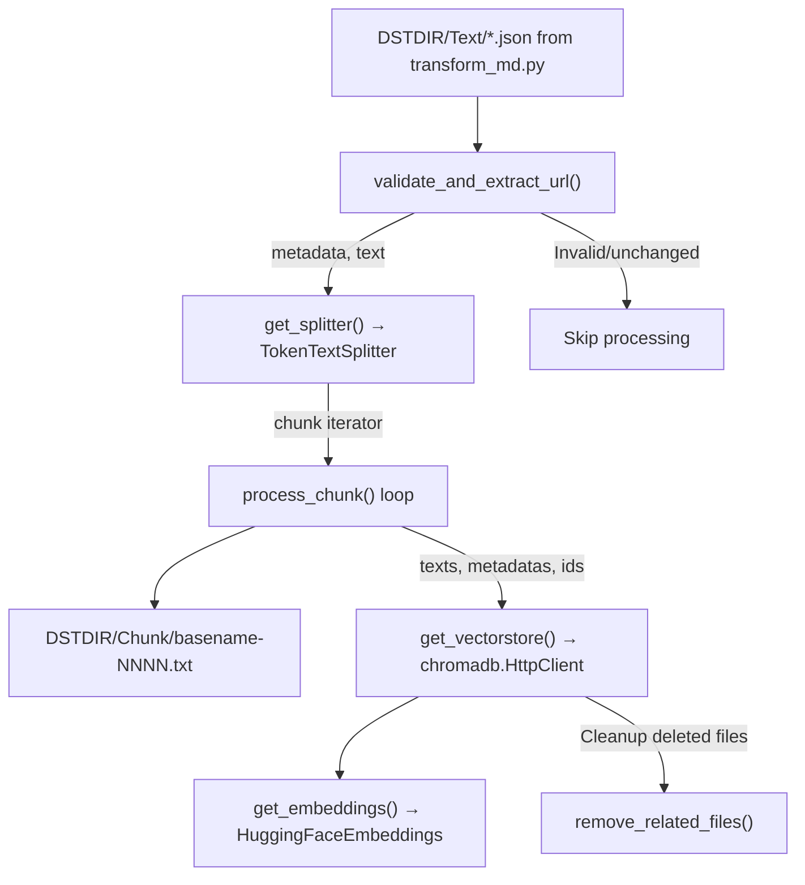
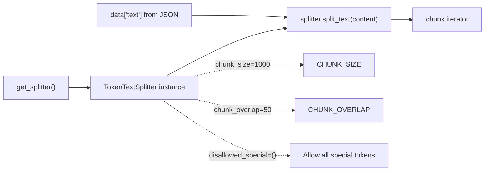
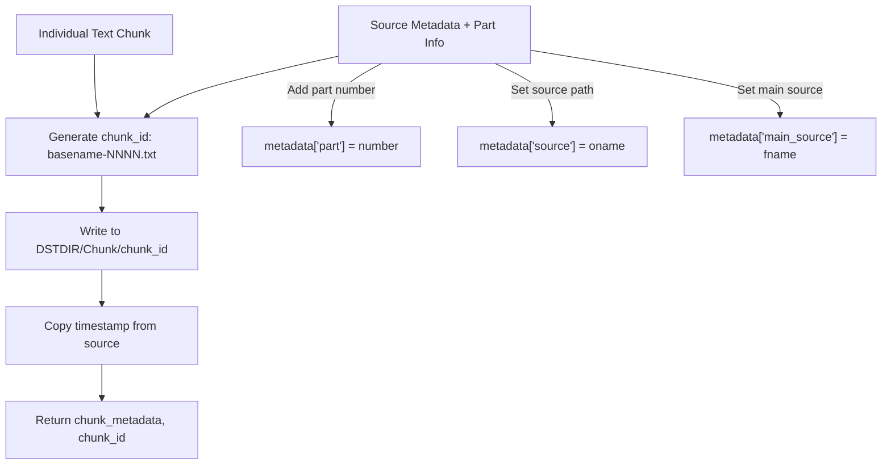
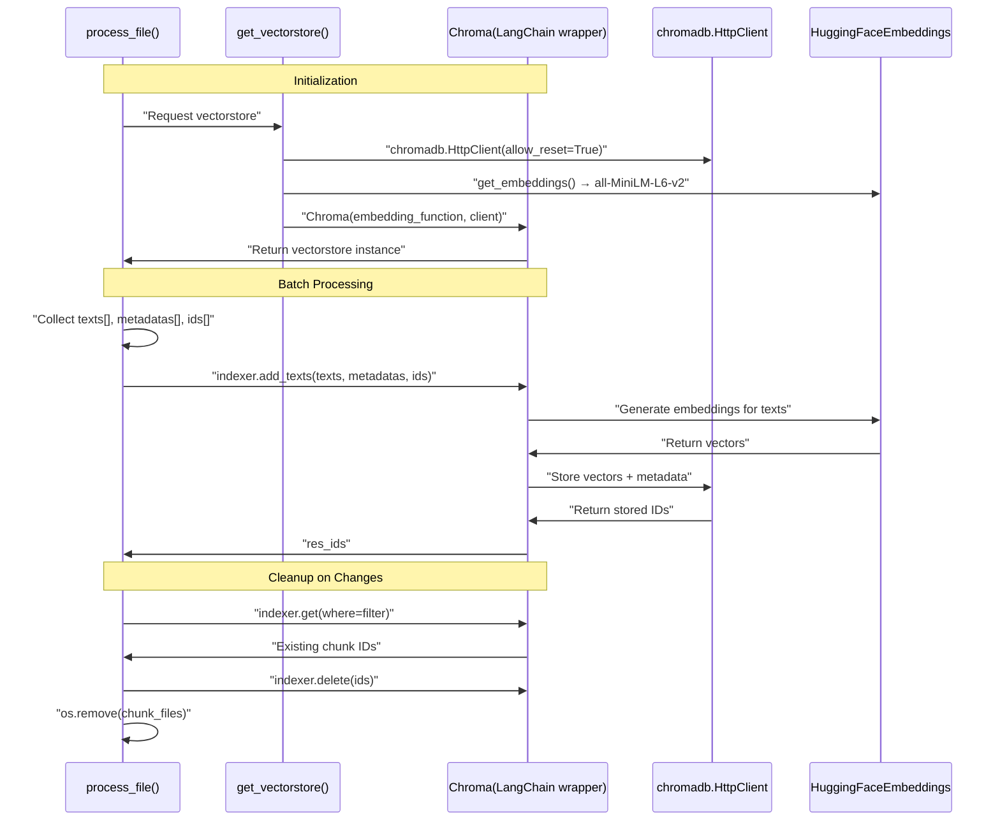
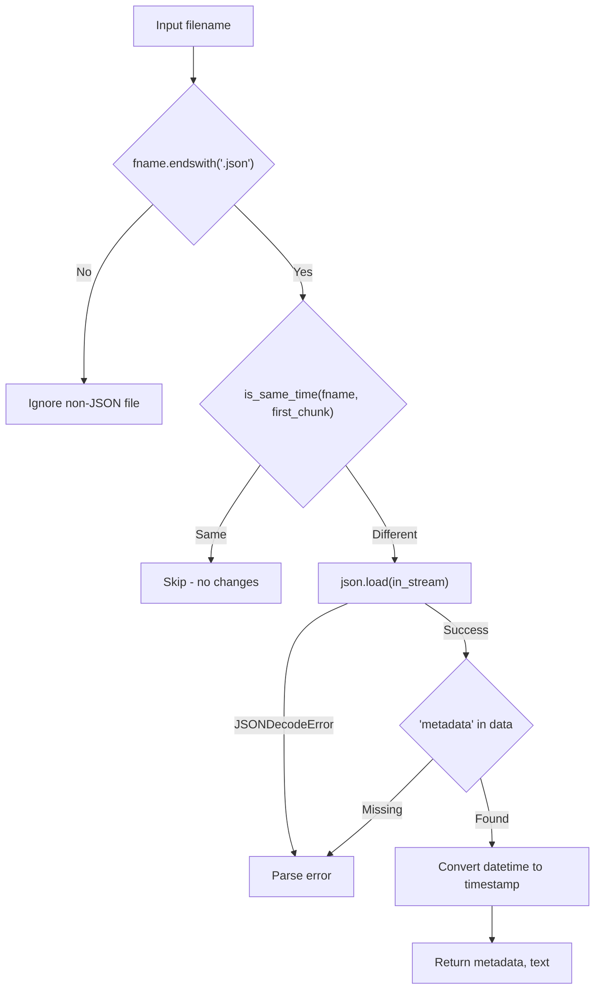
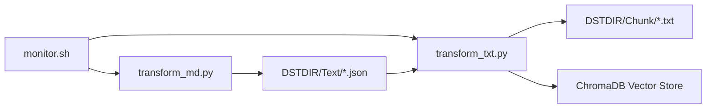

<!-- source: DeepWiki mcp.deepwiki.com · repo flepied/second-brain-agent · page 2.2 Text Chunking and Vectorization · fetched 2026-10-27 -->

# Text Chunking and Vectorization

<details>
<summary>Relevant source files</summary>

The following files were used as context for generating this wiki page:

- [lib.py](lib.py)
- [transform_txt.py](transform_txt.py)

</details>


## Purpose and Scope

This document explains the text chunking and vectorization system implemented in `transform_txt.py`, which is the second stage of the data processing pipeline. This system takes JSON files containing extracted text content and transforms them into searchable vector embeddings stored in ChromaDB.

For information about the initial content extraction from various document formats, see [Markdown and Content Extraction](#2.1). For details about the vector database configuration and deployment, see [Vector Database Setup](#5.1).

## System Overview

The text chunking and vectorization system processes JSON files produced by the content extraction stage and converts them into a searchable vector database. The system handles the complete workflow from text splitting to vector storage, including file management and metadata preservation.

### Processing Pipeline Flow



**Sources**: [transform_txt.py:101-131](), [lib.py:44-72]()

## Text Chunking Process

The system uses LangChain's `TokenTextSplitter` to divide text content into manageable chunks optimized for vector similarity search and LLM processing.

### Chunking Configuration

The chunking parameters are configured as constants to balance context preservation with token limits:

| Parameter | Value | Purpose |
|-----------|-------|---------|
| `CHUNK_SIZE` | 1000 tokens | Maximum size per chunk, optimized for 4096 token LLM limit |
| `CHUNK_OVERLAP` | 50 tokens | Overlap between chunks to preserve context |

**Sources**: [transform_txt.py:18-21]()

### Text Splitter Implementation



The `get_splitter()` function at [transform_txt.py:24-29]() creates a configured `TokenTextSplitter` instance from LangChain that handles token-based text division. The splitter uses tiktoken encoding to count tokens accurately, ensuring chunks stay within the specified token limits while preserving semantic boundaries where possible.

**Sources**: [transform_txt.py:24-29](), [transform_txt.py:116]()

## Chunk Processing and File Management

Each text chunk is processed individually to create both filesystem artifacts and database entries with comprehensive metadata.

### Chunk File Creation



The `process_chunk()` function handles individual chunk processing, creating numbered chunk files with preserved metadata and timestamps.

**Sources**: [transform_txt.py:32-49]()

### Metadata Enhancement

The system enriches each chunk with processing metadata:

- `part`: Sequential chunk number within the document
- `source`: Path to the individual chunk file  
- `main_source`: Path to the original JSON file
- `referer`: Base filename for grouping related chunks

**Sources**: [transform_txt.py:38-43]()

## Vectorization and Database Storage

The system generates vector embeddings for all chunks and stores them in ChromaDB with associated metadata for retrieval operations. The vectorization uses HuggingFace's sentence transformers model accessed via LangChain integrations.

### Vector Storage Process



The vectorization process batches all chunks from a document for efficient storage. The `get_vectorstore()` function at [lib.py:49-72]() handles ChromaDB connection with retry logic (up to 12 attempts with 5-second delays) to ensure the database is available.

**Sources**: [transform_txt.py:129-130](), [lib.py:49-72](), [lib.py:44-46]()

### Embedding Model Configuration

The system uses HuggingFace's `all-MiniLM-L6-v2` sentence transformer model for generating vector embeddings:

| Component | Implementation | Details |
|-----------|---------------|---------|
| Model | `all-MiniLM-L6-v2` | Sentence transformer optimized for semantic similarity |
| Framework | `HuggingFaceEmbeddings` | LangChain wrapper for HuggingFace models |
| Vector Store | `Chroma` | LangChain wrapper for ChromaDB |
| Client | `chromadb.HttpClient` | HTTP client connecting to ChromaDB server on port 8000 |

The `get_embeddings()` function at [lib.py:44-46]() creates the embedding function instance that is passed to the ChromaDB vector store for consistent embedding generation across all operations.

**Sources**: [lib.py:44-46](), [lib.py:49-72]()

## File Validation and Processing Logic

The system includes robust validation to ensure data integrity and avoid unnecessary reprocessing.

### File Validation Pipeline



The `validate_and_extract_url()` function performs comprehensive validation including file format checks, timestamp comparison for change detection, JSON parsing, and metadata validation.

**Sources**: [transform_txt.py:52-76]()

### Datetime Handling

The system handles datetime objects at two stages: deserialization from JSON and conversion for ChromaDB storage.

**JSON Deserialization**: The `datetime_decoder()` function at [lib.py:331-342]() converts ISO format strings and timestamps to Python `datetime` objects when loading JSON files:

```python
# Detects keys ending in '_at' or containing 'date'
if key.endswith("_at") or key.find("date") != -1:
    dct[key] = datetime.datetime.fromisoformat(val)  # from ISO string
    dct[key] = datetime.datetime.fromtimestamp(val)  # from Unix timestamp
```

**ChromaDB Conversion**: Since ChromaDB does not support `datetime` objects in metadata, the system converts them to Unix timestamps at [transform_txt.py:78-81]():

```python
# Convert datetime to timestamp for ChromaDB compatibility
if isinstance(val, datetime.datetime):
    metadata[key] = val.timestamp()
```

This two-stage approach allows the system to work with standard datetime objects internally while ensuring compatibility with ChromaDB's metadata constraints.

**Sources**: [transform_txt.py:78-81](), [lib.py:331-342](), [transform_txt.py:68]()

## Entry Points and Integration

The system provides flexible entry points for integration with the monitoring pipeline and manual processing.

### Main Processing Modes

| Mode | Input Source | Use Case |
|------|-------------|----------|
| Directory scan | `in_dir` parameter | Manual batch processing |
| Stdin processing | `in_dir = "-"` | Pipeline integration with monitor.sh |

The `main()` function supports both directory scanning and stdin-based filename processing, enabling integration with file monitoring systems.

**Sources**: [transform_txt.py:127-141]()

### System Integration Points



The text chunking and vectorization system serves as the critical bridge between extracted content and the queryable knowledge base, enabling the Agent system to perform semantic search and retrieval-augmented generation.

**Sources**: [transform_txt.py:1-148]()

---

