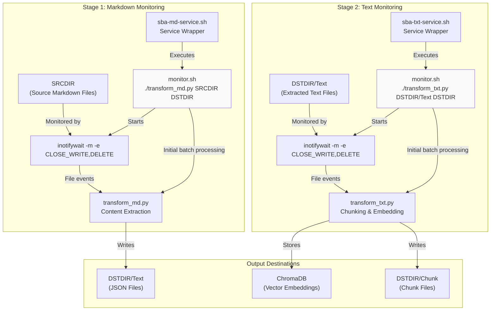
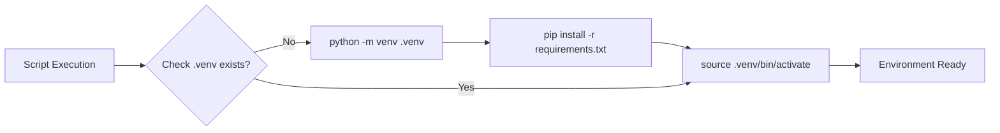
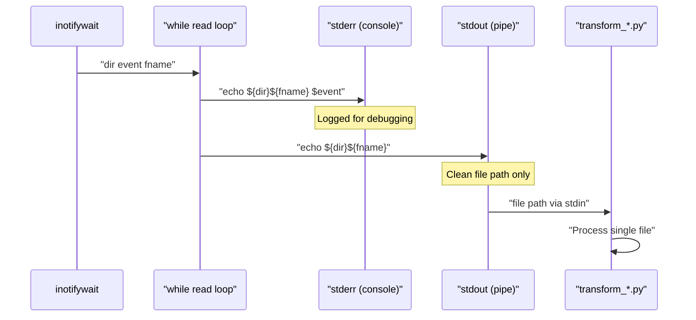
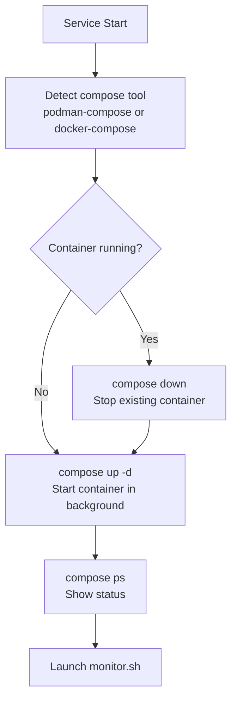
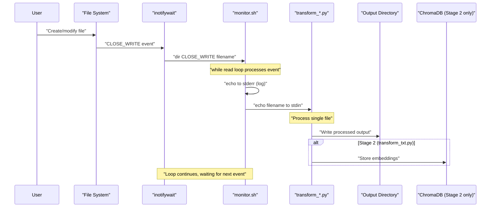
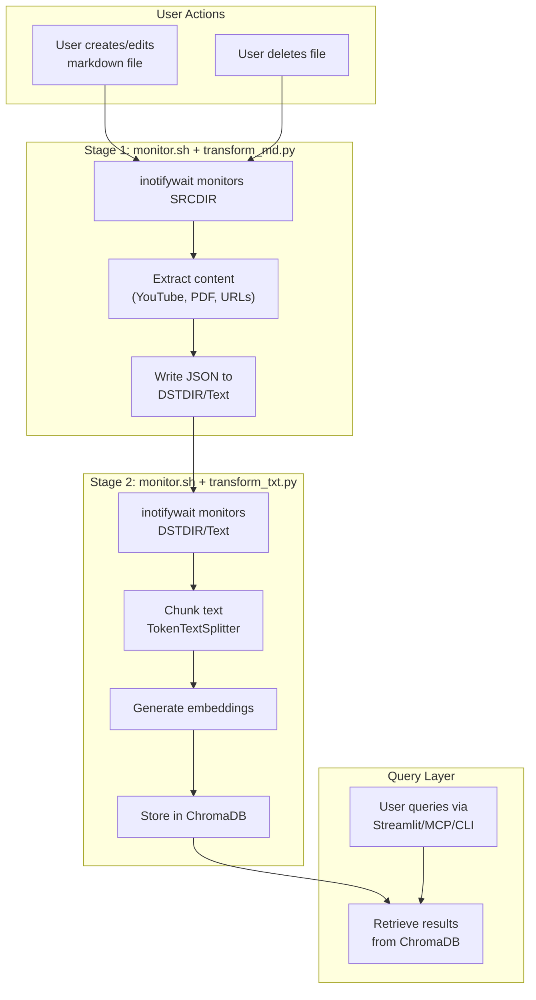
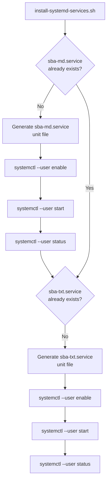

<!-- source: DeepWiki mcp.deepwiki.com · repo flepied/second-brain-agent · page 2.3 File System Monitoring · fetched 2026-10-27 -->

# File System Monitoring

<details>
<summary>Relevant source files</summary>

The following files were used as context for generating this wiki page:

- [install-systemd-services.sh](install-systemd-services.sh)
- [monitor.sh](monitor.sh)
- [sba-md-service.sh](sba-md-service.sh)
- [sba-txt-service.sh](sba-txt-service.sh)

</details>


## Purpose and Scope

This document explains the file system monitoring infrastructure that enables continuous, automated document ingestion in the Second Brain Agent. The monitoring system uses `inotifywait` (from inotify-tools) to detect file changes in real-time and automatically triggers the appropriate transformation scripts.

The monitoring system consists of:
- **`monitor.sh`**: Core orchestration script that handles initial processing and continuous file watching
- **Service wrappers**: `sba-md-service.sh` and `sba-txt-service.sh` that configure and launch monitoring for specific pipeline stages
- **Systemd integration**: User services that ensure continuous background operation

For details on the transformation scripts invoked by the monitoring system, see [Markdown and Content Extraction](#2.1) and [Text Chunking and Vectorization](#2.2). For systemd service configuration, see [System Services](#5.2).

---

## Architecture Overview

The monitoring system implements a two-stage watch-and-process pattern. Each stage monitors a specific directory and invokes the corresponding transformation utility when files are created, modified, or deleted.

### Monitoring Architecture



**Sources:** [monitor.sh:1-42](), [sba-md-service.sh:1-19](), [sba-txt-service.sh:1-42]()

---

## Core Monitoring Script

The `monitor.sh` script is the central orchestration component that implements the watch-and-process pattern. It accepts three arguments and performs two distinct phases: initial batch processing and continuous monitoring.

### Script Arguments and Validation

The script requires three positional arguments:

| Argument | Description | Example |
|----------|-------------|---------|
| `$1` | Transform utility path | `./transform_md.py` |
| `$2` | Source directory to monitor | `$SRCDIR` or `$DSTDIR/Text` |
| `$3` | Target directory for output | `$DSTDIR` |

Validation logic ensures all arguments are present and directories exist:

```
monitor.sh:3-20
- Argument count validation
- Directory existence checks
- Error reporting to stderr
```

**Sources:** [monitor.sh:3-20]()

### Virtual Environment Management

The script automatically creates or activates a Python virtual environment to ensure dependency isolation:



The environment setup occurs at [monitor.sh:24-30](), ensuring the transformation utilities have access to required Python packages.

**Sources:** [monitor.sh:22-30]()

### Two-Phase Processing Model

The monitoring system operates in two distinct phases:

#### Phase 1: Initial Batch Processing

Immediately upon script launch, the specified transform utility processes all existing files in the source directory:

```
monitor.sh:32-34
- Executes transform utility: "$TRANSFORM" "$SRC" "$DST"
- Processes entire directory in batch mode
- Outputs completion message
```

This ensures that any files present before monitoring began are processed, maintaining system consistency.

#### Phase 2: Continuous File Monitoring

After batch processing completes, `inotifywait` enters monitor mode and watches for file system events:

```
monitor.sh:36-39
Event Monitoring:
- inotifywait -m -e CLOSE_WRITE,DELETE "$SRC"
- Monitored events:
  * CLOSE_WRITE: File write completed and closed
  * DELETE: File removed from directory
- Output format: dir event fname
- Piped to transform utility with "-" as source
```

The `-m` flag enables **monitor mode**, which continuously watches for events rather than exiting after the first event. Each detected event generates a line with the directory, event type, and filename, which is piped to the transform utility.

**Sources:** [monitor.sh:32-39]()

### Event Stream Processing



The while loop at [monitor.sh:36-39]() performs dual output:
1. **stderr output** (`${dir}${fname} $event`): Full event information for logging
2. **stdout output** (`${dir}${fname}`): Clean file path piped to transform utility

The transform utility receives file paths via stdin (indicated by the `"-"` argument) and processes them incrementally.

**Sources:** [monitor.sh:36-39]()

---

## Service Wrappers

The service wrappers configure environment-specific parameters and launch `monitor.sh` with appropriate arguments for each pipeline stage.

### Markdown Service Wrapper (sba-md-service.sh)

This wrapper handles the first stage of the pipeline: monitoring markdown source files and extracting content.

#### Configuration Loading

```
sba-md-service.sh:7-10
- Checks for .env file existence
- Sources environment variables
- Exits with error if configuration missing
```

#### Directory Initialization

The script ensures required output directories exist before launching the monitor:

```
sba-md-service.sh:14
Creates:
- $DSTDIR/Orig   (Original downloaded content)
- $DSTDIR/Text   (Extracted text as JSON)
- $DSTDIR/Markdown (Processed markdown files)
```

#### Monitor Launch

```
sba-md-service.sh:16
Invocation: ./monitor.sh ./transform_md.py "$SRCDIR" "$DSTDIR"
- Transform: transform_md.py
- Source: $SRCDIR (user's markdown files)
- Target: $DSTDIR (extraction output)
```

**Sources:** [sba-md-service.sh:1-19]()

### Text Service Wrapper (sba-txt-service.sh)

This wrapper handles the second stage: monitoring extracted text files and generating embeddings.

#### Environment Validation

```
sba-txt-service.sh:14-18
- Validates DSTDIR is configured
- Fails fast if configuration incomplete
```

#### ChromaDB Container Management

The text service manages the ChromaDB Docker container lifecycle:



Container management logic at [sba-txt-service.sh:22-37]():

```
Tool detection: podman-compose or docker-compose
Container cleanup: Stop if already running
Container start: up -d (detached mode)
Status check: ps command output
```

#### Directory Initialization and Monitor Launch

```
sba-txt-service.sh:20
Creates:
- $DSTDIR/Chunk (Text chunks)
- $DSTDIR/Db    (ChromaDB persistent storage)

sba-txt-service.sh:39
Invocation: ./monitor.sh ./transform_txt.py "$DSTDIR/Text" "$DSTDIR"
- Transform: transform_txt.py
- Source: $DSTDIR/Text (JSON files from stage 1)
- Target: $DSTDIR (chunk and embedding output)
```

**Sources:** [sba-txt-service.sh:1-42]()

---

## Event Processing Flow

The following diagram traces a complete event lifecycle from file system change to vector storage:

### Complete Event Flow



**Sources:** [monitor.sh:36-39]()

### Event Types and Handling

The monitoring system responds to two specific inotify events:

| Event Type | Trigger Condition | Processing Behavior |
|------------|-------------------|---------------------|
| `CLOSE_WRITE` | File written and closed | Full processing of the file |
| `DELETE` | File removed | Cleanup or removal processing |

Both events are specified in [monitor.sh:36]() with the `-e CLOSE_WRITE,DELETE` flags.

**Key Behavior:** The `CLOSE_WRITE` event ensures files are only processed after write operations complete, preventing partial file processing that could occur with simpler events like `MODIFY`.

**Sources:** [monitor.sh:36]()

---

## Integration with Processing Pipeline

The monitoring system serves as the orchestration layer that connects file system changes to the data processing pipeline.

### Pipeline Integration Points



**Sources:** [monitor.sh:1-42](), [sba-md-service.sh:16](), [sba-txt-service.sh:39]()

### Cascading Pipeline Behavior

The two-stage monitoring creates a cascading effect:

1. **Stage 1 Trigger**: User modifies markdown file in `$SRCDIR`
   - `inotifywait` in `sba-md-service` detects event
   - `transform_md.py` processes file
   - JSON output written to `$DSTDIR/Text`

2. **Stage 2 Trigger**: JSON file created in `$DSTDIR/Text`
   - `inotifywait` in `sba-txt-service` detects event
   - `transform_txt.py` processes JSON
   - Chunks and embeddings stored in ChromaDB

This design decouples content extraction from vectorization, allowing each stage to be developed, tested, and monitored independently.

**Sources:** [sba-md-service.sh:16](), [sba-txt-service.sh:39]()

---

## Systemd Service Integration

The monitoring scripts run as continuous background processes managed by systemd user services. The installation and configuration is handled by `install-systemd-services.sh`.

### Service Installation Process



**Sources:** [install-systemd-services.sh:1-50]()

### Service Configuration

Both services share a common structure defined in [install-systemd-services.sh:8-26]() and [install-systemd-services.sh:28-47]():

| Service Property | Value | Purpose |
|-----------------|-------|---------|
| `Type` | `simple` | Standard long-running process |
| `ExecStart` | `$PWD/sba-*-service.sh` | Absolute path to wrapper script |
| `TimeoutStartSec` | `0` | No startup timeout (continuous monitoring) |
| `RemainAfterExit` | `yes` | Service considered active after script exits |
| `After` | `network.target` | Start after network is available |
| `WantedBy` | `default.target` | Start automatically on user login |

The `RemainAfterExit=yes` setting is critical because the monitoring scripts run indefinitely; this setting ensures systemd treats them as active services.

**Sources:** [install-systemd-services.sh:8-26](), [install-systemd-services.sh:28-47]()

---

## Summary

The file system monitoring infrastructure provides automated, continuous document ingestion through:

1. **`monitor.sh`**: Core orchestration script implementing batch + watch pattern
2. **`inotifywait`**: Real-time file system event detection for `CLOSE_WRITE` and `DELETE` events
3. **Service wrappers**: Environment-specific configuration and process launching
4. **Systemd integration**: Reliable background execution and automatic startup

This architecture enables a fully automated pipeline where users simply create or modify markdown files, and the system automatically extracts content, generates embeddings, and stores them in ChromaDB without manual intervention.

**Key Design Principles:**
- **Decoupled stages**: Markdown extraction and text vectorization run independently
- **Batch + incremental**: Initial full processing followed by incremental updates
- **Event-driven**: File changes trigger processing immediately
- **Fault-tolerant**: Systemd ensures processes restart after failures
- **Dependency-isolated**: Virtual environment management prevents conflicts

For details on what happens during transformation, see [Markdown and Content Extraction](#2.1) and [Text Chunking and Vectorization](#2.2). For systemd service management commands, see [System Services](#5.2).

**Sources:** [monitor.sh:1-42](), [sba-md-service.sh:1-19](), [sba-txt-service.sh:1-42](), [install-systemd-services.sh:1-50]()

---

