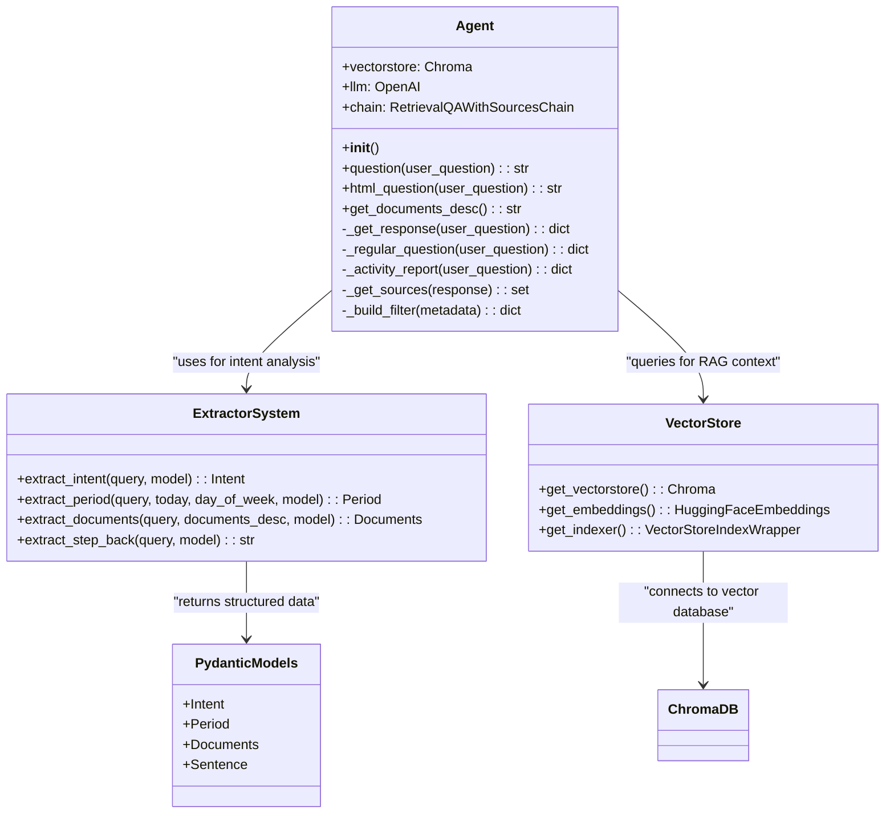
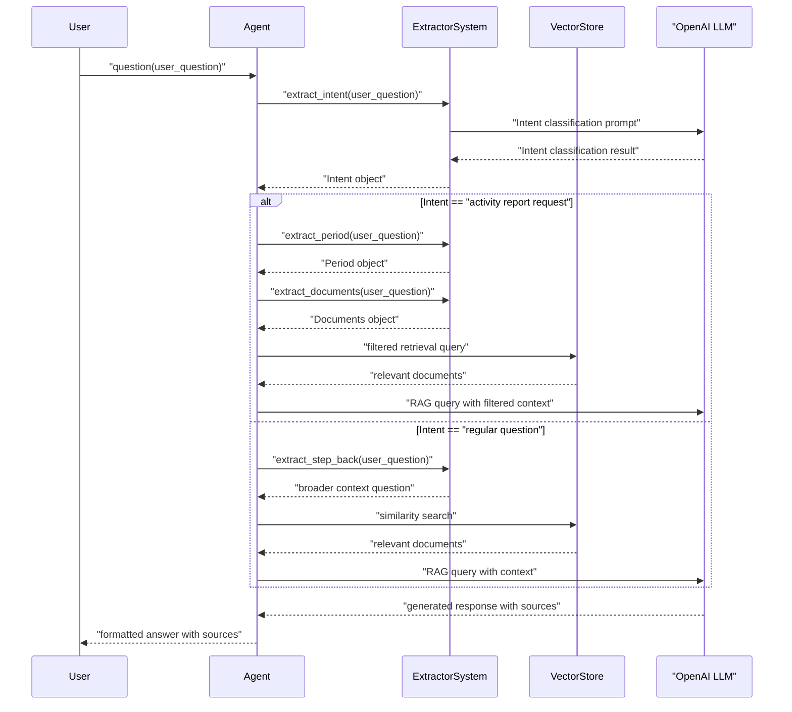
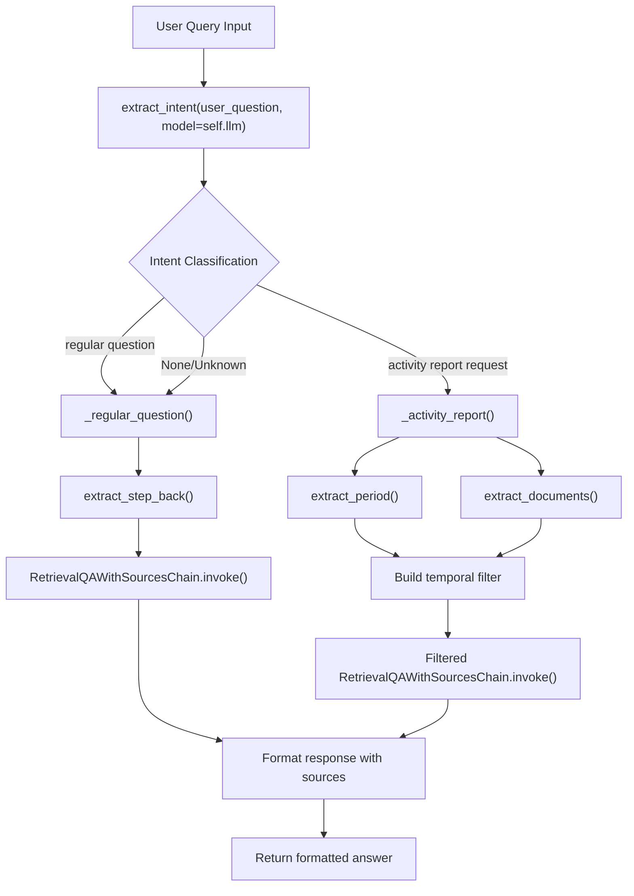
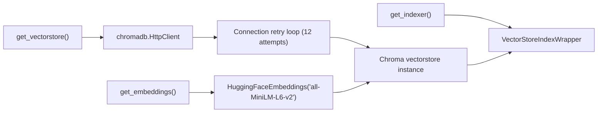

<!-- source: DeepWiki mcp.deepwiki.com · repo flepied/second-brain-agent · page 3 Agent and Intelligence Layer · fetched 2026-10-27 -->

# Agent and Intelligence Layer

<details>
<summary>Relevant source files</summary>

The following files were used as context for generating this wiki page:

- [extractors.py](extractors.py)
- [lib.py](lib.py)
- [qa.py](qa.py)

</details>


This document covers the core artificial intelligence components that power the Second Brain Agent system. The Agent and Intelligence Layer provides intelligent query processing, intent classification, retrieval-augmented generation (RAG), and natural language understanding capabilities.

For detailed implementation of the core `Agent` class, see [Core Agent System](#3.1). For specifics on intent classification algorithms, see [Intent Classification and Extraction](#3.2). For user-facing query interfaces, see [User Interfaces](#4).

## Architecture Overview

The Agent and Intelligence Layer consists of two primary components: the core `Agent` class that orchestrates LLM interactions and vector database queries, and the `extractors` module that provides intent classification and metadata extraction capabilities.

### Agent Intelligence Architecture



**Sources:** [lib.py:109-257](), [extractors.py:1-246]()

### Intelligence Processing Flow



**Sources:** [lib.py:136-175](), [lib.py:177-228](), [lib.py:230-236]()

## Core Intelligence Components

### Agent Class Implementation

The `Agent` class in [lib.py:109-257]() serves as the primary orchestrator for all intelligent query processing. It integrates multiple AI services and provides a unified interface for natural language understanding and response generation.

| Component | Purpose | Implementation |
|-----------|---------|----------------|
| `vectorstore` | Vector database connection | ChromaDB with HTTP client |
| `llm` | Language model interface | OpenAI with temperature=0 |
| `chain` | RAG pipeline | RetrievalQAWithSourcesChain |

The agent initializes its core components in [lib.py:112-119]():

```python
def __init__(self):
    self.vectorstore = get_vectorstore()
    self.llm = OpenAI(temperature=0)
    self.chain = RetrievalQAWithSourcesChain.from_llm(
        llm=self.llm,
        retriever=self.vectorstore.as_retriever(),
    )
```

### Query Processing Methods

The Agent provides multiple query interfaces optimized for different output formats:

- `question(user_question)` - Returns plain text responses with source citations [lib.py:136-146]()
- `html_question(user_question)` - Returns HTML-formatted responses with clickable source links [lib.py:148-162]()

Both methods use the private `_get_response()` method [lib.py:168-175]() which implements intent-based routing to determine the appropriate processing strategy.

**Sources:** [lib.py:136-175]()

### Intent-Based Query Routing



**Sources:** [lib.py:168-175](), [lib.py:177-228](), [lib.py:230-236]()

## Intent Classification System

The `extractors.py` module provides specialized functions for analyzing user queries and extracting structured information. Each extractor uses Pydantic models for type-safe output and LangChain prompt templates for consistent LLM interactions.

### Available Extractors

| Extractor Function | Return Type | Purpose |
|------------------|-------------|---------|
| `extract_intent()` | `Intent` | Classifies query type (regular vs activity report) |
| `extract_period()` | `Period` | Extracts date ranges from temporal queries |
| `extract_documents()` | `Documents` | Selects relevant document domains |
| `extract_step_back()` | `str` | Generates broader context questions |

### Intent Classification Implementation

The intent classifier uses a prompt template to distinguish between different query types [extractors.py:79-83]():

```python
_INTENT_PROMPT = PromptTemplate(
    template="Please analyze the following question to classify if this is an activity report request, a summary request, or a regular question.\n{format_instructions}\nQuestion: {query}\n",
    input_variables=["query"],
    partial_variables={"format_instructions": _INTENT_PARSER.get_format_instructions()},
)
```

### Temporal Query Processing

For activity report requests, the system extracts temporal constraints using the `extract_period()` function [extractors.py:40-63]() which handles various time expressions:

- Specific dates and ranges
- Relative time ("last week", "this month")  
- Current context awareness (today's date and day of week)

**Sources:** [extractors.py:24-63](), [extractors.py:71-101]()

## Vector Store Integration

The intelligence layer integrates tightly with ChromaDB for semantic search and retrieval-augmented generation.

### Vector Store Configuration



The vector store connection includes robust error handling with exponential backoff [lib.py:49-72]():

```python
def get_vectorstore():
    client = chromadb.HttpClient(settings=chromadb.config.Settings(allow_reset=True))
    tries = 0
    while tries < 12:
        tries += 1
        try:
            vectorstore = Chroma(
                embedding_function=get_embeddings(),
                client=client,
            )
            break
        except Exception as expt:
            print(f"Could not connect to the vector store, retrying in 5 seconds ({tries})")
            time.sleep(5)
```

### Metadata Filtering for Activity Reports

The Agent constructs complex metadata filters for activity report queries [lib.py:179-228](), combining temporal constraints with document domain filtering:

- **Temporal filtering**: Converts extracted dates to timestamps for `last_accessed_at` field
- **Domain filtering**: Uses document names from `extract_documents()` to filter by `domain` field  
- **Type filtering**: Restricts to history-type documents using `type` field

**Sources:** [lib.py:44-77](), [lib.py:179-228]()

## Utility Functions and Supporting Infrastructure

The intelligence layer includes several utility functions that support the core AI capabilities:

### Text Processing Utilities

- `cleanup_text()` [lib.py:28-41]() - Removes URLs, hashtags, and normalizes whitespace
- `local_link()` [lib.py:102-106]() - Converts file paths to local file:// URLs
- `is_history_filename()` [lib.py:93-99]() - Identifies document types for filtering

### Response Formatting

The Agent provides specialized methods for formatting responses with source citations:

- `_get_sources()` [lib.py:245-248]() - Extracts and deduplicates source URLs from responses
- `_filter_file()` [lib.py:164-166]() - Removes file:// prefixes from source paths for display

**Sources:** [lib.py:28-106](), [lib.py:164-166](), [lib.py:245-248]()

---

