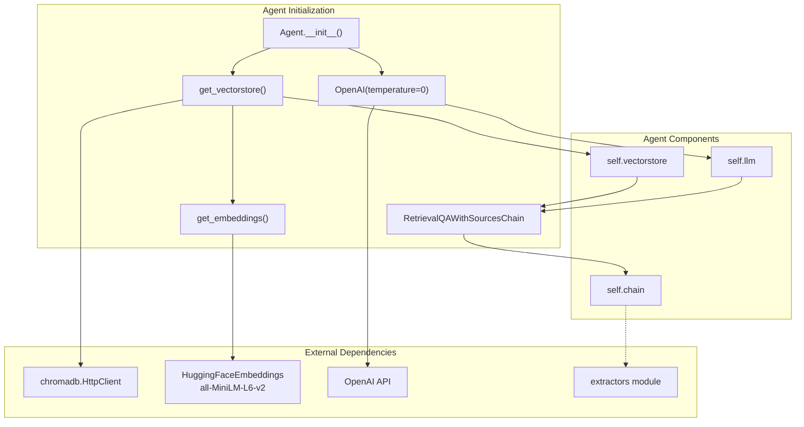
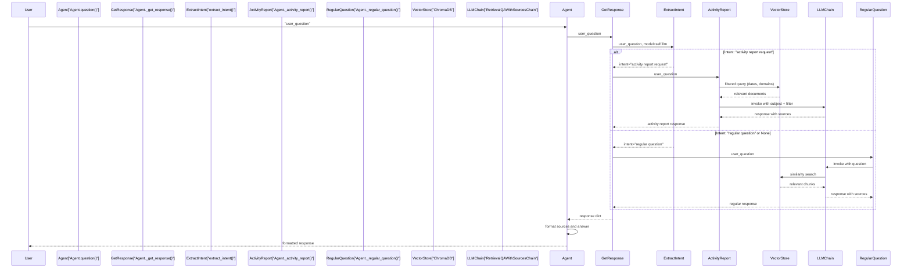

<!-- source: DeepWiki mcp.deepwiki.com · repo flepied/second-brain-agent · page 3.1 Core Agent System · fetched 2026-10-27 -->

# Core Agent System

<details>
<summary>Relevant source files</summary>

The following files were used as context for generating this wiki page:

- [example.env](example.env)
- [lib.py](lib.py)
- [test_lib.py](test_lib.py)

</details>


## Purpose and Scope

The Core Agent System serves as the intelligent orchestration layer of the Second Brain Agent, implemented primarily in the `Agent` class within [lib.py](). This system coordinates LLM interactions, vector database queries, and response generation to provide intelligent question-answering capabilities. The agent uses intent classification to route different types of queries and applies retrieval-augmented generation (RAG) patterns to deliver contextually relevant answers with source attribution.

For information about the intent classification subsystem that feeds into this agent, see [Intent Classification and Extraction](#3.2). For details about the vector database setup that the agent queries, see [Vector Database Setup](#5.1).

## Agent Architecture Overview

The `Agent` class integrates multiple AI components to create a cohesive question-answering system:



**Sources:** [lib.py:109-119](), [lib.py:44-46](), [lib.py:49-72]()

## Core Agent Class Structure

The `Agent` class provides the primary interface for intelligent document querying:

| Method | Purpose | Return Type |
|--------|---------|-------------|
| `__init__()` | Initialize vectorstore, LLM, and retrieval chain | None |
| `question(user_question)` | Process question and return text-formatted response | str |
| `html_question(user_question)` | Process question and return HTML-formatted response | str |
| `get_documents_desc()` | Retrieve domain organization documentation | str |
| `_get_response(user_question)` | Core response orchestration with intent routing | dict |
| `_activity_report(user_question)` | Handle activity/history report requests | dict |
| `_regular_question(user_question)` | Handle standard question-answering | dict |

**Sources:** [lib.py:109-257]()

## Question Processing Flow

The agent uses a sophisticated routing system based on intent classification to handle different types of queries:



**Sources:** [lib.py:136-146](), [lib.py:168-175](), [lib.py:177-228](), [lib.py:230-236]()

## Intent-Based Query Routing

The agent employs intent classification to optimize retrieval strategies for different query types:

### Regular Questions
For standard information retrieval queries, the agent uses the base `RetrievalQAWithSourcesChain` without filters:

```python
# From _regular_question method
res_step_back = extract_step_back(user_question)
res = self.chain.invoke({"question": user_question})
```

**Sources:** [lib.py:230-236]()

### Activity Report Requests  
For activity-based queries, the agent constructs complex metadata filters:

```mermaid
graph TD
    ActivityQuery["Activity Report Request"]
    ExtractPeriod["extract_period()"]
    ExtractDocuments["extract_documents()"] 
    BuildFilter["Build Complex Filter"]
    FilteredRetrieval["Filtered Vector Search"]
    
    ActivityQuery --> ExtractPeriod
    ActivityQuery --> ExtractDocuments
    ExtractPeriod --> BuildFilter
    ExtractDocuments --> BuildFilter
    
    subgraph "Filter Construction"
        TypeFilter['"type": {"$eq": "history"}']
        DateFilter['"last_accessed_at": {"$gte": start, "$lte": end}']
        DomainFilter['"domain": {"$eq": document_name}']
        AndClause['"$and": [type, dates, domains]']
    end
    
    BuildFilter --> TypeFilter
    BuildFilter --> DateFilter  
    BuildFilter --> DomainFilter
    TypeFilter --> AndClause
    DateFilter --> AndClause
    DomainFilter --> AndClause
    
    AndClause --> FilteredRetrieval
```

**Sources:** [lib.py:177-228](), [lib.py:183-226]()

## Vector Database Integration

The agent interfaces with ChromaDB through the Langchain abstraction layer:

### Connection Management
The `get_vectorstore()` function implements retry logic for robust database connections:

```python
# Retry mechanism with exponential backoff
tries = 0
while tries < 12:
    tries += 1
    try:
        vectorstore = Chroma(
            embedding_function=get_embeddings(),
            client=client,
        )
        break
    except Exception as expt:
        time.sleep(5)
        continue
```

### Embedding Configuration
The system uses HuggingFace's `all-MiniLM-L6-v2` model for consistent text embeddings:

```python
def get_embeddings():
    return HuggingFaceEmbeddings(model_name="all-MiniLM-L6-v2")
```

**Sources:** [lib.py:49-72](), [lib.py:44-46]()

## Response Formatting and Source Attribution

The agent provides dual output formats with comprehensive source tracking:

### Text Format Response
The `question()` method strips file:// prefixes and formats sources as a bulleted list:

```python
if response["sources"] not in ("None.", "N/A", "I don't know.") and len(response["sources"]) > 0:
    sources = "- " + "\n- ".join(self._filter_file(self._get_sources(response)))
    return f"{response['answer']}\nSources:\n{sources}"
```

### HTML Format Response  
The `html_question()` method generates clickable file links using the `local_link()` function:

```python
sources = "- " + "\n- ".join([
    f'<a href="{local_link(src)}">{src}</a>' 
    for src in self._get_sources(response)
])
```

### Source URL Resolution
The agent resolves chunk-level sources back to original document URLs through metadata lookups:

```python
def _get_source(self, source):
    try:
        return self.vectorstore.get(where={"source": source})["metadatas"][0]["url"]
    except IndexError:
        return source
```

**Sources:** [lib.py:136-162](), [lib.py:238-248](), [lib.py:102-106]()

## Supporting Utilities

### Document Organization Integration
The agent reads domain descriptions from a configurable organization document:

```python
def get_documents_desc(self):
    with open(
        os.path.join(
            os.environ.get("SRCDIR"),
            os.environ.get("SBA_ORG_DOC", "SecondBrainOrganization.md"),
        ), "r", encoding="UTF-8"
    ) as desc_file:
        return desc_file.read()
```

### Text Cleanup Utilities
The `cleanup_text()` function standardizes text formatting by removing URLs, hashtags, and excess whitespace:

```python
def cleanup_text(text):
    text = re.sub(r"https?://\S+", "", text)
    text = text.replace("#", "")
    text = re.sub(r"^[ \t]+$", "", text, flags=re.M)
    text = re.sub(r"[ \t]{2,}", " ", text)
    text = re.sub(r"\n{3,}", "\n\n", text)
    return text
```

**Sources:** [lib.py:121-134](), [lib.py:28-41]()

---

