<!-- source: DeepWiki mcp.deepwiki.com · repo flepied/second-brain-agent · page 3.2 Intent Classification and Extraction · fetched 2026-10-27 -->

# Intent Classification and Extraction

<details>
<summary>Relevant source files</summary>

The following files were used as context for generating this wiki page:

- [extractors.py](extractors.py)
- [lib.py](lib.py)
- [qa.py](qa.py)

</details>


## Purpose and Scope

This document explains the `extractors.py` module, which provides LLM-based query parsing capabilities for the Second Brain Agent. The module implements five specialized extractors that analyze user queries to extract structured information: intent classification, time periods, document names, step-back questions, and temporal-free sentence rephrasing. These extractors enable the Agent to route queries intelligently and construct appropriate retrieval strategies.

For information about how the Agent uses these extractors for RAG orchestration, see [Core Agent System](#3.1). For details on the query interfaces that provide user input to the Agent, see [User Interfaces](#4).

---

## Architecture Overview

The extraction pipeline uses a consistent pattern across all extractors: Pydantic models define output schemas, `PydanticOutputParser` handles structured parsing, and `PromptTemplate` objects encode extraction logic. Each extractor function invokes an LLM with a specialized prompt and returns typed results.

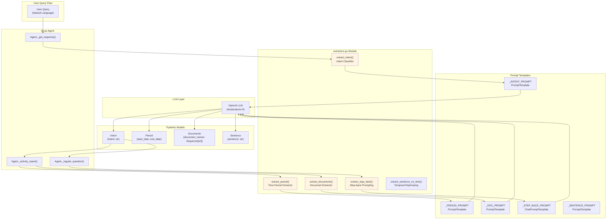

**Query Processing Flow**: The `Agent._get_response()` method first calls `extract_intent()` to classify the query. Based on the classification, it routes to either `_activity_report()` (which calls `extract_period()` and `extract_documents()`) or `_regular_question()` (which calls `extract_step_back()`).

Sources: [extractors.py:1-246](), [lib.py:168-236]()

---

## Intent Classification

The `extract_intent()` function classifies user queries into three categories: "activity report request", "summary request", or "regular question". This classification determines the retrieval strategy used by the Agent.

### Intent Pydantic Model

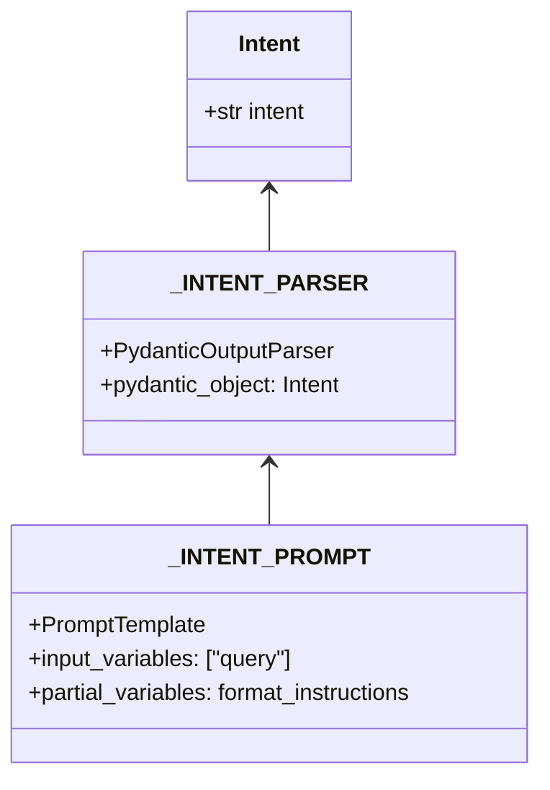

Sources: [extractors.py:71-83]()

### Implementation Details

| Component | Details |
|-----------|---------|
| Function | `extract_intent(query: str, model: BaseLLM = None) -> Optional[Intent]` |
| Input | Raw user query string |
| Output | `Intent` object with `intent` field, or `None` if parsing fails |
| Default Model | `OpenAI(temperature=0)` |
| Prompt Template | [extractors.py:79-83]() |

The prompt instructs the LLM to classify queries as:
- **Activity Report Request**: Queries asking for summaries of activities over time periods
- **Summary Request**: Queries requesting comprehensive summaries
- **Regular Question**: Standard factual questions

### Agent Integration

The Agent uses intent classification in `_get_response()` to route queries:

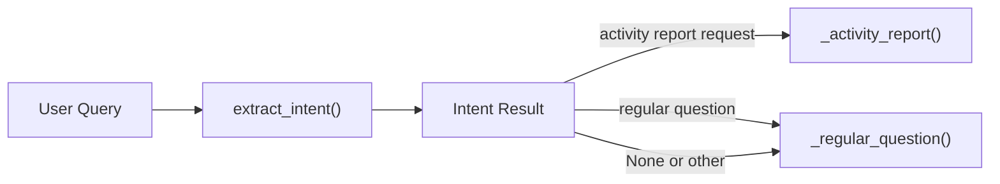

Sources: [lib.py:168-176](), [extractors.py:86-101]()

**Code Example**: [lib.py:170-175]()
```python
res_intent = extract_intent(user_question, model=self.llm)
if res_intent is None or res_intent.intent.lower() == "regular question":
    return self._regular_question(user_question)
if res_intent.intent.lower() == "activity report request":
    return self._activity_report(user_question)
```

---

## Period Extraction

The `extract_period()` function parses temporal references in queries and returns structured date ranges. This enables the Agent to filter history entries by time when handling activity report requests.

### Period Pydantic Model

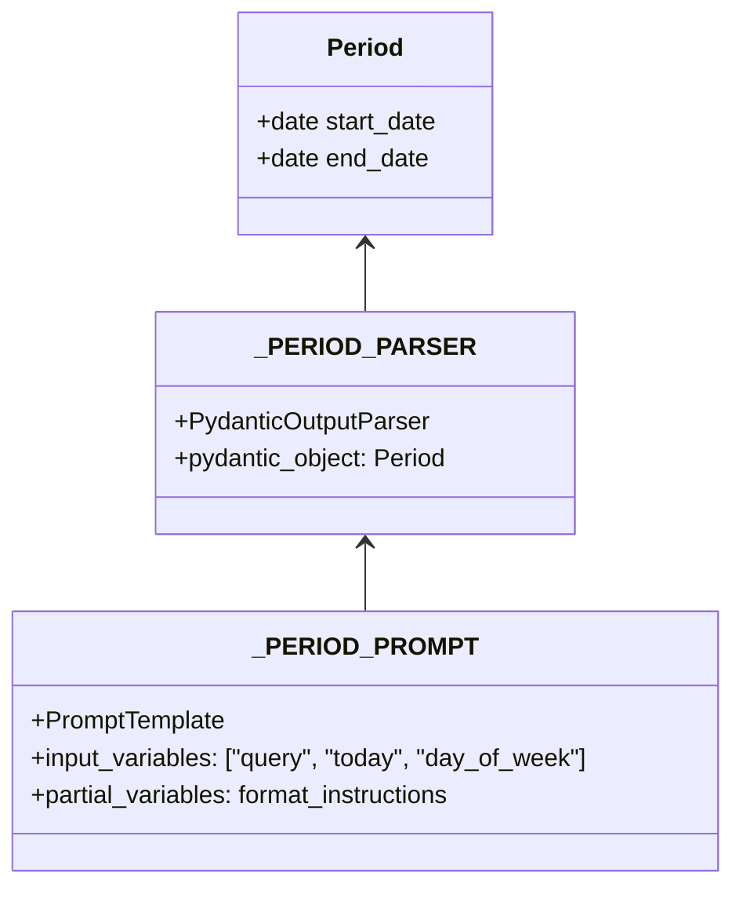

Sources: [extractors.py:24-37]()

### Temporal Context Handling

The extractor incorporates contextual information to resolve relative time references:

| Parameter | Purpose | Default Value |
|-----------|---------|---------------|
| `today` | Current date reference | `date.today().strftime("%Y-%m-%d")` |
| `day_of_week` | Current day name | `date.today().strftime("%A")` |

The prompt template [extractors.py:33-37]() includes special instructions:
- **Month references**: Start on the 1st day, end on the last day
- **Week references**: Start on Monday, end on Sunday
- **Relative references**: Resolve using the provided `today` and `day_of_week` context

### Activity Report Integration

The Agent uses period extraction in `_activity_report()` to build ChromaDB filter clauses:

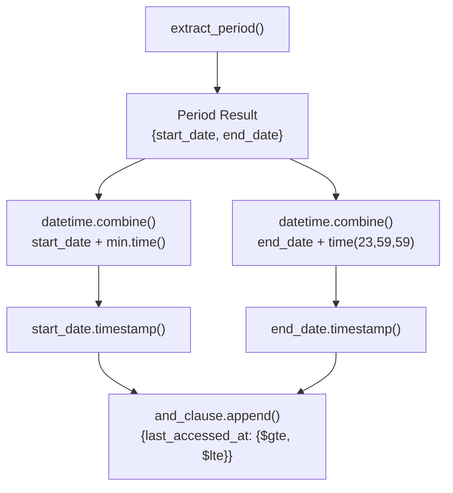

Sources: [lib.py:183-196](), [extractors.py:40-63]()

**Code Example**: [lib.py:188-196]()
```python
start_date = datetime.datetime.combine(
    res_dates.start_date, datetime.datetime.min.time()
).timestamp()
and_clause.append({"last_accessed_at": {"$gte": start_date}})

end_date = datetime.datetime.combine(
    res_dates.end_date, datetime.time(23, 59, 59)
).timestamp()
and_clause.append({"last_accessed_at": {"$lte": end_date}})
```

---

## Document Extraction

The `extract_documents()` function identifies relevant document domains from user queries by comparing the query against a document description file. This enables domain-filtered retrieval for activity reports.

### Documents Pydantic Model

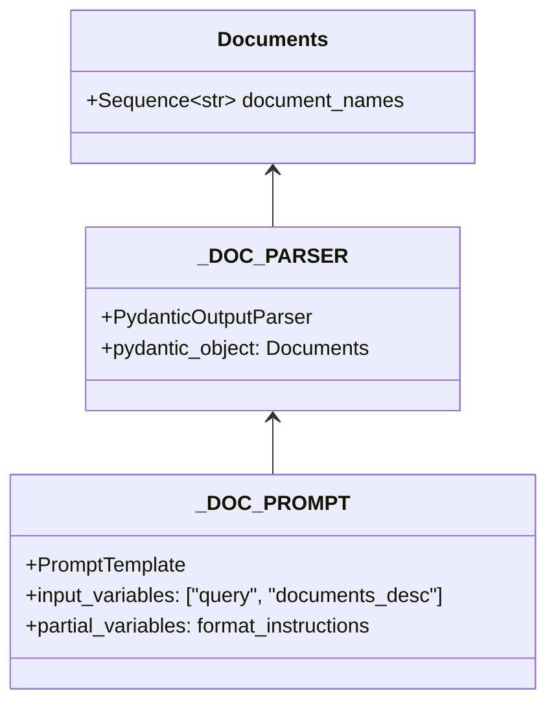

Sources: [extractors.py:109-121]()

### Document Description Integration

The extractor requires a `documents_desc` parameter that describes available document domains. The Agent retrieves this from the organization file:

| Component | Details |
|-----------|---------|
| Function | `extract_documents(query, documents_desc, model) -> Optional[Documents]` |
| Document Source | `Agent.get_documents_desc()` reads from `SRCDIR/SecondBrainOrganization.md` |
| Fallback | Returns empty string if organization file not found |
| Configuration | Set via `SBA_ORG_DOC` environment variable (default: `SecondBrainOrganization.md`) |

Sources: [lib.py:121-134](), [extractors.py:124-142]()

### Filter Construction for Multiple Documents

The Agent converts extracted document names into ChromaDB filter clauses using logical OR for multiple documents:

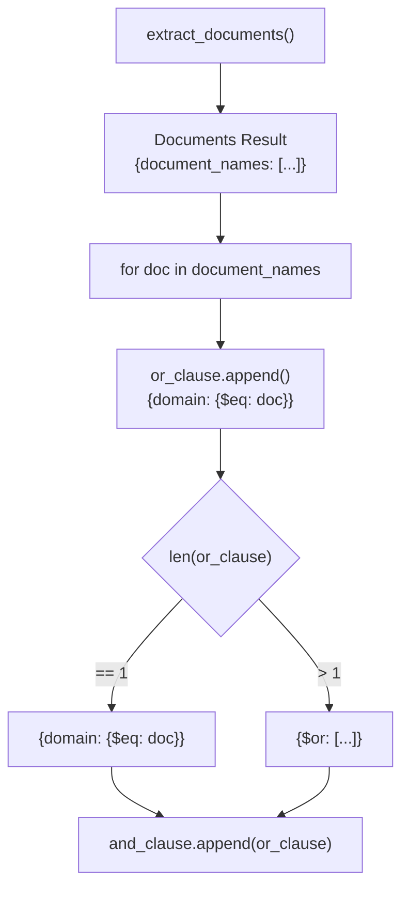

Sources: [lib.py:200-213]()

**Code Example**: [lib.py:204-213]()
```python
or_clause = []
for doc in res_doc.document_names:
    or_clause.append({"domain": {"$eq": doc}})
if len(or_clause) > 1:
    or_clause = {"$or": or_clause}
elif len(or_clause) == 1:
    or_clause = or_clause[0]
if or_clause != []:
    and_clause.append(or_clause)
```

---

## Step-back Prompting

The `extract_step_back()` function implements step-back prompting, a technique that rephrases specific questions into broader, more general questions to improve context retrieval.

### Few-Shot Prompt Architecture

Step-back prompting uses a `FewShotChatMessagePromptTemplate` with example transformations:

| Original Question | Step-back Question |
|------------------|-------------------|
| "Could the members of The Police perform lawful arrests?" | "what can the members of The Police do?" |
| "Jan Sindel's was born in what country?" | "what is Jan Sindel's personal history?" |

Sources: [extractors.py:191-212]()

### Prompt Template Structure

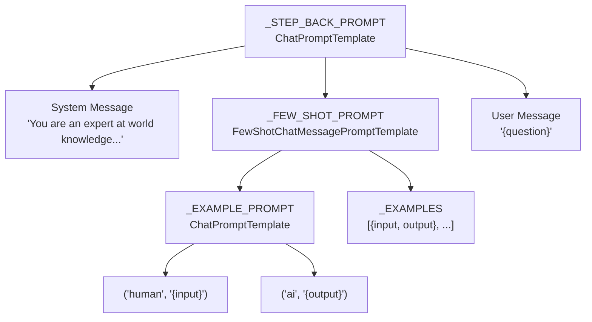

Sources: [extractors.py:189-225]()

### Implementation Details

| Component | Details |
|-----------|---------|
| Function | `extract_step_back(query: str, model: BaseLLM = None) -> Optional[Sentence]` |
| Output | String containing the step-back question, or `None` if extraction fails |
| Prompt Type | `ChatPromptTemplate` (multi-message format) |
| Parsing | Manual extraction via `output.split("AI: ")[1].strip()` |

The function does not use a Pydantic parser; instead, it extracts the step-back question by splitting the LLM response on the "AI: " delimiter.

### Regular Question Integration

The Agent calls `extract_step_back()` in `_regular_question()` but currently only logs the result without modifying the query:

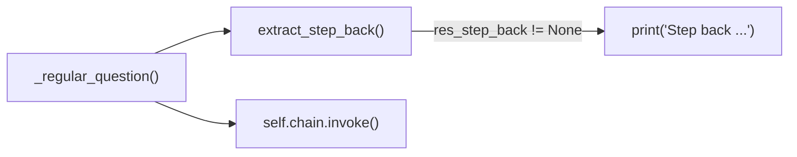

Sources: [lib.py:230-236](), [extractors.py:228-243]()

**Code Example**: [lib.py:232-235]()
```python
res_step_back = extract_step_back(user_question)
if res_step_back is not None:
    print(f"Step back {res_step_back}", file=sys.stderr)
res = self.chain.invoke({"question": user_question})
```

---

## Sentence Rephrasing (Temporal Removal)

The `extract_sentence_no_time()` function rephrases sentences to remove temporal references. This extractor is currently defined but not actively used in the codebase.

### Sentence Pydantic Model

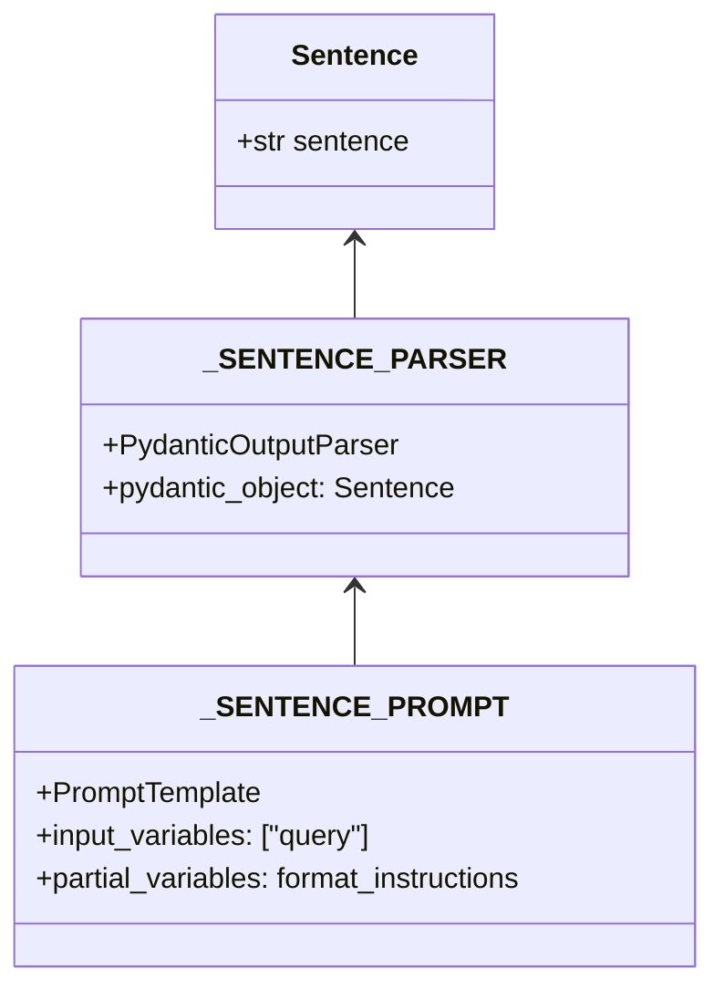

Sources: [extractors.py:150-164]()

### Implementation Details

| Component | Details |
|-----------|---------|
| Function | `extract_sentence_no_time(query: str, model: BaseLLM = None) -> Optional[Sentence]` |
| Purpose | Remove temporal references from sentences |
| Prompt | "Please rephrase the following sentence to remove any notion of time." |
| Current Usage | Not actively called by Agent or CLI tools |

Sources: [extractors.py:167-182]()

---

## Common Patterns and Design

All extractors in the module follow a consistent architectural pattern:

### Shared Components

| Component | Type | Purpose |
|-----------|------|---------|
| Pydantic Model | `BaseModel` subclass | Defines structured output schema |
| Parser | `PydanticOutputParser` | Converts LLM text output to typed objects |
| Prompt Template | `PromptTemplate` or `ChatPromptTemplate` | Encodes extraction logic and format instructions |
| Extractor Function | Function returning `Optional[Model]` | Orchestrates LLM invocation and parsing |

### Error Handling

All extractors use try-except blocks to handle parsing failures gracefully:

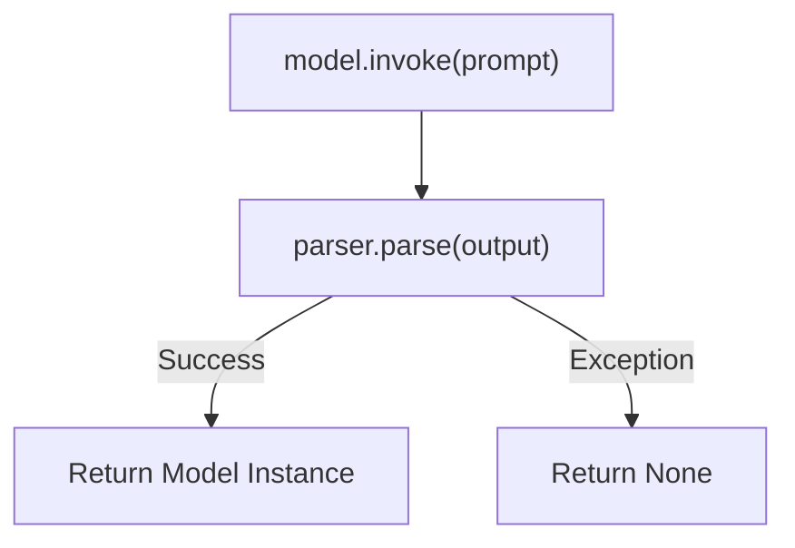

Sources: [extractors.py:60-63](), [extractors.py:98-101](), [extractors.py:138-142](), [extractors.py:179-182](), [extractors.py:240-243]()

### Debug Mode

The module defines `_DEBUG = True` at the module level [extractors.py:17](), causing all extractors to print prompts and outputs to stderr for debugging purposes:

```python
if _DEBUG:
    print(f"Input: {_input.to_string()}", file=sys.stderr)
# ... LLM invocation ...
if _DEBUG:
    print(f"Output: {output}", file=sys.stderr)
```

---

## LLM Configuration

All extractors accept an optional `model` parameter with consistent defaults:

| Parameter | Type | Default Value | Purpose |
|-----------|------|---------------|---------|
| `model` | `BaseLLM` | `OpenAI(temperature=0)` | LLM instance for extraction |

The `temperature=0` setting ensures deterministic outputs for consistent extraction behavior. The Agent passes its own LLM instance [lib.py:115]() to extractors, ensuring shared configuration and reducing initialization overhead.

Sources: [extractors.py:56](), [extractors.py:94](), [extractors.py:133](), [extractors.py:174](), [extractors.py:235](), [lib.py:115]()

---

## Integration Summary

The extraction pipeline enables intent-based query routing in the Agent:

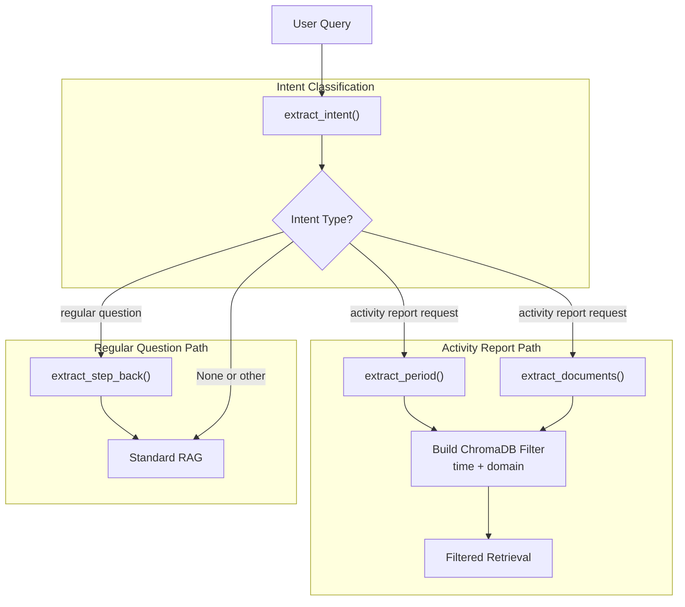

This architecture enables the Second Brain Agent to dynamically adapt its retrieval strategy based on query characteristics, providing specialized handling for temporal activity reports while maintaining efficient standard question-answering.

Sources: [lib.py:168-236](), [extractors.py:1-246]()

---

