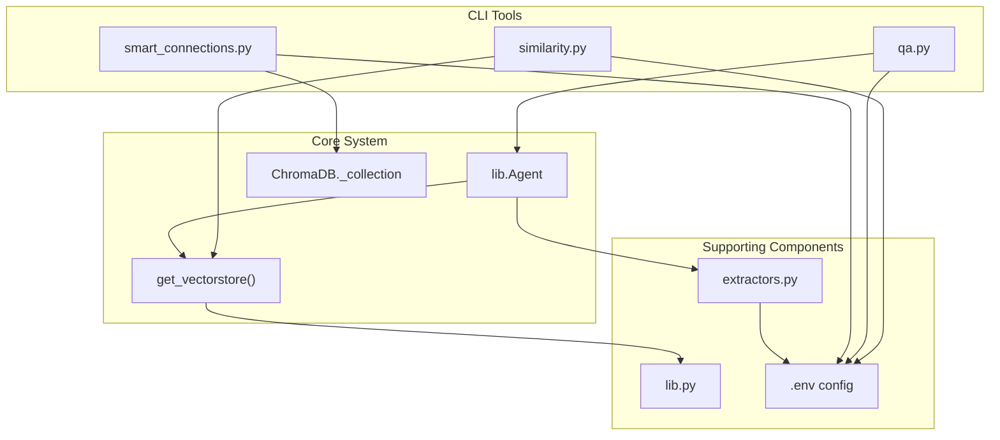
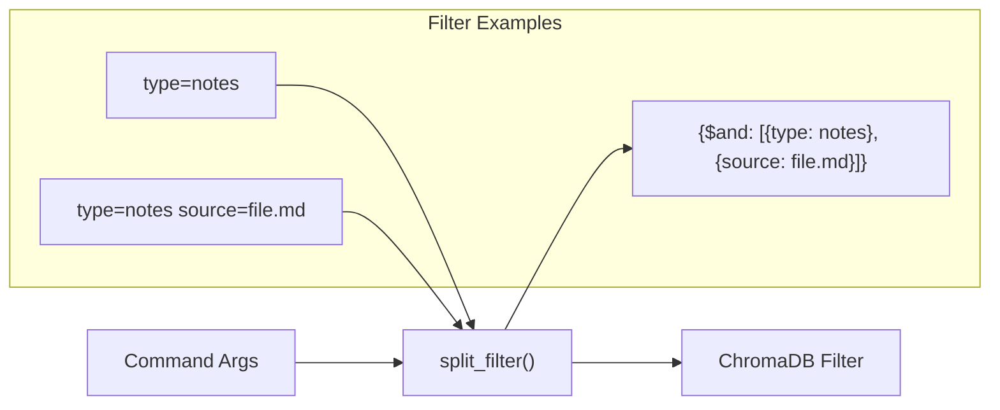
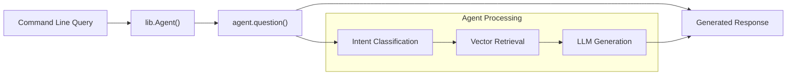
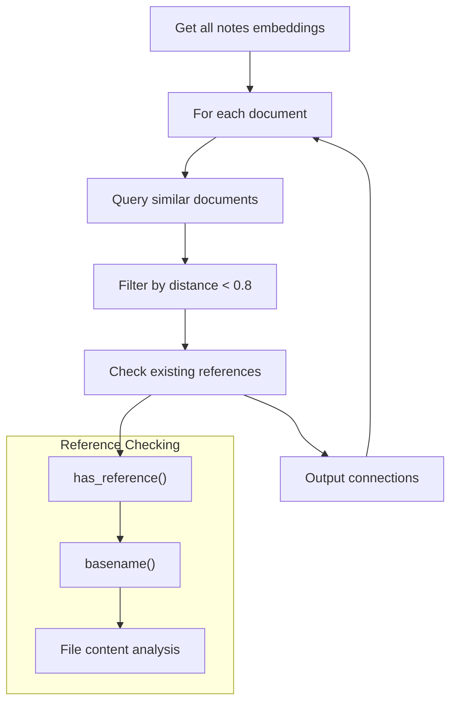
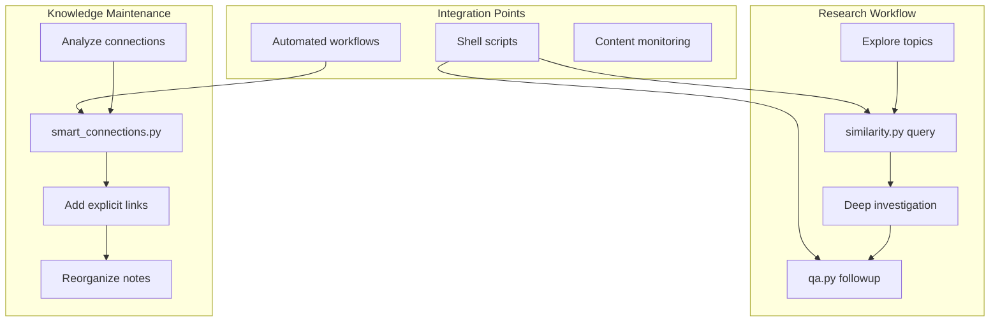

<!-- source: DeepWiki mcp.deepwiki.com · repo flepied/second-brain-agent · page 4.3 Command Line Tools · fetched 2026-10-27 -->

# Command Line Tools

<details>
<summary>Relevant source files</summary>

The following files were used as context for generating this wiki page:

- [extractors.py](extractors.py)
- [lib.py](lib.py)
- [qa.py](qa.py)
- [similarity.py](similarity.py)

</details>


The Second Brain Agent system provides several command-line utilities that offer different ways to interact with the knowledge base. These tools enable direct querying, similarity search, and analysis of document relationships without requiring the web interface or MCP server.

For interactive querying through a web browser, see [Web Interface](#4.1). For programmatic access via the Model Context Protocol, see [MCP Protocol Server](#4.2).

## Overview

The CLI tools provide three primary interaction patterns:

| Tool | Purpose | Interface Level |
|------|---------|----------------|
| `similarity.py` | Direct vector similarity search | Direct ChromaDB access |
| `qa.py` | Full agent-based question answering | Agent intelligence layer |
| `smart_connections.py` | Find similar documents without existing references | ChromaDB analysis |

These tools complement each other by offering different levels of sophistication and use cases, from simple similarity matching to full conversational AI.

## Command Line Tool Architecture



**CLI Tool Integration Flow**: Each CLI tool accesses the system at different abstraction levels, from direct ChromaDB queries to full agent intelligence.

Sources: [similarity.py:1-40](), [qa.py:1-15](), [smart_connections.py:1-98](), [lib.py]() (referenced)

## Similarity Search Tool

The `similarity.py` tool provides direct vector similarity search capabilities against the ChromaDB vector store. It accepts natural language queries and optional metadata filters to find relevant document chunks.

### Basic Usage

```bash
./similarity.py "machine learning concepts"
./similarity.py "project planning" type=notes
./similarity.py "debugging techniques" source=programming.md
```

### Filter System

The tool supports ChromaDB's metadata filtering through command-line arguments:



**Filter Processing**: The `split_filter()` function converts command-line arguments into ChromaDB-compatible filter objects.

The [split_filter function:14-20]() converts command-line filter arguments:
- Single filter: `type=notes` becomes `{"type": "notes"}`  
- Multiple filters: `type=notes source=file.md` becomes `{"$and": [{"type": "notes"}, {"source": "file.md"}]}`

### Search Results

Results are returned with relevance scores and full metadata:

```
document.md: 0.85 ({'source': 'document.md', 'type': 'notes', 'chunk': 1})
```

The [main function:23-32]() handles the search execution and result formatting, using `similarity_search_with_relevance_scores()` to provide both content and confidence metrics.

Sources: [similarity.py:14-38]()

## Question Answering Tool

The `qa.py` tool provides a simple command-line interface to the full Agent intelligence system. Unlike similarity search, this tool uses the complete RAG (Retrieval-Augmented Generation) pipeline with intent classification and LLM reasoning.

### Implementation

The tool is minimal by design:



**QA Tool Flow**: Simple CLI interface that leverages the full Agent intelligence pipeline for comprehensive question answering.

The [qa.py implementation:9-13]() demonstrates the tool's simplicity - it instantiates an `Agent` object and calls the `question()` method with the command-line argument.

### Usage Examples

```bash
./qa.py "What did I learn about Python testing last week?"
./qa.py "Summarize my recent project work"  
./qa.py "What are the key concepts in machine learning?"
```

This tool automatically benefits from all Agent capabilities including intent classification, period extraction, and document selection from the [extractors.py]() module.

Sources: [qa.py:1-15](), [extractors.py:1-246]()

## Smart Connections Tool

The `smart_connections.py` tool analyzes document relationships by finding similar documents that don't already explicitly reference each other. This helps discover implicit connections in the knowledge base.

### Connection Discovery Algorithm



**Smart Connections Algorithm**: Systematic discovery of similar documents without existing cross-references.

### Key Functions

The [has_reference function:25-35]() checks if two files already reference each other by:
1. Reading both file contents
2. Extracting basenames (filename without extension)
3. Checking if either basename appears in the other file's content

The [find_similar_docs function:38-63]() processes similarity results:
- Filters documents by distance threshold (< 0.8)
- Excludes self-references and existing cross-references  
- Reports connection counts and document names

### Output Format

```
Found 3 similar documents for project-notes.md: optimization.md, algorithms.md, performance.md
Found 2 similar documents for python-tips.md: debugging.md, testing.md
```

The tool helps identify potential knowledge connections that could be made explicit through document linking.

Sources: [smart_connections.py:25-92]()

## Usage Patterns and Integration

### Development Workflow Integration

The CLI tools integrate into different development and research workflows:



**CLI Tool Integration**: Different tools serve distinct phases of knowledge work and can be combined in automated workflows.

### Environment Configuration

All CLI tools use the same environment configuration through `dotenv.load_dotenv()`:

| Variable | Purpose | Used By |
|----------|---------|---------|
| `OPENAI_API_KEY` | LLM access | qa.py |
| `DSTDIR` | Vector database location | All tools |
| `HUGGINGFACE_API_KEY` | Alternative embeddings | All tools |

The [dotenv loading:35,11,95]() ensures consistent configuration across all CLI interfaces.

### Error Handling and Debugging

The tools include different error handling strategies:
- `similarity.py`: Removes empty filters to avoid ChromaDB errors
- `smart_connections.py`: Handles UnicodeDecodeError and FileNotFoundError gracefully  
- `qa.py`: Relies on Agent-level error handling

Debug output is available through stderr for troubleshooting query processing and results.

Sources: [similarity.py:26-28](), [smart_connections.py:33-57](), [qa.py:11]()

---

