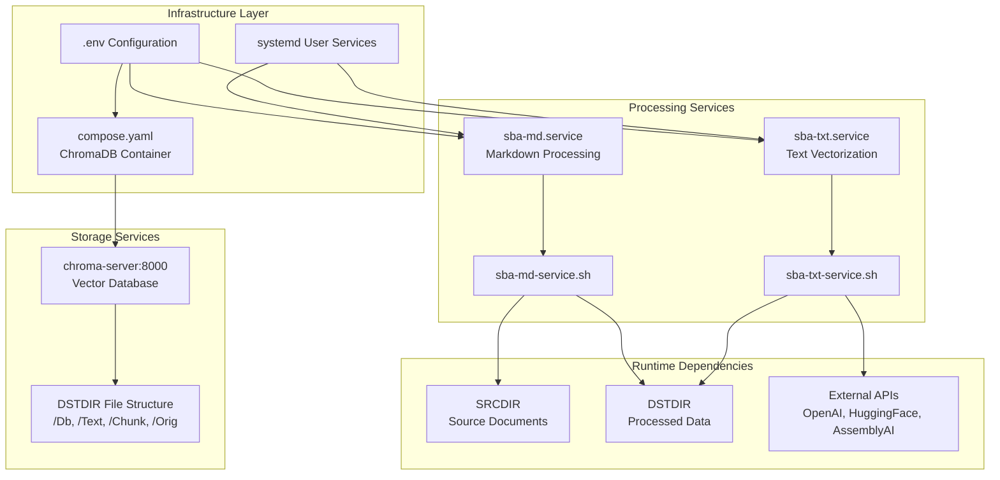
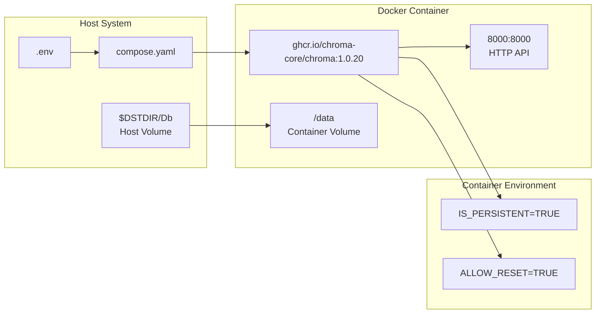
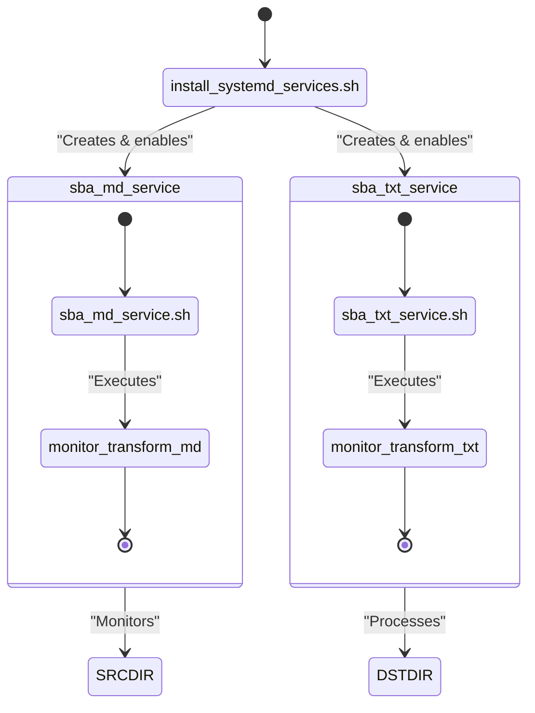
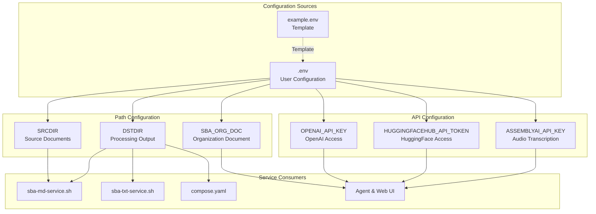
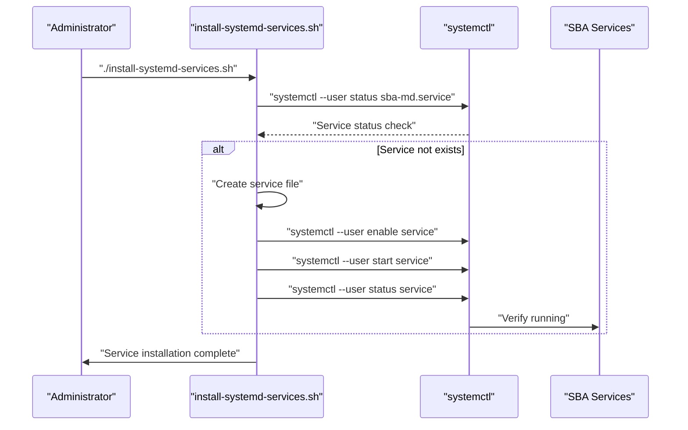

<!-- source: DeepWiki mcp.deepwiki.com · repo flepied/second-brain-agent · page 5 Infrastructure and Deployment · fetched 2026-10-27 -->

# Infrastructure and Deployment

<details>
<summary>Relevant source files</summary>

The following files were used as context for generating this wiki page:

- [README.md](README.md)
- [compose.yaml](compose.yaml)
- [install-systemd-services.sh](install-systemd-services.sh)
- [sba-md-service.sh](sba-md-service.sh)

</details>


This document covers the operational deployment aspects of the Second Brain Agent system, including vector database setup, system service configuration, and environment management. It focuses on the production deployment architecture and automated service management.

For development environment setup and dependencies, see [Development Environment](#6). For details on the data processing pipeline components, see [Data Processing Pipeline](#2).

## Deployment Architecture

The Second Brain Agent system follows a service-oriented deployment model with containerized storage and systemd-managed processing services. The deployment consists of three primary operational layers:



Sources: [compose.yaml:1-22](), [example.env:1-7](), [install-systemd-services.sh:1-49]()

## Vector Database Setup

The system uses ChromaDB as its vector database, deployed via Docker Compose for isolation and persistence management. The database configuration emphasizes data persistence and development flexibility.

### ChromaDB Container Configuration



The ChromaDB service mounts the `$DSTDIR/Db` directory to `/data` inside the container with SELinux-compatible `z` flag for persistent storage. The service exposes the HTTP API on port 8000 for client connections.

### Database Deployment Commands

| Operation | Command |
|-----------|---------|
| Start ChromaDB | `docker-compose up -d` |
| View logs | `docker-compose logs -f server` |
| Stop database | `docker-compose down` |
| Reset data | `docker-compose down -v` |

Sources: [compose.yaml:8-20]()

## System Services Configuration

The system uses systemd user services to manage the continuous data processing pipeline. Two primary services handle different stages of the document processing workflow.

### Service Architecture



### Service Installation Process

The [install-systemd-services.sh:1-49]() script automatically creates and enables both services:

| Service | Purpose | Script |
|---------|---------|--------|
| `sba-md.service` | Transform documents to text | [sba-md-service.sh:1-19]() |
| `sba-txt.service` | Generate vectors and chunks | `sba-txt-service.sh` |

Each service runs as a simple systemd unit with `RemainAfterExit=yes` to maintain continuous monitoring. The services depend on network availability and start after the `network.target`.

### Service Management Commands

| Operation | Command |
|-----------|---------|
| Install services | `./install-systemd-services.sh` |
| Check status | `systemctl --user status sba-md.service` |
| View logs | `journalctl --user -u sba-md.service -f` |
| Restart service | `systemctl --user restart sba-md.service` |
| Stop services | `systemctl --user stop sba-md.service sba-txt.service` |

Sources: [install-systemd-services.sh:7-26](), [install-systemd-services.sh:28-47](), [sba-md-service.sh:1-19]()

## Configuration Management

The system uses environment-based configuration with a centralized `.env` file pattern. All services and components read configuration from environment variables loaded from the `.env` file.

### Environment Variable Architecture



### Required Environment Variables

| Variable | Purpose | Example |
|----------|---------|---------|
| `SRCDIR` | Source document directory | `/home/user/documents` |
| `DSTDIR` | Processing output directory | `/home/user/second-brain-data` |
| `OPENAI_API_KEY` | OpenAI API access token | `sk-...` |
| `HUGGINGFACEHUB_API_TOKEN` | HuggingFace Hub token | `hf_...` |
| `ASSEMBLYAI_API_KEY` | AssemblyAI transcription token | `...` |
| `SBA_ORG_DOC` | Organization document filename | `SecondBrainOrganization.md` |

### Directory Structure Creation

The [sba-md-service.sh:14-14]() script automatically creates the required directory structure within `$DSTDIR`:

```
$DSTDIR/
├── Orig/          # Original document backups
├── Text/          # Extracted text files  
├── Markdown/      # Processed markdown
├── Chunk/         # Text chunks (created by txt service)
└── Db/            # ChromaDB data (mounted in container)
```

Sources: [example.env:1-7](), [sba-md-service.sh:7-16](), [compose.yaml:12-12]()

## Deployment Verification

The system includes verification mechanisms to ensure proper deployment and service health.

### Service Health Checks



The installation script performs status checks before creating services, ensuring idempotent deployment. Each service creation includes immediate status verification to confirm successful startup.

Sources: [install-systemd-services.sh:7-7](), [install-systemd-services.sh:23-25](), [install-systemd-services.sh:44-46]()

---

