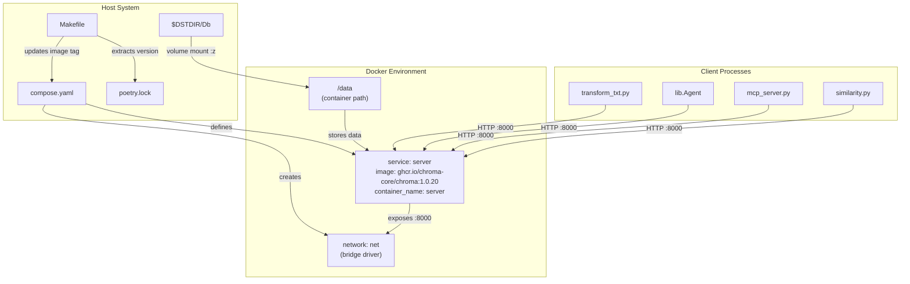
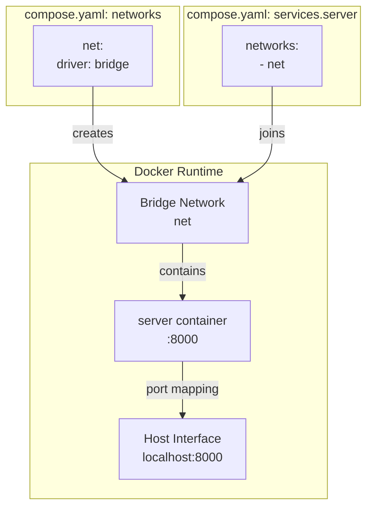
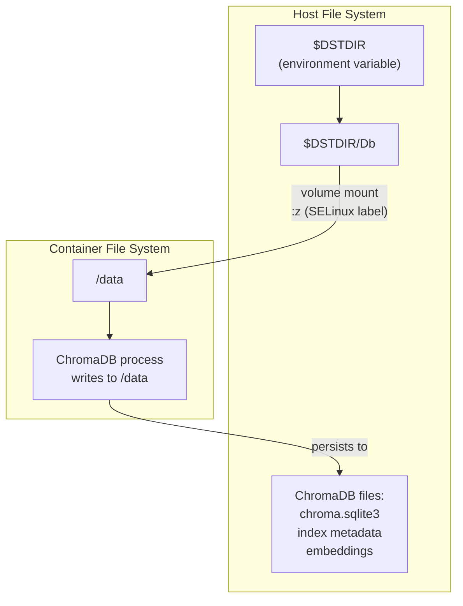
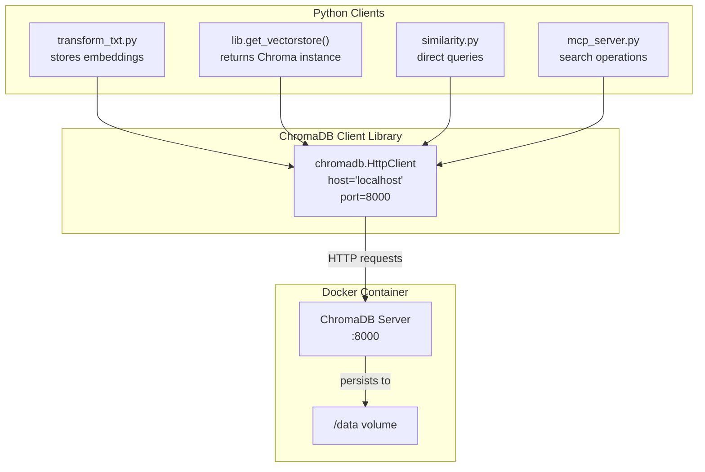

<!-- source: DeepWiki mcp.deepwiki.com · repo flepied/second-brain-agent · page 5.1 Vector Database Setup · fetched 2026-10-27 -->

# Vector Database Setup

Relevant source files

The following files were used as context for generating this wiki page:

- [.github/workflows/pr.yml](.github/workflows/pr.yml)
- [Makefile](Makefile)
- [compose.yaml](compose.yaml)

## Purpose and Scope

This document covers the ChromaDB vector database deployment via `compose.yaml`, including Docker service configuration, persistent volume management, network setup, and automated version synchronization with `poetry.lock`. ChromaDB serves as the core storage layer for document embeddings. For document vectorization details, see [Text Chunking and Vectorization](#2.2). For database access patterns, see [User Interfaces](#4).

## Docker Compose Configuration

The system deploys ChromaDB as a containerized service using Docker Compose. The `compose.yaml` file defines a single service (`server`) that runs the official ChromaDB image with persistent storage and network isolation.

### Container Architecture

**compose.yaml Container Deployment Architecture**

Sources: [compose.yaml:1-22]()

### Service Configuration

The `server` service is defined in `compose.yaml` with the following configuration:

| Parameter | Value | Description |
|-----------|-------|-------------|
| `image` | `ghcr.io/chroma-core/chroma:1.0.20` | Official ChromaDB Docker image from GitHub Container Registry |
| `ports` | `8000:8000` | Exposes ChromaDB HTTP API on port 8000 |
| `volumes` | `$DSTDIR/Db:/data:z` | Mounts host directory for persistent storage (`:z` for SELinux compatibility) |
| `networks` | `net` | Connects to bridge network for isolation |
| `environment.IS_PERSISTENT` | `TRUE` | Enables data persistence across container restarts |
| `environment.ALLOW_RESET` | `TRUE` | Allows database reset operations for development/testing |

Sources: [compose.yaml:9-19]()

### Network Configuration

The `net` network provides container isolation using a bridge driver:

**Network Configuration and Port Exposure**

Sources: [compose.yaml:5-16]()

## Version Synchronization

The system maintains version consistency between the Python ChromaDB client library and the Docker container image using an automated Makefile target.

### Makefile Version Extraction

```mermaid
graph LR
    subgraph "Source of Truth"
        PYPROJECT["pyproject.toml"]
        POETRY_LOCK["poetry.lock<br/>chromadb==1.0.20"]
    end
    
    subgraph "Makefile Build Process"
        VENV[".venv/bin/activate"]
        FREEZE["pip3 freeze"]
        GREP["grep chromadb=="]
        SED["sed 's/.*==//'"]
        VERSION["$$VER variable"]
        UPDATE["sed -i on compose.yaml"]
    end
    
    subgraph "Output"
        COMPOSE_UPDATED["compose.yaml<br/>image: ...chroma:$$VER"]
    end
    
    PYPROJECT -->|"poetry lock"| POETRY_LOCK
    POETRY_LOCK -->|"make compose.yaml"| VENV
    VENV --> FREEZE
    FREEZE --> GREP
    GREP --> SED
    SED --> VERSION
    VERSION --> UPDATE
    UPDATE --> COMPOSE_UPDATED
```

**Version Synchronization Flow via Makefile**

The Makefile target `compose.yaml` depends on `poetry.lock` and automatically updates the Docker image tag:

1. Activates the Poetry virtual environment at `.venv/bin/activate`
2. Runs `pip3 freeze` to list installed packages
3. Extracts the ChromaDB version using `grep chromadb==` and `sed "s/.*==//"`
4. Updates `compose.yaml` line 10 with the extracted version using `sed -i`

This ensures the Docker container version matches the Python client library version specified in `poetry.lock`.

Sources: [Makefile:1-16]()

## Data Storage and Persistence

### Volume Mounting Strategy

The `volumes` configuration mounts the host directory `$DSTDIR/Db` to the container path `/data` with the `:z` SELinux label:

**Volume Mount and Persistence Architecture**

The `:z` flag indicates a shared SELinux label, allowing the container to read and write to the host directory with appropriate security context. This is required on SELinux-enabled systems (e.g., Fedora, RHEL, CentOS).

Sources: [compose.yaml:11-12]()

## Client Integration

### HTTP API Access

ChromaDB exposes an HTTP API on port 8000 that clients access via the Python `chromadb` library. The client connects to `localhost:8000` from the host system:

**Client Access via HTTP API**

All clients use the `chromadb.HttpClient` to connect to the containerized ChromaDB server at `localhost:8000`. The bridge network exposes the container port to the host, enabling local connections without complex networking configuration.

Sources: [compose.yaml:13-16]()

## Administrative and Development Features

### Reset Capability

The `ALLOW_RESET=TRUE` environment variable enables administrative operations for development and maintenance workflows. This allows the database to be reset without container recreation, supporting:

- Development environment cleanup
- Testing pipeline resets  
- Database schema migrations
- Debugging and troubleshooting scenarios

### Persistence Configuration

The `IS_PERSISTENT=TRUE` setting ensures ChromaDB maintains data across container lifecycles, which is essential for production deployment where document vectors represent significant processing investment.

Sources: [compose.yaml:18-19]()

---

