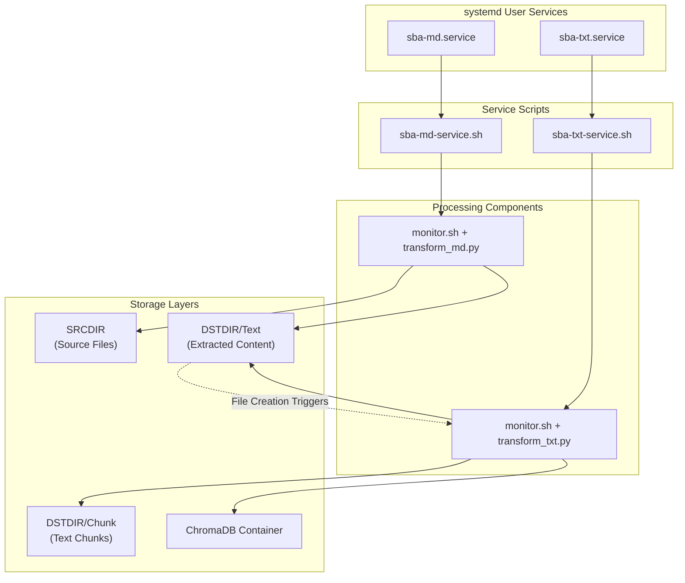
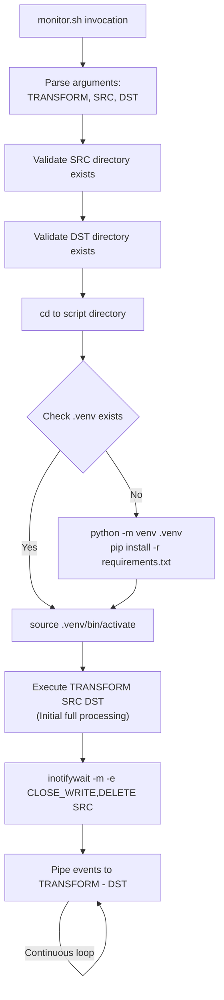
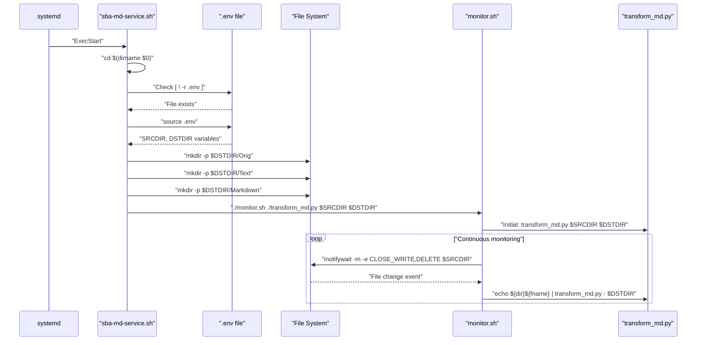
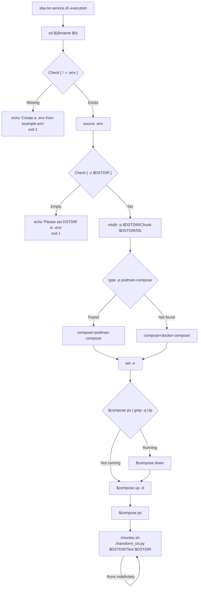
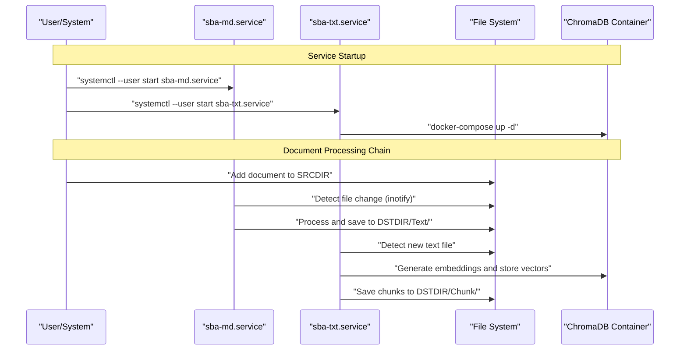

<!-- source: DeepWiki mcp.deepwiki.com · repo flepied/second-brain-agent · page 5.2 System Services · fetched 2026-10-27 -->

# System Services

Relevant source files

The following files were used as context for generating this wiki page:

- [install-systemd-services.sh](install-systemd-services.sh)
- [monitor.sh](monitor.sh)
- [sba-md-service.sh](sba-md-service.sh)
- [sba-txt-service.sh](sba-txt-service.sh)

This document covers the systemd services that automate the Second Brain Agent's data processing pipeline. These services provide continuous monitoring and processing of source documents, transforming them into a searchable vector database without manual intervention.

For information about the underlying data processing components, see [Data Processing Pipeline](#2). For vector database deployment details, see [Vector Database Setup](#5.1). For configuration management, see [Configuration Management](#5.3).

## Service Architecture Overview

The Second Brain Agent uses two systemd user services that work in tandem to provide automated document processing:

### Service Architecture Diagram

Sources: [install-systemd-services.sh:8-48](), [sba-md-service.sh:1-18](), [sba-txt-service.sh:1-41]()

## Monitoring Mechanism

Both services rely on `monitor.sh` as the core orchestration component. This script provides continuous file system monitoring and processing through `inotifywait`.

### monitor.sh Architecture

The monitoring script operates in two phases:

**Phase 1: Initial Processing** [monitor.sh:32]()
- Executes the transform script once with source and destination directories
- Processes all existing files in the source directory
- Example: `./transform_md.py "$SRCDIR" "$DSTDIR"`

**Phase 2: Continuous Monitoring** [monitor.sh:36-39]()
- Uses `inotifywait -m` (monitor mode) to watch for file system events
- Monitors `CLOSE_WRITE` (file written and closed) and `DELETE` events
- Pipes detected file paths to the transform script with `-` as source argument
- Transform scripts handle `-` specially to read file paths from stdin

| Component | Configuration |
|-----------|---------------|
| File system monitor | `inotifywait` from inotify-tools |
| Events monitored | `CLOSE_WRITE`, `DELETE` |
| Output format | `"${dir}${fname}"` piped to transform script |
| Virtual environment | Created at `.venv` with `requirements.txt` dependencies |

Sources: [monitor.sh:1-42]()

## Service Components

### sba-md.service

The `sba-md.service` executes `sba-md-service.sh`, which handles the first stage of document processing.

| Property | Value |
|----------|--------|
| Description | Transform Markdown files, pdf and Youtube transcripts into text files |
| Type | simple |
| ExecStart | `$PWD/sba-md-service.sh` (absolute path) |
| Dependencies | network.target |
| DefaultDependencies | no |
| RemainAfterExit | yes |

**sba-md-service.sh Execution Flow:**

**Script Operations:**

1. **Environment Setup** [sba-md-service.sh:5-12]()
   - Changes to script directory
   - Validates `.env` file exists
   - Sources environment variables (`SRCDIR`, `DSTDIR`)

2. **Directory Creation** [sba-md-service.sh:14]()
   - Creates `$DSTDIR/Orig` for original file copies
   - Creates `$DSTDIR/Text` for extracted text content
   - Creates `$DSTDIR/Markdown` for processed markdown

3. **Monitor Launch** [sba-md-service.sh:16]()
   - Invokes `monitor.sh` with `transform_md.py` as processor
   - Passes `$SRCDIR` as source and `$DSTDIR` as destination
   - Runs indefinitely until service stopped

Sources: [sba-md-service.sh:1-18](), [install-systemd-services.sh:8-26]()

### sba-txt.service

The `sba-txt.service` executes `sba-txt-service.sh`, which manages ChromaDB container lifecycle and processes extracted text into vector embeddings.

| Property | Value |
|----------|--------|
| Description | Transform txt files into chunks and then into embeddings in a vector db |
| Type | simple |
| ExecStart | `$PWD/sba-txt-service.sh` (absolute path) |
| Dependencies | network.target |
| DefaultDependencies | no |
| RemainAfterExit | yes |

**sba-txt-service.sh Execution Flow:**

**Script Operations:**

1. **Environment Validation** [sba-txt-service.sh:5-18]()
   - Changes to script directory
   - Validates `.env` file exists and is readable
   - Sources environment variables
   - Validates `$DSTDIR` is set (required for storage paths)

2. **Directory Creation** [sba-txt-service.sh:20]()
   - Creates `$DSTDIR/Chunk` for text chunk storage
   - Creates `$DSTDIR/Db` for ChromaDB persistent volume mount

3. **Container Runtime Detection** [sba-txt-service.sh:22-26]()
   - Checks for `podman-compose` availability using `type -p`
   - Falls back to `docker-compose` if podman not found
   - Sets `$compose` variable for subsequent commands

4. **Container Lifecycle Management** [sba-txt-service.sh:28-37]()
   - Checks if ChromaDB containers already running using `$compose ps`
   - Executes `$compose down` if containers detected (ensures clean state)
   - Executes `$compose up -d` to start ChromaDB container in detached mode
   - Executes `$compose ps` to display running container status

5. **Monitor Launch** [sba-txt-service.sh:39]()
   - Invokes `monitor.sh` with `transform_txt.py` as processor
   - Monitors `$DSTDIR/Text` (output from sba-md.service)
   - Passes `$DSTDIR` as destination for chunks and embeddings

Sources: [sba-txt-service.sh:1-41](), [install-systemd-services.sh:28-47]()

## Service Installation and Management

### Installation Process

The `install-systemd-services.sh` script automates service installation:

```mermaid
flowchart LR
    SCRIPT_START["install-systemd-services.sh"]
    CHECK_MD["Check sba-md.service status"]
    CREATE_MD["Generate sba-md.service file"]
    ENABLE_MD["systemctl --user enable sba-md.service"]
    START_MD["systemctl --user start sba-md.service"]
    
    CHECK_TXT["Check sba-txt.service status"]
    CREATE_TXT["Generate sba-txt.service file"]
    ENABLE_TXT["systemctl --user enable sba-txt.service"]
    START_TXT["systemctl --user start sba-txt.service"]
    
    SCRIPT_START --> CHECK_MD
    CHECK_MD -->|"Not installed"| CREATE_MD
    CREATE_MD --> ENABLE_MD
    ENABLE_MD --> START_MD
    START_MD --> CHECK_TXT
    CHECK_TXT -->|"Not installed"| CREATE_TXT
    CREATE_TXT --> ENABLE_TXT
    ENABLE_TXT --> START_TXT
```

The installation script:
- Checks if services are already installed [install-systemd-services.sh:7](), [install-systemd-services.sh:28]()
- Generates service unit files with absolute paths [install-systemd-services.sh:8-22](), [install-systemd-services.sh:29-43]()
- Enables and starts services using `systemctl --user` [install-systemd-services.sh:23-25](), [install-systemd-services.sh:44-46]()

Sources: [install-systemd-services.sh:1-49]()

## Service Management Commands

### Systemctl Operations

Both services are installed as systemd user services, requiring `--user` flag for all operations:

| Command | Purpose |
|---------|---------|
| `systemctl --user status sba-md.service` | Check sba-md.service status |
| `systemctl --user start sba-md.service` | Start markdown processing service |
| `systemctl --user stop sba-md.service` | Stop markdown processing service |
| `systemctl --user restart sba-md.service` | Restart markdown processing service |
| `systemctl --user status sba-txt.service` | Check sba-txt.service status |
| `systemctl --user start sba-txt.service` | Start text chunking/embedding service |
| `systemctl --user stop sba-txt.service` | Stop text chunking/embedding service |
| `systemctl --user restart sba-txt.service` | Restart text chunking/embedding service |
| `systemctl --user enable sba-md.service` | Enable sba-md.service at user login |
| `systemctl --user enable sba-txt.service` | Enable sba-txt.service at user login |

### Service Dependencies

| Component | Dependency | Purpose |
|-----------|------------|---------|
| `sba-md.service` | `.env` file | Environment configuration (SRCDIR, DSTDIR) |
| `sba-md.service` | `SRCDIR` directory | Source document location |
| `sba-md.service` | `transform_md.py` | Content extraction processor |
| `sba-md.service` | `monitor.sh` | File system monitoring orchestrator |
| `sba-md.service` | `inotify-tools` | File system event monitoring |
| `sba-txt.service` | `.env` file | Environment configuration (DSTDIR) |
| `sba-txt.service` | `DSTDIR` directory | Processed content location |
| `sba-txt.service` | Docker/Podman | ChromaDB container runtime |
| `sba-txt.service` | `compose.yaml` | ChromaDB container configuration |
| `sba-txt.service` | `transform_txt.py` | Vectorization processor |
| `sba-txt.service` | `monitor.sh` | File system monitoring orchestrator |
| `sba-txt.service` | `inotify-tools` | File system event monitoring |

### Service Interaction Flow

The services operate independently but form a processing pipeline where `sba-md.service` output becomes `sba-txt.service` input through the file system.

Sources: [sba-md-service.sh:16](), [sba-txt-service.sh:39](), [install-systemd-services.sh:8-47]()

---

