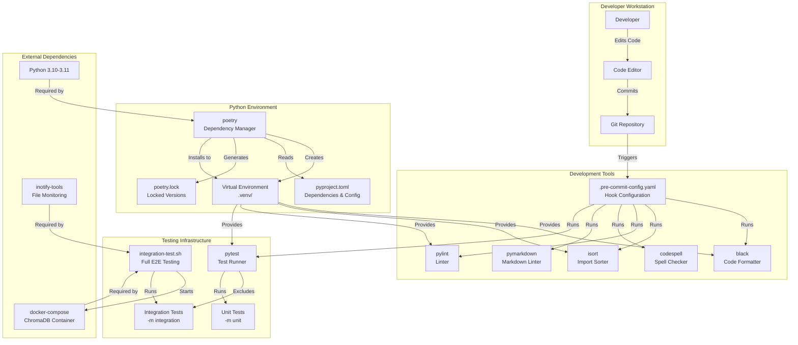
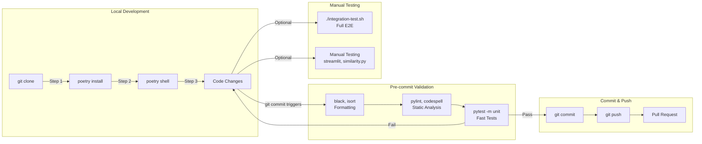

<!-- source: DeepWiki mcp.deepwiki.com · repo flepied/second-brain-agent · page 6 Development Environment · fetched 2026-10-27 -->

# Development Environment

<details>
<summary>Relevant source files</summary>

The following files were used as context for generating this wiki page:

- [.pre-commit-config.yaml](.pre-commit-config.yaml)
- [README.md](README.md)
- [pyproject.toml](pyproject.toml)

</details>


## Purpose and Scope

This page provides an overview of the development environment setup for the Second Brain AI Agent project. It covers the initial setup process, dependency management, development tools, and the overall development workflow. For detailed information about specific aspects of development:

- For dependency management and the technology stack, see [Project Dependencies](#6.1)
- For testing frameworks and code quality tools, see [Code Quality and Testing](#6.2)
- For continuous integration and deployment workflows, see [CI/CD Pipeline](#6.3)

## Overview

The Second Brain AI Agent uses a modern Python development stack centered around Poetry for dependency management, pre-commit hooks for code quality enforcement, and pytest for testing. The project requires Python 3.10 or 3.11 and uses a combination of automated tooling to ensure code quality before commits reach the repository.

The development environment is designed to provide:

- Reproducible dependency installation via `poetry.lock`
- Automated code quality checks via pre-commit hooks
- Separation of unit tests from integration tests
- Local testing capabilities without external services
- Full integration testing with ChromaDB and systemd services

Sources: [README.md:204-254](), [pyproject.toml:1-70]()

## Development Environment Architecture



This diagram shows the complete development environment with actual tools and file names used in the project. The environment is structured around Poetry for dependency management, with pre-commit hooks enforcing code quality before commits.

Sources: [README.md:204-254](), [pyproject.toml:1-70](), [.pre-commit-config.yaml:1-90]()

## Python Version Requirements

The project requires Python 3.10 or 3.11, as specified in [pyproject.toml:18](). This constraint is enforced at multiple levels:

| Level | Enforcement | Configuration |
|-------|-------------|---------------|
| Poetry | Dependency resolution | `python = ">=3.10,<3.12"` |
| Virtual Environment | Runtime isolation | Created by Poetry |
| CI/CD | Build validation | GitHub Actions workflow |

Python 3.12 is explicitly excluded due to compatibility issues with some dependencies in the LangChain ecosystem.

Sources: [pyproject.toml:18]()

## Environment Configuration

The development environment requires configuration via a `.env` file, which stores API keys and directory paths. The project provides `example.env` as a template:

```
.env                  # Active configuration (git-ignored)
example.env           # Template with default values
```

Key configuration variables include:

- `OPENAI_API_KEY`: OpenAI API access
- `HUGGINGFACEHUB_API_TOKEN`: HuggingFace embeddings
- `ASSEMBLYAI_API_KEY`: Audio transcription
- `SRCDIR`: Source directory for markdown notes
- `DSTDIR`: Destination directory for processed files
- `SBA_ORG_DOC`: Organization document name (defaults to `SecondBrainOrganization.md`)

Sources: [README.md:135-139]()

## Development Workflow



The workflow emphasizes fast feedback through pre-commit hooks while allowing optional integration testing for complex changes. Unit tests run automatically on every commit, while integration tests are run manually or in CI.

Sources: [README.md:204-254](), [.pre-commit-config.yaml:1-90]()

## Quick Start

### Initial Setup

```bash
# Clone repository
git clone https://github.com/flepied/second-brain-agent.git
cd second-brain-agent

# Configure environment
cp example.env .env
# Edit .env with your API keys and paths

# Install dependencies
poetry install

# Workaround for torch/pypi issue
poetry run pip install torch

# Activate virtual environment
poetry shell
```

Sources: [README.md:129-157]()

### Development Setup

```bash
# Install development and test dependencies
poetry install --with test

# Install pre-commit hooks
poetry run pre-commit install

# Verify setup
poetry run pytest -m unit
```

Sources: [README.md:206-210](), [README.md:250-254]()

### Running Tests

```bash
# Unit tests only (fast, no external dependencies)
poetry run pytest -m unit

# Integration tests only (requires ChromaDB)
poetry run pytest -m integration

# All tests
poetry run pytest

# Full integration test suite
./integration-test.sh
```

The test markers are defined in [pyproject.toml:56-69]():

- `unit`: Tests that run without external services
- `integration`: Tests requiring ChromaDB and other external services

Pre-commit hooks automatically run unit tests but exclude integration tests to maintain fast feedback loops.

Sources: [README.md:213-246](), [pyproject.toml:56-69](), [.pre-commit-config.yaml:70-76]()

## Development Tools Summary

| Tool | Purpose | Configuration | When It Runs |
|------|---------|---------------|--------------|
| `poetry` | Dependency management | `pyproject.toml` | Manual, CI |
| `black` | Code formatting | `.pre-commit-config.yaml` | Pre-commit, CI |
| `isort` | Import sorting | `.pre-commit-config.yaml` | Pre-commit, CI |
| `pylint` | Static analysis | `.pre-commit-config.yaml` | Pre-commit, CI |
| `codespell` | Spell checking | `.pre-commit-config.yaml` | Pre-commit, CI |
| `pymarkdown` | Markdown linting | `.pre-commit-config.yaml` | Pre-commit, CI |
| `pytest` | Test execution | `pyproject.toml` | Pre-commit, Manual, CI |
| `pre-commit` | Hook orchestration | `.pre-commit-config.yaml` | Git commit |

Sources: [.pre-commit-config.yaml:1-90](), [pyproject.toml:48-69]()

## System Requirements

The development environment requires the following system-level dependencies:

- **Python 3.10 or 3.11**: Core runtime
- **inotify-tools**: File system monitoring for `monitor.sh`
- **docker-compose** or **podman-compose**: ChromaDB container management for integration tests
- **Git**: Version control and pre-commit hook support

The project has been tested on:
- Fedora Linux 42
- Ubuntu (latest, in CI workflows)

Sources: [README.md:127]()

## Related Documentation

For more detailed information about specific aspects of the development environment:

- **Dependency Management**: See [Project Dependencies](#6.1) for details on `pyproject.toml`, Poetry configuration, and the technology stack
- **Testing and Quality**: See [Code Quality and Testing](#6.2) for detailed information on pytest, pre-commit hooks, and test organization
- **CI/CD**: See [CI/CD Pipeline](#6.3) for GitHub Actions workflows, integration testing, and deployment automation

For runtime deployment configuration:
- **Vector Database**: See [Vector Database Setup](#5.1) for ChromaDB deployment
- **System Services**: See [System Services](#5.2) for systemd service configuration
- **Configuration**: See [Configuration Management](#5.3) for environment variables and API keys

Sources: [README.md:1-254]()

---

