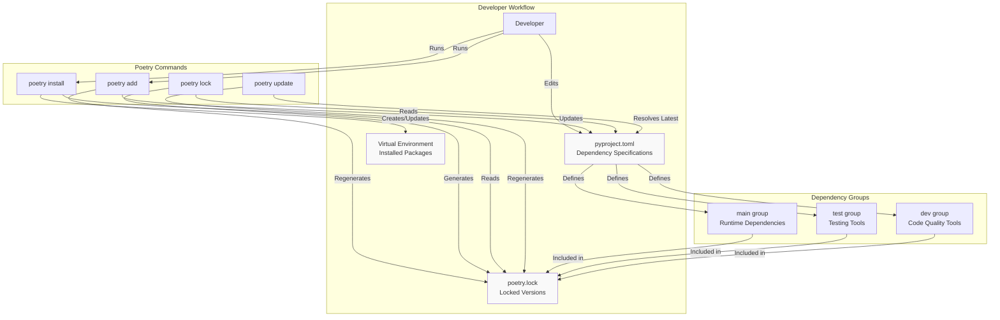
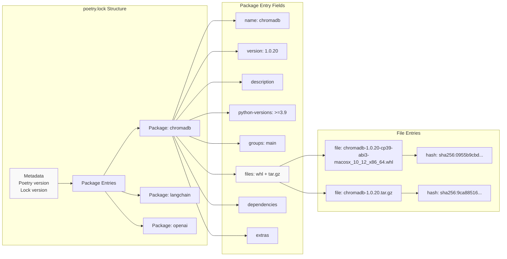
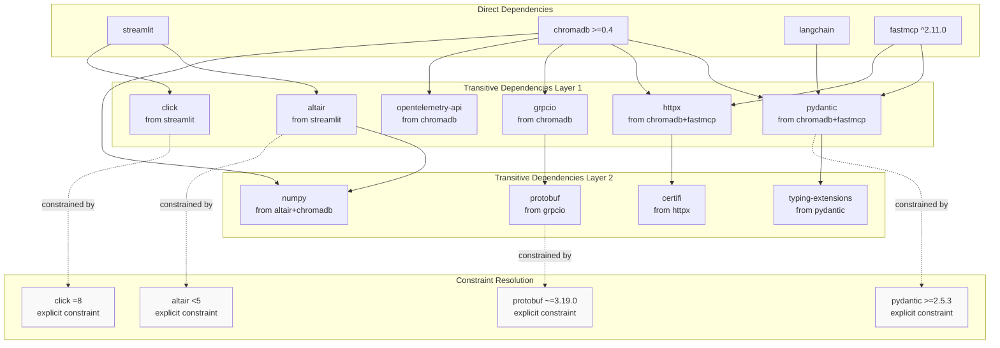
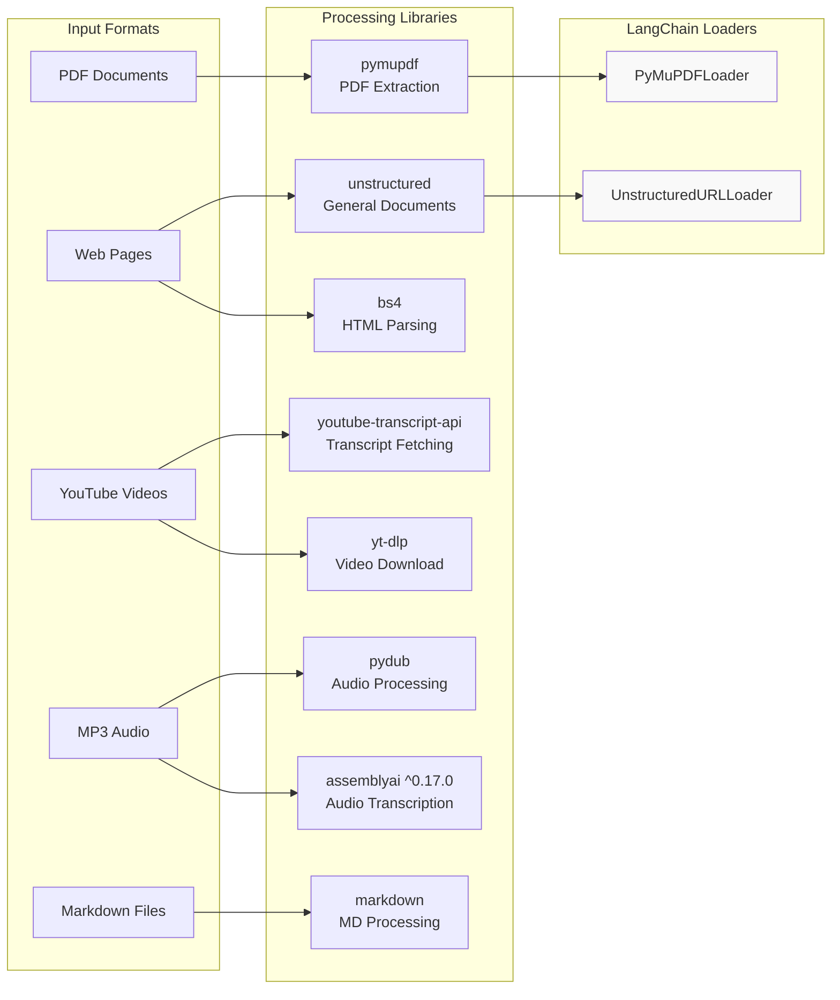

<!-- source: DeepWiki mcp.deepwiki.com · repo flepied/second-brain-agent · page 6.1 Project Dependencies · fetched 2026-10-27 -->

# Project Dependencies

<details>
<summary>Relevant source files</summary>

The following files were used as context for generating this wiki page:

- [poetry.lock](poetry.lock)
- [pyproject.toml](pyproject.toml)

</details>


This document explains the project's dependency management system using Poetry, the structure of `pyproject.toml`, the role of `poetry.lock`, and the complete technology stack that powers the Second Brain AI Agent. For information about the CI/CD pipeline that validates dependencies, see [CI/CD Pipeline](#6.3). For configuration of external service API keys, see [Configuration Management](#5.3).

## Overview

The Second Brain AI Agent uses [Poetry](https://python-poetry.org/) for dependency management, providing deterministic builds through lock files and organized dependency groups. The project relies on a multi-layered technology stack spanning AI/ML services, document processing, vector databases, and web frameworks.

**Key Files:**
- [pyproject.toml:1-70]() - Project metadata and dependency specifications
- [poetry.lock:1-50000+]() - Locked dependency versions with hashes for reproducibility

## Poetry Dependency Management Architecture



**Poetry Dependency Management Flow**

Poetry provides three-stage dependency management: specification in `pyproject.toml`, resolution and locking in `poetry.lock`, and installation to virtual environments. This ensures reproducible builds across development, CI/CD, and production environments.

**Sources:** [pyproject.toml:1-70](), [poetry.lock:1-50]()

## Dependency Groups Configuration

The project organizes dependencies into three groups defined in `pyproject.toml`:

### Main Dependencies (Runtime)

```toml
[tool.poetry.dependencies]
python = ">=3.10,<3.12"

# AI/ML Services
langchain = "*"
langchain-community = "*"
langchain-chroma = "^0.2.5"
langchain-openai = "*"
langchain-huggingface = "*"
openai = "*"
sentence-transformers = "*"

# Vector Database
chromadb = ">=0.4"

# Document Processing
bs4 = "*"
pymupdf = "*"
unstructured = "*"
youtube-transcript-api = "*"
yt-dlp = "*"
pydub = "*"
markdown = "*"
assemblyai = "^0.17.0"

# Web Framework
streamlit = "*"
altair = "<5"
protobuf = "~=3.19.0"

# MCP Server
fastmcp = "^2.11.0"
pydantic = ">=2.5.3"

# Utilities
python-dotenv = "*"
tiktoken = "*"
click = "=8"
huggingface_hub = "*"
```

**Sources:** [pyproject.toml:17-46]()

### Test Dependencies

```toml
[tool.poetry.group.test.dependencies]
pytest = "*"
pytest-asyncio = "*"
pylint = "*"
pre-commit = "*"
```

**Sources:** [pyproject.toml:48-54]()

### Development Dependencies

```toml
[tool.poetry.group.dev.dependencies]
pyproject-pre-commit = "^0.0.17"
```

**Sources:** [pyproject.toml:10-11]()

## Technology Stack Layers

```mermaid
graph TB
    subgraph "AI/ML Layer"
        OPENAI[openai<br/>GPT Models]
        LANGCHAIN_OPENAI[langchain-openai<br/>LLM Integration]
        HUGGINGFACE[langchain-huggingface<br/>Embeddings]
        SENTENCE_T[sentence-transformers<br/>all-MiniLM-L6-v2]
        ASSEMBLYAI[assemblyai 0.17.0<br/>Audio Transcription]
        TIKTOKEN[tiktoken<br/>Token Counting]
    end
    
    subgraph "LangChain Ecosystem"
        LANGCHAIN[langchain<br/>Core Framework]
        LC_COMMUNITY[langchain-community<br/>Document Loaders]
        LC_CHROMA[langchain-chroma ^0.2.5<br/>Vector Store Interface]
    end
    
    subgraph "Vector Database"
        CHROMADB[chromadb >=0.4<br/>Version 1.0.20 locked]
    end
    
    subgraph "Document Processing"
        PYMUPDF[pymupdf<br/>PDF Extraction]
        UNSTRUCTURED[unstructured<br/>General Documents]
        YT_TRANSCRIPT[youtube-transcript-api<br/>Transcript Retrieval]
        YT_DLP[yt-dlp<br/>Video Download]
        PYDUB[pydub<br/>Audio Processing]
        BS4[bs4<br/>HTML Parsing]
        MARKDOWN[markdown<br/>Markdown Processing]
    end
    
    subgraph "Web & API Layer"
        STREAMLIT[streamlit<br/>Web UI]
        ALTAIR[altair <5<br/>Visualization]
        FASTMCP[fastmcp ^2.11.0<br/>MCP Server]
        PYDANTIC[pydantic >=2.5.3<br/>Data Validation]
    end
    
    subgraph "Core Python"
        PYTHON[python >=3.10,<3.12]
        DOTENV[python-dotenv<br/>Config Management]
        CLICK[click =8<br/>CLI Framework]
        PROTOBUF[protobuf ~=3.19.0<br/>Serialization]
    end
    
    LANGCHAIN -->|Integrates| LANGCHAIN_OPENAI
    LANGCHAIN -->|Integrates| HUGGINGFACE
    LANGCHAIN -->|Integrates| LC_COMMUNITY
    LANGCHAIN -->|Integrates| LC_CHROMA
    
    LC_CHROMA -->|Connects to| CHROMADB
    LC_COMMUNITY -->|Loads with| PYMUPDF
    LC_COMMUNITY -->|Loads with| UNSTRUCTURED
    
    HUGGINGFACE -->|Uses| SENTENCE_T
    LANGCHAIN_OPENAI -->|Calls| OPENAI
    
    STREAMLIT -->|Visualizes with| ALTAIR
    STREAMLIT -->|Constrained by| PROTOBUF
    
    FASTMCP -->|Validates with| PYDANTIC
    
    PYTHON -->|Runs| LANGCHAIN
    PYTHON -->|Runs| STREAMLIT
    PYTHON -->|Runs| CHROMADB
    
    style CHROMADB fill:#f9f9f9
    style LANGCHAIN fill:#f9f9f9
    style STREAMLIT fill:#f9f9f9
```



**Technology Stack Organization**

The dependency tree is organized into six functional layers: AI/ML services for intelligent processing, the LangChain ecosystem for orchestration, ChromaDB for vector storage, document processing libraries for content extraction, web/API frameworks for user interfaces, and core Python utilities.

**Sources:** [pyproject.toml:17-46](), [poetry.lock:783-829]()

## Version Constraints and Pinning

The project uses different constraint strategies based on dependency stability:

| Constraint Type | Syntax | Example | Usage |
|----------------|--------|---------|-------|
| Wildcard | `"*"` | `langchain = "*"` | Flexible, poetry resolves latest compatible |
| Caret | `"^X.Y.Z"` | `langchain-chroma = "^0.2.5"` | Compatible with `>=0.2.5,<0.3.0` |
| Tilde | `"~=X.Y.Z"` | `protobuf = "~=3.19.0"` | Compatible with `>=3.19.0,<3.20.0` |
| Greater-than | `">=X.Y"` | `chromadb = ">=0.4"` | Minimum version constraint |
| Exact | `"=X"` | `click = "=8"` | Pin to major version `8.x.x` |
| Range | `">=X,<Y"` | `python = ">=3.10,<3.12"` | Between versions |
| Less-than | `"<X"` | `altair = "<5"` | Maximum version constraint |

**Sources:** [pyproject.toml:17-46]()

### Critical Version Constraints

```python
# Python version constraint
python = ">=3.10,<3.12"  # Excludes Python 3.12+ for compatibility

# Streamlit ecosystem constraints (workarounds)
altair = "<5"           # Streamlit incompatibility with Altair 5+
protobuf = "~=3.19.0"   # Streamlit requires protobuf 3.x
click = "=8"            # Pin to Click 8.x for stability

# FastMCP compatibility
pydantic = ">=2.5.3"    # Requires Pydantic 2.5.3+ for FastMCP
fastmcp = "^2.11.0"     # Lock to 2.11.x series

# ChromaDB minimum version
chromadb = ">=0.4"      # Minimum version for required features
```

**Sources:** [pyproject.toml:18,21,40-44]()

## Lock File Structure and Versioning

The `poetry.lock` file contains the complete dependency resolution with cryptographic hashes for verification:



**Lock File Entry Structure**

Each package in `poetry.lock` includes name, version, description, Python version requirements, dependency groups, downloadable files with SHA256 hashes, transitive dependencies, and optional extras.

**Sources:** [poetry.lock:1-830]()

### ChromaDB Lock Example

```toml
[[package]]
name = "chromadb"
version = "1.0.20"
description = "Chroma."
optional = false
python-versions = ">=3.9"
groups = ["main"]
files = [
    {file = "chromadb-1.0.20-cp39-abi3-macosx_10_12_x86_64.whl", hash = "sha256:0955b9cbd..."},
    {file = "chromadb-1.0.20-cp39-abi3-macosx_11_0_arm64.whl", hash = "sha256:52819408a..."},
    {file = "chromadb-1.0.20-cp39-abi3-manylinux_2_17_aarch64.manylinux2014_aarch64.whl", hash = "sha256:68dbe15270..."},
    {file = "chromadb-1.0.20-cp39-abi3-manylinux_2_17_x86_64.manylinux2014_x86_64.whl", hash = "sha256:2044e1400..."},
    {file = "chromadb-1.0.20-cp39-abi3-win_amd64.whl", hash = "sha256:b81be370b7..."},
    {file = "chromadb-1.0.20.tar.gz", hash = "sha256:9ca88516f1..."},
]

[package.dependencies]
bcrypt = ">=4.0.1"
build = ">=1.0.3"
grpcio = ">=1.58.0"
httpx = ">=0.27.0"
# ... 20+ more dependencies
```

**Sources:** [poetry.lock:783-829]()

## Transitive Dependency Resolution



**Transitive Dependency Resolution**

Poetry resolves transitive dependencies from direct dependencies (e.g., `streamlit` requires `altair`, `chromadb` requires `pydantic`). Explicit constraints in `pyproject.toml` override transitive version requirements to ensure compatibility.

**Sources:** [pyproject.toml:17-46](), [poetry.lock:153-174,783-829]()

## Core Technology Stack Detail

### LangChain Integration Packages

The project uses five LangChain packages for different integration points:

```python
langchain = "*"                    # Core framework
langchain-community = "*"          # Document loaders (PyMuPDF, Unstructured)
langchain-chroma = "^0.2.5"       # ChromaDB vector store interface
langchain-openai = "*"            # OpenAI LLM integration
langchain-huggingface = "*"       # HuggingFace embeddings integration
```

**Package Responsibilities:**
- **langchain**: Core abstractions (chains, prompts, agents, memory)
- **langchain-community**: Third-party integrations (document loaders, utilities)
- **langchain-chroma**: `Chroma` vector store class, metadata filtering
- **langchain-openai**: `ChatOpenAI`, `OpenAI` LLM classes
- **langchain-huggingface**: `HuggingFaceEmbeddings` class

**Sources:** [pyproject.toml:23-27]()

### Document Processing Stack



**Document Processing Pipeline**

Different file formats use specialized libraries: PyMuPDF for PDFs, Unstructured for general documents, BeautifulSoup for HTML, youtube-transcript-api for YouTube, yt-dlp for video downloads, pydub for audio manipulation, and AssemblyAI for transcription.

**Sources:** [pyproject.toml:29-38]()

### AI Service Dependencies

| Service | Package | Version | Purpose | API Key Required |
|---------|---------|---------|---------|------------------|
| OpenAI | `openai` | `*` | GPT models for answer generation | `OPENAI_API_KEY` |
| HuggingFace | `huggingface_hub` | `*` | Model downloads and API access | Optional |
| Sentence Transformers | `sentence-transformers` | `*` | Local embedding generation | No |
| AssemblyAI | `assemblyai` | `^0.17.0` | Audio transcription API | `ASSEMBLYAI_API_KEY` |

**Token Counting:**
- `tiktoken = "*"` - OpenAI's token counting library for GPT models

**Sources:** [pyproject.toml:22-28,45]()

## Build System and Metadata

```toml
[tool.poetry]
name = "second-brain-agent"
version = "0.7.0"
description = "Second Brain AI Agent"
authors = ["Frederic Lepied <flepied@gmail.com>"]
license = "GPL 3.0"
readme = "README.md"
repository = "https://www.github.com/flepied/second-brain-agent"

[build-system]
requires = ["poetry-core"]
build-backend = "poetry.core.masonry.api"
```

**Build Configuration:**
- **Build backend**: Poetry Core (modern PEP 517/518 builder)
- **Package metadata**: Name, version, description, author, license, repository
- **Version**: `0.7.0` (semantic versioning)

**Sources:** [pyproject.toml:1-15]()

## Test Configuration

```toml
[tool.pytest.ini_options]
markers = [
    "integration: marks tests as integration tests (requires external services like vector database)",
    "unit: marks tests as unit tests (can run without external services)",
]
addopts = [
    "-v",
    "--strict-markers",
    "--disable-warnings",
]
testpaths = ["."]
python_files = ["test_*.py", "*_test.py"]
python_classes = ["Test*"]
python_functions = ["test_*"]
```

**Test Markers:**
- `@pytest.mark.unit` - Fast tests without external dependencies
- `@pytest.mark.integration` - Tests requiring ChromaDB, API keys, etc.

**Sources:** [pyproject.toml:56-69]()

## Dependency Installation Workflows


**Installation Workflows**

Four common workflows: fresh installation for new developers, adding dependencies for development, CI/CD installation with test dependencies, and updating dependencies to latest compatible versions.

**Sources:** [pyproject.toml:1-70]()

## Version Synchronization with Docker

The `Makefile` synchronizes ChromaDB version between `poetry.lock` and `compose.yaml`:

```makefile
# Extract ChromaDB version from poetry.lock
CHROMADB_VERSION := $(shell grep -A 2 'name = "chromadb"' poetry.lock | \
                            grep 'version = ' | \
                            cut -d '"' -f 2)

# Update compose.yaml with extracted version
update-compose:
    sed -i 's|chromadb/chroma:.*|chromadb/chroma:$(CHROMADB_VERSION)|' compose.yaml
```

This ensures the ChromaDB Docker container version matches the Python client library version.

**Sources:** Referenced in high-level diagrams, implementation in `Makefile`

## Dependency Vulnerabilities and Updates

Poetry provides commands for security and maintenance:

```bash
# Show outdated packages
poetry show --outdated

# Update specific package
poetry update chromadb

# Update all packages within constraints
poetry update

# Check lock file validity
poetry check

# Regenerate lock file without updating
poetry lock --no-update
```

**Best Practices:**
1. Run `poetry update` periodically to get security patches
2. Test thoroughly after updates, especially for `chromadb`, `streamlit`, `langchain`
3. Check GitHub Security Advisories for critical vulnerabilities
4. Pin versions that cause breaking changes (e.g., `altair = "<5"`)

**Sources:** Poetry documentation, [pyproject.toml:40-44]()

## Summary

The Second Brain AI Agent uses Poetry for reproducible dependency management with three organized groups (main, test, dev). The technology stack spans six layers: AI/ML services (OpenAI, HuggingFace, AssemblyAI), LangChain ecosystem, ChromaDB vector database, document processing libraries (PyMuPDF, Unstructured, yt-dlp), web/API frameworks (Streamlit, FastMCP), and core utilities. Version constraints use wildcard, caret, tilde, and exact pinning strategies, with explicit constraints resolving Streamlit compatibility issues. The `poetry.lock` file provides cryptographic verification of dependencies through SHA256 hashes, ensuring identical installations across environments.

**Sources:** [pyproject.toml:1-70](), [poetry.lock:1-830]()

---

