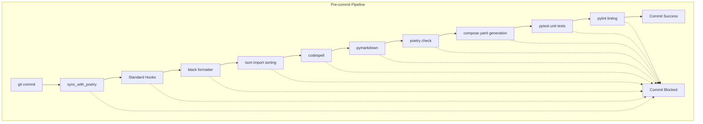
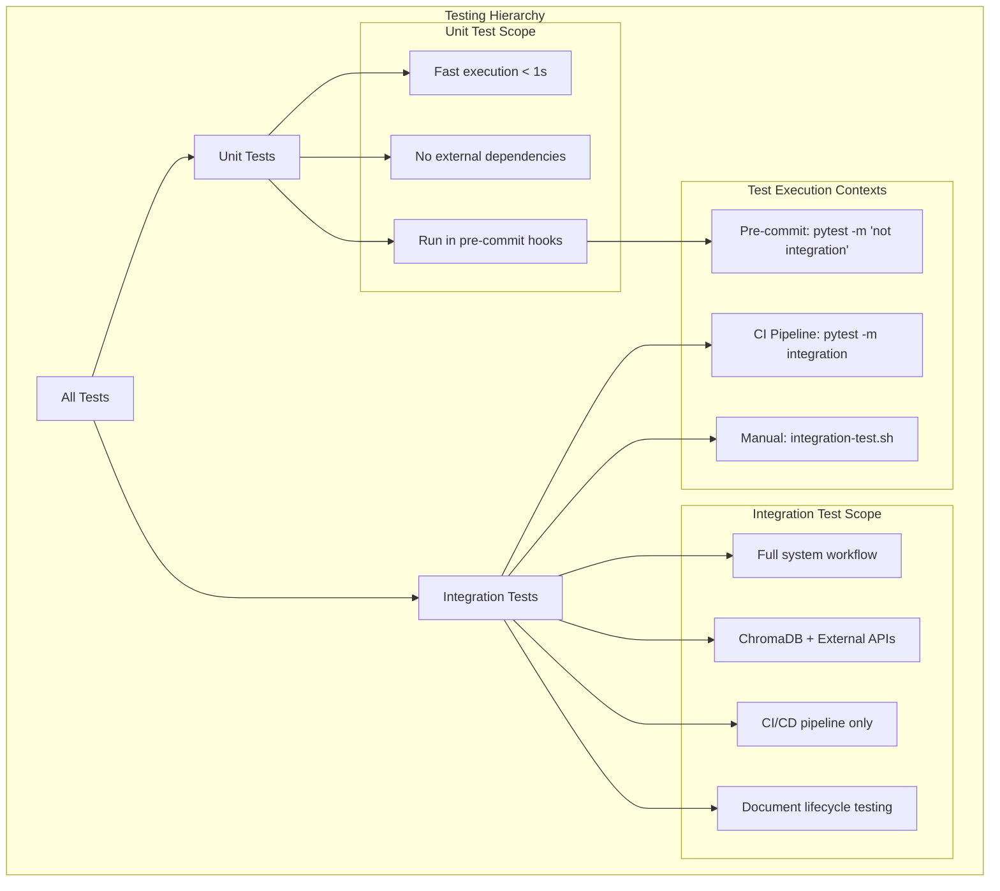
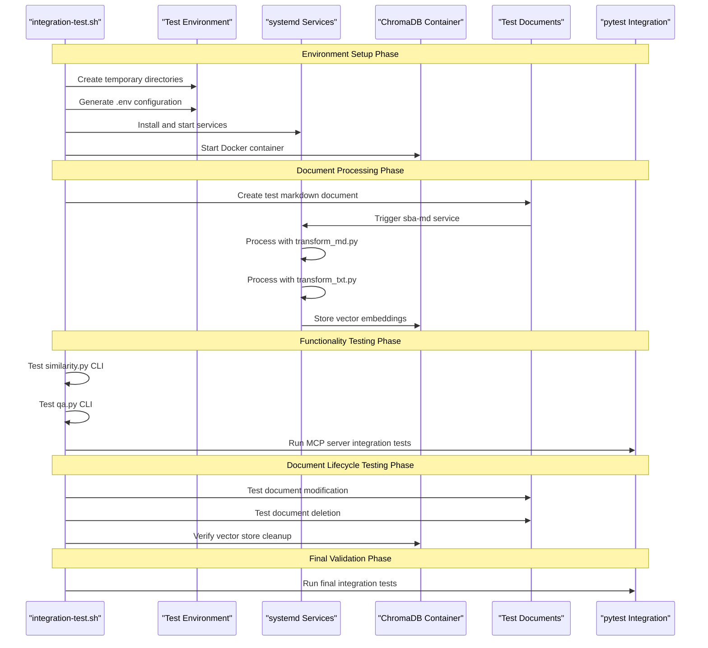
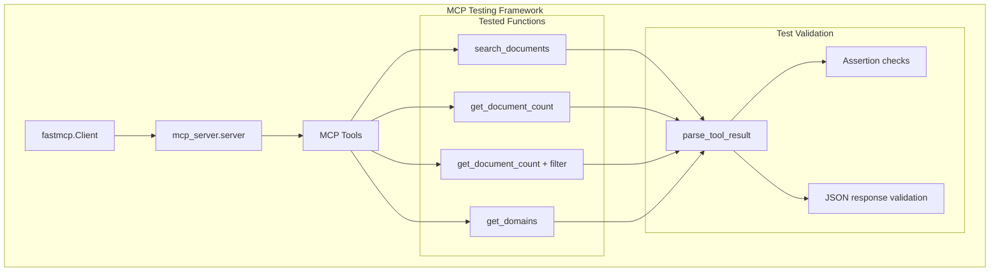

<!-- source: DeepWiki mcp.deepwiki.com · repo flepied/second-brain-agent · page 6.2 Code Quality and Testing · fetched 2026-10-27 -->

# Code Quality and Testing

<details>
<summary>Relevant source files</summary>

The following files were used as context for generating this wiki page:

- [.pre-commit-config.yaml](.pre-commit-config.yaml)
- [example.env](example.env)
- [integration-test.sh](integration-test.sh)
- [test_lib.py](test_lib.py)

</details>


This document covers the automated code quality enforcement and comprehensive testing framework for the Second Brain Agent system. This includes pre-commit hooks, linting tools, unit testing, and integration testing strategies. For information about project dependencies and Poetry configuration, see [Project Dependencies](#6.1). For CI/CD pipeline automation, see [CI/CD Pipeline](#6.3).

## Code Quality Framework

The project enforces code quality through a comprehensive pre-commit hook configuration that runs automatically before each commit. This ensures consistent code style, validates configuration files, and runs fast unit tests.

### Pre-commit Hook Pipeline



**Pre-commit Quality Gates**

Sources: [.pre-commit-config.yaml:1-87]()

The pre-commit configuration defines multiple quality gates that must pass before code can be committed:

| Hook | Purpose | Configuration |
|------|---------|---------------|
| `sync_with_poetry` | Keeps pre-commit dependencies synchronized with Poetry | [.pre-commit-config.yaml:8-12]() |
| `trailing-whitespace` | Removes trailing whitespace | [.pre-commit-config.yaml:17]() |
| `end-of-file-fixer` | Ensures files end with newline | [.pre-commit-config.yaml:18]() |
| `check-yaml` | Validates YAML syntax | [.pre-commit-config.yaml:19]() |
| `check-added-large-files` | Prevents committing large files | [.pre-commit-config.yaml:20]() |
| `black` | Code formatting with Black | [.pre-commit-config.yaml:22-25]() |
| `isort` | Import sorting with Black profile | [.pre-commit-config.yaml:27-33]() |
| `codespell` | Spell checking, excludes `poetry.lock` | [.pre-commit-config.yaml:35-40]() |
| `pymarkdown` | Markdown linting with disabled rules | [.pre-commit-config.yaml:42-46]() |

### Custom Quality Hooks

The project includes several custom hooks for project-specific quality checks:

**Poetry Configuration Validation**
```yaml
- id: poetry-check
  name: Poetry check
  description: run poetry check to validate config
  entry: poetry check
  language: python
  pass_filenames: false
  files: ^(.*/)?pyproject.toml$
```

**ChromaDB Version Injection**
```yaml
- id: inject-chromadb-version
  name: inject chromadb version into compose.yaml
  entry: make compose.yaml
  language: python
  pass_filenames: false
  files: ^poetry.lock$
```

**Unit Test Execution**
```yaml
- id: pytest
  name: Pytest checks
  entry: poetry run pytest -m "not integration"
  language: python
  pass_filenames: false
  files: ".*\\.py$"
```

**Code Linting**
```yaml
- id: pylint
  name: Pylint checks
  entry: poetry run pylint --disable=C0301
  pass_filenames: true
  language: system
  files: ".*\\.py$"
  exclude: "htmlTemplates\\.py|test.*\\.py|extractors.py"
```

Sources: [.pre-commit-config.yaml:48-84]()

## Testing Strategy

The project implements a two-tier testing strategy separating fast unit tests from comprehensive integration tests.

### Test Classification



Sources: [.pre-commit-config.yaml:69-74](), [test_mcp_server.py:31-47]()

### Unit Testing Framework

Unit tests run during pre-commit hooks and focus on individual component functionality without external dependencies. The pytest configuration excludes integration tests using markers:

```bash
poetry run pytest -m "not integration"
```

### Integration Testing Framework

Integration tests validate the complete system workflow and are marked with the `@pytest.mark.integration` decorator. These tests require a running ChromaDB instance and external API access.

**Integration Test Markers**
```python
@pytest.mark.integration
@pytest.mark.asyncio
async def test_mcp_server():
    """Test the MCP server functions using the proper client pattern.
    
    This test requires a running vector database and is marked as an integration test.
    """
```

Sources: [test_mcp_server.py:31-48]()

## Integration Testing Pipeline

The comprehensive integration test script validates the entire document processing and querying workflow.

### Integration Test Workflow



Sources: [integration-test.sh:1-251]()

### Test Environment Setup

The integration test creates an isolated environment to avoid interfering with development data:

```bash
TOP=$(mktemp -d -p $HOME)
SRCDIR=$TOP/Notes
DSTDIR=$TOP/.second-brain
```

**Environment Configuration**
```bash
cat > .env <<EOF
SRCDIR=$SRCDIR
DSTDIR=$DSTDIR
EOF
```

**Service Installation and Startup**
```bash
bash -x ./install-systemd-services.sh
```

Sources: [integration-test.sh:19-33]()

### Document Processing Validation

The test validates that documents flow correctly through the processing pipeline by monitoring systemd service logs:

**Markdown Processing Validation**
```bash
journalctl --user -u sba-md | grep "processed '$SRCDIR/langchain.md'"
```

**Text Chunking and Vectorization Validation**
```bash
journalctl --user -u sba-txt | grep "Storing .* chunks to the db for metadata=.*'url': 'file://$SRCDIR/langchain.md'"|grep "'type': 'notes'"
```

Sources: [integration-test.sh:81-107]()

### Document Lifecycle Testing

The integration test validates the complete document lifecycle including creation, modification, and deletion:

| Test Phase | Validation | Log Pattern |
|------------|------------|-------------|
| Creation | Document processed | `processed '$SRCDIR/langchain.md'` |
| No-change touch | Content unchanged | `content is the same for ${DSTDIR}/Text/langchain.json` |
| Content modification | Selective reprocessing | Count of `content is the same for` messages |
| Deletion | File and vector cleanup | `removing $TOP/.second-brain/Text/langchain.json` |

Sources: [integration-test.sh:156-241]()

## MCP Server Testing

The Model Context Protocol (MCP) server has dedicated integration tests that validate programmatic access to the document database.

### MCP Test Architecture



Sources: [test_mcp_server.py:1-98]()

### MCP Tool Testing

The MCP server test validates each tool function individually:

**Search Documents Tool**
```python
result = await client.call_tool("search_documents", {"text": "DCI", "limit": 3})
parsed_result = parse_tool_result(result)
assert "documents" in parsed_result
```

**Document Count Tool**
```python
result = await client.call_tool("get_document_count", {})
parsed_result = parse_tool_result(result)
assert "document_count" in parsed_result
```

**Filtered Document Count Tool**
```python
result = await client.call_tool(
    "get_document_count", {"filter_metadata": {"domain": "Work"}}
)
```

**Domain Enumeration Tool**
```python
result = await client.call_tool("get_domains", {})
parsed_result = parse_tool_result(result)
assert "domains" in parsed_result
```

Sources: [test_mcp_server.py:56-94]()

### Test Result Parsing

The MCP test includes a utility function to parse tool results from the MCP protocol format:

```python
def parse_tool_result(result):
    """Parse the result from call_tool which returns a list of TextContent objects"""
    if result.content and len(result.content) > 0:
        content_text = result.content[0].text
        return json.loads(content_text)
    pytest.fail("No content returned from tool")
```

Sources: [test_mcp_server.py:23-28]()

## Testing Infrastructure Requirements

The testing framework requires specific infrastructure components and system dependencies:

### System Dependencies

**Red Hat/Fedora Systems**
```bash
sudo dnf install -y inotify-tools podman-compose
```

**Debian/Ubuntu Systems**
```bash
sudo apt-get install inotify-tools docker-compose
```

### Container Management

The tests support both Docker Compose and Podman Compose for container orchestration:

```bash
if type -p podman-compose; then
    compose=podman-compose
else
    compose=docker-compose
fi
```

### Test Isolation

Tests ensure isolation by checking for the absence of local configuration:

```bash
# avoid losing my local env if testing locally :-)
test ! -f .env
```

Sources: [integration-test.sh:13-26]()

---

