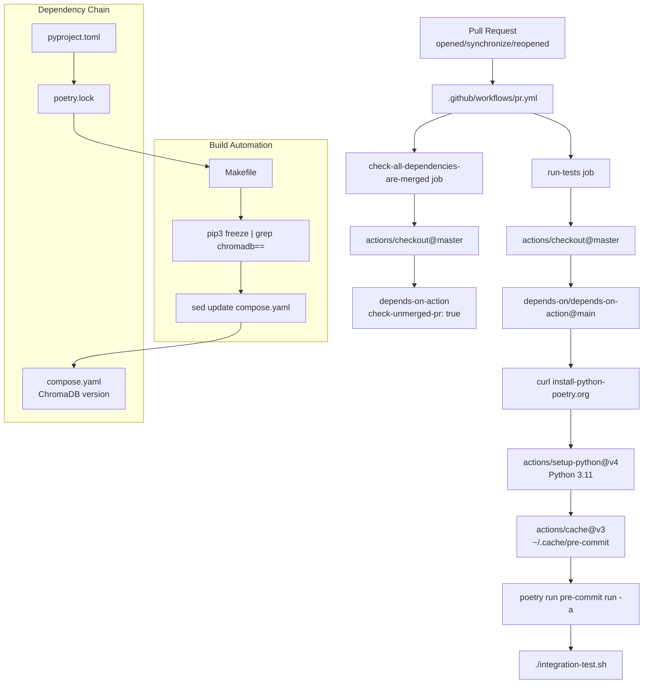
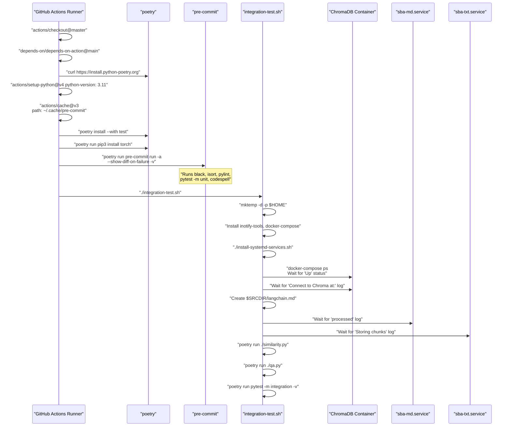
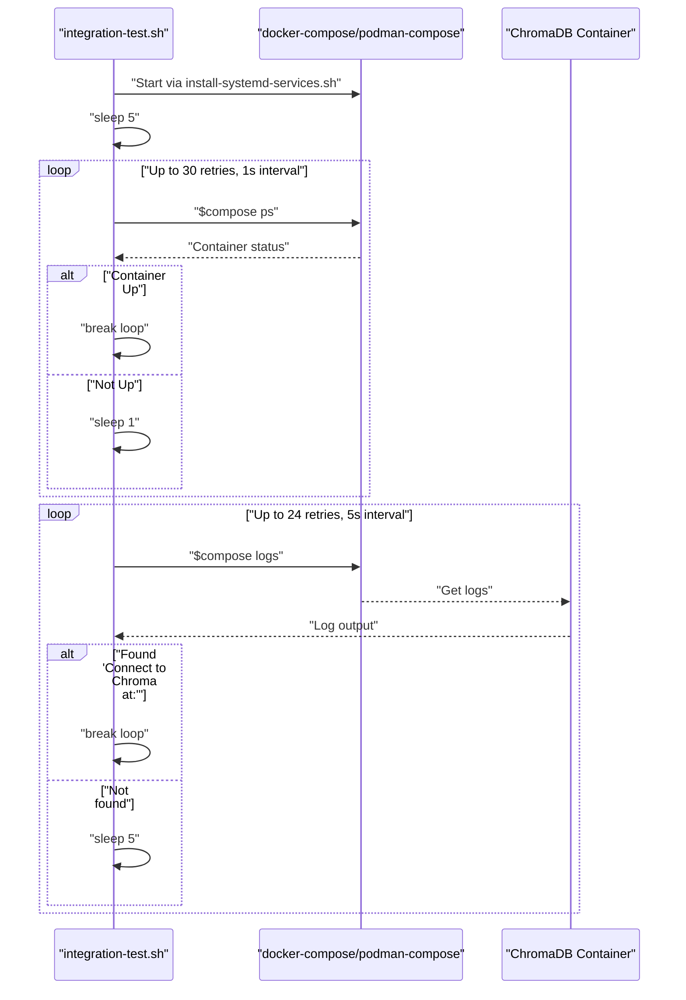
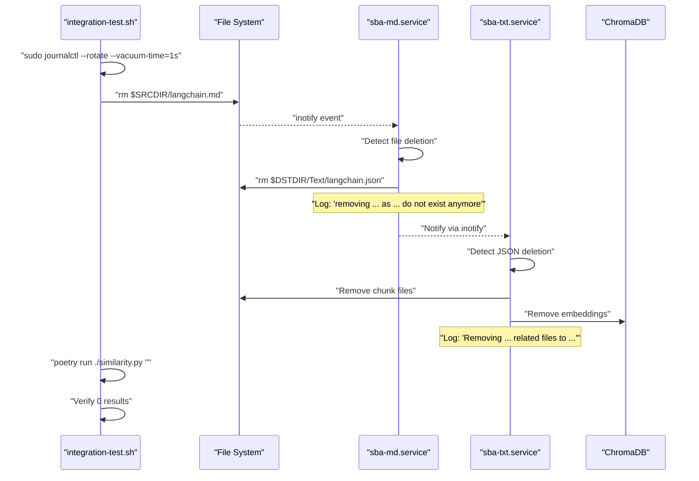
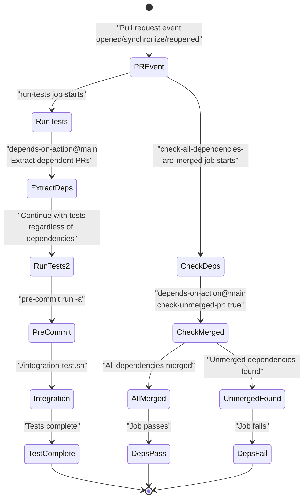

<!-- source: DeepWiki mcp.deepwiki.com · repo flepied/second-brain-agent · page 6.3 CI/CD Pipeline · fetched 2026-10-27 -->

# CI/CD Pipeline

<details>
<summary>Relevant source files</summary>

The following files were used as context for generating this wiki page:

- [.github/workflows/pr.yml](.github/workflows/pr.yml)
- [Makefile](Makefile)
- [integration-test.sh](integration-test.sh)

</details>


This document covers the continuous integration and continuous deployment (CI/CD) infrastructure for the Second Brain Agent system. The CI/CD pipeline automates code quality checks, testing, dependency management, and deployment processes through GitHub Actions workflows and build automation tools.

For information about the testing framework and code quality tools that are executed within this pipeline, see [Code Quality and Testing](#6.2). For details about project dependencies managed by this pipeline, see [Project Dependencies](#6.1).

## Pipeline Overview

The CI/CD system is built around GitHub Actions workflows that orchestrate automated testing, dependency checking, and deployment tasks. The pipeline integrates with Poetry for dependency management and pre-commit hooks for code quality enforcement. The core workflow is defined in `.github/workflows/pr.yml` and executes `integration-test.sh` for end-to-end validation.

### CI/CD Architecture



Sources: [.github/workflows/pr.yml:1-70](), [Makefile:1-17]()

## Pull Request Workflow

The primary CI/CD workflow is defined in `.github/workflows/pr.yml` and executes on pull request events (`opened`, `synchronize`, `reopened`). The workflow consists of two parallel jobs that ensure code quality and dependency management.

### Job Configuration

| Job Name | Purpose | Key Steps | Environment Variables |
|----------|---------|-----------|----------------------|
| `run-tests` | Execute code quality checks and integration tests | Pre-commit hooks, integration testing | `HUGGINGFACEHUB_API_TOKEN`, `OPENAI_API_KEY` |
| `check-all-dependencies-are-merged` | Verify dependent PRs are merged | Dependency validation via `depends-on-action` | None |

Sources: [.github/workflows/pr.yml:7-69]()

### Test Execution Pipeline



Sources: [.github/workflows/pr.yml:7-56](), [integration-test.sh:1-252]()

The `run-tests` job follows this execution sequence:

1. **Code Checkout** - Uses `actions/checkout@master` to retrieve the repository code [.github/workflows/pr.yml:13-14]()
2. **Dependency Extraction** - Leverages `depends-on/depends-on-action@main` to identify dependent pull requests [.github/workflows/pr.yml:16-19]()
3. **Poetry Installation** - Installs Poetry package manager via `curl -sSL https://install.python-poetry.org | python3 -` [.github/workflows/pr.yml:21-25]()
4. **Python Environment Setup** - Configures Python 3.11 with Poetry cache support using `actions/setup-python@v4` [.github/workflows/pr.yml:27-31]()
5. **Pre-commit Caching** - Caches `~/.cache/pre-commit` directory based on `.pre-commit-config.yaml` hash [.github/workflows/pr.yml:33-40]()
6. **Dependency Installation** - Executes `poetry install --with test` and `poetry run pip3 install torch` [.github/workflows/pr.yml:42-47]()
7. **Quality Checks** - Runs `poetry run pre-commit run -a --show-diff-on-failure -v` [.github/workflows/pr.yml:42-47]()
8. **Integration Testing** - Executes `./integration-test.sh` with `HUGGINGFACEHUB_API_TOKEN` and `OPENAI_API_KEY` environment variables [.github/workflows/pr.yml:49-55]()

Sources: [.github/workflows/pr.yml:7-56]()

## Build and Dependency Management

The build system uses a `Makefile` to automate dependency synchronization and ensure that the ChromaDB Docker container version matches the Python package version managed by Poetry.

### Automated Version Synchronization

```mermaid
graph LR
    PYPROJECT["pyproject.toml<br/>ChromaDB dependency"] --> POETRYLOCK["poetry lock<br/>poetry.lock"]
    POETRYLOCK --> MAKEFILE["make all<br/>Makefile"]
    MAKEFILE --> ACTIVATE[". .venv/bin/activate"]
    ACTIVATE --> PIPFREEZE["pip3 freeze"]
    PIPFREEZE --> GREP["grep chromadb=="]
    GREP --> SED["sed 's/.*==//'"]
    SED --> VERSION["$$VER variable"]
    VERSION --> SEDUPDATE["sed -i compose.yaml<br/>Update ghcr.io/chroma-core/chroma:$$VER"]
    SEDUPDATE --> COMPOSEYAML["compose.yaml<br/>Synchronized version"]
```



Sources: [Makefile:1-17]()

### Makefile Dependency Chain

The `Makefile` implements three targets with automatic dependency resolution:

| Target | Dependencies | Command | Purpose |
|--------|--------------|---------|---------|
| `all` | `compose.yaml` | N/A | Default target, ensures `compose.yaml` is up-to-date |
| `compose.yaml` | `poetry.lock` | Extract version from `pip3 freeze \| grep chromadb==` and update `compose.yaml` | Synchronize Docker image version |
| `poetry.lock` | `pyproject.toml` | `poetry lock` | Regenerate lock file when dependencies change |

### Version Extraction Process

The version synchronization process extracts the ChromaDB version from the Poetry-managed virtual environment:

```bash
. .venv/bin/activate
VER=$(pip3 freeze | grep chromadb== | sed "s/.*==//")
sed -i -e "s@ghcr.io/chroma-core/chroma:.*@ghcr.io/chroma-core/chroma:$$VER@" compose.yaml
```

This three-step process:
1. Activates the Poetry virtual environment at `.venv/bin/activate` [Makefile:7]()
2. Extracts the ChromaDB version using `pip3 freeze | grep chromadb== | sed "s/.*=//"` [Makefile:8]()
3. Updates `compose.yaml` with the extracted version via `sed -i` in-place editing [Makefile:12]()

The `touch poetry.lock` command ensures the timestamp is updated, preventing unnecessary re-runs [Makefile:16]().

Sources: [Makefile:1-17]()

## Integration Testing

The CI/CD pipeline executes comprehensive end-to-end testing via `integration-test.sh`, which validates the entire system lifecycle from document ingestion to query processing.

### Integration Test Architecture

```mermaid
graph TB
    START["integration-test.sh"] --> SETUP["Environment Setup"]
    SETUP --> INSTALL["Install Dependencies"]
    INSTALL --> TEMPDIR["mktemp -d -p $HOME"]
    TEMPDIR --> ENV["Create .env<br/>SRCDIR=$TOP/Notes<br/>DSTDIR=$TOP/.second-brain"]
    ENV --> SYSTEMD["./install-systemd-services.sh"]
    
    SYSTEMD --> WAITCHROMA["Wait for ChromaDB<br/>docker-compose ps | grep 'Up'<br/>Timeout: 30 retries"]
    WAITCHROMA --> WAITLOG["Wait for log<br/>'Connect to Chroma at:'<br/>Timeout: 24 retries"]
    
    WAITLOG --> CREATE["Create Test Document<br/>$SRCDIR/langchain.md"]
    CREATE --> WAITMD["Wait for sba-md log<br/>\"processed '$SRCDIR/langchain.md'\"<br/>Timeout: 30 retries"]
    WAITMD --> WAITTXT["Wait for sba-txt log<br/>\"Storing chunks to the db\"<br/>Timeout: 30 retries"]
    
    WAITTXT --> TESTSIM["poetry run ./similarity.py<br/>'What is langchain?'"]
    TESTSIM --> TESTQA["poetry run ./qa.py<br/>'What is langchain?'"]
    TESTQA --> PYTEST1["poetry run pytest -m integration -v"]
    
    PYTEST1 --> RESTART["docker-compose restart"]
    RESTART --> WAITRESTART["Wait for ChromaDB restart<br/>Timeout: 24 retries"]
    WAITRESTART --> TESTPERSIST["Test persistence<br/>similarity.py and qa.py"]
    
    TESTPERSIST --> TESTTOUCH["Test touch without change<br/>journalctl | grep 'content is the same'"]
    TESTTOUCH --> TESTMODIFY["Test document modification<br/>Verify partial reprocessing"]
    TESTMODIFY --> TESTDELETE["Test document deletion<br/>journalctl | grep 'removing'"]
    
    TESTDELETE --> PYTEST2["poetry run pytest -m integration -v"]
    PYTEST2 --> END["Test Complete"]
```

Sources: [integration-test.sh:1-252]()

### Test Phases

The integration test script executes seven distinct validation phases:

#### Phase 1: Environment Setup

| Step | Command | Purpose |
|------|---------|---------|
| Install system packages | `dnf install inotify-tools podman-compose` or `apt-get install inotify-tools docker-compose` | File monitoring and container orchestration |
| Create temporary directory | `mktemp -d -p $HOME` | Isolated test environment |
| Generate `.env` file | `SRCDIR=$TOP/Notes DSTDIR=$TOP/.second-brain` | Configuration for test services |
| Install systemd services | `./install-systemd-services.sh` | Background processing services |

Sources: [integration-test.sh:11-33]()

#### Phase 2: ChromaDB Startup Validation



The script waits for two indicators of successful ChromaDB startup:
1. Container status showing `Up` in `docker-compose ps` output [integration-test.sh:44-54]()
2. Log message `Connect to Chroma at:` indicating readiness [integration-test.sh:56-66]()

Sources: [integration-test.sh:36-66]()

#### Phase 3: Document Processing Validation

The test creates a markdown file with embedded URLs and monitors the processing pipeline:

```bash
cat > $SRCDIR/langchain.md <<EOF
## References
- https://docs.langchain.com/docs/
- https://blog.langchain.dev/conversational-retrieval-agents/
Plan-and-Solve Prompting: Improving Zero-Shot Chain-of-Thought Reasoning by Large Language Models
https://arxiv.org/pdf/2305.04091.pdf
EOF
```

Processing is validated through `journalctl` monitoring:
- **sba-md processing**: Waits for `processed '$SRCDIR/langchain.md'` log entry [integration-test.sh:80-92]()
- **sba-txt processing**: Waits for `Storing .* chunks to the db for metadata=.*'url': 'file://$SRCDIR/langchain.md'` with `'type': 'notes'` [integration-test.sh:94-107]()

Sources: [integration-test.sh:68-107]()

#### Phase 4: Query Interface Validation

| Tool | Command | Validation |
|------|---------|------------|
| `similarity.py` | `poetry run ./similarity.py "What is langchain?"` | Non-empty result required |
| `qa.py` | `poetry run ./qa.py "What is langchain?"` | Must not return "I don't know." |
| `pytest` | `poetry run pytest -m integration -v` | All integration tests pass |

Sources: [integration-test.sh:109-123]()

#### Phase 5: Persistence Validation

The script restarts ChromaDB via `docker-compose restart` and re-runs the same queries to verify data persistence across container restarts [integration-test.sh:125-150]().

#### Phase 6: Incremental Processing Validation

Tests the checksum-based change detection system:

**Test 6a: Touch without content change**
```bash
touch $SRCDIR/langchain.md
# Wait for log: "content is the same for ${DSTDIR}/Text/langchain.json"
```

**Test 6b: Partial content modification**
```bash
cat >> $SRCDIR/langchain.md <<EOF
## Links
- https://python.langchain.com/
EOF
# Verify that only the new URL is processed, not the existing PDFs
```

The test validates that exactly 2 entries show `content is the same` (the two existing URLs), confirming that embedded PDF content is not reprocessed [integration-test.sh:156-205]().

Sources: [integration-test.sh:152-205]()

#### Phase 7: Document Deletion Validation



The deletion test validates the cleanup cascade:
1. Markdown file deletion triggers `sba-md.service` to remove the corresponding JSON file [integration-test.sh:217-229]()
2. JSON deletion triggers `sba-txt.service` to remove chunk files and ChromaDB entries [integration-test.sh:231-241]()
3. Verification that no documents remain in the vector database [integration-test.sh:243-245]()

Sources: [integration-test.sh:207-250]()

### Test Environment Configuration

| Environment Variable | Purpose | Source |
|---------------------|---------|---------|
| `HUGGINGFACEHUB_API_TOKEN` | HuggingFace API access for embeddings | GitHub Secrets |
| `OPENAI_API_KEY` | OpenAI API access for LLM operations | GitHub Secrets |
| `SRCDIR` | Source directory for markdown files | Generated in script: `$TOP/Notes` |
| `DSTDIR` | Destination directory for processed data | Generated in script: `$TOP/.second-brain` |

Sources: [.github/workflows/pr.yml:50-52](), [integration-test.sh:19-31]()

## Dependency Validation System

The CI/CD pipeline includes sophisticated dependency management through the `depends-on/depends-on-action` GitHub Action, which enables PRs to declare dependencies on other PRs using special comment syntax.

### Dependent PR Management



Sources: [.github/workflows/pr.yml:7-69]()

### Two-Phase Dependency Validation

The system implements two independent jobs with different dependency validation behaviors:

#### Phase 1: Dependency Extraction (run-tests job)

```yaml
- name: Extract dependent Pull Requests
  uses: depends-on/depends-on-action@main
  with:
    token: ${{ secrets.GITHUB_TOKEN }}
```

This step extracts dependent PRs but allows the job to continue regardless of their merge status [.github/workflows/pr.yml:16-19](). This enables early testing and feedback even when dependencies are not yet merged.

#### Phase 2: Merge Validation (check-all-dependencies-are-merged job)

```yaml
- name: Check all dependent Pull Requests are merged
  uses: depends-on/depends-on-action@main
  with:
    token: ${{ secrets.GITHUB_TOKEN }}
    check-unmerged-pr: true
```

This step enforces that all dependent PRs are merged before allowing the current PR to be merged [.github/workflows/pr.yml:64-68](). The `check-unmerged-pr: true` parameter causes the action to fail if unmerged dependencies are detected.

This two-phase approach provides:
- **Early feedback**: Tests run immediately without waiting for dependencies
- **Merge safety**: PRs cannot be merged until all dependencies are merged
- **Parallel execution**: Both jobs run concurrently for faster CI completion

Sources: [.github/workflows/pr.yml:16-19](), [.github/workflows/pr.yml:64-68]()

## Workflow Triggers and Events

The CI/CD pipeline is configured to respond to specific GitHub events:

### Trigger Configuration

```yaml
on:
  pull_request:
    types: [opened, synchronize, reopened]
```

The pipeline activates on three pull request events:
- **opened** - New pull requests
- **synchronize** - Updates to existing pull requests  
- **reopened** - Previously closed pull requests that are reopened

This ensures comprehensive testing coverage throughout the pull request lifecycle.

Sources: [.github/workflows/pr.yml:4-6]()

---

