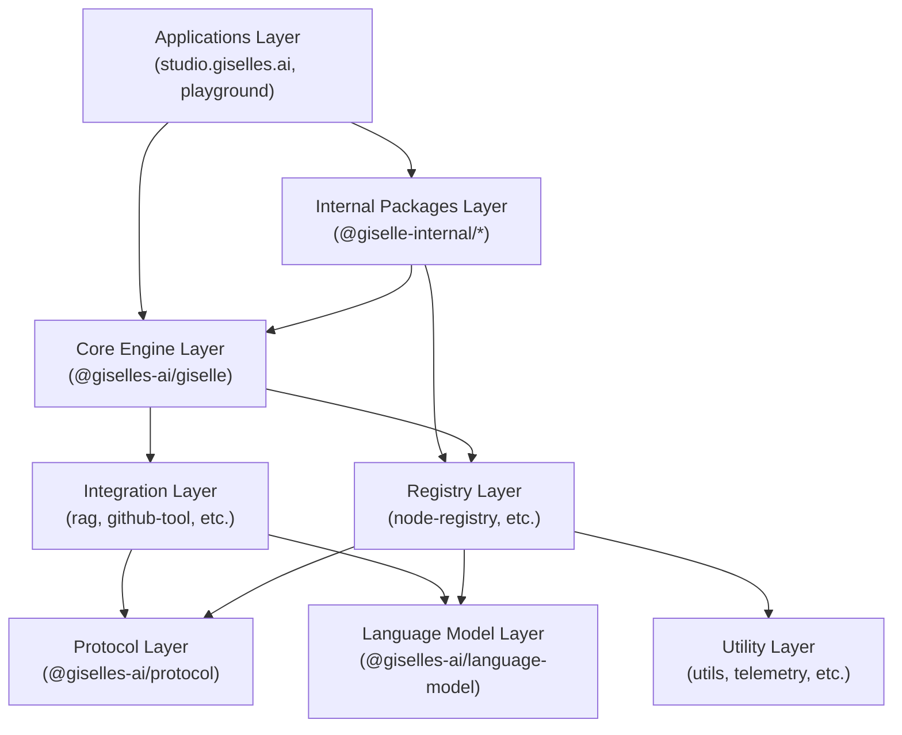
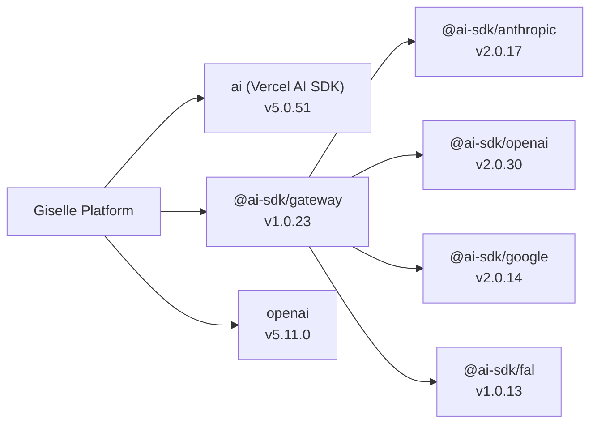
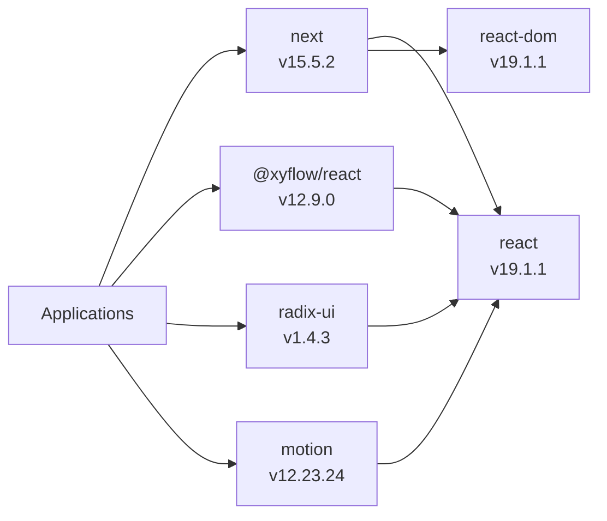

<!-- source: DeepWiki mcp.deepwiki.com · repo giselles-ai/giselle · page 1.2 Package Architecture and Dependencies · fetched 2026-10-27 -->

# Package Architecture and Dependencies

<details>
<summary>Relevant source files</summary>

The following files were used as context for generating this wiki page:

- [apps/playground/package.json](apps/playground/package.json)
- [apps/studio.giselles.ai/package.json](apps/studio.giselles.ai/package.json)
- [internal-packages/workflow-designer-ui/package.json](internal-packages/workflow-designer-ui/package.json)
- [package.json](package.json)
- [packages/giselle/package.json](packages/giselle/package.json)
- [pnpm-lock.yaml](pnpm-lock.yaml)
- [pnpm-workspace.yaml](pnpm-workspace.yaml)

</details>


## Overview and Scope

This document details the package architecture of the Giselle AI platform, covering the dependency graph, the catalog-based dependency management system, and the organization of packages into logical layers. The platform is structured as a pnpm monorepo with workspace-scoped packages that follow a layered dependency architecture.

For information about the monorepo's build system and development workflow, see [Build System and Development Workflow](#1.3). For details about how the core engine orchestrates these packages, see [Core Engine and SDK](#2).

## Monorepo Structure

The Giselle AI platform uses a pnpm workspace monorepo with the following directory structure:

| Directory | Purpose | Package Naming |
|-----------|---------|----------------|
| `apps/` | User-facing applications | Domain-based (e.g., `studio.giselles.ai`) |
| `internal-packages/` | Private shared UI and workflow components | `@giselle-internal/*` scope |
| `packages/` | Public-scoped SDK and integration packages | `@giselles-ai/*` scope |
| `tools/` | Build tools and shared configurations | `@giselles-ai/*` scope |

The workspace configuration defines package locations and sets a minimum release age for dependencies:

[pnpm-workspace.yaml:1-6]()

**Sources:** [pnpm-workspace.yaml:1-6]()

## Dependency Catalog System

The monorepo uses pnpm's catalog feature to manage dependency versions centrally. This ensures consistent versions across all packages and simplifies version updates.

### Catalog Definition

The catalog is defined in `pnpm-workspace.yaml` and contains version specifications for all shared dependencies:

```yaml
catalog:
  '@ai-sdk/anthropic': 2.0.17
  '@ai-sdk/openai': 2.0.30
  react: 19.1.1
  next: 15.5.2
  # ... 95+ more entries
```

[pnpm-workspace.yaml:7-101]()

### Catalog Usage

Packages reference catalog entries using the `catalog:` protocol:

```json
{
  "dependencies": {
    "react": "catalog:",
    "@ai-sdk/openai": "catalog:",
    "next": "catalog:"
  }
}
```

This resolves to the version specified in the catalog. For example, `"react": "catalog:"` resolves to `19.1.1`.

### Catalog Benefits

1. **Single Source of Truth**: All version specifications exist in one location
2. **Atomic Updates**: Updating a dependency version updates all consumers
3. **Consistency Guarantees**: Prevents version mismatches across packages
4. **Simplified Maintenance**: No need to update versions in multiple `package.json` files

**Sources:** [pnpm-workspace.yaml:7-101](), [apps/studio.giselles.ai/package.json:25-106](), [packages/giselle/package.json:55-75]()

## Package Layers and Dependencies

The package architecture follows a layered dependency model where lower layers provide abstractions consumed by higher layers. Dependencies flow upward through the layers, with no circular dependencies.

### Layer Overview



**Sources:** [pnpm-lock.yaml:242-964]()

## Protocol Layer

### @giselles-ai/protocol

The foundational package defining shared TypeScript types and schemas used throughout the platform.

**Key Responsibilities:**
- Workflow graph data structures (nodes, edges, ports)
- Generation and Act execution types
- Vector store and RAG types
- Tool and model configuration schemas
- GitHub integration types

**Dependencies:**
```json
{
  "@ai-sdk/provider": "catalog:",
  "@giselles-ai/action-registry": "workspace:*",
  "@giselles-ai/language-model": "workspace:^",
  "@giselles-ai/trigger-registry": "workspace:*",
  "@octokit/webhooks": "catalog:",
  "ai": "catalog:",
  "zod": "catalog:"
}
```

[packages/protocol/package.json]() (not shown in files but referenced in dependencies)

**Sources:** [pnpm-lock.yaml:1084-1119](), [packages/giselle/package.json:44]()

### @giselles-ai/language-model

Provides model abstraction types and validation schemas.

**Dependencies:**
```json
{
  "zod": "catalog:"
}
```

[pnpm-lock.yaml:1043-1057]()

**Sources:** [pnpm-lock.yaml:1043-1057]()

## Registry Layer

Registry packages define pluggable components that extend workflow capabilities.

### @giselles-ai/action-registry

Defines action types for GitHub and other integrations.

**Dependencies:**
```json
{
  "@giselles-ai/utils": "workspace:*"
}
```

[pnpm-lock.yaml:828-842]()

### @giselles-ai/trigger-registry

Defines trigger types for workflow initiation (GitHub events, manual triggers, etc.).

**Dependencies:** Minimal (utility only)

### @giselles-ai/node-registry

Defines node types for the workflow graph (TextGeneration, ImageGeneration, Query, etc.).

**Dependencies:**
```json
{
  "@giselles-ai/action-registry": "workspace:*",
  "@giselles-ai/language-model": "workspace:*",
  "@giselles-ai/protocol": "workspace:*",
  "@giselles-ai/text-editor-utils": "workspace:*",
  "@giselles-ai/trigger-registry": "workspace:*"
}
```

[pnpm-lock.yaml:1059-1082]()

**Sources:** [pnpm-lock.yaml:828-842](), [pnpm-lock.yaml:1059-1082]()

## Core Engine Layer

### @giselles-ai/giselle

The main orchestration engine responsible for workflow execution, generation lifecycle management, and AI provider integration.

**Key Responsibilities:**
- Generation pipeline execution (text, image, query)
- Act runner for multi-step workflows
- AI provider abstraction and routing
- Storage and vault integration
- Tool orchestration

**Core Dependencies:**

| Package | Purpose |
|---------|---------|
| `@ai-sdk/anthropic`, `@ai-sdk/openai`, `@ai-sdk/google`, `@ai-sdk/fal` | AI provider integrations via Vercel AI SDK |
| `@ai-sdk/gateway` | AI Gateway for provider routing |
| `ai` (Vercel AI SDK) | Core AI streaming and generation abstractions |
| `@giselles-ai/protocol` | Type definitions |
| `@giselles-ai/action-registry`, `@giselles-ai/trigger-registry`, `@giselles-ai/node-registry` | Registry packages |
| `@giselles-ai/github-tool`, `@giselles-ai/web-search` | Tool integrations |
| `@giselles-ai/language-model` | Model abstractions |
| `openai` | OpenAI API client |
| `pg` | PostgreSQL client for database queries |

[packages/giselle/package.json:55-75]()

**Exports Structure:**

The package provides multiple entry points for different contexts:

```json
{
  ".": "./dist/index.js",
  "./next": "./next/dist/index.js",
  "./react": "./react/dist/index.js",
  "./client": "./client/dist/index.js"
}
```

[packages/giselle/package.json:16-41]()

**Sources:** [packages/giselle/package.json:1-80](), [pnpm-lock.yaml:872-964]()

## Integration Layer

Integration packages provide specialized functionality for external services and data processing.

### @giselles-ai/rag

Vector search and retrieval-augmented generation capabilities.

**Dependencies:**
```json
{
  "@ai-sdk/gateway": "catalog:",
  "@ai-sdk/google": "catalog:",
  "@ai-sdk/openai": "catalog:",
  "@giselles-ai/protocol": "workspace:*",
  "ai": "catalog:",
  "openai": "catalog:",
  "pg": "catalog:",
  "pgvector": "catalog:",
  "zod": "catalog:"
}
```

[pnpm-lock.yaml:1121-1162]()

### @giselles-ai/github-tool

GitHub integration including repository indexing, GraphQL API access, and webhook handling.

**Dependencies:**
```json
{
  "@giselles-ai/rag": "workspace:*",
  "@octokit/auth-app": "catalog:",
  "@octokit/core": "catalog:",
  "@octokit/request-error": "catalog:",
  "@octokit/webhooks": "catalog:",
  "@urql/core": "catalog:",
  "ai": "catalog:",
  "gql.tada": "catalog:",
  "tar": "catalog:",
  "urql": "catalog:",
  "zod": "catalog:"
}
```

[pnpm-lock.yaml:966-1016]()

### @giselles-ai/web-search

Web search tool integration for querying external search engines.

**Dependencies:** Minimal, focused on search API integration.

### @giselles-ai/document-preprocessor

Document processing pipeline for PDF text extraction and image rendering.

**Dependencies:**
```json
{
  "@embedpdf/pdfium": "catalog:",
  "pngjs": "catalog:"
}
```

[pnpm-lock.yaml:844-870]()

### @giselles-ai/supabase-driver

Storage driver implementation for Supabase backend.

**Dependencies:** Supabase client libraries and authentication.

**Sources:** [pnpm-lock.yaml:844-1162]()

## Utility Layer

### @giselles-ai/text-editor

Tiptap-based rich text editor component.

**Dependencies:**
```json
{
  "@tiptap/core": "catalog:",
  "@tiptap/extension-code-block-lowlight": "catalog:",
  "@tiptap/extension-mention": "catalog:",
  "@tiptap/extension-placeholder": "catalog:",
  "@tiptap/html": "catalog:",
  "@tiptap/react": "catalog:",
  "@tiptap/starter-kit": "catalog:",
  "@tiptap/suggestion": "catalog:"
}
```

### @giselles-ai/text-editor-utils

Utilities for text editor content manipulation and serialization.

### @giselles-ai/langfuse

LLM observability integration with Langfuse.

**Dependencies:**
```json
{
  "@giselles-ai/language-model": "workspace:^",
  "@giselles-ai/protocol": "workspace:^",
  "@giselles-ai/rag": "workspace:^",
  "langfuse": "catalog:"
}
```

[pnpm-lock.yaml:1018-1041]()

### @giselles-ai/telemetry

OpenTelemetry integration for distributed tracing.

### @giselles-ai/utils

Shared utility functions and helpers.

**Sources:** [pnpm-lock.yaml:1018-1041](), [pnpm-workspace.yaml:35-43]()

## Internal Packages Layer

### @giselle-internal/ui

Shared UI component library with design system primitives.

**Key Components:**
- Theme system with CSS variables
- Radix UI component wrappers
- Text editor integration
- Protocol type integration

**Dependencies:**
```json
{
  "@giselles-ai/protocol": "workspace:^",
  "@giselles-ai/text-editor": "workspace:^",
  "clsx": "catalog:",
  "lucide-react": "catalog:",
  "next": "catalog:",
  "radix-ui": "catalog:",
  "react": "catalog:",
  "react-dom": "catalog:"
}
```

[pnpm-lock.yaml:673-714]()

### @giselle-internal/workflow-designer-ui

Visual workflow editor components built on ReactFlow.

**Key Components:**
- Node rendering system
- Properties panels for node configuration
- Toolbar and node creation flow
- Generation execution and results display

**Dependencies:**
```json
{
  "@giselle-internal/ui": "workspace:^",
  "@giselles-ai/action-registry": "workspace:*",
  "@giselles-ai/giselle": "workspace:*",
  "@giselles-ai/language-model": "workspace:^",
  "@giselles-ai/node-registry": "workspace:*",
  "@giselles-ai/protocol": "workspace:*",
  "@giselles-ai/text-editor": "workspace:^",
  "@giselles-ai/text-editor-utils": "workspace:^",
  "@giselles-ai/trigger-registry": "workspace:*",
  "@xyflow/react": "catalog:",
  "clsx": "catalog:",
  "fast-levenshtein": "catalog:",
  "lucide-react": "catalog:",
  "marked": "catalog:",
  "motion": "catalog:",
  "next": "catalog:",
  "radix-ui": "catalog:",
  "react": "catalog:",
  "react-dom": "catalog:",
  "react-markdown": "catalog:",
  "react-resizable-panels": "catalog:",
  "swr": "catalog:",
  "zod": "catalog:",
  "zustand": "catalog:"
}
```

[internal-packages/workflow-designer-ui/package.json:15-41]()

**Sources:** [pnpm-lock.yaml:673-826](), [internal-packages/workflow-designer-ui/package.json:1-58]()

## Applications Layer

### studio.giselles.ai

The primary production application providing workflow design, execution, and management.

**Key Features:**
- Workflow designer integration
- Stage system for production execution
- Vector store management
- GitHub integration
- User authentication and team management
- Database schema via Drizzle ORM

**Dependencies Summary:**

| Category | Key Packages |
|----------|--------------|
| Internal | `@giselle-internal/ui`, `@giselle-internal/workflow-designer-ui` |
| Engine | `@giselles-ai/giselle`, `@giselles-ai/protocol`, `@giselles-ai/node-registry` |
| Integrations | `@giselles-ai/github-tool`, `@giselles-ai/rag`, `@giselles-ai/document-preprocessor` |
| Framework | `next`, `react`, `react-dom` |
| Database | `drizzle-orm`, `@vercel/postgres`, `pg` |
| Auth | `@supabase/supabase-js`, `@supabase/ssr`, `@supabase/auth-js` |
| AI | `ai`, `openai`, `langfuse-vercel` |
| Infrastructure | `@trigger.dev/sdk`, `@vercel/edge-config`, `@vercel/functions`, `@vercel/otel` |
| Observability | `@sentry/nextjs`, `@opentelemetry/*` packages |
| Payments | `stripe` |
| Email | `@react-email/components`, `nodemailer` |

[apps/studio.giselles.ai/package.json:25-106]()

### playground

Simplified development and testing application with reduced feature set.

**Dependencies:**
```json
{
  "@giselle-internal/ui": "workspace:^",
  "@giselle-internal/workflow-designer-ui": "workspace:*",
  "@giselles-ai/protocol": "workspace:*",
  "@giselles-ai/giselle": "workspace:*",
  "@giselles-ai/langfuse": "workspace:^",
  "@giselles-ai/supabase-driver": "workspace:^",
  "clsx": "catalog:",
  "lucide-react": "catalog:",
  "next": "catalog:",
  "react": "catalog:",
  "react-dom": "catalog:"
}
```

[apps/playground/package.json:19-30]()

**Sources:** [apps/studio.giselles.ai/package.json:1-132](), [apps/playground/package.json:1-42]()

## Key External Dependencies

The platform relies on several critical external dependencies managed through the catalog.

### AI and Language Models



| Package | Version | Purpose |
|---------|---------|---------|
| `ai` | 5.0.51 | Core Vercel AI SDK for streaming and generation abstractions |
| `@ai-sdk/gateway` | 1.0.23 | AI Gateway for provider routing and fallback |
| `@ai-sdk/anthropic` | 2.0.17 | Claude model integration |
| `@ai-sdk/openai` | 2.0.30 | GPT model integration |
| `@ai-sdk/google` | 2.0.14 | Gemini model integration |
| `@ai-sdk/fal` | 1.0.13 | Fal.ai image generation |
| `openai` | 5.11.0 | Direct OpenAI API client for embeddings |

**Sources:** [pnpm-workspace.yaml:8-23](), [pnpm-lock.yaml:123-125]()

### React and UI Framework



| Package | Version | Purpose |
|---------|---------|---------|
| `next` | 15.5.2 | React framework with App Router |
| `react` | 19.1.1 | Core React library |
| `react-dom` | 19.1.1 | React DOM renderer |
| `@xyflow/react` | 12.9.0 | Node-based graph editor for workflow canvas |
| `radix-ui` | 1.4.3 | Accessible UI primitives (meta-package) |
| `motion` | 12.23.24 | Animation library (Framer Motion successor) |
| `lucide-react` | 0.473.0 | Icon library |

**Sources:** [pnpm-workspace.yaml:58-92]()

### Database and Vector Store

| Package | Version | Purpose |
|---------|---------|---------|
| `pg` | 8.14.1 | PostgreSQL client |
| `pgvector` | 0.2.1 | PostgreSQL vector extension types |
| `drizzle-orm` | 0.44.2 | TypeScript ORM |
| `@vercel/postgres` | 0.9.0 | Vercel-optimized PostgreSQL client |

**Sources:** [pnpm-workspace.yaml:80-81](), [apps/studio.giselles.ai/package.json:76]()

### Authentication and Storage

| Package | Version | Purpose |
|---------|---------|---------|
| `@supabase/supabase-js` | 2.50.5 | Supabase client SDK |
| `@supabase/ssr` | 0.6.1 | Server-side rendering support |
| `@supabase/auth-js` | 2.70.0 | Authentication library |

**Sources:** [pnpm-workspace.yaml:30-32]()

### GitHub Integration

| Package | Version | Purpose |
|---------|---------|---------|
| `@octokit/core` | 7.0.2 | Core GitHub API client |
| `@octokit/auth-app` | 8.0.1 | GitHub App authentication |
| `@octokit/webhooks` | 14.0.2 | Webhook event handling |
| `@urql/core` | 5.1.1 | GraphQL client for GitHub API |
| `gql.tada` | 1.8.10 | Type-safe GraphQL queries |

**Sources:** [pnpm-workspace.yaml:23-28](), [pnpm-workspace.yaml:55](), [pnpm-workspace.yaml:63]()

### Observability

| Package | Version | Purpose |
|---------|---------|---------|
| `langfuse` | 3.38.4 | LLM observability and tracing |
| `@sentry/nextjs` | 9.30.0 | Error tracking and performance monitoring |
| `@opentelemetry/*` | Various | OpenTelemetry instrumentation |
| `@vercel/otel` | 1.10.0 | Vercel OpenTelemetry integration |
| `pino` | 9.9.0 | Structured logging |

**Sources:** [pnpm-workspace.yaml:69-82](), [apps/studio.giselles.ai/package.json:45-51]()

### Infrastructure

| Package | Version | Purpose |
|---------|---------|---------|
| `@trigger.dev/sdk` | 4.0.5 | Background job processing |
| `@vercel/edge-config` | 1.4.0 | Edge configuration and feature flags |
| `@vercel/functions` | 2.2.11 | Vercel serverless functions utilities |

**Sources:** [pnpm-workspace.yaml:44](), [pnpm-workspace.yaml:56-57]()

## Complete Dependency Graph

The following diagram shows the complete dependency relationships between all workspace packages:

```mermaid
graph TB
    Studio["studio.giselles.ai"]
    Playground["playground"]
    
    WorkflowUI["@giselle-internal/workflow-designer-ui"]
    InternalUI["@giselle-internal/ui"]
    
    Giselle["@giselles-ai/giselle"]
    Protocol["@giselles-ai/protocol"]
    LangModel["@giselles-ai/language-model"]
    
    NodeReg["@giselles-ai/node-registry"]
    ActionReg["@giselles-ai/action-registry"]
    TriggerReg["@giselles-ai/trigger-registry"]
    
    RAG["@giselles-ai/rag"]
    GitHubTool["@giselles-ai/github-tool"]
    WebSearch["@giselles-ai/web-search"]
    DocPreproc["@giselles-ai/document-preprocessor"]
    SupabaseDriver["@giselles-ai/supabase-driver"]
    
    TextEditor["@giselles-ai/text-editor"]
    TextEditorUtils["@giselles-ai/text-editor-utils"]
    Langfuse["@giselles-ai/langfuse"]
    Telemetry["@giselles-ai/telemetry"]
    Utils["@giselles-ai/utils"]
    
    Studio --> WorkflowUI
    Studio --> InternalUI
    Studio --> Giselle
    Studio --> Protocol
    Studio --> NodeReg
    Studio --> GitHubTool
    Studio --> RAG
    Studio --> DocPreproc
    Studio --> Langfuse
    Studio --> LangModel
    Studio --> SupabaseDriver
    Studio --> Utils
    
    Playground --> WorkflowUI
    Playground --> InternalUI
    Playground --> Giselle
    Playground --> Protocol
    Playground --> Langfuse
    Playground --> SupabaseDriver
    
    WorkflowUI --> InternalUI
    WorkflowUI --> Giselle
    WorkflowUI --> Protocol
    WorkflowUI --> NodeReg
    WorkflowUI --> ActionReg
    WorkflowUI --> TriggerReg
    WorkflowUI --> LangModel
    WorkflowUI --> TextEditor
    WorkflowUI --> TextEditorUtils
    
    InternalUI --> Protocol
    InternalUI --> TextEditor
    
    Giselle --> Protocol
    Giselle --> LangModel
    Giselle --> NodeReg
    Giselle --> ActionReg
    Giselle --> TriggerReg
    Giselle --> GitHubTool
    Giselle --> WebSearch
    Giselle --> TextEditorUtils
    
    NodeReg --> Protocol
    NodeReg --> LangModel
    NodeReg --> ActionReg
    NodeReg --> TriggerReg
    NodeReg --> TextEditorUtils
    
    Protocol --> ActionReg
    Protocol --> TriggerReg
    Protocol --> LangModel
    
    ActionReg --> Utils
    
    RAG --> Protocol
    
    GitHubTool --> RAG
    
    Langfuse --> Protocol
    Langfuse --> LangModel
    Langfuse --> RAG
```



**Dependency Flow Rules:**

1. **No Circular Dependencies**: The graph is acyclic (DAG)
2. **Layer Ordering**: Dependencies only flow from higher to lower layers
3. **Protocol Foundation**: Most packages depend on `@giselles-ai/protocol` for shared types
4. **Engine Independence**: The `@giselles-ai/giselle` engine has no dependencies on application or internal packages
5. **Workspace References**: All internal package references use `workspace:*` or `workspace:^` protocol

**Sources:** [pnpm-lock.yaml:242-1162](), [apps/studio.giselles.ai/package.json:25-39](), [apps/playground/package.json:19-30](), [internal-packages/workflow-designer-ui/package.json:15-41](), [packages/giselle/package.json:55-75]()

## Package Version Management

### Workspace Protocol

Internal packages use the `workspace:` protocol to reference other workspace packages:

```json
{
  "dependencies": {
    "@giselles-ai/protocol": "workspace:*",
    "@giselles-ai/giselle": "workspace:^"
  }
}
```

- `workspace:*` - Exact version match, always uses current workspace version
- `workspace:^` - Compatible version range, allows minor/patch updates

### Overrides

The root `package.json` defines global overrides to ensure specific versions:

```json
{
  "pnpm": {
    "overrides": {
      "@electric-sql/client": "1.0.10",
      "@types/react": "19.1.10",
      "@types/react-dom": "19.1.7",
      "cookie": "1.0.2",
      "vite": "7.1.3"
    }
  }
}
```

[package.json:46-53]()

These overrides resolve version conflicts and ensure critical packages use specific versions across the entire dependency tree.

**Sources:** [package.json:46-54](), [pnpm-lock.yaml:235-240]()

---

