<!-- source: DeepWiki mcp.deepwiki.com · repo giselles-ai/giselle · page 2.5 Storage and Vault Systems · fetched 2026-10-27 -->

# Storage and Vault Systems

<details>
<summary>Relevant source files</summary>

The following files were used as context for generating this wiki page:

- [apps/playground/giselle-engine.ts](apps/playground/giselle-engine.ts)
- [apps/studio.giselles.ai/app/giselle-engine.ts](apps/studio.giselles.ai/app/giselle-engine.ts)
- [packages/giselle/src/engine/acts/run-act.ts](packages/giselle/src/engine/acts/run-act.ts)
- [packages/giselle/src/engine/generations/generate-content.ts](packages/giselle/src/engine/generations/generate-content.ts)
- [packages/giselle/src/engine/generations/generate-image.ts](packages/giselle/src/engine/generations/generate-image.ts)
- [packages/giselle/src/engine/generations/internal/use-generation-executor.ts](packages/giselle/src/engine/generations/internal/use-generation-executor.ts)
- [packages/giselle/src/engine/generations/types.ts](packages/giselle/src/engine/generations/types.ts)
- [packages/giselle/src/engine/generations/utils.ts](packages/giselle/src/engine/generations/utils.ts)
- [packages/giselle/src/engine/operations/execute-query.ts](packages/giselle/src/engine/operations/execute-query.ts)
- [packages/giselle/src/engine/telemetry/index.ts](packages/giselle/src/engine/telemetry/index.ts)
- [packages/giselle/src/engine/telemetry/types.ts](packages/giselle/src/engine/telemetry/types.ts)
- [packages/giselle/src/engine/triggers/resolve-trigger.ts](packages/giselle/src/engine/triggers/resolve-trigger.ts)
- [packages/giselle/src/engine/types.ts](packages/giselle/src/engine/types.ts)
- [packages/giselle/src/react/generations/generation-runner.tsx](packages/giselle/src/react/generations/generation-runner.tsx)

</details>


This document describes the storage abstraction layer and secret management (vault) system used throughout the Giselle Engine. The storage system provides a unified interface for persisting generation data, files, and indexes across different backend implementations (Supabase S3, local filesystem). The vault system provides secure secret storage and decryption for tool credentials, API keys, and database connection strings.

For information about how storage is used during generation execution, see [Generation Pipeline and Lifecycle](#2.2). For database schema and persistent data models, see [Database Schema and Data Model](#2.6).

---

## Storage System Architecture

The storage system uses an abstraction layer (`GiselleStorage`) that allows the engine to operate with different storage backends without changing application code. The system supports both cloud storage (Supabase S3-compatible) and local filesystem storage.

### Storage Abstraction Interface

The `GiselleStorage` interface defines the contract for all storage operations:

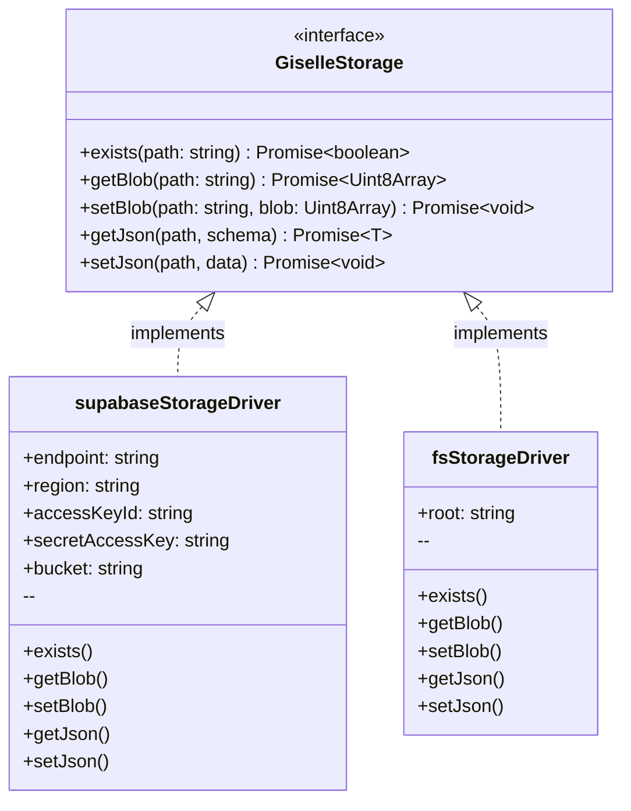

**Sources:** [packages/giselle/src/engine/types.ts:23](), [packages/giselle/src/engine/storage.ts]() (inferred), [packages/supabase-driver/src/index.ts]() (inferred)

### Storage Driver Implementations

#### Supabase Storage Driver

The `supabaseStorageDriver` provides S3-compatible object storage through Supabase:

| Configuration Field | Type | Description |
|-------------------|------|-------------|
| `endpoint` | `string` | Supabase storage endpoint URL |
| `region` | `string` | Storage region identifier |
| `accessKeyId` | `string` | S3-compatible access key |
| `secretAccessKey` | `string` | S3-compatible secret key |
| `bucket` | `string` | Storage bucket name (typically "app") |

The driver is initialized in the Studio application:

**Sources:** [apps/studio.giselles.ai/app/giselle-engine.ts:40-46]()

#### Filesystem Storage Driver

The `fsStorageDriver` provides local filesystem storage for development:

| Configuration Field | Type | Description |
|-------------------|------|-------------|
| `root` | `string` | Root directory path for storage (e.g., "./.storage") |

The playground application conditionally selects the storage driver based on environment:

**Sources:** [apps/playground/giselle-engine.ts:14-24]()

### Storage Path Organization

The storage system uses a hierarchical path structure to organize different types of data:

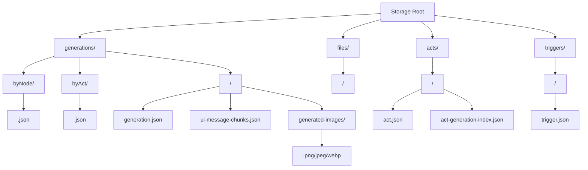

**Key Path Functions:**

| Function | Path Pattern | Usage |
|----------|-------------|-------|
| `generationPath` | `generations/{generationId}/generation.json` | Store/retrieve generation metadata |
| `generationUiMessageChunksPath` | `generations/{generationId}/ui-message-chunks.json` | Store streaming UI messages |
| `generatedImagePath` | `generations/{generationId}/generated-images/{filename}` | Store generated images |
| `filePath` | `files/{workspaceId}/{fileId}` | Store uploaded files |
| `nodeGenerationIndexPath` | `generations/byNode/{nodeId}.json` | Index generations by node |
| `actGenerationIndexPath` | `generations/byAct/{actId}.json` | Index generations by act |

**Sources:** [packages/giselle/src/engine/path.ts]() (inferred), [packages/giselle/src/engine/generations/utils.ts:316-318,335-337,612-614](), [packages/giselle/src/engine/files/utils.ts]() (inferred)

---

## Vault System Architecture

The vault system provides secure storage and retrieval of sensitive credentials. It uses encryption at rest and supports multiple backend implementations.

### Vault Abstraction Interface

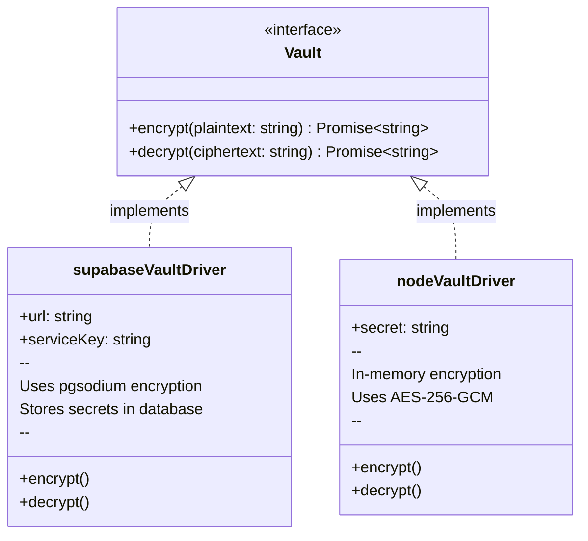

**Sources:** [packages/giselle/src/engine/vault.ts]() (inferred), [packages/supabase-driver/src/vault.ts]() (inferred), [apps/playground/lib/vault-driver.ts]()

### Vault Driver Implementations

#### Supabase Vault Driver

The `supabaseVaultDriver` uses PostgreSQL's pgsodium extension for encryption at rest:

| Configuration Field | Type | Description |
|-------------------|------|-------------|
| `url` | `string` | Supabase project URL |
| `serviceKey` | `string` | Supabase service role key |

The driver stores encrypted secrets in the database with column-level encryption provided by pgsodium.

**Sources:** [apps/studio.giselles.ai/app/giselle-engine.ts:48-51](), [packages/supabase-driver/src/vault.ts]() (inferred)

#### Node Vault Driver

The `nodeVaultDriver` provides in-memory encryption for development environments:

| Configuration Field | Type | Description |
|-------------------|------|-------------|
| `secret` | `string` | Encryption key from `VAULT_SECRET` environment variable |

This driver uses AES-256-GCM encryption and is suitable for local development where database-backed encryption is not available.

**Sources:** [apps/playground/giselle-engine.ts:137-139](), [apps/playground/lib/vault-driver.ts]()

### Vault Integration in Engine Context

The vault is provided to the engine through `GiselleEngineContext`:

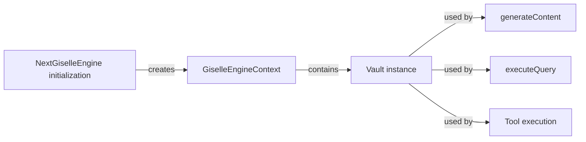

**Sources:** [packages/giselle/src/engine/types.ts:90-127](), [apps/studio.giselles.ai/app/giselle-engine.ts:196-227]()

---

## Storage Usage Patterns

### Generation Data Storage Flow

The storage system is used throughout the generation lifecycle to persist state and results:

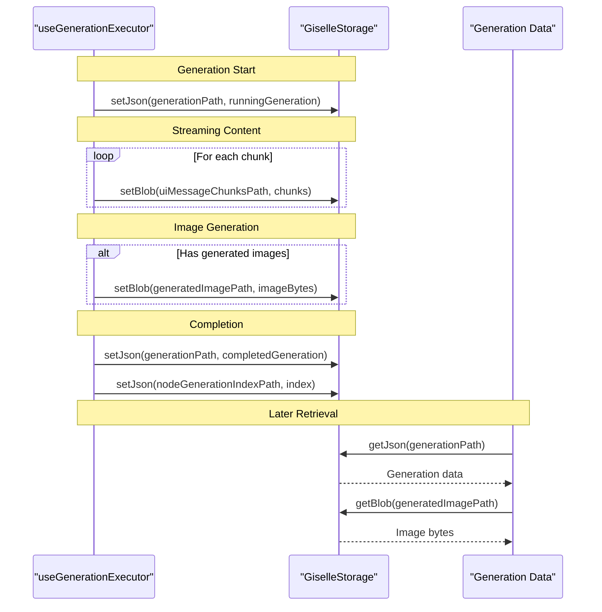

**Key storage operations during generation:**

1. **Generation metadata**: Stored as JSON at `generations/{generationId}/generation.json`
2. **UI message chunks**: Streamed chunks stored at `generations/{generationId}/ui-message-chunks.json`
3. **Generated images**: Binary blobs stored at `generations/{generationId}/generated-images/{filename}`
4. **Indexes**: Generation lookups by node ID and act ID

**Sources:** [packages/giselle/src/engine/generations/internal/use-generation-executor.ts:96-101,328-398](), [packages/giselle/src/engine/generations/generate-content.ts:414-427](), [packages/giselle/src/engine/generations/generate-image.ts:188-196]()

### File Resolution and Retrieval

The `fileResolver` function provides file data retrieval during generation execution:

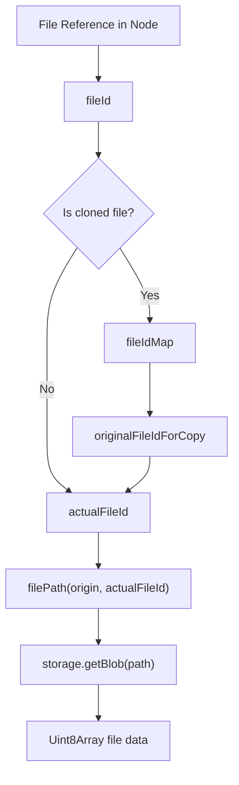

**File ID mapping for duplicated nodes:**

When nodes are duplicated, cloned file references point to the original file's storage location. The `fileIdMap` is built during generation execution to map cloned file IDs to their original storage IDs.

**Sources:** [packages/giselle/src/engine/generations/internal/use-generation-executor.ts:144-179](), [packages/giselle/src/engine/files/utils.ts]() (inferred)

### Generated Image Storage

Generated images from text-to-image models are stored as binary blobs:

| Operation | Path | Data Type | Content |
|-----------|------|-----------|---------|
| Write | `generations/{genId}/generated-images/{imageId}.{ext}` | `Uint8Array` | PNG, JPEG, or WebP image bytes |
| Read | Same path | `Uint8Array` | Raw image data for display |

**Image type detection:** The system detects image format by examining header bytes (magic numbers) to determine the correct file extension.

**Sources:** [packages/giselle/src/engine/generations/utils.ts:612-637,640-685](), [packages/giselle/src/engine/generations/generate-image.ts:179-196,263-280,330-357]()

### Generation Index Storage

The system maintains indexes for efficient generation lookup:

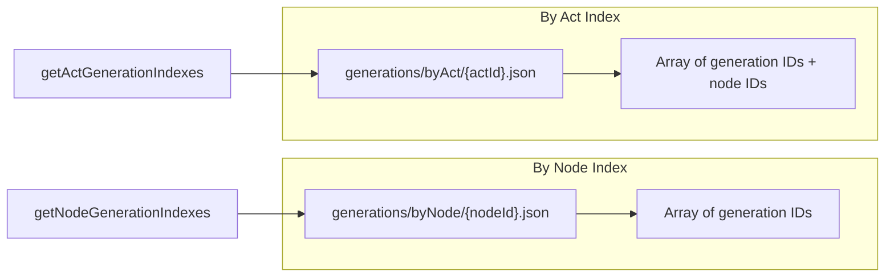

**Index structures:**

- **Node index**: `NodeGenerationIndex[]` - chronological list of all generations for a node
- **Act index**: `ActGenerationIndex[]` - list of generations executed within an act, with node association

**Sources:** [packages/giselle/src/engine/generations/utils.ts:335-350](), [packages/giselle/src/engine/generations/internal/get-act-generation-indexes.ts]() (inferred)

---

## Vault Usage Patterns

### Secret Decryption for Tools

The vault is used to decrypt credentials when tools are executed during generation:

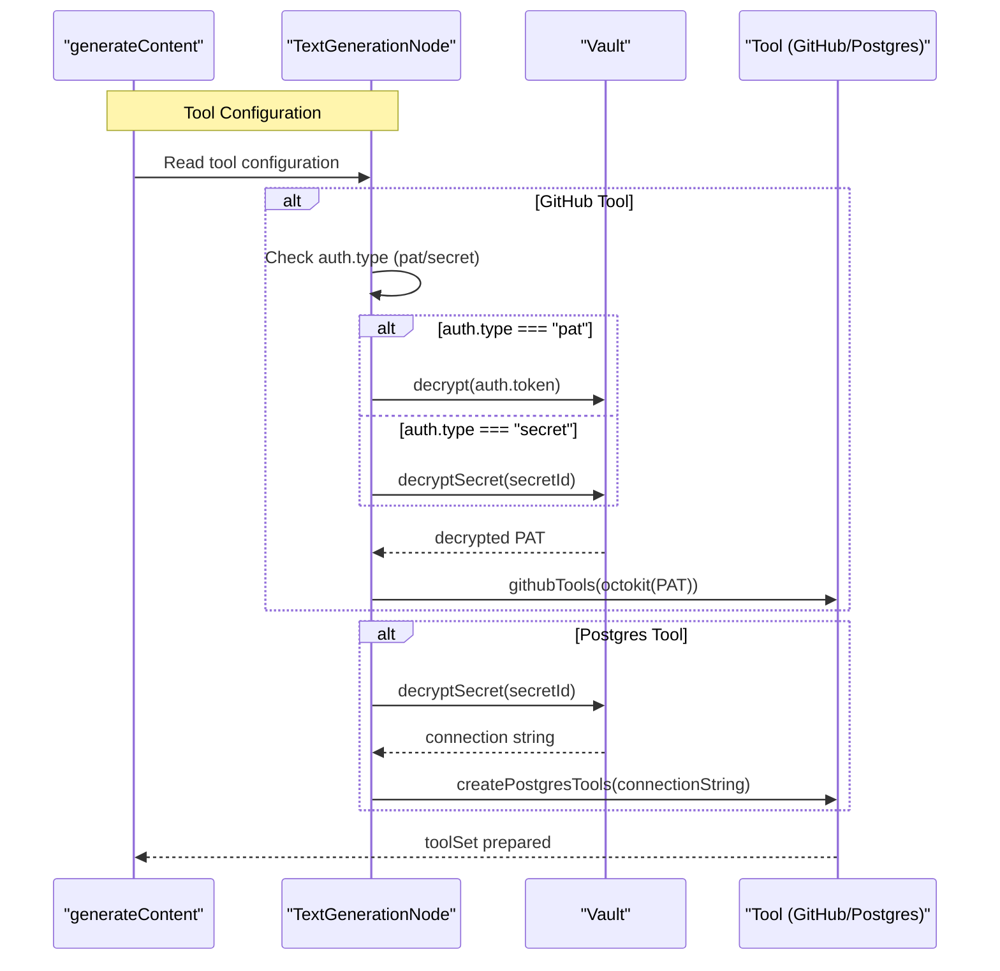

**Credential types stored in vault:**

| Tool | Credential Type | Storage Format |
|------|----------------|----------------|
| GitHub | Personal Access Token | Encrypted string |
| Postgres | Connection string | Encrypted string (contains host, user, password, database) |
| Custom integrations | API keys | Encrypted string |

**Sources:** [packages/giselle/src/engine/generations/generate-content.ts:117-186](), [packages/giselle/src/engine/secrets.ts]() (inferred)

### GitHub Authentication Decryption

Two authentication patterns use vault decryption:

**Pattern 1: Direct PAT decryption**
```typescript
// Tool configuration with direct token reference
const decryptToken = await context.vault?.decrypt(githubTool.auth.token);
```

**Pattern 2: Secret ID lookup**
```typescript
// Tool configuration with secret ID
const decryptToken = await decryptSecret({
    context,
    secretId: githubTool.auth.secretId,
});
```

Both patterns result in a decrypted personal access token used to initialize the GitHub Octokit client.

**Sources:** [packages/giselle/src/engine/generations/generate-content.ts:119-134]()

### Database Connection Decryption

PostgreSQL tool configuration requires decryption of connection strings:

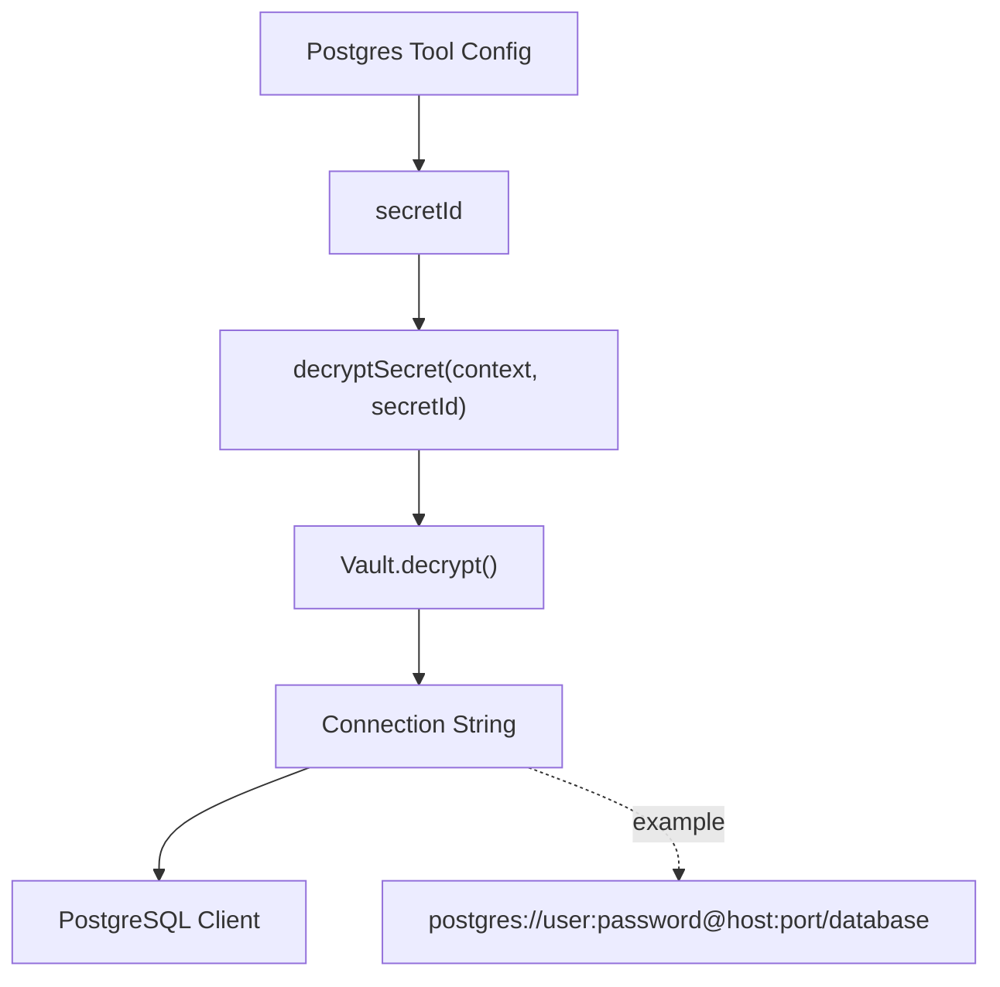

**Connection string format:** The decrypted string contains all necessary connection parameters in standard PostgreSQL URI format.

**Sources:** [packages/giselle/src/engine/generations/generate-content.ts:154-186]()

---

## Runtime Environment Selection

The storage and vault drivers are selected based on the runtime environment:

### Environment Detection

```mermaid
graph TB
    Init["Engine Initialization"]
    EnvCheck{"Check Environment"}
    
    Init --> EnvCheck
    
    EnvCheck -->|process.env.VERCEL === "1"| Vercel["Vercel Environment"]
    EnvCheck -->|process.env.NODE_ENV === "development"| Local["Local Environment"]
    EnvCheck -->|Other| Production["Production Environment"]
    
    Vercel --> SupabaseStorage["supabaseStorageDriver"]
    Vercel --> SupabaseVault["supabaseVaultDriver"]
    
    Local --> FSStorage["fsStorageDriver"]
    Local --> NodeVault["nodeVaultDriver"]
    
    Production --> SupabaseStorage
    Production --> SupabaseVault
```

**Environment-specific configuration:**

| Environment | Storage Driver | Vault Driver | Configuration Source |
|------------|----------------|--------------|---------------------|
| **Production (Studio)** | `supabaseStorageDriver` | `supabaseVaultDriver` | Environment variables (`SUPABASE_*`) |
| **Development (Local)** | `fsStorageDriver` | `nodeVaultDriver` | Local config (`./.storage`, `VAULT_SECRET`) |
| **Vercel Preview** | `supabaseStorageDriver` | `supabaseVaultDriver` | Environment variables |
| **Playground (Vercel)** | `supabaseStorageDriver` | `nodeVaultDriver` | Mixed configuration |
| **Playground (Local)** | `fsStorageDriver` | `nodeVaultDriver` | Local config |

**Sources:** [apps/studio.giselles.ai/app/giselle-engine.ts:40-51,180-187](), [apps/playground/giselle-engine.ts:12-24,137-139]()

### Driver Configuration Examples

**Studio production configuration:**
```typescript
const storage = experimental_supabaseStorageDriver({
    endpoint: process.env.SUPABASE_STORAGE_URL,
    region: process.env.SUPABASE_STORAGE_REGION,
    accessKeyId: process.env.SUPABASE_STORAGE_ACCESS_KEY_ID,
    secretAccessKey: process.env.SUPABASE_STORAGE_SECRET_ACCESS_KEY,
    bucket: "app",
});

const vault = supabaseVaultDriver({
    url: process.env.SUPABASE_URL,
    serviceKey: process.env.SUPABASE_SERVICE_KEY,
});
```

**Playground local configuration:**
```typescript
const storage = fsStorageDriver({
    root: "./.storage",
});

const vault = nodeVaultDriver({
    secret: process.env.VAULT_SECRET,
});
```

**Sources:** [apps/studio.giselles.ai/app/giselle-engine.ts:40-51](), [apps/playground/giselle-engine.ts:14-24,137-139]()

---

## Storage Access Patterns

### Batch Writing for Streaming Data

The storage system uses batched writes for efficient streaming data persistence:

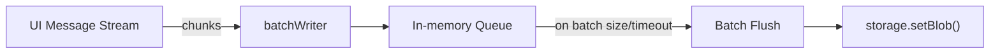

The `batchWriter` utility collects streaming chunks in memory and periodically flushes them to storage, reducing I/O operations.

**Sources:** [packages/giselle/src/engine/generations/generate-content.ts:414-438](), [packages/giselle/src/utils/index.ts]() (inferred)

### Generation Retrieval Pattern

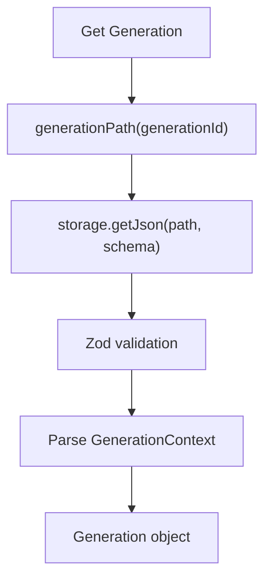

All generation data is validated against Zod schemas when retrieved from storage, ensuring type safety and data integrity.

**Sources:** [packages/giselle/src/engine/generations/utils.ts:320-333]()

---

