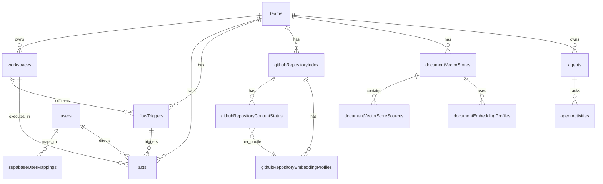
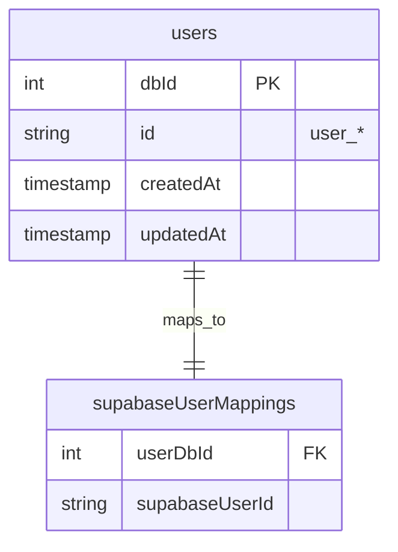
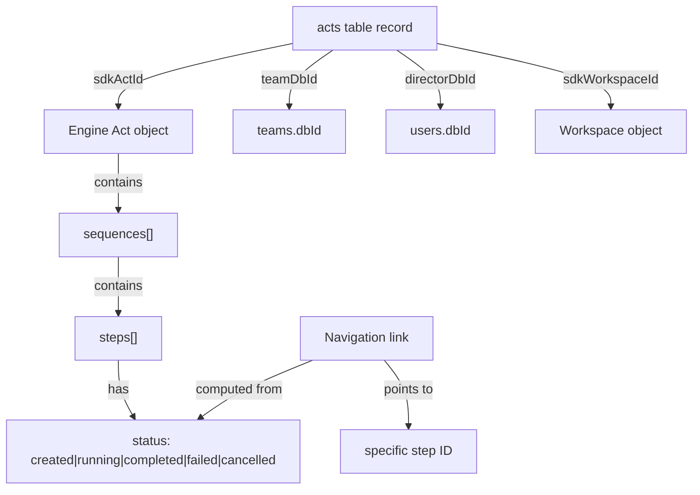
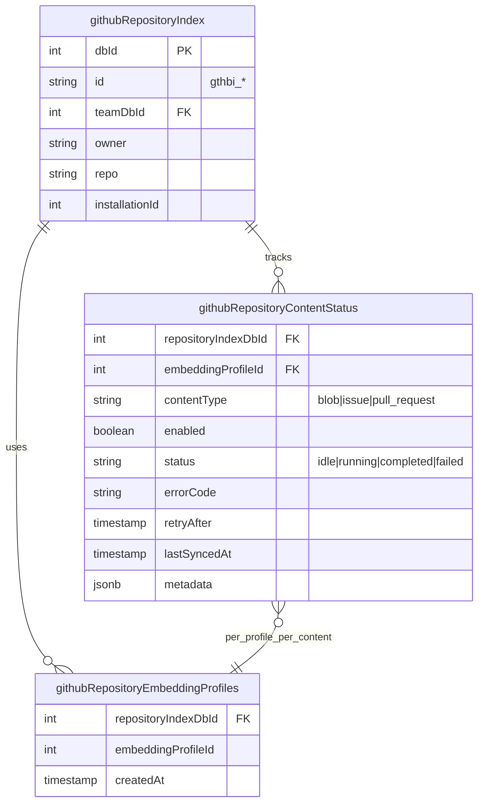
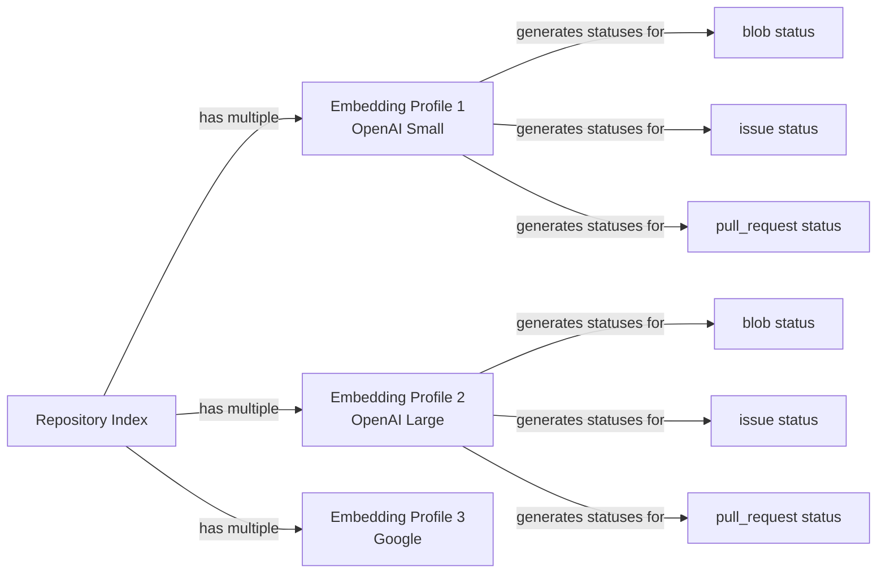
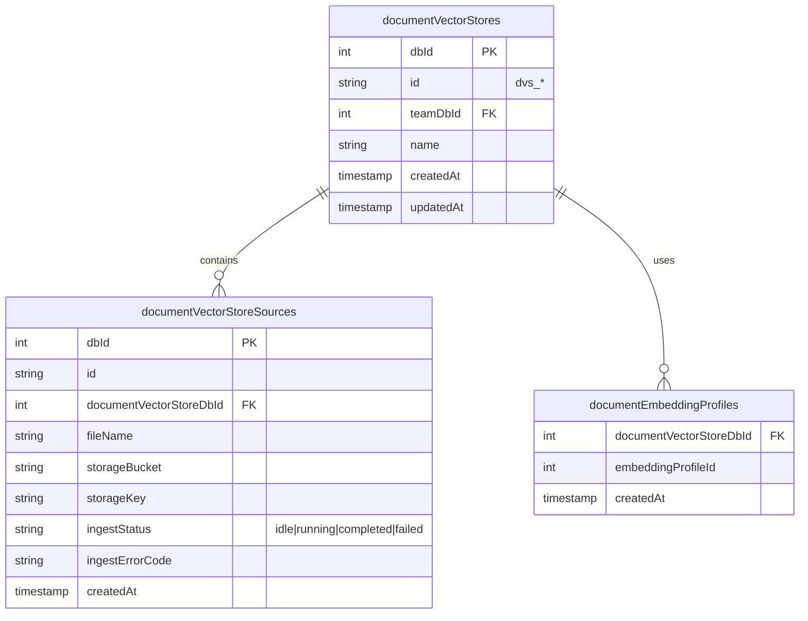
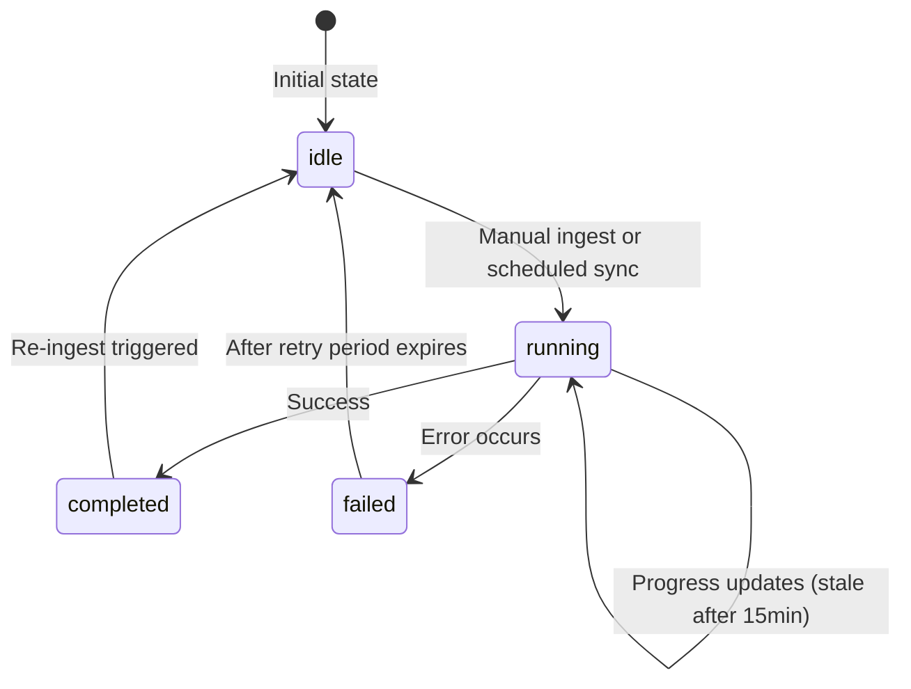
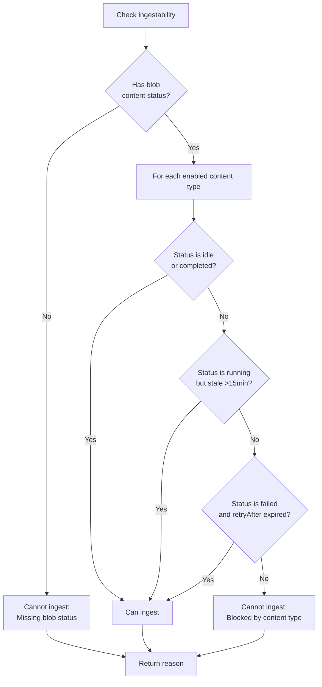
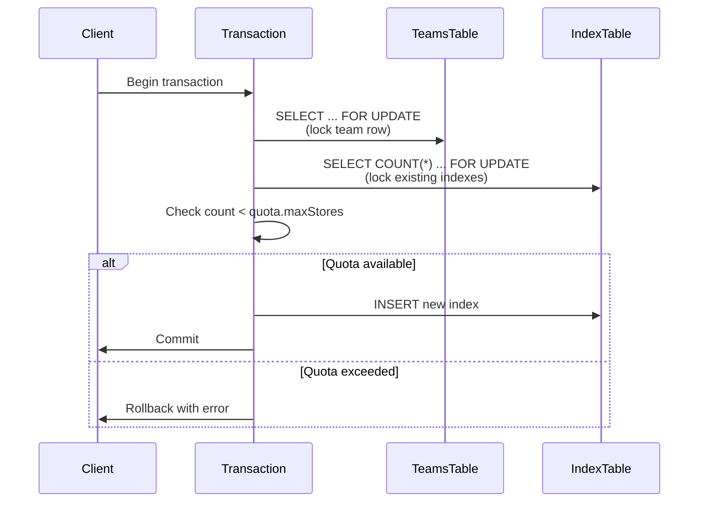
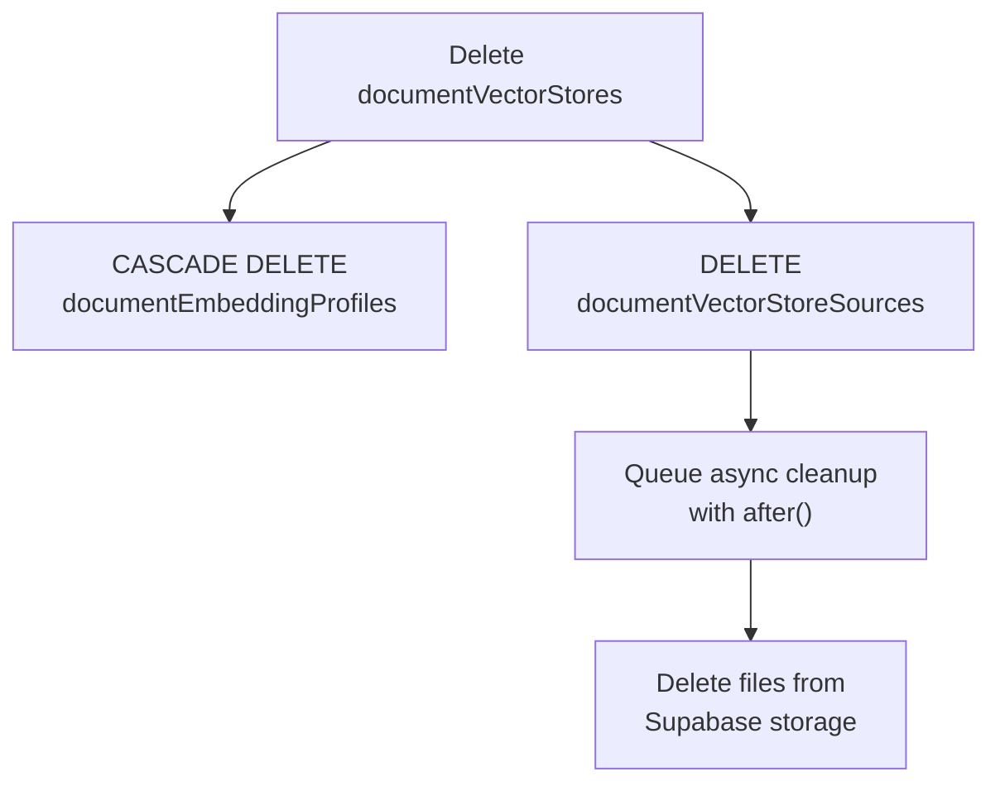

<!-- source: DeepWiki mcp.deepwiki.com · repo giselles-ai/giselle · page 2.6 Database Schema and Data Model · fetched 2026-10-27 -->

# Database Schema and Data Model

<details>
<summary>Relevant source files</summary>

The following files were used as context for generating this wiki page:

- [apps/playground/.gitignore](apps/playground/.gitignore)
- [apps/studio.giselles.ai/app/(main)/settings/team/vector-stores/actions.ts](apps/studio.giselles.ai/app/(main)/settings/team/vector-stores/actions.ts)
- [apps/studio.giselles.ai/app/(main)/settings/team/vector-stores/configure-sources-dialog.tsx](apps/studio.giselles.ai/app/(main)/settings/team/vector-stores/configure-sources-dialog.tsx)
- [apps/studio.giselles.ai/app/(main)/settings/team/vector-stores/data.ts](apps/studio.giselles.ai/app/(main)/settings/team/vector-stores/data.ts)
- [apps/studio.giselles.ai/app/(main)/settings/team/vector-stores/diagnostic-modal.tsx](apps/studio.giselles.ai/app/(main)/settings/team/vector-stores/diagnostic-modal.tsx)
- [apps/studio.giselles.ai/app/(main)/settings/team/vector-stores/document-embedding-profiles.ts](apps/studio.giselles.ai/app/(main)/settings/team/vector-stores/document-embedding-profiles.ts)
- [apps/studio.giselles.ai/app/(main)/settings/team/vector-stores/document-store-create-dialog.tsx](apps/studio.giselles.ai/app/(main)/settings/team/vector-stores/document-store-create-dialog.tsx)
- [apps/studio.giselles.ai/app/(main)/settings/team/vector-stores/document-vector-store-list.tsx](apps/studio.giselles.ai/app/(main)/settings/team/vector-stores/document-vector-store-list.tsx)
- [apps/studio.giselles.ai/app/(main)/settings/team/vector-stores/document/document-vector-store-item.tsx](apps/studio.giselles.ai/app/(main)/settings/team/vector-stores/document/document-vector-store-item.tsx)
- [apps/studio.giselles.ai/app/(main)/settings/team/vector-stores/document/page.tsx](apps/studio.giselles.ai/app/(main)/settings/team/vector-stores/document/page.tsx)
- [apps/studio.giselles.ai/app/(main)/settings/team/vector-stores/layout.tsx](apps/studio.giselles.ai/app/(main)/settings/team/vector-stores/layout.tsx)
- [apps/studio.giselles.ai/app/(main)/settings/team/vector-stores/navigation-layout.tsx](apps/studio.giselles.ai/app/(main)/settings/team/vector-stores/navigation-layout.tsx)
- [apps/studio.giselles.ai/app/(main)/settings/team/vector-stores/page.tsx](apps/studio.giselles.ai/app/(main)/settings/team/vector-stores/page.tsx)
- [apps/studio.giselles.ai/app/(main)/settings/team/vector-stores/repository-item.tsx](apps/studio.giselles.ai/app/(main)/settings/team/vector-stores/repository-item.tsx)
- [apps/studio.giselles.ai/app/(main)/settings/team/vector-stores/repository-list.tsx](apps/studio.giselles.ai/app/(main)/settings/team/vector-stores/repository-list.tsx)
- [apps/studio.giselles.ai/app/(main)/settings/team/vector-stores/repository-registration-dialog.tsx](apps/studio.giselles.ai/app/(main)/settings/team/vector-stores/repository-registration-dialog.tsx)
- [apps/studio.giselles.ai/app/(main)/settings/team/vector-stores/sidebar-menu.tsx](apps/studio.giselles.ai/app/(main)/settings/team/vector-stores/sidebar-menu.tsx)
- [apps/studio.giselles.ai/app/(main)/settings/team/vector-stores/types.ts](apps/studio.giselles.ai/app/(main)/settings/team/vector-stores/types.ts)
- [apps/studio.giselles.ai/app/(main)/workspaces/actions.ts](apps/studio.giselles.ai/app/(main)/workspaces/actions.ts)
- [apps/studio.giselles.ai/app/api/workspaces/route.ts](apps/studio.giselles.ai/app/api/workspaces/route.ts)
- [apps/studio.giselles.ai/app/stage/(top)/actions.ts](apps/studio.giselles.ai/app/stage/(top)/actions.ts)
- [apps/studio.giselles.ai/app/stage/(top)/circular-carousel.module.css](apps/studio.giselles.ai/app/stage/(top)/circular-carousel.module.css)
- [apps/studio.giselles.ai/app/stage/(top)/circular-carousel.tsx](apps/studio.giselles.ai/app/stage/(top)/circular-carousel.tsx)
- [apps/studio.giselles.ai/app/stage/(top)/form-input-renderer.tsx](apps/studio.giselles.ai/app/stage/(top)/form-input-renderer.tsx)
- [apps/studio.giselles.ai/app/stage/(top)/form.tsx](apps/studio.giselles.ai/app/stage/(top)/form.tsx)
- [apps/studio.giselles.ai/app/stage/(top)/helpers.ts](apps/studio.giselles.ai/app/stage/(top)/helpers.ts)
- [apps/studio.giselles.ai/app/stage/(top)/page.tsx](apps/studio.giselles.ai/app/stage/(top)/page.tsx)
- [apps/studio.giselles.ai/app/stage/(top)/resizable-layout.tsx](apps/studio.giselles.ai/app/stage/(top)/resizable-layout.tsx)
- [apps/studio.giselles.ai/app/stage/(top)/services.ts](apps/studio.giselles.ai/app/stage/(top)/services.ts)
- [apps/studio.giselles.ai/app/stage/(top)/settings-dialog.tsx](apps/studio.giselles.ai/app/stage/(top)/settings-dialog.tsx)
- [apps/studio.giselles.ai/app/stage/(top)/team-card.tsx](apps/studio.giselles.ai/app/stage/(top)/team-card.tsx)
- [apps/studio.giselles.ai/app/stage/(top)/types.ts](apps/studio.giselles.ai/app/stage/(top)/types.ts)
- [apps/studio.giselles.ai/app/stage/acts/[actId]/actions.ts](apps/studio.giselles.ai/app/stage/acts/[actId]/actions.ts)
- [apps/studio.giselles.ai/app/stage/acts/[actId]/lib/data.ts](apps/studio.giselles.ai/app/stage/acts/[actId]/lib/data.ts)
- [apps/studio.giselles.ai/app/stage/acts/[actId]/lib/utils.ts](apps/studio.giselles.ai/app/stage/acts/[actId]/lib/utils.ts)
- [apps/studio.giselles.ai/app/stage/acts/components/filterable-acts-list.tsx](apps/studio.giselles.ai/app/stage/acts/components/filterable-acts-list.tsx)
- [apps/studio.giselles.ai/app/stage/acts/page.tsx](apps/studio.giselles.ai/app/stage/acts/page.tsx)
- [apps/studio.giselles.ai/app/stage/acts/types/index.ts](apps/studio.giselles.ai/app/stage/acts/types/index.ts)
- [apps/studio.giselles.ai/app/stage/layout.tsx](apps/studio.giselles.ai/app/stage/layout.tsx)
- [apps/studio.giselles.ai/app/stage/showcase/[appId]/actions.ts](apps/studio.giselles.ai/app/stage/showcase/[appId]/actions.ts)
- [apps/studio.giselles.ai/app/stage/showcase/[appId]/page.tsx](apps/studio.giselles.ai/app/stage/showcase/[appId]/page.tsx)
- [internal-packages/ui/components/form-field.tsx](internal-packages/ui/components/form-field.tsx)
- [internal-packages/ui/components/section-header.tsx](internal-packages/ui/components/section-header.tsx)
- [internal-packages/ui/components/status-indicator.tsx](internal-packages/ui/components/status-indicator.tsx)

</details>


## Purpose and Scope

This document describes the database schema and data model used throughout the Giselle AI platform. It covers the core tables for team management, workflow execution, and vector store systems, as well as the relationships between these entities. The schema supports multi-tenant operations, workflow execution tracking, and RAG capabilities through vector embeddings.

For information about how the engine interacts with this data model, see [Engine Architecture and Configuration](#2.1). For vector store management interfaces, see [Vector Store Management](#3.2). For workflow execution lifecycle, see [Act Runner and Workflow Orchestration](#2.4).

## Database Technology Stack

The Giselle platform uses the following database technologies:

| Technology | Purpose |
|------------|---------|
| PostgreSQL | Primary relational database |
| pgvector | Vector similarity search extension |
| Drizzle ORM | Type-safe database client and query builder |
| Supabase | Database hosting, authentication, and storage |
| pgsodium | Encryption for sensitive data (vault) |

Sources: [apps/studio.giselles.ai/app/(main)/settings/team/vector-stores/actions.ts:1-55]()

## Core Entity Relationship Diagram



Sources: [apps/studio.giselles.ai/app/(main)/settings/team/vector-stores/actions.ts:107-251](), [apps/studio.giselles.ai/app/stage/(top)/services.ts:1-135](), [apps/studio.giselles.ai/app/stage/showcase/[appId]/page.tsx:1-210]()

## Team and User Management Schema

### Teams Table

The `teams` table represents organizations or workspaces within the platform. Each team has:

| Column | Type | Purpose |
|--------|------|---------|
| `dbId` | integer | Internal database ID (primary key) |
| `id` | string | External team identifier (`tm_*`) |
| `name` | string | Team display name |
| `plan` | enum | Subscription plan (free, pro, team, enterprise, internal) |
| `avatarUrl` | string | Team avatar image URL |

Sources: [apps/studio.giselles.ai/app/(main)/settings/team/vector-stores/actions.ts:161-166](), [apps/studio.giselles.ai/app/(main)/settings/team/vector-stores/repository-list.tsx:184-194]()

### Users and Authentication



The `supabaseUserMappings` table bridges Supabase authentication with internal user records, enabling OAuth-based authentication while maintaining internal user identities.

Sources: [apps/studio.giselles.ai/app/stage/showcase/[appId]/page.tsx:88-96]()

## Workflow and Execution Schema

### Flow Triggers Table

The `flowTriggers` table stores published workflow entry points:

| Column | Type | Purpose |
|--------|------|---------|
| `dbId` | integer | Internal database ID |
| `teamDbId` | integer | Owning team (FK) |
| `sdkWorkspaceId` | string | Associated workspace ID |
| `sdkFlowTriggerId` | string | SDK trigger identifier |
| `updatedAt` | timestamp | Last update time |

Flow triggers represent configured trigger nodes in workspaces that can be invoked to start workflow executions. The system filters triggers by team and supports various filter types (all, latest, history, favorites).

Sources: [apps/studio.giselles.ai/app/stage/(top)/services.ts:137-233](), [apps/studio.giselles.ai/app/stage/(top)/page.tsx:41-55]()

### Acts Table (Execution Tracking)

The `acts` table tracks individual workflow executions:

| Column | Type | Purpose |
|--------|------|---------|
| `dbId` | integer | Internal database ID |
| `teamDbId` | integer | Team context (FK) |
| `directorDbId` | integer | User who initiated (FK) |
| `sdkActId` | string | Engine act identifier |
| `sdkFlowTriggerId` | string | Trigger that started this act |
| `sdkWorkspaceId` | string | Workspace being executed |
| `createdAt` | timestamp | Execution start time |

Each act represents a single workflow execution initiated either from the Stage interface or via GitHub triggers. The table maintains the relationship between the user-facing database layer and the engine's internal act representation.

Sources: [apps/studio.giselles.ai/app/stage/(top)/actions.ts:1-51](), [apps/studio.giselles.ai/app/stage/acts/page.tsx:4-147]()

### Act Status and Navigation



The system computes navigation links to acts by examining the step statuses within sequences and routing to the appropriate step based on execution state.

Sources: [apps/studio.giselles.ai/app/stage/acts/page.tsx:15-115](), [apps/studio.giselles.ai/app/stage/(top)/services.ts:13-104]()

### Agents Table

The `agents` table stores AI agent configurations:

| Column | Type | Purpose |
|--------|------|---------|
| `dbId` | integer | Internal database ID |
| `id` | string | Agent identifier |
| `teamDbId` | integer | Owning team (FK) |
| `name` | string | Agent display name |
| `description` | string | Agent description |
| `creatorDbId` | integer | Creating user (FK) |
| `workspaceId` | string | Associated workspace |
| `updatedAt` | timestamp | Last update time |

The `agentActivities` table tracks usage metrics for agents:

| Column | Type | Purpose |
|--------|------|---------|
| `agentDbId` | integer | Agent reference (FK) |
| `userDbId` | integer | User who used agent (FK) |
| `activityAt` | timestamp | Activity timestamp |

Sources: [apps/studio.giselles.ai/app/stage/showcase/[appId]/page.tsx:98-133]()

## Vector Store Schema

### GitHub Vector Store System

The GitHub vector store system uses three interconnected tables to manage repository indexing with multiple embedding profiles and content types:



#### GitHub Repository Index Table

The `githubRepositoryIndex` table is the primary record for registered repositories:

| Column | Type | Purpose |
|--------|------|---------|
| `id` | string | External identifier (`gthbi_*`) |
| `owner` | string | GitHub repository owner |
| `repo` | string | GitHub repository name |
| `teamDbId` | integer | Owning team (FK) |
| `installationId` | integer | GitHub App installation ID |

Sources: [apps/studio.giselles.ai/app/(main)/settings/team/vector-stores/actions.ts:203-212]()

#### Content Status Granularity

The `githubRepositoryContentStatus` table provides fine-grained tracking for each combination of:
- Repository
- Embedding profile (OpenAI Small, OpenAI Large, Google, Cohere)
- Content type (blob/code, issue, pull_request)

This design enables:
1. **Per-profile ingestion tracking**: Each embedding model can have different ingestion states for the same content
2. **Per-content-type control**: Code, issues, and PRs can be enabled/disabled independently
3. **Granular retry logic**: Failed ingestions can be retried after exponential backoff per content type

| Column | Type | Purpose |
|--------|------|---------|
| `repositoryIndexDbId` | integer | Repository reference (FK) |
| `embeddingProfileId` | integer | Embedding profile (1=OpenAI Small, 2=OpenAI Large, 3=Google, 4=Cohere) |
| `contentType` | enum | Content category (blob, issue, pull_request) |
| `enabled` | boolean | Whether ingestion is active |
| `status` | enum | Current state (idle, running, completed, failed) |
| `errorCode` | string | Error identifier if failed |
| `retryAfter` | timestamp | When retry is allowed after failure |
| `lastSyncedAt` | timestamp | Last successful sync |
| `metadata` | jsonb | Type-specific metadata (commit SHA, issue number, PR number) |

Sources: [apps/studio.giselles.ai/app/(main)/settings/team/vector-stores/repository-item.tsx:25-27](), [apps/studio.giselles.ai/app/(main)/settings/team/vector-stores/actions.ts:222-232]()

#### Embedding Profile Management

The `githubRepositoryEmbeddingProfiles` table establishes which embedding models are active for a repository:



When profiles are added or removed, the system synchronizes content statuses automatically. The compound primary key `(repositoryIndexDbId, embeddingProfileId)` ensures each profile is registered once per repository.

Sources: [apps/studio.giselles.ai/app/(main)/settings/team/vector-stores/actions.ts:214-221](), [apps/studio.giselles.ai/app/(main)/settings/team/vector-stores/repository-registration-dialog.tsx:47-58]()

### Document Vector Store System

The document vector store system manages uploaded documents with similar multi-profile architecture:



#### Document Vector Stores Table

| Column | Type | Purpose |
|--------|------|---------|
| `id` | string | External identifier (`dvs_*`) |
| `teamDbId` | integer | Owning team (FK) |
| `name` | string | User-defined store name |

Sources: [apps/studio.giselles.ai/app/(main)/settings/team/vector-stores/actions.ts:659-666]()

#### Document Sources Table

The `documentVectorStoreSources` table tracks individual uploaded files:

| Column | Type | Purpose |
|--------|------|---------|
| `id` | string | Source identifier |
| `documentVectorStoreDbId` | integer | Parent store (FK) |
| `fileName` | string | Original file name |
| `storageBucket` | string | Supabase storage bucket |
| `storageKey` | string | Storage path/key |
| `ingestStatus` | enum | Processing state |
| `ingestErrorCode` | string | Error identifier if failed |

Files are stored in Supabase storage under the path pattern `vector-stores/{dvs_id}/{file}` and referenced by the `storageKey` column.

Sources: [apps/studio.giselles.ai/app/(main)/settings/team/vector-stores/actions.ts:803-812](), [apps/studio.giselles.ai/app/(main)/settings/team/vector-stores/document/document-vector-store-item.tsx:286-295]()

#### Document Embedding Profiles

Similar to GitHub stores, document stores support multiple embedding profiles simultaneously. The `documentEmbeddingProfiles` table uses a compound key `(documentVectorStoreDbId, embeddingProfileId)` to prevent duplicates.

Sources: [apps/studio.giselles.ai/app/(main)/settings/team/vector-stores/actions.ts:668-683]()

## Status Tracking and State Machines

### Content Status State Machine

The vector store ingestion system uses a state machine for tracking processing status:



**Status values:**
- `idle`: Ready for ingestion, not currently processing
- `running`: Actively ingesting content
- `completed`: Successfully ingested and indexed
- `failed`: Error occurred, retry after backoff period

The system considers a `running` status "stale" if `updatedAt` is older than 15 minutes, allowing forced re-ingestion.

Sources: [apps/studio.giselles.ai/app/(main)/settings/team/vector-stores/actions.ts:928-973]()

### Ingestability Logic

The system determines whether a repository can be manually ingested based on content status:



Sources: [apps/studio.giselles.ai/app/(main)/settings/team/vector-stores/repository-item.tsx:103-114](), [apps/studio.giselles.ai/app/(main)/settings/team/vector-stores/actions.ts:929-973]()

### Error Handling and Retry

When ingestion fails, the system:
1. Sets `status = 'failed'`
2. Records `errorCode` (e.g., `DOCUMENT_NOT_FOUND`, `DOCUMENT_FETCH_ERROR`, `DOCUMENT_RATE_LIMITED`, `DOCUMENT_TOO_LARGE`)
3. Sets `retryAfter` timestamp for exponential backoff
4. Prevents manual ingestion until retry period expires

Sources: [apps/studio.giselles.ai/app/(main)/settings/team/vector-stores/types.ts:1-6](), [apps/studio.giselles.ai/app/(main)/settings/team/vector-stores/repository-item.tsx:363-373]()

## Data Access Patterns

### Multi-Tenancy Enforcement

All vector store queries enforce team isolation through foreign key constraints and query filters:

```typescript
// Example: Team-scoped repository query
await db
  .select()
  .from(githubRepositoryIndex)
  .where(
    and(
      eq(githubRepositoryIndex.teamDbId, team.dbId),
      eq(githubRepositoryIndex.id, indexId)
    )
  )
```

This pattern appears consistently across all team-owned resources (acts, vector stores, agents).

Sources: [apps/studio.giselles.ai/app/(main)/settings/team/vector-stores/actions.ts:287-296]()

### Quota Enforcement with Row Locking

Vector store creation enforces quotas using row-level locking to prevent race conditions:



The `FOR UPDATE` lock on the team row serializes quota checks, preventing concurrent insertions from exceeding limits.

Sources: [apps/studio.giselles.ai/app/(main)/settings/team/vector-stores/actions.ts:159-201](), [apps/studio.giselles.ai/app/(main)/settings/team/vector-stores/actions.ts:643-657]()

### Compound Status Queries

Retrieving repository data with all content statuses requires joining multiple tables:

```typescript
// Fetch repository with all content statuses
const records = await db
  .select({
    repositoryIndex: githubRepositoryIndex,
    contentStatus: githubRepositoryContentStatus
  })
  .from(githubRepositoryIndex)
  .leftJoin(
    githubRepositoryContentStatus,
    eq(githubRepositoryContentStatus.repositoryIndexDbId, githubRepositoryIndex.dbId)
  )
  .where(eq(githubRepositoryIndex.teamDbId, team.dbId))
```

The result is then grouped by repository to produce the `RepositoryWithStatuses` structure used throughout the UI.

Sources: [apps/studio.giselles.ai/app/(main)/settings/team/vector-stores/data.ts:13-56]()

### Cascading Deletes

When deleting vector stores, the system:
1. Deletes embedding profiles (cascade via FK)
2. Deletes content statuses (cascade via FK)
3. Deletes document sources (explicit deletion)
4. Schedules async storage cleanup (uses Next.js `after()`)



The storage cleanup happens asynchronously to avoid blocking the database transaction.

Sources: [apps/studio.giselles.ai/app/(main)/settings/team/vector-stores/actions.ts:778-891]()

## Embedding Profile Configuration

### Supported Embedding Models

The platform supports multiple embedding profiles identified by numeric IDs:

| ID | Name | Provider | Dimensions | Notes |
|----|------|----------|------------|-------|
| 1 | OpenAI Small | OpenAI | 1536 | Default, text-embedding-3-small |
| 2 | OpenAI Large | OpenAI | 3072 | text-embedding-3-large |
| 3 | Google | Google | 768 | text-embedding-004 |
| 4 | Cohere | Cohere | 1024 | Legacy, not selectable in UI |

The `DEFAULT_EMBEDDING_PROFILE_ID` is `1` (OpenAI Small).

Sources: [apps/studio.giselles.ai/app/(main)/settings/team/vector-stores/repository-registration-dialog.tsx:16-17](), [apps/studio.giselles.ai/app/(main)/settings/team/vector-stores/document/document-vector-store-item.tsx:336-355]()

### Profile Selection UI

Users can select multiple profiles when registering repositories or creating document stores. The UI enforces that at least one profile must remain selected to prevent invalid configurations.

Sources: [apps/studio.giselles.ai/app/(main)/settings/team/vector-stores/repository-registration-dialog.tsx:378-433]()

## Storage Integration

### Supabase Storage Structure

Document files are stored in Supabase storage with the following structure:

```
bucket: {storageBucket}
├── vector-stores/
│   ├── {dvs_id}/
│   │   ├── {file1}
│   │   ├── {file2}
│   │   └── ...
```

The `documentVectorStoreSources.storageKey` contains the full path: `vector-stores/{dvs_id}/{filename}`.

Sources: [apps/studio.giselles.ai/app/(main)/settings/team/vector-stores/actions.ts:55-56](), [apps/studio.giselles.ai/app/(main)/settings/team/vector-stores/actions.ts:844-857]()

### Storage Cleanup on Deletion

When a document vector store is deleted, the system:
1. Collects all storage keys from `documentVectorStoreSources`
2. Deletes database records in a transaction
3. Asynchronously removes files from storage buckets
4. Groups deletions by bucket to minimize API calls

Sources: [apps/studio.giselles.ai/app/(main)/settings/team/vector-stores/actions.ts:842-880]()

## pgvector Integration

While not explicitly shown in the provided files, the database uses the pgvector extension for storing and querying vector embeddings. The embeddings are generated during ingestion and stored in vector columns, enabling similarity search for RAG queries.

The schema supports multiple embedding profiles per content, allowing the same document or code to be indexed with different embedding models simultaneously. This enables experimentation with different models and fallback options.

Sources: [apps/studio.giselles.ai/app/(main)/settings/team/vector-stores/actions.ts:1-55]()

---

